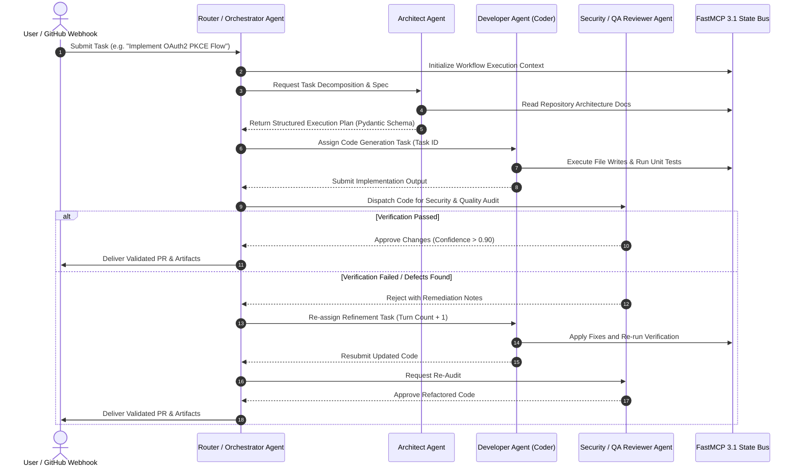

# Multi-Agent Systems

## What it is
Multi-Agent Systems (MAS) represent an architectural pattern and execution paradigm where multiple autonomous AI agents—each possessing distinct roles, tools, domain prompts, and context windows—collaborate, negotiate, and coordinate to solve complex, multi-step problems. In enterprise knowledge networks and software engineering platforms, Multi-Agent Systems form the foundation of autonomous software engineering, distributed task execution, cross-domain workflow orchestration, and automated peer review using open standards like the Model Context Protocol (MCP) and FastMCP 3.1.

Rather than relying on a single, monolithic large language model (LLM) loaded with massive system instructions and tool schemas, a Multi-Agent System breaks complex business logic into an interconnected topology of lightweight, highly specialized agent nodes (such as Architects, Coders, Security Reviewers, and Quality Assurance Testers).

## Architecture & Communication Topology

```
+-----------------------------------------------------------------------------------+
|                     Multi-Agent System (MAS) Orchestration Mesh                   |
|                                                                                   |
|   +--------------------------+       +----------------------------------------+   |
|   |  User Goal / Input       |       |  Isolated Worker Context Sandboxes     |   |
|   |  (GitHub PR / Spec)      |       |                                        |   |
|   +------------+-------------+       |   +--------------------------------+   |   |
|                |                     |   | Architect Agent                |   |   |
|                v                     |   | (Design / Spec Parser)         |   |   |
|   +--------------------------+       |   +---------------+----------------+   |   |
|   | Orchestrator / Planner   |<======|===================>                    |   |
|   | (Task Decomposition Engine)      |   +--------------------------------+   |   |
|   +------------+-------------+       |   | Developer Agent (Coder)        |   |   |
|                |                     |   | (FastMCP 3.1 Tools: FS/Git)    |   |   |
|                v                     |   +---------------+----------------+   |   |
|   +--------------------------+       |                   |                    |   |
|   | FastMCP 3.1 Event Bus /  |       |                   v                    |   |
|   | State Router             |       |   +--------------------------------+   |   |
|   +------------+-------------+       |   | Reviewer / Security QA Agent   |   |   |
|                |                     |   +--------------------------------+   |   |
|                v                     +----------------------------------------+   |
|   +---------------------------------------------------------------------------+   |
|   | Consolidated Output / Pull Request / Pydantic v2 Validated Artifact       |   |
|   +---------------------------------------------------------------------------+   |
+-----------------------------------------------------------------------------------+
```

### Detailed Inter-Agent Sequence & Verification Flow



## What problem it solves
Monolithic single-agent LLM executions suffer from severe constraints when confronted with enterprise-scale complexity:
- **Context Window Degeneration**: Monolithic prompts loaded with entire codebases, database schemas, and long interaction histories suffer from degraded instruction-following and attention saturation ("lost-in-the-middle" phenomenon).
- **Role Pollution & Prompt Inflation**: Expecting a single prompt to simultaneously act as a software architect, developer, security auditor, and QA tester leads to frequent hallucinations, contradictory outputs, and missed edge cases.
- **Lack of Independent Verification**: Single agents cannot effectively evaluate their own outputs due to self-confirmation bias, leading to unvalidated code generation and unverified assumption propagation.
- **Permission Bloat & Security Risks**: Giving a single agent access to file write, database drop, shell execution, and remote deployment tools exposes the system to prompt injection attacks and destructive execution.

Multi-Agent Systems solve these problems by enforcing strict role separation, isolated context spaces, narrow tool access permissions, and structured peer-review loops across specialized agent nodes.

## Topology & Collaboration Pattern Comparison

| Topology Pattern | Control Model | Latency Profile | Best Use Case | Risk / Drawbacks |
| :--- | :--- | :--- | :--- | :--- |
| **Hierarchical (Orchestrator-Worker)** | Centralized planner breaks down & routes tasks | Medium (2-4 turns) | Complex coding tasks, PR refactoring | Orchestrator single point of failure |
| **Peer-to-Peer Mesh (Swarm)** | Decentralized direct agent negotiation | High (Variable turns) | Autonomous red/blue security simulations | Infinite loop risk without turn limits |
| **Sequential Pipeline** | Deterministic output-to-input chain | Low-Medium (Fixed turns) | Data ingestion, transcription & extraction | Cascading errors if early step fails |
| **Consensus / Voting Jury** | Parallel worker execution with voting router | High Parallel (1 turn multi-fanout) | High-stakes medical/financial analysis | High token consumption & latency |

## Where it fits in the stack
**Category**: [Agents](../agents/index.md) / Architecture & Orchestration Pattern. Multi-Agent Systems sit between the high-level application orchestration layer and low-level LLM foundation models (such as Claude 3.5/3.7, GPT-4o/O1, and Gemini 2.0), organizing inter-agent message passing, state persistence, task routing, and tool invocation.

## Key Technical Specifications & Architectural Standards

| Dimension | Standard / Specification | Production Requirement |
| :--- | :--- | :--- |
| **Inter-Agent Protocol** | FastMCP 3.1 / Model Context Protocol | JSON-RPC 2.0 over SSE or Standard Input/Output transport |
| **Data Contract Validation** | Pydantic v2 Models | Strict schema validation with strict field type enforcement |
| **State Persistence** | Redis / PostgreSQL JSONB | Distributed transaction locks with event sourcing |
| **Traceability & Auditing** | OpenTelemetry / W&B Weave | Trace parent-child context propagation across agent turns |
| **Isolation Sandboxing** | gVisor / Docker Container / Firecracker | Ephemeral isolated runtime environments per worker agent |

## Typical use cases
- **Autonomous Software Development**: Teams of specialized agents (Architect, Coder, Tester, Reviewer) operating collaboratively on GitHub pull requests and issue queues.
- **Complex Information Extraction & Synthesis**: Coordinating web scraping agents, document parsing agents, and schema validation agents for large-scale enterprise data ingestion pipelines.
- **Security & Vulnerability Auditing**: Red team attacker agents paired with blue team defender agents to automatically identify, exploit, and patch software vulnerabilities in continuous integration pipelines.
- **Enterprise Operations & Support**: Multi-department support agents routing queries across finance, IT, compliance, and legal domains with human-in-the-loop checkpoints.

## Strengths
- **Modular Design & Separation of Concerns**: Each agent operates with a focused prompt, specialized tools, and minimal necessary context, yielding superior instruction-following accuracy.
- **Granular Security Controls**: Tools are scoped strictly to worker nodes that require them (e.g., only the tester agent receives test execution permissions; the reviewer receives read-only access).
- **Scalability & Extensibility**: New specialized agents (e.g., performance benchmarking agent) can be integrated into the topology without refactoring the core reasoning logic of existing agents.
- **Built-in Quality Verification**: Multi-agent setups enforce automated peer review and validation checks before committing changes to production environments.

## Limitations
- **Increased Latency & Token Usage**: Multi-agent communication and intermediate feedback loops increase total token consumption and time-to-solution compared to single-shot prompts.
- **Recursion & Infinite Loop Risks**: Unchecked agent interactions can result in circular reasoning or infinite tool invocation loops without strict execution limits.
- **Distributed State Synchronization**: Managing state, shared memory, and context coherence across multiple independent agents requires robust message routing and locking mechanisms.

## When to use it
- When tasks require distinct phases of planning, execution, security review, and empirical verification.
- When single-agent context windows become saturated or instruction-following deteriorates due to complex instructions.
- When building enterprise autonomous coding or data analysis pipelines requiring specialized tool permissions and audit trails.

## When not to use it
- For single-step or straightforward queries where a single prompt execution is faster, cheaper, and sufficiently accurate.
- For real-time, sub-second API endpoints where low latency is mandatory.
- When budget constraints prohibit multi-turn LLM reasoning iterations.

## System Configuration & Operational Parameters

| Environment Variable | Default Value | Description |
| :--- | :--- | :--- |
| `MAS_ROUTER_PORT` | `8090` | Network port for the FastMCP 3.1 multi-agent task router service. |
| `MAS_MAX_RECURSION_TURNS` | `5` | Maximum number of refinement loops between worker and reviewer agents before circuit breaking. |
| `MAS_WORKER_TIMEOUT_SEC` | `120` | Timeout threshold for individual worker agent tool execution sessions. |
| `MAS_STATE_BACKEND` | `memory` | Shared state storage backend (`memory`, `redis`, `postgres`). |
| `MAS_LOG_LEVEL` | `INFO` | Logging verbosity (`DEBUG`, `INFO`, `WARNING`, `ERROR`). |

## Getting started

### Installation
Install the core FastMCP 3.1 SDK and Pydantic v2 libraries:
```bash
pip install "mcp[cli]>=3.1.0" "pydantic>=2.7.0" "uvicorn>=0.30.0"
```

### Basic Multi-Agent System Setup
Define an orchestrator configuration file (`mas-config.json`):
```json
{
  "topology": "hierarchical",
  "max_turns": 5,
  "agents": {
    "orchestrator": { "role": "planner", "model": "claude-3-7-sonnet" },
    "coder": { "role": "developer", "tools": ["file_writer", "git_commit"] },
    "reviewer": { "role": "security_qa", "tools": ["static_analysis", "test_runner"] }
  }
}
```

## CLI examples

### Inspect Multi-Agent Span Traces
```bash
# Query agent tracing spans for multi-agent workflows
openclaw trace list --workflow multi-agent-pipeline
```

### Execute Multi-Agent CLI Harness
```bash
# Run a multi-agent orchestration task using OpenSwarm
openswarm run --config agents.yaml --task "Refactor authentication module to Pydantic v2"
```

### Monitor Multi-Agent Task Router Status
```bash
# Query active worker agent nodes registered on the state bus
curl -s http://localhost:8090/health | jq .
```

## API examples

### 1. Pydantic v2 Task Delegation Engine
The following Python script utilizes **Pydantic v2** to define a structured multi-agent message routing, validation, and task delegation schema:

```python
from pydantic import BaseModel, Field, field_validator
from typing import List, Literal, Optional, Dict, Any
import json
import uuid

class AgentTask(BaseModel):
    task_id: str = Field(default_factory=lambda: f"task-{uuid.uuid4().hex[:8]}", description="Unique subtask identifier.")
    workflow_id: str = Field(..., description="Parent workflow execution correlation ID.")
    assigned_role: Literal["architect", "coder", "tester", "reviewer"] = Field(..., description="Target agent role.")
    instructions: str = Field(..., description="Specific, unambiguous instructions for the target agent.")
    context_payload: Dict[str, Any] = Field(default_factory=dict, description="Isolated context data strictly required for task.")
    turn_number: int = Field(default=1, ge=1, le=10, description="Current turn number in the negotiation sequence.")

    @field_validator('instructions')
    def validate_instructions_length(cls, v: str) -> str:
        if len(v.strip()) < 10:
            raise ValueError("Task instructions must be at least 10 characters long.")
        return v

class AgentResponse(BaseModel):
    task_id: str = Field(..., description="Matching task identifier.")
    workflow_id: str = Field(..., description="Parent workflow correlation ID.")
    agent_role: str = Field(..., description="Role of the responding agent.")
    status: Literal["completed", "failed", "requires_review"] = Field(..., description="Execution status.")
    output: str = Field(..., description="Result or generated code/analysis.")
    confidence_score: float = Field(..., ge=0.0, le=1.0, description="Self-assessed or audited confidence score.")
    next_action: Optional[AgentTask] = Field(None, description="Optional downstream task delegation.")

def dispatch_multi_agent_workflow(task: AgentTask) -> str:
    """Dispatches tasks across multi-agent topologies with validated schemas."""
    # Simulate worker execution
    response = AgentResponse(
        task_id=task.task_id,
        workflow_id=task.workflow_id,
        agent_role=task.assigned_role,
        status="completed",
        output=f"Executed task '{task.instructions}' successfully under role {task.assigned_role}.",
        confidence_score=0.95,
        next_action=AgentTask(
            task_id=f"{task.task_id}-review",
            workflow_id=task.workflow_id,
            assigned_role="reviewer",
            instructions="Verify generated implementation for security compliance and test coverage.",
            context_payload={"parent_task_id": task.task_id, "code_diff": "diff --git a/auth.py b/auth.py..."},
            turn_number=task.turn_number + 1
        )
    )
    return response.model_dump_json(indent=2)

if __name__ == "__main__":
    initial_task = AgentTask(
        workflow_id="wf-9002",
        assigned_role="coder",
        instructions="Implement JWT token validation function with FastMCP 3.1 support.",
        context_payload={"target_module": "auth/jwt_validator.py"}
    )
    print(dispatch_multi_agent_workflow(initial_task))
```

### 2. FastMCP 3.1 Multi-Agent Task Router Server
Expose a FastMCP 3.1 server to route task events and manage state pass-through across specialized agent nodes:

```python
from mcp.server.fastmcp import FastMCP
from pydantic import BaseModel, Field
from typing import List, Optional, Dict, Any
import logging

logging.basicConfig(level=logging.INFO)
logger = logging.getLogger("MultiAgentRouter")

mcp = FastMCP("MultiAgentTaskRouter")

class DispatchRequest(BaseModel):
    workflow_id: str = Field(..., description="Unique workflow run ID")
    target_role: str = Field(..., description="Role of the target worker agent")
    payload: Dict[str, Any] = Field(default_factory=dict, description="Context payload passed to worker")
    priority: int = Field(default=1, ge=1, le=5, description="Task execution priority")

class DispatchStatus(BaseModel):
    workflow_id: str = Field(..., description="Workflow ID")
    acknowledged: bool = Field(True, description="Receipt status")
    assigned_worker_id: str = Field(..., description="ID of worker container handling task")
    queue_depth: int = Field(default=0, description="Current router queue depth")

class CircuitBreakerCheck(BaseModel):
    workflow_id: str = Field(..., description="Workflow correlation ID")
    current_turns: int = Field(..., ge=0, description="Accumulated turn count")
    max_turns: int = Field(default=5, description="Threshold limit")

@mcp.tool()
def route_agent_task(request: DispatchRequest) -> str:
    """Routes an agent task to a specialized worker node via FastMCP 3.1 task protocol."""
    logger.info(f"Routing task for workflow {request.workflow_id} to role {request.target_role}")
    status = DispatchStatus(
        workflow_id=request.workflow_id,
        acknowledged=True,
        assigned_worker_id=f"worker-{request.target_role}-01",
        queue_depth=1
    )
    return status.model_dump_json(indent=2)

@mcp.tool()
def check_circuit_breaker(check: CircuitBreakerCheck) -> str:
    """Evaluates whether an inter-agent loop has exceeded maximum allowable turns."""
    is_exceeded = check.current_turns >= check.max_turns
    result = {
        "workflow_id": check.workflow_id,
        "circuit_broken": is_exceeded,
        "current_turns": check.current_turns,
        "max_turns": check.max_turns,
        "recommendation": "HALT_WORKFLOW_HUMAN_IN_THE_LOOP" if is_exceeded else "CONTINUE_EXECUTION"
    }
    return json.dumps(result, indent=2)

if __name__ == "__main__":
    mcp.run()
```

## Production Systemd Service Unit Configuration

To run the Multi-Agent System task router as a persistent background daemon in Linux production environments, create the systemd unit file at `/etc/systemd/system/multi-agent-router.service`:

```ini
[Unit]
Description=FastMCP 3.1 Multi-Agent Task Router Service
After=network.target redis.service
Wants=redis.service

[Service]
Type=simple
User=mas
Group=mas
WorkingDirectory=/opt/multi-agent-systems
Environment="PATH=/opt/multi-agent-systems/venv/bin:/usr/local/bin:/usr/bin"
Environment="MAS_ROUTER_PORT=8090"
Environment="MAS_MAX_RECURSION_TURNS=5"
Environment="MAS_LOG_LEVEL=INFO"
ExecStart=/opt/multi-agent-systems/venv/bin/python3 -m mas.router_server
Restart=always
RestartSec=5
LimitNOFILE=65536

# Security Hardening
ProtectSystem=full
ProtectHome=true
NoNewPrivileges=true
PrivateTmp=true

[Install]
WantedBy=multi-user.target
```

Enable and manage the service using standard systemctl commands:
```bash
sudo systemctl daemon-reload
sudo systemctl enable --now multi-agent-router.service
sudo systemctl status multi-agent-router.service
```

## Diagnostic Troubleshooting Matrix

| Symptom / Issue | Primary Cause | Diagnostic Command | Remediation Strategy |
| :--- | :--- | :--- | :--- |
| **Worker Ping-Pong Loop** | Worker and Reviewer agents endlessly rejecting/re-submitting without convergence. | `openclaw trace view --workflow <ID> \| grep -i "turn"` | Enforce circuit breaker checking via `check_circuit_breaker()`. Reduce `MAS_MAX_RECURSION_TURNS` to 3 and route to human review. |
| **Context Over-Saturation** | Worker agent output accuracy drops significantly after turn 3. | `cat /var/log/mas/router.log \| grep "prompt_tokens"` | Enforce context trimming on the router. Strip prior intermediate diffs and send only current task spec and latest error output. |
| **FastMCP Transport Disconnect** | Worker agent fails to acknowledge dispatched tasks (`DispatchStatus.acknowledged = False`). | `systemctl status multi-agent-router.service` | Verify network listener on port `8090`. Check systemd logs via `journalctl -u multi-agent-router -n 100 --no-pager`. |
| **Permission Escalation Error** | Developer agent attempts to execute unauthorized system commands. | `grep -i "permission_denied" /var/log/mas/audit.log` | Re-verify worker tool manifests. Ensure developer agent container runs under restricted gVisor sandbox with read-only root FS. |
| **High Token Cost Overhead** | Unsynchronized parallel fanouts burning excess API budget. | `openclaw metrics cost --group-by-agent` | Switch top-level orchestrator model to a lighter planner tier and reserve frontier models exclusively for Coder and Reviewer nodes. |

## Operational Best Practices & Governance

1. **Strict Context Isolation**:
   - Never pass full conversation histories or full repository states between agents. Filter inputs to contain only the necessary sub-problem context.
2. **Infinite Loop & Recursion Guardrails**:
   - Set hard limits (`MAS_MAX_RECURSION_TURNS = 5`) on inter-agent negotiation channels to prevent infinite budget consumption.
3. **Audit Trails & Telemetry**:
   - Log all inter-agent messages and FastMCP tool invocations with OpenTelemetry correlation IDs to maintain compliance and debug failure states.
4. **Human-in-the-Loop Circuit Breakers**:
   - Automatically pause multi-agent workflows and request human approval if confidence scores fall below 0.80 or if sensitive files (e.g. Terraform production state, security tokens) are modified.

## Related tools / concepts
- [Agency Agents](agency-agents.md) — Multi-agent orchestrator for developer operations and task execution.
- [AutoGen](../frameworks/autogen.md) — Microsoft's multi-agent conversational framework.
- [LangGraph](../frameworks/langgraph.md) — State-machine graph framework for complex multi-agent workflows.
- [OpenSwarm](../development_ops/openswarm.md) — Multi-agent Claude CLI orchestrator.
- [Claude Code Setup](../development_ops/claude-code-setup.md) — Setup guide for Claude agent environments.

## Sources / references
- [Multi-Agent System Architecture Standards](https://github.com/internal-ref/multi-agent-systems)
- [FastMCP 3.1 Protocol Specifications](https://modelcontextprotocol.io/)
- [TrueForge Claude Managed Agents Platform - The New Stack](https://thenewstack.io/truefoundry-trueforge-claude-managed-agents/)
- [Spline V2 MCP Agents - The New Stack](https://thenewstack.io/spline-v2-mcp-agents/)

---
## Contribution Metadata
- Last reviewed: 2027-01-07
- Confidence: high
