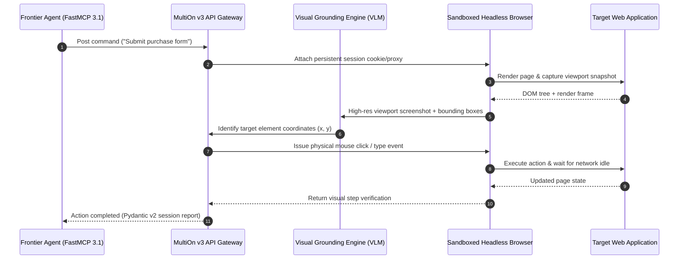

# MultiOn

## What it is
MultiOn is an enterprise-grade AI agent framework, SDK, and API designed specifically for autonomous web navigation, interaction, and stateful browser control. As of early January 2027, it operates on the mature API v3 architecture with full support for **FastMCP 3.1 Task Protocol**, serving as a high-performance "motor cortex" for AI. It enables frontier reasoning models like **Claude 5.6**, **GPT-5.6**, **Gemini 4.0 Ultra**, **Gemma 4**, **DeepSeek-V4**, and **Qwen 3.6 VL** to execute complex, multi-step actions across any web surface by combining real-time visual grounding with structural DOM parsing.

## What problem it solves
Traditional web scraping, RPA (Robotic Process Automation), and heuristic automation frameworks are notoriously brittle, requiring constant maintenance when website layouts or class names change. Standard LLMs without browser grounding are "read-only" and cannot interact with authenticated user sessions or complete transaction loops. MultiOn bridges this gap by providing autonomous web execution environments that handle state management, user authentication, CAPTCHAs, dynamic JS execution, and self-healing navigation trajectories without brittle hardcoded rules.

## Where it fits in the stack
**Category**: [Agents](index.md) / [Automation & Orchestration](../automation_orchestration/index.md).
It functions as the execution and interaction layer of the agentic stack. SOTA models generate semantic intents or command paths (such as using Model Context Protocol / FastMCP 3.1 specifications), which are translated by MultiOn's browser orchestrator into physical browser operations (click, type, hover, scroll, extract).

## Architecture & Visual Grounding Sequence

The following sequence diagram illustrates MultiOn's API v3 visual grounding loop, from user command ingestion and FastMCP 3.1 agent tool invocation to physical browser interaction, anti-bot proxy routing, and screenshot verification:



## Web Automation Framework Comparison Matrix

| Framework | Primary Engine | Anti-Bot & CAPTCHA | Visual Grounding | State Persistence | Avg Step Latency | Ideal Use Case |
| :--- | :--- | :---: | :---: | :---: | :---: | :--- |
| **MultiOn** | Cloud API v3 / Chromium | Advanced Auto-Solving | High (VLM-Native) | Continuous Cookies | ~3 - 8s | Complex transactional SaaS automation |
| **Stagehand** | Playwright + AI | Proxy Integration | Medium (DOM + Vision) | Local Browser State | ~2 - 5s | Node/TypeScript web agent execution |
| **Browser Use** | LangChain / Playwright | Custom Proxies | High (VLM Viewport) | Session Context | ~4 - 10s | Python-native LLM browser steering |
| **Skyvern** | Computer Vision / OCR | Basic Proxy | High (OCR + Bounding) | Ephemeral Session | ~5 - 12s | Layout-agnostic visual scraping |
| **Crawl4AI** | Headless Chromium | Stealth Mode | None (Pure Text/DOM) | Stateless / Per Request| ~0.2 - 0.8s | High-throughput LLM text ingestion |
| **Playwright** | Native CDP / Chromium | Manual Extension | None (Rule-Based) | Manual Storage State| ~0.05 - 0.2s | Deterministic unit testing & scraping |

## Typical use cases
- **Transaction Orchestration**: Completing automated purchases, hotel/flight bookings, or filling out long corporate forms across disjointed websites.
- **Enterprise SaaS Workflows**: Automating repetitive data entry or cross-platform synchronization between internal tools, legacy portals, and third-party SaaS dashboards.
- **Dynamic Data Ingestion**: Gathering structured market intelligence or downloading reports from behind complex, multifactor-authenticated (MFA) client portals.
- **Social Media & Workspace Automation**: Managing profiles, scheduling posts, reviewing pull requests on GitHub, and interacting with team portals.
- **Competitive Benchmarking & Live Audits**: Continuously navigating e-commerce websites to monitor real-time pricing and stock adjustments under varying simulation profiles.

## Strengths
- **Visual Grounding & Self-Healing**: Utilizing visual analysis from frontier VLMs to accurately target UI elements, making it highly resilient to HTML structural changes.
- **Model Context Protocol / FastMCP 3.1 Native**: Seamlessly maps web browsing capabilities to MCP-compatible agents as an external tool, providing structured inputs/outputs.
- **Continuous Session State**: Maintains persistent, secure browser environments that carry over cookies, logins, and session states across multi-step flows.
- **Anti-Bot and CAPTCHA Handling**: Integrates advanced proxy routing and automated CAPTCHA solving to navigate complex security gates smoothly.
- **Multi-Modal Execution**: Supports both headless high-throughput sessions and visual debug sessions in a real-time local or cloud window.

## Limitations
- **Operational Latency**: Multi-step web interaction is bound by browser rendering times, network latencies, and visual verification steps (often 5 to 15 seconds per step).
- **Execution Cost**: High consumption of VLM and LLM reasoning tokens when performing long-horizon vision tasks or DOM parsing on dense websites.
- **Safety and Guardrails**: Requires rigorous application-level filtering (e.g., via [Lakera Guard](../benchmarking/lakera-guard.md)) to prevent unintended transactional actions or modifications of sensitive accounts.
- **Deterministic Limits**: Unpredictable web design shifts or custom iframe-based interfaces may occasionally require fallback prompt corrections or manual human-in-the-loop overrides.

## When to use it
- When an agent must perform write actions (e.g., submit forms, transfer data, book services) on websites lacking public API access.
- For long-horizon agentic missions requiring interaction across multiple web domains with persistent sessions.
- When building multi-agent systems that need a reliable, fully managed browser orchestration gateway instead of maintaining a complex Selenium, Puppeteer, or Playwright cluster.

## When not to use it
- For static data extraction or massive-scale crawling where high-performance local scrapers like [Crawl4AI](../process_understanding/crawl4ai.md) can run headless with significantly lower cost and latency.
- If the target systems already expose secure, robust REST or GraphQL APIs, which are always faster, cheaper, and more reliable than web-based automation.
- For strictly local, completely air-gapped deployments where external API endpoints or third-party visual model APIs cannot be queried.

## Getting started

### Installation
Install the official MultiOn client, Pydantic, and MCP libraries:
```bash
pip install multion pydantic mcp
```

### Authentication and Setup
Acquire an API key from the [MultiOn Console](https://console.multion.ai/) and export it to your environment variables:
```bash
export MULTION_API_KEY="mo_live_abcdef1234567890abcdef"
```

## CLI examples
The MultiOn CLI allows you to execute immediate web tasks and monitor active visual sessions directly from your terminal.

```bash
# Install the command-line companion tool
pip install multion-cli

# Run a simple, headless visual navigation task
multion browse --cmd "Search for the top trending AI research paper of the week on arXiv and summarize its abstract"

# Launch a session in a local debug window to observe browser actions
multion browse --url "https://news.ycombinator.com" --cmd "Find the top story and print its author" --local

# Maintain a persistent session across commands
multion session create --url "https://github.com"
```

## API examples

### 1. Programmatic Web Browsing with API v3 (Python)
Execute a complete visual navigation task using the native client under early January 2027 SOTA standards.

```python
import os
from multion.client import MultiOn

# Initialize the v3 client
client = MultiOn(api_key=os.environ.get("MULTION_API_KEY"))

# Run a headless browsing command
result = client.browse(
    cmd="Navigate to GitHub, locate the trending Python repositories, and return the name of the top repository.",
    url="https://github.com/trending",
    include_screenshot=True,
    local=False
)

print("Execution Status:", result.status)
print("Execution Summary:", result.message)
if result.screenshot:
    print("Screenshot captured and stored.")
```

### 2. Multi-Step Stateful Sessions with FastMCP 3.1 Integration
Maintain state across successive steps for long-horizon agentic missions.

```python
import os
from multion.client import MultiOn

client = MultiOn(api_key=os.environ.get("MULTION_API_KEY"))

# Step A: Spin up a persistent session with secure proxy routing
session = client.sessions.create(
    url="https://wikipedia.org",
    local=False,
    load_plugins=True,
    protocol="FastMCP 3.1"
)
session_id = session.session_id
print(f"Active Session established: {session_id}")

try:
    # Step B: Execute the first action
    step_1 = client.sessions.step(
        session_id=session_id,
        cmd="Type 'Quantum Computing' in the search bar and press Enter"
    )
    print("Step 1 Response:", step_1.message)

    # Step C: Execute a follow-up action within the same session
    step_2 = client.sessions.step(
        session_id=session_id,
        cmd="Click on the section link for 'Quantum decoherence' and extract the introductory paragraph"
    )
    print("Step 2 Response:", step_2.message)

finally:
    # Step D: Always clean up and close active sessions
    client.sessions.close(session_id=session_id)
    print("Session terminated successfully.")
```

### 3. FastMCP 3.1 Executable Browser Automation Tool Server
Exposing MultiOn visual navigation capabilities as a standardized FastMCP 3.1 tool server with Pydantic v2 session guardrails:

```python
import os
from typing import Dict, Any, Optional
from pydantic import BaseModel, Field, field_validator, ValidationError
from mcp.server.fastmcp import FastMCP
from multion.client import MultiOn

mcp = FastMCP("multion-browser-tool-server")

class BrowseCommandSchema(BaseModel):
    target_url: str = Field(..., description="HTTPS target URL to initiate browsing session.")
    command: str = Field(..., min_length=5, description="Natural language navigation command.")
    max_steps: int = Field(default=10, ge=1, le=30)
    capture_screenshot: bool = Field(default=True)

    @field_validator("target_url")
    @classmethod
    def validate_https(cls, v: str) -> str:
        if not v.startswith("https://"):
            raise ValueError("Target URL must use secure https:// scheme.")
        return v

@mcp.tool()
def execute_multion_browse(payload_dict: Dict[str, Any]) -> Dict[str, Any]:
    """Executes an autonomous visual browser navigation loop via MultiOn v3 API."""
    try:
        req = BrowseCommandSchema.model_validate(payload_dict)
        client = MultiOn(api_key=os.environ.get("MULTION_API_KEY", "mock_key"))

        # Trigger MultiOn v3 browse execution
        res = client.browse(
            url=req.target_url,
            cmd=req.command,
            include_screenshot=req.capture_screenshot
        )

        return {
            "status": "success",
            "execution_message": getattr(res, "message", "Command processed successfully"),
            "steps_completed": getattr(res, "steps", 1),
            "protocol": "FastMCP 3.1"
        }
    except ValidationError as e:
        return {"status": "error", "error_type": "ValidationFailure", "details": e.errors()}
    except Exception as e:
        return {"status": "error", "error_type": "RuntimeFailure", "details": str(e)}

if __name__ == "__main__":
    mcp.run()
```

## Production Guardrails & Operational Security Guidelines

1. **Transaction Guardrails & Domain Safelisting**:
   - Always run MultiOn browser sessions with explicit domain safelists (`allowed_domains=["*.internal.corp", "github.com"]`) to prevent unintended navigation or credential exfiltration.
   - Enforce human-in-the-loop confirmation before issuing state-altering form submissions (e.g. wire transfers, deleting accounts).

2. **Session Cleanup & Rate Limiting**:
   - Ensure active session tokens are terminated inside `finally:` blocks to prevent orphaned cloud browser instances from consuming quotas.
   - Limit parallel sessions (`max_concurrent_sessions=5`) per worker pod to maintain predictable API rate limits.

3. **Proxy Rotation & Anti-Bot Reliability**:
   - Route requests through premium residential proxy networks when navigating geo-restricted or strict anti-bot targets.

## Systematic Troubleshooting & Navigation Diagnostic Guide

| Diagnostic Symptom | Probable Cause | Diagnostic Command / Tool | Remediation Action |
| :--- | :--- | :--- | :--- |
| **`ElementNotFoundError` during step** | Dynamic JS rendering delay or hidden iframe element | `multion browse --local --debug` | Add explicit visual wait instruction in prompt (e.g., "Wait for modal to render") |
| **CAPTCHA Solving Failure** | Bot score trigger on IP or outdated browser fingerprint | MultiOn Console Session Inspector | Enable enterprise residential proxy routing or manual human solve fallback |
| **Session Token Expiration** | Session timeout after prolonged inactivity (>15m) | `client.sessions.get_status(session_id)` | Implement automated heartbeat ping or re-authenticate session |
| **High VLM Token Overhead** | Viewport rendering on ultra-dense high-resolution web pages | MultiOn API payload configuration | Set viewport resolution to `1280x720` and disable unneeded background asset downloads |

## Related tools / concepts
- [Stagehand](../automation_orchestration/stagehand.md) — Node-based visual automation using SOTA vision-language models and Playwright.
- [Browser Use](../automation_orchestration/browser-use.md) — LangChain-native framework for steering web browsers with SOTA visual LLMs.
- [Skyvern](../automation_orchestration/skyvern.md) — Open-source visual web-automation and scraping agent platform.
- [Playwright](../development_ops/playwright.md) — The core high-performance browser automation engine.
- [Crawl4AI](../process_understanding/crawl4ai.md) — Lightning-fast open-source scraping and chunking optimized for LLM ingestion.
- [Agentic Workflows](../../knowledge_base/patterns/agentic-workflows.md) — Stateful, multi-step patterns for executing long-horizon tasks.
- [Model Context Protocol](../../knowledge_base/patterns/tool-calling-and-mcp.md) — Industry-standard protocol for integrating web tools with frontier LLMs.
- [Exa AI](../providers/exa_ai.md) — Semantic search provider used to identify target URLs before initiating MultiOn browser interactions.

## Licensing and cost
- **License**: Proprietary SDK / Cloud API.
- **Cost**: Offers free tier with limited browsing runs; standard consumption costs are billed based on execution runtime, step counts, and active proxy/solving features.

## Sources / references
- [MultiOn Developer Portal](https://docs.multion.ai/)
- [MultiOn Official Site](https://www.multion.ai/)
- [MultiOn Python SDK GitHub](https://github.com/multion-ai/multion-python)
- [API v3 Architecture and Vision-Grounding Update](https://www.multion.ai/blog/v3-api-release)

## Contribution Metadata
- Last reviewed: 2027-01-07
- Confidence: high
