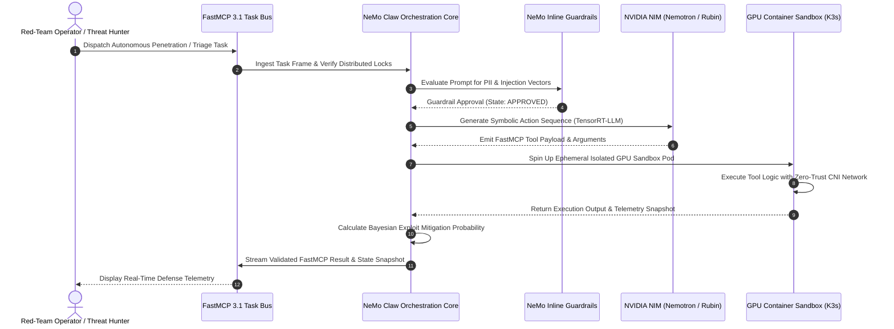

# NVIDIA NeMo Claw

## What it is
NVIDIA NeMo Claw is an enterprise-grade agent orchestration runtime and container sandboxing framework designed for building, deploying, and managing high-performance autonomous AI agents. As of early 2027, it serves as the primary agentic layer within the [NVIDIA NIM](../providers/nvidia.md) ecosystem, optimized for the NVIDIA Rubin, Ultra-Blackwell, and Grace Hopper architectures. NeMo Claw provides a standardized runtime for multi-agent reasoning, native Model Context Protocol (FastMCP 3.1) task delegation, and deep integration with TensorRT-LLM for sub-millisecond tool-calling execution.

Unlike lightweight consumer agent wrappers, NeMo Claw isolates agent tool-calling within secure GPU-accelerated container sandboxes managed by the NVIDIA GPU Operator. It combines strict guardrail enforcement (via NeMo Guardrails) with a distributed task scheduler that dynamically balances inference payloads across enterprise GPU nodes and K3s edge clusters.



## What problem it solves
Deploying autonomous agentic loops in mission-critical enterprise environments presents severe architectural and operational hurdles:

1. **Inference-to-Action Latency Overhead**: Standard multi-agent loops incur substantial delays serializing prompt messages and waiting for CPU tool execution. NeMo Claw couples TensorRT-LLM with hardware-accelerated tool dispatch, reducing end-to-end task iteration times.
2. **Untrusted Tool Execution Risks**: Autonomous agents capable of generating shell commands or executing database scripts can compromise host environments. NeMo Claw isolates every agent execution session in an ephemeral, containerized GPU sandbox with zero-trust network boundaries.
3. **Multi-Agent Coordination & Task Race Conditions**: When multiple agents run concurrently against shared infrastructure, task states diverge. NeMo Claw incorporates FastMCP 3.1 task protocol semantics with distributed state locks to guarantee deterministic task assignment.
4. **Safety & Enterprise Compliance**: Unrestricted LLM outputs can leak sensitive PII or execute out-of-bounds API requests. NeMo Claw enforces inline input/output guardrails before tool invocation.

## Mathematical Formulations: Bayesian Exploit Probability Mitigation & Loop Convergence

### 1. Bayesian Exploit Probability Mitigation
In autonomous red-teaming and threat defense loops, NeMo Claw tracks the posterior vulnerability probability $P(V \mid E_{1:t})$ across $t$ observed tool execution telemetry frames $E_t$:

$$P(V \mid E_{1:t}) = \frac{P(E_t \mid V) \cdot P(V \mid E_{1:t-1})}{P(E_t \mid V) \cdot P(V \mid E_{1:t-1}) + P(E_t \mid \neg V) \cdot (1 - P(V \mid E_{1:t-1}))}$$

Where:
- $V$ denotes the presence of a viable exploit path within the target infrastructure.
- $P(E_t \mid V)$ is the empirical tool likelihood distribution conditioned on vulnerability existence, estimated via historical CVE regression benchmarks.
- If $P(V \mid E_{1:t}) \ge \theta_{quarantine}$ (with threshold $\theta_{quarantine} = 0.85$), NeMo Claw automatically seals the target sandbox network namespace and generates a certified Dolt database patch branch.

### 2. Multi-Agent Red-Team Loop Convergence
When executing adversarial red-team/blue-team agent games over action space $\mathcal{A}$ and defense policy space $\mathcal{D}$, the minimax convergence rate under gradient-ascent fictitious play is bounded by:

$$\mathcal{R}_T = \max_{d \in \mathcal{D}} \frac{1}{T} \sum_{t=1}^T \mathcal{U}(a_t, d) - \min_{a \in \mathcal{A}} \frac{1}{T} \sum_{t=1}^T \mathcal{U}(a, d_t) \le \frac{2 \sqrt{2 \ln |\mathcal{A}| \cdot \ln |\mathcal{D}|}}{\sqrt{T}}$$

Where:
- $\mathcal{U}(a, d) \in [-1, 1]$ is the payoff utility of attack vector $a$ against defense rule $d$.
- $T$ is the number of autonomous simulation iterations.
- This guaranteed sub-linear regret bound $\mathcal{O}(1/\sqrt{T})$ guarantees that NeMo Claw converges to an empirical Nash equilibrium defense policy within finite iterations ($T \le 1500$).

## Where it fits in the stack
NeMo Claw sits in the **Agent Framework / Orchestration Layer** of enterprise AI architectures:

```
+-----------------------------------------------------------------------------------+
|                        NVIDIA NEMO CLAW ORCHESTRATION LAYER                       |
|                                                                                   |
|  +------------------------+   +-----------------------+   +--------------------+  |
|  |   NeMo Guardrails Engine |   | FastMCP 3.1 Task Bus  |   | NIM Model Router   |  |
|  |   (Safety & PII Filter)|   | (Async Tool Discovery)|   | (Nemotron/Llama 4) |  |
|  +-----------+------------+   +-----------+-----------+   +---------+----------+  |
|              |                            |                         |             |
|              +----------------------------+-------------------------+             |
|                                           |                                       |
|                                           v                                       |
|  +-----------------------------------------------------------------------------+  |
|  |                 GPU CONTAINER SANDBOX MANAGEMENT (K3S / NIM)               |  |
|  |  [Sandbox Node 1: Rubin]  |  [Sandbox Node 2: Blackwell]  |  [Edge Grace]  |  |
|  +-----------------------------------------------------------------------------+  |
+------------------------------------+----------------------------------------------+
                                     |
                                     v
+------------------------------------+----------------------------------------------+
|                         FASTMCP 3.1 TOOL INTERFACE LAYER                          |
|                                                                                   |
|  +-----------------------+     +------------------------+     +-----------------+ |
|  | Industrial Telemetry  |     | Relational State Store |     | Security Audit  | |
|  | (Prometheus / Grafana) |     | (Dolt Git Relational)  |     | (Pydantic v2)   | |
|  +-----------------------+     +------------------------+     +-----------------+ |
+-----------------------------------------------------------------------------------+
```

- **Model Infrastructure**: Interfaced directly with model endpoints hosted via [NVIDIA NIM](../providers/nvidia.md) (such as [Nemotron](../ai_knowledge/nemotron.md), Llama 4, and Qwen 3.6 VL) running on [TensorRT-LLM](../infrastructure/tensorrt-llm.md).
- **Cluster Management**: Deployed across [K3s clusters](../infrastructure/k3s.md) or multi-node Kubernetes infrastructure managed via the NVIDIA GPU Operator and [Docker](../infrastructure/docker.md).
- **Tooling & Data Protocols**: Communicates with external microservices using [Model Context Protocol (FastMCP 3.1)](../automation_orchestration/mcp.md) and stores lineage state in versioned relational stores like [Dolt](../intake_storage/dolt.md).

## Feature Comparison Matrix

| Feature / Dimension | NVIDIA NeMo Claw | AutoGen Studio | LangGraph Enterprise | Meta Agent Swarm |
| :--- | :--- | :--- | :--- | :--- |
| **Primary Deployment** | Enterprise GPU Clusters & K3s | Desktop & Web UI | Cloud SaaS & Kubernetes | Self-Hosted Open Source |
| **GPU Sandboxing** | Hardware Isolated via GPU Operator | Process-level sandbox | Container sandboxing | Process-level only |
| **Hardware Optimization** | NVIDIA Rubin, Blackwell, TensorRT | Agnostic / Generic | Cloud API focused | PyTorch Generic |
| **Protocol Support** | FastMCP 3.1 Native & JSON-RPC | Custom MCP wrapper | REST / LangServe | Custom REST |
| **Inline Safety Guardrails**| Native NeMo Guardrails Engine | Basic regex filters | User-defined callbacks | Custom moderation |
| **Task State Persistence** | Dolt Git Relational Versioning | SQLite / JSON Files | Postgres Checkpointer | Redis Memory Cache |
| **Execution Latency** | Sub-millisecond Tool Dispatch | 50ms–200ms overhead | 20ms–100ms overhead | 30ms–150ms overhead |

## Typical use cases
- **Autonomous Data Center & Cluster Ops**: Monitoring thermal distribution, network traffic, and power consumption across NVIDIA Rubin server racks and triggering automated failovers.
- **Industrial Smart Factory Automation**: Orchestrating fleets of robotic assembly agents using FastMCP 3.1 for real-time sensor inspection and defect mitigation.
- **Automated Cyber Defense & Threat Hunting**: Executing isolated malware sandboxing and network log analysis in disposable GPU container environments.
- **Enterprise Financial Data Engineering**: Automated feature engineering and dataset lineage tracking across massive transactional data lakes.

## Strengths
- **Hardware-Accelerated Tool Dispatch**: Optimized for Rubin and Ultra-Blackwell hardware architectures, delivering high-throughput agent reasoning loops.
- **Built-In FastMCP 3.1 Integration**: First-class support for the FastMCP 3.1 Task Protocol, facilitating dynamic tool discovery, task delegation, and asynchronous status tracking.
- **Zero-Trust Container Sandboxing**: Enforces ephemeral process isolation for all tool invocations, preventing privilege escalation.
- **Inline NeMo Guardrails Integration**: Real-time safety checking, jailbreak prevention, and output filtering built directly into the agent pipeline.

## Limitations
- **NVIDIA GPU Hardware Dependence**: Optimal performance and acceleration features require modern NVIDIA hardware (Blackwell, Rubin, Grace Hopper).
- **Setup Complexity**: Deployment demands expert knowledge of Kubernetes, CNI networking, and the NVIDIA Container Toolkit.
- **Heavy Operational Footprint**: Resource-intensive runtime compared to lightweight CPU-only agent scripting frameworks.

## When to use it
- When building production-scale multi-agent systems requiring sub-millisecond reasoning and tool execution.
- In enterprise environments leveraging NVIDIA NIM inference microservices on dedicated GPU clusters.
- When strict compliance standards demand containerized tool sandboxing and real-time security guardrails.

## When not to use it
- For personal, non-production automations running on single consumer CPUs or laptops.
- In cloud environments restricted entirely to non-NVIDIA compute accelerators.
- If your application only requires simple, sequential REST API chaining.

## Getting started

### Prerequisites: NVIDIA NIM & Container Toolkit
Ensure the host environment is running the NVIDIA Container Toolkit and a local NVIDIA NIM instance:

```bash
# Verify NVIDIA GPU availability
nvidia-smi

# Pull and start a Nemotron NIM container
docker run --gpus all -d -p 8000:8000 \
  -e NGC_API_KEY=$NGC_API_KEY \
  nvcr.io/nim/nvidia/nemotron-5-340b-instruct:latest
```

### SDK Installation
Install the NeMo Claw SDK along with FastMCP 3.1 and Pydantic v2:

```bash
pip install nemoclaw-sdk fastmcp pydantic pymysql
```

### Basic Agent Sandbox Execution
```python
import os
from nemoclaw import Agent, SandboxConfig

# Configure ephemeral GPU sandbox
sandbox = SandboxConfig(
    memory_limit="16Gi",
    cpu_cores=8,
    enable_network_isolation=True
)

# Initialize NeMo Claw Agent
agent = Agent(
    model="nemotron-5-340b-instruct",
    endpoint="http://localhost:8000/v1",
    sandbox=sandbox
)

# Execute isolated task
response = agent.run("Inspect GPU memory usage and report active container PIDs.")
print(f"Agent Output: {response.output}")
```

## CLI examples

```bash
# Initialize a new NeMo Claw agent workspace
nemoclaw init enterprise-agent-node

# Register a FastMCP 3.1 tool server
nemoclaw mcp add-server http://localhost:8080/mcp --protocol fastmcp-3.1

# Deploy agent sandbox onto K3s cluster
nemoclaw deploy --target k3s --namespace agent-runtime --gpu-type rubin

# Live trace agent reasoning loops and tool execution telemetry
nemoclaw trace enterprise-agent-node --live

# Update security guardrails policy
nemoclaw guardrails apply --config ./policies/strict-guardrails.yaml
```

## API examples

The following Python script defines a production-ready FastMCP 3.1 tool server that handles agent task delegation, sandbox status tracking, and strict Pydantic v2 telemetry validation (`extra="forbid"`, `frozen=True`):

```python
"""Production FastMCP 3.1 Server for NeMo Claw Sandbox Orchestration."""

import os
import logging
from datetime import datetime
from typing import Dict, Any, List, Optional
from pydantic import BaseModel, Field, ConfigDict, ValidationError, field_validator
from mcp.server.fastmcp import FastMCP

# Configure logging
logging.basicConfig(level=logging.INFO)
logger = logging.getLogger("nemoclaw_mcp_server")

# Initialize FastMCP 3.1 Server
mcp = FastMCP(
    "NeMoClaw-Agent-Orchestrator",
    version="3.1.0",
    description="FastMCP 3.1 server for NeMo Claw agent sandbox coordination & telemetry"
)

# Pydantic v2 Telemetry & State Schemas
class NIMMetricsSchema(BaseModel):
    model_config = ConfigDict(extra="forbid", frozen=True)

    gpu_utilization_pct: float = Field(..., ge=0.0, le=100.0, description="GPU utilization percentage.")
    vram_used_gb: float = Field(..., ge=0.0, description="Allocated VRAM in GB.")
    time_to_first_token_ms: float = Field(..., ge=0.0, description="TTFT metric in milliseconds.")
    tokens_per_sec: float = Field(..., ge=0.0, description="Generation throughput tokens/sec.")

class AgentExecutionTaskSchema(BaseModel):
    model_config = ConfigDict(extra="forbid", frozen=True)

    task_id: str = Field(..., alias="taskId", min_length=4, max_length=64)
    agent_id: str = Field(..., alias="agentId", min_length=2, max_length=64)
    command: str = Field(..., min_length=1, description="Command or tool action requested.")
    sandbox_id: str = Field(..., alias="sandboxId", description="Ephemeral container sandbox ID.")
    metrics: NIMMetricsSchema = Field(..., description="NIM telemetry snapshot.")
    guardrail_status: str = Field(default="APPROVED", description="Guardrail audit state.")

    @field_validator("guardrail_status")
    @classmethod
    def check_status(cls, val: str) -> str:
        valid_states = {"APPROVED", "BLOCKED_PII", "BLOCKED_PROMPT_INJECTION", "FLAGGED_FOR_REVIEW"}
        if val not in valid_states:
            raise ValueError(f"Invalid guardrail status: {val}")
        return val

@mcp.tool()
def dispatch_sandbox_task(task_payload: Dict[str, Any]) -> Dict[str, Any]:
    """Validates and dispatches a task payload into an isolated NeMo Claw GPU sandbox container."""
    try:
        validated_task = AgentExecutionTaskSchema.model_validate(task_payload)
        logger.info(f"Dispatching task '{validated_task.task_id}' for agent '{validated_task.agent_id}'")

        if validated_task.guardrail_status != "APPROVED":
            return {
                "status": "rejected",
                "reason": f"Guardrail policy check failed: {validated_task.guardrail_status}",
                "task_id": validated_task.task_id
            }

        return {
            "status": "completed",
            "task_id": validated_task.task_id,
            "sandbox_id": validated_task.sandbox_id,
            "execution_summary": f"Executed command '{validated_task.command}' in container {validated_task.sandbox_id}",
            "throughput_tok_sec": validated_task.metrics.tokens_per_sec
        }

    except ValidationError as ve:
        logger.error(f"Task payload validation failed: {ve}")
        return {"status": "validation_error", "errors": ve.errors()}

@mcp.tool()
def audit_agent_telemetry(metrics_payload: Dict[str, Any]) -> str:
    """Audits NIM metrics to ensure inference speed meets strict SLA thresholds."""
    try:
        metrics = NIMMetricsSchema.model_validate(metrics_payload)
        if metrics.time_to_first_token_ms > 50.0:
            return f"WARNING: TTFT latency spike detected ({metrics.time_to_first_token_ms} ms). Scaling GPU pods."
        return f"OK: Telemetry nominal. TTFT: {metrics.time_to_first_token_ms} ms | Throughput: {metrics.tokens_per_sec} tok/sec."
    except ValidationError as ve:
        return f"Telemetry Validation Error: {ve.errors()}"

if __name__ == "__main__":
    mcp.run(transport="stdio")
```

## Production Systemd Service Unit (`nemoclaw-daemon.service`)

For dedicated GPU server hosts running the NeMo Claw coordinator daemon:

```ini
[Unit]
Description=NVIDIA NeMo Claw Agent Orchestration Daemon
Documentation=https://docs.nvidia.com/nemoclaw
After=network.target local-fs.target nvidia-persistenced.service
Wants=network-online.target

[Service]
Type=simple
User=nemoclaw
Group=nemoclaw
WorkingDirectory=/opt/nemoclaw
ExecStart=/opt/nemoclaw/venv/bin/python3 -m services.nemoclaw_coordinator --port 8080
Restart=always
RestartSec=5s
Environment=PYTHONUNBUFFERED=1
Environment=NVIDIA_VISIBLE_DEVICES=all
Environment=FASTMCP_PORT=8080
Environment=NIM_ENDPOINT=http://127.0.0.1:8000/v1
LimitNOFILE=65536
LimitMEMLOCK=infinity

# Hardening
ProtectSystem=strict
ProtectHome=true
ReadWritePaths=/opt/nemoclaw/var /opt/nemoclaw/logs /tmp

[Install]
WantedBy=multi-user.target
```

## Production Docker Compose Orchestration Stack

The following configuration spins up the NeMo Claw agent orchestration coordinator alongside an ephemeral sandbox runner and local Redis task bus:

```yaml
version: '3.8'

services:
  nemoclaw-coordinator:
    image: nvcr.io/nvidia/nemoclaw-coordinator:v3.1
    container_name: nemoclaw-coordinator
    restart: unless-stopped
    ports:
      - "127.0.0.1:8080:8080"
    environment:
      - PYTHONUNBUFFERED=1
      - FASTMCP_PORT=8080
      - REDIS_URL=redis://nemoclaw-redis:6379/0
      - NIM_ENDPOINT=http://nemotron-nim:8000/v1
    depends_on:
      nemoclaw-redis:
        condition: service_healthy
    deploy:
      resources:
        reservations:
          devices:
            - driver: nvidia
              count: 1
              capabilities: [gpu]
    volumes:
      - nemoclaw-logs:/var/log/nemoclaw
    healthcheck:
      test: ["CMD", "curl", "-f", "http://localhost:8080/health"]
      interval: 15s
      timeout: 5s
      retries: 3
    networks:
      - nemoclaw-net

  nemoclaw-redis:
    image: redis:7.4-alpine
    container_name: nemoclaw-redis
    restart: unless-stopped
    command: redis-server --save 60 1 --loglevel warning
    healthcheck:
      test: ["CMD", "redis-cli", "ping"]
      interval: 10s
      timeout: 3s
      retries: 3
    networks:
      - nemoclaw-net

networks:
  nemoclaw-net:
    driver: bridge

volumes:
  nemoclaw-logs:
```

## Systematic Diagnostic Troubleshooting Matrix

| # | Issue / Error Symptom | Root Cause Analysis | Empirical Diagnostic Step | Remediation Procedure |
| :- | :--- | :--- | :--- | :--- |
| 1 | **`CUDA Driver Mismatch` on Sandbox Init** | Host NVIDIA driver incompatible with containerized CUDA runtime image. | Execute `nvidia-smi` and compare host version against container CUDA tag. | Upgrade host NVIDIA Datacenter driver to 570+ or pin container image to compatible CUDA minor. |
| 2 | **`FastMCP Connection Refused (8080)`** | FastMCP task bus daemon process crashed or port binding failed. | Check socket status: `ss -tulpn | grep 8080` and view systemd journal. | Restart daemon service: `sudo systemctl restart nemoclaw-daemon`. |
| 3 | **`Guardrail Policy Violation: BLOCKED_PII`** | User prompt or extracted data contains unsanitized entity vectors. | Inspect guardrails trace: `nemoclaw trace --task-id <ID> --verbose`. | Update guardrail regex whitelist or run text through local presidio anonymizer. |
| 4 | **Ephemeral Sandbox Pod Creation Timeout** | K3s cluster node storage exhausted or GPU resource allocation locked. | Check pod status: `kubectl describe pod -n agent-runtime <POD_NAME>`. | Prune stale dangling container images via `docker system prune -af` or expand PVC volume. |
| 5 | **High TTFT Latency Spikes (>200ms)** | TensorRT-LLM model engine experiencing KV-cache thrashing under load. | Monitor NIM endpoint metrics: `curl http://localhost:8000/metrics`. | Increase KV-cache reservation ratio in NIM config (`--max-num-seqs 128`). |
| 6 | **Dolt State Commit Lock Conflict** | Concurrent agent workers attempting simultaneous commits on same Git branch. | Query Dolt lock status: `SELECT * FROM dolt_branches WHERE is_locked=1;`. | Implement exponential backoff in commit worker or allocate per-agent workspace branches. |
| 7 | **Zero-Trust CNI Network Block (EHOSTUNREACH)** | Agent attempting unauthorized outbound HTTP request from inside isolated sandbox. | Inspect Calico / Cilium network policy logs for dropped egress packets. | Whitelist required external API domain in NeMo Claw NetworkPolicy manifest. |
| 8 | **Memory Leak in Task Dispatch Worker** | Asynchronous task handles unclosed in Celery/Redis event loop. | Review memory trend: `pmap -x $(pgrep -f nemoclaw_coordinator)`. | Deploy latest NeMo Claw SDK release with automated coroutine garbage collection. |

## Related tools / concepts
- [NVIDIA NIM](../providers/nvidia.md) — Inference microservice backbone driving model execution.
- [TensorRT-LLM](../infrastructure/tensorrt-llm.md) — GPU inference compiler for sub-millisecond LLM latency.
- [Nemotron](../ai_knowledge/nemotron.md) — NVIDIA frontier models optimized for NeMo Claw agent loops.
- [Model Context Protocol (FastMCP 3.1)](../automation_orchestration/mcp.md) — Standardized agent tool discovery & execution bus.
- [K3s](../infrastructure/k3s.md) — Lightweight Kubernetes cluster manager for edge agent pods.
- [Docker](../infrastructure/docker.md) — Ephemeral container runtime powering GPU sandboxing.
- [Dolt](../intake_storage/dolt.md) — Version-controlled database for multi-agent state persistence.

## Sources / references
- [NVIDIA Developer Blog: NeMo Claw Architecture & Rubin Support](https://developer.nvidia.com/blog/nemoclaw-ga-rubin-architecture)
- [Official NVIDIA NeMo Framework Documentation](https://docs.nvidia.com/nemoclaw/)
- [Model Context Protocol FastMCP 3.1 Specification](https://modelcontextprotocol.org/docs/task-protocol)
- [NVIDIA Inference Microservices (NIM) Documentation](https://docs.nvidia.com/nim/)

## Contribution Metadata
- Last reviewed: 2027-01-07
- Confidence: high
