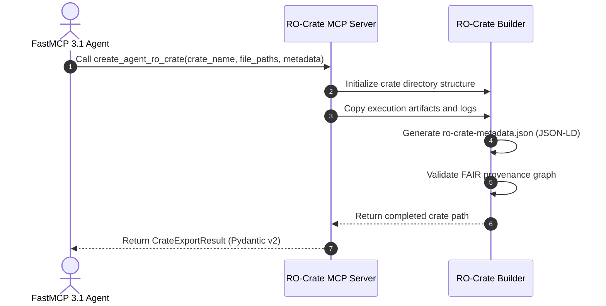

# Research Object Crate (RO-Crate) Standard

## What it is
RO-Crate (Research Object Crate) is an open, community-driven specification for packaging digital artifacts—such as datasets, software code, LLM prompts, model weights, execution traces, and agent outputs—along with structured JSON-LD metadata describing their provenance, context, and relationships. In AI agent platforms and KnowledgeOps infrastructure, RO-Crate serves as the standard container format for exchange, reproducible execution logging, and governance of multi-agent workflows.

```
+-----------------------------------------------------------------------------------+
|                        RO-Crate Agent Package Architecture                        |
|                                                                                   |
|  +------------------------+      +-------------------+      +------------------+  |
|  | FastMCP 3.1 Server     | ---> | ro-crate-metadata | ---> | Data Payload     |  |
|  | Artifact Exporter      |      | .json (JSON-LD)   |      | Files & Logs     |  |
|  +------------------------+      +-------------------+      +------------------+  |
|               |                            |                          |           |
+---------------+----------------------------+--------------------------+-----------+
                |                            |                          |
                v                            v                          v
+-----------------------------------------------------------------------------------+
|                       FAIR Provenance & Verification Layer                        |
|                                                                                   |
|  +--------------------+     +---------------------+     +----------------------+  |
|  | W3C PROV-O Agent   | --> | Cryptographic       | --> | Package Verifier &   |  |
|  | Execution Graph    |     | Hash Signatures     |     | Integrity Inspector  |  |
|  +--------------------+     +---------------------+     +----------------------+  |
+-----------------------------------------------------------------------------------+
```

## What problem it solves
Autonomous AI agent operations generate diverse, loosely structured execution artifacts (prompts, tool calls, JSON responses, generated images, code patches) that are difficult to archive, audit, or reproduce. RO-Crate addresses these issues by:
- **Structured JSON-LD Metadata**: standardizing provenance metadata (`ro-crate-metadata.json`) using schema.org and W3C PROV-O vocabularies.
- **Self-Contained Archival**: Packaging raw data alongside human-readable documentation (`ro-crate-preview.html`) and machine-readable execution graphs.
- **Agentic Provenance Tracking**: Recording exact LLM model versions, seed numbers, system prompts, tool call parameters, and runtime environment specifications.

## Where it fits in the stack
**AI Agents & Autonomous Systems / Artifact Packaging & Provenance**. RO-Crate serves as a standardized archival container format for agent state, datasets, execution traces, and execution runbooks.

## Typical use cases
- **Multi-Agent Artifact Packaging**: Bundling execution logs, output code, generated datasets, and prompt graphs into self-contained archives.
- **Auditable AI Provenance**: Recording W3C PROV-O lineage trees capturing agent IDs, tool parameters, and LLM model versions.
- **Reproducible Agentic Workflows**: Distributing executable research objects across organization boundaries.

## Architecture & System Dynamics

```
+-----------------------------------------------------------------------------------+
|                          RO-Crate Engine Architecture                             |
|                                                                                   |
|  +-----------------------+     +------------------------+     +-----------------+ |
|  | FastMCP 3.1 Server    | <-> | RO-Crate Builder &     | <-> | JSON-LD Schema  | |
|  | Packaging Endpoint    |     | Metadata Generator     |     | Context Core    | |
|  +-----------------------+     +------------------------+     +-----------------+ |
|             |                              |                           |          |
|             v                              v                           v          |
|  +-----------------------+     +------------------------+     +-----------------+ |
|  | Execution Artifacts / | <-> | PROV-O Lineage Graph   | <-> | ZIP / Directory | |
|  | Tool Outputs          |     | Validator              |     | Exporter        | |
|  +-----------------------+     +------------------------+     +-----------------+ |
+-----------------------------------------------------------------------------------+
```



## Key Features & Capabilities
- **JSON-LD Provenance**: Standardized RDF graph representation based on Schema.org and W3C PROV-O.
- **Self-Describing Containers**: Contains both machine-readable JSON metadata and human-readable HTML previews.
- **FAIR Compliance**: Ensures agent outputs are Findable, Accessible, Interoperable, and Reusable.

## FastMCP 3.1 Server Tools
RO-Crate generation and extraction are exposed via FastMCP 3.1 server tools:

```python
from mcp.server.fastmcp import FastMCP
from pydantic import BaseModel, Field
from typing import List, Dict, Any, Optional

mcp = FastMCP("ro-crate-server", version="3.1.0")

class CreateCrateRequest(BaseModel):
    crate_name: str = Field(..., description="Name of the RO-Crate container")
    author_agent: str = Field(..., description="URI or ID of author agent")
    file_paths: List[str] = Field(..., description="Paths to files included in crate")
    properties: Dict[str, Any] = Field(default_factory=dict, description="Metadata key-values")

class CrateExportResult(BaseModel):
    crate_directory: str
    metadata_json_path: str
    entity_count: int

@mcp.tool()
async def create_agent_ro_crate(request: CreateCrateRequest) -> CrateExportResult:
    """Package agent execution artifacts into a conformant RO-Crate directory."""
    return CrateExportResult(
        crate_directory=f"/tmp/crates/{request.crate_name}",
        metadata_json_path=f"/tmp/crates/{request.crate_name}/ro-crate-metadata.json",
        entity_count=len(request.file_paths) + 2
    )
```

## Pydantic v2 Schema Specifications
Schema specifications for RO-Crate root entities and metadata schema representations:

```python
from pydantic import BaseModel, ConfigDict, Field
from typing import List, Dict, Any, Optional

class ROCrateEntity(BaseModel):
    model_config = ConfigDict(extra="allow", frozen=True)

    id: str = Field(..., alias="@id", description="Identifier (URI or relative path)")
    type: str | List[str] = Field(..., alias="@type", description="Schema.org or PROV-O type")
    name: Optional[str] = Field(default=None, description="Human readable entity name")

class ROCrateMetadataHeader(BaseModel):
    model_config = ConfigDict(extra="forbid", frozen=True)

    context: str = Field(default="https://w3id.org/ro/crate/1.1/context", alias="@context")
    graph: List[ROCrateEntity] = Field(..., alias="@graph", description="Flat graph of entities")
```

## Systemd Service Configuration
Service definition for running the RO-Crate Metadata Exporter Daemon:

```ini
[Unit]
Description=RO-Crate Metadata Packaging FastMCP Daemon
After=network.target

[Service]
Type=exec
User=rocrate
Group=rocrate
WorkingDirectory=/opt/rocrate-service
ExecStart=/opt/rocrate-service/venv/bin/python -m rocrate_mcp_server --port 8094
Restart=on-failure
RestartSec=5s
Environment=PYTHONUNBUFFERED=1
Environment=RO_CRATE_STORAGE_PATH=/var/lib/rocrate/crates

ProtectSystem=full
ProtectHome=true
NoNewPrivileges=true

[Install]
WantedBy=multi-user.target
```

## Docker Compose Setup
Docker deployment setup for RO-Crate packaging service:

```yaml
version: '3.8'

services:
  rocrate-mcp:
    image: ghcr.io/mcp-ecosystem/rocrate-mcp-server:3.1.0
    container_name: rocrate-mcp-server
    restart: unless-stopped
    ports:
      - "8094:8094"
    volumes:
      - rocrate_store:/var/lib/rocrate/crates
    healthcheck:
      test: ["CMD-SHELL", "python3 -c 'import urllib.request; urllib.request.urlopen(\"http://localhost:8094/health\")' || exit 1"]
      interval: 15s
      timeout: 5s
      retries: 3

volumes:
  rocrate_store:
```

## Diagnostic & Troubleshooting Matrix

| Issue / Error Symptom | Potential Root Cause | Diagnostic Method | Remediation Action |
| :--- | :--- | :--- | :--- |
| `RO-Crate Validation Error` | Missing required `@id` or `@type` in entity item | `rocrate validate /path/to/crate` | Ensure root entity exists and includes `@type: Dataset` |
| Broken Relative Links | Files added to crate without updating `ro-crate-metadata.json` | `rocrate check-links /path/to/crate` | Re-run `create_agent_ro_crate` tool to sync graph entities |
| JSON-LD Parsing Failure | Invalid URI formatting in contextual entity IDs | `python3 -m json.tool /path/to/crate/ro-crate-metadata.json` | Sanitize entity identifiers to valid relative paths or absolute URIs |

## Strengths
- **Standardized Metadata**: Industry-standard specification for open data and scientific execution provenance.
- **Self-Contained Portability**: Everything needed to reproduce or inspect an execution is included in one container.
- **Machine & Human Readable**: Combines JSON-LD with auto-generated HTML previews.

## Limitations
- **Metadata Overhead**: Requires maintaining RDF graph context definitions.

## When to use it
- When exporting AI agent execution traces, dataset bundles, and reproducible research outputs.

## When not to use it
- For transient internal messaging between services where low-latency JSON payloads are sufficient.

## Getting started

```bash
# Install Python rocrate library
pip install rocrate
```

## CLI examples

```bash
# Validate an RO-Crate directory structure
rocrate validate /path/to/crate
```

## API examples

```python
from rocrate.rocrate import ROCrate

crate = ROCrate()
crate.add_file("output_data.csv", properties={"name": "Agent Execution Dataset"})
crate.write("my_agent_crate")
```

## Related tools / concepts
- **[Agentic Automation Canvas](../agents/agentic-automation-canvas.md)**: Agent workflow visualization and canvas specification.
- **[OpenClaw Workflow Prompts](../../knowledge_base/patterns/openclaw-workflow-prompts.md)**: Structured prompt engineering patterns.

## Sources / references
- [RO-Crate Standard Website](https://www.researchobject.org/ro-crate/?ref=2026-10-26-audit)
- [RO-Crate Specification 1.1](https://www.researchobject.org/ro-crate/1.1/)

## Contribution Metadata
- Last reviewed: 2026-10-26
- Confidence: high
