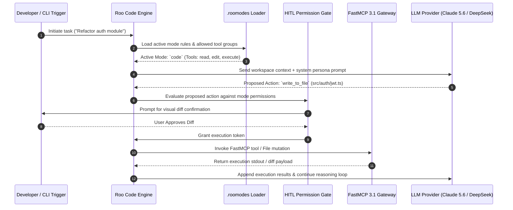

# Roo Code

## What it is
**Roo Code** is an open-source, AI-powered autonomous coding agent and IDE platform available for Visual Studio Code, JetBrains IDEs, and CLI execution environments. Originally created as a community fork of Cline, Roo Code has evolved into an enterprise-grade agent orchestration platform defined by custom task modes (`.roomodes`), multi-model agentic switching, human-in-the-loop permission boundaries, and native support for **FastMCP 3.1** (Model Context Protocol). As of 2027, Roo Code is widely adopted for autonomous software engineering across frontier reasoning models ([Claude 5.6](../providers/anthropic.md), [GPT-5.6](../ai_knowledge/openai.md), [Gemini 4.0 Ultra](../ai_knowledge/gemini.md)), open weights ([DeepSeek-V4](../providers/deepseek.md), [Qwen 3.6 VL](../ai_knowledge/qwen.md)), and local GPU inference engines ([Ollama](../../services/ollama.md), [ExLlamaV2](../infrastructure/exllamav2.md)).

## What problem it solves
Autonomous software development with LLMs faces distinct operational challenges:
- **Generalist Model Fatigue**: Single-persona system prompts fail when shifting between high-level architectural design, low-level code refactoring, and technical writing.
- **Unbounded Shell & File Execution**: Unrestricted agent execution risks destructive file overwrites or unauthorized terminal commands.
- **Context Window Fragmentation**: Large codebases exhaust LLM context limits quickly without targeted context pinning and file pruning.
- **Tool Protocol Isolation**: Connecting developer assistants to local databases, internal CI/CD pipelines, and diagnostic APIs traditionally required bespoke IDE plugins.

Roo Code solves these issues by introducing **Granular Custom Modes** (`.roomodes`), a **Human-in-the-Loop Tool Permission Engine**, **Context Pinning Memory**, and **Native FastMCP 3.1 Integration** for real-time tool execution.

## Where it fits in the stack
```
+-----------------------------------------------------------------------------------+
|                            DEVELOPER / IDE INTERFACE LAYER                        |
|                     (VS Code / JetBrains / Roo Code CLI Platform)                 |
+-----------------------------------------------------------------------------------+
                                          |
                                          v
+-----------------------------------------------------------------------------------+
|                            ROO CODE AGENT CORE & MODE ENGINE                      |
|      - Custom Modes (.roomodes: Architect, Code, Ask, Test, Security)            |
|      - Context Pinning, Pruning, & File Indexing Engine                           |
|      - Human-in-the-Loop Permission Boundary Controller                          |
+-----------------------------------------------------------------------------------+
          |                                  |                                  |
          v                                  v                                  v
+------------------------+        +------------------------+        +------------------------+
|   FILE & TERMINAL TOOLS|        |   FASTMCP 3.1 SERVERS  |        |    MODEL PROVIDERS     |
|   - Read / Write File  |        |   - DB Query / Vault   |        |   - Claude 5.6 / GPT-5.6   |
|   - Execute Command    |        |   - Playwright-MCP     |        |   - DeepSeek-V4            |
|   - Browser Check      |        |   - Custom Tool APIs   |        |   - Local Ollama / vLLM    |
+------------------------+        +------------------------+        +------------------------+
```

Roo Code operates at the **Developer Experience & IDE Agent Layer**, bridging developer intent with automated codebase mutations, shell execution, and remote tool services.

## Architecture & Custom Mode System

The core innovation of Roo Code is its **Custom Mode Framework** (`.roomodes`). Rather than using a static prompt persona, projects define tailored modes with constrained tool groups:

```
+----------------------------------------------------------------------------------------------------+
|                                    ROO CODE MODE TAXONOMY MATRIX                                   |
+-------------------+-----------------------------------+--------------------------------------------+
| Mode Slug         | Primary System Persona            | Allowed Tool Groups                        |
+-------------------+-----------------------------------+--------------------------------------------+
| `architect`       | System Architect & API Designer   | Read files, Browser, FastMCP Read-only     |
| `code`            | Software Engineer & Implementer   | Read, Edit/Write files, Execute Terminal   |
| `ask`             | Code Base Specialist & Educator   | Read files, Search code                    |
| `test-engineer`   | QA Automation & Test Specialist   | Read, Edit test files, Execute test runner |
| `security-audit`  | DevSecOps & Vulnerability Auditor | Read files, Execute scanner, FastMCP Vault |
+-------------------+-----------------------------------+--------------------------------------------+
```

### Execution Sequence & Tool Permission Workflow



### `.roomodes` Configuration Lifecycle
1. **Mode Initialization**: On project load, Roo Code parses `.roomodes` at the workspace root.
2. **Permission Gate Enforcement**: Tools outside the defined `groups` array for the active mode are disabled in the agent's tool declaration block.
3. **Instruction Injection**: `customInstructions` and workspace rules (`.clinerules` / `.roorules`) are appended to the system prompt dynamically.

## Typical use cases
- **Multi-Phase Feature Implementation**: Beginning in `architect` mode to write architectural decision records (ADRs) and OpenAPI specifications, switching to `code` mode for implementation, and finalizing in `test-engineer` mode for test coverage.
- **Autonomous Bug Fixing**: Investigating stack traces, reproducing bugs via automated test suites, editing source code across multiple packages, and verifying fixes before committing.
- **Local AI Pair Programming**: Interfacing Roo Code with a private local LLM running on [Ollama](../../services/ollama.md) or [ExLlamaV2](../infrastructure/exllamav2.md) for zero-data-leakage enterprise development.
- **Database & Secrets Integration**: Connecting FastMCP 3.1 tools like [Vault-MCP](../automation_orchestration/vault-mcp.md) or custom PostgreSQL tool servers directly into the agent reasoning loop.

## Strengths
- **Custom Mode Granularity**: Full customizability over persona prompts, allowed tool groups, and project rules.
- **FastMCP 3.1 First-Class Support**: Native support for Model Context Protocol 3.1, enabling low-latency streaming tools and structured schema validation.
- **Flexible Model Selection**: Seamless switching between top-tier cloud models and self-hosted open-weights models.
- **Human-in-the-Loop Security**: Configurable permission boundaries requiring explicit user approval before executing dangerous terminal commands or destructive file edits.

## Limitations
- **Token Overhead**: Long autonomous multi-file task loops generate substantial token usage, requiring active context management for large projects.
- **Configuration Complexity**: Maintaining complex custom mode rules across multi-repo organizations requires clear team standards.

## When to use it
- When requiring an autonomous IDE agent capable of multi-file editing, command execution, and visual UI verification.
- When working on complex codebases requiring distinct personas for architecture, coding, and testing.
- When leveraging local FastMCP 3.1 servers for database queries, issue tracking, or internal cloud infrastructure management.

## When not to use it
- For trivial single-line autocomplete completions where inline autocompletion (e.g., GitHub Copilot) is faster.
- In environments where IDE extensions are strictly forbidden from spawning terminal sub-processes.

## Getting started

### Installation & Basic Setup
1. Install **Roo Code** from the Visual Studio Code Marketplace or Open VSX Registry.
2. Open the Roo Code side panel, navigate to Settings, and select your LLM Provider (Anthropic, OpenAI, OpenRouter, DeepSeek, or Ollama).
3. Specify your primary API key and target model (e.g., `claude-3-7-sonnet-20250219`, `gpt-4o`, or `deepseek-v3`).
4. (Optional) Create a `.roomodes` file in your workspace root to configure custom project personas.

## CLI examples

Drive Roo Code CLI tool instances or verify system integration using terminal tools:

```bash
# Check Roo Code CLI version and installed runtime tools
roo-code --version

# Run a project workspace audit using a custom mode definition
roo-code audit --mode security-audit --workspace .

# Execute an autonomous refactoring task in headless mode
roo-code run --mode code --task "Refactor database pool handling to use async connections" --auto-approve

# List registered FastMCP 3.1 servers available to Roo Code
mcp-server-manager list

# Execute test suite to verify agent code changes
pytest tests/ -v --tb=short
```

## Production Systemd Service Unit

For headless continuous integration, automated background agent workers, or scheduled codebase maintenance tasks, deploy Roo Code as a systemd background service:

```ini
[Unit]
Description=Roo Code Headless Agent Daemon
After=network-online.target mcp-gateway.service
Wants=network-online.target

[Service]
Type=simple
User=builder
Group=builder
WorkingDirectory=/opt/services/app-workspace
Environment="NODE_ENV=production"
Environment="ROO_CODE_MODE=code"
Environment="ANTHROPIC_API_KEY=sk-ant-api03-xxxxxx"
ExecStart=/usr/local/bin/roo-code daemon --workspace /opt/services/app-workspace --listen 127.0.0.1:9090
Restart=always
RestartSec=10s
StandardOutput=journal
StandardError=journal
SyslogIdentifier=roo-code-daemon

# Hardening Measures
ProtectSystem=strict
ReadWritePaths=/opt/services/app-workspace /var/log/roo-code
ProtectHome=true
NoNewPrivileges=true

[Install]
WantedBy=multi-user.target
```

## API examples

### FastMCP 3.1 Custom Tool Server for Roo Code Integration

This server exposes database inspection capabilities directly to Roo Code via FastMCP 3.1:

```python
"""
FastMCP 3.1 Database Inspection Tool Server for Roo Code.
Enables Roo Code agents to inspect database schemas and run safe read-only queries.
"""

from typing import List, Dict, Any
from pydantic import BaseModel, Field
from mcp.server.fastmcp import FastMCP

mcp = FastMCP("roo-code-db-tools", version="3.1.0")

class SchemaInspectionRequest(BaseModel):
    table_name: str = Field(..., description="Target database table name to inspect")

class TableColumnInfo(BaseModel):
    column_name: str
    data_type: str
    nullable: bool

class QueryExecutionRequest(BaseModel):
    sql_query: str = Field(..., description="Read-only SQL SELECT query to execute")
    limit: int = Field(default=50, ge=1, le=500, description="Maximum row limit")

@mcp.tool(
    name="inspect_table_schema",
    description="Retrieve table column definitions and types for database design tasks."
)
def inspect_table_schema(request: SchemaInspectionRequest) -> List[TableColumnInfo]:
    """
    Simulates retrieving table metadata for Roo Code architect or coding modes.
    """
    schemas = {
        "users": [
            TableColumnInfo(column_name="id", data_type="uuid", nullable=False),
            TableColumnInfo(column_name="email", data_type="varchar(255)", nullable=False),
            TableColumnInfo(column_name="created_at", data_type="timestamp", nullable=False),
        ],
        "orders": [
            TableColumnInfo(column_name="id", data_type="uuid", nullable=False),
            TableColumnInfo(column_name="user_id", data_type="uuid", nullable=False),
            TableColumnInfo(column_name="total_amount", data_type="numeric(10,2)", nullable=False),
        ]
    }
    return schemas.get(request.table_name, [])

@mcp.tool(
    name="execute_readonly_query",
    description="Executes a safe SELECT query against the workspace development database."
)
def execute_readonly_query(request: QueryExecutionRequest) -> Dict[str, Any]:
    """
    Validates read-only status and executes query against target database.
    """
    if not request.sql_query.strip().lower().startswith("select"):
        return {"error": "Security Violation: Only SELECT queries are allowed."}

    return {
        "status": "success",
        "row_count": 2,
        "rows": [
            {"id": "usr-001", "email": "dev@example.local", "created_at": "2027-01-01T00:00:00Z"},
            {"id": "usr-002", "email": "admin@example.local", "created_at": "2027-01-02T00:00:00Z"}
        ]
    }

if __name__ == "__main__":
    mcp.run()
```

### Pydantic v2 `.roomodes` Validation Schema

```python
"""
Pydantic v2 Model Schema for Roo Code Workspace Configuration (.roomodes).
Validates custom modes, tool groups, and persona instruction sets.
"""

from typing import List, Optional
from pydantic import BaseModel, Field, field_validator

class RooCustomMode(BaseModel):
    slug: str = Field(..., pattern=r"^[a-z0-9\-]+$", description="Kebab-case mode slug identifier")
    name: str = Field(..., min_length=2, max_length=50, description="Display title of the mode")
    role_definition: str = Field(..., min_length=20, alias="roleDefinition", description="Detailed persona system instructions")
    groups: List[str] = Field(..., description="Allowed tool groups: read, edit, execute, browser, mcp")
    custom_instructions: Optional[str] = Field(None, alias="customInstructions", description="Project-specific prompt constraints")

    @field_validator("groups")
    @classmethod
    def validate_groups(cls, groups: List[str]) -> List[str]:
        valid_groups = {"read", "edit", "execute", "browser", "mcp"}
        for group in groups:
            if group not in valid_groups:
                raise ValueError(f"Invalid tool group '{group}'. Must be one of {valid_groups}")
        return groups

class RooModesConfig(BaseModel):
    custom_modes: List[RooCustomMode] = Field(..., alias="customModes")

# Validation Execution Example
if __name__ == "__main__":
    config_payload = {
        "customModes": [
            {
                "slug": "security-auditor",
                "name": "Security Auditor",
                "roleDefinition": "You are a senior DevSecOps engineer inspecting code for OWASP Top 10 vulnerabilities.",
                "groups": ["read", "mcp"],
                "customInstructions": "Never execute code edits directly. Report issues in MARKDOWN format."
            }
        ]
    }
    validated = RooModesConfig.model_validate(config_payload)
    print("Successfully validated Roo Code configuration:")
    print(validated.model_dump_json(indent=2))
```

## Diagnostic & Troubleshooting Matrix

| Operational Issue | Probable Root Cause | Resolution Strategy |
| :--- | :--- | :--- |
| **Tool Permission Rejected** | Action requested by model is outside allowed `groups` in current mode. | Switch to `code` mode or edit `.roomodes` to grant the target tool group (`execute`, `edit`). |
| **FastMCP Connection Timeout** | FastMCP server binary crashed or stdin/stdout pipe stalled. | Verify server binary in terminal (`python3 server.py`) and check `mcp-server-manager list`. |
| **Context Window Exhaustion** | Unpruned terminal outputs or large multi-file diffs in session. | Use context pinning to lock critical files, then clear session context history. |
| **Invalid `.roomodes` Schema** | Malformed JSON/YAML or illegal group identifier in `.roomodes`. | Validate payload against Pydantic schema using `roo-code check-config`. |
| **Headless Daemon Crash** | Missing API keys or permission denied writing to workspace directory. | Check `journalctl -u roo-code-daemon` and confirm `ReadWritePaths` environment rules. |

## Related tools / concepts
- [Cline](cline.md) — The foundation open-source autonomous coding agent.
- [Claude Code](../development_ops/claude-code.md) — Anthropic's terminal-native agentic pair programmer.
- [Model Context Protocol (MCP)](../automation_orchestration/mcp.md) — The FastMCP 3.1 protocol standard.
- [Playwright-MCP](../automation_orchestration/playwright-mcp.md) — Web visual testing tools for agents.
- [Ollama](../../services/ollama.md) — Self-hosted local model provider.

## Sources / references
- [Roo Code Official GitHub Repository](https://github.com/RooCodeInc/Roo-Code)
- [Roo Code Documentation Portal](https://docs.roocode.com/)
- [Model Context Protocol Specification](https://modelcontextprotocol.io)

## Contribution Metadata
- Last reviewed: 2027-01-07
- Confidence: high
