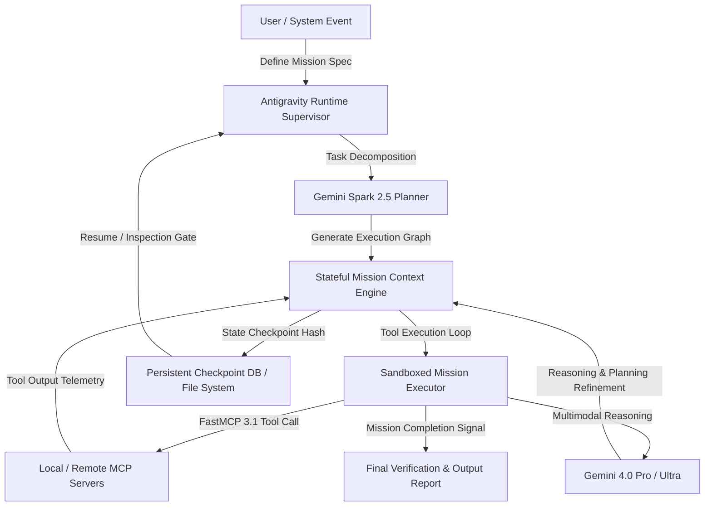
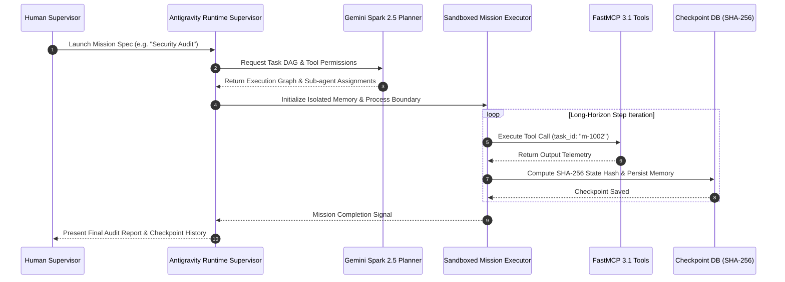

# Antigravity Agent

## What it is
Antigravity Agent is Google's flagship stateful runtime orchestration framework and autonomous execution platform designed to build, deploy, monitor, and govern highly autonomous AI agents capable of executing complex, long-horizon multi-day missions ("Missions"). Operating as a core pillar of Google's state-of-the-art agent engineering stack in early 2027, Antigravity Agent is powered natively by the Gemini 4.0 frontier series (Gemini 4.0 Pro, Gemini 4.0 Ultra, Gemini 4.0 Flash), Gemini Spark 2.5 (for multi-agent hierarchical decomposition), and Gemini Omni 2.0 (for multimodal context mapping), with native first-class compliance for the [Model Context Protocol (FastMCP 3.1)](../automation_orchestration/mcp.md) standard.

```
+-----------------------------------------------------------------------------------+
|                        Antigravity Agent Runtime Supervisor                       |
|                                                                                   |
|  +------------------------+      +-------------------+      +------------------+  |
|  | User / Event Mission   | ---> | Gemini Spark 2.5  | ---> | Stateful Context |  |
|  | Specification (YAML)   |      | Planner DAG       |      | Memory Engine    |  |
|  +------------------------+      +-------------------+      +------------------+  |
|               |                            |                          |           |
+---------------+----------------------------+--------------------------+-----------+
                |                            |                          |
                v                            v                          v
+-----------------------------------------------------------------------------------+
|                        Deterministic Execution & Checkpoint Layer                 |
|                                                                                   |
|  +--------------------+     +---------------------+     +----------------------+  |
|  | Sandboxed Mission  |     | SHA-256 Merkle      |     | FastMCP 3.1 Tool     |  |
|  | Container Sandbox  |     | State Checkpoint DB |     | Gateway Client       |  |
|  +--------------------+     +---------------------+     +----------------------+  |
+-----------------------------------------------------------------------------------+
```

## Architecture & Mission Lifecycle
Antigravity Agent isolates execution loops within sandboxed stateful runtimes, maintaining persistent task memory and checkpoint states throughout multi-day mission trajectories.



## Detailed Execution Sequence & Checkpoint Flow



## What problem it solves
Traditional conversational agents are fundamentally stateless and ephemeral, rendering them incapable of managing complex, nested, long-running processes without losing state, losing planning alignment, or failing on security boundaries. Antigravity Agent solves these operational limitations:
- **Long-Horizon Context Drift & Planning Alignment**: Stateless agents degrade after 10–20 turns; Antigravity maintains mathematical state invariants, goals, and checkpoint graphs over hundreds of sequential execution steps.
- **Deterministic Pause, Rewind, and Resumption**: Enables missions to be safely paused across server reboots, network partitions, or human-in-the-loop approvals without losing active memory.
- **Granular Security Containment**: Constrains shell commands, file modifications, and external network egress within isolated micro-sandboxes with deterministic auditing.
- **Multimodal State Perception**: Ingests video streams, diagrams, and UI screenshots directly into mission context via Gemini Omni 2.0 to guide physical or GUI automation tasks.

## Mathematical Formulations: Stateful Checkpointing & DAG Optimization

### 1. Long-Horizon State Checkpoint Consistency & Entropy Decay Bounds
Let $\mathcal{S}_t = (\mathcal{M}_t, \mathcal{F}_t, \mathcal{T}_t)$ represent the complete agent mission state at step $t$, comprising episodic memory $\mathcal{M}_t$, file system delta $\mathcal{F}_t$, and tool execution history $\mathcal{T}_t$. The cryptographic state checkpoint hash $H_t$ is computed via a Merkle tree formulation:

$$H_t = \text{SHA-256}\left( H_{t-1} \,\|\, \text{hash}(\Delta \mathcal{M}_t) \,\|\, \text{hash}(\Delta \mathcal{F}_t) \,\|\, \text{hash}(\Delta \mathcal{T}_t) \right)$$

To bound hallucination and drift over long execution horizons ($T \gg 100$), Antigravity computes task entropy $H(\mathcal{G}_t \mid \mathcal{S}_t)$ relative to target goal graph $\mathcal{G}_t$:

$$\mathcal{R}_{drift}(t) = D_{KL}\left( P(\mathcal{G}^* \mid \mathcal{S}_t) \parallel P(\mathcal{G}^* \mid \mathcal{S}_0) \right) \le \sum_{k=1}^t \gamma^k \cdot \epsilon_{step}(k)$$

Where $\gamma \in (0, 1)$ is the temporal discounting factor and $\epsilon_{step}$ is the maximum divergence per step. By enforcing checkpoint verification gates whenever $\mathcal{R}_{drift} > \tau_{threshold}$, Antigravity bounds cumulative mission divergence and restores the nearest verified checkpoint $H_{t^*}$.

### 2. Multi-Agent Hierarchical DAG Task Allocation Optimization
Gemini Spark 2.5 decomposes a top-level Mission $\Omega$ into a Directed Acyclic Graph $\mathcal{G} = (\mathcal{V}, \mathcal{E})$ with $N$ sub-tasks $v_i \in \mathcal{V}$. The allocator assigns each sub-task to agent tier $a \in \{\text{Gemini 4.0 Flash}, \text{Gemini 4.0 Pro}, \text{Gemini 4.0 Ultra}\}$ by solving:

$$\min_{\mathbf{X}} \sum_{i=1}^N \sum_{a=1}^3 X_{ia} \left( \lambda \cdot \text{Cost}(v_i, a) + (1 - \lambda) \cdot \text{Risk}(v_i, a) \right) \quad \text{s.t.} \quad \sum_{a=1}^3 X_{ia} = 1, \quad X_{ia} \in \{0, 1\}$$

Ensuring low-risk administrative sub-tasks run on lightweight Flash endpoints while complex security audits or architectural refactors utilize Ultra with maximal verification.

## Where it fits in the stack
**AI Assistants & Knowledge / Agentic Orchestration Layer**. Sitting directly above the foundational model provider layer, Antigravity Agent acts as the stateful runtime supervisor. It consumes standard API models or local endpoints and coordinates them with security systems, database servers, and automation structures like [Ollama](../../services/ollama.md) or [n8n](../../services/n8n.md).

```
+-----------------------------------------------------------------------------------+
|                        Enterprise Task / Human Supervisor                         |
+-----------------------------------------------------------------------------------+
                                          | Mission Spec (YAML / JSON)
                                          v
+-----------------------------------------------------------------------------------+
|                          Antigravity Runtime Supervisor                           |
|      - Gemini Spark 2.5 Hierarchical Task Decomposer & DAG Scheduler              |
|      - Merkle Tree State Checkpoint DB & Rollback Engine                          |
|      - Multimodal Context Ingestion (Gemini Omni 2.0)                             |
+-----------------------------------------------------------------------------------+
                                          |
                        FastMCP 3.1 Task Calls & Sandboxed Subprocesses
                                          v
+-----------------------------------------------------------------------------------+
|                          Sandboxed Execution Infrastructure                       |
|      - Isolated Docker Containers & Memory-Constrained cgroups                    |
|      - FastMCP 3.1 Tool Servers (Filesystem, Cloud Infrastructure, Database)      |
|      - Persistent SHA-256 State Volume (`/var/lib/antigravity/checkpoints`)       |
+-----------------------------------------------------------------------------------+
```

## Feature Matrix & Framework Comparison

| Feature / Dimension | Antigravity Agent | Claude Code / Agent | AutoGen / AG2 | CrewAI Enterprise |
| :--- | :--- | :--- | :--- | :--- |
| **Primary Model Engine** | Gemini 4.0 Pro / Ultra / Spark | Claude 5.6 / Anthropic | Model Agnostic / Open-Source | Model Agnostic |
| **Stateful Persistence** | Native Merkle DB / SHA-256 Hashes | File-based Context Memory | In-Memory / Custom Redis | In-Memory Session |
| **Protocol Support** | Native FastMCP 3.1 Task Standard | Anthropic MCP Standard | Custom Tool Functions | Custom Agent Tools |
| **Sandbox Isolation** | Built-in Container / Memory Guard | Shell Subprocess Sandbox | Local / Docker Sandbox | Subprocess Execution |
| **Mission Planning** | Gemini Spark 2.5 Multi-Agent DAG | Single / Sub-agent Loops | Conversational GroupChat | Sequential / Hierarchical |
| **Long-Horizon Capacity**| Multi-Day / 1000+ Steps | Multi-Hour Workflows | Short-to-Medium Sessions | Medium Task Pipelines |
| **Multimodal Inputs** | Native Video/Audio/Diagrams | Image / Vision Prompts | Image Inputs via APIs | Text-First Workflows |

## Typical use cases
- **Long-Horizon Software Engineering**: Executing multi-step code refactoring, dependency migrations, and test-driven development Missions within secure development workspaces.
- **Sovereign System Administration**: Safely executing server maintenance, database backups, and security patch audits via sandboxed loops.
- **Multimodal Data Analysis**: Parsing complicated video recordings, hardware circuit diagrams, and scanned technical manuals to generate multi-format summaries using Gemini Omni 2.0.
- **Dynamic Tool Discovery**: Auto-detecting and securely connecting with local or remote FastMCP 3.1 servers to perform complex data transformations.

## Operational Lifecycle & Mission Governance
1. **Mission Specification & Bounds**: Missions are authored in YAML/JSON or Python SDK specifications defining strict objectives, allowed tool classes, memory caps, and human checkpoint intervals.
2. **Hierarchical Task Planning**: Gemini Spark 2.5 breaks high-level goals into directed acyclic graphs (DAGs) of sub-tasks assigned to specialized sub-agents.
3. **Deterministic State Checkpointing**: Every turn, file system edit, and terminal execution generates SHA-256 state hashes, allowing Missions to be paused, audited, or rewound to prior states.
4. **Sandboxed FastMCP Protocol Guard**: All external tool calls are serialized over FastMCP 3.1 task boundaries with strict schema validation and execution timeouts.

## Strengths
- **Native Stateful Session Persistence**: Automatically checkpoints the agent's memory, terminal logs, and planning files to allow graceful pause and resume capabilities.
- **Gemini 4.0 & Spark 2.5 Native Integration**: Fully leverages advanced reasoning tokens, multimodal parsing, and sub-agent task-decomposition logic.
- **Standardized FastMCP 3.1 Client**: Dynamically connects to stdio, SSE-based, or WebSocket FastMCP 3.1 servers out-of-the-box.
- **Isolated Sandbox Security**: Executes all CLI tools, shell scripts, and system edits inside tightly controlled, isolated environment buffers.

## Limitations
- **Google Ecosystem Dependency**: Deeply optimized for Google Vertex AI and Gemini APIs, exhibiting reduced planning efficiency when paired with alternative open-source models.
- **Resource Intensity**: Maintaining deep historical checkpoints and parallel reasoning tracks requires significant memory and high system compute throughput.
- **Configuration Overhead**: Complex multi-agent Missions require extensive YAML schema definitions and specific security credential mappings.

## When to use it
- When building robust, autonomous developers or operations assistants that must execute tasks over hours or days without human supervision.
- When your architecture relies heavily on Google's Gemini multimodal capabilities and standardized tool-calling protocols.
- For high-security environments demanding strict isolation and sandbox logging of all agent actions.

## When not to use it
- For quick, stateless chat prompts where a simple API wrapper or standard client is faster and cheaper.
- In fully localized, air-gapped environments operating exclusively with low-parameter local models without Google cloud network access.
- For lightweight scripting where simple procedural Python scripts are sufficient.

## Getting started
1. **Prerequisites**: Ensure you have Python 3.11+, an active Google Cloud Vertex AI or Gemini API key, and access to an isolated runtime environment (like Docker or local sandbox).
2. **Framework Installation**: Install the secure Antigravity SDK:
   ```bash
   pip install google-antigravity-agent mcp pydantic fastmcp
   ```
3. **API Key Setup**: Export your standard API credentials:
   ```bash
   export GEMINI_API_KEY="your-gemini-api-key-here"
   ```
4. **Define a Stateful Mission**: Create an initialization script:
   ```python
   from antigravity_agent import AgentRuntime, Mission

   # Initialize stateful runtime
   runtime = AgentRuntime(model_name="gemini-4.0-pro")

   # Define task details and boundaries
   mission = Mission(
       name="Database Compliance Check",
       objective="Scan local SQLite database for compliance, export findings.",
       sandbox_isolation=True
   )
   ```

## CLI examples
You can interact with the Antigravity Agent and execute pre-configured YAML Missions using the system CLI.

```bash
# Launch a pre-configured multi-step Mission
antigravity-agent run docs/playbooks/raspberry-pi-kiosk-automation.md

# Inspect running stateful Missions and current checkpoint hashes
antigravity-agent list --status active

# Reconnect to a paused system administration Mission
antigravity-agent attach --hash sha256_9b3e1f0a
```

## API examples

### FastMCP 3.1 Mission Endpoint Provider
The following Python module demonstrates registering a FastMCP 3.1 server for launching Antigravity stateful Missions using strict **Pydantic v2** models (`extra="forbid"`, `frozen=True`):

```python
"""
Antigravity Agent FastMCP 3.1 Integration Server
Provides AI agents with structured tools to initiate and monitor long-horizon stateful missions.
"""

from typing import Dict, Any, Optional
from fastmcp import FastMCP
from pydantic import BaseModel, Field, ConfigDict

mcp_server = FastMCP(
    name="AntigravityFastMCPBridge",
    version="3.1.0",
    description="FastMCP 3.1 bridge for initiating and monitoring Antigravity stateful missions."
)

class MissionRequest(BaseModel):
    model_config = ConfigDict(extra="forbid", frozen=True)

    mission_name: str = Field(..., min_length=3, max_length=100, description="Unique descriptive title for mission")
    target_repo: str = Field(..., min_length=1, description="Target repository or infrastructure root")
    isolation_level: str = Field(default="strict", pattern=r"^(strict|permissive|none)$")
    max_steps: int = Field(default=50, ge=1, le=1000)

class MissionStatusResponse(BaseModel):
    model_config = ConfigDict(extra="forbid", frozen=True)

    mission_id: str
    status: str
    current_step: int
    total_steps: int
    last_checkpoint_hash: str
    mcp_version: str = "3.1.0"

@mcp_server.tool(
    name="trigger_antigravity_mission",
    description="Exposes Antigravity Agent long-horizon Mission triggers via FastMCP 3.1."
)
def trigger_antigravity_mission(request: MissionRequest) -> Dict[str, Any]:
    """Exposes Antigravity Agent long-horizon Mission triggers via FastMCP 3.1."""
    mission_id = f"mission-{request.mission_name.lower().replace(' ', '-')}"
    return {
        "status": "initiated",
        "mission_id": mission_id,
        "repo": request.target_repo,
        "sandbox": request.isolation_level,
        "max_steps": request.max_steps,
        "mcp_version": "3.1.0"
    }

@mcp_server.tool(
    name="query_mission_status",
    description="Retrieves current checkpoint status and progress telemetry for an active Mission."
)
def query_mission_status(mission_id: str) -> Dict[str, Any]:
    """Retrieves current checkpoint status and progress telemetry for an active Mission."""
    status_data = MissionStatusResponse(
        mission_id=mission_id,
        status="running",
        current_step=4,
        total_steps=10,
        last_checkpoint_hash="sha256_e3b0c44298fc1c149afbf4c8996fb92427ae41e4649b934ca495991b7852b855"
    )
    return status_data.model_dump()

if __name__ == "__main__":
    mcp_server.run()
```

### Programmatic Antigravity Mission Runtime Execution
The following Python script illustrates how to programmatically execute an Antigravity Agent Mission with custom FastMCP 3.1 tool integrations and strict configuration validation using Pydantic v2.

```python
import sys
from typing import Optional
from pydantic import BaseModel, Field, HttpUrl, ConfigDict

# Define Pydantic v2 models for strict mission constraints
class SandboxSettings(BaseModel):
    model_config = ConfigDict(extra="forbid", frozen=True)

    isolated: bool = True
    allow_network: bool = False
    max_memory_mb: int = Field(1024, gt=0, le=4096)

class AuditMission(BaseModel):
    model_config = ConfigDict(extra="forbid", frozen=True)

    name: str = Field(..., min_length=5, max_length=100)
    objective: str = Field(..., min_length=20)
    sandbox: SandboxSettings
    output_format: str = Field("markdown", pattern=r"^(markdown|json|text)$")
    callback_url: Optional[str] = None

def run_secure_audit():
    # 1. Establish validated inputs using Pydantic v2
    raw_config = {
        "name": "Source Code Security Audit",
        "objective": "Inspect scripts/ folder for plaintext keys or security vulnerabilities.",
        "sandbox": {
            "isolated": True,
            "allow_network": False,
            "max_memory_mb": 2048
        },
        "output_format": "markdown"
    }
    validated = AuditMission(**raw_config)
    print(f"Validated Mission Spec: {validated.name}")
    print(f"Sandbox Memory Cap: {validated.sandbox.max_memory_mb} MB")

if __name__ == "__main__":
    run_secure_audit()
```

## Systemd Production Runtime Supervisor Service Unit
To deploy the Antigravity Agent Runtime Supervisor as a background daemon managing mission persistence on enterprise host servers, save the following unit definition to `/etc/systemd/system/antigravity-supervisor.service`:

```ini
[Unit]
Description=Google Antigravity Agent Stateful Mission Supervisor Service
After=network.target docker.service
Wants=network-online.target

[Service]
Type=simple
User=antigravity-admin
Group=antigravity-admin
WorkingDirectory=/opt/antigravity/supervisor
Environment="GEMINI_API_KEY=your_gemini_4_pro_api_key_here"
Environment="PYTHONUNBUFFERED=1"
ExecStart=/usr/bin/python3 /opt/antigravity/supervisor/supervisor_daemon.py
Restart=always
RestartSec=10s
LimitNOFILE=65536

# Security Hardening & Isolation Directives
ProtectSystem=full
ProtectHome=true
NoNewPrivileges=true
PrivateTmp=true
ReadWritePaths=/var/lib/antigravity/checkpoints

[Install]
WantedBy=multi-user.target
```

Enable and activate the supervisor daemon:
```bash
sudo systemctl daemon-reload
sudo systemctl enable --now antigravity-supervisor.service
sudo systemctl status antigravity-supervisor.service
```

## Systematic Diagnostic Troubleshooting Matrix

| # | Issue / Symptom | Root Cause Analysis | Empirical Diagnostic Step | Remediation Procedure |
| :- | :--- | :--- | :--- | :--- |
| 1 | **`Checkpoint Hash Mismatch`** | File system state modified external to Antigravity runtime during mission step. | Run `antigravity-agent audit --hash <hash>`. | Rewind mission state to previous SHA-256 hash using `antigravity-agent attach --hash`. |
| 2 | **`Sandbox Memory Limit Exceeded`** | Sub-agent worker process breached `max_memory_mb` limit during code compilation. | Review journal logs: `journalctl -u antigravity-supervisor -n 100`. | Increase memory limit in `SandboxSettings` configuration schema or add swap allocation. |
| 3 | **`FastMCP 3.1 Tool Timeout`** | External MCP server failed to complete task within default 30-second window. | Check network reachability and inspect `antigravity-agent inspect-tools`. | Adjust `execution_timeout_sec` in FastMCP tool configuration envelope. |
| 4 | **`Vertex AI Quota Exceeded (429)`** | Multi-agent DAG generated excess token queries exceeding API rate quota. | Inspect Google Cloud Console Vertex AI token quota dashboard. | Enable token request batching in Gemini Spark 2.5 planner settings and add jitter backoff. |
| 5 | **`Mission Execution Stalled`** | Sub-agent awaiting unfulfilled human approval gate on destructive operation. | Query active missions: `antigravity-agent list --status pending_approval`. | Approve pending action gate via CLI (`antigravity-agent approve --id <id>`) or web UI. |
| 6 | **Merkle Tree Corruption on Disk** | Host abrupt power loss or unclean shutdown while writing state snapshot. | Check integrity with `fsck` or inspect `/var/lib/antigravity/checkpoints/corrupt.log`. | Restore last valid Merkle root from replicated snapshot volume. |
| 7 | **Multimodal Frame Decoder Error** | Video stream dropped keyframes or incompatible H.264 profile in Gemini Omni. | Review media ingestion pipeline logs for `AV_FRAME_CORRUPT`. | Re-encode input media stream to standard MP4 H.264 Baseline profile prior to ingest. |
| 8 | **Strict Pydantic Validation Error** | External tool emitted unexpected fields rejected by `extra="forbid"`. | Inspect error traceback for `ValidationError: Extra inputs are not permitted`. | Sanitize external tool JSON payloads to match strict schema expectations. |

## Related tools / concepts
- [Gemini](./gemini.md) — Google's enterprise-grade cloud-native multimodal AI reasoning model.
- [Gemini Canvas](./gemini-canvas.md) — Interactive persistent UI for visual, multi-modal Gemini planning workflows.
- [Google Search](./google-search.md) — Direct web-search context injection tool for local assistant engines.
- [Jules](./jules.md) — Privacy-first local home lab automation and daily log ingestion agent.
- [Model Context Protocol (MCP)](../automation_orchestration/mcp.md) — Unified protocol connecting models with local and cloud tools.
- [ExLlamaV2](../infrastructure/exllamav2.md) — High-throughput local GPU inference engine.

## Sources / references
- [Google AI Developer Platform: Introducing Antigravity Agent Stateful Framework](https://antigravity.google)
- [The New Stack: Google Antigravity IDE Extensions](https://thenewstack.io/google-antigravity-ide-extensions/)
- [GitHub Search: Antigravity Agent Stateful Orchestration Engine](https://github.com/search?q=Antigravity+Agent)
- [Vertex AI Agentic Workflows and Mission Planning](https://cloud.google.com/vertex-ai)

## Contribution Metadata
- Last reviewed: 2027-01-07
- Confidence: high
