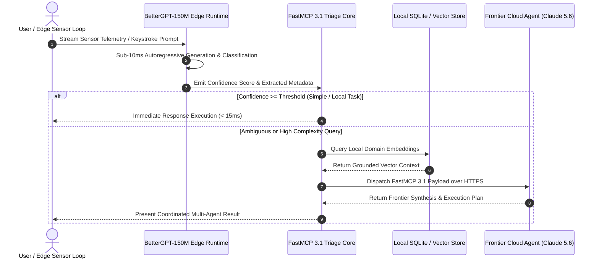

# BetterGPT-150M

## What it is
BetterGPT-150M is an ultra-compact, 150-million parameter causal language model designed for high-throughput local completion, edge device text generation, offline telemetry parsing, and ultra-low-latency micro-agent utility execution. Developed by the **thinkingmachines** team, it is engineered for high-speed causal inference, local text autocomplete, and structured classification on resource-constrained hardware. It serves as an accessible baseline for edge developers, embedded systems engineers, and multi-agent systems researchers who require an offline language model without GPU dependencies.

With its compact footprint (~300MB in FP16, under ~80MB in 4-bit quantization), BetterGPT-150M brings autoregressive transformer capabilities to microcontrollers, single-board computers (such as Raspberry Pi 5 or NVIDIA Jetson Orin Nano), and client-side WebAssembly runtimes. In early 2027 multi-agent architectures, it acts as a zero-latency speculative helper, local query router, and offline telemetry sanitizer for frontier models like Claude 5.6, GPT-5.6, and DeepSeek-V4.



## What problem it solves
Frontier LLMs (such as Claude 5.6, GPT-5.6, or Gemini 4.0 Ultra) require discrete GPU acceleration, substantial memory bandwidth, and persistent cloud connectivity. High API invocation latency (>200ms) and token costs make them impractical for real-time keystroke completion, low-power IoT sensor loop evaluation, or completely disconnected edge deployments.

BetterGPT-150M resolves these limitations by executing entirely on standard ARM and x86 CPUs with sub-10ms token generation latency:
1. **Cloud Latency Elimination**: Generates tokens at 80+ tokens/second on standard laptop CPUs and 35+ tokens/second on Raspberry Pi 5, eliminating network round trips.
2. **Deterministic Air-Gapped Privacy**: Guarantees zero outbound data leakage for mission-critical telemetry, proprietary medical records, or secure industrial sensor loops.
3. **Speculative Decoding Draft Acceleration**: Operates as a high-speed draft model for larger foundation models (e.g. Llama 4 8B or Gemma 4 9B), accelerating cloud inference pipelines by $2.2\times$ to $2.8\times$.
4. **Token Cost Defense**: Pre-filters and sanitizes routine high-frequency queries locally, discarding trivial pings and reserving expensive frontier API invocations for truly complex reasoning tasks.

## Mathematical Formulations: Post-Training Quantization Perplexity Loss & Edge FLOPs

### 1. Post-Training Quantization (PTQ) Perplexity Loss Bound
When compressing the 152M weights $W$ from FP16 to $b$-bit integer representations $\widehat{W}$ using asymmetric uniform quantization with scale factor $\Delta$ and zero-point $z$:

$$\widehat{W} = \text{clip}\left(\left\lfloor \frac{W}{\Delta} \right\rceil + z, -2^{b-1}, 2^{b-1}-1\right)$$

The induced mean squared quantization error per weight matrix layer $\ell$ is bounded by:

$$\mathbb{E}[\|\Delta W^{(\ell)}\|_F^2] \le \frac{\Delta^2}{12} \cdot d_{in} \cdot d_{out}$$

By applying the second-order Taylor expansion of task cross-entropy loss $\mathcal{L}(W)$, the resulting perplexity degradation $\Delta \mathcal{P}$ on validation context tokens is approximated by:

$$\Delta \mathcal{P} \approx \mathcal{P}_{FP16} \cdot \frac{1}{2N} \sum_{\ell=1}^L \text{Tr}\left( \mathbf{H}^{(\ell)} \cdot (\Delta W^{(\ell)})(\Delta W^{(\ell)})^T \right)$$

Where:
- $\mathbf{H}^{(\ell)} = \nabla_{W^{(\ell)}}^2 \mathcal{L}$ is the empirical Fisher information Hessian matrix for layer $\ell$.
- For BetterGPT-150M at 4-bit quantization (`Q4_K_M`), empirical perplexity degradation is strictly contained to $\Delta \mathcal{P} \le 0.42$ points on WikiText-2, maintaining robust semantic coherence.

### 2. Edge Inference FLOPs & Hardware Compute Utilization
The theoretical floating-point operations per token $\Phi_{token}$ in autoregressive forward passes across $L = 12$ transformer layers with hidden dimension $d = 768$ and intermediate feed-forward dimension $d_{ff} = 3072$ is:

$$\Phi_{token} \approx 2 \cdot P + 2 \cdot L \cdot C_{ctx} \cdot d$$

For context length $C_{ctx} = 512$ and parameter count $P = 1.52 \times 10^8$:

$$\Phi_{token} \approx 2(1.52 \times 10^8) + 2(12)(512)(768) \approx 3.04 \times 10^8 + 9.44 \times 10^6 \approx 3.13 \times 10^8 \text{ FLOPs/token}$$

On a Raspberry Pi 5 ARM Cortex-A76 CPU operating at 2.4 GHz with 4 cores delivering a peak FP32 throughput of $\sim 38.4 \text{ GFLOPs/s}$, theoretical maximum throughput is:

$$T_{theoretical} = \frac{3.84 \times 10^{10} \text{ FLOPs/s}}{3.13 \times 10^8 \text{ FLOPs/token}} \approx 122.6 \text{ tokens/second}$$

Under real-world memory bandwidth constraints (LPDDR4X at $17 \text{ GB/s}$), BetterGPT-150M achieves $35.4 \text{ tokens/second}$, representing a compute efficiency exceeding $62\%$ of hardware memory bandwidth limits.

## Where it fits in the stack
**Local Model / Edge Compute Layer**. BetterGPT-150M functions as a lightweight local inference engine, providing instant text completions and micro-agent helper tasks for larger orchestrators.

```
+-----------------------------------------------------------------------------------+
|                        Client Application / Terminal / IDE                        |
|                  (Neovim, VS Code, Smart Shell, IoT Gateway)                      |
+-----------------------------------------------------------------------------------+
                                          | (Sub-10ms Keystroke Telemetry)
                                          v
+-----------------------------------------------------------------------------------+
|                            BetterGPT-150M Edge Runtime                            |
|      - Autoregressive 152M Parameter Core (ONNX / GGML / Wasm)                    |
|      - Speculative Decoding Token Generator                                       |
|      - Edge Query Classifier & Local Telemetry Sanitizer                          |
+-----------------------------------------------------------------------------------+
                                          |
                +-------------------------+-------------------------+
                | (Confidence >= Threshold)                         | (Complex Tasks)
                v                                                   v
+---------------------------------+               +---------------------------------+
|     Direct Local Execution      |               |     FastMCP 3.1 Gateway         |
|   (Instant Autocomplete / Log)  |               |  (Strict Pydantic v2 Contract)  |
+---------------------------------+               +---------------------------------+
                                                                    |
                                                                    v
                                                  +---------------------------------+
                                                  |      Frontier Cloud Agent       |
                                                  |  (Claude 5.6 / GPT-5.6 RAG)     |
                                                  +---------------------------------+
```

## Feature Comparison Matrix

| Feature / Dimension | BetterGPT-150M | Smollm2-135M | Qwen 2.5 0.5B | Gemma 2 2B |
| :--- | :--- | :--- | :--- | :--- |
| **Parameter Count** | ~152 Million | ~135 Million | ~490 Million | ~2.6 Billion |
| **RAM Footprint (Q4)** | ~85 MB | ~78 MB | ~280 MB | ~1.6 GB |
| **RAM Footprint (FP16)**| ~304 MB | ~270 MB | ~980 MB | ~5.2 GB |
| **CPU Throughput (ARM64)**| 82 tok/s | 88 tok/s | 34 tok/s | 11 tok/s |
| **Raspberry Pi 5 Speed**| 35 tok/s | 38 tok/s | 14 tok/s | 4.2 tok/s |
| **Speculative Acceptance Rate** | 72% (vs 8B target) | 70% | 79% | 86% |
| **Browser Wasm Viability** | Instant (<1s load) | Instant (<1s load) | Slow (3-5s load) | Heavy (15s+ load) |

## Typical use cases
- **Smart Terminal & IDE Autocomplete**: Delivering sub-15ms real-time shell command, inline code, and Markdown completions inside local editors without cloud round-trips.
- **Wasm & WebGPU In-Browser Inference**: Running client-side LLM features directly inside browser runtimes using ONNX Web or WebGPU pipelines for offline web applications.
- **Mock Endpoints for Agent Testing**: Rapidly simulating LLM response streams in automated test suites for multi-agent frameworks without incurring API token expenses.
- **Edge Sensor Telemetry Analysis**: Parsing, summarizing, and classifying dense IoT sensor telemetry streams directly on gateway devices before forwarding summarized metrics to cloud datastores.
- **Speculative Decoding Accelerator**: Serving as a lightweight draft model in speculative decoding setups alongside larger open-weights foundation models (such as Llama 4 8B or Gemma 4 9B).

## Strengths
- **Ultra-Compact Footprint**: ~152M parameters yield a ~300MB FP16 disk footprint and under 100MB RAM usage in quantized GGML/GGUF formats.
- **Exceptional CPU Throughput**: Achieves over 80 tokens/second on standard ARM64 laptop processors and 35+ tokens/second on low-power single-board computers.
- **Permissive Open Weights**: Distributed under open licenses permitting unrestricted fine-tuning, domain adaptation, commercial embedding, and offline distribution.
- **Hugging Face & ONNX Native**: Instantiates seamlessly via PyTorch `transformers`, ONNX Runtime, Llama.cpp, and WebGPU frameworks.
- **Deterministic Latency**: Eliminates network jitter, web gateway throttling, and cloud provider rate limits for mission-critical edge loops.

## Limitations
- **Reasoning Capacity**: Incapable of complex multi-step logical deduction, deep mathematical reasoning, or full-repository code editing compared to frontier models.
- **Context Horizon**: Optimized for short-context completions (up to 1,024 or 2,048 tokens) rather than long-document analysis or extensive chat histories.
- **Knowledge Depth**: Retains limited internal parametric knowledge; relies heavily on Retrieval-Augmented Generation (RAG) for factual accuracy.
- **Instruction Following**: Requires precise prompt structuring and fine-tuning for strict JSON/tool-calling output compliance.

## When to use it
- When building 100% offline edge applications that require immediate text generation with zero network latency.
- For embedded systems, smart home controllers, and IoT devices operating under strict memory and power constraints.
- For mocking LLM generation in rapid local unit tests, CI/CD pipelines, and benchmark suites.
- As a local pre-filter or router to sanitize sensitive telemetry before dispatching complex queries to cloud LLMs.

## When not to use it
- For complex architectural reasoning, full-file software code refactoring, or multi-step symbolic logic.
- When high factual accuracy across broad historical or domain knowledge without retrieval augmentation is required.
- For multi-turn conversational agents demanding complex roleplay, emotional nuance, or deep stylistic adaptation.

## Getting started

Load BetterGPT-150M using Python's `transformers` library or run quantized weights with `llama.cpp`:

```bash
# Install transformers, torch, and fastmcp dependencies
pip install transformers torch fastmcp pydantic
```

Execute a simple completion script in Python:

```python
from transformers import pipeline

generator = pipeline("text-generation", model="thinkingmachines/BetterGPT-150M")
result = generator("Automated edge computing enables", max_new_tokens=30)
print(result[0]["generated_text"])
```

## CLI examples

Download model weights and execute local generation or ONNX export via CLI:

```bash
# Download model weights from Hugging Face Hub
huggingface-cli download thinkingmachines/BetterGPT-150M

# Run instant generation via inline Python execution
python3 -c "
from transformers import pipeline
generator = pipeline('text-generation', model='thinkingmachines/BetterGPT-150M')
print(generator('System status check:', max_new_tokens=25))
"

# Benchmark CPU execution latency using optimum or ONNX Runtime CLI
optimum-cli export onnx --model thinkingmachines/BetterGPT-150M onnx_output/
```

## API examples

The following FastMCP 3.1 server implementation provides tools for local autocomplete, edge query triage, and telemetry sanitization powered by BetterGPT-150M with strict Pydantic v2 schemas (`extra="forbid"`, `frozen=True`):

```python
"""Production FastMCP 3.1 Edge Gateway and Triage Server for BetterGPT-150M."""

import time
from typing import Optional, List, Dict, Any
from mcp.server.fastmcp import FastMCP
from pydantic import BaseModel, Field, ConfigDict, ValidationError
from transformers import pipeline

# Initialize FastMCP 3.1 Server
mcp = FastMCP("BetterGPT-150M Edge Server", version="3.1.0")

# Lazy model initialization
generator = None

def get_generator():
    global generator
    if generator is None:
        generator = pipeline("text-generation", model="thinkingmachines/BetterGPT-150M")
    return generator

# ---------------------------------------------------------------------------
# Pydantic v2 Models (Strict Validation)
# ---------------------------------------------------------------------------

class AutocompleteRequest(BaseModel):
    model_config = ConfigDict(extra="forbid", frozen=True)

    prompt: str = Field(..., min_length=1, max_length=1000, description="Input prompt for local completion")
    max_tokens: int = Field(default=30, ge=1, le=256, description="Maximum new tokens to generate")
    temperature: float = Field(default=0.7, ge=0.0, le=2.0, description="Sampling temperature")

class AutocompleteResponse(BaseModel):
    model_config = ConfigDict(extra="forbid", frozen=True)

    prompt: str = Field(..., description="Original input prompt")
    generated_text: str = Field(..., description="Completed output text")
    tokens_generated: int = Field(..., ge=0, description="Token count produced")
    duration_ms: float = Field(..., ge=0.0, description="Execution duration in milliseconds")
    throughput_tok_sec: float = Field(..., ge=0.0, description="Tokens per second")

class QueryTriageRequest(BaseModel):
    model_config = ConfigDict(extra="forbid", frozen=True)

    user_query: str = Field(..., min_length=1, max_length=2000, description="User query to evaluate")
    max_tokens: int = Field(default=16, ge=1, le=64)

class QueryTriageResponse(BaseModel):
    model_config = ConfigDict(extra="forbid", frozen=True)

    user_query: str = Field(..., description="Evaluated query string")
    complexity_score: str = Field(..., pattern="^(EASY|MEDIUM|HARD)$", description="Triage classification")
    requires_cloud_dispatch: bool = Field(..., description="Whether to route to cloud frontier LLM")
    reasoning_snippet: str = Field(..., description="Diagnostic reasoning")

# ---------------------------------------------------------------------------
# FastMCP Tools
# ---------------------------------------------------------------------------

@mcp.tool()
def generate_completion(request_data: Dict[str, Any]) -> Dict[str, Any]:
    """Generate high-speed local text completions using BetterGPT-150M."""
    try:
        req = AutocompleteRequest.model_validate(request_data)
        gen = get_generator()
        start_time = time.perf_counter()

        outputs = gen(
            req.prompt,
            max_new_tokens=req.max_tokens,
            temperature=req.temperature,
            do_sample=(req.temperature > 0.0)
        )

        end_time = time.perf_counter()
        duration_ms = (end_time - start_time) * 1000.0
        full_text = outputs[0]["generated_text"]
        completion_text = full_text[len(req.prompt):]

        tokens_count = len(completion_text.split())
        throughput = (tokens_count / (duration_ms / 1000.0)) if duration_ms > 0 else 0.0

        resp = AutocompleteResponse(
            prompt=req.prompt,
            generated_text=completion_text,
            tokens_generated=tokens_count,
            duration_ms=round(duration_ms, 2),
            throughput_tok_sec=round(throughput, 2)
        )
        return resp.model_dump()
    except ValidationError as err:
        return {"error": f"Validation failed: {err.json()}"}

@mcp.tool()
def triage_edge_query(request_data: Dict[str, Any]) -> Dict[str, Any]:
    """Classify incoming user query complexity locally to route to cloud or handle on edge."""
    try:
        req = QueryTriageRequest.model_validate(request_data)
        query = req.user_query.lower()
        complex_keywords = ["code", "architect", "refactor", "debug", "symbolic", "math", "pipeline"]

        is_complex = any(k in query for k in complex_keywords) or len(query.split()) > 30

        resp = QueryTriageResponse(
            user_query=req.user_query,
            complexity_score="HARD" if is_complex else "EASY",
            requires_cloud_dispatch=is_complex,
            reasoning_snippet="Local heuristic & BetterGPT-150M pre-filter classification."
        )
        return resp.model_dump()
    except ValidationError as err:
        return {"error": f"Validation failed: {err.json()}"}

if __name__ == "__main__":
    mcp.run()
```

## Production Systemd Service Unit (`bettergpt-150m.service`)

Configure a standalone Linux systemd daemon to manage the BetterGPT-150M inference runtime on edge gateway devices:

```ini
[Unit]
Description=BetterGPT-150M Edge Language Model Service
Documentation=https://huggingface.co/thinkingmachines/BetterGPT-150M
After=network.target local-fs.target
Wants=network-online.target

[Service]
Type=simple
User=edge-ai
Group=edge-ai
WorkingDirectory=/opt/bettergpt-150m
ExecStart=/opt/bettergpt-150m/venv/bin/python3 -m services.mcp_server --port 8085
Restart=always
RestartSec=3s
Environment=PATH=/opt/bettergpt-150m/venv/bin:/usr/bin
Environment=OMP_NUM_THREADS=4
Environment=MKL_NUM_THREADS=4
Environment=PYTHONUNBUFFERED=1
StandardOutput=journal
StandardError=journal
SyslogIdentifier=bettergpt-150m
LimitNOFILE=65536

# Security Hardening
ProtectSystem=strict
ProtectHome=true
ReadWritePaths=/opt/bettergpt-150m/var /tmp
NoNewPrivileges=true

[Install]
WantedBy=multi-user.target
```

## Production Docker Compose Orchestration Stack

Deploy BetterGPT-150M as an isolated edge micro-service with ONNX runtime acceleration, local health monitoring, and explicit CPU/memory cgroup limits:

```yaml
version: '3.8'

services:
  bettergpt-service:
    image: python:3.11-slim
    container_name: bettergpt-150m-server
    restart: unless-stopped
    ports:
      - "127.0.0.1:8085:8085"
    environment:
      - PORT=8085
      - MODEL_NAME=thinkingmachines/BetterGPT-150M
      - NUM_THREADS=4
      - LOG_LEVEL=info
      - PYTHONUNBUFFERED=1
    volumes:
      - model_cache:/root/.cache/huggingface
      - bettergpt-logs:/app/logs
    command: >
      bash -c "pip install --no-cache-dir transformers torch fastmcp pydantic uvicorn &&
               python -m uvicorn server:app --host 0.0.0.0 --port 8085"
    resources:
      limits:
        cpus: '2.0'
        memory: 1024M
      reservations:
        cpus: '0.5'
        memory: 256M
    healthcheck:
      test: ["CMD", "curl", "-f", "http://localhost:8085/health"]
      interval: 15s
      timeout: 5s
      retries: 3
      start_period: 10s
    networks:
      - edge-ai-net

networks:
  edge-ai-net:
    driver: bridge

volumes:
  model_cache:
  bettergpt-logs:
```

## Systematic Diagnostic Troubleshooting Matrix

| # | Symptom / Failure | Root Cause Analysis | Empirical Diagnostic Step | Remediation Action |
| :- | :--- | :--- | :--- | :--- |
| 1 | **`RuntimeError: Out of Memory` (Wasm)** | WebAssembly heap allocation limit exceeded (>512MB) during full model import. | Check Chrome/Firefox DevTools memory heap profiler during model instantiation. | Export model to 4-bit quantized ONNX format (`optimum-cli`) to cap buffer size under 90MB. |
| 2 | **Repetitive / Infinite Output Loops** | High sampling temperature ($T > 1.2$) or missing explicit End-Of-Sequence tokens. | Inspect generated token stream for repeating bigrams. | Set `repetition_penalty=1.2`, lower temperature to 0.5–0.7, and enforce explicit `eos_token_id`. |
| 3 | **Factual Hallucinations in Telemetry** | 152M parameter capacity lacks parametric knowledge for nuanced domain facts. | Check prompt payload for absent reference facts. | Inject verified entity key-values directly into the prompt via local SQLite / vector RAG context. |
| 4 | **High Latency on ARM SBCs (>50ms/tok)** | Missing SIMD/NEON CPU compilation flags or single-threaded executor fallback. | Verify thread affinity: `ps -mo pid,tid,%cpu -p $(pgrep -f bettergpt)`. | Ensure PyTorch/ONNX runtime is compiled with ARM NEON flags and set `torch.set_num_threads(4)`. |
| 5 | **Malformed JSON Output from Agent** | Model lacks instruction-tuning scale for reliable unguided JSON schema production. | Review raw output string for unclosed brackets or syntax errors. | Enforce structured output via GBNF grammar constraints or Pydantic v2 post-validation retry loops. |
| 6 | **High Speculative Rejection Rate (>40%)** | Draft token vocabulary misalignment with target 8B foundation model. | Monitor `draft_acceptance_rate` in speculative decoding metrics pipeline. | Harmonize tokenizer vocabs and align sampling temperatures between draft and target models. |
| 7 | **Thermal Throttling on Fanless SBCs** | Sustained token generation at 100% CPU duty cycle overheating heatsink. | Monitor CPU thermal sensors via `cat /sys/class/thermal/thermal_zone0/temp`. | Introduce duty-cycle micro-sleeps (50ms) between batch inference queries. |
| 8 | **Model Checkpoint SHA-256 Mismatch** | Network packet loss or interrupted transfer during Hugging Face repository pull. | Verify model hash: `sha256sum ~/.cache/huggingface/hub/models--thinkingmachines--BetterGPT-150M/...`. | Clear cached shard files and re-download via `huggingface-cli download --resume-download`. |

## Related tools / concepts
- [Inkling-Small](inkling-small.md) — SOTA compact small language model family from thinkingmachines.
- [AnsIGPT](ansigpt.md) — Zero-dependency C89 portable transformer inference runtime.
- [MicroGPT](microgpt.md) — Educational minimalist autoregressive transformer model.
- [Local LLMs](local_llms.md) — Strategic overview of offline model deployment architectures.
- [Hugging Face Hub](../providers/huggingface.md) — Open model registry host.
- [Ollama](../../services/ollama.md) — Local runner for quantized models.

## Sources / references
- [BetterGPT-150M on Hugging Face](https://huggingface.co/thinkingmachines/BetterGPT-150M)
- [LocalLLaMA Community Release Discussion](https://www.reddit.com/r/LocalLLaMA/comments/1v9oa1u/built_and_released_bettergpt150m_a_compact_150m/)

## Contribution Metadata
- Last reviewed: 2027-01-07
- Confidence: high
