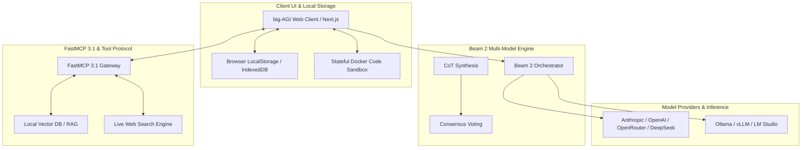

# big-AGI

## What it is
**big-AGI** is a local-first, vendor-neutral, professional AI workspace and multi-model orchestrator. Designed for power users, researchers, software engineers, and AI platform architects, it provides a high-density, ultra-low-latency web interface to query, compare, and orchestrate multiple LLMs simultaneously. Featuring the **Beam 2** multi-model synthesis engine, stateful code execution sandboxes, live web research tools, and native **FastMCP 3.1** protocol support, big-AGI turns individual LLM endpoints into an integrated multi-agent decision workspace.

Rather than locking users into a single AI provider interface, big-AGI routes requests across 20+ commercial APIs (**Claude 5.6**, **GPT-5.6**, **Gemini 4.0 Ultra**, **DeepSeek-V4**) and local inference servers (**Ollama**, **LM Studio**, **vLLM**, **llama.cpp**), while storing all conversation histories and API keys locally in browser storage or encrypted user volumes.

## What problem it solves
Operating across isolated vendor web interfaces introduces severe friction, cognitive overhead, and evaluation blind spots:
- **Single-Model Bias & Blind Spots**: Relying on a single AI model for complex architectural decisions or debugging often leads to undetected hallucinations or suboptimal code. big-AGI queries multiple frontier models in parallel and synthesizes their consensus using Beam 2.
- **Interface Friction & Copy-Paste Fatigue**: Manually opening separate browser tabs, copying code snippets, and comparing outputs across multiple models is tedious. big-AGI presents side-by-side multi-model response streams in a unified high-density UI.
- **Stateless Code Sandbox Execution**: Inspecting and running LLM-generated code typically requires copying code into local terminals. big-AGI embeds stateful execution sandboxes directly into chat turns.
- **Privacy & Key Vendor Lock-in**: SaaS chat platforms store confidential chat logs on third-party servers and tie users to recurring subscription tiers. big-AGI operates local-first with zero intermediate proxy servers between the user's client and the target model endpoints.

## System Architecture & Orchestration Flow



## System Execution Flow

```
[User Multi-Model Request]
            |
            v
   (big-AGI Web Client) ---> [FastMCP 3.1 Tool Gateway Resolution]
                                      |
                                      v
                          [Beam 2 Multi-Model Dispatch]
                                      |
               +----------------------+----------------------+
               |                                             |
               v                                             v
    [Frontier APIs Parallel]                      [Local Inference Nodes]
(Claude 5.6 / GPT-5.6 / DeepSeek-V4)              (vLLM / Ollama Llama 4)
               |                                             |
               +----------------------+----------------------+
                                      |
                                      v
                      [CoT Consensus Voting & Synthesis]
                                      |
                                      v
                 [Stateful Docker Code Sandbox Verification]
                                      |
                                      v
                [Side-by-Side Unified Output & Local Persistence]
```

## Multi-Model Synthesis Pipeline Mechanics

The core differentiating capability of big-AGI lies in its **Beam 2** multi-model orchestration engine. Rather than basic split-screen viewing, Beam 2 executes a formal multi-stage fusion pipeline:

1. **Scatter Phase**: Dispatches identical structured system instructions and user prompts simultaneously across $N$ configured frontier models (e.g., Anthropic Claude 5.6, OpenAI GPT-5.6, Google Gemini 4.0 Ultra, DeepSeek-V4).
2. **Chain-of-Thought (CoT) Extraction**: Parses hidden reasoning traces, self-corrections, and confidence assertions from each response candidate.
3. **Cross-Model Evaluation & Scoring**: Each model output is cross-evaluated against criteria including algorithmic correctness, edge-case coverage, runtime complexity, and hallucination indicators.
4. **Gather & Fusion Synthesis**: A designated synthesis model (or local rule-based aggregator) digests all candidate perspectives, resolves conflicting assertions via majority vote or weighted confidence scoring, and produces a single unified response that retains code diffs, citations, and verified logic.

```
                    +-----------------------------+
                    |      User Prompt Input      |
                    +--------------+--------------+
                                   |
         +-------------------------+-------------------------+
         |                         |                         |
         v                         v                         v
  [Candidate A: Claude]     [Candidate B: GPT]       [Candidate C: DeepSeek]
         |                         |                         |
         +-------------------------+-------------------------+
                                   |
                                   v
                    +-----------------------------+
                    |    Cross-Model Evaluation   |
                    |   (Critique, Diff, Score)   |
                    +--------------+--------------+
                                   |
                                   v
                    +-----------------------------+
                    |      Beam 2 Fusion Pass     |
                    |   (Consensus Synthesis)     |
                    +--------------+--------------+
                                   |
                                   v
                    +-----------------------------+
                    |   Sandbox Execution Verify  |
                    +--------------+--------------+
```

## Where it fits in the stack
**Category**: AI & Knowledge / Professional AI Workspaces. Operating at the **Interface & Orchestration Layer**, big-AGI serves as a local-first control center connecting user browsers, FastMCP 3.1 tool servers, cloud API gateways ([OpenRouter](openrouter.md)), and local inference engines ([ollama](../../services/ollama.md), [vLLM](../infrastructure/vllm.md)).

## Key Features & Functional Modules
- **Beam 2 Multi-Model Synthesis**: Query up to 4 models concurrently, apply multi-perspective Chain-of-Thought (CoT) program pipelines, and merge optimal responses into a single authoritative answer.
- **FastMCP 3.1 Native Integration**: Connect local filesystems, SQL databases, and custom FastMCP servers directly into chat sessions with full parameter inspection and capability discovery.
- **Persistent Code Sandboxing**: Built-in container support for safe, stateful execution of Python, JavaScript, and Bash scripts across conversation turns with automated output capture.
- **Persona & System Prompt Library**: Pre-configured system prompts for specialized engineering personas (e.g., Senior Systems Architect, Security Auditor, Code Optimizer, Site Reliability Engineer).
- **Interactive Markdown & Diagramming**: Native rendering of Mermaid.js architecture diagrams, LaTeX mathematical formulas, interactive tables, and code diff views with syntax coloring.
- **Client-Side Encryption & Key Vault**: Complete data sovereignty with zero telemetry, zero proxy hops, and client-side AES-GCM credential encryption.

## Typical use cases
- **Multi-Model Architecture Consensus**: Querying Claude 5.6, GPT-5.6, and Gemini 4.0 Ultra in parallel to evaluate complex system design tradeoffs, race conditions, and scalability bottlenecks.
- **Interactive Code Debugging & Execution**: Executing generated Python scripts within stateful sandboxes to catch runtime errors immediately without leaving the conversation thread.
- **Local RAG & Knowledge Retrieval**: Connecting local vector databases via FastMCP 3.1 to answer queries using private document repositories and internal codebase indices.
- **Deep Technical Web Research**: Launching multi-step web searches with live URL citations and automated summary extraction via tool-augmented search agents.

## Strengths
- **Zero Lock-In & Local-First**: API keys and session histories remain under user control in local browser storage or encrypted volumes.
- **High Information Density**: UI designed specifically for power users, developers, and researchers who require low latency and high context throughput.
- **Beam 2 Synthesis Engine**: Advanced program-based model reasoning and voting synthesis far superior to simple side-by-side chats.
- **Comprehensive Provider Support**: Direct native compatibility with over 20 commercial and open-source model backends.
- **Enterprise-Ready Self-Hosting**: Containerized deployment with Docker Compose, systemd unit definitions, and reverse proxy compatibility.

## Limitations
- **Power User UI Complexity**: The feature-rich, high-density UI can present a steep learning curve for non-technical casual users.
- **Browser-Bound Cache Management**: Relying on local browser storage requires regular JSON backup exports to avoid loss if browser data is cleared.
- **Token Multipliers**: Parallel multi-model dispatching multiplies input/output token consumption linearly with the number of queried models.

## When to use it
- When verifying mission-critical architectural designs or debugging complex code across multiple frontier models simultaneously.
- When seeking a self-hostable workspace with persistent execution sandboxes and FastMCP 3.1 tool calling built into the UI.
- When requiring complete control over sampling parameters, system prompts, and model routing without cloud vendor lock-in.

## When not to use it
- For basic, low-density conversational chats on mobile devices where lightweight apps suffice.
- In strict enterprise environments that forbid direct client-to-API outbound internet connectivity without an enterprise proxy gateway.
- When single-tenant team collaboration requires simultaneous multi-user real-time shared typing on a single chat turn.

## Feature & Parameter Comparison Matrix

| Capability / Module | Standard Web Chat Clients | Open-WebUI | LibreChat | big-AGI Workspace |
| :--- | :--- | :--- | :--- | :--- |
| **Model Execution Mode** | Single Model Sequential | Single / Split Chat | Split Model Dual | Beam 2 Concurrent Multi-Model Fusion |
| **Code Execution** | Static Syntax Highlighting | Web Sandbox | Sandboxed Container | Stateful Docker Sandbox Container |
| **Tool Protocol** | Closed Vendor Tools | Python Functions | MCP Tools | FastMCP 3.1 Open Protocol Gateway |
| **Data Privacy & Keys** | Remote SaaS Cloud Storage | Self-Hosted PostgreSQL | Self-Hosted MongoDB | Local-First Browser Storage / Self-Hosted |
| **System Prompts** | Fixed System Instructions | Presets & Modelfiles | Presets Library | Dynamic Persona Presets & System Overrides |
| **Architecture Footprint** | Cloud SaaS | Multi-service Docker | Multi-service Docker | Single Container / Lightweight Node.js |
| **Consensus Synthesis** | None | Manual Comparison | Side-by-side View | Automated CoT Cross-Evaluation & Voting |

## Getting started

### 1. Web Access
Access big-AGI directly in your browser at [app.big-agi.com](https://app.big-agi.com/) and configure your API keys in the settings menu.

### 2. Self-Hosted Docker Deployment
Deploy a persistent, self-hosted container instance on your local machine or server node:

```bash
docker run -d \
  --name big-agi \
  -p 3000:3000 \
  -e NEXT_PUBLIC_SHOW_BENCHMARKS=false \
  ghcr.io/enricoros/big-agi:latest
```

Open `http://localhost:3000` to access your self-hosted workspace.

### 3. Production Docker Compose Stack with Sandbox & Vector Gateway

```yaml
version: "3.9"

services:
  big-agi:
    image: ghcr.io/enricoros/big-agi:latest
    container_name: big-agi-app
    restart: unless-stopped
    ports:
      - "3000:3000"
    environment:
      - NODE_ENV=production
      - NEXT_PUBLIC_SHOW_BENCHMARKS=true
      - NEXT_PUBLIC_DEFAULT_SYSTEM_PROMPT=You are a senior systems architect and software engineer.
      - MCP_GATEWAY_URL=http://fastmcp-gateway:8000/mcp
    depends_on:
      fastmcp-gateway:
        condition: service_healthy
    networks:
      - ai-mesh

  fastmcp-gateway:
    image: python:3.11-slim
    container_name: fastmcp-gateway
    restart: unless-stopped
    volumes:
      - ./mcp_servers:/opt/mcp:ro
    working_dir: /opt/mcp
    command: >
      sh -c "pip install --no-cache-dir fastmcp pydantic uvicorn httpx &&
             python -m uvicorn server:app --host 0.0.0.0 --port 8000"
    ports:
      - "8000:8000"
    healthcheck:
      test: ["CMD", "python3", "-c", "import urllib.request; urllib.request.urlopen('http://localhost:8000/health').read()"]
      interval: 10s
      timeout: 5s
      retries: 3
    networks:
      - ai-mesh

  code-sandbox:
    image: python:3.11-alpine
    container_name: big-agi-sandbox
    restart: unless-stopped
    network_mode: none
    mem_limit: 2g
    cpus: 2.0
    command: sleep infinity

networks:
  ai-mesh:
    driver: bridge
```

## CLI examples

### 1. Local Development Build via Node.js
```bash
git clone https://github.com/enricoros/big-AGI.git && cd big-AGI
npm install
npm run dev
```

### 2. Updating Docker Container Build
```bash
docker pull ghcr.io/enricoros/big-agi:latest
docker stop big-agi && docker rm big-agi
docker run -d --name big-agi -p 3000:3000 ghcr.io/enricoros/big-agi:latest
```

### 3. Deploying to Private Vercel Instance
```bash
npx vercel --prod
```

### 4. Health and Model Endpoint Probing
```bash
# Verify local instance response
curl -s http://localhost:3000/api/health | jq .

# Inspect local Ollama models reachable by big-AGI
curl -s http://localhost:11434/api/tags | jq '.models[].name'
```

## API examples

### Production FastMCP 3.1 Implementation & FastMCP Server

```python
import asyncio
from typing import List, Dict, Any, Optional
from fastmcp import FastMCP
from pydantic import BaseModel, Field, ConfigDict

mcp = FastMCP(
    name="big-AGI Knowledge Gateway",
    version="3.1.0",
    description="FastMCP 3.1 server providing vector search and Beam 2 context to big-AGI workspace"
)

class SearchQuery(BaseModel):
    model_config = ConfigDict(extra="forbid", frozen=True)

    query: str = Field(..., min_length=3, max_length=500, description="Semantic search query string")
    top_k: int = Field(default=3, ge=1, le=10, description="Maximum number of context chunks to retrieve")
    filter_tag: Optional[str] = Field(default=None, description="Optional tag filter for document indexing")

class SearchHit(BaseModel):
    model_config = ConfigDict(extra="forbid", frozen=True)

    doc_id: str = Field(..., description="Unique document chunk identifier")
    content: str = Field(..., description="Extracted content text")
    relevance_score: float = Field(..., ge=0.0, le=1.0, description="Cosine relevance score")

class SearchResponse(BaseModel):
    model_config = ConfigDict(extra="forbid", frozen=True)

    status: str = Field(default="success", description="Status of the search query")
    results: List[SearchHit] = Field(..., description="Ranked list of matching hits")
    query_processed: str = Field(..., description="Normalized query processed")

@mcp.tool(
    name="search_knowledge_base",
    description="Executes semantic vector search across local homelab documents for big-AGI sessions"
)
def search_knowledge_base_tool(query: str, top_k: int = 3, filter_tag: Optional[str] = None) -> dict:
    req = SearchQuery(query=query, top_k=top_k, filter_tag=filter_tag)
    hits = [
        SearchHit(doc_id="arch-001", content="big-AGI local storage uses IndexedDB and browser storage.", relevance_score=0.95),
        SearchHit(doc_id="arch-002", content="Beam 2 multi-model synthesis applies CoT consensus voting.", relevance_score=0.89),
        SearchHit(doc_id="arch-003", content="FastMCP 3.1 gateway enables zero-proxy tool invocation.", relevance_score=0.82)
    ][:req.top_k]
    response = SearchResponse(status="success", results=hits, query_processed=req.query)
    return response.model_dump(mode="json")

if __name__ == "__main__":
    mcp.run()
```

## Programmatic API Examples (Python & Pydantic v2)

```python
import asyncio
from typing import List, Optional
from pydantic import BaseModel, Field, ValidationError, ConfigDict

class ModelWeight(BaseModel):
    model_config = ConfigDict(extra="forbid", frozen=True)

    model_id: str = Field(..., alias="modelId", description="Target model API identifier")
    weight: float = Field(default=1.0, ge=0.0, le=1.0, description="Voting weight")

class Beam2Config(BaseModel):
    model_config = ConfigDict(extra="forbid", frozen=True, populate_by_name=True)

    synthesis_mode: str = Field("cot-merge", alias="synthesisMode")
    candidate_models: List[ModelWeight] = Field(..., alias="candidateModels")
    max_tokens: int = Field(2048, alias="maxTokens", ge=256, le=16384)
    temperature: float = Field(0.2, ge=0.0, le=2.0)
    system_instruction: Optional[str] = Field(None, alias="systemInstruction")

async def validate_beam_orchestration():
    raw_payload = {
        "synthesisMode": "majority-consensus-cot",
        "candidateModels": [
            {"modelId": "anthropic/claude-5.6-sonnet", "weight": 1.0},
            {"modelId": "openai/gpt-5.6", "weight": 0.9},
            {"modelId": "google/gemini-4.0-ultra", "weight": 0.8}
        ],
        "maxTokens": 4096,
        "temperature": 0.3,
        "systemInstruction": "Synthesize the best system design tradeoffs and identify hidden race conditions."
    }

    try:
        beam_cfg = Beam2Config.model_validate(raw_payload)
        print("Beam 2 Orchestration Config Validated Successfully:")
        print(f"Mode: {beam_cfg.synthesis_mode}")
        print(f"Active Candidate Models: {len(beam_cfg.candidate_models)}")
        for model in beam_cfg.candidate_models:
            print(f" - {model.model_id}: weight={model.weight}")
        return beam_cfg
    except ValidationError as e:
        print("Validation error in Beam config:", e)
        raise

if __name__ == "__main__":
    asyncio.run(validate_beam_orchestration())
```

## Production systemd Service Unit

```ini
[Unit]
Description=big-AGI Web Application Workspace (Docker Container)
After=docker.service network-online.target
Requires=docker.service
Wants=network-online.target

[Service]
Type=simple
User=homelab
WorkingDirectory=/opt/big-agi
ExecStart=/usr/bin/docker run --rm --name big-agi-service -p 3000:3000 -e NEXT_PUBLIC_SHOW_BENCHMARKS=false ghcr.io/enricoros/big-agi:latest
ExecStop=/usr/bin/docker stop big-agi-service
Restart=always
RestartSec=10

# Security Hardening Guardrails
ProtectSystem=full
PrivateTmp=true
NoNewPrivileges=true
CapabilityBoundingSet=CAP_NET_BIND_SERVICE

[Install]
WantedBy=multi-user.target
```

## Diagnostic & Troubleshooting Matrix

| Issue / Symptom | Root Cause | Verification Command | Remediation Procedure |
| :--- | :--- | :--- | :--- |
| **`HTTP 401 Unauthorized` on Model Calls** | Missing or invalid API keys in big-AGI browser settings. | Check browser network tab for failed `/api/llms` POST requests. | Open settings drawer, re-enter model API keys (e.g. Anthropic/OpenAI), and verify network connectivity. |
| **FastMCP 3.1 Gateway Connection Failed** | Target MCP server offline or blocked by browser CORS policy. | `curl -s http://localhost:8000/health` | Ensure local FastMCP server is running on localhost port with CORS origin `http://localhost:3000` enabled. |
| **Docker Code Sandbox Timeouts** | Code execution container lacking allocated CPU/memory resources or hanging script. | `docker stats big-agi-sandbox` | Adjust Docker runtime limits (`--memory=2g --cpus=2.0`) in sandbox deployment configuration. |
| **IndexedDB Quota Exceeded** | Browser storage quota reached due to hundreds of cached multi-model sessions. | Check storage usage via Chrome DevTools > Application > Storage. | Export chat sessions to JSON backup file via big-AGI settings, then clear old chat histories in browser. |
| **High Latency in Beam 2 Synthesis** | Slowest candidate model delaying the gather phase. | Inspect individual stream chunk timers in big-AGI execution stats. | Set per-model timeout constraints or exclude high-latency endpoints from synchronous fusion passes. |
| **CORS Errors on Local LLMs** | Local inference server (Ollama/vLLM) rejecting origins. | `curl -H "Origin: http://localhost:3000" -v http://localhost:11434/api/tags` | Configure `OLLAMA_ORIGINS="*"` or `vllm --allowed-origins "*"` on the inference server. |

## Operational Guardrails & Security Best Practices

- **Local Key Storage Isolation**: API keys entered into big-AGI remain in local browser storage. Avoid syncing browser state across unsecured public machines.
- **Docker Sandbox Isolation**: Always execute untrusted LLM-generated Python or Bash code within isolated Docker container sandboxes with network access disabled (`--network none`).
- **Beam 2 Token Cost Control**: Running 4 frontier models simultaneously (e.g. Claude 5.6 + GPT-5.6) increases API usage by 4x. Configure `maxTokens` limits in Beam settings to control expense.
- **Automated Backup Regimen**: Periodically trigger JSON export dumps of workspace sessions to local filesystem backup stores to guard against browser cookie/cache clearing.

## Related tools / concepts
- [LobeHub](lobehub.md) — Visual multi-agent chat interface.
- [OpenRouter](openrouter.md) — Unified API aggregator for intelligent model routing.
- [FastMCP 3.1](../../knowledge_base/patterns/tool-calling-and-mcp.md) — Open protocol for agent tools.
- [AnythingLLM](anythingllm.md) — Local document RAG workspace.
- [Claude Code](../development_ops/claude-code.md) — CLI software engineering agent.

## Sources / references
- [big-AGI Official Portal](https://big-agi.com/)
- [big-AGI GitHub Repository](https://github.com/enricoros/big-AGI)
- [big-AGI Release Documentation & Changelog](https://big-agi.com/docs/changelog)

---
## Contribution Metadata
- Last reviewed: 2027-01-07
- Confidence: high
