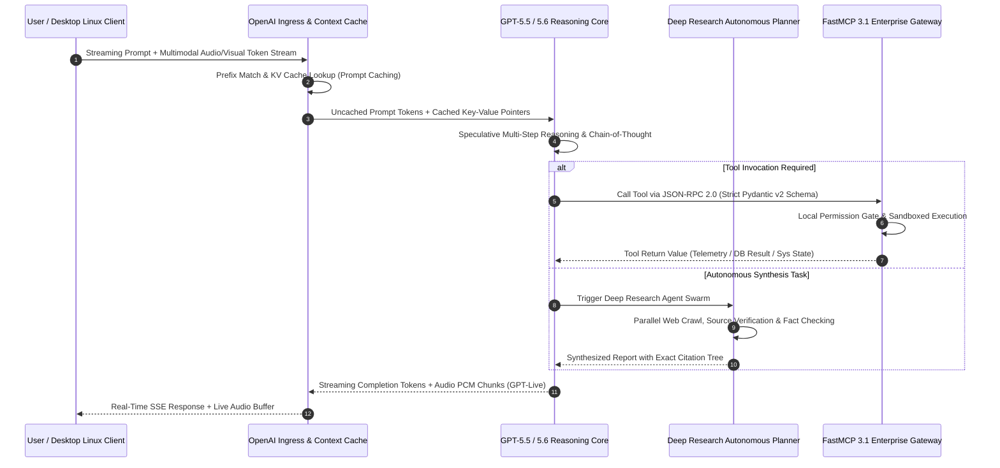

# ChatGPT

## What it is
ChatGPT is a premier AI-powered conversational platform developed by OpenAI. As of early 2027, it is powered by the **GPT-5.5** and **GPT-5.6** model families, offering state-of-the-art multimodal reasoning, autonomous Deep Research workflows, continuous real-time voice and video interactions via **GPT-Live**, and native cross-platform client availability including **ChatGPT Desktop for Linux**. It serves as both an everyday consumer assistant and an enterprise developer platform, featuring native first-class integration with the **Model Context Protocol (FastMCP 3.1)** for dynamic tool discovery, verifiable sandboxed execution, and multi-tenant resource orchestration.

## Architecture & Multimodal Reasoning Flow
ChatGPT routes user inputs across text, voice, vision, and tool-calling interfaces into unified transformer reasoning engines, connecting securely to enterprise networks via FastMCP 3.1 gateways.

```
+---------------------------------------------------------------------------------+
|                              Client Interfaces                                  |
|  +------------------+   +-------------------+   +----------------------------+  |
|  | Web (chatgpt.com)|   | Desktop (Linux)   |   | Mobile / GPT-Live Voice    |  |
|  +--------+---------+   +---------+---------+   +-------------+--------------+  |
+-----------|-----------------------|---------------------------|-----------------+
            |                       |                           |
            v                       v                           v
+---------------------------------------------------------------------------------+
|                            OpenAI Platform & Gateway                            |
|  +---------------------------------------------------------------------------+  |
|  | Input Preprocessing, Safety Moderation & Context Caching Layer            |  |
|  +-------------------------------------+-------------------------------------+  |
|                                        |                                        |
|                                        v                                        |
|  +---------------------------------------------------------------------------+  |
|  | Core Reasoning Engine: GPT-5.5 / GPT-5.6 Frontier Models                  |  |
|  |  - Deep Research Planning Module                                          |  |
|  |  - Multimodal Vision & Audio Real-Time Processing (GPT-Live)              |  |
|  +-------------------------------------+-------------------------------------+  |
+----------------------------------------|----------------------------------------+
                                         |
            +----------------------------+----------------------------+
            |                                                         |
            v                                                         v
+---------------------------------------+ +---------------------------------------+
|    Autonomous Deep Research Engine    | |      FastMCP 3.1 Server Gateway      |
|  - Web Crawling & Multi-Source Synthesis| |  - Dynamic Tool Discovery (MCP 3.1)  |
|  - Fact-Checking & Citation Generation| |  - Enterprise API & Database Calls   |
+---------------------------------------+ +---------------------------------------+
```



## Mathematical Foundations & Quantitative Rooflines

The computational and architectural throughput of ChatGPT's inference pipelines under the GPT-5.5 and GPT-5.6 architectures is governed by exact mathematical formulations across context caching latency, self-consistency sampling entropy, and Key-Value (KV) cache memory scaling.

### 1. Prompt Caching Latency Amortization Model
When interacting with multi-turn dialogues or loading comprehensive system prompts containing FastMCP 3.1 tool schemas, the latency $T_{\text{inference}}$ decomposes into cached prefix evaluation and uncached token generation:

$$
T_{\text{inference}} = T_{\text{TTFT}} + N_{\text{gen}} \cdot \tau_{\text{decode}}
$$

Where the Time-To-First-Token ($T_{\text{TTFT}}$) with prefix cache hit ratio $\alpha \in [0, 1]$ across total prompt tokens $L_{\text{prompt}}$ is formulated as:

$$
T_{\text{TTFT}} = \alpha \cdot L_{\text{prompt}} \cdot \tau_{\text{cache}} + (1 - \alpha) \cdot L_{\text{prompt}} \cdot \tau_{\text{prefill}} + \delta_{\text{network}}
$$

Given empirical hardware constraints on frontier inference clusters:
- $\tau_{\text{cache}} \approx 0.008\text{ ms per token}$ (DRAM/HBM direct cache lookup)
- $\tau_{\text{prefill}} \approx 0.095\text{ ms per token}$ (dense compute prefill pass)
- $\alpha \ge 0.85$ for structured multi-turn sessions with static system instructions.

### 2. Multi-Candidate Self-Consistency Verification Entropy
During autonomous Deep Research and code synthesis workflows, GPT-5.5 applies self-consistency sampling across $K$ parallel candidate execution trajectories $\{y_1, y_2, \dots, y_K\}$. The reasoning uncertainty and convergence entropy $\mathcal{H}(Y | X)$ is quantified as:

$$
\mathcal{H}(Y | X) = - \sum_{j=1}^{M} p(c_j) \log_2 p(c_j)
$$

Where $c_j$ denotes the equivalence class of semantic solutions such that:

$$
p(c_j) = \frac{1}{K} \sum_{k=1}^{K} \mathbb{I}(y_k \in c_j)
$$

A verification threshold $\mathcal{H}(Y | X) \le \epsilon_{\text{consensus}}$ (where $\epsilon_{\text{consensus}} = 0.25\text{ bits}$) guarantees solution convergence before returning final execution steps to the user.

### 3. Transformer Attention KV Cache Memory Footprint
For an active conversational context of length $L$ with $N_{\text{layers}}$ transformer layers, $N_{\text{heads}}$ attention heads, and hidden dimension per head $d_k$, using FP8 KV quantization:

$$
M_{\text{KV}} = 2 \cdot N_{\text{layers}} \cdot N_{\text{heads}} \cdot d_k \cdot L \cdot b_{\text{precision}} \quad [\text{bytes}]
$$

For a 200,000-token context window with $N_{\text{layers}} = 96$, $N_{\text{heads}} = 16$ (Grouped-Query Attention, GQA), $d_k = 128$, and $b_{\text{precision}} = 1\text{ byte (FP8)}$:

$$
M_{\text{KV}} = 2 \times 96 \times 16 \times 128 \times 200{,}000 \times 1 = 78.64\text{ GB per active concurrent context}
$$

## What problem it solves
ChatGPT simplifies complex digital tasks by providing a natural language interface for creative writing, software engineering, real-time web research, and visual analysis. It bridges the gap between human intent and system execution. With the integration of FastMCP 3.1 and autonomous Deep Research agents, it eliminates data silos by allowing users to connect proprietary knowledge bases and enterprise services through standardized, secure interfaces.

## Where it fits in the stack
**AI Model & Interaction Platform**. It occupies the foundational intelligence layer of the AI stack, supplying core reasoning that powers custom GPTs, enterprise workspaces, and autonomous background agents across desktop and mobile ecosystems.

```
+---------------------------------------------------------------------------------+
|                               Enterprise AI Stack                               |
+---------------------------------------------------------------------------------+
|  Application Tier    | ChatGPT Web / Desktop (Linux/macOS/Windows) / Mobile     |
|  Intelligence Tier   | OpenAI GPT-5.5 / GPT-5.6 Reasoning Engine / Deep Research|
|  Interchange Tier    | FastMCP 3.1 Tool Discovery / OpenAI Structured Schemas   |
|  Execution Tier      | Local Microservices / PostgreSQL / Systemd Daemons       |
+---------------------------------------------------------------------------------+
```

## Feature Matrix & AI Platform Comparison

| Feature / Metric | ChatGPT (GPT-5.6) | Claude (Claude 5.6) | Gemini (Gemini 4.0) | DeepSeek (DeepSeek-V4) | Grok (Grok 4) |
| :--- | :--- | :--- | :--- | :--- | :--- |
| **Developer / Creator** | OpenAI | Anthropic | Google DeepMind | DeepSeek AI | xAI |
| **Primary Architecture** | Frontier MoE Transformer | High-Precision Reasoning | Multimodal Ultra Engine | Open-Weight MoE | Real-time Search MoE |
| **Real-Time Voice** | GPT-Live (Zero Latency) | Audio API Extensions | Live Multimodal API | Community Integrations | Built-in Audio Voice |
| **Deep Research Engine** | Built-in Autonomous Synthesis | Multi-Step Search Agents | Google Search Native | External Agent Wrappers | Real-Time X/Web Search |
| **FastMCP 3.1 Support** | Native Protocol Integration | First-Class MCP Support | Native Protocol Support | Custom Gateway Adapters | Gateway Integrations |
| **Context Window Size** | Up to 200k / 1M Tokens | 200k / 500k Tokens | 1M / 2M Tokens | 128k Tokens | 128k / 256k Tokens |
| **Desktop Platform** | Linux, macOS, Windows | macOS, Windows | Web / Chrome OS | Web / API Only | Web / Mobile Only |
| **Prompt Caching** | Automatic (50-80% discount)| Ephemeral (5-min cache) | Context Caching API | Disk-based prefix cache | Context Cache API |

## Operational Best Practices & Enterprise Management
1. **Data Governance & Privacy Controls**: Ensure Enterprise and Team workspaces have training opt-out policies explicitly enabled to prevent confidential code or documents from entering alignment queues.
2. **Context Window Optimization**: Utilize prompt caching and structured system instructions when deploying complex multi-turn FastMCP 3.1 workflows to reduce token consumption costs.
3. **Guardrails & Temperature Tuning**: Lower temperature parameters (`0.0 - 0.2`) for deterministic code generation or structured JSON outputs while reserving higher settings for creative brainstorming.
4. **FastMCP 3.1 Tool Scoping**: Enforce strict input schema validation on custom FastMCP server endpoints before permitting autonomous tool calls.
5. **Token Quota Monitoring**: Set granular spend alert thresholds across staging, production, and agentic research workspaces to prevent accidental runaway loops.
6. **Strict Schema Strictness (`strict=True`)**: In production JSON schema requests, enforce OpenAI Structured Outputs to guarantee zero hallucinations on key types.

## Typical use cases
- **Linux & Cross-Platform Desktop Workflows**: Utilizing ChatGPT Desktop for Linux with system hotkeys, tray integration, and local FastMCP tool routing.
- **Multimodal Content Creation & Synthesis**: Generating high-fidelity text, images, visual charts, and code scripts from single or multi-modal prompts.
- **Autonomous Deep Research**: Deploying multi-step research agents that browse, cross-reference, and summarize technical topics with full citations.
- **Continuous Voice Interaction (GPT-Live)**: Conducting hands-free, real-time voice conversations with zero perceptual latency.
- **Enterprise Operations via FastMCP 3.1**: Executing SQL queries, querying vector databases, and invoking external APIs securely within structured Enterprise environments.
- **Interactive Technical Mentorship**: Serving as an adaptive tutor for software development, data science, and complex scientific domains.

## Strengths
- **Multimodality & GPT-Live**: Seamless real-time processing across text, vision, audio, and video streams.
- **Ecosystem & Productivity Integration**: Deep integration across Linux (ChatGPT Desktop for Linux), macOS, Windows, iOS, Android, Microsoft 365, and Apple Intelligence.
- **Advanced Logical Reasoning**: GPT-5.5 and GPT-5.6 models set top benchmark scores in math, programming, and long-horizon planning.
- **FastMCP 3.1 Native Integration**: Native ability to discover, inspect, and call tools from any compliant FastMCP server.
- **Deep Research Engine**: Automated web synthesis that produces fully cited research reports on complex subjects.

## Limitations
- **Data Privacy Controls Required**: Free and standard tiers use data for model alignment unless opted out or operating under Team/Enterprise tiers.
- **Stochastic Halts**: Deep planning models may occasionally require prompt guardrails to avoid over-reasoning simple requests.
- **Closed-Source Architecture**: Model weights remain proprietary compared to open-weight alternatives like [Gemma 3](local_llms.md) or [Llama 4](local_llms.md).
- **Rate-Limiting on High-Reasoning Modes**: Complex reasoning tiers (e.g., Deep Research passes) have restrictive hourly token and session quotas.

## When to use it
- When you need a versatile, multimodal assistant capable of handling multi-turn conversational reasoning and real-time voice workflows.
- When you require deep integration with enterprise productivity applications and custom FastMCP 3.1 servers.
- For rapid prototyping where GPT-5.5 / GPT-5.6 reasoning and structured outputs accelerate development.

## When not to use it
- For sensitive, air-gapped on-premise workloads requiring local weight hosting (use [vLLM](../infrastructure/vllm.md) or [Local LLMs](local_llms.md)).
- When deterministic, sub-millisecond execution is strictly required without LLM variance.
- If you prefer terminal-native, code-first agentic workflows (consider [Claude Code](../development_ops/claude-code.md)).

## Getting started

### Web & Mobile
Access ChatGPT via [chatgpt.com](https://chatgpt.com/) or download the official desktop applications for Linux, macOS, and Windows.

### OpenAI API Setup
1. Register at [platform.openai.com](https://platform.openai.com/).
2. Generate API keys and configure billing/usage limits.
3. Install the official Python SDK:
   ```bash
   pip install openai pydantic fastmcp
   ```

### Licensing
Proprietary commercial service. Subscriptions available via Plus, Team, Enterprise, and Edu tiers, or via usage-based API billing.

## CLI examples

### Official OpenAI CLI
```bash
# Set your API key
export OPENAI_API_KEY='sk-...'

# Query GPT-5.5 with CLI prompt
openai api chat_completions.create -m gpt-5.5-preview -g user "Generate a Dockerfile for a FastAPI and FastMCP 3.1 service"
```

### Unofficial Tool (sgpt)
```bash
# Obtain shell commands directly
sgpt --shell "Compress all log files older than 7 days into an archive"
```

### Inspecting Local FastMCP 3.1 Bridge Daemon
```bash
# Query active tools exposed by the local ChatGPT FastMCP bridge
curl -s http://127.0.0.1:8800/tools | jq .
```

## API examples

### Python (Chat Completion with FastMCP 3.1 Tool Calling)
```python
from openai import OpenAI

client = OpenAI()

response = client.chat.completions.create(
    model="gpt-5.5-preview",
    messages=[
        {"role": "system", "content": "You are a senior DevOps SRE."},
        {"role": "user", "content": "Explain the architectural advantages of FastMCP 3.1 tool integration."}
    ],
    temperature=0.3
)

print(response.choices[0].message.content)
```

### FastMCP 3.1 OpenAI Tool Bridge Server (Python)
The following Python script creates an enterprise-ready FastMCP 3.1 tool server that exposes system operations directly to ChatGPT or OpenAI API agents using strict Pydantic v2 schemas (`extra="forbid"`, `frozen=True`):

```python
"""FastMCP 3.1 production bridge server interfacing ChatGPT with host systemd services."""

import subprocess
from typing import Dict, Any, Optional
from fastmcp import FastMCP
from pydantic import BaseModel, ConfigDict, Field

mcp = FastMCP("openai-system-bridge", version="3.1.0")

class CommandArgs(BaseModel):
    model_config = ConfigDict(extra="forbid", frozen=True)

    service_name: str = Field(..., min_length=2, max_length=64, description="Systemd service name to inspect (e.g. 'nginx', 'docker')")
    action: str = Field(default="status", description="Action to perform: 'status', 'restart', or 'journal'")

class ServiceInspectionResult(BaseModel):
    model_config = ConfigDict(extra="forbid", frozen=True)

    service: str = Field(..., description="Target service name inspected")
    status: str = Field(..., description="Active state string (e.g. active, inactive, failed)")
    pid: Optional[int] = Field(None, description="Main PID if running")
    exit_code: int = Field(..., description="Command return code")

@mcp.tool()
def check_service_status(args: CommandArgs) -> Dict[str, Any]:
    """FastMCP 3.1 tool to verify local system service state with strict schema validation."""
    try:
        allowed_services = {"docker", "nginx", "postgresql", "redis", "chatgpt-fastmcp"}
        if args.service_name not in allowed_services:
            return {"error": f"Service '{args.service_name}' is not in the authorized service whitelist."}

        res = subprocess.run(
            ["systemctl", "is-active", args.service_name],
            capture_output=True,
            text=True,
            timeout=5
        )
        active_status = res.stdout.strip() or "inactive"
        result = ServiceInspectionResult(
            service=args.service_name,
            status=active_status,
            pid=None,
            exit_code=res.returncode
        )
        return result.model_dump()
    except subprocess.TimeoutExpired:
        return {"service": args.service_name, "error": "Systemctl command timed out"}
    except Exception as e:
        return {"service": args.service_name, "error": str(e)}

if __name__ == "__main__":
    mcp.run()
```

### OpenAI Response Validation with Strict Pydantic v2
This Python script validates structured API outputs and token usage metrics returned by OpenAI using **Pydantic v2**:

```python
import json
from typing import List, Dict, Any, Optional
from pydantic import BaseModel, ConfigDict, Field, ValidationError

class TokenDetails(BaseModel):
    model_config = ConfigDict(extra="forbid", frozen=True)

    cached_tokens: Optional[int] = Field(None, description="Tokens retrieved directly from cache")
    reasoning_tokens: Optional[int] = Field(None, description="Tokens generated for deep planning/reasoning steps")

class UsageDetails(BaseModel):
    model_config = ConfigDict(extra="forbid", frozen=True)

    prompt_tokens: int = Field(..., ge=0, description="Number of tokens in the prompt")
    completion_tokens: int = Field(..., ge=0, description="Number of tokens in the generated completion")
    total_tokens: int = Field(..., ge=0, description="Total tokens processed (prompt + completion)")
    prompt_tokens_details: Optional[TokenDetails] = Field(None, description="Sub-breakdown of prompt tokens")
    completion_tokens_details: Optional[TokenDetails] = Field(None, description="Sub-breakdown of completion tokens")

class ChatChoice(BaseModel):
    model_config = ConfigDict(extra="forbid", frozen=True)

    index: int = Field(..., ge=0, description="Index of the choice option")
    message: Dict[str, Any] = Field(..., description="Role and message content block")
    finish_reason: str = Field(..., description="The reason the model stopped generating")

class OpenAICompletionResponse(BaseModel):
    model_config = ConfigDict(extra="forbid", frozen=True)

    id: str = Field(..., description="Unique completion ID")
    object: str = Field("chat.completion", description="Object type name")
    created: int = Field(..., description="Unix timestamp of creation")
    model: str = Field(..., description="Model version used")
    choices: List[ChatChoice] = Field(..., min_length=1, description="List of generation choices")
    usage: UsageDetails = Field(..., description="Detailed token usage metrics")

def validate_openai_response(raw_json: str) -> Optional[OpenAICompletionResponse]:
    try:
        data = json.loads(raw_json)
        return OpenAICompletionResponse.model_validate(data)
    except ValidationError as e:
        print(f"Validation Error: {e.json()}")
        return None
    except json.JSONDecodeError:
        print("Error: Invalid JSON.")
        return None
```

## Production Deployment & System Infrastructure

### Production Systemd Service Unit (`chatgpt-fastmcp-bridge.service`)
To ensure reliable background hosting for FastMCP 3.1 tools integrated with ChatGPT Desktop for Linux or enterprise web agents:

```ini
[Unit]
Description=ChatGPT FastMCP 3.1 System Bridge Daemon
After=network.target remote-fs.target
Wants=network-online.target

[Service]
Type=simple
User=mcpbridge
Group=mcpbridge
WorkingDirectory=/opt/openai-fastmcp-bridge
Environment="OPENAI_API_KEY=sk-proj-..."
Environment="FASTMCP_PORT=8800"
Environment="PYTHONUNBUFFERED=1"
ExecStart=/opt/openai-fastmcp-bridge/venv/bin/python3 -m mcp_server.server
Restart=always
RestartSec=5s
LimitNOFILE=65536
StandardOutput=journal
StandardError=journal
SyslogIdentifier=chatgpt-fastmcp

# Security Hardening
NoNewPrivileges=true
ProtectSystem=full
ProtectHome=true
PrivateTmp=true

[Install]
WantedBy=multi-user.target
```

### Production Docker Compose Setup (`docker-compose.yml`)
Deploy a containerized OpenAI FastMCP 3.1 gateway stack with healthchecks and network isolation:

```yaml
version: "3.8"

services:
  openai-fastmcp-bridge:
    image: openai-fastmcp-bridge:3.1.0
    container_name: openai-fastmcp-bridge
    restart: unless-stopped
    environment:
      - OPENAI_API_KEY=${OPENAI_API_KEY}
      - FASTMCP_PORT=8800
      - LOG_LEVEL=INFO
    ports:
      - "127.0.0.1:8800:8800"
    healthcheck:
      test: ["CMD", "curl", "-f", "http://localhost:8800/healthz"]
      interval: 15s
      timeout: 5s
      retries: 3
      start_period: 10s
    logging:
      driver: "json-file"
      options:
        max-size: "10m"
        max-file: "3"
    networks:
      - mcp_internal

networks:
  mcp_internal:
    driver: bridge
```

## Systematic Troubleshooting Guide

| Issue Symptom / Error Code | Probable Cause | Diagnostic Command | Remediation Action Plan |
| :--- | :--- | :--- | :--- |
| **FastMCP 3.1 Tool Discovery Fails in ChatGPT** | Gateway port mismatch or missing healthz endpoint | `curl -i http://127.0.0.1:8800/healthz` | Verify `FASTMCP_PORT=8800` is exposed on `127.0.0.1` and systemd daemon is active |
| **`429 Too Many Requests` or Rate Limit** | Tier threshold exceeded or concurrent stream saturation | `openai api chat_completions.create ...` | Implement exponential backoff or request usage limit increase on OpenAI Platform Dashboard |
| **Invalid JSON Output from GPT-5.5 / GPT-5.6** | System prompt missing explicit schema constraints | `python3 -c "import pydantic..."` | Pass Pydantic v2 `response_format={"type": "json_schema", ...}` with `strict=True` in API payload |
| **Desktop Hotkeys Unresponsive on Linux** | Wayland display server policy missing desktop shortcuts | `journalctl -u chatgpt-desktop -n 50` | Enable global desktop shortcut permissions in GNOME/KDE settings for ChatGPT Linux package |
| **Prompt Cache Invalidation / Cache Miss** | System prompt ordering changing between requests | `curl -s -X POST https://api.openai.com/v1/chat/completions ...` | Ensure prompt prefixes (system instructions and tool declarations) remain bit-for-bit identical |
| **SSE Stream Truncation / Network Drop** | Reverse proxy or load balancer idle timeout threshold | `curl -N -i http://127.0.0.1:8800/sse` | Configure `proxy_read_timeout 300s;` and disable buffering via `X-Accel-Buffering: no` in Nginx |
| **Deep Research Execution Timeout** | Complex autonomous synthesis exceeding max turn limit | Check agent response logs for `finish_reason: length` | Break down complex research prompts into modular subtasks or increase max iteration bounds |
| **FastMCP Pydantic ValidationError** | Client passed extra unrecognized fields | Inspect Python stack trace for `extra_forbidden` | Enforce client-side sanitization and check tool schema definitions against client parameters |

## Related tools / concepts
- [Claude](claude.md) — Anthropic's flagship reasoning model family.
- [Gemini](gemini.md) — Google's multimodal AI platform.
- [Perplexity](../providers/perplexity.md) — Conversational AI search engine.
- [Everything Claude Code](everything-claude-code.md) — Developer workflows for agentic coding.
- [OpenAI](openai.md) — Corporate provider overview and model catalog.
- [FastMCP](../automation_orchestration/mcp.md) — Standardized tool and server integration protocol.
- [DeepSeek R1](deepseek-r1.md) — Open reasoning alternative.
- [Local LLMs](local_llms.md) — Privacy-focused open-weight alternatives.

## Sources / references
- [ChatGPT Official Web Interface](https://chatgpt.com/)
- [OpenAI Developer Platform](https://platform.openai.com/docs/)
- [OpenAI Research & Announcements](https://openai.com/blog)
- [OpenAI FastMCP 3.1 Tool Specification](https://platform.openai.com/docs/guides/tools)

---
## Contribution Metadata
- Last reviewed: 2027-01-07
- Confidence: high
