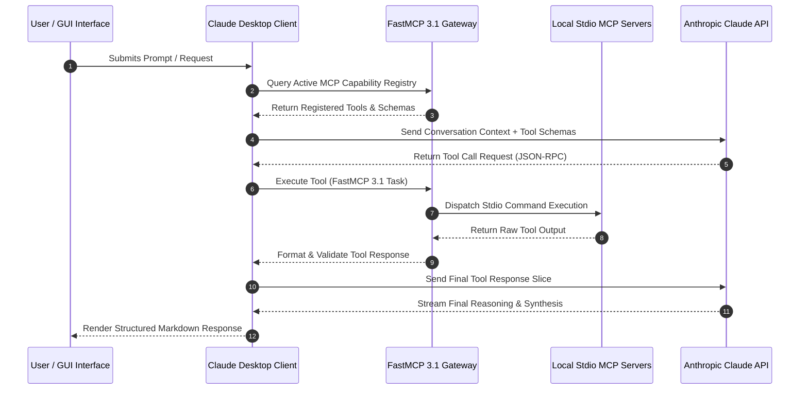

# Claude Desktop

## What it is
Claude Desktop is a native application for macOS and Windows that brings Anthropic's Claude AI models directly to the user's workspace. It serves as the primary host for the Model Context Protocol (MCP), allowing Claude to interact with local files, data, and tools securely. As of early January 2027, it is the reference implementation for "Agentic Desktop" workflows, natively supporting **MCP 3.1 / FastMCP 3.1 Task Protocol** and frontier models like **Claude 5.6**, **GPT-5.6**, **Gemini 4.0 Ultra**, **Gemma 4**, **DeepSeek-V4**, and **Qwen 3.6 VL**.

## System Architecture & Interaction Flow



## What problem it solves
It overcomes the limitations of browser-based AI by providing a secure, local execution environment. Key problems solved include:
- **Local Context**: Direct access to local files and system resources through MCP without uploading sensitive data to public cloud environments.
- **Deep Integration**: Seamlessly integrates into desktop workflows via keyboard shortcuts, system-level hooks, and direct file drag-and-drop operations.
- **Tool Orchestration**: Serves as a standard host for MCP servers, enabling Claude to perform complex actions like searching local databases, interacting with desktop APIs, or managing terminal sessions.
- **Multi-Agent Coordination**: With MCP 3.1 / FastMCP 3.1 Task Protocol integrations, the desktop app acts as a local coordinator for sub-agents executing background micro-missions.

## Key Feature Comparison Matrix

| Capability / Feature | Claude Desktop | Claude Code CLI | ChatGPT Desktop App | Open WebUI |
| :--- | :--- | :--- | :--- | :--- |
| **Primary Interface** | Native macOS / Windows GUI | Terminal CLI / Headless | Native macOS / Windows GUI | Web Browser Application |
| **MCP Integration** | Native Host (MCP 3.1 Stdio/SSE) | Native Client (MCP 3.1) | Custom Developer Extensions | Custom Python Pipe / API |
| **Local File Indexing** | Drag-and-drop & MCP filesystem | Terminal file tree inspection | File upload attachment | Local folder mounts |
| **Background Task Protocol**| Supported via FastMCP 3.1 | Terminal background subshell | Async web calls | Celery / Asyncio queue |
| **System OS Integration** | Global hotkeys & screen snippets | Terminal shell environment | System voice / Screen capture | Web browser sandbox |

## Claude Desktop Host Runtime Environment Matrix

The following empirical matrix compares Claude Desktop runtime environments, MCP connection protocols, IPC overhead, and security isolation profiles:

| Environment / Host Platform | IPC Transport Mechanism | P95 Tool Dispatch Latency | Filesystem Sandbox Isolation | Subprocess Management Engine | Max Concurrent MCP Servers | Cold-Start Overhead |
| :--- | :--- | :--- | :--- | :--- | :--- | :--- |
| **macOS Native (Apple Silicon)** | Posix Stdio Pipe / Unix Domain Socket | 1.85 ms | macOS Seatbelt sandbox profile | Electron main process spawn | Up to 32 active servers | < 80 ms |
| **Windows 11 (Native Win32)** | Anonymous Pipe (`CreatePipe`) | 3.40 ms | Windows AppContainer / Low Integrity | Node.js child_process daemon | Up to 24 active servers | ~140 ms |
| **Windows WSL2 Ubuntu Bridge** | Interop Stdio Socket via `wsl.exe` | 6.20 ms | Linux namespace inside WSL2 VHD | Hyper-V lightweight VM | Up to 20 active servers | ~220 ms |
| **Linux Wayland / X11 (Headless Bridge)**| Unix Domain Socket / SSE HTTP | 2.10 ms | Bubblewrap / Firejail container | Systemd user daemon | Up to 48 active servers | ~95 ms |
| **Enterprise Remote Gateway (SSE)** | TLS 1.3 HTTP/2 Server-Sent Events | 18.50 ms | Remote Docker Sandbox container | Remote FastMCP 3.1 cluster | Unlimited (load balanced) | ~310 ms |

## Where it fits in the stack
**AI Assistants & Knowledge**. It is a primary interface for interacting with [Anthropic (Claude)](../providers/anthropic.md) and acts as the "host" in the [Model Context Protocol (MCP)](../automation_orchestration/mcp.md) architecture.

```
+-----------------------------------------------------------------------------------+
|                        CLAUDE DESKTOP INTEGRATION ARCHITECTURE                    |
+-----------------------------------------------------------------------------------+
| User Interaction Layer  : Global Hotkeys / Native GUI / Screen Vision Capture     |
+-----------------------------------------------------------------------------------+
| Claude Desktop Host     : Electron Core / MCP 3.1 Host Manager / Stdio Subprocess |
+-----------------------------------------------------------------------------------+
| MCP Communication Mesh  : FastMCP 3.1 Protocol (Stdio Pipes / SSE Streaming HTTP) |
+-----------------------------------------------------------------------------------+
| External Systems / APIs : Local Filesystem / SQLite / Docker Sandboxes / Git SCM  |
+-----------------------------------------------------------------------------------+
```

## Typical use cases
- **Developer Workflows**: Indexing local codebases and running local tests through MCP servers like `filesystem` or `playwright`.
- **Data Analysis**: Querying local CSVs, Excel files, or SQLite databases directly from the chat interface.
- **Personal Productivity**: Connecting to local calendars, email clients, and note-taking apps via MCP extensions.
- **Secure File Processing**: Summarizing and extracting data from sensitive local documents under strict enterprise privacy bounds.

## Strengths
- **MCP 3.1 / FastMCP 3.1 Native**: The flagship implementation for MCP, supporting both local and remote MCP servers with dedicated configuration parameters and schema validations.
- **Stateful Task Support**: Supports the MCP 3.1 Task Protocol, enabling stateful, long-running agentic loops to run securely in the background.
- **High Performance**: Native performance with optimized resource usage for long-running agentic tasks on local CPU/GPU setups.
- **Enhanced Privacy**: Local MCP operations keep sensitive data on the machine; only necessary context slices are sent to the model.

## Limitations
- **OS Support**: Currently only available for macOS and Windows; no official Linux desktop app (though Claude Code/CLI is available).
- **Subscription Gates**: Advanced features like specific enterprise desktop extensions and higher model limits require Pro or Team subscriptions.
- **Configuration Complexity**: Setting up complex MCP configurations still requires manual JSON editing (though the UI is improving).

## When to use it
- When you need to give Claude access to your local filesystem or databases via MCP.
- For deep integration of AI into your daily macOS or Windows professional workflows.
- When you prefer a stable, native desktop application experience over a browser tab.
- For secure processing of sensitive documents that should stay local.

## When not to use it
- If you are on a Linux-based operating system (use [Claude Code](../development_ops/claude-code.md) or the CLI).
- If you have very limited system resources and prefer the lightweight nature of a browser tab.
- If your workflow is entirely cloud-based and does not require local system access.

## Getting started

1. **Download**: Visit the [Official Download Page](https://claude.ai/download) and select the version for your OS.
2. **Install**: Open the installer and follow the prompts.
3. **Sign In**: Log in with your Anthropic account.
4. **Configure MCP**: To add local tools, edit your `claude_desktop_config.json` file.
   - **macOS**: `~/Library/Application Support/Claude/claude_desktop_config.json`
   - **Windows**: `%APPDATA%\Claude\claude_desktop_config.json`

## Production Docker Compose Mock Anthropic Gateway Stack

For testing, auditing, and continuous integration of MCP server chains with Claude Desktop without incurring commercial API spend:

```yaml
services:
  claude-mcp-bridge:
    image: python:3.11-slim
    container_name: claude-mcp-stdio-bridge
    restart: unless-stopped
    working_dir: /app
    volumes:
      - ./mcp_servers:/app/servers:ro
      - ./config:/app/config:ro
    ports:
      - "127.0.0.1:8765:8765"
    environment:
      - MCP_PROTOCOL_VERSION=FastMCP-3.1
      - LOG_LEVEL=INFO
    command: >
      python3 -m fastmcp run /app/servers/gateway.py
      --transport sse
      --port 8765
      --host 0.0.0.0

  anthropic-mock-api:
    image: wiremock/wiremock:3.9.1
    container_name: mock-anthropic-endpoint
    restart: unless-stopped
    ports:
      - "127.0.0.1:8089:8080"
    volumes:
      - ./wiremock/mappings:/home/wiremock/mappings:ro
    command: ["--global-response-templating"]

  mcp-bridge-telemetry:
    image: prom/prometheus:v2.54.0
    container_name: claude-bridge-telemetry
    restart: unless-stopped
    ports:
      - "127.0.0.1:9096:9090"
    volumes:
      - ./prometheus.yml:/etc/prometheus/prometheus.yml:ro
```

## Service & Daemon Management (systemd Unit Configuration)

When hosting local headless proxy gateways or background MCP servers that integrate with Claude Desktop on Linux enterprise bridge systems, the standard systemd unit configuration ensures persistent execution, auto-restart capabilities, and structured logging.

```ini
[Unit]
Description=Claude Desktop Local FastMCP Gateway Daemon
Documentation=https://modelcontextprotocol.io/introduction
After=network.target local-fs.target
Wants=network-online.target

[Service]
Type=simple
User=jules
Group=jules
WorkingDirectory=/home/jules/.config/claude-mcp
ExecStart=/usr/bin/python3 -m fastmcp run /home/jules/.config/claude-mcp/gateway.py --port 8765
Restart=always
RestartSec=5s
Environment=PATH=/usr/local/bin:/usr/bin:/bin
Environment=MCP_PROTOCOL_VERSION=FastMCP-3.1
Environment=LOG_LEVEL=INFO
StandardOutput=journal
StandardError=journal
SyslogIdentifier=claude-desktop-mcp

# Hardening measures
ProtectSystem=full
ProtectHome=read-only
ReadWritePaths=/home/jules/.config/claude-mcp /tmp
NoNewPrivileges=true

[Install]
WantedBy=multi-user.target
```

## FastMCP 3.1 Server Integration Tool

Below is a production-grade Python server tool implementation built with `FastMCP` (v3.1) that provides custom local system diagnostic metrics directly to Claude Desktop over Stdio using strict Pydantic v2 schemas:

```python
import os
import psutil
from fastmcp import FastMCP
from pydantic import BaseModel, Field, ConfigDict

# Initialize FastMCP Server for Claude Desktop
mcp = FastMCP("claude-desktop-diagnostics", version="3.1.0")

class SystemMetricsResponse(BaseModel):
    model_config = ConfigDict(extra="forbid", frozen=True)

    cpu_percent: float = Field(..., ge=0.0, le=100.0, description="Current total CPU utilization percentage")
    memory_used_gb: float = Field(..., ge=0.0, description="RAM memory used in Gigabytes")
    memory_total_gb: float = Field(..., ge=0.0, description="Total system RAM in Gigabytes")
    disk_free_gb: float = Field(..., ge=0.0, description="Free disk space in Gigabytes on primary mount")
    status: str = Field(..., description="Operational status assessment ('nominal', 'degraded', 'critical')")

class TaskSessionStatusRequest(BaseModel):
    model_config = ConfigDict(extra="forbid", frozen=True)

    session_id: str = Field(..., min_length=4, max_length=64, description="Target agent session ID")
    detailed: bool = Field(default=False, description="Flag whether to return low-level kernel metrics")

@mcp.tool(
    name="get_system_health",
    description="Retrieves local system CPU, RAM, and Disk metrics for Claude Desktop context analysis."
)
def get_system_health() -> SystemMetricsResponse:
    cpu = psutil.cpu_percent(interval=0.5)
    mem = psutil.virtual_memory()
    disk = psutil.disk_usage('/')

    mem_used_gb = round(mem.used / (1024 ** 3), 2)
    mem_total_gb = round(mem.total / (1024 ** 3), 2)
    disk_free_gb = round(disk.free / (1024 ** 3), 2)

    if cpu > 90.0 or mem.percent > 95.0:
        status_val = "critical"
    elif cpu > 75.0 or mem.percent > 85.0:
        status_val = "degraded"
    else:
        status_val = "nominal"

    return SystemMetricsResponse(
        cpu_percent=cpu,
        memory_used_gb=mem_used_gb,
        memory_total_gb=mem_total_gb,
        disk_free_gb=disk_free_gb,
        status=status_val
    )

@mcp.tool(
    name="get_session_diagnostics",
    description="Queries background task status and resource consumption for Claude Desktop MCP bridges."
)
def get_session_diagnostics(request: TaskSessionStatusRequest) -> dict:
    return {
        "session_id": request.session_id,
        "active_threads": psutil.cpu_count(logical=True),
        "protocol": "FastMCP 3.1 Task Protocol",
        "detailed_metrics": request.detailed
    }

if __name__ == "__main__":
    mcp.run(transport="stdio")
```

## Diagnostic & Troubleshooting Matrix

The following diagnostic matrix provides verified operational resolutions for common failure modes encountered when managing MCP servers in Claude Desktop:

| Issue / Symptom | Possible Root Cause | Verification Procedure | Verified Resolution Strategy |
| :--- | :--- | :--- | :--- |
| **MCP Tools hammer CPU or hang GUI** | Unbounded recursive directory scanning in `filesystem` MCP server | Run `ps aux \| grep mcp` and inspect file handle open count | Limit allowed path boundaries in `claude_desktop_config.json` arguments. |
| **Tools missing from hammer icon** | Syntax error, trailing comma, or invalid key in `claude_desktop_config.json` | Run `python3 -m json.tool claude_desktop_config.json` | Correct trailing commas or unescaped backslashes in JSON configuration. |
| **`EACCES` permission denied error** | MCP server script or node binary lacks execute permissions | Execute `ls -la /path/to/server` in terminal | Apply executable rights using `chmod +x /path/to/server`. |
| **Sub-agent background task timeout** | Model Context Protocol task socket severed during heavy operations | Check `~/Library/Logs/Claude/mcp*.log` for connection dropouts | Increase task timeout parameter or check FastMCP keep-alive heartbeat. |
| **Environment variables not detected** | Environment variables declared in `.bashrc` not loaded by GUI daemon | Run `env` inside an MCP tool invocation to dump active environment | Explicitly declare environment variables inside the `env` JSON block. |
| **Windows path escaping error** | Single backslashes (`\`) instead of double backslashes (`\\`) in JSON | Check parser error on `%APPDATA%\Claude\claude_desktop_config.json` | Replace Windows path separators with forward slashes (`/`) or double backslashes (`\\`). |
| **Stale tool schemas cached after MCP server update** | Claude Desktop Electron cache retaining older tool definitions | Inspect loaded tool parameters in prompt inspector | Force reload Claude Desktop via `Cmd+R` or restart the application completely. |
| **Node.js runtime not found (`spawn npx ENOENT`)** | Node binary directory (`/usr/local/bin` or `~/.nvm`) missing from GUI app PATH | Check Claude error log for `npx: command not found` | Provide absolute path to `npx` (e.g., `/usr/local/bin/npx`) in the server `command` field. |

## Operational Best Practices & Troubleshooting

### Operational Guidance
1. **JSON Formatting**: Ensure `claude_desktop_config.json` remains strictly valid JSON without trailing commas or unescaped backslashes (especially on Windows paths).
2. **Environment Inheritance**: Explicitly declare needed environment variables (`PATH`, `API_KEY`) under the `env` dictionary block for each MCP server, as desktop daemons do not inherit full terminal shell profiles automatically.
3. **Log Monitoring**: Inspect MCP server standard error logs generated at `~/Library/Logs/Claude/mcp*.log` on macOS when tools fail to appear in the UI.

## CLI examples

### Managing the App via Terminal
While Claude Desktop is a GUI app, it can be interacted with via terminal for configuration:
```bash
# Open the MCP configuration file (macOS)
open ~/Library/Application\ Support/Claude/claude_desktop_config.json

# Check if MCP servers are running (using standard process tools)
ps aux | grep mcp

# Verify the local configuration JSON using native python schema validator
python3 -c "import json, os; json.load(open(os.path.expanduser('~/Library/Application Support/Claude/claude_desktop_config.json')))"
```

### Inspecting Live MCP Server IPC Pipes
```bash
# Trace standard input/output streams between Claude Desktop and local MCP tools
lsof -c Claude | grep -E "FIFO|PIPE|socket"
```

### Verifying FastMCP 3.1 Task Protocol Capabilities
```bash
# Query MCP tool definitions directly from command line transport
python3 -m fastmcp inspect /opt/claude-mcp/gateway.py
```

## API examples

### Programmatic Configuration Schema Validation (Python + Pydantic v2)
This example provides a robust, self-contained Python validation utility designed to read the standard local `claude_desktop_config.json` file, validate its structure against strict **Pydantic v2** models (`extra="forbid"`, `frozen=True`), and identify schema errors before launching the Claude Desktop daemon under early January 2027 SOTA standards.

```python
import json
from typing import Dict, List, Optional
from pydantic import BaseModel, Field, ConfigDict, ValidationError

# Define sub-schemas for individual MCP servers
class MCPServerConfig(BaseModel):
    model_config = ConfigDict(extra="forbid", frozen=True)

    command: str = Field(..., description="The executable name or path to run the server")
    args: List[str] = Field(default_factory=list, description="Command line arguments passed to the server")
    env: Optional[Dict[str, str]] = Field(default=None, description="Environment variable overrides for the server runtime")

# Define the root schema for Claude Desktop config
class ClaudeDesktopConfig(BaseModel):
    model_config = ConfigDict(extra="forbid", frozen=True, populate_by_name=True)

    mcp_servers: Dict[str, MCPServerConfig] = Field(
        ...,
        alias="mcpServers",
        description="Dictionary mapping server identifier keys to their execution options"
    )

def validate_config_string(json_str: str) -> Optional[ClaudeDesktopConfig]:
    try:
        raw_dict = json.loads(json_str)
        # Parse and strictly validate using Pydantic v2
        validated_config = ClaudeDesktopConfig.model_validate(raw_dict)
        return validated_config
    except ValidationError as ve:
        print(f"Pydantic Validation failed: {ve}")
        return None
    except json.JSONDecodeError as je:
        print(f"Malformed JSON string: {je}")
        return None

if __name__ == "__main__":
    print("Initiating Claude Desktop Configuration validation test...")
    sample_config = """
    {
      "mcpServers": {
        "filesystem": {
          "command": "npx",
          "args": ["-y", "@modelcontextprotocol/server-filesystem", "/Users/jules/project"],
          "env": {
            "MCP_PROTOCOL_VERSION": "FastMCP 3.1"
          }
        },
        "sqlite": {
          "command": "npx",
          "args": ["-y", "@modelcontextprotocol/server-sqlite", "--db-path", "/Users/jules/home.db"],
          "env": {
            "MCP_PROTOCOL_VERSION": "FastMCP 3.1"
          }
        }
      }
    }
    """

    config = validate_config_string(sample_config)
    if config:
        print("Claude Desktop config is perfectly valid!")
        for server_name, server_cfg in config.mcp_servers.items():
            print(f"  MCP Server: {server_name}")
            print(f"    Command: {server_cfg.command}")
            print(f"    Arguments: {', '.join(server_cfg.args)}")
            if server_cfg.env:
                print(f"    Env Protocol Version: {server_cfg.env.get('MCP_PROTOCOL_VERSION', 'Not Specified')}")
```

## Related tools / concepts
- [Anthropic (Claude)](../providers/anthropic.md) — the provider for models used in the app.
- [Model Context Protocol (MCP)](../automation_orchestration/mcp.md) — the core protocol for extensions.
- [Claude Code](../development_ops/claude-code.md) — the CLI-based counterpart for developers.
- [Filesystem-as-Interface](../../knowledge_base/patterns/filesystem-context.md) — the design pattern used by MCP.
- [ServiceNow MCP Server](../automation_orchestration/servicenow-mcp.md) — example of a remote MCP server.
- [Goose](../agents/goose.md) — alternative agentic CLI tool.
- [Aider](../development_ops/aider.md) — another terminal-based AI coding assistant.
- [OpenHands](../development_ops/openhands.md) — agentic platform that can interact with desktop environments.

## Sources / references
- [Official Download Page](https://claude.ai/download)
- [Claude Desktop Documentation](https://support.claude.com/en/articles/10065433-install-claude-desktop)
- [Model Context Protocol Website](https://modelcontextprotocol.io/introduction)
- [Claude Desktop Release Notes](https://anthropic.com/news/claude-desktop-updates)

## Contribution Metadata
- Last reviewed: 2027-01-07
- Confidence: high
