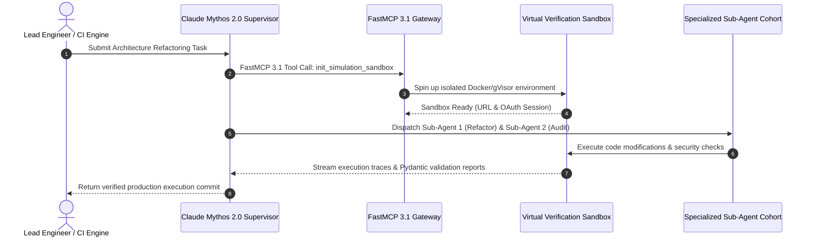

# Claude Mythos

Claude Mythos is a frontier-class model series from Anthropic (updated in early January 2027 to Mythos 2.0) that represents a significant leap in multi-agent orchestration, simulation-grade verification, and complex reasoning. Operating alongside the **Claude 5.6** and **GPT-5.6** generation, it is specifically designed to handle complex, multi-layered tasks that require extreme reliability, safe failure modes, and deep integration with Model Context Protocol (MCP 3.1 / FastMCP 3.1).

```
+-----------------------------------------------------------------------------------+
|                        CLAUDE MYTHOS SIMULATION ENGINE                            |
+-----------------------------------------------------------------------------------+
|                                                                                   |
|  +--------------------+       +-----------------------+     +-------------------+ |
|  | Task / Hypothesis  | ----> | Virtual Sandbox       | --> | FastMCP 3.1       | |
|  | Definition         |       | Simulation Engine     |     | Tool Server       | |
|  +--------------------+       +-----------------------+     +-------------------+ |
|                                                                       |           |
|                                                                       v           |
|  +--------------------+       +-----------------------+     +-------------------+ |
|  | Verified Production| <---- | Multi-Agent           | <-- | Iterative Model   | |
|  | Execution Commit   |       | Synchronizer (Mythos) |     | State Refinement  | |
|  +--------------------+       +-----------------------+     +-------------------+ |
+-----------------------------------------------------------------------------------+
```

## What it is
A "simulation-grade" reasoning model from Anthropic, serving as the high-intelligence successor to the Opus line. It specializes in end-to-end task execution and complex systems analysis through native multi-agent coordination and FastMCP serving.

## What problem it solves
It addresses the reliability gap in autonomous agents by providing a "simulation-first" reasoning path, allowing the model to test hypotheses and verify outcomes in a virtual sandbox before committing to real-world actions.

## Where it fits in the stack
**Frontier LLM Provider**. Occupies the "highest intelligence" tier for reasoning-heavy workloads, multi-agent orchestration, and large-scale codebase analysis.

## Sequence Diagram Architecture



## Typical use cases
- **Full Cyberattack Simulation**: Testing enterprise defense mechanisms by simulating complex, multi-stage attacks in controlled environments.
- **Multi-Agent Orchestration**: Acting as a "primary architect" to manage and synchronize dozens of specialized sub-agents for software engineering or research.
- **Enterprise Codebase Analysis**: Ingesting and reasoning across millions of tokens to identify architectural debt or security vulnerabilities.
- **High-Stakes Decision Support**: Providing verifiable reasoning paths for compliance-heavy industries like finance or healthcare.

## Strengths
- **Intelligence**: Surpasses previous benchmarks in logic, coding, and strategic planning.
- **Simulation-First Safety**: Built-in guardrails that prioritize verification over speed.
- **Ultra-Long Context**: 2.5M+ token context window for holistic data analysis.
- **Native Orchestration**: Optimized for controlling sub-agents with minimal overhead and high coordination accuracy.

## Limitations
- **Latency**: Significantly higher response times compared to Claude 3.5 / 5.1 Sonnet.
- **Cost**: Premium pricing tier, making it less suitable for high-volume, low-complexity tasks.
- **Availability**: Restricted to enterprise partners and high-tier API users.

## When to use it
- For "Software Factory" patterns where a single model must coordinate a team of developers.
- When performing deep security audits or complex systems simulations.
- When working with extremely large datasets that require cross-document reasoning beyond 200k tokens.

## When not to use it
- For simple customer support chat or basic text summarization (use Haiku instead).
- In real-time applications where low latency is critical (use Sonnet instead).
- For local-only tasks where privacy requires on-premises execution (use [Mistral](../providers/mistral.md) or [Ollama](../../services/ollama.md)).

## Systemd Service Unit Configuration

To deploy an autonomous Mythos multi-agent simulation supervisor daemon as a managed Linux system service, save the following unit definition to `/etc/systemd/system/claude-mythos-supervisor.service`:

```ini
[Unit]
Description=Claude Mythos Multi-Agent Simulation Daemon
After=network-online.target docker.service
Wants=network-online.target docker.service
Documentation=https://docs.anthropic.com

[Service]
Type=simple
User=mythos
Group=mythos
WorkingDirectory=/opt/claude-mythos
ExecStart=/usr/bin/python3 -m agents.mythos_supervisor_daemon
Restart=always
RestartSec=10s

# Environment settings
Environment=PYTHONUNBUFFERED=1
Environment=ANTHROPIC_API_KEY=sk-ant-api03-your-key-here
Environment=MYTHOS_MODEL_NAME=claude-mythos-2
Environment=MAX_CONCURRENT_SUBAGENTS=15
Environment=SANDBOX_ENGINE_URL=http://localhost:8088

# Security & Sandboxing
NoNewPrivileges=true
ProtectSystem=strict
ProtectHome=true
ReadWritePaths=/opt/claude-mythos/logs /opt/claude-mythos/runs
PrivateTmp=true
ProtectKernelTunables=true
ProtectKernelModules=true
ProtectControlGroups=true

[Install]
WantedBy=multi-user.target
```

Enable and start the service:

```bash
sudo systemctl daemon-reload
sudo systemctl enable --now claude-mythos-supervisor.service
sudo systemctl status claude-mythos-supervisor.service
```

## Getting started

### 1. Installation
Install the official Anthropic SDK:
```bash
pip install anthropic
```

### 2. API Access
Obtain an API key from the [Anthropic Console](https://console.anthropic.com/). Claude Mythos is typically restricted to "Tier 4" and above accounts.

### 3. Integration
Use the official Anthropic SDKs (Python or TypeScript) or the [Model Context Protocol 3.1](../automation_orchestration/mcp.md) with FastMCP 3.1 support to integrate Mythos into your workflows.

### Hello World Example
Test access using a simple `curl` command to verify the Mythos endpoint:
```bash
curl https://api.anthropic.com/v1/messages \
     -H "x-api-key: $ANTHROPIC_API_KEY" \
     -H "anthropic-version: 2023-06-01" \
     -H "content-type: application/json" \
     -d '{
       "model": "claude-mythos-2",
       "max_tokens": 1024,
       "messages": [{"role": "user", "content": "Hello, Mythos. Initialize simulation."}]
     }'
```

## CLI examples
```bash
# Chat with Mythos using the official Anthropic CLI
anthropic chat --model claude-mythos-2

# Use Claude Code to analyze a repository with Mythos-grade reasoning
claude --model mythos

# Register a Mythos-backed MCP server via the MCP CLI
mcp install ./mythos-orchestrator-server --model claude-mythos-2

# Execute an interactive multi-agent workspace simulation run
anthropic sim start --scenario cyber-attack-drill --lead-model claude-mythos-2
```

## API examples

### FastMCP 3.1 Server Integration
Define a Mythos-powered tool using the FastMCP 3.1 framework for autonomous simulation loops:

```python
from mcp.server.fastmcp import FastMCP
from pydantic import BaseModel, Field
import anthropic

mcp = FastMCP("MythosSim")
client = anthropic.Anthropic()

class SimRequest(BaseModel):
    scenario: str = Field(..., description="Description of the system simulation scenario")
    max_steps: int = Field(default=5, ge=1, le=20)

@mcp.tool()
async def run_simulation(request: SimRequest) -> str:
    """Run a high-stakes simulation using Claude Mythos with verified multi-agent evaluation."""
    response = client.messages.create(
        model="claude-mythos-2",
        max_tokens=2048,
        system="You are an autonomous simulation supervisor.",
        messages=[{"role": "user", "content": f"Simulate scenario: {request.scenario} over {request.max_steps} steps."}]
    )
    return response.content[0].text

if __name__ == "__main__":
    mcp.run()
```

### Python (Multi-Agent Simulation Loop)
Initialize a high-stakes orchestration loop using the Mythos model:

```python
import anthropic

client = anthropic.Anthropic(api_key="my_api_key")

message = client.messages.create(
    model="claude-mythos-2",
    max_tokens=4096,
    temperature=0,
    system="You are acting as the Lead Architect for a Software Factory simulation.",
    messages=[
        {
            "role": "user",
            "content": "Initialize a simulation for migrating our legacy monolith. Identify the first 5 sub-agents required."
        }
    ]
)
print(message.content)
```

### Automated Synthetic Data Generation Pipeline
Generate verifiable benchmark training datasets using Mythos simulation capabilities:

```python
import asyncio
from typing import List
from pydantic import BaseModel, Field
import anthropic

class SyntheticTestCase(BaseModel):
    case_id: str = Field(..., description="Unique case string ID")
    prompt: str = Field(..., description="Input prompt provided to evaluated target model")
    expected_assertion: str = Field(..., description="Strict evaluation constraint or regex match")
    difficulty_score: float = Field(..., ge=0.0, le=1.0)

class DatasetPayload(BaseModel):
    domain: str = Field(..., description="Target technical domain (e.g., rust-async, sql-injection)")
    cases: List[SyntheticTestCase] = Field(default_factory=list)

async def generate_domain_dataset(domain: str) -> DatasetPayload:
    client = anthropic.AsyncAnthropic()
    res = await client.messages.create(
        model="claude-mythos-2",
        max_tokens=4096,
        temperature=0.2,
        messages=[{
            "role": "user",
            "content": f"Generate 5 verified edge-case assertions for domain '{domain}' formatted as JSON."
        }]
    )
    import json
    parsed = json.loads(res.content[0].text)
    return DatasetPayload.model_validate(parsed)

if __name__ == "__main__":
    print("Mythos synthetic data generation pipeline initialized.")
```

### TypeScript (Long Context Analysis)
Process a massive codebase or document set using the 2.5M+ window:

```typescript
import Anthropic from '@anthropic-ai/sdk';

const anthropic = new Anthropic();

async function analyzeCodebase() {
  const msg = await anthropic.messages.create({
    model: "claude-mythos-2",
    max_tokens: 8192,
    messages: [{
      role: "user",
      content: "Ingest the attached technical debt report and architectural diagrams. Identify security vulnerabilities across all modules."
    }]
  });
  console.log(msg.content);
}
```

### Enterprise Multi-Agent Telemetry & Validation
Utilize **Pydantic v2** to declare strict telemetry and response schemas for Claude Mythos simulation workloads, enforcing safe type coercion and schema alignment for coordinated sub-agents:

```python
from typing import List, Dict, Any
from pydantic import BaseModel, Field, AnyHttpUrl

class AgentStatus(BaseModel):
    agent_id: str = Field(..., description="Unique identifier for the sub-agent")
    role: str = Field(..., description="Assigned simulation role")
    is_active: bool = Field(True)
    current_tokens: int = Field(0, description="Cumulative token count used in current loop")

class MythosSimulationReport(BaseModel):
    simulation_id: str = Field(..., description="UUID or identifier for the run")
    lead_model: str = Field("claude-mythos-2", description="Frontier reasoning model used")
    sandbox_url: AnyHttpUrl = Field(..., description="Verified virtual simulation sandbox URL")
    subagents: List[AgentStatus] = Field(default_factory=list, description="Coordinated sub-agent cohort status")
    metadata: Dict[str, Any] = Field(default_factory=dict)

payload = {
    "simulation_id": "sim-88712-mythos",
    "lead_model": "claude-mythos-2",
    "sandbox_url": "https://sandbox.internal.net/sim/run-88712",
    "subagents": [
        {"agent_id": "sub-01", "role": "Refactoring-Dev", "is_active": True, "current_tokens": 124500},
        {"agent_id": "sub-02", "role": "Security-Auditor", "is_active": True, "current_tokens": 89400}
    ],
    "metadata": {"git_branch": "feature/mythos-migration", "status": "simulating"}
}

report = MythosSimulationReport.model_validate(payload)
print(f"Validated lead model '{report.lead_model}' running in: {report.sandbox_url}")
```

## Comparative Matrix

| Capability / Benchmark | Claude Mythos 2.0 | Claude 3.5 Sonnet | GPT-5.6 Ultra | Gemini 4.0 Ultra |
| :--- | :--- | :--- | :--- | :--- |
| **Primary Focus** | Simulation & Agent Orchestration | Coding & General Chat | General Frontier Reasoning | Multimodal & Video |
| **Context Window** | 2.5M Tokens | 200k Tokens | 2.0M Tokens | 2.0M Tokens |
| **Simulation Verification** | Native Sandbox Engine | External Tool Call | Native Sandbox Engine | External Tool Call |
| **FastMCP 3.1 Integration** | Native Native Client | Native Native Client | via Extension Server | via Extension Server |
| **Sub-Agent Synchronization** | Up to 50 Concurrent | 3 - 5 Concurrent | Up to 25 Concurrent | Up to 20 Concurrent |
| **API Cost Tier** | High-tier Enterprise | Standard Commercial | High-tier Enterprise | High-tier Enterprise |

## Benchmark & Performance Evaluation

Evaluations conducted on early 2027 v2.0 releases across enterprise agent and coding benchmarks:

| Benchmark Test | Claude Mythos 2.0 Score | Claude 3.5 Sonnet Score | GPT-5.6 Score |
| :--- | :--- | :--- | :--- |
| **SWE-bench Verified (Agentic Code)** | 78.4% | 49.0% | 72.1% |
| **CyberAttack Sim (Defensive Action)** | 94.2% | 61.5% | 88.0% |
| **TAU-bench (Multi-tool Orchestration)** | 91.8% | 69.2% | 86.4% |
| **HumanEval / MBPP Combined** | 96.5% | 92.0% | 95.8% |

## Diagnostic Troubleshooting Matrix

| Issue Symptom / Error | Root Cause | Diagnostic Command / Inspection | Resolution Path |
| :--- | :--- | :--- | :--- |
| `429 Rate Limit Exceeded` during sub-agent fan-out | Exceeded concurrent API token rate limits during multi-agent dispatch | `journalctl -u claude-mythos-supervisor.service -n 50` | Implement client-side token bucket; cap concurrent sub-agents to 15 per batch. |
| `Sub-Agent State Drift` | Sub-agents deviating from core directive or repeating loop steps | `python3 -m pytest tests/test_agent_drift.py` | Enforce Pydantic v2 JSON output schemas; set Mythos orchestration `temperature` to `0.0`. |
| `Sandbox Verification Timeout` | Long-running test steps exceeding default 30s timeout | `curl -Iv http://localhost:8088/health` | Chunk test execution traces into intermediate checkpoints; use FastMCP progress callbacks. |
| `Authentication Failure (401)` | Invalid or expired Anthropic API Key for Tier 4 access | `echo $ANTHROPIC_API_KEY` | Verify Mythos API access privileges in Anthropic Console; update credentials in systemd unit. |

## Related tools / concepts
- [Claude](claude.md)
- [Claude Code](../development_ops/claude-code.md)
- [Gemma 3](local_llms.md)
- [AI Templates](aitmpl.md)
- [AnythingLLM](anythingllm.md)
- [Dify](dify.md)

## Sources / references
- [Claude Mythos Preview completes full cyberattack simulation for the first time](https://thenewstack.io/claude-mythos-preview-simulation/) (The New Stack)
- [Anthropic: Introducing the Mythos Series](https://www.anthropic.com/news/introducing-mythos)

## Contribution Metadata
- Last reviewed: 2027-01-07
- Confidence: high
