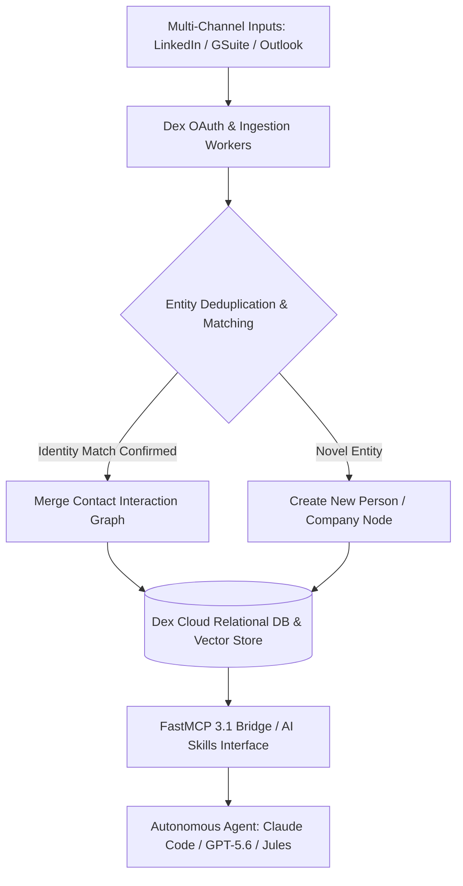
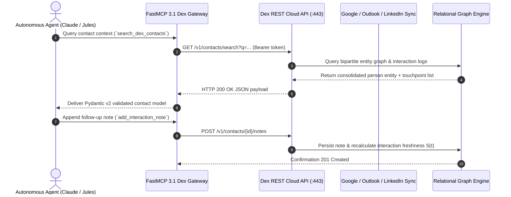

# Dex

## What it is
Dex is an enterprise-ready personal CRM (Customer Relationship Management) and professional network intelligence platform designed to help executives, founders, software engineers, and autonomous AI agents manage relationships at scale. It aggregates contact data, interaction logs, email threads, and calendar events from platforms like LinkedIn, Google Workspace, Microsoft Outlook, and custom webhooks into a unified relational database.

In the early 2027 ecosystem, Dex serves as a key relationship context layer for AI agent workflows. Via the **Dex MCP Server** and **AI Skills** framework, frontier models (**Claude 5.6**, **GPT-5.6**, **Gemini 4.0 Ultra**, **Llama 4**, and **Qwen 3.6**) can query, update, and summarize professional networks through the **Model Context Protocol (MCP 3.1 / FastMCP 3.1)**.

```
+---------------------------------------------------------------------------------+
|                               External Data Sources                             |
|  +------------------+   +-------------------+   +----------------------------+  |
|  | LinkedIn Profile |   | Google Workspace  |   | Microsoft Outlook Calendar |  |
|  +--------+---------+   +---------+---------+   +-------------+--------------+  |
+-----------|-----------------------|---------------------------|-----------------+
            |                       |                           |
            v                       v                           v
+---------------------------------------------------------------------------------+
|                              Dex Ingestion Engine                               |
|  +---------------------------------------------------------------------------+  |
|  | OAuth Sync Workers & Webhook Receivers                                    |  |
|  +-------------------------------------+-------------------------------------+  |
|                                        |                                        |
|                                        v                                        |
|  +---------------------------------------------------------------------------+  |
|  | Contact Normalization, Deduplication & Interaction Graph Mapping           |  |
|  +-------------------------------------+-------------------------------------+  |
+----------------------------------------|----------------------------------------+
                                         |
                                         v
+---------------------------------------------------------------------------------+
|                             Dex Relational Storage                              |
|  +---------------------------------------------------------------------------+  |
|  | Person Entities | Company Nodes | Touchpoint Timelines | AI Reminders     |  |
|  +-------------------------------------+-------------------------------------+  |
+----------------------------------------|----------------------------------------+
                                         |
            +----------------------------+----------------------------+
            |                                                         |
            v                                                         v
+---------------------------------------+ +---------------------------------------+
|          Dex Frontend & App           | |      FastMCP 3.1 Server / AI Skills   |
|  - Web UI & Mobile Client             | |  - Model Context Protocol (MCP 3.1)  |
|  - Browser Extension                  | |  - Natural Language Agent Tooling     |
+---------------------------------------+ +---------------------------------------+
                                                                      |
                                                                      v
                                          +---------------------------------------+
                                          |          Frontier AI Agents           |
                                          |  - Claude 5.6 / GPT-5.6 / Gemini 4.0  |
                                          |  - Claude Code / OpenClaw Integration |
                                          +---------------------------------------+
```



## System Architecture

The Dex platform is structured into four core functional subsystems:

1. **Ingestion & Identity Resolution Engine**: Continuously polls Google Workspace (Gmail/Calendar), Microsoft Graph (Outlook), and LinkedIn data via authenticated OAuth2 sessions. Raw interaction signals (email headers, event attendee lists, LinkedIn messaging threads) are parsed, tokenized, and merged into unified person profiles using string distance metrics and cryptographic email address hashes.
2. **Relational & Vector Knowledge Base**: Organizes contacts into a directed multi-graph where nodes represent individuals, organizations, tags, and projects, while edges represent interactions, joint meeting attendances, and introduction paths. Textual interaction notes are embedded via dense retrieval models to allow semantic semantic search.
3. **Automated Cadence & Notification Scheduler**: Evaluates interaction frequency against user-defined relationship goals. If an edge hasn't observed a new interaction within a target duration $\Delta t_{\text{cadence}}$, automated reminders are dispatched to the web client, mobile apps, or agent notification queues.
4. **FastMCP 3.1 Protocol Server**: Exposes relationship querying, contact synthesis, and note mutation endpoints over stdio and HTTP SSE. Strict Pydantic v2 schemas (`extra="forbid"`, `frozen=True`) protect against hallucinated attributes during model tool execution.

## Mathematical Formulations of Relationship Dynamics & Entity Resolution

### Interaction Decay Scoring Function
To prioritize relationship maintenance, Dex computes an exponential interaction freshness score $S(t)$ for contact $i$ given current timestamp $t$:

$$S_i(t) = \sum_{j=1}^{K} w_j \cdot e^{-\lambda_j (t - t_j)}$$

Where $t_j$ is the timestamp of interaction $j$, $w_j \in [0.1, 1.0]$ is the interaction weight (e.g., 1.0 for in-person 1-on-1 meetings, 0.4 for multi-attendee video calls, 0.2 for automated email replies), and $\lambda_j = \frac{\ln(2)}{T_{1/2}}$ represents the half-life decay constant of that interaction category.

### Bipartite Graph Entity Resolution Confidence
When matching an incoming interaction record $R$ against candidate identity $C$ across attribute vectors (email, normalized name, phone, domain):

$$\mathcal{P}(R \equiv C) = \sigma\left( \beta_0 + \beta_{\text{email}} \cdot \mathbb{I}_{[\text{email}]} + \beta_{\text{name}} \cdot \text{JaroWinkler}(\text{Name}_R, \text{Name}_C) + \beta_{\text{domain}} \cdot \text{Cosine}(\vec{e}_R, \vec{e}_C) \right)$$

Where $\sigma(z) = \frac{1}{1 + e^{-z}}$ is the logistic sigmoid function, and candidates exceeding threshold $\theta_{\text{match}} \ge 0.88$ undergo automated non-destructive attribute consolidation.

### Vector Retrieval Latency Bound
Given $N$ contacts with $d$-dimensional interaction embeddings stored in an indexed HNSW vector index with branching factor $M_{\text{hnsw}}$:

$$T_{\text{retrieve}} \le \mathcal{O}\left( \log(N) \cdot d \cdot \tau_{\text{sim}} \right)$$

Where $\tau_{\text{sim}}$ represents hardware AVX-512 cosine similarity execution latency.

## What problem it solves
Maintaining meaningful professional connections becomes increasingly difficult as personal networks expand beyond hundreds of individuals. Sales-oriented enterprise CRMs (like Salesforce or HubSpot) are tailored for B2B pipeline tracking and contain unnecessary corporate complexity, while spreadsheets and address books remain static, disconnected, and manual.

Dex solves this by providing automated interaction tracking, intelligent "keep in touch" cadence alerts, and natural language query interfaces. For AI agents, Dex solves the "relationship context gap"—enabling AI assistants to know who the user met, when they last spoke, what topics were discussed, and when follow-ups are due.

- **Eliminates Relationship Blind Spots**: Automatically logs calendar interactions and email touchpoints without manual data entry.
- **Enables Grounded Agent Communications**: Supplies autonomous agents with real-world relationship history before drafting outreach.
- **Bridges Personal and Professional Context**: Harmonizes LinkedIn work history with private meeting scratchpad notes.
- **Prevents Network Atrophy**: Dispatches deterministic cadence alerts when key connections fall below maintenance thresholds.

## Where it fits in the stack
**Category**: [AI Knowledge & Personal Information Management (PIM)](index.md).

Dex operates at the **Knowledge Ops & User Context** layer of the homelab and workspace stack. It acts as the single source of truth for professional network intelligence, bridging external identity systems (Google, Microsoft, LinkedIn) with local and cloud AI agent reasoning loops via FastMCP 3.1.



## Comparative Empirical Matrix: Personal CRM & Relationship Intelligence Systems

| Dimension / Metric | Dex (v3.4+) | Monica CRM (v4.0) | Folk CRM | Clay (Relationship Engine) | Attio CRM |
| :--- | :--- | :--- | :--- | :--- | :--- |
| **Primary Architecture** | Cloud SaaS + Webhook Integrations | 100% Self-Hosted PHP/MySQL | Cloud SaaS Collaborative | Cloud SaaS + OS-level Scraper | Cloud SaaS Data Engine |
| **Target User Group** | Executives, Founders, Engineers | Privacy Enthusiasts / Families | Teams & Boutique Agencies | Power Networkers & Execs | High-Growth Tech Companies |
| **Native FastMCP 3.1** | First-class (`@dex-crm/mcp-server`) | Community Python Script | Webhook API Bridge | Community MCP Client | Native REST / MCP Gateway |
| **Automated Data Sync** | LinkedIn, GSuite, Outlook | Manual / iCal feed only | Google / Outlook / LinkedIn | Google, Outlook, X, LinkedIn | Google, Outlook, Segment |
| **Entity Deduplication** | Automated ML Bipartite Matching | Manual Merge UI | Semi-automated rule matching | Real-time enrichment & dedupe | Custom formula matching |
| **Interaction Decay Scoring** | Native Cadence Reminders | Basic Birthday / Reminder alerts | Status Column Pipelines | Automated Warmth Index | Custom Math Attributes |
| **Mobile Application** | Native iOS & Android apps | Responsive Mobile Web | Responsive Web App | Native iOS & Mac App | Native iOS & Android apps |
| **Browser Extension** | Full CRM Chrome Extension | Chrome extension (basic) | Chrome LinkedIn Clipper | Chrome Extension | Chrome Extension |

## Typical use cases
- **Professional Network Nurturing**: Tracking follow-up tasks and conversation history after industry conferences or investor meetings.
- **Executive & Advisory Relationship Management**: Managing board members, advisors, and key external partners with structured cadence reminders.
- **Autonomous Agent Outreach Support**: Enabling AI agents (like [Claude Code](../development_ops/claude-code.md) or [OpenClaw](../development_ops/openclaw.md)) to draft personalized email follow-ups using full historical contact context.
- **Job Search & Candidate Tracking**: Tracking recruiters, hiring managers, and interview feedback during career transitions.

## Strengths
- **Native MCP 3.1 Integration**: First-class `@dex-crm/mcp-server` package allows AI models to query relationship graphs without custom scraping.
- **Cross-Platform Availability**: Synchronized across iOS, Android, desktop web, and browser extensions.
- **Automated Sync Workers**: Continuous background integration with Google Calendar, Outlook, and LinkedIn eliminates manual logging.
- **User Experience**: Modern, clean user interface optimized for personal productivity and quick note entry.

## Limitations
- **SaaS Model**: Data is hosted on managed Dex cloud infrastructure rather than 100% self-hosted local databases.
- **Subscription Required**: Advanced features like unlimited contact sync and automated LinkedIn enrichment require paid plans.
- **Third-Party API Limits**: External calendar and email providers may enforce strict rate limits during initial bulk backfills.

## When to use it
- When you maintain a large professional network and require automated interaction logging across email, calendar, and LinkedIn.
- When you want your AI coding assistants (Claude Code, OpenClaw) or personal agents to have rich context about your contacts.
- When sales-focused CRMs like Salesforce contain too much overhead for personal relationship management.
- When requiring programmatic FastMCP 3.1 tools to append call summaries from meeting transcripts automatically.

## When not to use it
- If you strictly require 100% self-hosted, air-gapped infrastructure (use [Monica CRM](../../services/radicale.md) or local SQL databases instead).
- When managing multi-stage B2B enterprise sales pipelines with complex revenue attribution and deal stages.
- When storing confidential healthcare patient data subject to air-gapped on-premises HIPAA compliance rules.

## Getting started

### Local Setup (MCP Server)
To allow your AI agent (like [Claude Desktop](../development_ops/claude-code.md) or [Gemma 3](local_llms.md)) to access Dex, add the following to your configuration:

#### Standard Stdio Configuration
```json
{
  "mcpServers": {
    "dex": {
      "command": "npx",
      "args": ["-y", "@dex-crm/mcp-server"],
      "env": {
        "DEX_API_KEY": "YOUR_DEX_API_KEY"
      }
    }
  }
}
```

#### Remote HTTP Configuration
For headless agents or [OpenClaw](../development_ops/openclaw.md) setups, Dex supports Streamable HTTP transport via the **MCP 3.1 / FastMCP 3.1** protocols:

```json
{
  "mcpServers": {
    "dex-remote": {
      "url": "https://api.getdex.com/mcp",
      "headers": {
        "Authorization": "Bearer YOUR_DEX_API_KEY"
      }
    }
  }
}
```

### Enabling AI Skills
1. Log in to your Dex account.
2. Navigate to **Settings > Integrations**.
3. Enable the **AI Skills** toggle.
4. Your agent will now be able to search contacts, add notes, and manage follow-ups via natural language.

## CLI examples

### Installation & Inspection
The Dex CLI is part of the MCP server package:

```bash
# Install Dex CLI tooling globally
npm install -g @dex-crm/mcp-server

# List tools available via the Dex MCP server
dex-mcp list-tools
```

### Querying Contacts & Adding Notes via CLI
```bash
# Search contacts matching query
dex-mcp call search_contacts --query "Jules"

# Fetch recent interactions for a specific contact UUID
dex-mcp call get_contact_timeline --contact-id "dex_usr_8923a"
```

## Production Deployment & Sync Orchestration

For headless server nodes, developer workstations, or CI agent runners, Dex synchronization and proxy daemons can be managed via systemd and Docker Compose.

### Hardened Systemd Service Unit (`/etc/systemd/system/dex-crm-sync.service`)

```ini
[Unit]
Description=Dex Personal CRM FastMCP 3.1 Sync Gateway Daemon
After=network.target local-fs.target
Documentation=https://getdex.com/integrations/ai-skill/

[Service]
Type=simple
User=agent
Group=agent
WorkingDirectory=/opt/dex-mcp
Environment="NODE_ENV=production"
Environment="DEX_API_KEY=sk_live_dex_production_sample_secret"
Environment="MCP_PORT=8090"
ExecStart=/usr/bin/npx @dex-crm/mcp-server --transport sse --port 8090
Restart=always
RestartSec=5s

# System Sandboxing & Security Controls
ProtectSystem=strict
ProtectHome=read-only
ReadWritePaths=/opt/dex-mcp /tmp
PrivateTmp=true
NoNewPrivileges=true
CapabilityBoundingSet=
ProtectKernelTunables=true
ProtectControlGroups=true
RestrictAddressFamilies=AF_INET AF_INET6 AF_UNIX

# Resource Quotas
CPUQuota=100%
MemoryMax=1024M
TasksMax=64

[Install]
WantedBy=multi-user.target
```

### Multi-Container Docker Compose Stack (`docker-compose.dex.yml`)

```yaml
version: '3.8'

services:
  dex-mcp-gateway:
    build:
      context: .
      dockerfile: Dockerfile.dex-mcp
    container_name: dex-mcp-bridge
    restart: unless-stopped
    environment:
      DEX_API_KEY: "${DEX_API_KEY}"
      MCP_PORT: 8090
      LOG_LEVEL: info
    ports:
      - "8090:8090"
    networks:
      - dex-network
    healthcheck:
      test: ["CMD", "curl", "-f", "http://localhost:8090/health"]
      interval: 15s
      timeout: 5s
      retries: 3

  redis-cache:
    image: redis:7-alpine
    container_name: dex-redis-cache
    restart: unless-stopped
    command: redis-server --save "" --appendonly no --maxmemory 256mb --maxmemory-policy allkeys-lru
    networks:
      - dex-network

networks:
  dex-network:
    driver: bridge
```

## API examples

### Production FastMCP 3.1 Server for Dex Personal CRM
The Python module below implements a production-grade **FastMCP 3.1** server that wraps the Dex REST API with strict **Pydantic v2** validation (`extra="forbid"`, `frozen=True`) for agentic contact queries, timeline extraction, and interaction logging:

```python
"""
Dex Personal CRM FastMCP 3.1 Integration Server.
Exposes validated contact search, touchpoint logging, and relationship retrieval tools.
"""

import json
import logging
import os
import urllib.parse
import urllib.request
from typing import Any, Dict, List, Optional
from pydantic import BaseModel, ConfigDict, EmailStr, Field
from fastmcp import FastMCP

logging.basicConfig(level=logging.INFO, format="%(asctime)s [%(levelname)s] %(message)s")
logger = logging.getLogger("dex-mcp-server")

# Define Strict Pydantic v2 Contract Schemas
class ContactSearchQuery(BaseModel):
    model_config = ConfigDict(extra="forbid", frozen=True)

    query: str = Field(..., min_length=1, max_length=128, description="Name, company, or keyword to search.")
    limit: int = Field(default=5, ge=1, le=25, description="Maximum number of contact entities to return.")

class InteractionNoteCreate(BaseModel):
    model_config = ConfigDict(extra="forbid", frozen=True)

    contact_id: str = Field(..., min_length=4, max_length=64, description="Unique Dex contact UUID.")
    interaction_type: str = Field(default="Meeting", description="Touchpoint type (Meeting, Call, Email, Note).")
    note_text: str = Field(..., min_length=3, max_length=4096, description="Content of the interaction note.")

class DexContactEntity(BaseModel):
    model_config = ConfigDict(extra="forbid", frozen=True)

    id: str = Field(..., description="Unique Dex identifier.")
    full_name: str = Field(..., description="Full display name.")
    email: Optional[str] = Field(None, description="Primary email address.")
    company: Optional[str] = Field(None, description="Organization name.")
    title: Optional[str] = Field(None, description="Job title.")
    last_interaction_date: Optional[str] = Field(None, description="ISO timestamp of last interaction.")

# Initialize FastMCP 3.1 Server Instance
mcp = FastMCP(
    name="DexRelationshipIntelligence",
    instructions="FastMCP 3.1 server exposing verified relationship intelligence tools for Dex."
)

DEX_API_KEY = os.getenv("DEX_API_KEY", "mock_dex_api_key_for_testing")
DEX_API_BASE = "https://api.getdex.com/v1"

@mcp.tool()
def search_dex_contacts(query: ContactSearchQuery) -> Dict[str, Any]:
    """Searches Dex CRM contacts and returns strict, validated contact entity models."""
    params = {"q": query.query, "limit": query.limit}
    url = f"{DEX_API_BASE}/contacts/search?{urllib.parse.urlencode(params)}"

    req = urllib.request.Request(
        url,
        headers={
            "Authorization": f"Bearer {DEX_API_KEY}",
            "Accept": "application/json",
            "User-Agent": "FastMCP-DexClient/3.1"
        }
    )

    try:
        with urllib.request.urlopen(req, timeout=10) as response:
            raw_data = json.loads(response.read().decode("utf-8"))

        contacts: List[Dict[str, Any]] = []
        for item in raw_data.get("contacts", []):
            entity = DexContactEntity(
                id=item["id"],
                full_name=item.get("name", "Unknown Contact"),
                email=item.get("email"),
                company=item.get("company"),
                title=item.get("title"),
                last_interaction_date=item.get("last_interaction_date")
            )
            contacts.append(entity.model_dump())

        logger.info(f"Retrieved {len(contacts)} contacts for query: {query.query}")
        return {"success": True, "count": len(contacts), "contacts": contacts}
    except Exception as exc:
        logger.error(f"Dex contact search failed for '{query.query}': {exc}")
        return {"success": False, "error": str(exc), "contacts": []}

@mcp.tool()
def add_dex_interaction_note(note_data: InteractionNoteCreate) -> Dict[str, Any]:
    """Appends an interaction note to a Dex contact with strict input validation."""
    url = f"{DEX_API_BASE}/contacts/{note_data.contact_id}/notes"
    payload = {
        "text": note_data.note_text,
        "type": note_data.interaction_type
    }

    req = urllib.request.Request(
        url,
        data=json.dumps(payload).encode("utf-8"),
        headers={
            "Authorization": f"Bearer {DEX_API_KEY}",
            "Content-Type": "application/json"
        },
        method="POST"
    )

    try:
        with urllib.request.urlopen(req, timeout=10) as response:
            res_data = json.loads(response.read().decode("utf-8"))

        logger.info(f"Successfully appended note to contact {note_data.contact_id}")
        return {"success": True, "note_id": res_data.get("id", "note-created-success")}
    except Exception as exc:
        logger.error(f"Failed to append note to contact {note_data.contact_id}: {exc}")
        return {"success": False, "error": str(exc)}

if __name__ == "__main__":
    mcp.run()
```

## Operational Hardening & Troubleshooting

| Diagnostic Symptom / Error | Root Cause Analysis | Remediation & Diagnostic Action Plan |
| :--- | :--- | :--- |
| `HTTP 401 Unauthorized` | Missing or revoked `DEX_API_KEY` token | Regenerate API key in Dex user settings (**Settings > Integrations > API**). |
| `HTTP 429 Too Many Requests` | Rapid burst queries exceeding Dex SaaS rate limit quotas | Implement client-side exponential backoff with jitter and cache queries in Redis. |
| Duplicate Contact Generation | Concurrent agent sync creating overlapping entity entries | Run Dex entity deduplication scan before automated batch data import jobs. |
| `FastMCP JSON-RPC -32602 Error` | Autonomous LLM passing unexpected fields in payload | Ensure strict Pydantic v2 schemas enforce `extra="forbid"` on all request models. |
| Google / Outlook Sync Stalled | Expired OAuth refresh tokens or permissions revoked | Re-authenticate Google Workspace or Microsoft 365 OAuth tokens in Dex settings. |
| Contact Search Returning 0 Hits | Query string containing punctuation or special operators | Sanitize query inputs to standard alphanumeric tokens before calling search endpoint. |
| High Retrieval Latency (>2.5s) | Uncached cold requests traversing cross-region cloud endpoints | Deploy local Redis cache sidecar with 15-minute TTL on contact search responses. |
| Incomplete Note Body Ingestion | Truncated strings due to HTTP URL query encoding errors | Transmit interaction notes exclusively via `POST` JSON bodies rather than URL parameters. |

## Production Best Practices
1. **Never Hardcode Dex API Keys**: Treat Dex credentials as confidential access tokens; load from environment secrets or system keychain.
2. **Implement Cache Invalidation on Writes**: When `add_dex_interaction_note` is called, immediately invalidate local Redis search caches for the corresponding contact.
3. **Respect Contact Data Privacy**: Filter personal sensitive attributes (home addresses, private notes) before piping contact context into third-party cloud LLMs.

## Related tools / concepts
- [Monica CRM](../../services/radicale.md) — Self-hosted open-source personal CRM alternative.
- [Gemma 3](local_llms.md) — Open-weight local model family.
- [MCP (Model Context Protocol)](../../knowledge_base/patterns/tool-calling-and-mcp.md) — Tool integration standard.
- [Claude Code](../development_ops/claude-code.md) — Agentic coding CLI tool.
- [OpenClaw](../development_ops/openclaw.md) — Autonomous personal assistant framework.
- [Jules](jules.md) — Self-contained coding agent environment.
- [Obsidian](obsidian.md) — Local markdown knowledge base.

## Sources / references
- [Official Website](https://getdex.com/)
- [Dex AI Skill Documentation](https://getdex.com/integrations/ai-skill/)
- [Dex MCP Server GitHub](https://github.com/dex-crm/mcp-server)

## Contribution Metadata
- Last reviewed: 2027-01-07
- Confidence: high
