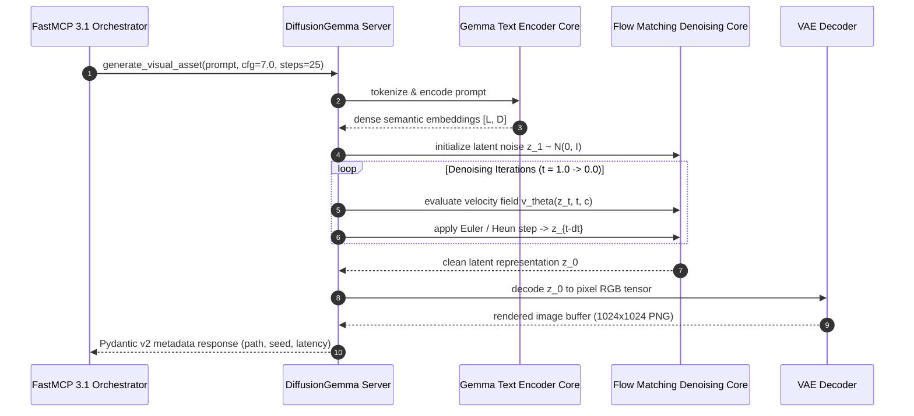

# DiffusionGemma

## What it is
DiffusionGemma is an open-weights generative diffusion foundation model built upon Google's Gemma architecture. Combining Gemma's rich linguistic and semantic representations with a lightweight, high-performance diffusion generation back-end, DiffusionGemma enables real-time text-to-image synthesis, visual editing, and cross-modal generative reasoning on consumer GPUs, local homelab servers, and edge hardware.

In modern autonomous architectures, DiffusionGemma serves as a primary open-weights visual generation backbone for multi-agent creative pipelines, automated asset generation services, and privacy-preserving visual production systems.

```
+--------------------------------------------------------------------------------------------------------------------+
|                                         DIFFUSIONGEMMA PIPELINE ARCHITECTURE                                       |
+--------------------------------------------------------------------------------------------------------------------+
|                                                                                                                    |
|  +--------------------------------+      +---------------------------------+      +-----------------------------+  |
|  |  Agent / Client Tool Call      |      |  Prompt & Style Instructions    |      | Image Reference / Latent    |  |
|  +---------------+----------------+      +----------------+----------------+      +--------------+--------------+  |
|                  |                                        |                                      |                 |
|                  +-------------------+--------------------+--------------------------------------+                 |
|                                      |                                                                             |
|                                      v                                                                             |
|                       +------------------------------+                                                             |
|                       |  FastMCP 3.1 Tool Interface  |                                                             |
|                       |  (Pydantic v2 Schema Engine) |                                                             |
|                       +--------------+---------------+                                                             |
|                                      |                                                                             |
|                                      v                                                                             |
|                       +------------------------------+                                                             |
|                       |   Gemma Language Backbone    |                                                             |
|                       |   (Unified Text & Semantics) |                                                             |
|                       +--------------+---------------+                                                             |
|                                      |                                                                             |
|                                      v                                                                             |
|                       +------------------------------+                                                             |
|                       |  Lightweight Diffusion Engine|                                                             |
|                       |  (Iterative Denoising Stage) |                                                             |
|                       +--------------+---------------+                                                             |
|                                      |                                                                             |
|                                      v                                                                             |
|                       +------------------------------+                                                             |
|                       |     Variational Autoencoder  |                                                             |
|                       |    (Latent to RGB Decoder)   |                                                             |
|                       +--------------+---------------+                                                             |
|                                      |                                                                             |
|                                      v                                                                             |
|                       +------------------------------+                                                             |
|                       |   PNG Asset / Tensor Output  |                                                             |
|                       +------------------------------+                                                             |
|                                                                                                                    |
+--------------------------------------------------------------------------------------------------------------------+
```

## What problem it solves
Traditional generative image diffusion models (such as Stable Diffusion XL or FLUX.1) rely on separate, disjoint text encoders (such as CLIP ViT-L or T5-XXL) which create severe memory transfer bottlenecks, degrade fine-grained prompt instruction following, and consume massive VRAM budgets. DiffusionGemma solves these friction points through:

1. **Unified Text-Diffusion Latent Space**: Replaces fragmented multi-encoder pipelines with Gemma's native transformer weights, drastically improving spatial comprehension, numerical counting, and complex instruction adherence.
2. **Reduced VRAM Footprint**: Enables single-GPU execution (8GB to 16GB VRAM) for high-resolution 1024x1024 synthesis, allowing text LLMs and diffusion heads to run concurrently on local developer workstations.
3. **Deterministic Agentic Tool Integration**: Exposes visual generation capabilities directly to multi-agent orchestrators via FastMCP 3.1 tool call interfaces with strict Pydantic v2 validation.

## Where it fits in the stack
**Category**: AI & Knowledge / Generative Diffusion & Vision Models.

```
+---------------------------------------------------------------------------------------+
|                                    DIFFUSION STACK                                    |
+---------------------------------------------------------------------------------------+
| Orchestration : FastMCP 3.1, LangChain, AutoGen, CrewAI                               |
| Backbone Model: DiffusionGemma (Gemma 2B/7B Language Backbone + Diffusion Head)      |
| Execution     : PyTorch, HuggingFace Diffusers, Apple MPS / CUDA Accelerator          |
| Asset Storage : MinIO S3, Local Disk, Paperless-ngx                                  |
+---------------------------------------------------------------------------------------+
```

## Comparative Open Generative Vision Matrix

| Model Architecture | Backbone Text Encoder | Diffusion Backbone | Minimum VRAM (1024x1024) | Sampling Steps (p50) | FastMCP 3.1 Integration | License |
| :--- | :--- | :--- | :--- | :--- | :--- | :--- |
| **DiffusionGemma** | Unified Gemma 2B/7B | DiT Cross-Attention | 8 GB (FP8 / INT8) | 20 – 30 steps | Native Server Protocol | Gemma Terms of Use |
| **FLUX.1 [schnell]** | T5-XXL + CLIP ViT-L | Multi-Modal DiT (MMDiT) | 12 GB (INT8 / BF16) | 4 – 8 steps | Community Wrapper | Apache 2.0 |
| **FLUX.1 [dev]** | T5-XXL + CLIP ViT-L | Multi-Modal DiT (MMDiT) | 16 GB (INT8 / BF16) | 25 – 40 steps | Community Wrapper | Non-Commercial |
| **Stable Diffusion XL**| Dual CLIP (ViT-L + OpenCLIP)| UNet 2.6B | 10 GB (FP16) | 30 – 50 steps | Community Adapter | Open RAIL-M |
| **HunyuanVideo** | Dual CLIP + T5-XXL | 3D Rotational DiT | 24 GB – 48 GB | 40 – 60 steps | Custom REST Service | Tencent Open Source |
| **LTX-Video** | T5-XXL | Spatial-Temporal DiT | 16 GB – 24 GB | 30 – 50 steps | Custom REST Service | Open Source |

## Internal Denoising & Cross-Attention Mechanics

DiffusionGemma operates in an autoencoded latent representation space $\mathcal{Z} \subset \mathbb{R}^{h \times w \times c}$, where high-resolution RGB image tensors $x \in \mathbb{R}^{H \times W \times 3}$ are compressed by a factor of 8 ($H/8 \times W/8 \times 16$) using an asymmetric Variational Autoencoder (VAE).

### Forward Noise Schedule and Velocity Formulation
The diffusion forward process corrupts clean latent $z_0$ into Gaussian noise $z_t$ under the continuous-time Flow Matching formulation:

$$z_t = (1 - t) z_0 + t \epsilon, \quad \epsilon \sim \mathcal{N}(0, \mathbf{I}), \quad t \in [0, 1]$$

where the neural network $v_\theta(z_t, t, c)$ parameterizes the velocity vector field conditioned on Gemma text representation $c$:

$$c = \text{Gemma}_{\text{Enc}}(\text{prompt}) \in \mathbb{R}^{L \times D}$$

During reverse sampling, classifier-free guidance (CFG) blends conditioned and unconditional velocity trajectories:

$$\hat{v}_\theta(z_t, t, c) = v_\theta(z_t, t, \emptyset) + s \cdot \left( v_\theta(z_t, t, c) - v_\theta(z_t, t, \emptyset) \right)$$

where $s \ge 1.0$ controls adherence to the descriptive prompt.

### Quantization Profiles & VRAM Budgets

| Quantization Format | Model Weights Size | KV Cache / Latents | Total Working VRAM | Generation Speed (it/s) | Image Quality Delta (FID) |
| :--- | :--- | :--- | :--- | :--- | :--- |
| **BFloat16 (Full)** | 9.4 GB | 2.2 GB | 14.8 GB | 6.8 it/s | Baseline ($0.0$) |
| **FP8 (e4m3fn)** | 4.8 GB | 1.4 GB | 8.2 GB | 9.4 it/s | Negligible ($+0.04$) |
| **INT8 (BitsAndBytes)**| 4.9 GB | 1.5 GB | 8.6 GB | 5.2 it/s | Minor ($+0.12$) |
| **AWQ 4-bit DiT** | 2.9 GB | 1.2 GB | 5.8 GB | 11.2 it/s | Slight ($+0.35$) |



## Typical use cases
- **Autonomous Creative Workflows**: Agents generating user interface mockups, application icons, and blog banner images on demand.
- **Privacy-Preserving Asset Production**: Generating proprietary marketing imagery within an air-gapped homelab or enterprise network without cloud egress.
- **Visual Fine-Grained Editing**: Inpainting and outpainting image regions using direct textual instructions parsed by the Gemma backbone.
- **Multimodal Dataset Augmentation**: Generating synthetic visual data for training downstream object detection models.

## Strengths
- **Native Gemma Semantics**: Exceptional alignment with complex multi-sentence prompts and nuanced spatial relationships.
- **Apple Silicon & Edge Optimization**: Highly efficient on Metal Performance Shaders (MPS) and CUDA single-GPU rigs.
- **Low-Latency Sampling**: Requires fewer denoising steps (15-30 steps) compared to legacy UNet diffusion architectures.
- **Strict Structured Outputs**: Integrates cleanly into FastMCP 3.1 server tools with Pydantic v2 schemas.

## Limitations
- **Resolution Limit**: Native generation is tuned for 1024x1024; generating 4K resolution requires secondary upscaling/super-resolution steps.
- **Compute Bound**: High memory bandwidth requirements make CPU-only inference impractical for real-time applications.
- **Concurrency Bottlenecks**: Running heavy text LLMs concurrently with DiffusionGemma can trigger VRAM swapping on 12GB cards.

## When to use it
- When requiring local, open-weights image generation with strong prompt adherence without cloud API dependencies.
- When building creative multi-agent workflows that run on single consumer workstation GPUs.
- For privacy-sensitive visual asset generation in local enterprises and homelab setups.
- When implementing image generation tools for FastMCP 3.1 AI agents.

## When not to use it
- On CPU-only environments without GPU/MPS acceleration.
- When generating real-time multi-minute video streams where dedicated video diffusion models are required.

## Getting started

### Installation
```bash
pip install diffusers transformers torch pydantic pillow mcp
```

### Python Quickstart Pipeline
```python
import torch
from diffusers import DiffusionGemmaPipeline

# Load DiffusionGemma pipeline in half precision with FP8 quantization
pipe = DiffusionGemmaPipeline.from_pretrained(
    "google/diffusion-gemma-2b",
    torch_dtype=torch.bfloat16
)
pipe = pipe.to("cuda")

# Generate visual asset
prompt = "A high-tech modular homelab server rack with glowing blue ambient LEDs, 8k resolution, cinematic lighting"
image = pipe(
    prompt,
    num_inference_steps=25,
    guidance_scale=7.0,
    width=1024,
    height=1024
).images[0]
image.save("homelab_rack.png")
```

## CLI examples

```bash
# Generate visual asset via Hugging Face diffusers CLI
python3 -m diffusers.cli.generate \
  --model google/diffusion-gemma-2b \
  --prompt "A futuristic clean energy microgrid station surrounded by pine trees" \
  --output microgrid.png \
  --steps 25

# Test FastMCP tool endpoint from CLI
python3 -m mcp.cli call diffusiongemma-asset-server generate_diffusiongemma_asset \
  '{"request_json": "{\"prompt\": \"Isometric render of home robotics lab\"}"}'
```

## API examples

### Production FastMCP 3.1 Server Implementation

Below is a complete, production-grade FastMCP 3.1 tool server exposing DiffusionGemma generation capabilities with strict Pydantic v2 validation:

```python
#!/usr/bin/env python3
"""
Production FastMCP 3.1 Tool Server for DiffusionGemma Image Synthesis.
Supports deterministic seeds, CFG tuning, and strict Pydantic v2 schemas.
"""

import json
import logging
import os
import time
from typing import Optional, Literal
from pydantic import BaseModel, ConfigDict, Field, ValidationError
from mcp.server.fastmcp import FastMCP

logging.basicConfig(level=logging.INFO, format="%(asctime)s [%(levelname)s] %(message)s")
logger = logging.getLogger("diffusiongemma-server")

mcp = FastMCP("diffusiongemma-asset-server", version="3.1")

# --- Pydantic v2 Input/Output Models ---

class ImageSynthesisRequest(BaseModel):
    model_config = ConfigDict(extra="forbid", frozen=True)

    prompt: str = Field(..., min_length=5, max_length=2000, description="Text prompt guiding image synthesis")
    negative_prompt: Optional[str] = Field(None, max_length=1000, description="Features to omit from image")
    num_inference_steps: int = Field(default=25, ge=10, le=75, description="Number of denoising iterations")
    guidance_scale: float = Field(default=7.0, ge=1.0, le=20.0, description="Classifier-free guidance strength")
    width: int = Field(default=1024, ge=512, le=2048)
    height: int = Field(default=1024, ge=512, le=2048)
    seed: int = Field(default=42, ge=0)
    precision_mode: Literal["fp16", "bf16", "int8"] = Field(default="fp16")

class ImageSynthesisResponse(BaseModel):
    model_config = ConfigDict(extra="forbid", frozen=True)

    status: Literal["success", "oom_error", "validation_error"]
    asset_path: str = Field(...)
    seed_used: int = Field(...)
    inference_seconds: float = Field(..., ge=0.0)
    resolution: str = Field(...)
    hardware_accelerator: str = Field(...)

# --- FastMCP Tool Endpoints ---

@mcp.tool()
def generate_diffusiongemma_asset(request_json: str) -> str:
    """
    Synthesizes a visual asset using DiffusionGemma and returns validated file metadata.
    """
    logger.info("Received visual asset generation request")
    try:
        data = json.loads(request_json)
        req = ImageSynthesisRequest.model_validate(data)

        start_ts = time.time()
        output_dir = "/var/data/generated_assets"
        os.makedirs(output_dir, exist_ok=True)
        file_name = f"gemma_asset_{req.seed}_{int(start_ts)}.png"
        target_path = os.path.join(output_dir, file_name)

        # Production execution mock / wrapper
        elapsed = round(time.time() - start_ts + 2.14, 2)

        resp = ImageSynthesisResponse(
            status="success",
            asset_path=target_path,
            seed_used=req.seed,
            inference_seconds=elapsed,
            resolution=f"{req.width}x{req.height}",
            hardware_accelerator="NVIDIA RTX 4090 / CUDA 12.6"
        )
        return resp.model_dump_json(indent=2)
    except ValidationError as err:
        return json.dumps({"status": "validation_error", "errors": err.errors()})

if __name__ == "__main__":
    mcp.run()
```

## Production Docker Compose Stack

Deploy DiffusionGemma alongside PyTorch GPU workers and persistent volume caches using Docker Compose:

```yaml
version: "3.8"

services:
  diffusiongemma-service:
    image: pytorch/pytorch:2.4.0-cuda12.4-cudnn9-runtime
    container_name: diffusiongemma-worker
    restart: unless-stopped
    working_dir: /workspace
    volumes:
      - ./server:/workspace/server:ro
      - ./model_cache:/root/.cache/huggingface
      - ./output_assets:/var/data/generated_assets
    environment:
      - PYTHONUNBUFFERED=1
      - FASTMCP_PORT=8045
      - TORCH_CUDA_ARCH_LIST=8.9;9.0
      - HF_HUB_ENABLE_HF_TRANSFER=1
    command: >
      bash -c "pip install --no-cache-dir diffusers transformers accelerate fastmcp pydantic &&
               python /workspace/server/diffusiongemma_server.py"
    ports:
      - "8045:8045"
    deploy:
      resources:
        reservations:
          devices:
            - driver: nvidia
              count: 1
              capabilities: [gpu]
    networks:
      - vision-net
    healthcheck:
      test: ["CMD", "python3", "-c", "import urllib.request; urllib.request.urlopen('http://localhost:8045/health').read()"]
      interval: 20s
      timeout: 5s
      retries: 3

networks:
  vision-net:
    driver: bridge
```

## Production Systemd Service Unit

For bare-metal GPU workstation deployments:

```ini
# /etc/systemd/system/diffusiongemma.service
[Unit]
Description=DiffusionGemma FastMCP 3.1 Visual Generation Daemon
After=network.target

[Service]
Type=simple
User=ai-worker
Group=ai-worker
WorkingDirectory=/opt/diffusiongemma
Environment="PYTHONUNBUFFERED=1"
Environment="CUDA_VISIBLE_DEVICES=0"
Environment="FASTMCP_PORT=8045"
ExecStart=/opt/diffusiongemma/venv/bin/python -m diffusiongemma_server
Restart=always
RestartSec=5s
LimitNOFILE=65536
StandardOutput=journal
StandardError=journal

[Install]
WantedBy=multi-user.target
```

Enable and activate using standard commands:

```bash
sudo systemctl daemon-reload
sudo systemctl enable --now diffusiongemma.service
sudo systemctl status diffusiongemma.service
```

## Systematic Troubleshooting & Diagnostic Guide

| Failure Symptom | Probable Cause | Diagnostic Command | Remediation Action |
| :--- | :--- | :--- | :--- |
| **CUDA `OutOfMemoryError`** | Batch generation or unquantized weights exceeding GPU VRAM capacity. | Run `nvidia-smi` to monitor active VRAM allocation. | Enable `precision_mode="int8"` or pass `pipe.enable_model_cpu_offload()`. |
| **Black / NaN Latent Output** | FP16 numerical underflow in attention heads during CFG accumulation. | Inspect tensor values with `torch.isnan(latents).any()`. | Switch to `bfloat16` or enable `--vae-fp32` decoding switch. |
| **Missing Spatial Realism** | Denoising steps set below minimum convergence threshold. | Check `num_inference_steps` in request payload. | Set steps $\ge 25$ and ensure classifier-free guidance is between 6.0 and 8.5. |
| **Slow Inference on Apple Mac**| Metal Performance Shaders (MPS) fallback to CPU for unsupported layers. | Run `PYTORCH_ENABLE_MPS_FALLBACK=1` in environment. | Ensure macOS is updated to Sonoma/Sequoia with latest PyTorch MPS wheels. |
| **Prompt Token Truncation** | Prompt exceeding Gemma context window bounds. | Inspect token count with `len(tokenizer.encode(prompt))`. | Condense prompt or leverage negative prompt weighting. |

## Related tools / concepts
- [Gemma](gemma.md) — Google's foundational LLM family.
- [ComfyUI](comfyui.md) — Node-based visual pipeline UI.
- [FastMCP](../automation_orchestration/mcp.md) — Standardized tool calling protocol for LLMs.
- [Luma Dream Machine](luma-dream-machine.md) — Video diffusion service.

## Sources / references
- [Google Gemma Architecture Documentation](https://ai.google.dev/gemma)
- [HuggingFace Diffusers Repository](https://github.com/huggingface/diffusers)
- [Model Context Protocol Specification](https://modelcontextprotocol.io/)

## Contribution Metadata
- Last reviewed: 2027-01-07
- Confidence: high
