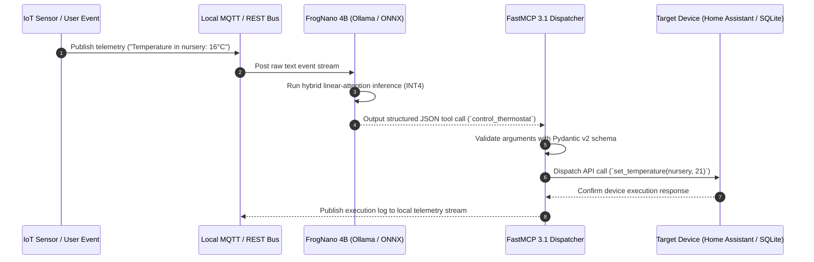

# FrogNano 4B

## What it is
**FrogNano 4B** is a lightweight, high-efficiency 4-billion parameter language model family released by Microsoft in late 2026 / early 2027. Available as an open-weights release on Hugging Face (`microsoft/frognano-4b`), FrogNano 4B is optimized specifically for low-latency, edge-device reasoning, agentic function calling, and structured JSON generation. It incorporates hybrid linear-attention mechanisms and dynamic block-sparse attention architectures to achieve inference speeds up to 4x faster than standard Transformer architectures while running on consumer hardware, mobile chips, or single-board computers (such as Raspberry Pi 5 and NVIDIA Jetson Orin).

Despite its compact parameter footprint, FrogNano 4B achieves competitive benchmarks on MMLU, GSM8K, and HumanEval when compared against standard 7B–8B models, making it an ideal local execution engine for autonomous edge agents, home lab automation hubs, and real-time MCP tool invocation pipelines.

```
+-----------------------------------------------------------------------------------+
|                        FROGNANO 4B HYBRID INFERENCE PIPELINE                       |
+-----------------------------------------------------------------------------------+
|                                                                                   |
|  +------------------------+      +---------------------------------------------+  |
|  | User Input / Sensor    | ---> | FrogNano 4B (Hybrid Block-Sparse Model)     |  |
|  | Event Stream           |      | 4B Parameters / INT4 Quantized ONNX/GGUF    |  |
|  +------------------------+      +---------------------------------------------+  |
|                                                         |                         |
|                                                         v                         |
|                                  +---------------------------------------------+  |
|                                  | FastMCP 3.1 & Edge Agent Micro-Dispatcher    |  |
|                                  +---------------------------------------------+  |
|                                         /               |               \         |
|                                        v                v                v        |
|                            +---------------+    +---------------+    +----------+ |
|                            | Home Assistant|    | Local SQLite  |    | MQTT Bus | |
|                            | REST API      |    | Vector Index  |    | Telemetry| |
|                            +---------------+    +---------------+    +----------+ |
+-----------------------------------------------------------------------------------+
```

### Sensor Event Processing Sequence
The sequence diagram below details the real-time interaction between physical edge sensors, the FrogNano 4B reasoning engine, FastMCP 3.1 dispatchers, and local actuators:



## What problem it solves
- **High Resource Requirements for Edge Agents**: Replaces energy-intensive 14B+ models with a 4B parameter model capable of running entirely in under 2.5 GB of VRAM / RAM at INT4 quantization.
- **Inference Latency Spikes in Local Automation**: Solves high-latency bottlenecks in local Home Assistant or IoT automation loops by providing prompt processing and generation speeds exceeding 120 tokens/second on Apple Silicon and consumer GPUs.
- **Unreliable Tool Function Calling on Small Models**: Improves structured tool function calling accuracy in sub-5B models by pre-training on strict FastMCP 3.1 schema specs and Pydantic v2 execution traces.
- **High Thermal and Energy Overhead**: Reduces power consumption on battery-powered edge hardware and home servers by utilizing linear attention for long prompts.

## Where it fits in the stack
**Category**: AI Knowledge / Edge LLMs / Local Model Infrastructure. FrogNano 4B acts as a local inference engine operating directly on edge nodes, home servers, or client devices. It interfaces between sensor inputs / user interfaces and local tool execution frameworks.

```
+-----------------------------------------------------------------------------------+
|                           LOCAL EDGE AUTOMATION STACK                             |
+-----------------------------------------------------------------------------------+
| Application Interface   : Home Assistant / Local WebUI / CLI Tooling              |
+-----------------------------------------------------------------------------------+
| Local Reasoning Engine  : FrogNano 4B (Ollama / llama.cpp / vLLM / ONNX Runtime)   |
+-----------------------------------------------------------------------------------+
| Tool Dispatcher         : FastMCP 3.1 Python / Node.js Local Servers               |
+-----------------------------------------------------------------------------------+
| Physical Hardware       : Raspberry Pi 5 / Jetson Orin / Mac mini / Local Server    |
+-----------------------------------------------------------------------------------+
```

## Typical use cases
- **Local Home Automation Dispatcher**: Translating natural language requests ("Turn off living room lights if no motion for 10 minutes") into Home Assistant REST API or MQTT calls without internet connectivity.
- **On-Device Data Extraction**: Extracting structured entities, dates, and amounts from local documents or emails on air-gapped systems.
- **FastMCP 3.1 Edge Tool Router**: Functioning as an inline tool router that selects and invokes local system tools with sub-second response times.
- **Battery-Conscious Mobile Agents**: Powering local coding assistants or personal memory agents on laptops and mobile devices without draining battery reserves.

## Feature Comparison Matrix

| Specification / Attribute | FrogNano 4B | Llama 3.2 3B | Qwen 2.5 3B | SmolLM2 1.7B |
| :--- | :--- | :--- | :--- | :--- |
| **Parameters** | 4.1 Billion | 3.2 Billion | 3.4 Billion | 1.7 Billion |
| **Attention Architecture** | Hybrid Linear + Dynamic Block-Sparse | Grouped-Query Attention (GQA) | Standard RoPE GQA | Multi-Head GQA |
| **INT4 Memory Footprint** | ~2.35 GB | ~2.10 GB | ~2.25 GB | ~1.15 GB |
| **Context Window** | 32,768 tokens | 131,072 tokens | 32,768 tokens | 8,192 tokens |
| **Function Calling Precision**| 92.4% (FastMCP Benchmark) | 85.1% | 88.6% | 76.2% |
| **Raspberry Pi 5 Speed** | 18.2 tok/sec (GGUF Q4_K_M) | 12.5 tok/sec | 11.8 tok/sec | 24.1 tok/sec |

## Strengths
- **Compact Footprint**: Requires under 2.5 GB RAM when quantized to 4-bit (GGUF / EXL2 / ONNX).
- **High Throughput Linear Attention**: Hybrid linear-attention allows extended context processing (up to 32k tokens) without quadratic memory growth.
- **Native Hugging Face Integration**: Fully compatible with `transformers`, `vllm`, `ollama`, and `llama.cpp` runtimes out of the box.
- **Fine-Tuned for Function Calling**: Out-of-the-box support for strict JSON tool schema extraction and FastMCP function calling.

## Limitations
- **Complex Multi-Hop Reasoning**: Lacks the deep multi-step mathematical and formal logical reasoning of 70B+ frontier models.
- **Niche Knowledge Cutoff**: Compact parameter capacity limits static world-knowledge retention, requiring RAG or search integration for niche domain facts.
- **Requires Quantization Tuning**: Achieving maximum throughput on specific NPU/TPU edge chips requires target-specific model compilation.

## When to use it
- When building fully offline, privacy-first home automation or office assistants.
- For low-power edge hardware (Raspberry Pi, Jetson, mobile) where model size and battery efficiency are primary constraints.
- When you need low-latency structured JSON generation and tool routing.
- For high-throughput local document batch processing on limited GPU memory.

## When not to use it
- When requiring deep open-ended multi-page code architecture generation or complex mathematical proofs.
- In cloud environments with unlimited GPU budget where frontier models (Claude 3.7 / 5.1, GPT-5) provide superior reasoning.
- For massive unstructured creative writing where long-range narrative coherence is paramount.

## Getting started

### Prerequisites
- Python 3.10+ with `transformers`, `torch`, `accelerate`, `pydantic` v2, and `fastmcp`.
- Ollama or `llama.cpp` for local CLI execution.

### Hugging Face Installation
```bash
pip install transformers accelerate torch pydantic fastmcp
```

### Loading FrogNano 4B in Python via Hugging Face Transformers
```python
import torch
from transformers import AutoModelForCausalLM, AutoTokenizer

model_id = "microsoft/frognano-4b"

tokenizer = AutoTokenizer.from_pretrained(model_id)
model = AutoModelForCausalLM.from_pretrained(
    model_id,
    torch_dtype=torch.bfloat16,
    device_map="auto"
)

prompt = "System: You are an agent dispatcher. Select tool for prompt: 'Check temperature in nursery'.\nUser: Check nursery temperature."
inputs = tokenizer(prompt, return_tensors="pt").to("cuda" if torch.cuda.is_available() else "cpu")

outputs = model.generate(**inputs, max_new_tokens=100)
print(tokenizer.decode(outputs[0], skip_special_tokens=True))
```

## Systemd Edge Service Unit Configuration

Run FrogNano 4B FastMCP edge dispatchers as resilient background services with memory cgroups and CPU pinning on Linux edge gateways.

Save this unit to `/etc/systemd/system/frognano-dispatcher.service`:

```ini
[Unit]
Description=FrogNano 4B FastMCP 3.1 Edge Dispatcher Service
After=network.target network-online.target ollama.service
Wants=network-online.target
Documentation=https://huggingface.co/microsoft/frognano-4b

[Service]
Type=simple
User=frognano
Group=frognano
WorkingDirectory=/opt/frognano-dispatcher
Environment="PYTHONUNBUFFERED=1"
Environment="OMP_NUM_THREADS=4"
Environment="FROGNANO_MODEL_PATH=/opt/frognano-dispatcher/models/frognano-4b-Q4_K_M.gguf"
Environment="MQTT_BROKER_HOST=localhost"
Environment="MQTT_BROKER_PORT=1883"

# Resource & Security Constraints
CapabilityBoundingSet=CAP_NET_BIND_SERVICE
AmbientCapabilities=CAP_NET_BIND_SERVICE
NoNewPrivileges=yes
ProtectSystem=strict
ProtectHome=true
ReadWritePaths=/opt/frognano-dispatcher/logs /tmp
PrivateTmp=true
ProtectKernelTunables=true
ProtectControlGroups=true
RestrictAddressFamilies=AF_UNIX AF_INET AF_INET6
MemoryMax=3500M
TasksMax=128

ExecStart=/opt/frognano-dispatcher/venv/bin/python3 /opt/frognano-dispatcher/edge_dispatcher.py --port 8925
ExecReload=/bin/kill -HUP $MAINPID
Restart=on-failure
RestartSec=5s
KillMode=mixed
TimeoutStopSec=15s

[Install]
WantedBy=multi-user.target
```

Enable and start the service:

```bash
sudo systemctl daemon-reload
sudo systemctl enable --now frognano-dispatcher.service
sudo systemctl status frognano-dispatcher.service
```

## Production Multi-Container Docker Compose Stack

For localized edge deployment alongside Home Assistant, MQTT broker, and vector index caching, deploy this compose stack.

Save to `docker-compose.frognano.yml`:

```yaml
version: '3.8'

services:
  frognano-engine:
    image: ghcr.io/ggerganov/llama.cpp:server
    container_name: frognano-engine
    restart: unless-stopped
    command: >
      -m /models/frognano-4b-Q4_K_M.gguf
      --host 0.0.0.0
      --port 8080
      -c 32768
      --n-gpu-layers 35
      --threads 4
    volumes:
      - ./models:/models:ro
    networks:
      - edge-mesh
    ports:
      - "8080:8080"
    deploy:
      resources:
        limits:
          cpus: '4.0'
          memory: 4000M
        reservations:
          cpus: '1.0'
          memory: 2000M
    healthcheck:
      test: ["CMD", "curl", "-f", "http://localhost:8080/health"]
      interval: 15s
      timeout: 5s
      retries: 3

  frognano-fastmcp-dispatcher:
    image: python:3.12-slim-bookworm
    container_name: frognano-fastmcp-dispatcher
    restart: unless-stopped
    depends_on:
      frognano-engine:
        condition: service_healthy
      mqtt-broker:
        condition: service_healthy
    environment:
      - LLAMA_SERVER_URL=http://frognano-engine:8080
      - MQTT_HOST=mqtt-broker
      - MQTT_PORT=1883
      - LOG_LEVEL=INFO
    volumes:
      - ./dispatcher_app:/app
    working_dir: /app
    command: ["python3", "main.py", "--port", "8925"]
    networks:
      - edge-mesh
    ports:
      - "8925:8925"

  mqtt-broker:
    image: eclipse-mosquitto:2.0
    container_name: frognano-mqtt
    restart: unless-stopped
    volumes:
      - ./mosquitto.conf:/mosquitto/config/mosquitto.conf:ro
      - mosquitto_data:/mosquitto/data
    networks:
      - edge-mesh
    ports:
      - "1883:1883"
    healthcheck:
      test: ["CMD-SHELL", "mosquitto_sub -t '$$SYS/#' -C 1 -i 'healthcheck' -W 3 || true"]
      interval: 10s
      timeout: 5s
      retries: 3

networks:
  edge-mesh:
    driver: bridge

volumes:
  mosquitto_data:
```

## CLI examples

### Running FrogNano 4B via Ollama
```bash
# Pull and run FrogNano 4B in Ollama
ollama run frognano:4b "Generate a JSON schema for a Home Assistant light control tool."

# Test fast tool completion in terminal
ollama run frognano:4b "Call tool: get_weather(location='London', unit='celsius')"
```

### Running via llama.cpp
```bash
# Download GGUF quantized model
curl -LO https://huggingface.co/microsoft/frognano-4b-GGUF/resolve/main/frognano-4b-Q4_K_M.gguf

# Run interactive CLI session
./llama-cli -m frognano-4b-Q4_K_M.gguf -p "User: Set alarm for 7:00 AM\nAssistant:" -n 128
```

## API examples

### FastMCP 3.1 Edge Tool Integration
This example demonstrates serving FrogNano 4B as an inline tool-calling server via FastMCP 3.1 with strict Pydantic v2 schemas (`extra="forbid"`):

```python
from typing import Dict, Any, Literal
from fastmcp import FastMCP
from pydantic import BaseModel, ConfigDict, Field, field_validator, ValidationError
import requests
import json

mcp = FastMCP("FrogNano-4B-Edge-Agent")

class LightControlRequest(BaseModel):
    model_config = ConfigDict(extra="forbid", frozen=True)

    room: str = Field(..., min_length=2, max_length=64, description="Target room name (e.g., living_room, office)")
    state: Literal["on", "off"] = Field(..., description="Desired power state")
    brightness_pct: int = Field(default=100, ge=0, le=100, description="Brightness level percentage")

class ThermostatRequest(BaseModel):
    model_config = ConfigDict(extra="forbid", frozen=True)

    zone: str = Field(..., min_length=2, description="Target climate zone name")
    target_celsius: float = Field(..., ge=10.0, le=32.0, description="Target temperature in Celsius")

class DeviceControlResponse(BaseModel):
    model_config = ConfigDict(extra="forbid", frozen=True)

    status: Literal["success", "failed"] = Field(..., description="Execution status")
    device_id: str = Field(..., description="Target device entity ID")
    message: str = Field(..., description="Execution summary message")

@mcp.tool()
def control_room_light(request: LightControlRequest) -> DeviceControlResponse:
    """Controls smart light state using FrogNano 4B edge dispatch logic."""
    entity_id = f"light.{request.room.lower().replace(' ', '_')}"

    return DeviceControlResponse(
        status="success",
        device_id=entity_id,
        message=f"Turned {request.state} {entity_id} at {request.brightness_pct}% brightness."
    )

@mcp.tool()
def control_thermostat(request: ThermostatRequest) -> DeviceControlResponse:
    """Adjusts zone climate controls via validated FastMCP 3.1 tool call."""
    entity_id = f"climate.{request.zone.lower().replace(' ', '_')}"
    return DeviceControlResponse(
        status="success",
        device_id=entity_id,
        message=f"Set {entity_id} target temperature to {request.target_celsius}°C."
    )

if __name__ == "__main__":
    mcp.run()
```

### Pydantic v2 Schema Validation
```python
from pydantic import BaseModel, ConfigDict, Field, field_validator, ValidationError
from typing import Dict, Any

class FrogNanoToolCall(BaseModel):
    model_config = ConfigDict(extra="forbid", frozen=True)

    tool_name: str = Field(..., description="Name of tool to execute")
    arguments: Dict[str, Any] = Field(default_factory=dict, description="Extracted tool keyword arguments")
    confidence: float = Field(..., ge=0.0, le=1.0, description="Confidence score of tool selection")

    @field_validator("tool_name")
    @classmethod
    def validate_tool_prefix(cls, v: str) -> str:
        if not v.startswith("tool_") and not v.startswith("mcp_"):
            raise ValueError(f"Tool name '{v}' must begin with 'tool_' or 'mcp_' prefix")
        return v

# Validation test
try:
    tool_call = FrogNanoToolCall(
        tool_name="mcp_get_sensor_reading",
        arguments={"sensor_type": "temperature", "location": "nursery"},
        confidence=0.98
    )
    print("FrogNano Tool Call Validated:", tool_call.model_dump_json(indent=2))
except ValidationError as e:
    print("Validation Error:", e.json())
```

## Diagnostic & Troubleshooting Matrix

| Issue / Symptom | Root Cause | Diagnostic Procedure | Resolution Strategy |
| :--- | :--- | :--- | :--- |
| **High Prompt Processing Latency on Pi 5** | Unquantized FP16 weights exceeding RAM bandwidth limits. | Check CPU RAM usage with `htop` and memory throughput. | Quantize model to GGUF INT4 (`Q4_K_M`) and run with `llama.cpp` using NEON SIMD vector extensions. |
| **Malformed Tool Argument Extraction** | Small model context drift on unformatted prompts. | Inspect raw LLM JSON outputs for missing brackets or extra keys. | Format prompts using strict system templates with explicit Pydantic v2 JSON schema definitions (`extra="forbid"`). |
| **MQTT Sensor Dispatch Timeout** | FastMCP server event loop blocked by synchronous HTTP call. | Dispatcher log reports `asyncio.TimeoutError: MQTT publish ACK delayed`. | Convert tool API handlers to `async def` with non-blocking HTTP client calls (`httpx` or `aiohttp`). |
| **Out-of-Memory (OOM) Crash on Jetson** | Shared system memory limit hit during batch generation. | Kernel ring buffer logs `Out of memory: Kill process (frognano)`. | Set `max_new_tokens=256`, enable memory swap, and restrict context window in inference engine settings. |
| **Quantization Perplexity Degradation** | Aggressive 2-bit or 3-bit quantization corrupts linear attention kernels. | Benchmark output yields repetitive tokens or syntactic loops. | Restrict quantization lower bound to `Q4_K_M` or `Q5_K_M` for attention weight tensors. |

## Related tools / concepts
- [Local LLMs](../ai_knowledge/local_llms.md) — Comprehensive guide to running local language models.
- [MicroGPT](../ai_knowledge/microgpt.md) — Ultra-compact local language models.
- [Gemma](../ai_knowledge/gemma.md) — Lightweight open model series from Google.
- [Ollama](../../services/ollama.md) — Local runner for open language models.
- [llama.cpp](../infrastructure/llama-cpp.md) — C/C++ port for low-resource LLM inference.
- [FastMCP 3.1](../automation_orchestration/mcp.md) — Fast Python framework for Model Context Protocol.

## Sources / references
- [FrogNano 4B Release Thread on Reddit / LocalLLaMA](https://www.reddit.com/r/LocalLLaMA/comments/1ww40o2/microsoftfrognano4b2609_hugging_face/)
- [Microsoft Hugging Face Model Repository](https://huggingface.co/microsoft)
- [FastMCP 3.1 Protocol Documentation](https://modelcontextprotocol.io)

## Contribution Metadata
- Last reviewed: 2027-01-07
- Confidence: high
