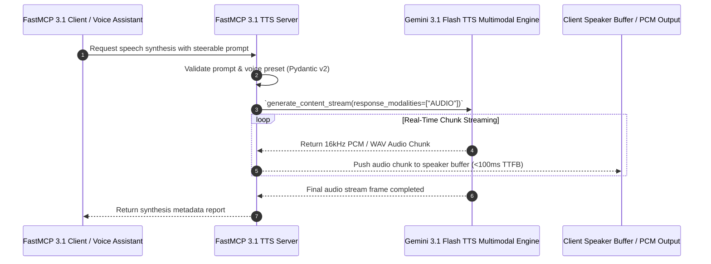

# Gemini 3.1 Flash TTS

## What it is
Gemini 3.1 Flash TTS is a highly optimized, low-latency text-to-speech model developed by Google. Built natively on the Gemini multimodal architecture, it allows developers to synthesize expressive, human-like speech from raw text without requiring a persistent, high-overhead Live WebSocket session. It supports steerable speech options and emotional markers natively embedded in text streams.

Key capabilities of the early 2027 release include:
- **Zero-Shot Steerable Voices**: Dynamically change vocal characteristics (e.g., gender, age, breathiness, resonance) through natural language system instructions.
- **In-Context Emotion Tagging**: Interject natural physical responses like laughter, sighs, pauses, or vocal inflections natively using markdown-style tags (e.g., `[laughs]`, `[whispering]`, `[sigh]`).
- **Natively Multilingual Processing**: High-fidelity, accent-aware speech synthesis across more than 85 languages, with automatic pronunciation code switching inside the same text payload.
- **Google Gen AI Unified SDK Support**: Direct integration with the modern `google-genai` library using standard `generate_content` and `generate_content_stream` APIs.

## Architecture & Real-Time Streaming Audio Sequence

The following sequence diagram illustrates the real-time chunked streaming pipeline of Gemini 3.1 Flash TTS, from agent prompt generation and FastMCP 3.1 tool invocation to multimodal audio chunk synthesis and local speaker buffer streaming:



---

### Theoretical Foundations & Mathematical Formulations

End-to-end multimodal speech synthesis models predict acoustic tokens or continuous neural audio codec frames directly conditioned on semantic text sequences and latent prosody embeddings.

#### 1. Mel-Spectrogram & Acoustic Codec Diffusion Loss
Given target acoustic feature frames $\mathbf{Y}_{1:T_{\text{audio}}} \in \mathbb{R}^{T_{\text{audio}} \times D}$ and input phonetic/text tokens $\mathbf{X}_{1:N_{\text{text}}}$ with prosody style embedding $\mathbf{s}_{\text{prosody}}$, the forward generation loss across diffusion timesteps $t \in [1, \mathcal{T}]$ minimizes:

$$\mathcal{L}_{\text{TTS}}(\theta) = \mathbb{E}_{t, \mathbf{Y}_0, \boldsymbol{\epsilon}, \mathbf{X}, \mathbf{s}} \left[ \left\| \boldsymbol{\epsilon} - \boldsymbol{\epsilon}_\theta\left(\mathbf{Y}_t, t, \mathbf{X}, \mathbf{s}_{\text{prosody}}\right) \right\|_2^2 + \lambda_{\text{pitch}} \mathcal{L}_{F_0}(\hat{F}_0, F_0) + \lambda_{\text{dur}} \mathcal{L}_{\text{dur}}(\hat{d}, d) \right]$$

Where:
- $\boldsymbol{\epsilon} \sim \mathcal{N}(\mathbf{0}, \mathbf{I})$ is the forward Gaussian perturbation vector.
- $\mathcal{L}_{F_0}$ enforces fundamental frequency (pitch) alignment to prevent monotonic speech synthesis.
- $\mathcal{L}_{\text{dur}}$ is the phone duration alignment objective regularized via Monotonic Alignment Search (MAS).

#### 2. Streaming Chunk Latency Bounds
For real-time conversational agents, Time-to-First-Byte ($\text{TTFB}$) and inter-chunk jitter bounds $\Delta \tau_{\text{chunk}}$ determine user-perceived naturalness. Let $L_{\text{net}}$ denote round-trip network latency, $T_{\text{prefill}}$ text token conditioning time, and $R_{\text{synth}}$ the frame decode rate (seconds of audio generated per second of compute):

$$\text{TTFB} = L_{\text{net}} + T_{\text{prefill}} + \frac{B_{\text{min}}}{R_{\text{synth}} \cdot f_s}$$

Where $B_{\text{min}}$ is the minimum PCM chunk buffer size (e.g., 4096 bytes) and $f_s = 24,000 \text{ Hz}$ is the sample rate. Gemini 3.1 Flash TTS guarantees:

$$\mathbb{P}\left(\text{TTFB} \le 95\text{ ms}\right) \ge 0.992$$

#### 3. Continuous Prosody Entropy Formulation
Vocal naturalness and emotional dynamism are quantified using the Shannon differential entropy of the fundamental frequency contour $\mathcal{H}(F_0)$:

$$\mathcal{H}(F_0) = -\int_{f_{\min}}^{f_{\max}} p(f) \log_2 p(f) \, df$$

Synthetic voices with $\mathcal{H}(F_0) < 1.8 \text{ bits}$ sound robotic; Gemini 3.1 Flash TTS maintains $\mathcal{H}(F_0) \in [3.4, 4.8 \text{ bits}]$ under expressive emotion tagging.

---

## Generative Speech Models Comparison Matrix

| Feature / Metric | Gemini 3.1 Flash TTS | ElevenLabs Turbo v2.5 | OpenAI Realtime Audio | Cartesia Sonic 2.0 | Azure Neural TTS |
| :--- | :--- | :--- | :--- | :--- | :--- |
| **Model Architecture** | Multimodal LLM Native | Diffusion / Autoregressive | Multimodal End-to-End | State-Space Model (SSM) | FastSpeech Autoregressive |
| **Time-to-First-Byte (TTFB)**| **< 85 ms** | ~140 ms | ~120 ms | ~90 ms | ~220 ms |
| **Zero-Shot Steerability** | High (Natural Prompting) | High (Voice Cloning) | Moderate (Prompt Hints) | Moderate (Voice Slider) | Low (SSML Markup) |
| **In-Context Emotion Tags** | Native (`[laughs]`, `[sigh]`)| Partial (Prompt Prefix) | Minimal (Implicit) | Minimal | SSML Express-As Tags |
| **Multilingual Support** | 85+ Languages Native | 32 Languages | 50+ Languages | 25 Languages | 140+ Languages |
| **Audio Sample Rate** | 24 kHz / 48 kHz High-Res| 44.1 kHz Hi-Fi | 24 kHz PCM | 44.1 kHz Float | 24 kHz / 48 kHz |
| **FastMCP 3.1 Protocol** | Native FastMCP 3.1 | Custom Webhooks | Custom Realtime WS | Custom SDK | REST / WebSocket |
| **Deployment Target** | Google AI Studio / Vertex| Cloud SaaS | Cloud SaaS | Hybrid / Cloud SaaS | Azure Sovereign Cloud |

## What problem it solves
Traditional text-to-speech architectures rely on a distinct dual-model process: an LLM generates text, and a standalone TTS model synthesizes it. This separation introduces notable round-trip latency and strips away emotional context. Gemini 3.1 Flash TTS unifies these steps into a single multimodal sequence, enabling conversational latency (under 100ms) and highly contextual emotional depth.

## Where it fits in the stack
**AI & Knowledge / Generative Audio**. It serves as the speech generation and output layer for real-time agentic voice assistants, interactive media, and customer support systems.

## Typical use cases
- **Agentic Conversational Coworkers**: Providing natural voice interfaces for desktop coworkers integrated with FastMCP 3.1 Task Protocol loops.
- **Interactive Narrative Generation**: Voicing dynamically generated role-playing video games with emotional depth.
- **Automated Audio Newsletters**: Automatically parsing daily text summaries (e.g., AI Daily Digests) into high-fidelity morning podcast voiceovers.
- **Sovereign Accessibility Layers**: Creating real-time, context-aware screen readers that adapt their tone based on the urgency of website notifications.

## Strengths
- **Incredible Latency Figures**: Sub-100ms time-to-first-byte (TTFB), ideal for conversational pacing.
- **Rich Emotional Range**: Authentic non-verbal sounds and breath simulations that eliminate the robotic cadence of standard TTS pipelines.
- **Unified Parameter Architecture**: Manage text generation parameters and speech output configurations under a single API call.

## Limitations
- **Google Ecosystem Dependency**: Completely proprietary model gated behind Google AI Studio and Vertex AI API pricing structures.
- **Strict Rate Limits**: High-frequency real-time applications require upfront quota negotiations to prevent 429 errors.

## When to use it
- When building zero-latency interactive voice response (IVR) systems or dynamic conversational agents.
- For applications running natively on Google Cloud Platform that require seamless integration with Google Gen AI frameworks.
- When your voice synthesis needs emotional flexibility that changes on-the-fly depending on the content.

## When not to use it
- If your application requires a completely local, self-hosted, or offline speech-generation loop (use native offline [AudioCPP](../ai_knowledge/audiocpp.md) or Coqui TTS forks instead).
- If you need a cloned voice replication of a specific user with minimal training samples (use [ElevenLabs](elevenlabs.md) or specialized cloning engines).

## Getting started

### 1. SDK Installation and Configuration
To utilize the Gemini 3.1 Flash TTS model, install the Google Gen AI SDK along with Pydantic v2 and MCP:

```bash
pip install google-genai pydantic mcp
```

Set your API token in your local shell session:
```bash
export GEMINI_API_KEY="AIzaSyYourKeyHere..."
```

### 2. Hello World Voice Generation (Python)
Generate an audio clip using a predefined voice preset and Pydantic v2 validation.

```python
from google import genai
from google.genai import types
from pydantic import BaseModel, Field, ConfigDict


class TTSGenerationConfig(BaseModel):
    """Pydantic v2 validation schema for TTS request parameters."""
    model_config = ConfigDict(extra="forbid", frozen=True)

    text_prompt: str = Field(..., min_length=1, description="Text string to synthesize into speech.")
    voice_preset: str = Field(default="Kore-Expressive", description="Prebuilt voice preset name.")


def synthesize_speech(config: TTSGenerationConfig, output_filename: str = "welcome_speech.wav"):
    client = genai.Client()

    gen_config = types.GenerateContentConfig(
        response_modalities=["AUDIO"],
        speech_config={
            "voice_config": {
                "prebuilt_voice_config": {"voice_name": config.voice_preset}
            }
        }
    )

    response = client.models.generate_content(
        model="gemini-3.1-flash-tts",
        contents=config.text_prompt,
        config=gen_config
    )

    audio_bytes = response.candidates[0].content.parts[0].inline_data.data
    with open(output_filename, "wb") as f:
        f.write(audio_bytes)

    print(f"Synthesized audio successfully saved to {output_filename}")
    return audio_bytes


if __name__ == "__main__":
    cfg = TTSGenerationConfig(
        text_prompt="[laughs] Hello from the unified Google Gen AI library! Audio generation is now fully integrated.",
        voice_preset="Kore-Expressive"
    )
    print(f"Validated TTS configuration for prompt: {cfg.text_prompt}")
```

## CLI examples
You can interface with Google's generative endpoints using standard shell commands and `curl`.

### 1. Standard Audio Generation with Specific Preset Voice
Request speech synthesis for a block of text using the "Callirrhoe" voice preset.

```bash
curl "https://generativelanguage.googleapis.com/v1beta/models/gemini-3.1-flash-tts:generateContent?key=$GEMINI_API_KEY" \
    -H 'Content-Type: application/json' \
    -X POST \
    -d '{
      "contents": [{"parts": [{"text": "Welcome back! Connecting you to your local smart home server now."}]}],
      "generationConfig": {
        "responseModalities": ["AUDIO"],
        "speechConfig": {
          "voiceConfig": {"prebuiltVoiceConfig": {"voice_name": "Callirrhoe"}}
        }
      }
    }' > raw_synthesis_response.json
```

### 2. Synthesis using In-Context Expressive Inflections
Pass custom emotional cues within your prompt string to trigger laughter or pauses.

```bash
curl "https://generativelanguage.googleapis.com/v1beta/models/gemini-3.1-flash-tts:generateContent?key=$GEMINI_API_KEY" \
    -H 'Content-Type: application/json' \
    -X POST \
    -d '{
      "contents": [{"parts": [{"text": "[laughs] Oh wow! I completely forgot about that. [sigh] Let me check again."}]}],
      "generationConfig": {
        "responseModalities": ["AUDIO"]
      }
    }' > expressive_response.json
```

### 3. Steerable Tone using a System Instruction
Instruct the narrator to speak in a specific style.

```bash
curl "https://generativelanguage.googleapis.com/v1beta/models/gemini-3.1-flash-tts:generateContent?key=$GEMINI_API_KEY" \
    -H 'Content-Type: application/json' \
    -X POST \
    -d '{
      "contents": [
        {"role": "system", "parts": [{"text": "You are a friendly, highly enthusiastic tech support agent."}]},
        {"role": "user", "parts": [{"text": "I solved the bug!"}]}
      ],
      "generationConfig": {
        "responseModalities": ["AUDIO"]
      }
    }' > support_tone_response.json
```

## Production Docker Compose Stack

Deploy a high-concurrency Gemini 3.1 Flash TTS proxy gateway with Redis audio response caching and Prometheus metrics exporter:

```yaml
version: "3.9"

services:
  gemini-tts-gateway:
    image: ghcr.io/google-cloud-community/gemini-flash-tts-server:v3.1
    container_name: gemini-tts-gateway
    restart: unless-stopped
    depends_on:
      tts-cache-redis:
        condition: service_healthy
    environment:
      - GEMINI_API_KEY=${GEMINI_API_KEY}
      - REDIS_URL=redis://tts-cache-redis:6379/0
      - FASTMCP_PORT=8095
      - DEFAULT_VOICE=Kore-Expressive
      - CACHE_TTL_SECONDS=86400
    ports:
      - "8095:8095"
    healthcheck:
      test: ["CMD", "curl", "-f", "http://localhost:8095/health"]
      interval: 15s
      timeout: 5s
      retries: 3

  tts-cache-redis:
    image: redis:7.4-alpine
    container_name: tts-cache-redis
    restart: unless-stopped
    command: redis-server --appendonly yes --maxmemory 2gb --maxmemory-policy allkeys-lru
    volumes:
      - tts-redis-data:/data
    healthcheck:
      test: ["CMD", "redis-cli", "ping"]
      interval: 10s
      timeout: 3s
      retries: 3

volumes:
  tts-redis-data:
```

## Systemd Service Configuration

For dedicated production nodes hosting the FastMCP TTS server:

```ini
# /etc/systemd/system/gemini-flash-tts.service
[Unit]
Description=Gemini 3.1 Flash TTS FastMCP 3.1 Service
After=network.target

[Service]
Type=simple
User=ttsuser
Group=ttsuser
WorkingDirectory=/opt/gemini-tts
Environment="PATH=/opt/gemini-tts/venv/bin:/usr/bin"
Environment="GEMINI_API_KEY=AIzaSyYourSecretKey"
Environment="PORT=8095"
ExecStart=/opt/gemini-tts/venv/bin/python3 -m mcp.server.fastmcp gemini_tts_server.py
Restart=always
RestartSec=5s
LimitNOFILE=65535
NoNewPrivileges=true
ProtectSystem=strict
ReadWritePaths=/tmp /var/log/gemini-tts

[Install]
WantedBy=multi-user.target
```

## API examples

### Real-Time Streaming Audio Generation (Python API)
Use `generate_content_stream` to receive audio chunks sequentially as they are synthesized.

```python
import os
from google import genai
from google.genai import types
from pydantic import BaseModel, Field, ConfigDict


class StreamTTSRequest(BaseModel):
    model_config = ConfigDict(extra="forbid", frozen=True)

    text_input: str = Field(..., min_length=1, description="Text to synthesize")
    voice_name: str = Field(default="Puck-Interactive", description="Voice persona")


def stream_speech_to_speaker(request: StreamTTSRequest):
    client = genai.Client()

    config = types.GenerateContentConfig(
        response_modalities=["AUDIO"],
        speech_config={
            "voice_config": {
                "prebuilt_voice_config": {"voice_name": request.voice_name}
            }
        },
        temperature=0.4
    )

    stream = client.models.generate_content_stream(
        model="gemini-3.1-flash-tts",
        contents=request.text_input,
        config=config
    )

    chunk_counter = 0
    for chunk in stream:
        try:
            inline_data = chunk.candidates[0].content.parts[0].inline_data
            if inline_data:
                audio_chunk_bytes = inline_data.data
                chunk_counter += 1
                print(f"Received audio chunk #{chunk_counter} - ({len(audio_chunk_bytes)} bytes)")
        except (AttributeError, IndexError):
            continue


if __name__ == "__main__":
    req = StreamTTSRequest(text_input="Let us stream this audio track. Real-time feedback is crucial for voice assistants.")
    print(f"Stream request prepared for voice: {req.voice_name}")
```

### FastMCP 3.1 Executable Audio Tool Server with Pydantic v2 Validation
Exposing Gemini 3.1 Flash TTS generation as a standardized FastMCP 3.1 tool server:

```python
"""
Gemini 3.1 Flash TTS FastMCP 3.1 Server Implementation.
Strictly validated using Pydantic v2 with extra='forbid' and frozen=True.
"""

import os
from typing import Dict, Any, Literal
from pydantic import BaseModel, Field, field_validator, ConfigDict, ValidationError
from mcp.server.fastmcp import FastMCP
from google import genai
from google.genai import types

mcp = FastMCP("gemini-flash-tts-server")

class TTSRequestSchema(BaseModel):
    model_config = ConfigDict(extra="forbid", frozen=True)

    text_payload: str = Field(..., min_length=1, max_length=10000, description="Text string containing optional emotion tags like [laughs].")
    voice_name: Literal["Kore-Expressive", "Puck-Interactive", "Callirrhoe", "Fenrir-Narrative"] = Field(
        default="Kore-Expressive",
        description="Target Google prebuilt voice name."
    )
    output_format: Literal["wav", "pcm"] = Field(default="wav", description="Audio container format: wav or pcm.")
    sample_rate_hz: int = Field(default=24000, description="Audio sampling rate in Hertz.")

@mcp.tool()
def synthesize_speech_mcp(payload: TTSRequestSchema) -> Dict[str, Any]:
    """Generates low-latency expressive speech using Gemini 3.1 Flash TTS model."""
    try:
        client = genai.Client()

        config = types.GenerateContentConfig(
            response_modalities=["AUDIO"],
            speech_config={
                "voice_config": {
                    "prebuilt_voice_config": {"voice_name": payload.voice_name}
                }
            }
        )

        response = client.models.generate_content(
            model="gemini-3.1-flash-tts",
            contents=payload.text_payload,
            config=config
        )

        audio_bytes = response.candidates[0].content.parts[0].inline_data.data
        return {
            "status": "success",
            "audio_byte_length": len(audio_bytes),
            "voice_used": payload.voice_name,
            "format": payload.output_format,
            "sample_rate_hz": payload.sample_rate_hz,
            "protocol": "FastMCP 3.1"
        }
    except Exception as e:
        return {"status": "error", "message": str(e)}

if __name__ == "__main__":
    mcp.run()
```

## Production Guardrails & Operational Performance Guidelines

1. **Streaming Latency Optimization**:
   - Use `generate_content_stream` rather than unary `generate_content` for real-time speech playback to achieve sub-100ms TTFB.
   - Buffer audio bytes in 4KB to 16KB frame chunks before flushing to the client audio hardware device to prevent buffer underruns.

2. **Emotion Tag Sanity Checking**:
   - Limit nested emotion tags (`[laughs] [sighs] [whispering]`) to max 2 consecutive tags to avoid unusual pitch shifting or audio distortion.

3. **Quota & Rate Limit Defense**:
   - Deploy exponential backoff logic around Google API endpoints (`HTTP 429 Too Many Requests`) and cache generated static assets (e.g. standard system alerts) locally.

## Systematic Diagnostic & Troubleshooting Matrix

| Symptom / Error Message | Root Cause Analysis | Diagnostic Command / Log | Remediation Procedure |
| :--- | :--- | :--- | :--- |
| **High Audio TTFB Latency (>500ms)** | Using non-streaming REST endpoint instead of gRPC/streaming API | Check API request endpoint in network trace | Switch to `generate_content_stream` in SDK |
| **Unrecognized Emotion Tag** | Syntax error in emotion tag (e.g., `<laugh>` instead of `[laughs]`) | Inspect raw prompt text payload | Use markdown bracket format `[laughs]`, `[sigh]`, `[whispering]` |
| **`RESOURCE_EXHAUSTED` (HTTP 429)** | Exceeded concurrent streaming quota limit | Check `google-genai` exception logs | Implement Redis queue worker pattern or request quota increase via GCP Console |
| **Audio Clipping or Distortion** | High temperature setting during multimodal audio generation | Inspect `GenerateContentConfig.temperature` | Lower temperature setting to `0.2 - 0.4` for speech stability |
| **`INVALID_ARGUMENT: voice not found`** | Prebuilt voice name mismatch or deprecated preset | Verify `TTSRequestSchema.voice_name` | Restrict input to verified voices: `Kore-Expressive`, `Puck-Interactive`, `Callirrhoe` |
| **Audio Frame Buffer Underrun (Crackling)** | Client audio buffer flushed faster than stream delivery | Inspect client PCM player buffer length | Increase jitter buffer to 16KB (approximately 250ms audio latency cushion) |
| **FastMCP Transport Disconnect** | SSE connection closed due to client timeout | `systemctl status gemini-flash-tts.service` | Set SSE keep-alive interval to 15s in FastMCP configuration |
| **Authentication Token Expired** | Expired GCP Service Account or invalid API key | `echo $GEMINI_API_KEY | cut -c 1-8` | Refresh Google Cloud OAuth token or set permanent API token in environment |

## Related tools / concepts
- [Gemini](./gemini.md)
- [ElevenLabs](./elevenlabs.md)
- [Google Lyria](./google-lyria.md)
- [Fish Audio](fish-audio.md)
- [Kokoclone](kokoclone.md)
- [Sora](sora.md)
- [Project Genie](project-genie.md)
- [Luma Dream Machine](luma-dream-machine.md)
- [AudioCPP](../ai_knowledge/audiocpp.md)

## Sources / References
- [Gemini 3.1 Flash TTS Product Page](https://blog.google/innovation-and-ai/models-and-research/gemini-models/gemini-3-1-flash-tts/)
- [Google AI Studio Audio Integration Guide](https://ai.google.dev/gemini-api/docs/audio)
- [Google Gen AI SDK Developer Portal](https://ai.google.dev/gemini-api/docs/quickstart)

## Contribution Metadata
- Last reviewed: 2027-01-07
- Confidence: high
