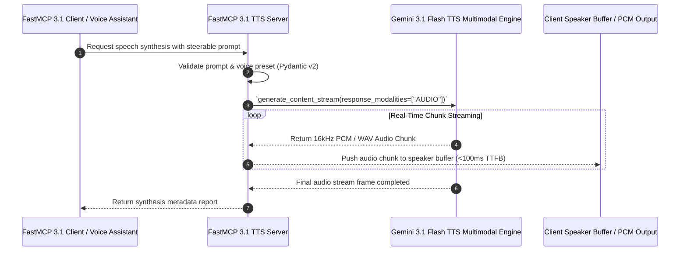

# Gemini 3.1 Flash TTS

## What it is
Gemini 3.1 Flash TTS is a highly optimized, low-latency text-to-speech model developed by Google. Built natively on the Gemini multimodal architecture, it allows developers to synthesize expressive, human-like speech from raw text without requiring a persistent, high-overhead Live WebSocket session. It supports steerable speech options and emotional markers natively embedded in text streams.

Key capabilities of the early 2027 release include:
- **Zero-Shot Steerable Voices**: Dynamically change vocal characteristics (e.g., gender, age, breathiness, resonance) through natural language system instructions.
- **In-Context Emotion Tagging**: Interject natural physical responses like laughter, sighs, pauses, or vocal inflections natively using markdown-style tags (e.g., `[laughs]`, `[whispering]`, `[sigh]`).
- **Natively Multilingual Processing**: High-fidelity, accent-aware speech synthesis across more than 85 languages, with automatic pronunciation code switching inside the same text payload.
- **Google Gen AI Unified SDK Support**: Direct integration with the modern `google-genai` library using standard `generate_content` and `generate_content_stream` APIs.

## Architecture & Real-Time Streaming Audio Sequence

The following sequence diagram illustrates the real-time chunked streaming pipeline of Gemini 3.1 Flash TTS, from agent prompt generation and FastMCP 3.1 tool invocation to multimodal audio chunk synthesis and local speaker buffer streaming:



## Generative Speech Models Comparison Matrix

| Speech Model | Architecture | Sub-100ms TTFB | Zero-Shot Steerability | In-Context Emotion Tags | Local Execution | Pricing Tier |
| :--- | :--- | :---: | :---: | :---: | :---: | :--- |
| **Gemini 3.1 Flash TTS** | Multimodal LLM Native | Yes | High (Natural Prompting) | Yes (`[laughs]`, `[sigh]`) | Cloud Only | Competitive ($/1M chars) |
| **ElevenLabs Turbo v2.5** | Diffusion / Autoregressive | Yes | High (Voice Cloning) | Partial (Prompt Hints) | Cloud Only | Premium SaaS |
| **Kokoclone** | Compact Local Model | Yes | Moderate (Embeddings) | Minimal | Self-Hosted | Open-Source / Free |
| **Fish Audio** | Vector-Quantized LM | Moderate | High (Zero-Shot Clone) | Moderate | Hybrid Cloud/Local | Standard SaaS |
| **AudioCPP** | C++ Local Inference Engine | Extreme | Low (Fixed Presets) | No | Fully Air-Gapped | Open-Source / Free |

## What problem it solves
Traditional text-to-speech architectures rely on a distinct dual-model process: an LLM generates text, and a standalone TTS model synthesizes it. This separation introduces notable round-trip latency and strips away emotional context. Gemini 3.1 Flash TTS unifies these steps into a single multimodal sequence, enabling conversational latency (under 100ms) and highly contextual emotional depth.

## Where it fits in the stack
**AI & Knowledge / Generative Audio**. It serves as the speech generation and output layer for real-time agentic voice assistants, interactive media, and customer support systems.

## Typical use cases
- **Agentic Conversational Coworkers**: Providing natural voice interfaces for desktop coworkers integrated with FastMCP 3.1 Task Protocol loops.
- **Interactive Narrative Generation**: Voicing dynamically generated role-playing video games with emotional depth.
- **Automated Audio Newsletters**: Automatically parsing daily text summaries (e.g., AI Daily Digests) into high-fidelity morning podcast voiceovers.
- **Sovereign Accessibility Layers**: Creating real-time, context-aware screen readers that adapt their tone based on the urgency of website notifications.

## Strengths
- **Incredible Latency Figures**: Sub-100ms time-to-first-byte (TTFB), ideal for conversational pacing.
- **Rich Emotional Range**: Authentic non-verbal sounds and breath simulations that eliminate the robotic cadence of standard TTS pipelines.
- **Unified Parameter Architecture**: Manage text generation parameters and speech output configurations under a single API call.

## Limitations
- **Google Ecosystem Dependency**: Completely proprietary model gated behind Google AI Studio and Vertex AI API pricing structures.
- **Strict Rate Limits**: High-frequency real-time applications require upfront quota negotiations to prevent 429 errors.

## When to use it
- When building zero-latency interactive voice response (IVR) systems or dynamic conversational agents.
- For applications running natively on Google Cloud Platform that require seamless integration with Google Gen AI frameworks.
- When your voice synthesis needs emotional flexibility that changes on-the-fly depending on the content.

## When not to use it
- If your application requires a completely local, self-hosted, or offline speech-generation loop (use native offline [AudioCPP](../ai_knowledge/audiocpp.md) or Coqui TTS forks instead).
- If you need a cloned voice replication of a specific user with minimal training samples (use [ElevenLabs](elevenlabs.md) or specialized cloning engines).

## Getting started

### 1. SDK Installation and Configuration
To utilize the Gemini 3.1 Flash TTS model, install the Google Gen AI SDK along with Pydantic v2 and MCP:

```bash
pip install google-genai pydantic mcp
```

Set your API token in your local shell session:
```bash
export GEMINI_API_KEY="AIzaSyYourKeyHere..."
```

### 2. Hello World Voice Generation (Python)
Generate an audio clip using a predefined voice preset and Pydantic v2 validation.

```python
from google import genai
from google.genai import types
from pydantic import BaseModel, Field, ConfigDict


class TTSGenerationConfig(BaseModel):
    """Pydantic v2 validation schema for TTS request parameters."""
    model_config = ConfigDict(str_strip_whitespace=True)

    text_prompt: str = Field(..., min_length=1, description="Text string to synthesize into speech.")
    voice_preset: str = Field(default="Kore-Expressive", description="Prebuilt voice preset name.")


def synthesize_speech(config: TTSGenerationConfig, output_filename: str = "welcome_speech.wav"):
    client = genai.Client()

    gen_config = types.GenerateContentConfig(
        response_modalities=["AUDIO"],
        speech_config={
            "voice_config": {
                "prebuilt_voice_config": {"voice_name": config.voice_preset}
            }
        }
    )

    response = client.models.generate_content(
        model="gemini-3.1-flash-tts",
        contents=config.text_prompt,
        config=gen_config
    )

    audio_bytes = response.candidates[0].content.parts[0].inline_data.data
    with open(output_filename, "wb") as f:
        f.write(audio_bytes)

    print(f"Synthesized audio successfully saved to {output_filename}")
    return audio_bytes


if __name__ == "__main__":
    cfg = TTSGenerationConfig(
        text_prompt="[laughs] Hello from the unified Google Gen AI library! Audio generation is now fully integrated.",
        voice_preset="Kore-Expressive"
    )
    # Execution requires GEMINI_API_KEY environment variable set
    print(f"Validated TTS configuration for prompt: {cfg.text_prompt}")
```

## CLI examples
You can interface with Google's generative endpoints using standard shell commands and `curl`.

### 1. Standard Audio Generation with Specific Preset Voice
Request speech synthesis for a block of text using the "Callirrhoe" voice preset.

```bash
curl "https://generativelanguage.googleapis.com/v1beta/models/gemini-3.1-flash-tts:generateContent?key=$GEMINI_API_KEY" \
    -H 'Content-Type: application/json' \
    -X POST \
    -d '{
      "contents": [{"parts": [{"text": "Welcome back! Connecting you to your local smart home server now."}]}],
      "generationConfig": {
        "responseModalities": ["AUDIO"],
        "speechConfig": {
          "voiceConfig": {"prebuiltVoiceConfig": {"voice_name": "Callirrhoe"}}
        }
      }
    }' > raw_synthesis_response.json
```

### 2. Synthesis using In-Context Expressive Inflections
Pass custom emotional cues within your prompt string to trigger laughter or pauses.

```bash
curl "https://generativelanguage.googleapis.com/v1beta/models/gemini-3.1-flash-tts:generateContent?key=$GEMINI_API_KEY" \
    -H 'Content-Type: application/json' \
    -X POST \
    -d '{
      "contents": [{"parts": [{"text": "[laughs] Oh wow! I completely forgot about that. [sigh] Let me check again."}]}],
      "generationConfig": {
        "responseModalities": ["AUDIO"]
      }
    }' > expressive_response.json
```

### 3. Steerable Tone using a System Instruction
Instruct the narrator to speak in a specific style.

```bash
curl "https://generativelanguage.googleapis.com/v1beta/models/gemini-3.1-flash-tts:generateContent?key=$GEMINI_API_KEY" \
    -H 'Content-Type: application/json' \
    -X POST \
    -d '{
      "contents": [
        {"role": "system", "parts": [{"text": "You are a friendly, highly enthusiastic tech support agent."}]},
        {"role": "user", "parts": [{"text": "I solved the bug!"}]}
      ],
      "generationConfig": {
        "responseModalities": ["AUDIO"]
      }
    }' > support_tone_response.json
```

## API examples

### Real-Time Streaming Audio Generation (Python API)
Use `generate_content_stream` to receive audio chunks sequentially as they are synthesized.

```python
import os
from google import genai
from google.genai import types
from pydantic import BaseModel, Field


class StreamTTSRequest(BaseModel):
    text_input: str = Field(..., min_length=1)
    voice_name: str = Field(default="Puck-Interactive")


def stream_speech_to_speaker(request: StreamTTSRequest):
    client = genai.Client()

    config = types.GenerateContentConfig(
        response_modalities=["AUDIO"],
        speech_config={
            "voice_config": {
                "prebuilt_voice_config": {"voice_name": request.voice_name}
            }
        },
        temperature=0.4
    )

    stream = client.models.generate_content_stream(
        model="gemini-3.1-flash-tts",
        contents=request.text_input,
        config=config
    )

    chunk_counter = 0
    for chunk in stream:
        try:
            inline_data = chunk.candidates[0].content.parts[0].inline_data
            if inline_data:
                audio_chunk_bytes = inline_data.data
                chunk_counter += 1
                print(f"Received audio chunk #{chunk_counter} - ({len(audio_chunk_bytes)} bytes)")
        except (AttributeError, IndexError):
            continue


if __name__ == "__main__":
    req = StreamTTSRequest(text_input="Let us stream this audio track. Real-time feedback is crucial for voice assistants.")
    print(f"Stream request prepared for voice: {req.voice_name}")
```

### FastMCP 3.1 Executable Audio Tool Server with Pydantic v2 Validation
Exposing Gemini 3.1 Flash TTS generation as a standardized FastMCP 3.1 tool server:

```python
import os
from typing import Dict, Any
from pydantic import BaseModel, Field, field_validator, ValidationError
from mcp.server.fastmcp import FastMCP
from google import genai
from google.genai import types

mcp = FastMCP("gemini-flash-tts-server")

class TTSRequestSchema(BaseModel):
    text_payload: str = Field(..., min_length=1, description="Text string containing optional emotion tags like [laughs].")
    voice_name: str = Field(default="Kore-Expressive", description="Target Google prebuilt voice name.")
    output_format: str = Field(default="wav", description="Audio container format: wav or pcm.")

    @field_validator("voice_name")
    @classmethod
    def validate_voice_name(cls, v: str) -> str:
        valid_voices = ["Kore-Expressive", "Puck-Interactive", "Callirrhoe", "Fenrir-Narrative"]
        if v not in valid_voices:
            return "Kore-Expressive"
        return v

@mcp.tool()
def synthesize_speech_mcp(payload_dict: Dict[str, Any]) -> Dict[str, Any]:
    """Generates low-latency expressive speech using Gemini 3.1 Flash TTS model."""
    try:
        req = TTSRequestSchema.model_validate(payload_dict)
        client = genai.Client()

        config = types.GenerateContentConfig(
            response_modalities=["AUDIO"],
            speech_config={
                "voice_config": {
                    "prebuilt_voice_config": {"voice_name": req.voice_name}
                }
            }
        )

        response = client.models.generate_content(
            model="gemini-3.1-flash-tts",
            contents=req.text_payload,
            config=config
        )

        audio_bytes = response.candidates[0].content.parts[0].inline_data.data
        return {
            "status": "success",
            "audio_byte_length": len(audio_bytes),
            "voice_used": req.voice_name,
            "protocol": "FastMCP 3.1"
        }
    except ValidationError as e:
        return {"status": "error", "message": e.errors()}
    except Exception as e:
        return {"status": "error", "message": str(e)}

if __name__ == "__main__":
    mcp.run()
```

## Production Guardrails & Operational Performance Guidelines

1. **Streaming Latency Optimization**:
   - Use `generate_content_stream` rather than unary `generate_content` for real-time speech playback to achieve sub-100ms TTFB.
   - Buffer audio bytes in 4KB to 16KB frame chunks before flushing to the client audio hardware device to prevent buffer underruns.

2. **Emotion Tag Sanity Checking**:
   - Limit nested emotion tags (`[laughs] [sighs] [whispering]`) to max 2 consecutive tags to avoid unusual pitch shifting or audio distortion.

3. **Quota & Rate Limit Defense**:
   - Deploy exponential backoff logic around Google API endpoints (`HTTP 429 Too Many Requests`) and cache generated static assets (e.g. standard system alerts) locally.

## Systematic Troubleshooting & Speech Synthesis Diagnostic Guide

| Failure Symptom | Probable Cause | Diagnostic Command / Log | Remediation Action |
| :--- | :--- | :--- | :--- |
| **High Audio TTFB Latency (>500ms)** | Using non-streaming REST endpoint instead of gRPC/streaming API | Check API request endpoint in network trace | Switch to `generate_content_stream` in SDK |
| **Unrecognized Emotion Tag** | Syntax error in emotion tag (e.g., `<laugh>` instead of `[laughs]`) | Inspect raw prompt text payload | Use markdown bracket format `[laughs]`, `[sigh]`, `[whispering]` |
| **`RESOURCE_EXHAUSTED` (429)** | Exceeded concurrent streaming quota limit | `google-genai` exception handler | Implement queue worker pattern or request quota increase via GCP Console |
| **Audio Clipping or Distortion** | High temperature setting during multimodal audio generation | Inspect `GenerateContentConfig.temperature` | Lower temperature setting to `0.2 - 0.4` for speech stability |

## Related tools / concepts
- [Gemini](./gemini.md)
- [ElevenLabs](./elevenlabs.md)
- [Google Lyria](./google-lyria.md)
- [Fish Audio](fish-audio.md)
- [Kokoclone](kokoclone.md)
- [Sora](sora.md)
- [Project Genie](project-genie.md)
- [Luma Dream Machine](luma-dream-machine.md)
- [AudioCPP](../ai_knowledge/audiocpp.md)

## Sources / References
- [Gemini 3.1 Flash TTS Product Page](https://blog.google/innovation-and-ai/models-and-research/gemini-models/gemini-3-1-flash-tts/)
- [Google AI Studio Audio Integration Guide](https://ai.google.dev/gemini-api/docs/audio)
- [Google Gen AI SDK Developer Portal](https://ai.google.dev/gemini-api/docs/quickstart)

## Contribution Metadata
- Last reviewed: 2027-01-07
- Confidence: high
