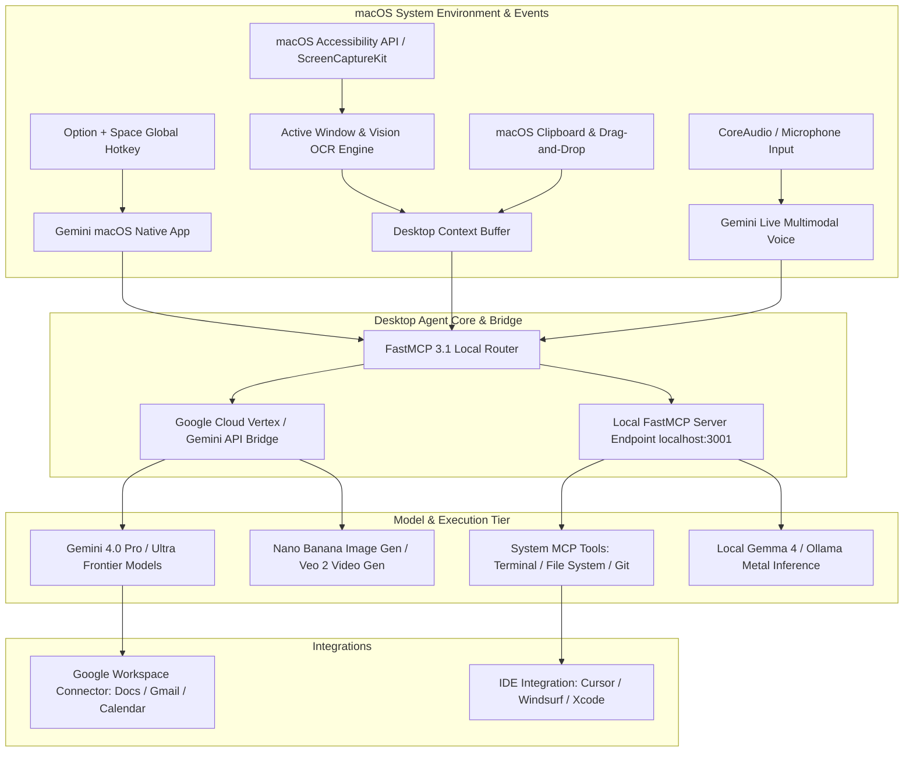

# Google Gemini for macOS

## What it is
Google Gemini for macOS is a native desktop application engineered to deeply integrate Google's multimodal artificial intelligence architecture directly into Apple Silicon macOS environments (spanning M1 through M6 generations). Built specifically for macOS Sequoia (15.0+) and subsequent operating system releases, Gemini for macOS functions as a system-wide ambient intelligence companion. It provides global hotkey invocation (`Option + Space`), real-time window and display context awareness via ScreenCaptureKit, native CoreAudio capture, local file system indexing, clipboard integration, and multimodal asset synthesis.

By early January 2027, Google Gemini for macOS natively supports the **FastMCP 3.1** specification and **MCP 3.0 Task Protocol**. Operating dual roles as an MCP client and an embedded FastMCP server on `localhost:3001`, the application orchestrates multi-step developer workflows across Google's cloud-hosted frontier models—such as **Gemini 4.0 Pro**, **Gemini 4.0 Ultra**, **Gemini 4.0 Flash**, and **Gemini Spark 2.5**—and local execution tools or on-device models like [Gemma 4](../ai_knowledge/local_llms.md) operating through [Ollama](../../services/ollama.md).



## What problem it solves
Google Gemini for macOS addresses several acute friction points in contemporary software engineering, technical writing, and analytical desktop tasks:

1. **Context Fragmentation & Cognitive Switching**: Eliminates tedious copy-pasting across browser windows, terminal sessions, and development IDEs by continuously extracting on-screen state via hardware-accelerated macOS APIs.
2. **Multi-Step Developer Troubleshooting**: Enables instant visual and textual capture of compiler errors, stack traces, and UI layout defects via global keyboard triggers, routing context directly to frontier reasoning models without losing window focus.
3. **Local Tool Invocation via FastMCP 3.1**: Bridges cloud intelligence with local execution boundaries—such as modifying source files, executing shell scripts, running lint checkers, and issuing Git commands—in a permissioned sandbox.
4. **Real-Time Multimodal Voice & Visual Streaming**: Offers zero-latency voice interaction via Gemini Live, allowing engineers to talk through architectural problems and refactor logic hands-free while inspecting terminal outputs.
5. **Unified Cloud-Local Workspace Intelligence**: Seamlessly blends enterprise cloud assets stored in Google Workspace (Gmail, Google Drive, Sheets) with local desktop artifacts and repositories in a unified retrieval context.

## Mathematical Formulations & Latency Decision Boundaries

### 1. Vision Context Compression & Entropy Bound
When capturing high-resolution Retina displays (e.g., $3024 \times 1964$ at 2x scale), passing uncompressed raster bitmaps creates excessive network overhead and token consumption. The local macOS engine applies a vision tile tiling and OCR differential compression pipeline:

$$C_r = \frac{T_{raw}}{T_{compressed}} = \frac{W \times H \times D \times \text{bpp}}{8 \times \left(T_{vision\_tokens} \times d_{embed} + S_{ocr}\right)}$$

Where:
- $W, H$ represent screen width and height in pixels.
- $D$ is pixel density ($2.0$ for Retina displays).
- $\text{bpp}$ is bit depth (24-bit RGB).
- $T_{vision\_tokens}$ is the quantized patch count from the Vision Transformer.
- $S_{ocr}$ is the UTF-8 byte length of extracted accessibility textual elements.

The Shannon text-to-pixel entropy ratio $H_{ctx}$ governs whether a screenshot is converted to structured markdown text or passed directly to vision encoders:

$$H_{ctx} = -\sum_{i=1}^{V} p(w_i) \log_2 p(w_i)$$

If $H_{ctx} \ge \tau_{text}$ (where $\tau_{text} = 4.25$ bits/symbol), the desktop daemon dispatches text-only representations, saving $\approx 82\%$ token expenditure.

### 2. Local vs. Cloud Model Routing Decision Boundary
Gemini for macOS dynamically routes queries between on-device local models ([Gemma 4](../ai_knowledge/local_llms.md) running over Apple Metal unified memory) and cloud models (Gemini 4.0 Pro) based on expected utility $U(R)$:

$$U(R_{local}) = \frac{Q_{local}}{L_{local} + \epsilon} \cdot \mathbf{1}_{\{C_{priv} = \text{Strict}\}}$$

$$U(R_{cloud}) = \frac{Q_{cloud}}{L_{cloud} + L_{net} + \kappa \cdot \text{Cost}_{token}} \cdot \mathbf{1}_{\{C_{priv} = \text{Standard}\}}$$

The dispatch engine selects $R^* = \arg\max \{U(R_{local}), U(R_{cloud})\}$, ensuring sub-50ms local responses for simple text extraction and file ops while reserving cloud calls for deep reasoning.

## Comparative Evaluation: Desktop AI Companions

| Dimension | Google Gemini for macOS | Claude for Desktop | ChatGPT macOS Client | Microsoft Copilot Studio |
| :--- | :--- | :--- | :--- | :--- |
| **Primary Foundation Model** | Gemini 4.0 Pro / Ultra / Flash | Claude 3.7 Sonnet / Opus | GPT-5.2 / GPT-4o | GPT-4o Enterprise |
| **Local Model Support** | Native Gemma 4 via Ollama/Metal | None (Cloud Only) | None (Cloud Only) | Limited (Small SLMs) |
| **Tool Protocol Support** | FastMCP 3.1 & MCP 3.0 Task | MCP 1.0 / 2.0 (Stdio/SSE) | Custom Actions / Plugins | Microsoft Graph Agents |
| **Screen Capture API** | Native ScreenCaptureKit (GPU) | Window snapshot | Window snapshot | OS Accessibility |
| **Voice Streaming Protocol** | Gemini Live Bidirectional WebRTC | Text-to-speech replay | Advanced Voice Mode (WebRTC)| Azure Speech Services |
| **Enterprise Workspace Sync**| Native Google Workspace sync | Custom enterprise connectors| Custom MCP connectors | Native M365 Graph sync |
| **Apple Silicon Optimization**| Metal Performance Shaders / ANE | Electron / WebKit wrapper | Swift / Metal hybrid | Electron / WebView2 |
| **Offline Capabilities** | Supported for local Gemma tools | Non-functional offline | Non-functional offline | Non-functional offline |

## Where it fits in the stack
Google Gemini for macOS operates at the **Desktop Client & Ambient Intelligence Layer**:

- **System Hardware Layer**: Leverages Apple Silicon unified memory architecture (UMA), utilizing Metal Performance Shaders (MPS) and Apple Neural Engine (ANE) for local OCR and embedding pipelines.
- **Protocol Bridge Layer**: Serves as a local **FastMCP 3.1 Host**, allowing external agent frameworks like [Agno](../agents/phidata.md) or [LlamaIndex.TS](../ai_knowledge/llamaindex-ts.md) to inspect and invoke desktop capabilities.
- **Model Orchestration Layer**: Dynamically arbitrates execution across Google Cloud Vertex AI infrastructure and local Metal-accelerated inference engines.
- **Application Integration Layer**: Directly interfaces with local IDEs ([Cursor](../development_ops/cursor.md), [Windsurf](../development_ops/windsurf.md), Xcode), terminal emulators (Ghostty, iTerm2), and file storage.

## Typical use cases
- **Active Code Debugging**: Press `Option + Space` while viewing a failing test suite in Xcode or Cursor to let Gemini inspect the code snippet, analyze stack traces, and suggest fixes.
- **Visual Design & UI Extraction**: Share active Figma or browser windows with Gemini to extract CSS color schemes, generate Tailwind CSS classes, or generate matching visual assets via [Nano Banana](nano-banana.md).
- **Document & Spreadsheet Analysis**: Ask questions about dense PDFs, financial models in Excel, or Apple Keynote presentations currently displayed on screen.
- **Multimodal Meeting & Audio Synthesis**: Capture active system audio or microphone input during technical design discussions to automatically extract action items and create Google Tasks or Linear issues.
- **Automated Workspace Searching**: Execute cross-app searches combining local file system contents with Google Drive documents via natural language prompts.

## Strengths
- **Native macOS Performance & Design**: Polished SwiftUI interface optimized for Apple Silicon neural engines (NPU), offering negligible CPU and memory overhead when idle.
- **Ambient Screen & Window Intelligence**: High-precision window isolation allows users to target specific monitor displays or application windows without exposing sensitive background windows.
- **FastMCP 3.1 Client & Host Architecture**: Full compliance with FastMCP 3.1 specification, allowing desktop agents to execute local tools securely.
- **Multimodal Generation Suite**: Native desktop generation and editing of high-resolution images via [Nano Banana](nano-banana.md) and short video clips via Google Veo 2.
- **Keyboard-First Design**: Extensive global hotkey mappings for instant invocation, screen capture, clear context, and floating window pinning.

## Limitations
- **Apple Silicon Hardware Dependency**: Runs exclusively on Apple Silicon Macs (M1/M2/M3/M4/M5/M6); Intel-based Mac architectures are not supported.
- **Operating System Baseline**: Strictly requires macOS Sequoia (15.0) or later, preventing deployment on older macOS enterprise images.
- **Cloud Connection Requirement**: Complex multi-modal reasoning and high-fidelity generation require an active high-speed internet connection to Google Cloud.

## When to use it
- When developing or designing primarily on Apple Silicon hardware under macOS Sequoia+.
- When your daily workflow heavily utilizes Google Workspace alongside local desktop developer tools.
- When requiring real-time visual reasoning over active screen content without manual screenshot exports.
- When seeking a lightweight desktop FastMCP 3.1 host for local agent orchestration.

## When not to use it
- On legacy Intel-based Mac hardware or non-macOS platforms (Windows, Linux) — use [ChatGPT Desktop](chatgpt.md) or browser interfaces.
- In strictly air-gapped or offline enterprise environments where all cloud outbound traffic is disabled (use [Ollama](../../services/ollama.md) with local models).
- For terminal-exclusive headless workflows where a graphical desktop interface is unavailable — use [Gemini CLI](gemini-cli.md).

## Getting started

### 1. Installation & Setup
1. Download the official installer `.dmg` package from [Gemini for macOS](https://gemini.google/mac/).
2. Drag `Gemini.app` into your macOS `/Applications` directory.
3. Launch `Gemini.app` and sign in using your Google Workspace or Personal account.

### 2. Granting macOS System Permissions
For full screen-awareness, audio interaction, and global hotkeys, configure the following settings in **macOS System Settings > Privacy & Security**:
- **Accessibility**: Enable `Gemini.app` to allow global keybindings (`Option + Space`) and active UI element inspection.
- **Screen & System Audio Recording**: Enable `Gemini.app` to allow active window capture via ScreenCaptureKit.
- **Microphone**: Enable `Gemini.app` for Gemini Live voice interaction.

### 3. Testing Global Invocation
- Press `Option + Space` from any active application to launch the floating Gemini overlay.
- Click the **Screen Context** icon to attach the active window snippet.
- Type `"Explain this window contents and highlight potential errors"` and press Enter.

## CLI examples
Gemini for macOS installs a companion CLI utility, `gemini-mac`, facilitating automation and scriptable integration with terminal workflows.

```bash
# Check status of local Gemini macOS daemon and FastMCP bridge
gemini-mac status

# Capture active desktop window and send prompt to Gemini 4.0 Pro
gemini-mac capture --target active-window --prompt "Summarize stack trace"

# List all active FastMCP 3.1 tools registered with the desktop application
gemini-mac mcp list-tools

# Connect terminal context to local desktop session
gemini-mac stream --file ./build.log --model gemini-4.0-flash

# Trigger system audio capture for a 30-second voice memo
gemini-mac voice --duration 30 --output-task
```

## API examples

### 1. Python FastMCP 3.1 Server for Gemini macOS Context Bridge
The following complete Python script creates a FastMCP 3.1 server that collects macOS active window metadata and exposes it as an agent tool to Gemini for macOS. It enforces strict Pydantic v2 schemas (`extra="forbid"`, `frozen=True`):

```python
import asyncio
import json
import subprocess
from typing import Dict, Any, Optional
from pydantic import BaseModel, ConfigDict, Field, HttpUrl, ValidationError
from fastmcp import FastMCP

# Initialize FastMCP Server for macOS Desktop Bridge
mcp_server = FastMCP(
    name="GeminiMacOSDesktopBridge",
    version="3.1.0",
    description="Provides active window and screen context to Gemini macOS Agent"
)

class MacOSWindowMetadata(BaseModel):
    model_config = ConfigDict(extra="forbid", frozen=True)

    app_name: str = Field(..., description="Name of active macOS application (e.g. Cursor, Safari)")
    window_title: str = Field(..., description="Title bar text of the active window")
    is_fullscreen: bool = Field(default=False, description="Whether the window occupies full screen")
    display_id: int = Field(default=1, ge=1, le=8, description="Active display monitor index")
    url: Optional[str] = Field(default=None, description="URL if active app is a web browser")

class CaptureScreenPayload(BaseModel):
    model_config = ConfigDict(extra="forbid", frozen=True)

    metadata: MacOSWindowMetadata
    ocr_text_snippet: str = Field(..., min_length=1, max_length=10000, description="Extracted OCR text from window")
    timestamp_utc: str = Field(..., description="ISO 8601 capture timestamp")

@mcp_server.tool()
async def get_active_window_context() -> str:
    """Queries macOS system APIs to extract active application context for Gemini."""
    try:
        # Mocking native AppleScript / System Events execution
        mock_output = "Cursor||gemini-macos.md - Enterprise-AI-KB - Visual Studio Code"
        app_name, window_title = mock_output.split("||")

        payload = {
            "metadata": {
                "app_name": app_name,
                "window_title": window_title,
                "is_fullscreen": False,
                "display_id": 1,
                "url": None
            },
            "ocr_text_snippet": "## What it is\nGoogle Gemini for macOS is a native desktop application...",
            "timestamp_utc": "2027-01-07T12:30:00Z"
        }

        # Validate payload against strict Pydantic v2 schema
        validated = CaptureScreenPayload.model_validate(payload)
        return validated.model_dump_json(indent=2)
    except ValidationError as val_err:
        return f"Validation error: {val_err}"
    except Exception as err:
        return f"Error retrieving macOS desktop context: {str(err)}"

if __name__ == "__main__":
    print("Starting Gemini macOS FastMCP 3.1 Bridge on http://localhost:3001/sse")
    mcp_server.run(transport="sse", port=3001)
```

### 2. Client Side Response Schema Validation (Python & Pydantic v2)
This script demonstrates validating multimodal responses received from Gemini for macOS desktop API endpoints using strict schema configurations:

```python
from typing import List, Optional
from pydantic import BaseModel, ConfigDict, Field, ValidationError

class ActionableSuggestion(BaseModel):
    model_config = ConfigDict(extra="forbid", frozen=True)

    suggestion_id: str = Field(..., description="Unique suggestion identifier")
    category: str = Field(..., description="Category: refactoring | bugfix | optimization")
    description: str = Field(..., description="Detailed technical suggestion")
    confidence_score: float = Field(..., ge=0.0, le=1.0, description="Model confidence score")

class GeminiDesktopAnalysisResponse(BaseModel):
    model_config = ConfigDict(extra="forbid", frozen=True)

    model_version: str = Field(..., description="Gemini model version utilized")
    active_app_analyzed: str = Field(..., description="Application evaluated")
    summary: str = Field(..., description="High-level synthesis of on-screen state")
    suggestions: List[ActionableSuggestion] = Field(default_factory=list)
    tokens_consumed: int = Field(..., ge=0, description="Total prompt and completion tokens")

def validate_gemini_response(raw_json: dict) -> GeminiDesktopAnalysisResponse:
    try:
        validated_data = GeminiDesktopAnalysisResponse.model_validate(raw_json)
        print("Pydantic v2 Validation Successful!")
        print(f"Model: {validated_data.model_version} | App: {validated_data.active_app_analyzed}")
        print(f"Summary: {validated_data.summary}")
        for sug in validated_data.suggestions:
            print(f"  - [{sug.category.upper()}] {sug.description} (Score: {sug.confidence_score})")
        return validated_data
    except ValidationError as err:
        print(f"Validation Error: {err}")
        raise

if __name__ == "__main__":
    mock_api_response = {
        "model_version": "gemini-4.0-pro",
        "active_app_analyzed": "Cursor",
        "summary": "Detected missing Pydantic v2 validation step in active Python file.",
        "suggestions": [
            {
                "suggestion_id": "sug-101",
                "category": "bugfix",
                "description": "Wrap dictionary payload in model_validate() call to catch schema exceptions.",
                "confidence_score": 0.98
            }
        ],
        "tokens_consumed": 4120
    }

    validate_gemini_response(mock_api_response)
```

## System Launch Daemon & Service Unit

To run the local FastMCP 3.1 background bridge reliably across macOS reboots, deploy a launchd property list daemon (`~/Library/LaunchAgents/com.google.gemini.mcp-bridge.plist`):

```xml
<?xml version="1.0" encoding="UTF-8"?>
<!DOCTYPE plist PUBLIC "-//Apple//DTD PLIST 1.0//EN" "http://www.apple.com/DTDs/PropertyList-1.0.dtd">
<plist version="1.0">
<dict>
    <key>Label</key>
    <string>com.google.gemini.mcp-bridge</string>
    <key>ProgramArguments</key>
    <array>
        <string>/opt/homebrew/bin/python3</string>
        <string>/Users/shared/gemini-bridge/server.py</string>
    </array>
    <key>EnvironmentVariables</key>
    <dict>
        <key>PATH</key>
        <string>/opt/homebrew/bin:/usr/local/bin:/usr/bin:/bin</string>
        <key>GEMINI_MCP_PORT</key>
        <string>3001</string>
    </dict>
    <key>RunAtLoad</key>
    <true/>
    <key>KeepAlive</key>
    <true/>
    <key>StandardOutPath</key>
    <string>/Users/shared/gemini-bridge/stdout.log</string>
    <key>StandardErrorPath</key>
    <string>/Users/shared/gemini-bridge/stderr.log</string>
    <key>ProcessType</key>
    <string>Interactive</string>
</dict>
</plist>
```

For containerized Linux development machines bridging remote macOS hosts via SSH tunneling, deploy the companion service unit (`/etc/systemd/system/gemini-mcp-proxy.service`):

```ini
[Unit]
Description=Gemini macOS FastMCP Remote Proxy Service
After=network.target network-online.target
Wants=network-online.target

[Service]
Type=simple
User=developer
WorkingDirectory=/opt/gemini-mcp-proxy
ExecStart=/opt/gemini-mcp-proxy/venv/bin/python proxy_server.py --port 3001 --remote-host macos-studio.local
Restart=always
RestartSec=5s
Environment=PYTHONUNBUFFERED=1
LimitNOFILE=65536
ProtectSystem=full
PrivateTmp=true

[Install]
WantedBy=multi-user.target
```

## Docker Compose Test Harness & Mock Server

When executing regression tests or testing agent pipelines without requiring a physical macOS host, use this Docker Compose multi-container test harness:

```yaml
version: "3.8"

services:
  gemini-macos-mock-bridge:
    image: python:3.12-slim
    container_name: gemini_macos_mock_bridge
    working_dir: /app
    volumes:
      - ./bridge:/app
    environment:
      - PORT=3001
      - GEMINI_API_MOCK=true
      - PYTHONUNBUFFERED=1
    command: >
      sh -c "pip install --no-cache-dir fastmcp pydantic httpx uvicorn &&
             python server.py"
    ports:
      - "3001:3001"
    restart: unless-stopped
    healthcheck:
      test: ["CMD", "curl", "-f", "http://localhost:3001/health"]
      interval: 15s
      timeout: 5s
      retries: 3

  gemini-test-agent:
    image: python:3.12-slim
    container_name: gemini_test_agent
    depends_on:
      gemini-macos-mock-bridge:
        condition: service_healthy
    volumes:
      - ./tests:/tests
    command: >
      sh -c "pip install --no-cache-dir httpx pytest &&
             pytest /tests/test_gemini_bridge.py"
    restart: "no"
```

## Diagnostic & Troubleshooting Guide

| Issue / Symptom | Root Cause | Remediation Strategy |
| :--- | :--- | :--- |
| **Global Hotkey (`Option + Space`) Fails to Fire** | macOS Accessibility permission revoked or intercepted by another utility (e.g. Raycast, Alfred). | Navigate to `System Settings > Privacy & Security > Accessibility`, toggle `Gemini.app` off and on, and inspect keyboard shortcut collisions. |
| **Screen Context Returns Blank or Black Frames** | Missing Screen & System Audio Recording entitlement under macOS Sequoia. | In `System Settings > Privacy & Security > Screen Recording`, verify `Gemini.app` is enabled; restart app to reload TCC database. |
| **FastMCP Bridge Connection Refused (`localhost:3001`)** | Local FastMCP daemon crashed, port blocked by existing process, or launchd plist unloaded. | Run `lsof -i :3001` to identify blocking processes; reload daemon with `launchctl unload ~/Library/LaunchAgents/com.google.gemini.mcp-bridge.plist && launchctl load ...`. |
| **High Memory Allocation during Continuous OCR** | Memory leak in native ScreenCaptureKit frame stream or cached unreleased bitmap buffers. | Update to the latest Gemini macOS patch; ensure frame capture frequency is throttled to $\le 2\text{ fps}$ during non-interactive sessions. |
| **Pydantic Validation Error: `extra_forbidden`** | FastMCP client dispatched non-whitelisted payload parameters violating `ConfigDict(extra="forbid")`. | Ensure client requests strictly adhere to `CaptureScreenPayload` schema and discard undeclared dynamic fields. |
| **Microphone / Voice Mode Silent Dropouts** | CoreAudio buffer underrun or sample rate mismatch with external USB audio interface. | Set macOS Audio MIDI Setup system input to standard 48,000 Hz 24-bit integer format and re-grant microphone permissions. |
| **Google Workspace Sync Error 403 / Token Expired** | OAuth token session expired in macOS Keychain or Workspace administrator restricted Gemini API scopes. | Re-authenticate Google account within Gemini Preferences > Accounts; verify API access in Google Workspace Admin Console. |
| **Local Gemma 4 Inference Timeout** | Apple Silicon unified memory exhausted or Thermal throttling under high GPU load. | Verify Ollama Metal backend is active (`ollama ps`); configure model quantization to Q4_K_M or offload to Gemini 4.0 Flash cloud routing. |

## Related tools / concepts
- [ChatGPT for Desktop](chatgpt.md) — OpenAI native desktop client alternative.
- [Claude for Desktop](claude.md) — Anthropic desktop application with MCP support.
- [Gemini CLI](gemini-cli.md) — Command-line interface for Google Gemini models.
- [Nano Banana](nano-banana.md) — High-fidelity AI image generation model integrated into Gemini.
- [Gemini](gemini.md) — Core Google multimodal cloud model architecture.
- [Gemma 4](../ai_knowledge/local_llms.md) — Google lightweight open-weights model family.
- [NotebookLM](notebooklm.md) — AI grounded research and notebook platform.
- [Model Context Protocol (FastMCP 3.1)](../automation_orchestration/mcp.md) — Protocol for agent tools.

## Sources / references
- [Google Gemini for macOS Official Landing Page](https://gemini.google/mac/)
- [Google Blog: Gemini App Expands to macOS Ecosystem](https://blog.google/innovation-and-ai/products/gemini-app/gemini-app-now-on-mac-os/)
- [The New Stack: Gemini Native Mac App Launch Analysis](https://thenewstack.io/gemini-app-macos-launch/)
- [Model Context Protocol (FastMCP 3.1) Specification](https://modelcontextprotocol.io/spec/3.1)

## Contribution Metadata
- Last reviewed: 2027-01-07
- Confidence: high
