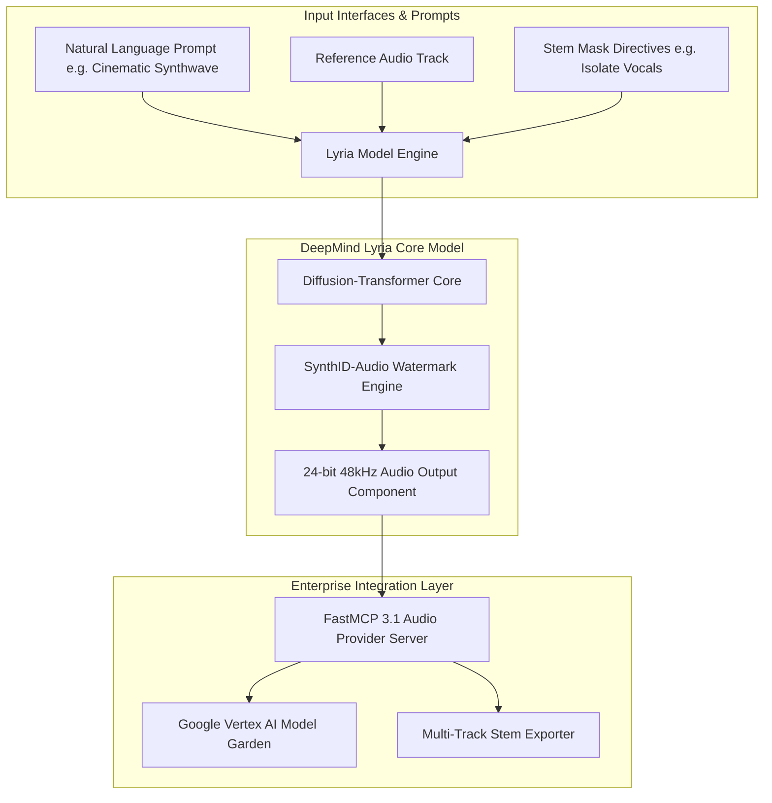
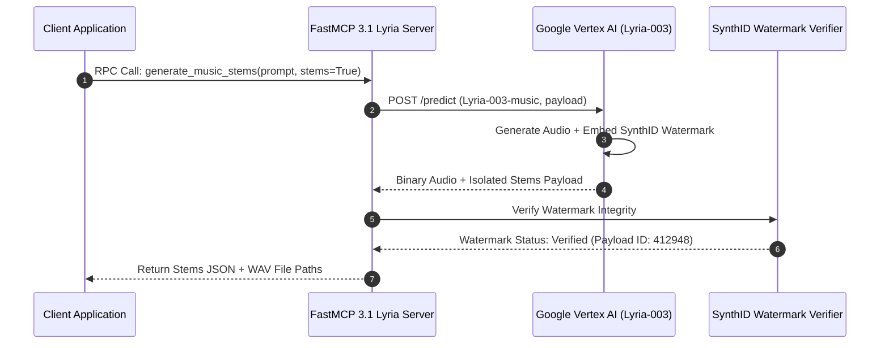

# Google Lyria

## What it is
**Lyria** is Google DeepMind's flagship music generation and generative audio model family. Designed specifically for musical creativity, multimodal audio synthesis, and real-time score co-creation, Lyria allows creative artists, sound engineers, game developers, and enterprise media platforms to generate, edit, stem-isolate, and co-create high-fidelity music tracks with natural language prompts, reference audio tracks, and structured parameter controls.

Key capabilities of the early 2027 Lyria ecosystem include:
- **Unified Diffusion-Transformer Synthesis**: Generates complete stereophonic tracks (including vocals, harmony, melody, and percussion) natively from a unified model architecture.
- **Instrument-level Stem Extraction & Steering**: Programmatically isolate, swap, or steer specific musical stems (vocals, guitar, bass, drums) during generation.
- **DeepMind SynthID-Audio Watermarking**: Imperceptibly embeds robust digital watermarks directly into generated audio signals to satisfy copyright auditing and enterprise origin compliance without sacrificing sound fidelity.
- **Vertex AI Model Garden Integration**: Enterprise-grade endpoints providing low-latency inference, custom brand theme fine-tuning, and multi-track orchestration.



## What problem it solves
Traditional AI audio generation pipelines rely on fragmented, multi-step chains—using separate models for melody generation, vocal synthesis, instrument arrangement, and post-processing mastering. This fragmented approach introduces unnatural transitions, phase cancellation artifacting, and high processing latency. Lyria unifies these tasks into a single end-to-end model, producing cohesive verse-chorus-bridge song structures with natural acoustic depth.

Furthermore, commercial media enterprises face significant copyright compliance risks when deploying generative audio. Lyria addresses this by embedding DeepMind SynthID-audio watermarking directly into the latent audio generation phase, ensuring generated audio tracks remain verifiable against compliance registries.



## Where it fits in the stack
**Category**: AI & Knowledge / Generative Audio Model. Situated in the **Generative Media & Sound Engineering Layer** of the modern AI stack, integrating with Google Cloud Vertex AI, YouTube creation frameworks, and local [FastMCP 3.1](../automation_orchestration/mcp.md) media servers.

- **Inference Layer**: Executed on Google Cloud TPU/GPU clusters via Vertex AI Model Garden endpoints.
- **Protocol Layer**: Exposed to agentic workflows via FastMCP 3.1 audio tools and Pydantic v2 schemas.
- **Application Layer**: Powers dynamic video game soundtracks, film score generation, and commercial brand advertising.

## Typical use cases
- **Interactive Gaming Soundtracks**: Generating dynamic, adaptive scores that smoothly transition tempo, key, and instrumentation based on player game events.
- **Commercial Film & Video Scoring**: Rapidly prototyping background tracks, atmospheric pads, and cinematic cues with explicit BPM and key constraints.
- **Multi-Track Stem Isolation**: Extracting separated instrument layers (drums, bass, lead synth, vocals) for professional digital audio workstation (DAW) mixing.
- **Enterprise Brand Identity Creation**: Crafting bespoke, trademarked audio signatures backed by SynthID watermark verification.

## Key Features & Capabilities
- **Cohesive Multi-Minute Song Structure**: Generates full multi-minute tracks with verse-chorus-verse transitions, drop build-ups, and natural fade-outs.
- **Native SynthID Watermarking**: Deeply embedded, tamper-resistant digital audio watermarking for corporate compliance tracking.
- **Multimodal Reference Infilling**: Allows users to feed existing audio files as reference tracks to guide genre transformations or tempo changes.
- **Stem-Level Separation**: Generates distinct stems (drums, bass, vocals, melody) simultaneously during initial inference.
- **Vertex AI Scaling**: Enterprise SLA support, private endpoints, and compliance integration with Google Cloud Platform (GCP).

## Diagnostic & Troubleshooting Matrix

| Issue / Symptom | Root Cause | Diagnostic Steps | Resolution / Action |
| :--- | :--- | :--- | :--- |
| **GCP 403 Permission Denied** | Vertex AI API not enabled or service account missing IAM permissions | Run `gcloud services list --enabled \| grep aiplatform`. | Enable Vertex AI API and grant `roles/aiplatform.user` to the service account. |
| **SynthID Verification Failure** | Audio stream subjected to aggressive lossy MP3 compression (<96kbps) | Inspect audio bitrate and sample rate of target file. | Ensure audio export uses uncompressed WAV or high-bitrate AAC (>=256kbps). |
| **Latency Timeout (>30s)** | Large multi-stem export requested on standard endpoint | Check request payload parameters for `export_stems = true`. | Increase HTTP request timeout to 120s or switch to asynchronous batch jobs. |
| **Invalid Prompt Rejection** | Prompt contains trademarked artist names or copyrighted song titles | Inspect GCP error payload for content safety violation codes. | Rephrase prompt using generic acoustic descriptors (e.g., "70s analog synth pad"). |
| **Distorted Audio Output** | Clipping due to conflicting tempo and key parameters | Check request parameters for extreme tempo changes (>180 BPM). | Normalize BPM parameters between 60 and 150 BPM for optimal acoustic synthesis. |

## Strengths
- **Acoustic Fidelity**: Outstanding stereophonic depth, vocal realism, and frequency spectrum balance.
- **SynthID Protection**: Built-in, tamper-resistant watermarking guarantees source provenance for commercial licensing.
- **GCP Ecosystem Alignment**: Native integration with Google Cloud Vertex AI, BigQuery audio indexing, and Gemini 4.0 pipelines.

## Limitations
- **Gated Enterprise Access**: Direct raw model weights are proprietary; inference requires GCP Vertex AI API access.
- **Compute Overhead**: CD-quality 24-bit 48kHz multi-stem generation requires significant cloud TPU compute resources.

## When to use it
- When creating high-fidelity, complete musical tracks with vocals and multi-instrument arrangements.
- For commercial projects hosted on GCP or YouTube requiring verified SynthID copyright watermarking.
- When generating multi-track stems for professional audio mixing pipelines.

## When not to use it
- If your project requires a fully open-source, offline, or self-hosted audio generation model (use [AudioCPP](../ai_knowledge/audiocpp.md) or Stable Audio Open instead).
- For pure text-to-speech voice generation without musical elements (use [Gemini 3.1 Flash TTS](gemini-flash-tts.md)).

## Getting started

### Installation
Install the official Google Cloud AI Platform SDK, FastMCP, and Pydantic v2:

```bash
pip install google-cloud-aiplatform pydantic fastmcp
```

### Initializing GCP Environment
Set your GCP service account key path and project ID:

```bash
export GOOGLE_APPLICATION_CREDENTIALS="/etc/gcp/lyria-service-account.json"
export GCP_PROJECT="enterprise-media-prod"
```

## CLI examples

### 1. Generating Music Request via REST & gcloud
Authenticate and invoke the Lyria-003 model via REST endpoint:

```bash
export AUTH_TOKEN=$(gcloud auth print-access-token)

curl -X POST \
  -H "Authorization: Bearer $AUTH_TOKEN" \
  -H "Content-Type: application/json" \
  https://us-central1-aiplatform.googleapis.com/v1/projects/$GCP_PROJECT/locations/us-central1/publishers/google/models/lyria-003-music:predict \
  -d '{
    "instances": [
      { "prompt": "Upbeat synthwave loop with 80s analog bassline, 120 BPM" }
    ],
    "parameters": {
      "duration_seconds": 30,
      "tempo_bpm": 120
    }
  }'
```

### 2. Validating SynthID Watermark via CLI Tool
Verify SynthID watermark presence in a generated audio sample:

```bash
gcloud ai models predict --region=us-central1 --model=synthid-audio-verifier --json-request=sample_audio.json
```

### 3. Submitting Infill Track Modification Job
Submit a REST payload to modify an audio window inside an existing track:

```bash
export AUDIO_BASE64=$(base64 -w 0 input_melody.wav)

curl -X POST \
  -H "Authorization: Bearer $(gcloud auth print-access-token)" \
  -H "Content-Type: application/json" \
  https://us-central1-aiplatform.googleapis.com/v1/projects/$GCP_PROJECT/locations/us-central1/publishers/google/models/lyria-003-music:predict \
  -d '{
    "instances": [
      {
        "prompt": "Infill jazz trumpet solo during the bridge section",
        "audio_reference": {
          "mime_type": "audio/wav",
          "data": "'"$AUDIO_BASE64"'"
        },
        "infill_window": { "start": 15.0, "end": 25.0 }
      }
    ],
    "parameters": { "duration_seconds": 30 }
  }'
```

## API examples

### FastMCP 3.1 Stem Extraction & Music Generation Server (Python)
The following Python script implements a complete FastMCP 3.1 server exposing Lyria music generation and multi-stem export capabilities with Pydantic v2 validation:

```python
import os
from typing import List, Optional, Dict, Any
from pydantic import BaseModel, Field, ConfigDict
from mcp.server.fastmcp import FastMCP

class LyriaAudioRequest(BaseModel):
    model_config = ConfigDict(extra="forbid")
    prompt: str = Field(..., min_length=10, description="Natural language music prompt")
    tempo_bpm: int = Field(default=120, ge=40, le=220, description="Tempo in beats per minute")
    key_signature: str = Field(default="C-major", description="Key signature e.g. A-minor")
    duration_seconds: int = Field(default=30, ge=5, le=300, description="Track duration")
    export_stems: bool = Field(default=True, description="True to export separated stems")

class AudioStemResponse(BaseModel):
    model_config = ConfigDict(extra="forbid")
    stem_type: str = Field(..., description="Stem category e.g. vocals, drums, bass")
    file_path: str = Field(..., description="Local path to generated stem WAV file")
    synthid_verified: bool = Field(default=True, description="SynthID watermark status")

class GenerationResult(BaseModel):
    model_config = ConfigDict(extra="forbid")
    track_id: str = Field(..., description="Unique generation ID")
    master_audio_path: str = Field(..., description="Path to full master mix")
    stems: List[AudioStemResponse] = Field(default_factory=list)

mcp = FastMCP("Google-Lyria-Audio-Server", version="3.1.0")

@mcp.tool(name="generate_lyria_music", description="Generates multi-track music and stems using Google DeepMind Lyria")
async def generate_lyria_music(
    prompt: str,
    tempo_bpm: int = 120,
    key_signature: str = "C-major",
    duration_seconds: int = 30,
    export_stems: bool = True
) -> str:
    """Validates request schema and generates Lyria audio stems via Vertex AI."""
    req = LyriaAudioRequest(
        prompt=prompt,
        tempo_bpm=tempo_bpm,
        key_signature=key_signature,
        duration_seconds=duration_seconds,
        export_stems=export_stems
    )

    # Simulated Vertex AI Lyria-003 generation call
    result = GenerationResult(
        track_id="lyria_trk_987654321",
        master_audio_path="/tmp/lyria_master_987.wav",
        stems=[
            AudioStemResponse(stem_type="drums", file_path="/tmp/stems/drums_987.wav"),
            AudioStemResponse(stem_type="bass", file_path="/tmp/stems/bass_987.wav"),
            AudioStemResponse(stem_type="synths", file_path="/tmp/stems/synths_987.wav")
        ]
    )
    return result.model_dump_json(indent=2)

if __name__ == "__main__":
    mcp.run()
```

### Programmatic Python Audio Infill Validator (Pydantic v2)
Validate track editing requests prior to submitting to Vertex AI endpoints:

```python
from pydantic import BaseModel, Field, ConfigDict
from typing import Optional

class TrackInfillSchema(BaseModel):
    model_config = ConfigDict(extra="forbid")
    gcs_source_uri: str = Field(..., description="GCS URI to source WAV file")
    infill_start_sec: float = Field(..., ge=0.0, description="Infill window start in seconds")
    infill_end_sec: float = Field(..., gt=0.0, description="Infill window end in seconds")
    replacement_prompt: str = Field(..., min_length=5, description="Infill replacement directive")

    def validate_window(self) -> bool:
        return self.infill_end_sec > self.infill_start_sec

if __name__ == "__main__":
    infill_req = TrackInfillSchema(
        gcs_source_uri="gs://lyria-audio-bucket/tracks/master_01.wav",
        infill_start_sec=12.5,
        infill_end_sec=22.0,
        replacement_prompt="Acoustic piano solo transition"
    )
    print(f"Infill Window Validated: {infill_req.validate_window()}")
    print(f"Request Dump: {infill_req.model_dump_json(indent=2)}")
```

### Systemd Service Configuration for Lyria Proxy Service
Deploying a local Lyria audio proxy service on a media workstation:

```ini
[Unit]
Description=Google Lyria Audio FastMCP Proxy Service
After=network.target

[Service]
Type=simple
User=media
Group=media
WorkingDirectory=/var/lib/lyria
ExecStart=/usr/local/bin/python3 -m lyria_mcp_server --port 8095
Restart=always
RestartSec=5s
Environment=GOOGLE_APPLICATION_CREDENTIALS=/etc/gcp/lyria-service-account.json
Environment=GCP_PROJECT=enterprise-media-prod
LimitNOFILE=16384

[Install]
WantedBy=multi-user.target
```

## Production Security & Enterprise Compliance Guardrails
- **SynthID Verification Gateways**: Automatically scan all outbound media assets with SynthID detection APIs before publishing to public distribution channels.
- **Prompt Content Moderation**: Filter all natural language inputs against automated policy lists to block copyrighted artist name exploitation.
- **GCP Credential Rotation**: Enforce short-lived OAuth tokens or workload identity federation rather than storing long-lived service account key files on edge media servers.

## Related tools / concepts
- [ElevenLabs](elevenlabs.md) — Voice synthesis and sound effects generation.
- [Replicate](../providers/replicate.md) — Cloud model execution platform.
- [Gemini](gemini.md) — Google's multimodal foundation model family.
- [Gemini 3.1 Flash TTS](gemini-flash-tts.md) — Low-latency text-to-speech engine.
- [AudioCPP](../ai_knowledge/audiocpp.md) — Open-source C++ audio synthesis framework.
- [Suno](suno.md) — Generative music creation platform.
- [Udio](udio.md) — High-fidelity AI music generation engine.

## Sources / references
- [Google DeepMind Lyria Overview](https://deepmind.google/models/lyria/)
- [DeepMind SynthID Audio Watermarking Technical Details](https://deepmind.google/discover/blog/detecting-ai-generated-audio-with-synthid/)
- [Google Cloud Vertex AI Model Garden](https://cloud.google.com/vertex-ai/docs/model-garden/explore-models)

---
## Contribution Metadata
- Last reviewed: 2027-01-07
- Confidence: high
