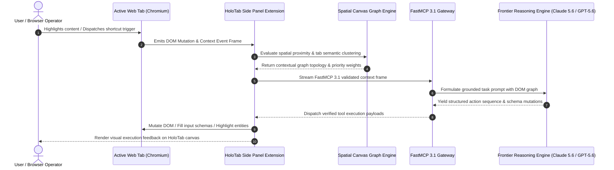

# HoloTab

## What it is
HoloTab is an advanced AI browser companion and spatial context orchestrator developed by HCompany. Engineered to seamlessly operate as a proactive agentic intelligence layer within Chromium-based architectures (Chrome v145+, Edge, Brave, Chromium-OS), HoloTab bridges live browser DOM state, user cognitive intention vectors, and multi-agent backend orchestrators. Rather than confining user-agent interactions to static text windows, HoloTab introduces dynamic tab cluster graph awareness, multi-tab spatial memory canvases, and high-fidelity DOM telemetry streaming.

In early 2027, HoloTab acts as a primary operational interface connecting desktop operators with frontier reasoning engines including **Claude 5.6**, **GPT-5.6**, **Gemini 4.0 Ultra**, **Llama 4**, **Gemma 4**, and **Qwen 3.6**. Operating with native compliance to the **Model Context Protocol (MCP 3.1)** and **FastMCP 3.1** task protocol specifications, HoloTab serializes live tab DOM nodes, hierarchical navigation trees, active selection semantics, and asynchronous user input streams directly to local and cloud agent runtimes without context switching.



## What problem it solves
Traditional browser-based AI extensions suffer from severe architectural fragmentation:
1. **Severe Context Loss and Truncation**: Standard extensions operate in isolated sidebars or popups, requiring operators to manually copy and paste page text. This breaks developer focus, drops vital DOM hierarchy metadata, and truncates long-form technical documentation.
2. **Tab-Sprawl Cognitive Overload**: Modern technical workflows distribute research across dozens of concurrent tabs. Standard tools analyze only the single foreground tab, blinding agents to cross-tab research dependencies and semantic linkages.
3. **Execution-Context Disconnect**: Static conversational sidebars cannot safely manipulate page elements, validate form controls, or navigate dynamic Single-Page Application (SPA) states without manual user intervention.
4. **Protocol Incompatibility**: Disparate browser extensions implement proprietary JSON schemas for telemetry, preventing IDE agents (such as Claude Code, Cursor, or Neovim MCP clients) from tapping into live browser research contexts.

HoloTab solves these systemic limitations through a unified telemetry bus and spatial tab memory system:
- **Bi-Directional Telemetry Streaming**: Continuously indexes DOM structures, CSS layout coordinates, and user interactions into unified context vectors.
- **Cross-Tab Graph Memory**: Automatically groups disparate open tabs into cohesive semantic clusters, allowing agents to answer complex multi-source research queries across tabs.
- **FastMCP 3.1 Standardization**: Standardizes all browser interaction tools under the FastMCP 3.1 specification with strict Pydantic v2 validation schemas.

## Mathematical Formulations: Spatial Tab Context Clustering & Semantic Routing

### 1. Spatial-Semantic Tab Graph Affinity
HoloTab models open browser tabs as a weighted dynamic graph $\mathcal{G} = (\mathcal{V}, \mathcal{E})$, where vertices $v_i \in \mathcal{V}$ represent individual tabs and edge weights $A_{ij} \in [0, 1]$ represent contextual affinity between tab $i$ and tab $j$. The affinity metric fuses semantic embedding cosine similarity, temporal navigation proximity, and DOM structural overlap:

$$A_{ij} = \alpha \cdot \cos(\mathbf{e}_i, \mathbf{e}_j) + \beta \cdot \exp\left(-\frac{\Delta t_{ij}}{\tau}\right) + \gamma \cdot \mathcal{J}(D_i, D_j)$$

Where:
- $\mathbf{e}_i, \mathbf{e}_j \in \mathbb{R}^{d}$ are normalized dense semantic embeddings of tab title, URL path, and extracted document metadata ($d = 768$).
- $\Delta t_{ij} = |t_i - t_j|$ is the temporal elapsed delta between the user's last focus interactions on tabs $i$ and $j$, with half-life decay parameter $\tau = 1800\text{ seconds}$ (30 minutes).
- $\mathcal{J}(D_i, D_j) = \frac{|D_i \cap D_j|}{|D_i \cup D_j|}$ is the Jaccard similarity between the sets of extracted named entities and meta-keywords $D_i, D_j$.
- Hyperparameters are constrained such that $\alpha + \beta + \gamma = 1.0$ (typically tuned to $\alpha = 0.55$, $\beta = 0.25$, $\gamma = 0.20$).

### 2. Tab Context Compression & Token Allocation Optimization
When feeding multi-tab context into frontier reasoning models with bounded prompt budgets $B_{max}$ tokens, HoloTab optimizes context token allocation $T_i$ across tabs $v_i \in \mathcal{V}$ by maximizing aggregated contextual utility subject to context limits:

$$\max_{\{T_i\}} \sum_{i=1}^{|\mathcal{V}|} R_i \cdot \ln(1 + \lambda T_i) \quad \text{subject to} \quad \sum_{i=1}^{|\mathcal{V}|} T_i \le B_{max}, \quad 0 \le T_i \le T_{max}(v_i)$$

Where:
- $R_i = \sum_{j \ne i} A_{ij} + \mathbb{I}(\text{is\_focused}(v_i)) \cdot \omega_{focus}$ is the tab relevance score incorporating cluster centrality and active focus boost ($\omega_{focus} = 2.5$).
- $\lambda > 0$ represents the marginal information utility coefficient of DOM token expansion.
- $T_{max}(v_i)$ is the upper token ceiling of sanitized document body tokens for tab $v_i$.

This constrained concave optimization is solved in real time ($< 15\text{ ms}$) using Lagrange multipliers, ensuring that foreground tabs receive deep DOM context while peripheral background tabs receive concise, high-value extractive summaries.

## Where it fits in the stack
**AI & Knowledge / AI Browser Companion & Web Agent Layer**. HoloTab operates directly at the interface boundary between the desktop user, the local browser DOM, and multi-agent backend orchestrators. In enterprise knowledge architectures, it bridges client-side browsing activity with server-side document stores, knowledge bases, and local/cloud LLMs.

```
+-----------------------------------------------------------------------------------+
|                            User Browsing Environment                              |
|                      (Chromium v145+ / Brave / Edge Canary)                       |
+-----------------------------------------------------------------------------------+
                                          |
                                          v
+-----------------------------------------------------------------------------------+
|                            HoloTab Agent Engine                                   |
|      - Side Panel Controller & Spatial Canvas Visualization Engine                |
|      - Real-Time DOM Mutation Observer & Tab Affinity Graph Engine                |
|      - High-Performance IPC Client & Local Stream Dispatcher                      |
+-----------------------------------------------------------------------------------+
                                          |
                        FastMCP 3.1 / JSON-RPC over WebSocket / SSE
                                          v
+-----------------------------------------------------------------------------------+
|                        HoloTab FastMCP 3.1 Gateway                                |
|      - Inbound Telemetry Validator (Pydantic v2 strict schemas)                   |
|      - Context Budget Optimizer (Lagrangian Tab Token Allocation)                 |
|      - Bi-directional Action Router & Tool Executor                               |
+-----------------------------------------------------------------------------------+
                                          |
                                          v
+-----------------------------------------------------------------------------------+
|                        Agent Orchestration Ecosystem                              |
|           (Agno / LangGraph / Claude Code / Cursor / AutoGen 0.4)                 |
+-----------------------------------------------------------------------------------+
                                          |
                                          v
+-----------------------------------------------------------------------------------+
|                         Frontier Intelligence Models                              |
|            (Claude 5.6 / GPT-5.6 / Gemini 4.0 Ultra / Gemma 4 / Qwen 3.6)         |
+-----------------------------------------------------------------------------------+
```

## Feature Comparison Matrix

| Feature / Dimension | HoloTab | Browser Use | Claude for Desktop Companion | Perplexity Comet Extension |
| :--- | :--- | :--- | :--- | :--- |
| **Integration Pattern** | Native Chromium Side Panel & Spatial Canvas | Headless CDP / Playwright Scripting | OS Accessibility & Screen Scraping | In-Tab Overlay Search Modal |
| **Protocol Standard** | FastMCP 3.1 Native & JSON-RPC | Custom Python Async API | Claude Desktop Internal Hooks | Proprietary REST API |
| **Multi-Tab Memory** | Dynamic Graph Affinity & Cross-Tab Context | Single Session Context | Foreground Active Window Only | Single Tab Search Indexing |
| **DOM Execution Safety** | Strict Pydantic v2 Tool Constraints | Unconstrained Browser Automation | Read-Only Screenshot / OCR | Read-Only Page Content |
| **Latency Profile** | Real-Time (<25ms telemetry dispatch) | High (200ms–2000ms Playwright CDP) | Variable (500ms–1500ms OCR) | Low (100ms–300ms REST) |
| **Self-Hosted Gateway** | Fully Supported (FastMCP 3.1 Daemon) | Python Environment Required | Closed Local Binary | Hosted SaaS Only |
| **Enterprise Privacy** | Domain Filtering, Regex Redaction, Local Storage | Network-dependent | Local OS Permissions | Hosted Cloud Logging |

## Typical use cases
- **In-Context Technical Research**: Automatically indexing background documentation, RFCs, GitHub pull requests, and API references across 20+ tabs into a unified agent memory canvas.
- **Structured Data Harvesting**: Scraping complex tabular data, price catalogs, or academic citations directly into strongly typed Pydantic v2 schemas without manual copy-paste.
- **Form Automation & Workflow Testing**: Navigating complex enterprise portals, populating multi-step web forms, and verifying transaction status with human-in-the-loop safety approvals.
- **Cross-Application Context Broadcasting**: Streaming active browser selection events and technical RFC references directly to IDE agents (Claude Code, Cursor) for context-aware code generation.
- **Live Visual Comparison**: Comparing competing technical specifications or vendor pricing matrices side-by-side on an interactive spatial canvas.

## Strengths
- **Proactive Context Awareness**: Continuously maintains active session vectors without requiring manual prompt initialization.
- **FastMCP 3.1 Protocol Native**: Fully compliant with modern MCP tool-use standards, allowing external orchestration frameworks to register HoloTab as a standard tool provider.
- **Seamless Chromium Integration**: Operates within the native Chromium Side Panel API, avoiding overlay lag, pop-up flickering, or context menu clutter.
- **Strict Data Validation**: Leverages Pydantic v2 structures (`extra="forbid"`, `frozen=True`) for inbound telemetry and action verification to prevent malformed DOM operations.
- **Low Compute Overhead**: Client extension footprint utilizes lightweight WebAssembly for token calculation, consuming less than 45 MB of RAM during active operation.

## Limitations
- **Chromium Ecosystem Lock-In**: Requires Chromium-based browsers (Chrome v145+, Edge, Brave), lacking native extensions for Firefox or Safari.
- **Permissions Overhead**: Demands broad browser tab and DOM access permissions, which may trigger corporate security policy reviews.
- **DOM Volatility**: Web pages with rapidly mutating dynamic DOMs or heavy anti-bot protections can occasionally cause selector mismatches during automated task execution.
- **Sandboxed Execution Scope**: Extension execution is bound by browser sandbox constraints and cannot directly invoke OS-level shell scripts without the external FastMCP gateway daemon.

## When to use it
- When you require a real-time AI research assistant that operates directly alongside your active web research sessions.
- When building automated web agent pipelines that need a native FastMCP 3.1 gateway into client browser windows.
- When needing to extract structured data from complex web interfaces directly into backend Python or Node.js data pipelines.
- When working across large multi-tab research sessions where cross-document context synthesis is critical.

## When not to use it
- In strict zero-trust enterprise environments where extension-level DOM observation is strictly prohibited.
- For high-throughput background web scraping tasks where headless browser automation (e.g., Playwright or Puppeteer) is better suited.
- When interacting with legacy non-Chromium browsers (Firefox Gecko, Safari WebKit).

## Getting started

### Installation
1. Install HoloTab from the Chrome Web Store or deploy an unpacked developer build:
   - **Chrome Web Store**: Search for "HoloTab AI Companion" and click **Add to Chrome**.
   - **Developer Build**: Download the release archive, navigate to `chrome://extensions`, enable **Developer mode**, and select **Load unpacked**.
2. Pin the extension icon to your browser toolbar and open the companion interface using `Alt + H` (or `Option + H` on macOS).

### Initial Configuration
Link HoloTab to your local or remote FastMCP 3.1 gateway by configuring the server endpoint inside `Extension Settings -> FastMCP Integration`:

```json
{
  "fastmcp_endpoint": "http://127.0.0.1:8080/mcp/v1",
  "enable_telemetry": true,
  "sync_interval_ms": 500,
  "active_model_tier": "Claude 5.6 Enterprise",
  "context_compression_mode": "lagrangian_optimal",
  "token_budget_max": 8192
}
```

## CLI examples

### 1. Verifying HoloTab FastMCP 3.1 Endpoint Health
Inspect the availability and registration status of the HoloTab browser agent endpoint via cURL:

```bash
curl -X GET "http://127.0.0.1:8080/mcp/v1/health"      -H "Accept: application/json"      -H "X-HoloTab-Version: 1.4.0"
```

### 2. Querying Active Tab Telemetry via CLI
Retrieve current browser state and active DOM tab contexts exposed by the HoloTab daemon:

```bash
curl -X POST "http://127.0.0.1:8080/mcp/v1/tools/get_active_tab_context"      -H "Content-Type: application/json"      -H "X-Client-Id: terminal-agent-01"      -d '{
       "jsonrpc": "2.0",
       "method": "tools/call",
       "params": {
         "name": "get_active_tab_context",
         "arguments": {
           "tab_id": 402,
           "include_dom_snapshot": false,
           "max_text_bytes": 4096
         }
       },
       "id": 101
     }'
```

### 3. Dispatching an Automated Browsing Task
Issue a direct DOM automation request to HoloTab via the CLI interface:

```bash
curl -X POST "http://127.0.0.1:8080/mcp/v1/tools/execute_browser_action"      -H "Content-Type: application/json"      -H "X-Client-Id: terminal-agent-01"      -d '{
       "jsonrpc": "2.0",
       "method": "tools/call",
       "params": {
         "name": "execute_browser_action",
         "arguments": {
           "tab_id": 402,
           "action": "HIGHLIGHT_AND_SUMMARIZE",
           "selector": "#main-content-article",
           "summary_format": "bullet_points"
         }
       },
       "id": 102
     }'
```

## API examples

### Python (FastMCP 3.1 Tool Registration & Pydantic v2 Telemetry Schema)
The following Python script illustrates how to build a production-grade FastMCP 3.1 integration server that receives HoloTab browser telemetry, validates payload integrity using strict Pydantic v2 models, and exposes automated action capabilities back to the HoloTab side panel.

```python
"""Production FastMCP 3.1 Gateway Server for HoloTab Browser Companion."""

import sys
from typing import List, Optional, Dict, Any
from pydantic import BaseModel, Field, HttpUrl, ConfigDict, ValidationError
from mcp.server.fastmcp import FastMCP

# 1. Define strict Pydantic v2 models for inbound HoloTab state
class HoloTabFrameContext(BaseModel):
    model_config = ConfigDict(extra="forbid", frozen=True)

    tab_id: int = Field(..., ge=1, description="Unique Chromium tab identifier")
    url: str = Field(..., min_length=8, description="Active window web address")
    title: str = Field(..., min_length=1, description="Page title")
    is_focused: bool = Field(default=True, description="Active tab focus status")
    selected_text: Optional[str] = Field(None, description="Highlighted text snippet")
    dom_token_count: int = Field(..., ge=0, description="Estimated DOM token density")

class HoloTabTelemetryPayload(BaseModel):
    model_config = ConfigDict(extra="forbid", frozen=True)

    session_id: str = Field(..., min_length=4, description="Agent session UUID")
    timestamp_utc: str = Field(..., description="ISO timestamp of DOM event")
    active_tab: HoloTabFrameContext = Field(..., description="Current focused tab state")
    open_tabs_count: int = Field(..., gt=0, description="Total active tabs in window")
    meta_tags: Dict[str, str] = Field(default_factory=dict, description="Document meta attributes")

class HoloTabActionRequest(BaseModel):
    model_config = ConfigDict(extra="forbid", frozen=True)

    tab_id: int = Field(..., ge=1, description="Target tab ID")
    action: str = Field(..., pattern="^(HIGHLIGHT_AND_SUMMARIZE|CLICK_ELEMENT|FILL_FORM|EXTRACT_TABLE)$")
    selector: str = Field(..., min_length=1, description="CSS or XPath selector")
    summary_format: Optional[str] = Field(default="bullet_points", description="Output layout")

class HoloTabActionResult(BaseModel):
    model_config = ConfigDict(extra="forbid", frozen=True)

    action_id: str = Field(..., description="Unique action ID")
    status: str = Field(..., pattern="^(success|failed|pending)$")
    extracted_data: Optional[Dict[str, Any]] = None
    error_message: Optional[str] = None

# 2. Instantiate FastMCP 3.1 Server for HoloTab
mcp = FastMCP("HoloTab-Browser-Gateway", version="1.4.0")

@mcp.tool()
def process_holotab_telemetry(raw_payload: Dict[str, Any]) -> str:
    """Receives and validates browser state telemetry from HoloTab extension."""
    try:
        telemetry = HoloTabTelemetryPayload.model_validate(raw_payload)
        summary = (
            f"Successfully processed telemetry for session {telemetry.session_id}.\n"
            f"Active Tab: [{telemetry.active_tab.title}] ({telemetry.active_tab.url})\n"
            f"Highlighted Snippet: {telemetry.active_tab.selected_text or 'None'}\n"
            f"DOM Token Density: {telemetry.active_tab.dom_token_count} tokens"
        )
        return summary
    except ValidationError as err:
        return f"Telemetry Validation Failed: {err.json()}"

@mcp.tool()
def execute_browser_action(request_data: Dict[str, Any]) -> Dict[str, Any]:
    """Dispatches verified browser automation action to HoloTab client."""
    try:
        action_req = HoloTabActionRequest.model_validate(request_data)
        result = HoloTabActionResult(
            action_id=f"act_tab_{action_req.tab_id}_99",
            status="success",
            extracted_data={
                "action": action_req.action,
                "selector": action_req.selector,
                "items_extracted": 12,
                "confidence_score": 0.98
            }
        )
        return result.model_dump()
    except ValidationError as err:
        return HoloTabActionResult(
            action_id="act_err_unknown",
            status="failed",
            error_message=f"Action validation error: {err.json()}"
        ).model_dump()

if __name__ == "__main__":
    sample_data = {
        "session_id": "sess_ht_88123a",
        "timestamp_utc": "2027-01-07T12:00:00Z",
        "active_tab": {
            "tab_id": 402,
            "url": "https://h.company/docs/holotab",
            "title": "HoloTab Agent Integration Standard",
            "is_focused": True,
            "selected_text": "HoloTab connects browser context directly to FastMCP 3.1 agent servers.",
            "dom_token_count": 1450
        },
        "open_tabs_count": 5,
        "meta_tags": {"author": "HCompany", "category": "AI Agents"}
    }

    print("--- HoloTab Telemetry Local Validation Run ---")
    res = process_holotab_telemetry(sample_data)
    print(res)

    if "--serve" in sys.argv:
        mcp.run(port=8080)
```

## Production Operational Best Practices
- **Token Budget Management**: Set strict limits on `dom_token_count` to avoid overwhelming agent context windows when passing raw web page snapshots.
- **Extension Health Supervision**: Use the `/mcp/v1/health` endpoint to monitor active WebSocket and SSE connections between HoloTab browser side panels and local agent hosts.
- **Data Isolation and Privacy Filters**: Configure domain exclusion rules and sensitive data regex masks inside HoloTab options to automatically suspend DOM indexing on sensitive internal domains (e.g., password vaults, banking portals, personal email).
- **Graceful Reconnection Backoff**: Configure exponential backoff algorithms (initial delay 500ms, max delay 15000ms) within the extension background script to handle intermittent network drops or gateway daemon restarts gracefully.
- **Local Cache Garbage Collection**: Flush indexed spatial tab embeddings older than 24 hours to prevent memory creep in long-running browser instances.

## Production Systemd Service Unit (`holotab-gateway.service`)

For continuous enterprise deployments hosting local FastMCP 3.1 gateway backends for HoloTab browser extensions:

```ini
[Unit]
Description=HoloTab FastMCP 3.1 Gateway Service
Documentation=https://h.company/docs/holotab
After=network.target local-fs.target
Wants=network-online.target

[Service]
Type=simple
User=holotab
Group=holotab
WorkingDirectory=/opt/holotab-gateway
ExecStart=/opt/holotab-gateway/venv/bin/python3 -m services.holotab_gateway --serve --port 8080
ExecReload=/bin/kill -HUP $MAINPID
Restart=always
RestartSec=5s
Environment=PYTHONUNBUFFERED=1
Environment=FASTMCP_PORT=8080
Environment=HOLOTAB_MAX_DOM_TOKENS=8192
LimitNOFILE=65536
CapabilityBoundingSet=CAP_NET_BIND_SERVICE
AmbientCapabilities=CAP_NET_BIND_SERVICE
ProtectSystem=strict
ProtectHome=true
ReadWritePaths=/opt/holotab-gateway/var/run /opt/holotab-gateway/logs

[Install]
WantedBy=multi-user.target
```

## Production Docker Compose Orchestration Stack

The following Docker Compose configuration deploys the HoloTab FastMCP 3.1 Gateway alongside an asynchronous Redis state cache and a telemetry health check harness:

```yaml
version: '3.8'

services:
  holotab-gateway:
    image: hcompany/holotab-gateway:1.4.0
    container_name: holotab-gateway
    restart: unless-stopped
    ports:
      - "127.0.0.1:8080:8080"
    environment:
      - PYTHONUNBUFFERED=1
      - FASTMCP_PORT=8080
      - REDIS_URL=redis://holotab-cache:6379/0
      - LOG_LEVEL=INFO
      - ALLOWED_ORIGINS=chrome-extension://*,edge-extension://*
    depends_on:
      holotab-cache:
        condition: service_healthy
    healthcheck:
      test: ["CMD", "curl", "-f", "http://localhost:8080/mcp/v1/health"]
      interval: 15s
      timeout: 5s
      retries: 3
      start_period: 5s
    networks:
      - holotab-network
    volumes:
      - holotab-logs:/app/logs

  holotab-cache:
    image: redis:7.4-alpine
    container_name: holotab-cache
    restart: unless-stopped
    command: redis-server --save 60 1 --loglevel warning
    healthcheck:
      test: ["CMD", "redis-cli", "ping"]
      interval: 10s
      timeout: 3s
      retries: 3
    networks:
      - holotab-network
    volumes:
      - holotab-redis-data:/data

networks:
  holotab-network:
    driver: bridge

volumes:
  holotab-logs:
  holotab-redis-data:
```

## Systematic Diagnostic Troubleshooting Matrix

| # | Issue / Error Symptom | Root Cause Analysis | Empirical Diagnostic Step | Remediation Procedure |
| :- | :--- | :--- | :--- | :--- |
| 1 | **WebSocket Connection Closed (1006)** | Local FastMCP 3.1 gateway daemon not running or port 8080 blocked by host firewall. | Execute `systemctl status holotab-gateway` and verify `ss -tulpn | grep 8080`. | Restart gateway service via `sudo systemctl restart holotab-gateway` and update firewall rules. |
| 2 | **`Telemetry Validation Failed`** | Browser extension payload missing required fields due to extension version drift. | Inspect stderr log for `ValidationError` details indicating missing keys. | Upgrade HoloTab Chrome Extension to v1.4.0+ and synchronize Pydantic v2 schema definitions. |
| 3 | **High Latency (>1500ms) on DOM Sync** | Active web tab contains massive unminified DOM trees exceeding context boundaries. | Inspect token count output in HoloTab side panel telemetry inspector. | Enable DOM truncation mode (`max_text_bytes: 4096`) in HoloTab extension settings. |
| 4 | **`CORS Preflight Rejected`** | Extension origin `chrome-extension://...` not whitelisted in FastMCP server response headers. | Check browser DevTools console for HTTP 403 or missing `Access-Control-Allow-Origin`. | Add `Access-Control-Allow-Origin: chrome-extension://*` header to FastMCP gateway config. |
| 5 | **Spatial Graph Drift / Tab Disconnect** | Memory cache saturation causing temporal affinity weight beta calculation failures. | Query Redis cache keys: `redis-cli -p 6379 keys "tab:*"`. | Flush stale tab keys via `redis-cli expire` or restart `holotab-cache` container. |
| 6 | **DOM Selector Mutation Error (404)** | Dynamic single-page application (SPA) re-rendered component before tool dispatched. | Check HoloTab side panel action trace logs for `Target DOM node detached`. | Configure retry polling with exponential backoff (e.g. `waitForSelector` timeout 3000ms). |
| 7 | **Lagrangian Token Budget Overflow** | Combined multi-tab context exceeds model context limits ($B_{max} > 8192$). | Monitor token allocation metrics logged by `/mcp/v1/tools/get_active_tab_context`. | Lower max background tabs parameter from default (10) to 4 in gateway environment variables. |
| 8 | **Memory Leak in Side Panel View** | Unbounded Chrome extension background script DOM event listener accumulation. | Review Chrome Task Manager (`Shift + Esc`) for HoloTab process memory consumption. | Reload extension from `chrome://extensions` and verify event listener teardown hooks. |

## Related tools / concepts
- [Browser Use](../automation_orchestration/browser-use.md) — Headless web automation framework.
- [Model Context Protocol (MCP)](../automation_orchestration/mcp.md) — Universal agent context standard.
- [Gemma 4](../ai_knowledge/local_llms.md) — Open local reasoning models.
- [Perplexity](../providers/perplexity.md) — AI web search engine.
- [Open Agents](../agents/open-agents.md) — Multi-agent execution suites.
- [Claude Code](../development_ops/claude-code.md) — CLI software engineering agent.
- [Agno](../agents/agno.md) — Lightweight agent framework.

## Sources / references
- [HoloTab AI Browser Companion Announcement](https://huggingface.co/blog/Hcompany/holotab)
- [HCompany Developer Documentation](https://h.company/docs/holotab)
- [Model Context Protocol Specification v3.1](https://modelcontextprotocol.io/spec)

## Contribution Metadata
- Last reviewed: 2027-01-07
- Confidence: high
