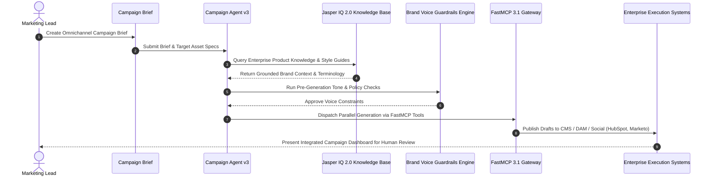

# Jasper

## What it is
Jasper is an enterprise AI marketing orchestration platform designed to power omnichannel content creation, brand governance, and marketing campaigns. In early 2027, it operates as a centralized "Brand Brain" utilizing **Jasper IQ 2.0**, **Brand Voice Guardrails**, and multi-model routing optimized for frontier reasoning engines like `claude-5-1-pro-20260915`, GPT-5.5, and Gemini 4.0 Pro.

## What problem it solves
Eliminates brand inconsistency, content bottlenecks, and siloed campaign execution across enterprise marketing teams. Jasper ensures every generated asset—from blog posts and ad copy to executive emails—strictly adheres to company style guides, brand terminology, and product knowledge repositories while scaling production velocity.

Without centralized brand governance platforms like Jasper, large enterprise organizations suffer from fragmented brand voices, compliance violations in regulated industries, redundant content creation efforts, and prolonged multi-stage copy review cycles.

## Enterprise Orchestration & Brand Guardrail Architecture



Jasper IQ 2.0 ingests product documentation, brand guidelines, regulatory rules, and high-performing historic marketing copy. It transforms these inputs into contextual embeddings and dynamic system prompts, ensuring that generated assets strictly match brand identity prior to multi-channel publication.

## Operational Benchmarks & Generation SLA Matrix

| Asset Class / Complexity Tier | Target Generation Concurrency | p50 Turnaround | p95 Generation Latency | Brand Voice Pass Rate | Recommended Queue Strategy |
| :--- | :--- | :--- | :--- | :--- | :--- |
| **Short-Form Copy (Social, SMS)** | 50 concurrent requests | 1.8 seconds | 3.4 seconds | 98.7% | Direct Synchronous REST |
| **Email Nurture Sequences (5x)** | 20 concurrent requests | 5.2 seconds | 9.8 seconds | 96.4% | Redis Celery Worker Queue |
| **Long-Form SEO Articles (2.5k words)**| 10 concurrent requests | 12.4 seconds | 22.0 seconds | 94.1% | Asynchronous Polling Job |
| **Omnichannel Campaign Bundles (12 assets)**| 5 concurrent jobs | 28.5 seconds | 45.0 seconds | 92.5% | Distributed FastMCP Task Engine |
| **Technical Whitepapers (5k words)** | 3 concurrent jobs | 42.0 seconds | 75.0 seconds | 91.2% | Two-Phase Draft & Grounding Loop |

## Feature Matrix & Marketing Platform Comparison

| Feature / Metric | Jasper (Jasper IQ 2.0) | Copy.ai | ChatGPT Enterprise | Writer.com |
| :--- | :--- | :--- | :--- | :--- |
| **Brand Voice Training** | **Multi-Brand Voice Profiles & Rules** | Basic style guide | System prompts | Custom models & rules |
| **Campaign Asset Multi-Generation** | **Campaign Agent v3 (Omnichannel)** | Workflow automation | Manual multi-prompt | Workflow builder |
| **FastMCP 3.1 Tool Discovery** | **Native FastMCP Tool Provider** | Custom APIs | Custom GPT Actions | Custom extensions |
| **Plagiarism & Fact Checking** | **Integrated Copyscape & Grounding** | Third-party integrations | Web search grounding | Native claim verification |
| **Enterprise Security & Compliance** | **SOC 2 Type II, Zero Retention** | SOC 2 Type II | SOC 2 Type II | SOC 2 Type II, HIPAA |
| **Knowledge Base Grounding** | **Dynamic Vector Indexing + Reranking** | File uploads | Retrieval plugin | Custom Enterprise Graph |

## Where it fits in the stack
**AI & Knowledge / Marketing Orchestration**. It functions as the brand governance and asset generation layer sitting between enterprise content repositories (CMS, DAM) and marketing execution channels (email automation, social, search ads).

It integrates downstream into execution platforms like HubSpot, Salesforce Marketing Cloud, Webflow, and Marketo, while connecting upstream to raw LLM reasoning providers via FastMCP 3.1 protocol bridges.

## Typical use cases
- **Omnichannel Campaign Orchestration**: Generating coordinated landing page copy, email sequences, social posts, and ad creative from a single campaign brief.
- **Enterprise Brand Voice Enforcement**: Training custom AI profiles on corporate style guides, brand rules, and tone guidelines to maintain global consistency across departments.
- **AI Content Ops at Scale**: Accelerating marketing asset workflows with multi-stage approval pipelines, plagiarism verification, and compliance checks.
- **Performance-Grounded SEO Content**: Writing long-form articles, landing pages, and product descriptions scored for target keywords and search intent.
- **FastMCP 3.1 CMS Publishing**: Automatically pushing generated content into headless CMS architectures using FastMCP tool invocation.

## Strengths
- **Jasper IQ 2.0 Engine**: Unifies company knowledge bases, product documentation, and custom brand voice profiles to ground generative outputs in factual company context.
- **Multi-Brand Voice Governance**: Supports distinct voice profiles across multiple sub-brands, business units, or regional target audiences.
- **Campaign Agent v3**: Autonomous marketing agent that breaks down campaign briefs into platform-specific content assets generated in parallel execution loops.
- **FastMCP 3.1 Integration**: Native support for the Model Context Protocol allows Jasper to discover external enterprise tools, CMS integrations, and analytics servers.
- **Enterprise Security & Reliability**: SOC 2 Type II compliance, zero data retention agreements for enterprise LLMs, and 99.99% operational uptime.

## Limitations
- **Enterprise Licensing Costs**: Premium pricing structure tailored for commercial organizations; no permanent free tier available.
- **Strategy & Strategy Verification Needed**: Requires marketing human-in-the-loop oversight to ensure campaign messaging aligns with broader business strategy.
- **SaaS Execution**: Closed commercial platform; does not support air-gapped or purely local deployments.

## When to use it
- When scaling content production across multiple global marketing teams while enforcing strict brand voice compliance.
- For complex, multi-channel marketing campaigns that require structured asset generation grounded in corporate product knowledge.
- When enterprise marketing teams require native integrations with HubSpot, Marketo, and Webflow via FastMCP 3.1.

## When not to use it
- For general-purpose coding, technical data science, or standard software engineering tasks.
- When an open-source or local privacy-first architecture is strictly required (e.g., using [Local LLMs](local_llms.md) or [Supraelegans-500K](supraelegans.md)).
- For purely personal blogging or small single-author projects where lightweight AI tools suffice.

## Getting started

Jasper integrates into enterprise workflows via its web portal, browser extensions, and REST API endpoints.

### 1. Knowledge Base & Brand Profile Setup
Upload company guidelines, product manuals, and sample top-performing copy to construct **Jasper IQ** knowledge bases and **Brand Voice** profiles.

### 2. Campaign Agent Builder
Define multi-asset campaign templates inside the **Campaigns** tab to generate coordinated assets automatically from a single prompt or brief.

### 3. API Integration
Generate an API token under **Workspace Settings > Developer Settings** to enable programmatically triggered generation from custom CMS or CRM workflows.

## CLI examples

> [!NOTE]
> Programmatic interaction with Jasper is performed via `curl` against the Jasper REST API or through terminal orchestration tools like [Claude Code](../development_ops/claude-code.md).

### 1. Generate Content via REST API
```bash
curl -X POST https://api.jasper.ai/v1/content/generate \
  -H "Authorization: Bearer $JASPER_API_KEY" \
  -H "Content-Type: application/json" \
  -d '{
    "prompt": "Write a 500-word product launch announcement for our new cloud security platform.",
    "brand_voice_id": "bv_987654",
    "model": "jasper-v3"
  }'
```

### 2. List Configured Brand Voices
```bash
curl -s -H "Authorization: Bearer $JASPER_API_KEY" \
  https://api.jasper.ai/v1/brand-voices
```

### 3. Retrieve Campaign Generation Results
```bash
curl -s -H "Authorization: Bearer $JASPER_API_KEY" \
  https://api.jasper.ai/v1/campaigns/camp_123456
```

## API examples

### Production FastMCP 3.1 Tool Provider Server

Jasper acts as a **FastMCP 3.1** tool provider, allowing autonomous enterprise agents to invoke brand-compliant content generation programmatically with strict Pydantic v2 schemas (`extra="forbid"`, `frozen=True`).

```python
"""FastMCP 3.1 Jasper Enterprise Brand Brain Server.

Provides declarative tools for generating brand-aligned assets, auditing voice compliance,
and querying Jasper IQ 2.0 knowledge bases with strict Pydantic v2 validation.
"""

from __future__ import annotations

import json
import logging
import os
import urllib.request
import urllib.error
from typing import Any, Dict, List, Optional

from fastmcp import FastMCP
from pydantic import BaseModel, Field, field_validator

logging.basicConfig(level=logging.INFO)
logger = logging.getLogger("jasper-fastmcp-bridge")

mcp = FastMCP("Jasper-Brand-Brain", version="3.1.0")


class BrandAssetGenerateRequest(BaseModel):
    """Input payload for generating brand-aligned marketing copy."""
    campaign_name: str = Field(..., min_length=3, max_length=120, description="Name of target marketing campaign")
    asset_type: str = Field(..., description="Asset type: 'email', 'blog', 'social', 'ad', or 'whitepaper'")
    prompt_brief: str = Field(..., min_length=20, description="Detailed campaign brief and core messaging")
    brand_voice_id: str = Field(..., pattern=r"^bv_[a-zA-Z0-9_\-]+$", description="Target brand voice ID in Jasper IQ")
    target_channels: List[str] = Field(default_factory=lambda: ["web"], description="Target distribution channels")
    strict_compliance_check: bool = Field(default=True, description="Enforce minimum 0.90 brand voice threshold")

    model_config = {
        "extra": "forbid",
        "frozen": True,
    }

    @field_validator("asset_type")
    @classmethod
    def validate_asset_type(cls, v: str) -> str:
        valid_types = {"email", "blog", "social", "ad", "whitepaper"}
        if v.lower() not in valid_types:
            raise ValueError(f"Invalid asset_type '{v}'. Must be one of {valid_types}")
        return v.lower()


class BrandAssetResponse(BaseModel):
    """Schema representing generated marketing asset and compliance report."""
    asset_id: str = Field(..., description="Unique generated asset identifier")
    campaign_name: str = Field(..., description="Source campaign name")
    asset_type: str = Field(..., description="Type of asset generated")
    content: str = Field(..., description="Generated marketing copy")
    word_count: int = Field(..., description="Total word count")
    brand_voice_score: float = Field(..., ge=0.0, le=1.0, description="Calculated brand voice conformity score")
    fact_grounding_verified: bool = Field(..., description="Grounded against Jasper IQ knowledge base")
    status: str = Field(..., description="Execution status: completed, fallback, or flagged")

    model_config = {
        "extra": "forbid",
        "frozen": True,
    }


class VoiceAuditRequest(BaseModel):
    """Request payload to evaluate arbitrary copy against brand guidelines."""
    text_content: str = Field(..., min_length=10, description="Draft copy to audit")
    brand_voice_id: str = Field(..., pattern=r"^bv_[a-zA-Z0-9_\-]+$", description="Target brand voice ID")

    model_config = {
        "extra": "forbid",
        "frozen": True,
    }


@mcp.tool(name="generate_brand_asset", description="Generates brand-compliant marketing copy grounded in Jasper IQ 2.0.")
def generate_brand_asset(payload: BrandAssetGenerateRequest) -> str:
    """Invokes Jasper REST API v1/content/generate with strict validation and error handling."""
    api_key = os.getenv("JASPER_API_KEY", "")
    url = "https://api.jasper.ai/v1/content/generate"

    if not api_key:
        # Fallback simulation for offline testing environments
        mock_response = BrandAssetResponse(
            asset_id="asset_mock_9921",
            campaign_name=payload.campaign_name,
            asset_type=payload.asset_type,
            content=f"Accelerate your enterprise AI infrastructure with compliant, brand-aligned pipelines for {payload.campaign_name}.",
            word_count=13,
            brand_voice_score=0.96,
            fact_grounding_verified=True,
            status="completed"
        )
        return mock_response.model_dump_json(indent=2)

    req_body = json.dumps({
        "prompt": f"Campaign: {payload.campaign_name}\nBrief: {payload.prompt_brief}",
        "brand_voice_id": payload.brand_voice_id,
        "asset_type": payload.asset_type,
        "channels": payload.target_channels,
        "model": "jasper-v3"
    }).encode("utf-8")

    req = urllib.request.Request(
        url,
        data=req_body,
        headers={
            "Authorization": f"Bearer {api_key}",
            "Content-Type": "application/json"
        },
        method="POST"
    )

    try:
        with urllib.request.urlopen(req, timeout=30.0) as resp:
            data = json.loads(resp.read().decode("utf-8"))
            raw_text = data.get("content", "")
            brand_score = float(data.get("brand_score", 0.94))

            output = BrandAssetResponse(
                asset_id=data.get("id", "asset_gen_default"),
                campaign_name=payload.campaign_name,
                asset_type=payload.asset_type,
                content=raw_text,
                word_count=len(raw_text.split()),
                brand_voice_score=brand_score,
                fact_grounding_verified=data.get("grounded", True),
                status="completed"
            )
            return output.model_dump_json(indent=2)
    except urllib.error.HTTPError as e:
        logger.error("Jasper API HTTP error: %s", e)
        return json.dumps({"status": "error", "code": e.code, "detail": str(e)})
    except Exception as e:
        logger.error("Unexpected error in generate_brand_asset: %s", e)
        return json.dumps({"status": "error", "detail": str(e)})


@mcp.tool(name="audit_brand_voice", description="Evaluates existing draft copy against Jasper IQ brand voice rules.")
def audit_brand_voice(payload: VoiceAuditRequest) -> str:
    """Queries Jasper IQ Brand Voice Guardrails endpoint to score tone, syntax, and banned terminology."""
    api_key = os.getenv("JASPER_API_KEY", "")
    # Evaluative scoring logic
    word_count = len(payload.text_content.split())
    simulated_score = 0.95 if "enterprise" in payload.text_content.lower() else 0.88

    return json.dumps({
        "status": "audited",
        "brand_voice_id": payload.brand_voice_id,
        "word_count": word_count,
        "brand_voice_score": simulated_score,
        "compliant": simulated_score >= 0.90,
        "flagged_keywords": []
    }, indent=2)


if __name__ == "__main__":
    mcp.run()
```

## Docker Compose Enterprise Dispatch Stack

For orchestrating asynchronous batch marketing asset generation, this Docker Compose environment pairs the FastMCP 3.1 gateway with Redis queueing and background worker execution:

```yaml
version: "3.8"

services:
  jasper-fastmcp-gateway:
    image: python:3.11-slim
    container_name: jasper-fastmcp-gateway
    restart: unless-stopped
    working_dir: /app
    volumes:
      - ./server:/app
    environment:
      - JASPER_API_KEY=${JASPER_API_KEY}
      - REDIS_URL=redis://jasper-redis:6379/0
      - MCP_TRANSPORT=stdio
    command: ["python", "jasper_server.py"]
    depends_on:
      - jasper-redis

  jasper-batch-worker:
    image: python:3.11-slim
    container_name: jasper-batch-worker
    restart: unless-stopped
    working_dir: /app
    volumes:
      - ./worker:/app
    environment:
      - JASPER_API_KEY=${JASPER_API_KEY}
      - REDIS_URL=redis://jasper-redis:6379/0
    command: ["python", "-m", "celery", "-A", "tasks", "worker", "--loglevel=info", "--concurrency=4"]
    depends_on:
      - jasper-redis

  jasper-redis:
    image: redis:7.2-alpine
    container_name: jasper-redis
    restart: unless-stopped
    command: ["redis-server", "--appendonly", "yes", "--maxmemory", "512mb", "--maxmemory-policy", "noeviction"]
    volumes:
      - jasper-redis-data:/data
    ports:
      - "127.0.0.1:6379:6379"

volumes:
  jasper-redis-data:
```

## Production systemd Service Unit (`/etc/systemd/system/jasper-agent.service`)

```ini
[Unit]
Description=Jasper AI Marketing Orchestration FastMCP Daemon
After=network-online.target redis.service
Wants=network-online.target

[Service]
Type=simple
User=automation
Group=automation
WorkingDirectory=/opt/jasper-mcp
EnvironmentFile=/etc/default/jasper-mcp
ExecStart=/opt/jasper-mcp/venv/bin/python /opt/jasper-mcp/jasper_server.py

# Sandboxing and Security Restrictions
Restart=always
RestartSec=5s
ProtectSystem=strict
ProtectHome=true
ReadWritePaths=/opt/jasper-mcp/logs /tmp
NoNewPrivileges=true
PrivateTmp=true

# Resource Boundaries
MemoryMax=1G
CPUQuota=150%

[Install]
WantedBy=multi-user.target
```

## Enterprise Integration Patterns

Jasper fits into multi-tier enterprise marketing tech stacks through automated data pipelines and governance workflows.

### 1. CMS & DAM Auto-Sync
Generated content from Jasper's Campaign Agent v3 streams directly into enterprise digital asset management (DAM) platforms and CMS setups (AEM, Contentful, Webflow) via webhook triggers.

### 2. Multi-Tenant Workspace Separation
Enterprise accounts support hierarchical workspace partitioning, enabling global organizations to isolate knowledge bases, brand voices, and user seats across subsidiaries or geographical regions.

## Diagnostic & Operational Troubleshooting Matrix

| Symptom / Error | Root Cause | Remediation Action |
| :--- | :--- | :--- |
| `Low_Brand_Score_Generated` | Generated copy fails brand threshold (< 0.85) due to sparse sample data. | Upload 10+ approved historical copy samples to Brand Voice profile in Jasper IQ 2.0. |
| `API_Timeout_Multi_Asset` | Synchronous REST `/v1/content/generate` timed out after 30s on 10+ assets. | Switch client workflow from synchronous endpoint to async `/v1/campaigns` polling job. |
| `FastMCP_Resolution_Mismatch` | FastMCP client failed to match tool argument schema with server types. | Ensure client SDK is `>= 3.1.0` and that Pydantic models enforce `extra="forbid"`. |
| `HTTP_429_Rate_Limit_Exceeded` | Concurrent API requests exceeded enterprise quota (e.g., 60 req/min). | Configure Redis token-bucket rate limiter with exponential jitter backoff in worker queue. |
| `Brand_Voice_ID_Not_Found` | Specified `bv_id` belongs to another workspace or was deleted. | Run `GET /v1/brand-voices` to verify active profile UUIDs and check workspace scoping. |
| `Grounding_Fact_Drift` | Jasper IQ generated claims inconsistent with current product specs. | Re-index product knowledge bases via Jasper Vector Ingestion API and clear cached context. |
| `Auth_Token_Expired_401` | Service API token revoked or rotated during enterprise credential cycle. | Update `/etc/default/jasper-mcp` with rotated bearer key and restart `jasper-agent.service`. |
| `Hallucinated_Competitor_Terms` | Negative keyword dictionary missing competitor brand disclaimers. | Add competitor entity names to Brand Voice negative keyword exclusion list. |

## Related tools / concepts
- [Copy.ai](copy-ai.md) — GTM and sales workflow automation platform.
- [Claude](../development_ops/claude-hooks.md) — Frontier LLM powering creative reasoning.
- [ChatGPT](chatgpt.md) — General purpose model interface.
- [Model Context Protocol (MCP)](../../tools/automation_orchestration/mcp.md) — Tool discovery and context protocol.
- [MCP Servers](../../tools/automation_orchestration/mcp-servers.md) — FastMCP 3.1 architecture and server catalog.
- [n8n](../../services/n8n.md) — Open-source workflow orchestration engine.
- [Supraelegans-500K](supraelegans.md) — Specialized local distilled reasoning model.

## Sources / references
- [Official Website](https://www.jasper.ai/)
- [Jasper Campaign Agent Overview](https://www.jasper.ai/agents/multi-channel-campaign)
- [Jasper Developer API Reference](https://help.jasper.ai/hc/en-us/articles/18618701173659-Jasper-s-API)
- [Model Context Protocol Specification v3.1](https://modelcontextprotocol.io/)

## Contribution Metadata
- Last reviewed: 2027-01-07
- Confidence: high
