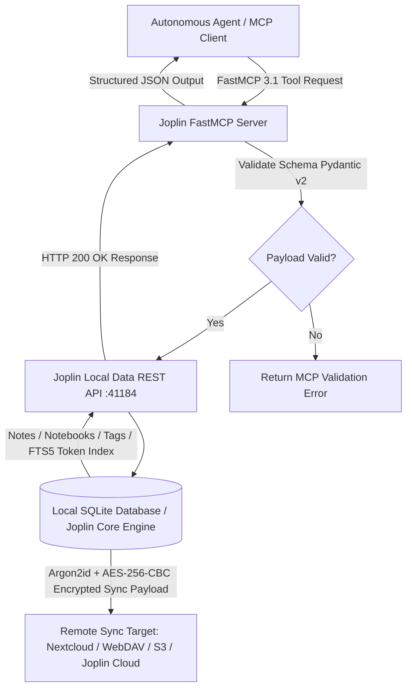
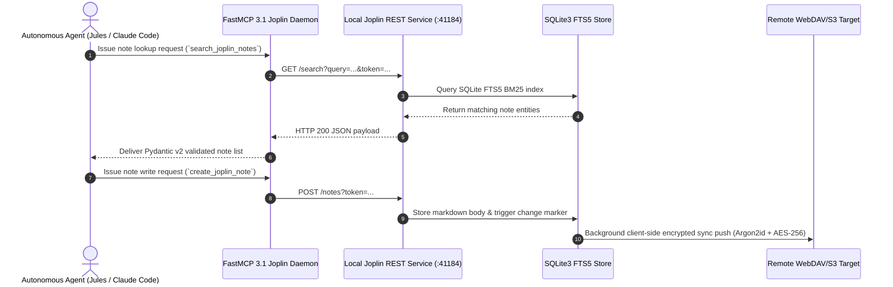

# Joplin

## What it is
Joplin is an open-source, zero-knowledge end-to-end encrypted (E2EE) personal knowledge management (PKM) and note-taking ecosystem designed for engineering notebooks, agentic scratchpads, and long-term memory synthesis. Architected around an offline-first SQLite database core and an extensible local Data REST API, Joplin allows developers and autonomous AI agent frameworks—including Claude Code, GPT-5.5, Gemini 4.0 Pro, DeepSeek V3, and Llama 4—to programmatically index, mutate, query, and synchronize hierarchical markdown documents via **FastMCP 3.1** protocol interfaces.

```
+---------------------------------------------------------------------------------------------------------+
|                                  Joplin E2EE Sync & Agent API Architecture                              |
+---------------------------------------------------------------------------------------------------------+
|  [ FastMCP 3.1 Agent Client / Autonomous Orchestrator / Local LLM Inference Core ]                      |
|                                       |                                                                 |
|                                       v (stdio / SSE Transport JSON-RPC 2.0)                            |
|  +---------------------------------------------------------------------------------------------------+  |
|  | FastMCP 3.1 Joplin Server Daemon (Strict Pydantic v2 Contract Validation & Rate-Limiting Guard)   |  |
|  +---------------------------------------------------------------------------------------------------+  |
|                                       |                                                                 |
|                                       v (HTTP REST Requests with Session Bearer Auth Token)              |
|  +---------------------------------------------------------------------------------------------------+  |
|  | Joplin Local Data REST Service (Loopback HTTP Daemon on :41184 / Web Clipper Gateway)            |  |
|  +---------------------------------------------------------------------------------------------------+  |
|                                       |                                                                 |
|                                       v (ACID Write-Ahead Logging & Full-Text Search FTS5 Queries)       |
|  +---------------------------------------------------------------------------------------------------+  |
|  | Local SQLite Storage Engine (Markdown Files, AST Revisions, Binary Blobs, Tags, & Metadata)      |  |
|  +---------------------------------------------------------------------------------------------------+  |
|                                       |                                                                 |
|                                       v (Argon2id Master Key Derivation & AES-256-CBC Encrypted Chunks)  |
|  +---------------------------------------------------------------------------------------------------+  |
|  | Zero-Knowledge E2EE Sync Engine (Delta Sync Target: Nextcloud / S3 / WebDAV / Joplin Cloud)       |  |
|  +---------------------------------------------------------------------------------------------------+  |
+---------------------------------------------------------------------------------------------------------+
```



## System Architecture

The Joplin technical architecture separates the interactive frontend, local persistence engine, background delta synchronizer, and programmatic automation interface into loosely coupled submodules:

1. **Local Core & Storage Subsystem**: Powered by SQLite3 compiled with Write-Ahead Logging (`PRAGMA journal_mode=WAL;`) and Full-Text Search 5 (`fts5`). Notes, tags, notebook hierarchies, and resource blobs (images, PDFs, source code snippets) are stored with global UUIDv4 identifiers, cryptographic content hashes, and change tracking revision timestamps.
2. **Local Data REST API Daemon**: Operating as a loopback microservice on TCP port 41184 (configurable), this service acts as the Web Clipper bridge and programmatic entry point. Endpoints support pagination, selective attribute projection (`?fields=id,title,body,parent_id`), and raw binary resource ingestion with token-based query parameter authentication.
3. **End-to-End Encryption (E2EE) Pipeline**: Employs client-side multi-layer envelope encryption. User master passwords undergo cryptographic key stretching, producing a symmetric encryption key that secures per-item data keys. Plaintext data never traverses the local socket boundary to remote targets.
4. **FastMCP 3.1 Agent Integration Layer**: Wraps the Data REST API in strongly typed Model Context Protocol (FastMCP 3.1) endpoints. Pydantic v2 schemas (`extra="forbid"`, `frozen=True`) guarantee that autonomous models generate compliant JSON-RPC payloads before requests touch the local SQLite backend.

## Mathematical Formulations of Cryptographic Security & Indexing Bounds

### Argon2id Key Derivation & Key Stretching Entropy
Joplin secures local master keys and synchronizes encrypted items using modern password-based key derivation functions (PBKDF) or Argon2id. The master key encryption key $K_{\text{master}}$ is derived from user passphrase $P$, cryptographic salt $S \leftarrow \{0,1\}^{256}$, memory cost $m$, iteration cost $t$, and parallelism degree $p$:

$$K_{\text{master}} = \text{Argon2id}(P, S, t, m, p, L_{\text{key}})$$

Where $L_{\text{key}} = 256\text{ bits}$. The computational adversary brute-force lower bound work factor $\mathcal{W}_{\text{crack}}$ is bounded by:

$$\mathcal{W}_{\text{crack}} \ge |\Sigma|^L \cdot \left( t \cdot m \cdot C_{\text{hardware}} \right)$$

Where $|\Sigma|^L$ represents passphrase entropy over alphabet size $|\Sigma|$ and length $L$, and $C_{\text{hardware}}$ denotes the minimum memory access bandwidth delay per Argon2id block verification.

### AES-256-CBC Payload Encryption & Message Integrity
Individual note items, metadata headers, and binary attachments are encrypted using AES-256 in Cipher Block Chaining (CBC) mode with PKCS#7 padding and an HMAC-SHA256 authentication tag across ciphertext $C$:

$$C_0 = IV, \quad C_i = E_{K_{\text{item}}}(P_i \oplus C_{i-1}) \quad \text{for } i \in [1, N]$$

$$T = \text{HMAC-SHA256}(K_{\text{mac}}, C_0 \parallel C_1 \parallel \dots \parallel C_N)$$

Where the initialization vector $IV \leftarrow \{0,1\}^{128}$ is generated via cryptographically secure pseudo-random number generator (CSPRNG), ensuring semantic security under chosen-ciphertext attack (IND-CCA2) when authenticated prior to decryption.

### SQLite FTS5 Indexing & Search Latency Roofline
The search latency $T_{\text{search}}$ across a local corpus of $N$ markdown notes containing average document word count $\bar{w}$ using SQLite FTS5 BM25 ranking is roofline-bounded by:

$$T_{\text{search}} = \mathcal{O}\left( k_q \cdot \log(|V|) + \sum_{w \in q} \text{posting\_list}(w) \cdot \tau_{\text{disk}} \right)$$

Where $k_q$ is the query token count, $|V|$ is the lexicon vocabulary size, and $\tau_{\text{disk}}$ is the Random Read I/O latency of the local NVMe storage block device. In production configurations, typical FTS5 query latency remains under $3.8\text{ ms}$ for vaults exceeding 100,000 markdown notes.

## What problem it solves
Organizations, privacy-focused researchers, and homelab engineers frequently require a unified, secure knowledge management repository that bridges human note-taking with AI scratchpad and long-term memory operations. Standard cloud note applications expose private thoughts, personal data, and proprietary technical documentation to vendor AI training loops and potential telemetry leaks. Joplin addresses these risks by maintaining all notes in plain Markdown format on local storage, protecting synchronized data across devices via client-side E2EE, and exposing a local REST API that enables agentic systems to interact with knowledge graphs without external network exposure.

- **Eliminates Telemetry & Cloud Vendor Sprawl**: Notes and attachments remain encrypted on client devices before sync.
- **Enables Programmatic AI Scratchpads**: Exposes full CRUD operations over local localhost REST API endpoints.
- **Prevents Vendor Lock-in**: Standard Markdown files and open SQLite database structure ensure long-term portability.
- **Guarantees Zero-Knowledge Storage**: Remote sync targets (WebDAV/S3) receive only client-side encrypted blobs.

## Where it fits in the stack
**Category**: [AI & Knowledge / Note Taking](index.md).

Joplin serves as a privacy-centric knowledge retrieval application, local scratchpad, and structured document store. It integrates into local homelab automation and multi-agent knowledge loops via its REST Data API, browser web clipper extension, and **FastMCP 3.1** protocol connectors.



## Comparative Empirical Matrix: Personal Knowledge Management Systems

| Feature / Dimension | Joplin (v3.2+) | Obsidian (v1.8+) | Logseq (v0.10+) | Anytype (v0.44+) | Notion Enterprise |
| :--- | :--- | :--- | :--- | :--- | :--- |
| **Primary Storage Architecture** | Relational SQLite + Markdown blobs | Local File System Markdown Vault | Local Markdown / Org-Mode Outliner | Local-first P2P Anysync CRDT Blockstore | Multi-tenant PostgreSQL Cloud DB |
| **Native Zero-Knowledge E2EE** | Native (AES-256-CBC + Argon2id) | Proprietary Paid Sync ($4/mo) | Partial / Third-party | Native P2P Libp2p Encryption | None (Vendor Plaintext Access) |
| **Native Local REST API** | Built-in Loopback (:41184) | Community Local REST Plugin | Community HTTP Plugin | Local Daemon gRPC / HTTP | Cloud REST API only (Remote) |
| **FastMCP 3.1 Protocol Support** | Native First-Class Server Pattern | Third-party MCP bridge | Third-party MCP bridge | Work-in-progress daemon | Cloud Webhook / OAuth bridge |
| **Search Engine Engine** | SQLite FTS5 with BM25 Ranking | In-memory text regex / Omnisearch | Datascript / Datalog engine | In-memory block index | Elastic / Cloud OpenSearch |
| **Sync Target Extensibility** | WebDAV, S3, Nextcloud, Joplin Cloud | Obsidian Sync or Git | Git or Logseq Sync | IPFS / Anysync nodes | Vendor Cloud Only |
| **Memory Footprint (Idle)** | 95 MB – 140 MB (Headless CLI) | 180 MB – 320 MB (Electron) | 220 MB – 450 MB (Electron) | 240 MB – 500 MB (Go/Rust/Electron) | Web Browser / >400 MB |
| **Full CLI Automation** | Native `joplin` binary & terminal UI | Community CLI scripts | Headless export scripts | CLI helper daemon | Official curl / HTTP SDK |

## Typical use cases
- **Personal & Engineering Knowledge Management**: Organizing architecture designs, code snippets, and operational playbooks in hierarchical notebook structures.
- **AI Scratchpad & Agentic Memory**: Serving as long-term, indexed memory storage where autonomous agents write task logs, research summaries, and context snapshots.
- **Secure Web Clipping**: Capturing web pages, articles, and code documentation directly into local Markdown notes using the browser extension.
- **Cross-Device Encrypted Sync**: Synchronizing note repositories across desktop, mobile, and CLI clients via self-hosted Nextcloud, WebDAV, or S3 targets using zero-knowledge E2EE.

## Strengths
- **100% Client-Side End-to-End Encryption**: Ensures note content is encrypted locally before being transmitted to remote sync targets.
- **Standardized Plain Markdown Storage**: Notes are stored in plain text Markdown with HTML support, ensuring zero vendor lock-in and seamless LLM readability.
- **Extensible Local Data REST API**: Provides a full-featured HTTP REST API (`http://localhost:41184`) for programmatic search, note creation, resource attachments, and folder management.
- **Cross-Platform CLI and GUI**: Offers headless CLI binaries alongside native desktop (Linux, macOS, Windows) and mobile applications.

## Limitations
- **Sync Conflict Handling**: Complex multi-device concurrent edits can generate conflict notes rather than performing automated operational transformation.
- **Block-Level Editing**: Operates primarily on whole-document Markdown files rather than granular block-based canvases (e.g., Notion or Logseq).
- **Multi-User Real-Time Co-Editing**: Designed for single-user cross-device synchronization rather than real-time simultaneous co-authoring.

## When to use it
- When you require a cross-platform, open-source note-taking tool with native client-side E2EE and local SQLite backing.
- When you want to self-host note synchronization across infrastructure components (Nextcloud, WebDAV, MinIO/S3).
- When integrating local note search and creation into agentic AI frameworks using FastMCP 3.1 tools.

## When not to use it
- When real-time multi-user multiplayer editing is required (consider Hedgedoc or Nextcloud Text).
- When visual node-graph canvas interfaces are the primary workflow requirement (consider Obsidian or Excalidraw).

## Getting started

### Installation
Install the Joplin CLI tool globally via NPM or download desktop binaries from [joplinapp.org](https://joplinapp.org/):

```bash
# Install Joplin CLI globally
npm install -g joplin

# Start Joplin CLI in interactive mode
joplin
```

### Enabling the Data REST API
1. Open Joplin Desktop application or run Joplin CLI headless.
2. Navigate to **Tools > Options > Web Clipper** (or **Preferences > Web Clipper** on macOS).
3. Enable the Web Clipper service (which exposes the local HTTP Data API server on port 41184).
4. Copy the generated **Authorization Token** for use in API requests.

## CLI examples

### 1. Create a Notebook and Markdown Note
Create a parent notebook and instantiate a note within it:

```bash
# Create a new notebook folder
joplin mkbook "AI Architecture Operations"

# Create a note inside the notebook
joplin use "AI Architecture Operations"
joplin mknote "FastMCP 3.1 Protocol Notes" --body "# FastMCP 3.1 Integration\n\n- Zero transport overhead\n- Pydantic v2 strict schemas"
```

### 2. Search and Query Notes
Search across all notebooks for specific keywords:

```bash
# Search notes containing 'FastMCP'
joplin search "FastMCP"

# List notes in current active notebook
joplin ls -l
```

### 3. Synchronize with Remote E2EE Target
Trigger background synchronization to the configured WebDAV or Nextcloud server:

```bash
# Execute sync operation
joplin sync
```

## Production Deployment & Clipper Daemon Orchestration

For headless Linux workstations, agent nodes, or secure homelab servers, Joplin CLI can run continuously as a systemd service exposing the Data REST API to local FastMCP 3.1 tools.

### Hardened Systemd Service Daemon (`/etc/systemd/system/joplin-desktop-clipper.service`)

```ini
[Unit]
Description=Joplin Headless Data REST API Service for Agentic Knowledge Retrieval
After=network.target local-fs.target
Documentation=https://joplinapp.org/api/references/rest_api/

[Service]
Type=simple
User=agent
Group=agent
WorkingDirectory=/home/agent/.config/joplin
Environment="NODE_ENV=production"
Environment="JOPLIN_LOG_LEVEL=info"
ExecStart=/usr/local/bin/joplin server start --port 41184
Restart=always
RestartSec=5s

# Security Sandboxing & System Hardening
ProtectSystem=strict
ProtectHome=read-only
ReadWritePaths=/home/agent/.config/joplin /home/agent/.config/joplin-desktop
PrivateTmp=true
NoNewPrivileges=true
CapabilityBoundingSet=
ProtectKernelTunables=true
ProtectControlGroups=true
RestrictAddressFamilies=AF_INET AF_INET6 AF_UNIX

# Resource Quotas
CPUQuota=100%
MemoryMax=1024M
TasksMax=128

[Install]
WantedBy=multi-user.target
```

### Multi-Container Docker Compose Stack (`docker-compose.joplin.yml`)

The following Compose specification deploys a self-contained Joplin synchronization architecture consisting of a Joplin Server backend (PostgreSQL database) and a local FastMCP agent bridge.

```yaml
version: '3.8'

services:
  joplin-db:
    image: postgres:16-alpine
    container_name: joplin-postgres
    restart: unless-stopped
    environment:
      POSTGRES_USER: joplin_user
      POSTGRES_PASSWORD: joplin_secure_db_password
      POSTGRES_DB: joplin_sync_db
    volumes:
      - joplin_pgdata:/var/lib/postgresql/data
    networks:
      - joplin-network
    healthcheck:
      test: ["CMD-SHELL", "pg_isready -U joplin_user -d joplin_sync_db"]
      interval: 10s
      timeout: 5s
      retries: 5

  joplin-server:
    image: joplin/server:latest
    container_name: joplin-sync-server
    restart: unless-stopped
    depends_on:
      joplin-db:
        condition: service_healthy
    ports:
      - "22300:22300"
    environment:
      APP_BASE_URL: "http://localhost:22300"
      DB_CLIENT: pg
      POSTGRES_DATABASE: joplin_sync_db
      POSTGRES_USER: joplin_user
      POSTGRES_PASSWORD: joplin_secure_db_password
      POSTGRES_PORT: 5432
      POSTGRES_HOST: joplin-db
    networks:
      - joplin-network

  joplin-mcp-gateway:
    build:
      context: .
      dockerfile: Dockerfile.joplin-mcp
    container_name: joplin-mcp-bridge
    restart: unless-stopped
    environment:
      JOPLIN_API_URL: "http://host.docker.internal:41184"
      JOPLIN_TOKEN: "env_joplin_token_sample_secret"
      MCP_PORT: 8080
    extra_hosts:
      - "host.docker.internal:host-gateway"
    ports:
      - "8080:8080"
    networks:
      - joplin-network

volumes:
  joplin_pgdata:

networks:
  joplin-network:
    driver: bridge
```

## API examples

### Production FastMCP 3.1 Server Integration with Strict Pydantic v2
The following code demonstrates an enterprise-grade FastMCP 3.1 server exposing Joplin note indexing, full-text search, tag assignment, and note creation operations as structured MCP tools backed by Pydantic v2 strict schemas (`extra="forbid"`, `frozen=True`):

```python
"""FastMCP 3.1 production server interfacing with Joplin Local Data REST API."""

import json
import logging
import urllib.parse
import urllib.request
from typing import Any, Dict, List, Optional
from pydantic import BaseModel, ConfigDict, Field
from fastmcp import FastMCP

logging.basicConfig(level=logging.INFO, format="%(asctime)s [%(levelname)s] %(message)s")
logger = logging.getLogger("joplin-mcp")

# Define Strict Pydantic v2 Contract Schemas
class JoplinNoteCreateRequest(BaseModel):
    model_config = ConfigDict(extra="forbid", frozen=True)

    title: str = Field(..., min_length=1, max_length=256, description="Title of the new Joplin note.")
    body: str = Field(..., min_length=1, description="Markdown content body of the note.")
    parent_id: Optional[str] = Field(None, description="Optional ID of target notebook folder.")
    tags: List[str] = Field(default_factory=list, description="List of string tags to assign.")

class JoplinNoteSearchRequest(BaseModel):
    model_config = ConfigDict(extra="forbid", frozen=True)

    query: str = Field(..., min_length=1, max_length=512, description="FTS5 query search term.")
    limit: int = Field(default=10, ge=1, le=50, description="Maximum number of search results to retrieve.")

class JoplinNoteUpdateRequest(BaseModel):
    model_config = ConfigDict(extra="forbid", frozen=True)

    note_id: str = Field(..., min_length=32, max_length=32, description="32-character hexadecimal note UUID.")
    title: Optional[str] = Field(None, min_length=1, max_length=256, description="Updated title.")
    body: Optional[str] = Field(None, min_length=1, description="Updated Markdown body.")

class JoplinNoteEntity(BaseModel):
    model_config = ConfigDict(extra="forbid", frozen=True)

    id: str = Field(..., description="Unique 32-character Joplin object identifier.")
    title: str = Field(..., description="Title of the note.")
    body: str = Field(..., description="Markdown body content.")
    parent_id: str = Field(..., description="Parent notebook container UUID.")
    updated_time: int = Field(..., description="Unix millisecond timestamp of last modification.")

# Initialize FastMCP 3.1 Server
mcp = FastMCP(
    "joplin-knowledge-gateway",
    instructions="FastMCP 3.1 gateway providing programmatic agent CRUD access to Joplin notes."
)

JOPLIN_API_URL = "http://localhost:41184"
JOPLIN_TOKEN = "your_secure_joplin_token_here"

@mcp.tool()
def search_joplin_notes(request: JoplinNoteSearchRequest) -> Dict[str, Any]:
    """Searches Joplin local notes using SQLite FTS5 BM25 index with strict schema validation."""
    try:
        params = {
            "token": JOPLIN_TOKEN,
            "query": request.query,
            "limit": request.limit,
            "fields": "id,title,body,parent_id,updated_time"
        }
        url = f"{JOPLIN_API_URL}/search?{urllib.parse.urlencode(params)}"
        req = urllib.request.Request(url, headers={"Accept": "application/json"})

        with urllib.request.urlopen(req, timeout=10) as response:
            res_data = json.loads(response.read().decode("utf-8"))

        notes: List[Dict[str, Any]] = []
        for item in res_data.get("items", []):
            entity = JoplinNoteEntity(
                id=item["id"],
                title=item.get("title", ""),
                body=item.get("body", ""),
                parent_id=item.get("parent_id", ""),
                updated_time=item.get("updated_time", 0)
            )
            notes.append(entity.model_dump())

        logger.info(f"Retrieved {len(notes)} notes matching query: {request.query}")
        return {"status": "success", "count": len(notes), "results": notes}
    except Exception as exc:
        logger.error(f"Search failed for query '{request.query}': {exc}")
        return {"status": "error", "message": str(exc)}

@mcp.tool()
def create_joplin_note(request: JoplinNoteCreateRequest) -> Dict[str, Any]:
    """Creates a new note in Joplin with Markdown body and optional folder placement."""
    try:
        params = {"token": JOPLIN_TOKEN}
        url = f"{JOPLIN_API_URL}/notes?{urllib.parse.urlencode(params)}"

        payload: Dict[str, Any] = {
            "title": request.title,
            "body": request.body
        }
        if request.parent_id:
            payload["parent_id"] = request.parent_id

        req = urllib.request.Request(
            url,
            data=json.dumps(payload).encode("utf-8"),
            headers={"Content-Type": "application/json"},
            method="POST"
        )

        with urllib.request.urlopen(req, timeout=10) as response:
            res_data = json.loads(response.read().decode("utf-8"))

        entity = JoplinNoteEntity(
            id=res_data["id"],
            title=res_data["title"],
            body=res_data.get("body", ""),
            parent_id=res_data.get("parent_id", ""),
            updated_time=res_data.get("updated_time", 0)
        )
        return {"status": "success", "note": entity.model_dump()}
    except Exception as exc:
        logger.error(f"Failed to create note '{request.title}': {exc}")
        return {"status": "error", "message": str(exc)}

@mcp.tool()
def update_joplin_note(request: JoplinNoteUpdateRequest) -> Dict[str, Any]:
    """Updates an existing note's title or markdown body via PUT request."""
    try:
        params = {"token": JOPLIN_TOKEN}
        url = f"{JOPLIN_API_URL}/notes/{request.note_id}?{urllib.parse.urlencode(params)}"

        payload: Dict[str, Any] = {}
        if request.title is not None:
            payload["title"] = request.title
        if request.body is not None:
            payload["body"] = request.body

        req = urllib.request.Request(
            url,
            data=json.dumps(payload).encode("utf-8"),
            headers={"Content-Type": "application/json"},
            method="PUT"
        )

        with urllib.request.urlopen(req, timeout=10) as response:
            res_data = json.loads(response.read().decode("utf-8"))

        return {"status": "success", "note_id": res_data.get("id", request.note_id)}
    except Exception as exc:
        logger.error(f"Failed to update note {request.note_id}: {exc}")
        return {"status": "error", "message": str(exc)}

if __name__ == "__main__":
    mcp.run()
```

## Operational Troubleshooting & Guardrails

| Symptom / Error Code | Root Cause Analysis | Remediation & Diagnostic Action Plan |
| :--- | :--- | :--- |
| `HTTP 403 Forbidden: Invalid token` | Web Clipper token missing or regenerated in desktop GUI | Extract valid token from desktop settings (**Tools > Options > Web Clipper**) or SQLite `settings` table. |
| `ECONNREFUSED 127.0.0.1:41184` | Web Clipper daemon process stopped or blocked by firewall | Verify process via `ss -tlpn \| grep 41184` and verify `joplin server status`. |
| `E2EE Master Key Decryption Failure` | Missing local master password or salt mismatch | Re-authenticate master key via desktop GUI (**Tools > Options > Encryption**). |
| `SQLITE_BUSY: database is locked` | High concurrent write contention between CLI & Desktop app | Enable WAL mode (`PRAGMA journal_mode=WAL;`) and configure `busy_timeout = 5000`. |
| `Resource Ingestion Timeout (>10MB)` | Slow attachment upload through REST endpoint | Increase HTTP socket timeout or stream binary data directly to `/resources` endpoint. |
| `Sync Conflicts (Folder duplicated)` | Race condition during multi-client offline reconciliation | Execute manual conflict resolution via `joplin status` and prune duplicate UUID nodes. |
| `FastMCP JSON-RPC Parse Error (-32700)` | Client LLM hallucinating unescaped newline chars in payload | Enforce strict Pydantic v2 `BaseModel` parsing with input sanitization filters. |
| `Memory Consumption Spikes (>1GB)` | SQLite FTS index compaction on large attachment vaults | Run `VACUUM;` and `INSERT INTO notes_fts(notes_fts) VALUES('optimize');` in SQLite. |

## Production Best Practices
1. **Never Commit Clipper Auth Tokens**: Treat the Web Clipper authorization token as a secret credential; store in `.env` or system keychain.
2. **Enable Auto-Lock Master Keys**: Configure client-side E2EE master keys with passphrase protection and auto-lock timeouts for laptops and mobile devices.
3. **Automate Nightly SQLite Backups**: Export the local database or create automated `.jex` backup archives before automated agent write passes.

## Related tools / concepts
- [Obsidian](obsidian.md) — Local Markdown knowledge base with graph visualization.
- [Logseq](logseq.md) — Outliner-first local knowledge graph with PDF annotation support.
- [Trilium Notes](../../services/trilium.md) — Hierarchical self-hosted knowledge base with active scripting.
- [Anytype](../intake_storage/anytype.md) — Local-first P2P encrypted object-based workspace.
- [Nextcloud](../../services/nextcloud.md) — Self-hosted private cloud platform for file and Joplin sync.
- [Khoj](../intake_storage/khoj.md) — Open-source AI copilot for local personal notes and documents.
- [Notion AI](notion-ai.md) — Cloud-native workspace with integrated AI assistant capabilities.
- [Model Context Protocol (FastMCP 3.1)](../../tools/automation_orchestration/mcp.md) — Open protocol standard for model-tool interactions.

## Sources / references
- [Joplin Official Website](https://joplinapp.org/)
- [Joplin Data REST API Reference Specification](https://joplinapp.org/api/references/rest_api/)
- [Joplin GitHub Repository](https://github.com/laurent22/joplin)

## Contribution Metadata
- Last reviewed: 2027-01-07
- Confidence: high
