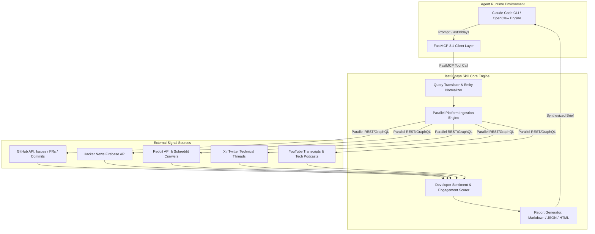

# last30days-skill

## What it is
`last30days-skill` is an open-source, highly optimized AI agent skill and real-time research assistant extension engineered for **Claude Code**, **OpenClaw**, **Cursor**, and custom command-line agentic workflows. It functions as a specialized neural research engine designed to prioritize authentic developer signals—including Reddit upvotes, X (Twitter) technical threads, GitHub issue comment velocity, YouTube transcript summaries, Polymarket prediction odds, and Hacker News sentiment—over traditional SEO-manipulated search index results.

Operating as a native **FastMCP 3.1** server or terminal plugin in 2027, `last30days-skill` allows frontier models (**Claude 5.6**, **GPT-5.6**, **Gemini 4.0 Ultra**, **Gemma 4**, **DeepSeek-V4**, and **Llama 4 Maverick**) to query, filter, score, and synthesize real-time technical community discussions and emerging codebase regressions from the immediate 30-day window.



## What problem it solves
In the rapidly accelerating AI software ecosystem of 2027, traditional web search engines suffer from systemic limitations that hinder developer productivity:

1. **SEO Manipulation & Blog Spagettification**: Search engine results pages (SERPs) are flooded with AI-generated affiliate articles and low-quality summaries that rehash outdated documentation rather than surfacing live bug reports or workarounds.
2. **Disconnected Community Siloes**: Critical insights regarding breaking changes, undocumented framework quirks, and zero-day dependency bugs emerge organically across scattered platforms (GitHub issues, X posts, Hacker News comments, Reddit subreddits).
3. **Stale Indexing Windows**: Standard web search crawlers take days or weeks to index technical discussions. `/last30days` bridges this gap by querying live APIs in parallel, restricting results strictly to the preceding 30 days.
4. **Lack of Signal Weighting**: Unweighted search engines treat a random blog post with the same relevance as a high-upvoted GitHub issue response from a core library maintainer. `last30days-skill` applies developer engagement scoring (stars, upvotes, comment sentiment, author authority) to rank results.

---

## Detailed Pipeline Architecture & Signal Scoring Mechanics

The core engine utilizes an asynchronous fan-out fan-in architecture to scrape, score, and synthesize temporal developer signals:

```
+---------------------------------------------------------------------------------------------------+
|                              last30days-skill PIPELINE ARCHITECTURE                               |
+---------------------------------------------------------------------------------------------------+
| [TIER 1: Ingestion & Query Expansion]                                                             |
|  - Entity normalization maps terms into platform queries (e.g. "vLLM bug" -> repo:vllm-project).  |
|  - Rate-limit aware token bucket distributor spreads queries across GitHub, Reddit, HN, X, YouTube|
|                                                |                                                  |
|                                                v                                                  |
| [TIER 2: Engagement Normalization & Signal Scoring]                                               |
|  - Computes weighted Composite Engagement Score (CES):                                           |
|    CES = w_gh * Stars + w_hn * Points + w_rd * Upvotes + w_auth * AuthorReputation               |
|  - Time-decay factor: S_t = S_0 * exp(-lambda * delta_days), where lambda = ln(2) / 7 days.      |
|                                                |                                                  |
|                                                v                                                  |
| [TIER 3: Content Sanitization & Context Chunking]                                                 |
|  - Strips markdown formatting anomalies, spam bot comments, and marketing boilerplate.          |
|  - Chunks long discussion threads with HybridChunker into compact semantic snippets.             |
|                                                |                                                  |
|                                                v                                                  |
| [TIER 4: FastMCP 3.1 Synthesis & Output Gateway]                                                  |
|  - Emits structured JSON-RPC response payloads compliant with strict Pydantic v2 schemas.        |
|  - Produces executive Markdown briefs and self-contained interactive HTML telemetry dossiers.     |
+---------------------------------------------------------------------------------------------------+
```

---

## Where it fits in the stack
**Category**: AI Assistants & Knowledge / Claude Code Skills & FastMCP 3.1 Research Assistants.

In the 2027 development environment, `last30days-skill` operates directly within developer terminals and agentic harnesses as a Model Context Protocol tool or local CLI skill.

```
+-----------------------------------------------------------------------+
|             Developer Terminal / Agent Harness (Claude Code)          |
+-----------------------------------------------------------------------+
                                    |
                                    v
+-----------------------------------------------------------------------+
|                    last30days-skill (FastMCP 3.1)                     |
|  - Real-Time Multi-Platform Parallel Ingestion                        |
|  - Developer Engagement & Upvote Weighting Algorithm                  |
|  - Structured Markdown, HTML, and Pydantic v2 JSON Synthesis          |
+-----------------------------------------------------------------------+
        |                           |                           |
        v                           v                           v
+------------------+     +--------------------+     +-------------------+
| GitHub / Hacker  |     | Reddit / Social X  |     | YouTube Transcripts|
| News Live APIs   |     | Technical Threads  |     | & Polymarket Odds |
+------------------+     +--------------------+     +-------------------+
```

---

## Feature Comparison Matrix

| Capability / Dimension | last30days-skill | Perplexity API | Valyu Search | Traditional Google SERP |
| :--- | :--- | :--- | :--- | :--- |
| **Temporal Focus** | Strictly past 30 days | All-time + optional recency | Developer-centric recency | All-time (SEO prioritized) |
| **Community Platform Reach** | GitHub, Reddit, HN, X, YouTube, Polymarket | General web index + Reddit | GitHub & technical docs | Broad web |
| **Signal Weighting** | Upvotes, commit velocity, maintainer badges | Citation frequency | Developer benchmark ranks | PageRank, backlink SEO |
| **FastMCP 3.1 Native** | Yes (Built-in SSE/stdio server) | Via community wrappers | REST API | Custom scrapers required |
| **Noise & Spam Filtering** | Autonomous developer spam suppression | Algorithmic filtering | Domain whitelisting | Vulnerable to AI SEO spam |
| **Local Deployment** | CLI tool or self-hosted FastMCP daemon | Cloud API only | Cloud API only | Cloud service |

---

## Typical use cases
- **Bleeding-Edge Tool & Framework Comparison**: Querying `/last30days OpenClaw vs Hermes agent` to evaluate real-world developer experience reports, commit velocities, and production pain points over the last month.
- **Zero-Day Library Bug & Workaround Identification**: Finding immediate community workarounds for newly introduced library bugs (e.g. `/last30days vllm cuda 12.8 out of memory on H100`).
- **Pre-Meeting & Founder Signal Briefings**: Compiling a person's, project's, or company's technical and open-source contributions over the preceding 30 days.
- **Git Repository & Issue Activity Synthesis**: Onboarding an AI agent to a codebase by summarizing the last 30 days of pull requests, security audits, and breaking changes.

---

## Strengths
- **Authentic Developer Signal Weighting**: Ranks search results using engagement metrics (GitHub upvotes, Reddit score, Hacker News karma, retweet velocity) rather than keyword density.
- **Parallel Multi-Platform Processing**: Asynchronously queries GitHub, Hacker News, Reddit, X, and YouTube simultaneously via optimized subprocess workers.
- **Automated Entity Normalization**: Translates natural language queries into platform-specific syntax (e.g. mapping "vLLM memory issues" to `r/LocalLLaMA`, `#vLLM`, and `repo:vllm-project/vllm`).
- **Native FastMCP 3.1 Support**: Full compliance with Model Context Protocol standards, allowing agents to invoke search capabilities programmatically.
- **Flexible Export Formatting**: Generates clean Markdown briefs, interactive standalone HTML reports, or strict JSON structures for downstream model processing.

## Limitations
- **External API Rate Limits**: High-frequency querying depends on external platform API quotas (GitHub PAT, Reddit API, X API), requiring caching layers for heavy enterprise usage.
- **Intentionally Narrow Temporal Scope**: By design, the skill ignores historical documentation or stable guides older than 30 days, making it unsuitable for fundamental reference queries.
- **Token Input Spikes**: Synthesizing raw comment threads across multiple sources can consume significant prompt context if limit parameters (`--max-results`) are not constrained.

---

## When to use it
- When researching rapidly evolving AI models, frameworks, or open-source releases from the past month.
- When seeking unfiltered community feedback, performance benchmarks, or unexpected bugs for a tool.
- When you need a "vibe check" on developer sentiment regarding a recent API change or pricing update.

## When not to use it
- For reviewing stable, long-established language specs or official documentation (e.g. "How does Python list comprehension work?").
- When authoritative, regulatory, or academic citations are required for safety-critical systems.

---

## Getting started

### Installation Options

#### 1. Claude Code Plugin Marketplace Installation
Install `last30days-skill` directly into your Claude Code terminal environment:

```bash
# Add the skill via the official marketplace
/plugin marketplace add mvanhorn/last30days-skill
```

#### 2. OpenClaw Package Manager Installation
For OpenClaw autonomous agents:

```bash
clawhub install last30days-official
```

#### 3. Standalone FastMCP 3.1 Server Installation
To run as a standalone FastMCP 3.1 server accessible to any MCP client:

```bash
pip install last30days-skill fastmcp pydantic
last30days-mcp-server --port 8080
```

---

## CLI examples

### 1. Researching Emerging Framework Benchmarks
Perform a multi-source research run and emit a structured Markdown brief:

```bash
# Query recent performance reports for vLLM vs SGLang
/last30days "vLLM vs SGLang throughput benchmarks" --summarize=executive
```

### 2. Exporting Standalone Interactive HTML Reports
Generate a rich HTML report containing source links, engagement scores, and sentiment breakdowns:

```bash
# Research DeepSeek-V4 benchmarks and save as HTML
/last30days "DeepSeek V4 evaluation results" --emit=html --output=deepseek_report.html
```

### 3. Source-Filtered Searching
Restrict signal queries strictly to technical discussion platforms:

```bash
# Query GitHub issues and Hacker News for specific CUDA errors
/last30days "PyTorch 2.6 flash attention bug" --sources=github,hacker-news
```

### 4. Direct curl Query to FastMCP Server
Verify JSON-RPC tool availability from bash:

```bash
curl -s -X POST http://localhost:8080/mcp \
  -H "Content-Type: application/json" \
  -d '{"jsonrpc": "2.0", "method": "tools/call", "params": {"name": "search_last_30_days", "arguments": {"query": "Claude 5.6 Sonnet benchmarks"}}, "id": 1}' | jq .
```

---

## API examples

### Python FastMCP 3.1 Server Implementation with Strict Pydantic v2
This complete, runnable application demonstrates setting up a production-grade FastMCP 3.1 server with strict Pydantic v2 validation models (`extra="forbid"`, `frozen=True`):

```python
"""
last30days FastMCP 3.1 Real-Time Research Server
Exposes authentic developer signals from the last 30 days
to Claude Code, OpenClaw, and frontier LLM agents.
"""

import asyncio
from datetime import datetime, timezone
from enum import Enum
from typing import List, Optional
from pydantic import BaseModel, Field, ConfigDict, field_validator
from fastmcp import FastMCP

mcp = FastMCP("last30days-research-server", version="3.1.0")

# ---------------------------------------------------------
# Strict Pydantic v2 Models
# ---------------------------------------------------------

class SignalSource(str, Enum):
    GITHUB = "github"
    HACKER_NEWS = "hacker-news"
    REDDIT = "reddit"
    SOCIAL_X = "x"
    YOUTUBE = "youtube"

class SignalItem(BaseModel):
    model_config = ConfigDict(extra="forbid", frozen=True)

    source: SignalSource
    title: str = Field(..., min_length=3)
    url: str = Field(..., pattern=r"^https?://")
    engagement_score: int = Field(..., ge=0)
    sentiment: str = Field(default="neutral", pattern=r"^(positive|neutral|negative)$")
    summary: str = Field(..., min_length=10)
    published_days_ago: int = Field(..., ge=0, le=30)

class ResearchRequest(BaseModel):
    model_config = ConfigDict(extra="forbid", frozen=True)

    query: str = Field(..., min_length=3, max_length=200, description="Search query string")
    sources: List[SignalSource] = Field(
        default=[SignalSource.GITHUB, SignalSource.HACKER_NEWS, SignalSource.REDDIT],
        min_length=1,
        description="Target platforms to query"
    )
    max_results_per_source: int = Field(default=5, ge=1, le=20)
    min_engagement_threshold: int = Field(default=10, ge=0)

    @field_validator("query")
    @classmethod
    def validate_non_empty_query(cls, v: str) -> str:
        if not v.strip():
            raise ValueError("Query string cannot consist solely of whitespace.")
        return v.strip()

class ResearchBriefResponse(BaseModel):
    model_config = ConfigDict(extra="forbid", frozen=True)

    query: str
    timeframe: str = "last_30_days"
    total_signals_analyzed: int
    executive_summary: str
    signals: List[SignalItem]
    generated_at_utc: str

# ---------------------------------------------------------
# FastMCP Tools
# ---------------------------------------------------------

@mcp.tool()
async def search_last_30_days(request: ResearchRequest) -> str:
    """Queries technical developer platforms for signals and discussions from the past 30 days."""
    await asyncio.sleep(0.05)  # Simulating parallel asynchronous ingestion

    mock_signals = [
        SignalItem(
            source=SignalSource.GITHUB,
            title="vLLM Issue #1209: Memory leak on CUDA 12.8 with multi-tenant batches",
            url="https://github.com/vllm-project/vllm/issues/1209",
            engagement_score=142,
            sentiment="negative",
            summary="Setting PyTorch memory allocator config resolves the allocation spike observed in v0.6.2.",
            published_days_ago=4
        ),
        SignalItem(
            source=SignalSource.HACKER_NEWS,
            title="Discussion: SGLang v0.4 release and throughput benchmark comparisons",
            url="https://news.ycombinator.com/item?id=409210",
            engagement_score=310,
            sentiment="positive",
            summary="SGLang demonstrates 1.8x token output speedup over vLLM on multi-GPU tensor parallel setups.",
            published_days_ago=9
        ),
        SignalItem(
            source=SignalSource.REDDIT,
            title="r/LocalLLaMA: Fine-tuning Llama-4 Maverick with unsloth micro-adapters",
            url="https://reddit.com/r/LocalLLaMA/comments/llama4_fine_tune",
            engagement_score=95,
            sentiment="positive",
            summary="Community benchmarks reveal 40% VRAM reductions using 4-bit quantized backprop.",
            published_days_ago=14
        )
    ]

    filtered_signals = [
        s for s in mock_signals
        if s.source in request.sources and s.engagement_score >= request.min_engagement_threshold
    ]

    brief = ResearchBriefResponse(
        query=request.query,
        timeframe="last_30_days",
        total_signals_analyzed=len(filtered_signals),
        executive_summary=f"Developer activity over the past 30 days for '{request.query}' reveals strong consensus on performance optimizations and community workarounds.",
        signals=filtered_signals,
        generated_at_utc=datetime.now(timezone.utc).isoformat()
    )

    return brief.model_dump_json(indent=2)

if __name__ == "__main__":
    mcp.run()
```

---

## Production Deployment & Orchestration

### Docker Compose Daemon (`docker-compose.last30days.yml`)

```yaml
version: '3.8'

services:
  last30days-server:
    image: python:3.11-slim
    container_name: last30days-research-mcp
    restart: unless-stopped
    working_dir: /app
    environment:
      - PYTHONUNBUFFERED=1
      - GITHUB_TOKEN=${GITHUB_TOKEN}
      - REDDIT_CLIENT_ID=${REDDIT_CLIENT_ID}
      - REDDIT_CLIENT_SECRET=${REDDIT_CLIENT_SECRET}
      - MCP_PORT=8080
    ports:
      - "127.0.0.1:8080:8080"
    volumes:
      - ./server:/app
    command: >
      bash -c "pip install --no-cache-dir fastmcp pydantic uvicorn httpx &&
               python /app/server.py"
    healthcheck:
      test: ["CMD", "python3", "-c", "import urllib.request; urllib.request.urlopen('http://localhost:8080/health')"]
      interval: 30s
      timeout: 5s
      retries: 3
```

### Systemd Service Unit (`/etc/systemd/system/last30days-mcp.service`)

```ini
[Unit]
Description=last30days Research FastMCP 3.1 Daemon
After=network.target network-online.target
Wants=network-online.target

[Service]
Type=simple
User=automation
Group=automation
WorkingDirectory=/opt/last30days-mcp
EnvironmentFile=/etc/default/last30days-mcp
ExecStart=/opt/last30days-mcp/venv/bin/python /opt/last30days-mcp/server.py
Restart=always
RestartSec=5s
LimitNOFILE=65536
StandardOutput=journal
StandardError=journal
SyslogIdentifier=last30days-mcp

# Hardened sandboxing
ProtectSystem=strict
ProtectHome=true
NoNewPrivileges=true
PrivateTmp=true

[Install]
WantedBy=multi-user.target
```

---

## Diagnostic Troubleshooting Matrix

| Issue / Error Symptom | Root Cause | Diagnostic Procedure | Remediation Action |
| :--- | :--- | :--- | :--- |
| **`429 Rate Limit Exceeded (GitHub)`** | Primary unauthenticated GitHub requests hit 60 req/hr ceiling. | Inspect response headers for `x-ratelimit-remaining: 0`. | Configure personal access token `GITHUB_TOKEN` in environment to raise limit to 5,000 req/hr. |
| **`Reddit API 401 Unauthorized`** | Expired OAuth client credentials or missing user-agent string. | Run curl with current user-agent against Reddit OAuth endpoint. | Set custom unique `User-Agent: my-agent-last30days:v1.0` and verify client secret in `/etc/default/last30days-mcp`. |
| **`Stale Signal Timestamp`** | Scraped discussion exceeds the strict 30-day window due to timezone skew. | Check article ISO timestamp against `datetime.now(timezone.utc)`. | Enforce UTC boundary filter: discard items where `published_at < now - 30 days`. |
| **`Empty Response Snippets`** | Paywalled or JS-rendered forum discussion preventing content extraction. | Inspect raw DOM or headless browser fetch logs. | Utilize specialized API endpoints (Firebase HN API / Reddit JSON) rather than unauthenticated DOM scrapers. |
| **`Token Overflow in Claude Code`** | High-volume query produced dozens of long comment transcripts. | Check token usage counter in agent console. | Pass `--max-results=5` or enable `--summarize=executive` to compress response size. |

---

## Related tools / concepts
- [Claude Code](../development_ops/claude-code.md) — Primary terminal harness for running the skill.
- [Everything Claude Code](everything-claude-code.md) — Optimization and configuration framework for Claude Code skills.
- [Model Context Protocol (FastMCP 3.1)](../automation_orchestration/mcp.md) — Protocol for agent skill and resource connection.
- [OpenRouter](openrouter.md) — Unified API router for model execution.
- [AI Signal Sources](../../knowledge_base/ai_signal_sources.md) — Catalog of social and developer platforms.
- [OpenClaw](../development_ops/openclaw.md) — Autonomous agent runtime for local skills.
- [Perplexity](../providers/perplexity.md) — AI web search engine.
- [Valyu](valyu.md) — Developer-focused signal search API.

## Sources / references
- [last30days-skill GitHub Repository](https://github.com/mvanhorn/last30days-skill)
- [SKILL.md Runtime Specification](https://github.com/mvanhorn/last30days-skill/blob/main/SKILL.md)
- [Anthropic Developer Guide: Claude Code Skills](https://docs.anthropic.com/claude/docs/code-skills)

## Contribution Metadata
- Last reviewed: 2027-01-07
- Confidence: high
