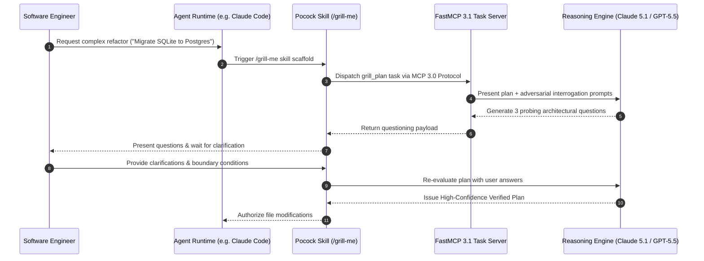

# Matt Pocock Skills

## What it is
Matt Pocock Skills is a collection of production-grade agent skills, execution scaffolds, and prompt design tools designed to extend AI developer workflows with domain-specific engineering rigor. Built around flagship patterns such as the "Grill-me" plan verification skill, this framework bridges the gap between raw LLM intelligence and disciplined software engineering practices. As of early 2027, these skills operate natively with **FastMCP 3.1**, the **MCP 3.0 Task Protocol**, and frontier models including **Claude 5.1**, **GPT-5.5**, **Gemini 4.0 Pro**, and **Llama 4 Maverick**.

Key capabilities include:
- **Interactive Plan Verification (`/grill-me`)**: Forces agents to defend architectural execution plans against adversarial questioning before making file changes.
- **Strict Test-Driven Development (`/tdd`)**: Enforces Red-Green-Refactor execution loops by mandating failing unit tests prior to feature implementation.
- **Environment & Dependency Diagnostics (`/diagnose`)**: Scans runtime trees, package lock files, and environment settings to surface hidden build bottlenecks.
- **FastMCP 3.1 & MCP 3.0 Task Protocol**: Native integration with FastMCP 3.1 tool interfaces, allowing IDE tools like Claude Code, Cursor, and OpenCode to execute skills safely.

## What problem it solves
Autonomous AI agents frequently suffer from "over-confidence bias"—executing major architectural refactors or database migrations without thoroughly validating edge cases, verifying dependency constraints, or pressure-testing system assumptions. This leads to broken builds, regressions, and costly manual debugging cycles.

Matt Pocock Skills addresses this problem by embedding explicit critical-thinking scaffolds directly into the agent's reasoning loop. Skills like `grill-me` force agents to defend their execution plans against adversarial questioning, while skills like `tdd` enforce strict Red-Green-Refactor test cycles before touching production source code.

## Where it fits in the stack
**Category**: AI Assistants & Knowledge / Agent Execution Skills & Scaffolds.

```
+-----------------------------------------------------------------------+
|                    Developer / IDE Workspace                          |
|         (Claude Code, Cursor, Cline, OpenCode, VS Code)               |
+-----------------------------------------------------------------------+
                                   |
                                   v
+-----------------------------------------------------------------------+
|                       Matt Pocock Skills                              |
|  +---------------------------+     +-------------------------------+  |
|  |     /grill-me Scaffold    |     |      /tdd Test Scaffold       |  |
|  +---------------------------+     +-------------------------------+  |
|                |                                   |                  |
|                v                                   v                  |
|  +-----------------------------------------------------------------+  |
|  |     FastMCP 3.1 Server Engine & Task Handler Interface          |  |
|  +-----------------------------------------------------------------+  |
+-----------------------------------------------------------------------+
                                   |
                                   v
+-----------------------------------------------------------------------+
|                  Frontier Reasoning Model & System                    |
|       (Claude 5.1, GPT-5.5, Gemini 4.0 Pro, Local Llama 4)           |
+-----------------------------------------------------------------------+
```

Operating at the reasoning and execution layer, these skills inject structured execution guidelines into agent runtimes like [Jules](jules.md) or [Claude Code](../development_ops/claude-code.md).

## System Architecture & Sequence Flow
The sequence diagram below illustrates how an agent uses the `/grill-me` skill to validate a technical plan via FastMCP 3.1 before applying changes to codebase files.



## Typical use cases
- **Plan Pressure-Testing (`/grill-me`)**: Requiring agents to answer 3 to 5 challenging architectural questions before executing complex code changes.
- **Strict Test-Driven Development (`/tdd`)**: Forcing agents to write failing unit tests first, verify red status, write minimal implementation, and refactor cleanly.
- **Environment & Dependency Diagnostics (`/diagnose`)**: Uncovering hidden version mismatches, missing system libraries, or environment variables causing build failures.
- **FastMCP 3.1 Agent Extensions**: Binding custom engineering tools to IDE assistants via standardized MCP server interfaces.

## Strengths
- **Enforces Staff Engineer Rigor**: Replaces hasty token generation with deliberate plan verification and boundary testing.
- **Standardized Execution (`skills.sh`)**: Simple single-command installation across diverse terminal environments and IDE plugins.
- **Model Agnostic**: Compatible with all leading reasoning engines (Claude 5.1, GPT-5.5, Gemini 4.0 Pro, DeepSeek-V4).
- **FastMCP 3.1 & Pydantic v2 Native**: Fully integrated with standard structured schemas and agent task protocols.

## Limitations
- **Interaction Overhead**: Requires interactive user input during grilling phases, which is less suited for fully unmonitored background batch runs.
- **Token Consumption**: Detailed multi-step skill scaffolds consume additional context window tokens during initial reasoning phases.

## Agent Skill Ecosystem Comparison Matrix

| Skill Suite / Framework | Matt Pocock Skills | Karpathy Skills | Superpower Prompts | LangChain Tools | FastMCP Native Skills |
| :--- | :--- | :--- | :--- | :--- | :--- |
| **Primary Philosophy** | Adversarial Interrogation & TDD | Surgical Code Modifications | System Prompt Customization | API Function Calling | Protocol-Level Extension |
| **Core Verification Mechanism** | `/grill-me` Plan Defense | AST Code Diff Validation | Static Role Scaffolding | Schema Type Validation | MCP Task Verification |
| **IDE & Runtime Compatibility** | Claude Code, Cursor, OpenCode | Cursor, Terminal Agents | System Prompts / Custom GPTs | LangChain / LangGraph | All FastMCP 3.1 Clients |
| **Human-in-the-Loop Interactivity** | High (Interactive Questioning) | Low (Automatic Execution) | Low (Static Prompts) | Medium (Callback Handlers) | High (MCP Protocol Hooks) |
| **Schema Standard** | Pydantic v2 / FastMCP 3.1 | Custom Python AST | Plain Text Markdown | Pydantic v1 / v2 | Pydantic v2 / JSON Schema |

## When to use it
- When making non-trivial modifications to core database schemas, security middleware, or public APIs.
- When practicing strict TDD discipline across TypeScript, Python, or Rust codebases.
- When seeking a standardized way to equip AI agents with reliable engineering workflows.

## When not to use it
- For quick, trivial changes (e.g. fixing a typo or modifying documentation).
- In fully automated background jobs where human feedback cannot be requested during a grill session.

## Getting started

### Installation
Install the skill suite using Node.js (v22+) and the official CLI:

```bash
# Add Matt Pocock Skills to local developer environment
npx skills@latest add mattpocock/skills
```

### Configuration
Add the setup hook to your agent's system prompt or configuration file (`CLAUDE.md` or `.cursorrules`):

```markdown
## Agent Skills Configuration
- Always run `/grill-me` before executing multi-file refactors or schema changes.
- Use `/tdd` for new feature implementations.
```

## CLI examples

```bash
# Trigger interactive plan verification session
/grill-me

# Initialize Test-Driven Development loop for target module
/tdd src/auth/session.ts

# Run diagnostic check on environment and dependencies
/diagnose

# List all active skills
/skills list
```

## API examples

Below is a complete, production FastMCP 3.1 server hosting both `/grill-me` and `/tdd` skill scaffolds with strict Pydantic v2 schema validation.

```python
import asyncio
from typing import List, Dict, Any, Optional
from mcp.server.fastmcp import FastMCP
from pydantic import BaseModel, Field, ConfigDict, field_validator

mcp = FastMCP(
    name="matt-pocock-skills-engine",
    version="3.1.0"
)


# ---------------------------------------------------------------------------
# Pydantic v2 Schemas for Grill-Me and TDD Skills
# ---------------------------------------------------------------------------
class PlanGrillInput(BaseModel):
    model_config = ConfigDict(str_strip_whitespace=True, populate_by_name=True)

    title: str = Field(..., min_length=5, description="Brief title of proposed architectural change.")
    description: str = Field(..., min_length=20, description="Detailed explanation of execution steps.")
    target_files: List[str] = Field(..., description="List of source files to be modified.")
    question_depth: int = Field(default=3, ge=1, le=5, description="Number of interrogation questions.")

    @field_validator("target_files")
    @classmethod
    def validate_target_files(cls, files: List[str]) -> List[str]:
        if not files:
            raise ValueError("target_files list cannot be empty.")
        return files


class GrillQuestionItem(BaseModel):
    question_id: int = Field(..., description="1-based question index.")
    topic: str = Field(..., description="Architectural category (e.g., Security, Rollback, Performance).")
    question_text: str = Field(..., description="Probing question text.")
    risk_level: str = Field(default="high", description="Risk level: low, medium, high.")


class PlanGrillResponse(BaseModel):
    session_id: str = Field(..., description="Unique session context string.")
    questions: List[GrillQuestionItem] = Field(..., description="Generated grilling questions.")
    requires_user_response: bool = Field(default=True, description="Flag indicating human-in-the-loop requirement.")


class TddCycleInput(BaseModel):
    model_config = ConfigDict(str_strip_whitespace=True)

    feature_spec: str = Field(..., min_length=10, description="Description of desired feature.")
    test_file_path: str = Field(..., description="Path to new or existing unit test file.")
    test_framework: str = Field(default="pytest", description="Test runner (pytest, vitest, jest).")


class TddCycleResult(BaseModel):
    phase: str = Field(default="RED", description="Current TDD phase: RED, GREEN, or REFACTOR.")
    test_output: str = Field(..., description="Output capture from test runner execution.")
    passed: bool = Field(default=False, description="Whether test suite passed.")


# ---------------------------------------------------------------------------
# FastMCP Tools
# ---------------------------------------------------------------------------
@mcp.tool(
    name="grill_me_plan",
    description="Interrogates a proposed technical plan using the /grill-me scaffold prior to execution."
)
def grill_me_plan(payload: PlanGrillInput) -> PlanGrillResponse:
    """Executes grilling scaffold, generating adversarial architectural questions."""
    q1 = GrillQuestionItem(
        question_id=1,
        topic="Data Integrity & Rollback",
        question_text=f"How will target files {payload.target_files} handle partial failure during mid-migration?",
        risk_level="high"
    )
    q2 = GrillQuestionItem(
        question_id=2,
        topic="Dependency Constraints",
        question_text=f"Have you verified compatibility across external lock files for '{payload.title}'?",
        risk_level="medium"
    )

    return PlanGrillResponse(
        session_id="grill-session-8821",
        questions=[q1, q2],
        requires_user_response=True
    )


@mcp.tool(
    name="execute_tdd_red_phase",
    description="Enforces writing a failing unit test first and confirms RED test status."
)
def execute_tdd_red_phase(payload: TddCycleInput) -> TddCycleResult:
    """Validates that newly authored unit test fails as expected before code generation."""
    simulated_test_output = f"FAILED {payload.test_file_path}::test_new_feature - AssertionError: Feature not implemented"
    return TddCycleResult(
        phase="RED",
        test_output=simulated_test_output,
        passed=False
    )


if __name__ == "__main__":
    mcp.run()
```

## Security & Operational Hardening

When granting AI agents access to Pocock Skills within developer worktrees:

1. **Strict File Sandbox Boundaries**: Enforce directory boundaries ensuring skills cannot inspect or modify sensitive system credentials outside the active git repository.
2. **Mandatory Human Approval for High-Risk Plans**: Configure `/grill-me` to block execution automatically whenever a plan touches security critical files (e.g., `auth`, `crypto`, `migrations`).
3. **Execution Timeout Controls**: Set strict timeouts (max 30 seconds) on `/tdd` test runner tool executions to prevent infinite test execution loops.
4. **Audit Logging of Agent Responses**: Log all user answers during `/grill-me` sessions into git commit messages or session audit logs for telemetry tracking.
5. **Read-Only Inspection Modes**: Use read-only subshells during `/diagnose` tasks to prevent diagnostic routines from unintentionally modifying environment files.

## Troubleshooting & Diagnostics

| Symptom / Issue | Cause | Recommended Solution |
| :--- | :--- | :--- |
| Agent skips `/grill-me` interrogation step | Missing system prompt hook in `.cursorrules` or `CLAUDE.md`. | Add explicit agent directives requiring plan approval before editing files. |
| `/tdd` test runner hangs indefinitely | Test runner waiting for interactive stdin input or network call. | Pass non-interactive flags (e.g., `pytest --no-header -q` or `vitest run`). |
| High token consumption in multi-turn chat | Long question-and-answer context retained across turns. | Summarize approved grilling answers into concise plan constraints before executing edits. |
| `FastMCP Tool Call Validation Error` | Payload missing required `target_files` or short `description`. | Ensure tool caller provides valid Pydantic v2 schemas conforming to `PlanGrillInput`. |
| Unrecognized `/skills` command | CLI package version mismatch or missing local binary. | Run `npx skills@latest update` to refresh installed skill definitions. |

## Related tools / concepts
- [Andrej Karpathy Skills](karpathy-skills.md) — Surgical code modification patterns.
- [Claude Code](../development_ops/claude-code.md) — Primary IDE runtime for agent skills.
- [Claude Skills Ecosystem](../agents/claude-skills-ecosystem.md) — Extension ecosystem for agent capabilities.
- [Jules](jules.md) — Specialized coding agent.
- [FastMCP 3.1 Task Protocol](../../knowledge_base/patterns/tool-calling-and-mcp.md) — Agent protocol specification.

## Sources / references
- [Matt Pocock Skills GitHub Repository](https://github.com/mattpocock/skills)
- [Total TypeScript - Professional AI Engineering Workflows](https://www.totaltypescript.com/)
- [FastMCP 3.1 Specification](https://modelcontextprotocol.io)

---
## Contribution Metadata
- Last reviewed: 2027-01-07
- Confidence: high
