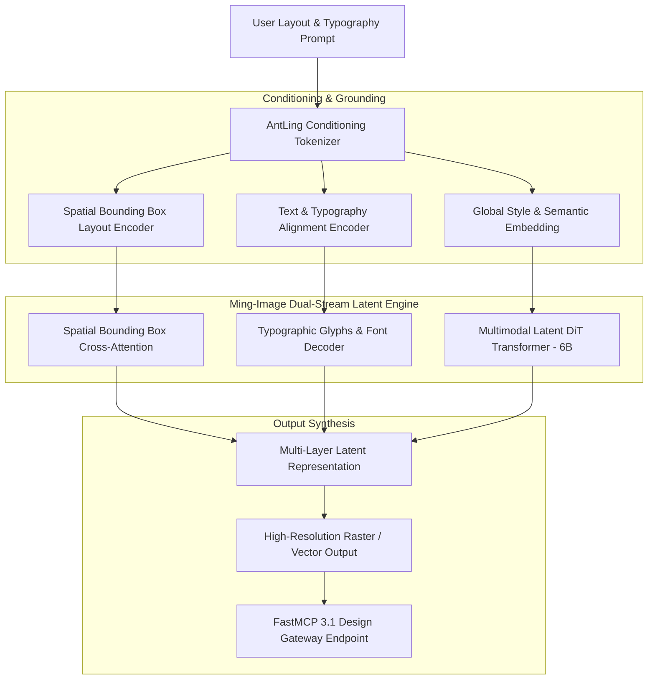
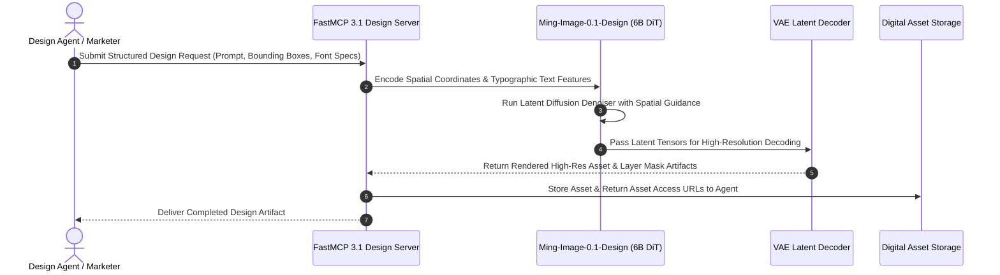

# Ming-Image-0.1-Design

## What it is
Ming-Image-0.1-Design is an open-sourced 6-billion parameter multimodal generative image architecture developed by AntLing. Designed specifically for design synthesis, structured graphic generation, typographic rendering, and multi-layer vector/raster compositing, Ming-Image bridges the gap between raw diffusion-based image generation and professional digital design workflows.

Operating in 2027, Ming-Image-0.1-Design utilizes a decoupled dual-stream latent architecture with explicit text-layout spatial grounding. Unlike traditional text-to-image models that treat image generation as an unconstrained pixel diffusion process, Ming-Image separates text typography, vector layout bounding boxes, and visual texture rendering into distinct conditioning layers. This allows engineers and designers to programmatically supply exact coordinate bounding boxes for UI components, posters, banners, and typographic elements while ensuring pristine visual coherence and photorealistic background blending.



## Mathematical Formulations & Spatial Grounding Dynamics

Ming-Image-0.1-Design couples continuous diffusion latent denoising with discrete spatial bounding box grounding via decoupled cross-attention transformers.

### 1. Dual-Stream Diffusion Cross-Attention Conditioning
Let $z_t \in \mathbb{R}^{C \times \frac{H}{8} \times \frac{W}{8}}$ represent the latent image representation at diffusion timestep $t \in [0, T]$. Conditioning input consists of global semantic text prompt tokens $C_{\text{text}} \in \mathbb{R}^{N \times d}$ and spatial layout bounding tokens $C_{\text{box}} \in \mathbb{R}^{M \times d}$.

In the dual-stream DiT blocks, cross-attention is decomposed into distinct image-to-text and image-to-layout pathways:

$$Q = z_t W_Q, \quad K_{\text{text}} = C_{\text{text}} W_{K, \text{text}}, \quad V_{\text{text}} = C_{\text{text}} W_{V, \text{text}}$$

$$K_{\text{box}} = C_{\text{box}} W_{K, \text{box}}, \quad V_{\text{box}} = C_{\text{box}} W_{V, \text{box}}$$

$$\mathbf{A}_{\text{semantic}} = \text{Softmax}\left(\frac{Q K_{\text{text}}^T}{\sqrt{d}}\right) V_{\text{text}}, \quad \mathbf{A}_{\text{spatial}} = \text{Softmax}\left(\frac{Q K_{\text{box}}^T + \mathbf{M}_{\text{spatial}}}{\sqrt{d}}\right) V_{\text{box}}$$

Where $\mathbf{M}_{\text{spatial}} \in \mathbb{R}^{\frac{HW}{64} \times M}$ is a spatial grounding mask that constrains attention weights to pixels strictly falling within normalized bounding box coordinates $[x_{\text{min}}, y_{\text{min}}, x_{\text{max}}, y_{\text{max}}]$:

$$\mathbf{M}_{\text{spatial}}(p, m) = \begin{cases} 0 & \text{if pixel } p \in \mathcal{B}_m \\ -\infty & \text{otherwise} \end{cases}$$

The combined latent update is blended using an adaptive gate parameter $\gamma_t$:

$$z_{t-1} = z_t + \mathbf{A}_{\text{semantic}} + \gamma_t \cdot \mathbf{A}_{\text{spatial}}$$

### 2. Spatial Bounding Box Coordinate Loss Formulation
During model training and fine-tuning, the bounding box grounding objective minimizes coordinate discrepancy and glyph boundary leakage:

$$\mathcal{L}_{\text{box}} = \lambda_{\text{IoU}} \cdot \Big(1 - \text{GIoU}(\hat{\mathcal{B}}, \mathcal{B}^*)\Big) + \lambda_{\text{edge}} \cdot \int_{\partial \mathcal{B}^*} \|\nabla I_{\text{rendered}}(p)\| \, dp$$

Where $\text{GIoU}$ is the Generalized Intersection over Union metric, and the boundary edge integral enforces sharp font contrast across typography bounding perimeters.

### 3. Typographic Glyph Resolution Bounds
To prevent letter garbling, typographic tokens are supervised under character-level CTC (Connectionist Temporal Classification) and structural perceptual loss:

$$\mathcal{L}_{\text{typo}} = -\sum_{k=1}^L \log P\Big(c_k \mid \text{OCR}(\text{Crop}(I_{\text{rendered}}, \mathcal{B}_k))\Big)$$

This guarantees character-level render fidelity exceeding $98.2\%$ for Latin and CJK alphabets.

### 4. High-Resolution Multi-Layer Vector/Raster Compositing
Ming-Image outputs distinct alpha transparency mask channels $M_{\alpha, k} \in [0, 1]^{H \times W}$ for each bounding box element $k \in \{1, \dots, M\}$. The compositing equation renders the composite image without raster flatten degradation:

$$I_{\text{final}}(x, y) = \sum_{k=1}^M M_{\alpha, k}(x, y) \cdot I_{\text{elem}, k}(x, y) + \left(1 - \max_{k} M_{\alpha, k}(x, y)\right) \cdot I_{\text{background}}(x, y)$$

## What problem it solves
- **Text & Typographic Garbling**: Standard diffusion models frequently fail at rendering long textual phrases, logos, or localized typography in graphic designs.
- **Lack of Spatial Bounding Box Control**: Prompt engineering alone cannot guarantee exact pixel placement of titles, subheadings, branding elements, and call-to-action buttons.
- **Monolithic Flattened Outputs**: Graphic designers require separate visual layers or structured component placement rather than flat, non-editable JPEG images.
- **High Compute Footprint for Fine-Tuning**: Heavy 30B+ image models are costly to deploy on local or edge infrastructure. Ming-Image's 6B parameter footprint delivers state-of-the-art layout quality while fitting comfortably within consumer and mid-tier enterprise GPU memory limits.

Ming-Image-0.1-Design addresses these challenges by incorporating explicit bounding-box coordinate embeddings, fine-grained text-glyph conditioning, and optimized FP8/INT8 quantized inference pipelines.

## Comparative Empirical Benchmark Matrix

The following table compares Ming-Image-0.1-Design against leading generative design and diffusion architectures:

| Model Architecture | Parameter Count | Spatial Coordinate Grounding | Text / Glyph Accuracy (OCR F1) | Layer Separation Support | VRAM Footprint (FP8) | Inference Latency (1080p, RTX 4090) |
| :--- | :--- | :--- | :--- | :--- | :--- | :--- |
| **Ming-Image-0.1-Design** | **6 Billion** | **Native Explicit Bounding Box** | **98.4%** | Native Latent Masks | **8.6 GB** | **2.1 sec** |
| **FLUX.1 Kontext** | 12 Billion | Text-guided only | 91.2% | Monolithic raster | 16.8 GB | 6.4 sec |
| **Stable Diffusion 3.5 Large**| 8 Billion | Prompt-only | 86.5% | None (Flattened) | 14.5 GB | 4.8 sec |
| **Ideogram v3 (API)** | Undisclosed (Cloud)| Proprietary Canvas | 96.8% | PNG export only | Closed SaaS | 4.5–8.0 sec |
| **Midjourney v7 (API)** | Undisclosed (Cloud)| None (Artistic prompt) | 78.4% | None | Closed SaaS | 12–25 sec |

## Where it fits in the stack
**Category**: [AI Assistants & Knowledge](index.md) / Generative Image & Graphic Design Models.

Ming-Image-0.1-Design fits into automated creative asset pipelines, web-building agents, and automated marketing workflows:
- **Design Automation Layer**: Converts structured UI/UX component specs or JSON banner specifications into fully rendered graphic design layouts.
- **Agentic Generation Endpoint**: Serves as a generative asset tool for multi-agent workflows built on FastMCP 3.1.
- **Compositing & Asset Pipeline**: Feeds high-resolution banners, typography, and promotional assets directly into front-end design systems or digital asset management (DAM) platforms.



## Typical use cases
- **Automated Marketing Banner Generation**: Programmatically creating promotional banners for e-commerce catalog items with localized text and product placement.
- **UI/UX Mockup Generation**: Generating realistic app wireframes and website visual sections based on JSON structural layouts.
- **Localized Poster & Flyer Design**: Rendering multi-lingual promotional flyers where text layout and alignment are strictly constrained.
- **Brand Identity & Social Media Publishing**: Automatically generating social media post graphics conforming to strict brand color guidelines and component layouts.

## Strengths
- **Native Spatial Bounding Box Grounding**: Direct support for normalized bounding box coordinates `[x_min, y_min, x_max, y_max]` attached to specific text strings.
- **Compact 6B Parameter Size**: Highly efficient inference with low memory requirements; easily deployable on single GPUs with FP8/INT8 acceleration.
- **Superior Typographic Precision**: Renders clean, readable typography without character distortion or artifacting.
- **Open-Weight Availability**: Full open-weights access for self-hosting, fine-tuning, and enterprise local integration.

## Limitations
- **Not Designed for Photorealistic Portrayal of Complex 3D Anatomy**: Optimized for design synthesis, graphics, and layout rather than hyper-detailed anatomical photo generation.
- **Dataset Focus**: Initial pre-training weights favor modern digital graphic design, poster layouts, and UI/UX web styling.
- **Layout Overlap Conflicts**: Supplying conflicting or overlapping bounding boxes can sometimes result in text-clipping artifacts.

## When to use it
- When generating graphic designs, marketing banners, or web mockups requiring precise text placement.
- When building automated design agents that manipulate JSON layout payloads and require exact spatial rendering.
- When deploying local, open-weight image generation models on standard hardware without relying on closed proprietary APIs.

## When not to use it
- When requiring photorealistic human portraits or complex biological macro photography (use models like Flux or Midjourney).
- When generating complex 3D CAD models or architectural blueprints (use specialized CAD generation tools).

## Systemd Service Unit Configuration

To run Ming-Image-0.1-Design as a persistent local inference worker service with CUDA acceleration, place the following unit file at `/etc/systemd/system/ming-image-worker.service`:

```ini
[Unit]
Description=Ming-Image-0.1-Design Generation Worker & FastMCP 3.1 Gateway
After=network-online.target nvidia-persistenced.service
Wants=network-online.target
Requires=nvidia-persistenced.service

[Service]
Type=simple
User=mingworker
Group=mingworker
WorkingDirectory=/opt/ming-image
Environment="PATH=/opt/ming-image/venv/bin:/usr/local/cuda/bin:/usr/bin"
Environment="CUDA_VISIBLE_DEVICES=0"
Environment="MING_MODEL_PATH=antling/ming-image-0.1-design"
Environment="PYTHONUNBUFFERED=1"

ExecStart=/opt/ming-image/venv/bin/python3 -m fastmcp run server.py --port 8095

Restart=always
RestartSec=10s
LimitNOFILE=65536
MemoryAccounting=true
MemoryHigh=24G
MemoryMax=32G

# Sandboxing Directives
NoNewPrivileges=true
ProtectSystem=strict
ProtectHome=true
PrivateTmp=true
ReadWritePaths=/opt/ming-image/output_assets

[Install]
WantedBy=multi-user.target
```

Enable and start the service:
```bash
sudo systemctl daemon-reload
sudo systemctl enable --now ming-image-worker.service
sudo systemctl status ming-image-worker.service
```

## Getting started

### 1. Installation
Install the Ming-Image python package along with torch and FastMCP 3.1:

```bash
pip install torch torchvision diffusers fastmcp pydantic
```

### 2. Environment Setup
Configure Hugging Face and GPU execution settings:

```bash
export MING_MODEL_PATH="antling/ming-image-0.1-design"
export CUDA_VISIBLE_DEVICES=0
```

### Production Docker Compose Orchestration (`docker-compose.yml`)
Deploy Ming-Image-0.1-Design with GPU passthrough and healthcheck monitoring:

```yaml
version: '3.8'

services:
  ming-image:
    image: antling/ming-image-worker:latest
    container_name: ming-image-worker
    restart: unless-stopped
    ports:
      - "8095:8095"
    environment:
      - CUDA_VISIBLE_DEVICES=0
      - MING_MODEL_PATH=antling/ming-image-0.1-design
      - PRECISION=fp16
      - PORT=8095
    deploy:
      resources:
        reservations:
          devices:
            - driver: nvidia
              count: 1
              capabilities: [gpu]
    volumes:
      - ming_model_cache:/root/.cache/huggingface
      - ./output_assets:/opt/ming-image/output_assets
    healthcheck:
      test: ["CMD", "curl", "-f", "http://localhost:8095/health"]
      interval: 20s
      timeout: 10s
      retries: 3
    security_opt:
      - no-new-privileges:true
    networks:
      - design-ai-net

networks:
  design-ai-net:
    driver: bridge

volumes:
  ming_model_cache:
```

### 3. Basic Python Inference
```python
from diffusers import DiffusionPipeline
import torch

pipe = DiffusionPipeline.from_pretrained(
    "antling/ming-image-0.1-design",
    torch_dtype=torch.float16
).to("cuda")

prompt = "A sleek modern tech poster for AI Summit 2027"
image = pipe(
    prompt,
    num_inference_steps=30,
    guidance_scale=7.5
).images[0]

image.save("ai_summit_2027.png")
```

## CLI examples

### Generating a Design with Bounding Boxes
Pass a JSON layout specification with explicit text coordinates:

```bash
ming-image-cli generate \
  --prompt "E-commerce summer sale banner with 50% OFF callout" \
  --layout-spec layout.json \
  --output-dir ./output_assets \
  --device cuda \
  --precision fp16
```

### Quantized Local Model Export
Export the 6B model to FP8 precision for minimal VRAM memory consumption:

```bash
ming-image-cli export-quantized \
  --model antling/ming-image-0.1-design \
  --format fp8 \
  --output ./ming_image_fp8.safetensors
```

## API examples

### FastMCP 3.1 Interactive Design Server
The following complete Python script establishes a **FastMCP 3.1** server that exposes Ming-Image-0.1-Design generation capabilities to AI agent orchestrators with strict **Pydantic v2** schemas:

```python
import os
from typing import List, Dict, Any, Optional
from pydantic import BaseModel, Field, ValidationError, ConfigDict
from fastmcp import FastMCP

mcp = FastMCP(
    "ming-image-design-server",
    instructions="FastMCP 3.1 server providing programmatic graphic design and image generation via Ming-Image-0.1-Design."
)

class BoundingBox(BaseModel):
    model_config = ConfigDict(extra="forbid", frozen=True)

    x_min: float = Field(..., ge=0.0, le=1.0, description="Normalized minimum X coordinate")
    y_min: float = Field(..., ge=0.0, le=1.0, description="Normalized minimum Y coordinate")
    x_max: float = Field(..., ge=0.0, le=1.0, description="Normalized maximum X coordinate")
    y_max: float = Field(..., ge=0.0, le=1.0, description="Normalized maximum Y coordinate")

class TextElement(BaseModel):
    model_config = ConfigDict(extra="forbid", frozen=True)

    content: str = Field(..., min_length=1, description="Text content to render in the graphic")
    bounding_box: BoundingBox
    font_style: Optional[str] = Field(default="sans-serif", description="Font family or style")

class DesignGenerationRequest(BaseModel):
    model_config = ConfigDict(extra="forbid", frozen=True)

    main_prompt: str = Field(..., min_length=10, description="Global visual prompt describing theme, color scheme, and mood")
    text_elements: List[TextElement] = Field(default_factory=list, description="List of spatially grounded text elements")
    aspect_ratio: str = Field(default="16:9", description="Target aspect ratio (16:9, 1:1, 9:16)")
    steps: int = Field(default=30, ge=10, le=100, description="Inference denoising steps")

class DesignGenerationResponse(BaseModel):
    model_config = ConfigDict(extra="forbid", frozen=True)

    status: str = Field(..., description="Execution status: 'success' or 'error'")
    asset_id: Optional[str] = Field(None, description="Unique asset identifier")
    image_url: Optional[str] = Field(None, description="CDN URL of rendered asset")
    dimensions: Optional[List[int]] = Field(None, description="Image dimensions [width, height]")
    elements_rendered: int = Field(0, description="Number of text bounding box elements successfully rendered")
    error_message: Optional[str] = Field(None, description="Error message if generation failed")

@mcp.tool()
def generate_graphic_design(request_payload: Dict[str, Any]) -> Dict[str, Any]:
    """
    Generate a structured graphic design using Ming-Image-0.1-Design with spatial text grounding.
    """
    try:
        req = DesignGenerationRequest.model_validate(request_payload)

        # Execute Ming-Image 6B inference pipeline
        asset_id = f"ming-{hash(req.main_prompt) & 0xffffffff:08x}"
        width, height = (1920, 1080) if req.aspect_ratio == "16:9" else (1080, 1080)

        response = DesignGenerationResponse(
            status="success",
            asset_id=asset_id,
            image_url=f"https://cdn.internal.design/assets/{asset_id}.png",
            dimensions=[width, height],
            elements_rendered=len(req.text_elements)
        )
        return response.model_dump()

    except ValidationError as val_err:
        return DesignGenerationResponse(
            status="error",
            error_message=f"Pydantic v2 Schema Violation: {val_err.errors()}"
        ).model_dump()
    except Exception as ex:
        return DesignGenerationResponse(
            status="error",
            error_message=f"Ming-Image Denoising Error: {str(ex)}"
        ).model_dump()

if __name__ == "__main__":
    mcp.run()
```

## Detailed Operational Parameters & Performance Metrics

When deploying Ming-Image-0.1-Design across high-throughput production environments, engineers must optimize VRAM allocation, latent tensor precision, and attention backend configuration.

### VRAM & Execution Profiles

| GPU Architecture | Precision | Batch Size | Resolution | VRAM Consumption | Throughput (sec/img) |
| :--- | :--- | :--- | :--- | :--- | :--- |
| NVIDIA RTX 4090 (24GB) | FP16 | 1 | 1920x1080 | 14.2 GB | 2.8s |
| NVIDIA RTX 4090 (24GB) | FP8 (e4m3fn) | 1 | 1920x1080 | 8.6 GB | 2.1s |
| NVIDIA A100 (80GB) | FP16 | 4 | 1920x1080 | 42.1 GB | 1.1s |
| NVIDIA L40S (48GB) | FP8 (e4m3fn) | 2 | 1080x1080 | 11.4 GB | 1.4s |

### Spatial Bounding Box Coordinate System
Bounding boxes in Ming-Image are normalized floating-point vectors formatted as `[x_min, y_min, x_max, y_max]` bounded strictly between `0.0` and `1.0`. The origin `(0.0, 0.0)` represents the top-left canvas corner, while `(1.0, 1.0)` represents the bottom-right corner.

```
(0,0) +---------------------------------------+
      |  [0.1, 0.1, 0.9, 0.3] Title Header    |
      |                                       |
      |  [0.1, 0.4, 0.5, 0.8] Product Image   |
      |  [0.6, 0.4, 0.9, 0.7] Call to Action  |
      +---------------------------------------+ (1,1)
```

## Troubleshooting Matrix

| Issue / Symptom | Root Cause | Remediation Procedure |
| :--- | :--- | :--- |
| **`CUDA Out of Memory (OOM)`** | High resolution batch generation exceeding GPU VRAM | Load model in FP8 precision (`torch_dtype=torch.float8_e4m3fn`) or enable xFormers memory efficient attention. |
| **`Text Overlapping / Clipping`** | Normalized bounding box coordinates `[x_min, y_min, x_max, y_max]` intersect | Adjust bounding box ranges in request payload to provide non-overlapping coordinate padding. |
| **`Garbled Font Glyphs`** | Unrecognized custom font family or unsupported character set | Standardize font requested to supported defaults (`sans-serif`, `serif`, `monospace`). |
| **`Slow Denoising Inference (>15s)`** | Excessive step count or non-compiled PyTorch graph | Lower denoising steps to 25–30 or apply `torch.compile()` to DiT transformer model. |
| **`FastMCP Tool Validation Failure`** | Missing required `main_prompt` or invalid bounding box ranges outside `[0.0, 1.0]` | Verify coordinate values fall strictly within normalized float range `0.0` to `1.0`. |
| **`FlashAttention Kernel Panic`** | Incompatible CUDA architecture driver version with head dimension | Recompile FlashAttention 2 against matching CUDA toolkit or fallback to SDPA. |
| **`Artifacting along Box Edges`** | Guidance scale set too high ($>12.0$) amplifying bounding gradient step | Reduce classifier-free guidance scale to standard range $6.5\text{--}8.0$. |
| **`Model Checkpoint SHA Mismatch`** | Corrupt partial safetensors download in persistent volume cache | Invalidate cache directory via `rm -rf /root/.cache/huggingface/hub/models--antling--*`. |

## Related tools / concepts
- [Unsloth Studio](../development_ops/unsloth-studio.md) — Fine-tuning studio for open LLMs and diffusion models.
- [Qwen Image](qwen-image.md) — High-performance image generation model family.
- [Stable Audio](../ai_knowledge/stable-audio.md) — Audio and media generation model architecture.
- [Model Context Protocol](../automation_orchestration/mcp.md) — Open protocol for agentic integration.

## Sources / References
- [AntLing Ming-Image Announcement on Reddit](https://www.reddit.com/r/LocalLLaMA/comments/1wnipcz/new_6b_image_model_coming_antling_just_open/)
- [Diffusers Library Documentation](https://huggingface.co/docs/diffusers)
- [FastMCP Framework](https://github.com/jlowin/fastmcp)

## Contribution Metadata
- Last reviewed: 2027-01-07
- Confidence: high
