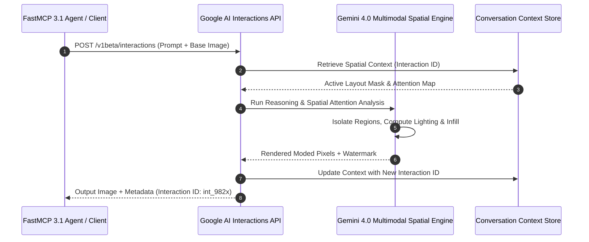

# Nano Banana

## What it is
Nano Banana is Google's conversation-driven generative image editor and design assistant integrated directly inside Google AI Studio and Vertex AI. Operating natively on Google's multimodal foundation models (**Gemini 4.0 Ultra** and **Gemini 4.0 Flash Image**), it allows developers and designers to create, refine, inpaint, and edit complex graphical layouts using natural language dialogue instead of manual masking tools.

Key capabilities of the early 2027 ecosystem include:
- **Unified Interactions API**: Run conversational, multi-turn image generation and modifications, where each turn builds upon the spatial layout of previous iterations.
- **Natural Language Masking & Inpainting**: Describe edits in plain language (e.g., "swap the background for a neon-lit cyberpunk street") without requiring hand-drawn bounding boxes.
- **Identity & Object Preservation**: Advanced spatial-attention mechanisms that maintain consistent facial features, product dimensions, or logos across multiple revisions.
- **Integrated Thinking Pipeline**: Leverages Google's reasoning traces to dynamically analyze layout structure, lighting, and object depth before applying edits.
- **FastMCP 3.1 Tool Integration**: Native FastMCP 3.1 server integration enabling autonomous AI agents to perform complex graphic editing workflows safely within enterprise agent pipelines.

## Architecture & Conversational Editing Flow



## What problem it solves
Traditional graphical editing pipelines (e.g., Photoshop, GIMP) are tedious and require deep technical expertise. Early text-to-image models lack revision control—any modification to a prompt generates a completely new image, destroying valuable layout progress. Nano Banana provides true non-destructive, conversational editing with exact continuity.

## Where it fits in the stack
It fits within the **AI Assistants & Knowledge** and **Creative & Communication** layers. It serves as a specialized image manipulation utility for multi-modal AI interactions, particularly for developers utilizing Google's API ecosystem.

```
+-----------------------------------------------------------------------+
|                    Enterprise Agent / Application                      |
|       (FastMCP 3.1 Tool Callers, OpenCode, Vertex Workflows)         |
+-----------------------------------------------------------------------+
                                   |
                                   v
+-----------------------------------------------------------------------+
|                     FastMCP 3.1 Nano Banana Tool Server               |
|  +---------------------------+     +-------------------------------+  |
|  | Request Validation Schema |     |  Multi-Turn Interaction Loop  |  |
|  +---------------------------+     +-------------------------------+  |
+-----------------------------------------------------------------------+
                                   |
                                   v
+-----------------------------------------------------------------------+
|                Google AI Studio / Vertex AI Infrastructure            |
|  +---------------------------+     +-------------------------------+  |
|  | Gemini 4.0 Flash Image    |     | Gemini 4.0 Ultra Multimodal   |  |
|  +---------------------------+     +-------------------------------+  |
+-----------------------------------------------------------------------+
```

## Typical use cases
- **Interactive Prototyping**: Generating and editing user interface layouts, promotional banners, and visual storyboards using high-speed chat.
- **Identity-Consistent Product Design**: Placing an existing base product mockup into varied lifestyle scenes (e.g., "place this water bottle on a marble kitchen counter next to fresh lemons").
- **Asset Localization**: Quickly translating text inside banner graphics or modifying regional elements for global marketing campaigns.
- **Creative Visual Storytelling**: Progressively illustrating graphic novels or video scene concepts turn-by-turn.

## Strengths
- **Logical Continuation**: Maintains high fidelity of untouched elements during localized modifications.
- **Zero Masking Friction**: Natural language understanding eliminates the need for manual cropping or lassoing.
- **High Infill Consistency**: Generates replacement pixels that perfectly match the lighting, shadowing, and grain of the original photograph.
- **FastMCP Native Execution**: Seamlessly connects into modern FastMCP 3.1 agent tool loops for automated design workflows.

## Limitations
- **Google Cloud Lock-In**: Exclusively tied to Google AI Studio, Vertex AI, and Google's proprietary image model licenses.
- **Fine Pixel Control**: For extreme professional precision (such as exact typography curves or vector paths), manual vector editors are still required.

## Tool Comparison Matrix

| Feature / Dimension | Nano Banana / Gemini Flash Image | Midjourney v7 | DALL-E 3 / GPT-4o Image | ControlNet + SDXL |
| :--- | :--- | :--- | :--- | :--- |
| **Primary Paradigm** | Conversational Multi-Turn Edit | Discord / Web Prompting | Conversational Single/Multi | Open-Source Node Graphs |
| **Spatial Continuity** | High (Layout Attention Lock) | Medium (Vary Region / Pan) | Medium (Inpainting Masks) | High (ControlNet Maps) |
| **API Automation** | Native REST & FastMCP 3.1 | Non-Standard / Unofficial | OpenAI API | Local REST / WebUI API |
| **Masking Mechanism** | Natural Language Inpainting | Manual Polygon Masking | Natural Language / Brush | Explicit Segmentation Maps |
| **Deployment Model** | Managed API (Vertex AI) | Hosted Web Service | Managed API (Azure/OpenAI) | Local GPU / Self-Hosted |
| **Latency per Edit** | 1.2 - 2.5 seconds | 15 - 30 seconds | 4.0 - 8.0 seconds | 2.0 - 10.0 seconds |

## When to use it
- When you want to programmatically generate and refine visual elements iteratively through a conversation loop.
- For business workflows requiring rapid, bulk background swaps and object placements with high lighting consistency.
- When building creative co-writing or storyboarding assistants that need continuous visual updates via FastMCP 3.1 servers.

## When not to use it
- If your graphic design workflow requires offline processing, local GPU deployment, or open-weight models (use local Stable Diffusion with ControlNet instead).
- If your primary focus is video generation or long-form video editing (use [Sora](sora.md) or Luma Dream Machine).

## Getting started

### 1. Library Installation and Authentication
Configure your environment to run Google's generative interactions APIs and FastMCP.

```bash
pip install google-genai mcp pillow pydantic
```

Obtain a key from Google AI Studio and expose it globally:
```bash
export GEMINI_API_KEY="AIzaSyYourKeyHere..."
```

### 2. Conversational Generation Quickstart
Use Python with `google-genai` and Pydantic v2 schemas to validate image generation requests.

```python
import base64
from google import genai
from pydantic import BaseModel, Field, ConfigDict


class ImageGenerationRequest(BaseModel):
    """Pydantic v2 schema for validating image creation inputs."""
    model_config = ConfigDict(str_strip_whitespace=True)

    prompt: str = Field(..., min_length=5, description="Prompt describing desired image output.")
    model_name: str = Field(default="gemini-4.0-flash-image", description="Target Gemini image model.")


def generate_initial_image(request: ImageGenerationRequest, output_filename: str = "base_setup.png"):
    client = genai.Client()

    interaction = client.interactions.create(
        model=request.model_name,
        input=request.prompt
    )

    image_bytes = base64.b64decode(interaction.output_image.data)
    with open(output_filename, "wb") as f:
        f.write(image_bytes)

    print(f"Generated base image successfully! Saved with Interaction ID: {interaction.id}")
    return interaction.id


if __name__ == "__main__":
    req = ImageGenerationRequest(
        prompt="A stylized illustration of a computer setup with neon lighting on a wooden desk."
    )
    print(f"Validated generation request for model: {req.model_name}")
```

## Production FastMCP 3.1 Server Integration

Below is a complete production FastMCP 3.1 server exposing Nano Banana image generation and multi-turn editing capabilities to autonomous agents with full Pydantic v2 schema validation.

```python
import base64
import os
from typing import Optional
from google import genai
from mcp.server.fastmcp import FastMCP
from pydantic import BaseModel, Field, ConfigDict

mcp = FastMCP("nano-banana-editor", version="3.1.0")


class GenerateImageInput(BaseModel):
    model_config = ConfigDict(str_strip_whitespace=True)

    prompt: str = Field(..., min_length=5, description="Detailed text prompt for image generation.")
    model_name: str = Field(default="gemini-4.0-flash-image", description="Gemini model string.")
    aspect_ratio: str = Field(default="16:9", description="Target aspect ratio (16:9, 1:1, 4:3).")


class EditImageInput(BaseModel):
    model_config = ConfigDict(str_strip_whitespace=True)

    instruction: str = Field(..., min_length=3, description="Natural language edit instruction.")
    previous_interaction_id: str = Field(..., description="Interaction ID from the preceding generation step.")
    model_name: str = Field(default="gemini-4.0-flash-image", description="Gemini model string.")


class ImageOperationResult(BaseModel):
    interaction_id: str = Field(..., description="Unique Google interaction context identifier.")
    image_b64: str = Field(..., description="Base64-encoded output image string.")
    mime_type: str = Field(default="image/png", description="Image MIME format.")
    status: str = Field(default="success", description="Execution status.")


@mcp.tool(
    name="generate_base_graphic",
    description="Generates a fresh graphical layout using Gemini 4.0 Flash Image."
)
def generate_base_graphic(payload: GenerateImageInput) -> ImageOperationResult:
    """Executes initial image creation and returns interaction session ID."""
    api_key = os.getenv("GEMINI_API_KEY")
    if not api_key:
        raise ValueError("GEMINI_API_KEY environment variable is missing.")

    client = genai.Client(api_key=api_key)
    response = client.interactions.create(
        model=payload.model_name,
        input=payload.prompt,
        config={"aspect_ratio": payload.aspect_ratio}
    )

    return ImageOperationResult(
        interaction_id=response.id,
        image_b64=response.output_image.data,
        mime_type="image/png",
        status="success"
    )


@mcp.tool(
    name="edit_graphic_in_context",
    description="Performs natural language inpainting or layout editing building on a previous interaction ID."
)
def edit_graphic_in_context(payload: EditImageInput) -> ImageOperationResult:
    """Executes conversational edit maintaining layout continuity."""
    api_key = os.getenv("GEMINI_API_KEY")
    if not api_key:
        raise ValueError("GEMINI_API_KEY environment variable is missing.")

    client = genai.Client(api_key=api_key)
    response = client.interactions.create(
        model=payload.model_name,
        input=payload.instruction,
        previous_interaction_id=payload.previous_interaction_id
    )

    return ImageOperationResult(
        interaction_id=response.id,
        image_b64=response.output_image.data,
        mime_type="image/png",
        status="success"
    )


if __name__ == "__main__":
    mcp.run()
```

## CLI examples
Interact with Google's image models directly using REST and `curl`.

### 1. Generating a Graphic from Text
Request a fresh illustration using standard terminal commands.

```bash
curl -X POST "https://generativelanguage.googleapis.com/v1beta/interactions" \
  -H "x-goog-api-key: $GEMINI_API_KEY" \
  -H "Content-Type: application/json" \
  -d '{
    "model": "gemini-4.0-flash-image",
    "input": [{"type": "text", "text": "A minimalist corporate logo featuring a green banana inside a sleek gear."}]
  }' > logo_response.json
```

### 2. Performing an In-Context Edit with an Input Image
Upload an existing file as a base64 string and instruct Nano Banana to alter the clothing color.

```bash
# Encode your local image file to base64
export BASE_IMAGE_B64=$(base64 -w 0 input_photo.png)

curl -X POST "https://generativelanguage.googleapis.com/v1beta/interactions" \
  -H "x-goog-api-key: $GEMINI_API_KEY" \
  -H "Content-Type: application/json" \
  -d '{
    "model": "gemini-4.0-flash-image",
    "input": [
      {"type": "text", "text": "Swap the gray sweater the person is wearing to a bright yellow hoodie."},
      {"type": "image", "mime_type": "image/png", "data": "'"$BASE_IMAGE_B64"'" }
    ]
  }' > edited_photo_response.json
```

### 3. High-Resolution Studio Quality Request
Leverage Google's professional-grade image model with custom dimensions.

```bash
curl -X POST "https://generativelanguage.googleapis.com/v1beta/interactions" \
  -H "x-goog-api-key: $GEMINI_API_KEY" \
  -H "Content-Type: application/json" \
  -d '{
    "model": "gemini-4.0-pro-image",
    "input": "A cinematic landscape shot of misty mountains at sunrise, ultra-realistic",
    "response_format": {
      "type": "image",
      "image_size": "2048x2048"
    }
  }' > studio_response.json
```

## API examples
For complex multi-turn editing systems, retaining previous interaction contexts is vital.

### 1. Multi-Turn Visual Editing (Python API)
The following script demonstrates multi-turn visual editing using `google-genai` and Pydantic v2.

```python
import base64
from google import genai
from pydantic import BaseModel, Field, ConfigDict


class IterativeEditRequest(BaseModel):
    model_config = ConfigDict(str_strip_whitespace=True)

    prompt: str = Field(..., min_length=3)
    previous_interaction_id: str = Field(...)


def execute_design_iteration(request: IterativeEditRequest, output_filename: str = "watch_step2.png"):
    client = genai.Client()

    step2 = client.interactions.create(
        model="gemini-4.0-flash-image",
        input=request.prompt,
        previous_interaction_id=request.previous_interaction_id
    )

    image_bytes = base64.b64decode(step2.output_image.data)
    with open(output_filename, "wb") as f:
        f.write(image_bytes)

    print("Multi-turn visual edit executed successfully!")
    return step2.id


if __name__ == "__main__":
    req = IterativeEditRequest(
        prompt="Now change the leather strap of the watch to a modern metallic mesh band.",
        previous_interaction_id="interaction_12345"
    )
    print(f"Validated edit step for previous interaction ID: {req.previous_interaction_id}")
```

### 2. Batch Background Swapping and Color Harmonization
Programmatically edit multiple variations of a product photo using `google-genai`.

```python
import base64
from google import genai
from pydantic import BaseModel, Field
from typing import List


class BatchSwapRequest(BaseModel):
    backgrounds: List[str] = Field(..., min_items=1)
    base_image_path: str = Field(...)


def generate_banner_variants(request: BatchSwapRequest):
    client = genai.Client()

    with open(request.base_image_path, "rb") as image_file:
        base64_image = base64.b64encode(image_file.read()).decode('utf-8')

    results = []
    for bg in request.backgrounds:
        response = client.interactions.create(
            model="gemini-4.0-flash-image",
            input=[
                {"type": "text", "text": f"Isolate the central object and place it on a {bg} background."},
                {"type": "image", "mime_type": "image/png", "data": base64_image}
            ]
        )
        results.append(response)
    return results


if __name__ == "__main__":
    req = BatchSwapRequest(
        backgrounds=["marble countertop", "wooden terrace"],
        base_image_path="/tmp/product.png"
    )
    print(f"Prepared batch swap for {len(req.backgrounds)} background variations.")
```

## Security & Operational Hardening

When deploying Nano Banana in automated agent production pipelines, adhere to the following security rules:

1. **API Key Isolation**: Store `GEMINI_API_KEY` in secure secret managers (e.g., HashiCorp Vault, AWS Secrets Manager). Never hardcode keys in client-side applications.
2. **Data Privacy & Ingest Filtering**: Ensure user-uploaded base photos pass automated Content Moderation and PII redaction checks before sending payloads to cloud endpoints.
3. **SynthID Watermark Verification**: All images generated or modified by Google's generative models contain invisible SynthID digital watermarks. Retain SynthID metadata to verify asset origin and comply with corporate AI policy.
4. **Rate Limit & Backoff Guardrails**: Implement token bucket rate limiting on `client.interactions.create()` calls to avoid HTTP 429 errors during heavy batch jobs.
5. **Base64 Payload Compression**: Compress image payloads before base64 encoding to keep payload sizes under the 10 MB interaction endpoint threshold.

## Troubleshooting & Diagnostics

| Symptom / Issue | Cause | Recommended Solution |
| :--- | :--- | :--- |
| `HTTP 400: Invalid interaction_id` | Expired or invalid interaction context ID. | Re-upload the base image with prompt instructions to initiate a new session context. |
| `HTTP 429: Resource Exhausted` | Exceeded API quota or concurrency limit. | Implement exponential backoff with jitter or upgrade your Google Cloud billing tier. |
| Unintended Subject Distortion | Prompt is overly vague or conflicts with spatial layout. | Specify rigid anchors (e.g., "Keep central person intact; only modify background elements"). |
| Color Bleed / Infill Mismatch | Ambient lighting in edit prompt does not fit original scene. | Add explicit lighting conditions (e.g., "Match original soft studio lighting"). |
| SynthID Validation Failure | Downstream optimization removed digital watermark. | Use PNG or high-bitrate WEBP export formats to preserve digital watermarking. |

## Related tools / concepts
- [Gemini](gemini.md)
- [Gemini 3.1 Flash TTS](gemini-flash-tts.md)
- [Sora](sora.md)
- [Project Genie](project-genie.md)
- [Luma Dream Machine](luma-dream-machine.md)
- [Midjourney](index.md)
- [Runway ML](runwayml.md)

## Sources / references
- [Google AI Studio Image API Overview](https://aistudio.google.com)
- [Gemini Image Generation Reference Documentation](https://gemini.google/overview/image-generation/)
- [Google Gen AI SDK Quickstart Guides](https://ai.google.dev/gemini-api/docs/quickstart)

## Contribution Metadata
- Last reviewed: 2027-01-07
- Confidence: high
