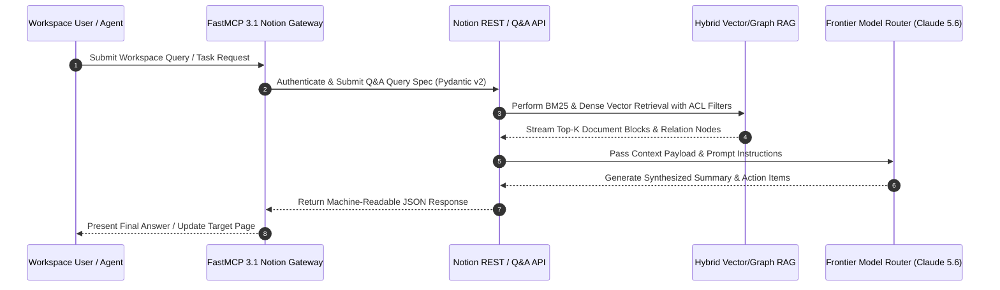

# Notion AI

## What it is
Notion AI is a suite of integrated artificial intelligence features within the Notion workspace. It assists users with writing, brainstorming, synthesizing, and querying workspace knowledge directly where they collaborate. By early 2027, it has evolved into a comprehensive agentic assistant capable of cross-workspace reasoning, multi-step automation, and native integration with the Model Context Protocol (FastMCP 3.1) and frontier reasoning models like **GPT-5.6**, **Claude 5.6**, **Gemini 4.0 Ultra**, and **DeepSeek-V4**.

## System Architecture

Notion AI relies on a hybrid vector-search, keyword BM25, and relational graph database architecture. Document blocks, page properties, and relational databases are chunked and embedded into high-throughput vector indexes, enabling multi-hop retrieval-augmented generation (RAG) across workspace blocks:

```
+-----------------------------------------------------------------------------------+
|                                 NOTION WORKSPACE                                  |
|   +--------------------+     +--------------------+     +---------------------+   |
|   | Pages & Documents  |     | Relational DBs     |     | FastMCP 3.1 Agents  |   |
|   +---------+----------+     +---------+----------+     +----------+----------+   |
+-------------|--------------------------|---------------------------|--------------+
              | Block Updates            | Property Changes          | Q&A Query
              v                          v                           v
+-----------------------------------------------------------------------------------+
|                            NOTION AI HYBRID RAG ENGINE                            |
|   +---------------------------------------------------------------------------+   |
|   |                       Block Chunking & Vector Ingestion                   |   |
|   |  - Sparse BM25 Keyword Search           - Dense Vector Embeddings             |   |
|   |  - Relation Graph Context Expansion     - Workspace ACL Security Filter       |   |
|   +-------------------------------------+-------------------------------------+   |
+-----------------------------------------|-----------------------------------------+
                                          | Context Payload
                                          v
+-----------------------------------------------------------------------------------+
|                             FRONTIER LLM ROUTER & REASONING                       |
|   +-------------------+    +--------------------+    +------------------------+   |
|   | Claude 5.6 / GPT5 |    | Gemini 4.0 Ultra   |    | FastMCP 3.1 Connector  |   |
|   | (Synthesis)       |    | (Large Context)    |    | (External Execution)   |   |
|   +-------------------+    +--------------------+    +------------------------+   |
+-----------------------------------------------------------------------------------+
```



## What problem it solves
It bridges the gap between passive document repositories and active AI assistance. By embedding AI capabilities directly into the workspace system of record, Notion AI eliminates context switching between chat interfaces and project documentation. Key problems resolved include:
- **Context Loss Across Knowledge Silos**: Consolidating information across disparate databases, meeting notes, and wiki pages using multi-hop RAG queries.
- **Manual Document Summarization & Enrichment**: Automating property extraction, meeting action items, and task generation across workspace databases.
- **Agent Memory Integration**: Serving as a structured, human-readable and machine-accessible persistent memory store for external AI coding agents via FastMCP 3.1 interfaces.

## Where it fits in the stack
**Category**: AI & Knowledge / Workspace Collaboration Layer. Notion AI operates at the **Knowledge Capture & Workspace Intelligence Layer**, sitting above storage primitives and providing structured knowledge interfaces for both human teams and autonomous agent frameworks.

## Typical use cases
- **Automated Workspace Q&A**: Performing natural language semantic search across enterprise wikis and relational project trackers.
- **Database Property Enrichment**: Automatically populating summary, status, and tag fields in databases using AI prompts.
- **Meeting Notes Action Item Extraction**: Processing raw transcripts and generating follow-up task records in project databases.
- **FastMCP 3.1 Knowledge Gateway**: Exposing workspace pages and databases as context tools for external agents powered by **Claude 5.6**, **GPT-5.6**, or **Jules**.

## Detailed Comparison Matrix

| Feature / Capability | Notion AI | Obsidian + Copilot | Logseq + Local AI | Coda AI |
| :--- | :--- | :--- | :--- | :--- |
| **Workspace Integration** | Native Document Blocks | Plugin / Local Files | Plugin / Markdown | Native Tables & Docs |
| **Q&A RAG Engine** | Cloud Hybrid Vector/Graph | Local Vector DB (Ollama) | Local Vector DB | Cloud Workspace Index |
| **FastMCP 3.1 Gateway**| Native Connector API | Extension Plugin | Community Plugin | Custom Gateway |
| **Data Privacy** | Cloud / Enterprise SOC2 | 100% Local / Zero Cloud | 100% Local / Zero Cloud | Cloud / Enterprise Terms |
| **Multi-Model Support**| GPT-5.6 / Claude 5.6 | Ollama / Custom API | Ollama / Custom API | GPT-5.6 / Claude 5.6 |
| **Pricing Model** | ~$10 / user / mo | Free / BYO API Key | Free / BYO API Key | ~$12 / user / mo |

## Strengths
- **Native Block Integration**: Operates directly inside existing workspace documents and databases with zero import/export friction.
- **Context-Aware Multi-Hop Reasoning**: Leverages page link relations and database schemas for deep contextual comprehension.
- **Agent Memory System of Record**: Pages serve as dual-use human readable docs and machine-queryable agent memory targets.
- **Frontier LLM Selection**: Dynamically routes queries across top-tier models (Claude 5.6, GPT-5.6, Gemini 4.0 Ultra).

## Limitations
- **Subscription Cost**: Requires per-user monthly add-on pricing ($10/user/month or credit-based models).
- **Cloud Dependency**: Incompatible with strict air-gapped or zero-cloud data sovereignty mandates (see [Obsidian](./obsidian.md)).
- **API Rate Limits**: Standard API endpoints enforce rate throttling (3 requests per second baseline per integration token).

## When to use it
- When your organization uses Notion as its primary knowledge base and project management system.
- For summarizing meeting notes, extracting action items, and populating database properties.
- When exposing workspace documentation to AI agents via FastMCP 3.1 tools.

## When not to use it
- For air-gapped or zero-cloud local data privacy requirements (consider Obsidian instead).
- For heavy coding or raw text manipulation tasks.

## Getting started

Notion AI is available natively within Notion web and desktop applications. For automated integrations, use the official SDK or REST APIs.

### Installation
Install the official Notion client for Node.js or Python:

```bash
# Node.js
npm install @notionhq/client

# Python API SDK & FastMCP
pip install notion-client fastmcp pydantic requests
```

## CLI examples

```bash
# Query workspace pages via REST API
curl -s -X POST https://api.notion.com/v1/search -H "Authorization: Bearer $NOTION_API_KEY" -H "Notion-Version: 2022-06-28" -d '{"query": "Architecture"}'
```

## API examples

### FastMCP 3.1 Notion Knowledge Gateway & Pydantic v2 Schema

Below is a complete FastMCP 3.1 Python server exposing Notion workspace Q&A, page search, and page block enrichment capabilities with strict Pydantic v2 schemas (`extra="forbid"`):

```python
import os
import json
import requests
from typing import Optional, List, Dict
from pydantic import BaseModel, Field, ConfigDict, field_validator, ValidationError
from mcp.server.fastmcp import FastMCP

mcp = FastMCP("Notion-AI-FastMCP-Gateway", version="3.1.0")

NOTION_TOKEN = os.getenv("NOTION_TOKEN", "secret_mock_token")
NOTION_VERSION = "2022-06-28"

class WorkspaceQuerySpec(BaseModel):
    model_config = ConfigDict(extra="forbid", frozen=True)

    query_text: str = Field(..., min_length=2, description="Search query or topic keyword")
    page_size: int = Field(default=5, ge=1, le=20, description="Max result count")
    filter_object: Optional[str] = Field(default="page", description="Target object type: page or database")

    @field_validator("query_text")
    @classmethod
    def validate_query(cls, val: str) -> str:
        if not val.strip():
            raise ValueError("Query text cannot be empty or whitespace.")
        return val.strip()

class NotionPageSummary(BaseModel):
    model_config = ConfigDict(extra="forbid", frozen=True)
    page_id: str
    url: str
    title: str
    object_type: str

class QueryResponsePayload(BaseModel):
    model_config = ConfigDict(extra="forbid", frozen=True)
    status: str
    count: int
    results: List[NotionPageSummary]

class AppendBlockSpec(BaseModel):
    model_config = ConfigDict(extra="forbid", frozen=True)
    page_id: str = Field(..., description="Target Notion Page UUID")
    heading_text: str = Field(..., description="Heading text for new content section")
    paragraph_text: str = Field(..., description="Paragraph text content")

@mcp.tool(name="search_notion_knowledge", description="Executes semantic query search across Notion workspace pages via FastMCP 3.1.")
def search_notion_knowledge(spec_json: str) -> str:
    """Parses query specification, calls Notion API, and returns validated JSON result."""
    try:
        raw_data = json.loads(spec_json)
        spec = WorkspaceQuerySpec.model_validate(raw_data)

        headers = {
            "Authorization": f"Bearer {NOTION_TOKEN}",
            "Notion-Version": NOTION_VERSION,
            "Content-Type": "application/json"
        }
        payload = {
            "query": spec.query_text,
            "page_size": spec.page_size,
            "filter": {"value": spec.filter_object, "property": "object"}
        }

        resp = requests.post("https://api.notion.com/v1/search", json=payload, headers=headers, timeout=10)

        if resp.status_code == 200:
            raw_results = resp.json().get("results", [])
            items = []
            for item in raw_results:
                title = "Untitled"
                if "properties" in item and "title" in item["properties"]:
                    title_objs = item["properties"]["title"].get("title", [])
                    if title_objs:
                        title = title_objs[0].get("plain_text", "Untitled")

                items.append(NotionPageSummary(
                    page_id=item.get("id", ""),
                    url=item.get("url", ""),
                    title=title,
                    object_type=item.get("object", "page")
                ))

            res = QueryResponsePayload(status="SUCCESS", count=len(items), results=items)
            return json.dumps(res.model_dump(), indent=2)
        else:
            return json.dumps({"status": "API_ERROR", "code": resp.status_code, "detail": resp.text})

    except json.JSONDecodeError as err:
        return json.dumps({"status": "ERROR", "message": f"Invalid JSON payload: {str(err)}"})
    except ValidationError as err:
        return json.dumps({"status": "VALIDATION_FAILED", "errors": err.errors()})
    except Exception as err:
        return json.dumps({"status": "EXCEPTIONAL_FAILURE", "message": str(err)})

@mcp.tool(name="append_notion_page_content", description="Appends structured block content to a target Notion page.")
def append_notion_page_content(spec_json: str) -> str:
    """Validates block payload and appends heading/paragraph blocks to a Notion page."""
    try:
        raw_data = json.loads(spec_json)
        spec = AppendBlockSpec.model_validate(raw_data)

        headers = {
            "Authorization": f"Bearer {NOTION_TOKEN}",
            "Notion-Version": NOTION_VERSION,
            "Content-Type": "application/json"
        }
        children_payload = {
            "children": [
                {
                    "object": "block",
                    "type": "heading_2",
                    "heading_2": {
                        "rich_text": [{"type": "text", "text": {"content": spec.heading_text}}]
                    }
                },
                {
                    "object": "block",
                    "type": "paragraph",
                    "paragraph": {
                        "rich_text": [{"type": "text", "text": {"content": spec.paragraph_text}}]
                    }
                }
            ]
        }

        url = f"https://api.notion.com/v1/blocks/{spec.page_id}/children"
        resp = requests.patch(url, json=children_payload, headers=headers, timeout=10)

        if resp.status_code == 200:
            return json.dumps({"status": "SUCCESS", "appended_page_id": spec.page_id}, indent=2)
        else:
            return json.dumps({"status": "API_ERROR", "code": resp.status_code, "detail": resp.text})

    except ValidationError as err:
        return json.dumps({"status": "VALIDATION_FAILED", "errors": err.errors()})
    except Exception as err:
        return json.dumps({"status": "ERROR", "message": str(err)})

if __name__ == "__main__":
    mcp.run()
```

## Production Deployment & Systemd Service Architecture

### Container Orchestration with Docker Compose

Deploy the Notion AI FastMCP gateway microservice in self-hosted environments using Docker Compose:

```yaml
version: "3.8"

services:
  notion-fastmcp-gateway:
    image: python:3.11-slim
    container_name: notion-fastmcp-gateway
    restart: unless-stopped
    command: python3 -m mcp.server.fastmcp run notion_mcp_server.py
    environment:
      - PYTHONUNBUFFERED=1
      - NOTION_TOKEN=${NOTION_TOKEN}
    volumes:
      - ./notion_mcp_server.py:/app/notion_mcp_server.py:ro
    working_dir: /app
    ports:
      - "8000:8000"
    deploy:
      resources:
        limits:
          cpus: "1.0"
          memory: 512M
    healthcheck:
      test: ["CMD", "python3", "-c", "import requests; print('OK')"]
      interval: 30s
      timeout: 5s
      retries: 3
    security_opt:
      - no-new-privileges:true
```

### Systemd Service Unit Specification

For host-level Linux deployments, install the following systemd service unit:

```ini
[Unit]
Description=Notion AI FastMCP Gateway Daemon
After=network.target

[Service]
Type=simple
User=notion-agent
Group=notion-agent
WorkingDirectory=/opt/notion-gateway
ExecStart=/usr/bin/python3 -m mcp.server.fastmcp run notion_mcp_server.py
Restart=always
RestartSec=5s
Environment=PYTHONUNBUFFERED=1
EnvironmentFile=/etc/notion-gateway/env

# Security Hardening
ProtectSystem=strict
ProtectHome=true
NoNewPrivileges=true
PrivateTmp=true
ProtectKernelTunables=true
ProtectControlGroups=true
ReadOnlyPaths=/opt/notion-gateway

[Install]
WantedBy=multi-user.target
```

## Operational Best Practices

1. **Integration Connection Sharing**: Remember to explicitly share top-level parent pages with the integration bot in the Notion UI (**... -> Add Connections**), or child pages will return empty result sets.
2. **API Rate Limit Resilience**: Enforce retries with exponential backoff on HTTP 429 rate limit errors (Notion enforces a baseline limit of 3 requests per second per token).
3. **Sensitive Key Storage**: Never commit `NOTION_TOKEN` secrets into source code or repository files; load via system environment or encrypted secret vaults.

## Troubleshooting & Diagnostic Matrix

| Symptom / Error | Probable Cause | Diagnostic Command | Remediation Action |
| :--- | :--- | :--- | :--- |
| **HTTP 401 Unauthorized** | Invalid or expired `NOTION_TOKEN` bearer secret | `curl -H "Authorization: Bearer $NOTION_TOKEN" https://api.notion.com/v1/users/me` | Regenerate internal integration token in Notion developer portal. |
| **Empty Search Results (0 items)** | Target parent pages not shared with integration bot | `curl -X POST https://api.notion.com/v1/search -H "Authorization: Bearer $NOTION_TOKEN"` | In Notion UI, navigate to target page menu and add connection to integration. |
| **HTTP 429 Rate Limit Exceeded** | Query rate exceeded 3 requests/second threshold | `python3 notion_mcp_server.py --test-rate` | Add exponential backoff retry wrapper to API requests. |

## Related tools / concepts
- [Obsidian](./obsidian.md) — Local-first markdown knowledge base alternative.
- [Logseq](./logseq.md) — Privacy-focused graph knowledge tool.
- [n8n](../../services/n8n.md) — Workflow automation integration.
- [Model Context Protocol (FastMCP 3.1)](../automation_orchestration/mcp.md) — Agent connection protocol.

## Sources / references
- [Official Website](https://www.notion.so/product/ai)
- [Notion Developers API](https://developers.notion.com/)
- [Latent Space: Notion's Token Town & The Software Factory Future](https://www.latent.space/p/notion)

## Contribution Metadata
- Last reviewed: 2027-01-07
- Confidence: high
