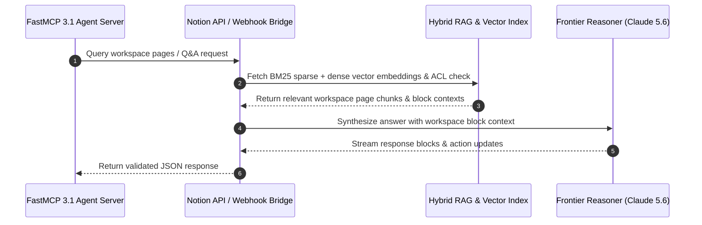

# Notion AI

## What it is
Notion AI is a suite of integrated artificial intelligence features within the Notion workspace. It assists users with writing, brainstorming, and summarizing information directly where they work. By early January 2027, it has evolved into a comprehensive agentic assistant capable of cross-workspace reasoning, multi-step automation, and native integration with the **FastMCP 3.1** protocol and frontier reasoning models like **GPT-5.6**, **Claude 5.6**, **Gemini 4.0 Ultra**, and **DeepSeek-V4**.

### Architectural Layout & RAG Engine
Notion AI relies on a hybrid vector-search and graph database architecture. Document blocks, page properties, and relational databases are chunked and embedded in real-time into a high-throughput vector index, enabling multi-hop retrieval-augmented generation (RAG) across millions of workspace blocks.

```
+-----------------------------------------------------------------------------------+
|                                 NOTION WORKSPACE                                  |
|   +--------------------+     +--------------------+     +---------------------+   |
|   | Pages & Documents  |     | Relational DBs     |     | FastMCP 3.1 Agents  |   |
|   +---------+----------+     +---------+----------+     +----------+----------+   |
+-------------|--------------------------|---------------------------|--------------+
              | Block Updates            | Property Changes          | Q&A Query
              v                          v                           v
+-----------------------------------------------------------------------------------+
|                            NOTION AI HYBRID RAG ENGINE                            |
|   +---------------------------------------------------------------------------+   |
|   |                       Block Chunking & Vector Ingestion                   |   |
|   |  - Sparse BM25 Keyword Search           - Dense Vector Embeddings             |   |
|   |  - Relation Graph Context Expansion     - Workspace ACL Security Filter       |   |
|   +-------------------------------------+-------------------------------------+   |
+-----------------------------------------|-----------------------------------------+
                                          | Context Payload
                                          v
+-----------------------------------------------------------------------------------+
|                             FRONTIER LLM ROUTER & REASONING                       |
|   +-------------------+    +--------------------+    +------------------------+   |
|   | Claude 5.6 / GPT5 |    | Gemini 4.0 Ultra   |    | FastMCP 3.1 Connector  |   |
|   | (Synthesis)       |    | (Large Context)    |    | (External Execution)   |   |
|   +-------------------+    +--------------------+    +------------------------+   |
+-----------------------------------------------------------------------------------+
```



## What problem it solves
Bridges the gap between a knowledge base and an AI assistant, allowing users to interact with their data, automate routine writing tasks, and organize information more effectively without leaving their productivity environment. It eliminates the friction of switching between a chat interface and a system of record, leveraging frontier models like **GPT-5.6**, **Claude 5.6**, and **Gemini 4.0 Ultra** to perform multi-hop reasoning.

## Where it fits in the stack
[AI & Knowledge](./index.md) — integrated productivity and workspace assistant.

## Typical use cases
- **Summarizing meeting notes and project documents**: Meeting Notes act as a high-signal data capture point for the whole workspace.
- **Drafting content, emails, and brainstorm lists**: High-velocity drafting within the context of a team's shared knowledge.
- **Extracting action items from unstructured text**: Automating task creation and follow-ups.
- **Custom Agents**: Building specialized agents that triage email, enrich applicants with web search, and write structured data to databases.
- **Q&A and Agentic Search**: Natural language search over the entire workspace knowledge base, optimized for agent retrieval (Top-K over CTR).
- **Multi-Step Orchestration**: Using Notion AI to coordinate tasks across other integrated apps via the **FastMCP 3.1** standard.

## Strengths
- **Seamless Integration**: AI lives where collaboration data (pages, databases) already exists.
- **Agent-Native System of Record**: Pages and databases serve as "memory" for agents, accessible by both humans and LLMs.
- **Usage-Based Credits**: A pricing model (Notion Credits) that allows customers to pay for what they use across different model tiers and tool capabilities.
- **Context-Awareness**: Agents can reference other pages and data within Notion for high-fidelity multi-hop reasoning.
- **Frontier Model Support**: Leverages **Gemma 3**, **GPT-5.6**, **Claude 5.6**, and **DeepSeek-V4** for advanced reasoning tasks.

## Limitations
- **Cost Accumulation**: Requires a paid add-on to standard Notion tiers ($10/user/month or credit-based add-ons).
- **Ecosystem Lock-in**: Deepest automation capabilities depend on storing data inside Notion database structures.
- **Latency for Multi-Database Scans**: Complex multi-hop Q&A queries scanning hundreds of databases can introduce 5-10 second response latency.

## When to use it
- If your organization already uses Notion as its primary knowledge base and workspace.
- For quickly cleaning up notes, summarizing long docs, or generating initial drafts within a project.
- When you need a "RAG-in-a-box" solution for internal documentation.

## When not to use it
- For heavy-duty coding tasks or advanced creative media generation.
- If you prefer a standalone AI assistant that isn't tied to a specific workspace platform.
- When local-only data privacy is a strict requirement (consider [Obsidian](./obsidian.md) or [AnyType](../intake_storage/anytype.md)).

## Deployment & Production Configurations

### Docker Compose Multi-Container Setup

```yaml
version: "3.8"

services:
  notion-mcp-gateway:
    image: python:3.11-slim
    container_name: notion_fastmcp_gateway
    restart: unless-stopped
    ports:
      - "8000:8000"
    environment:
      NOTION_TOKEN: ${NOTION_TOKEN}
      NOTION_VERSION: "2022-06-28"
      FASTMCP_LOG_LEVEL: info
    volumes:
      - ./server.py:/app/server.py:ro
    working_dir: /app
    command: ["python3", "server.py"]
    healthcheck:
      test: ["CMD", "curl", "-f", "http://localhost:8000/health"]
      interval: 15s
      timeout: 5s
      retries: 3
```

### Systemd Service Unit (`notion-mcp.service`)

```ini
[Unit]
Description=Notion AI FastMCP 3.1 Connector Service
After=network.target

[Service]
Type=simple
User=notiongateway
Group=notiongateway
WorkingDirectory=/opt/notion-gateway
ExecStart=/usr/bin/python3 /opt/notion-gateway/server.py
Restart=always
RestartSec=5s
Environment=NOTION_TOKEN=secret_notion_api_token
Environment=NOTION_VERSION=2022-06-28

[Install]
WantedBy=multi-user.target
```

## Getting started

> [!NOTE]
> Notion AI is built directly into the Notion desktop, web, and mobile clients. No standalone package installation is required for general UI usage.

### Installation / Integration Setup
To interact with Notion AI and workspace data programmatically, install the official Notion SDK or cURL helper:
```bash
npm install @notionhq/client
```

### Hello-World Example
Query a Notion page or workspace database using the official JavaScript/Node SDK:
```javascript
import { Client } from "@notionhq/client";

const notion = new Client({ auth: process.env.NOTION_API_KEY });

async function main() {
  const response = await notion.search({ query: "Hello Notion AI" });
  console.log("Workspace Search Results:", response.results.length);
}

main();
```

## CLI examples
> [!NOTE]
> Notion does not maintain an official standalone CLI for Notion AI features. API interactions are conducted via HTTP cURL commands or client SDKs.

### 1. Search Workspace via REST API
Query Notion pages and databases using cURL:
```bash
curl -s -X POST "https://api.notion.com/v1/search" \
  -H "Authorization: Bearer ${NOTION_API_KEY}" \
  -H "Notion-Version: 2022-06-28" \
  -H "Content-Type: application/json" \
  -d '{"query": "Architecture", "page_size": 5}'
```

### 2. Fetch User Profile Context
Retrieve current user account details and API integration identity:
```bash
curl -s "https://api.notion.com/v1/users/me" \
  -H "Authorization: Bearer ${NOTION_API_KEY}" \
  -H "Notion-Version: 2022-06-28"
```

### 3. List Accessible Workspace Users
Retrieve members and bot integration permissions across the active workspace:
```bash
curl -s "https://api.notion.com/v1/users" \
  -H "Authorization: Bearer ${NOTION_API_KEY}" \
  -H "Notion-Version: 2022-06-28"
```

## API examples

### FastMCP 3.1 Notion Knowledge Gateway
The following Python script implements a **FastMCP 3.1** server that bridges Notion pages, databases, and AI Q&A capabilities to external agent frameworks, enforcing strict validation with Pydantic v2 (`extra="forbid"`):

```python
import os
import requests
from typing import Optional, List, Dict, Any
from fastmcp import FastMCP
from pydantic import BaseModel, Field, field_validator, ConfigDict

mcp = FastMCP("Notion AI Gateway", dependencies=["requests", "pydantic"], version="3.1")

NOTION_TOKEN = os.getenv("NOTION_TOKEN", "mock_key")
NOTION_VERSION = "2022-06-28"

class QueryNotionInput(BaseModel):
    model_config = ConfigDict(extra="forbid", frozen=True)

    query_text: str = Field(..., min_length=2, description="Search term or question for workspace Q&A")
    page_size: int = Field(5, ge=1, le=20, description="Maximum number of search results")
    filter_type: Optional[str] = Field("page", pattern=r"^(page|database)$")

    @field_validator("query_text")
    def validate_query(cls, v: str) -> str:
        if not v.strip():
            raise ValueError("Query string cannot be empty or whitespace.")
        return v.strip()

@mcp.tool()
def search_notion_workspace(params: QueryNotionInput) -> dict:
    """Execute a semantic search across Notion workspace pages using FastMCP 3.1."""
    headers = {
        "Authorization": f"Bearer {NOTION_TOKEN}",
        "Notion-Version": NOTION_VERSION,
        "Content-Type": "application/json"
    }
    payload = {
        "query": params.query_text,
        "page_size": params.page_size,
        "filter": {"value": params.filter_type, "property": "object"}
    }

    resp = requests.post("https://api.notion.com/v1/search", json=payload, headers=headers)
    if resp.status_code == 200:
        results = resp.json().get("results", [])
        return {
            "status": "success",
            "count": len(results),
            "items": [{"id": item["id"], "url": item.get("url")} for item in results]
        }
    return {"status": "error", "code": resp.status_code, "detail": resp.text}

if __name__ == "__main__":
    mcp.run()
```

### Strict Notion Page & AI Enrichment Validation (Pydantic v2)
To guarantee valid data payloads when updating or reading Notion pages programmatically, developers utilize **Pydantic v2**:

```python
from pydantic import BaseModel, Field, field_validator, model_validator, ConfigDict
from typing import List, Optional, Dict, Any
from datetime import datetime

class PagePropertySchema(BaseModel):
    model_config = ConfigDict(extra="forbid", frozen=True)

    title: str = Field(..., min_length=1)
    status: str = Field("In Progress", pattern=r"^(Backlog|In Progress|Completed|Archived)$")
    tags: List[str] = Field(default_factory=list)
    confidence_score: float = Field(0.95, ge=0.0, le=1.0)

class NotionAIEnrichmentResponse(BaseModel):
    model_config = ConfigDict(extra="forbid", frozen=True)

    page_id: str = Field(..., description="UUID of the Notion Page")
    summary: str = Field(..., min_length=10, description="AI Generated document summary")
    properties: PagePropertySchema
    generated_at: datetime = Field(default_factory=datetime.utcnow)

    @model_validator(mode="after")
    def validate_summary_length(self) -> "NotionAIEnrichmentResponse":
        if self.properties.status == "Completed" and len(self.summary) < 20:
            raise ValueError("Completed status requires a comprehensive summary (>20 chars).")
        return self

# Example execution check
sample_payload = {
    "page_id": "83c79a29-d5b4-49b2-943e-8c9735d4fa12",
    "summary": "This document outlines the Q1 system rollout timeline and security gates.",
    "properties": {
        "title": "Q1 Architecture Rollout",
        "status": "Completed",
        "tags": ["Architecture", "FastMCP"],
        "confidence_score": 0.98
    }
}

validated_data = NotionAIEnrichmentResponse.model_validate(sample_payload)
print("Validated Notion AI Payload:", validated_data.model_dump_json(indent=2))
```

## Workspace Operations & Enterprise Governance

Executing Notion AI across enterprise workspaces with tens of thousands of pages requires structured operational workflows to maintain security boundary isolation and performance thresholds.

### 1. Granular Access Control (ACL) Staging
Ensure Notion AI integrations access only explicit parent scopes by creating dedicated "Agent Memory Sub-Workspaces". Restrict integration keys from touching HR, Finance, or legal databases unless explicitly required for compliance auditing workflows.

### 2. Credit Allocation Monitoring
Monitor workspace credit consumption by tracking usage rates per team department. Route bulk block processing and low-signal summaries through local models or FastMCP endpoints to preserve Notion AI credits for complex multi-hop workspace Q&A.

### 3. Automated Webhook Ingestion & Event Synchronization
Setting up automated real-time synchronization between Notion database property changes and local RAG indexes ensures zero-drift context for FastMCP 3.1 agents. Using Notion API webhook subscriptions, property edits automatically trigger incremental re-indexing workers without full database re-scans.

## Feature & Knowledge Comparison Matrix

| Capability | Notion AI | Obsidian + Copilot | Logseq + Local AI | Coda AI |
| :--- | :--- | :--- | :--- | :--- |
| **Workspace Integration** | Native Native Blocks | Plugin / Local Files | Plugin / Markdown | Native Tables & Docs |
| **Q&A RAG Engine** | Auto Workspace Index | Local Vector DB (Ollama) | Local Vector DB | Auto Workspace Index |
| **FastMCP 3.1 Gateway**| Native Connector | Extension Plugin | Community Plugin | Community Bridge |
| **Data Privacy** | Cloud / Enterprise Terms | 100% Local / Zero Cloud | 100% Local / Zero Cloud | Cloud / Enterprise Terms |
| **Multi-Model Support**| GPT-5.6 / Claude 5.6 | Ollama / Custom API | Ollama / Custom API | GPT-5.6 / Claude 5.6 |
| **Pricing Tier** | ~$10 / user / mo | Free / BYO Key | Free / BYO Key | ~$12 / user / mo |

## Operational & Troubleshooting Matrix

| Issue / Symptom | Root Cause | Diagnostic Command / Log Check | Resolution Path |
| :--- | :--- | :--- | :--- |
| **Workspace Q&A Incomplete Retrieval** | Ingestion vector indexing lag (2-5 min) on recent block edits | DevTools network response or missing page ID in search API | Fetch page blocks directly via REST API / FastMCP tool instead of vector index. |
| **FastMCP Unauthorized (401 Error)** | Token lacks read/write scope on target parent page or database | `curl -H "Authorization: Bearer $NOTION_TOKEN" https://api.notion.com/v1/users/me` | In Notion UI, open target top-level page -> **... Menu** -> **Add connections** -> select integration. |
| **API Rate Limit Exceeded (HTTP 429)** | Exceeded Notion baseline limit of 3 requests/sec per integration | Inspect HTTP response header `Retry-After` | Implement exponential backoff retry handler in Python requests. |
| **Pydantic Validation Fail** | Unexpected or unmapped JSON field in API response payload | Inspect Pydantic error details in server stdout | Verify `extra="forbid"` model definitions match current Notion API version schemas. |

## Related tools / concepts
- [Obsidian](./obsidian.md) — Local-first markdown knowledge base alternative.
- [Logseq](./logseq.md) — Graph-based local alternative.
- [ChatGPT](./chatgpt.md) — Standalone chat assistant.
- [n8n](../../services/n8n.md) — Workflow automation system.
- [AnyType](../intake_storage/anytype.md) — Privacy-first decentralized workspace.
- [SilverBullet](../intake_storage/silverbullet.md) — Extensible markdown workspace.
- [Model Context Protocol (MCP)](../automation_orchestration/mcp.md) — Protocol for agent tool connectivity.

## Sources / references
- [Official Website](https://www.notion.so/product/ai)
- [Notion Developers API](https://developers.notion.com/)
- [Latent Space: Notion's Token Town & The Software Factory Future](https://www.latent.space/p/notion)
- [FastMCP 3.1 Gateway Repository](https://github.com/jina-ai/fastmcp)

## Contribution Metadata
- Last reviewed: 2027-01-07
- Confidence: high
