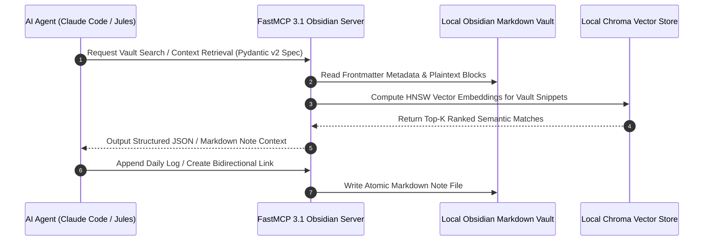

# Obsidian

## What it is
Obsidian is an extensible personal knowledge management (PKM) and local-first notes application built on top of a plain-text vault of Markdown files. Featuring native Model Context Protocol (FastMCP 3.1) server tools as of early 2027, Obsidian serves as a primary local knowledge base for AI coding agents (**Claude Code**, **Jules**, **Cursor**), providing local-first data ownership, graph visualization, and high-performance vector retrieval across private vaults.

## System Architecture

Obsidian operates as a local-first application where all note content, YAML metadata, and canvas files remain stored in standard filesystem folders. FastMCP 3.1 servers bridge the local Markdown vault to external AI agents and RAG pipelines:

```
┌─────────────────────────────────────────────────────────────────────────────┐
│                      Obsidian Local Note Vault Directory                    │
│             (Plain Markdown Files, YAML Frontmatter, Canvas DB)             │
└──────────────────────────────────────┬──────────────────────────────────────┘
                                       │ Direct File System Access / SQLite Cache
                                       ▼
┌─────────────────────────────────────────────────────────────────────────────┐
│                       FastMCP 3.1 Obsidian Server Bridge                     │
│         (Search Notes, Read Sections, Create Links, Incremental RAG)        │
└──────┬───────────────────────────────┬───────────────────────────────┬──────┘
       │ Native Stdio / SSE Transport  │ Local Vector Embeddings       │ Local Markdown Parsing
       ▼                               ▼                               ▼
┌──────────────┐               ┌──────────────┐               ┌──────────────┐
│ Claude Code  │               │ Local Vector │               │ Personal AI  │
│ Agent Client │               │ DB (Chroma)  │               │ Dashboard    │
└──────────────┘               └──────────────┘               └──────────────┘
```



## What problem it solves
It eliminates vendor lock-in, proprietary cloud databases, and privacy leaks inherent in cloud note applications (like Notion or Evernote). Storing notes as plain Markdown files on local disk ensures long-term file longevity, instant offline accessibility, and zero-latency text manipulation using standard tools (`grep`, `rg`, `git`, Python). In agentic workflows, it solves the "agent persistent long-term memory" problem by serving as a human-readable, machine-queryable, and local-first memory store for **Claude 5.6**, **GPT-5.6**, and **Gemini 4.0 Ultra**.

## Where it fits in the stack
**Category**: AI & Knowledge / Personal Knowledge Management. Obsidian resides at the **Knowledge Capture & Local RAG Memory Layer**, providing plain-text context for local RAG pipelines, agentic task orchestration, and personal KnowledgeOps.

```
┌─────────────────────────────────────────────────────────────────────────────┐
│                          KnowledgeOps Stack Top Layer                       │
├─────────────────────────────────────────────────────────────────────────────┤
│ Agent Frameworks: Claude Code / FastMCP 3.1 Swarms / LangGraph              │
├─────────────────────────────────────────────────────────────────────────────┤
│ Knowledge Storage: Obsidian Vault (Local Plain Markdown + Frontmatter)      │
├─────────────────────────────────────────────────────────────────────────────┤
│ Indexing & RAG: Incremental Vault Indexer / Chroma Vector Store              │
└─────────────────────────────────────────────────────────────────────────────┘
```

## Typical use cases
- **Personal Knowledge Graphs**: Connecting ideas through bidirectional links (`[[Link]]`), block references, and interactive 2D/3D graph views.
- **Agent Long-Term Memory Storage**: Storing daily execution logs, technical decision records, and system playbooks accessible by AI tools via FastMCP 3.1.
- **Local RAG Pipeline Ingestion**: Supplying contextual embeddings directly to local LLMs (Ollama, vLLM) without transmitting proprietary notes to third-party clouds.
- **Canvas Workflow Modeling**: Designing visual architecture diagrams and workflow trees using Obsidian Canvas JSON files.

## Detailed Comparison Matrix

| Feature / Metric | Obsidian | Logseq | Anytype | SilverBullet |
| :--- | :--- | :--- | :--- | :--- |
| **Storage Format** | Plain Markdown Files | Markdown / Org-mode | Local Object Store | Plain Markdown Files |
| **FastMCP 3.1 Support** | SOTA Community Plugins | Community MCP Plugin | Custom REST Gateway | Native Webhooks/MCP |
| **Bidirectional Links** | Native (`[[Link]]`) | Native (`[[Link]]`) | Object Relations | Native (`[[Link]]`) |
| **Graph View** | Interactive 2D/3D Graph | Dynamic Canvas Graph | Visual Object Graph | Link Visualizer |
| **License Model** | Closed Core / Open Data | Open Source (AGPL) | Open Source (AGPL) | Open Source (MIT) |
| **Sync Options** | Obsidian Sync / Git / Syncthing | Git / Sync Service | P2P Anysync Network | Self-hosted Server |

## Strengths
- **100% Data Sovereignty**: Notes exist as standard `.md` files on local storage, guaranteeing total data ownership and zero vendor lock-in.
- **FastMCP 3.1 Protocol Integration**: Native FastMCP servers allow agents to search notes, create backlinks, and update frontmatter via standardized tools.
- **Rich Plugin Ecosystem**: Thousands of community plugins for Dataview queries, Kanban boards, and local AI completion.
- **Zero-Latency Offline Execution**: Runs completely offline with instant search performance.

## Limitations
- **Closed Core Application**: The application UI code is proprietary, although the underlying data format (Markdown) is open and standardized.
- **Sync Setup Overhead**: Cross-device synchronization requires Obsidian Sync or self-hosted tools (Syncthing, Git).

## When to use it
- When building a local-first, highly customizable personal knowledge base in plain Markdown.
- When providing local AI coding agents with private context via FastMCP 3.1 servers.
- When long-term data ownership and zero vendor lock-in are essential.

## When not to use it
- When real-time concurrent multi-user editing is required.
- If you prefer an entirely open-source application core (consider Logseq instead).

## Getting started

Download the installer from [obsidian.md](https://obsidian.md/) and point it at a local directory.

### Quick Setup Steps
1. **Initialize Vault**: Select or create a local folder for storing your Markdown notes.
2. **Enable FastMCP Server**: Install the 'MCP Obsidian' plugin to expose FastMCP 3.1 tool interfaces to AI clients like Claude Code.

## CLI examples

```bash
# Search vault notes using ripgrep
rg -i "FastMCP 3.1" ~/Documents/ObsidianVault/
```

## API examples

### FastMCP 3.1 Obsidian Vault Server & Pydantic v2 Validation Schema

The Python script below builds a production FastMCP 3.1 server enabling AI agents to search notes, query frontmatter, and append logs to an Obsidian vault with strict Pydantic v2 schemas (`extra="forbid"`):

```python
import os
import json
import pathlib
import frontmatter
from typing import List, Optional, Dict
from pydantic import BaseModel, Field, ConfigDict, field_validator, ValidationError
from mcp.server.fastmcp import FastMCP

mcp = FastMCP("Obsidian-Vault-FastMCP-Server", version="3.1.0")

class VaultSearchSpec(BaseModel):
    model_config = ConfigDict(extra="forbid", frozen=True)

    query: str = Field(..., min_length=2, description="Search term or regex pattern")
    vault_path: str = Field(default="~/Documents/ObsidianVault", description="Root vault directory path")
    max_results: int = Field(default=5, ge=1, le=50, description="Max matching notes to return")

    @field_validator("query")
    @classmethod
    def validate_query(cls, val: str) -> str:
        if not val.strip():
            raise ValueError("Query string cannot be empty.")
        return val.strip()

class NoteMatchResult(BaseModel):
    model_config = ConfigDict(extra="forbid", frozen=True)
    file_name: str
    relative_path: str
    snippet: str

class VaultSearchResponsePayload(BaseModel):
    model_config = ConfigDict(extra="forbid", frozen=True)
    status: str
    match_count: int
    matches: List[NoteMatchResult]

class AppendNoteSpec(BaseModel):
    model_config = ConfigDict(extra="forbid", frozen=True)
    note_relative_path: str = Field(..., description="Target note path relative to vault root e.g. Daily/2027-01-07.md")
    content_to_append: str = Field(..., description="Markdown text to append to file")
    vault_path: str = Field(default="~/Documents/ObsidianVault", description="Root vault directory path")

@mcp.tool(name="search_obsidian_notes", description="Searches local Obsidian Markdown vault files for matching text keywords via FastMCP 3.1.")
def search_obsidian_notes(spec_json: str) -> str:
    """Parses search specification, scans vault Markdown files, and returns validated JSON response."""
    try:
        raw_data = json.loads(spec_json) if isinstance(spec_json, str) else spec_json
        spec = VaultSearchSpec.model_validate(raw_data)

        vault = pathlib.Path(os.path.expanduser(spec.vault_path))
        if not vault.exists() or not vault.is_dir():
            return json.dumps({"status": "ERROR", "message": f"Vault path '{spec.vault_path}' not found."})

        results = []
        for md_path in vault.rglob("*.md"):
            try:
                content = md_path.read_text(encoding="utf-8")
                if spec.query.lower() in content.lower():
                    idx = content.lower().find(spec.query.lower())
                    snippet_text = content[max(0, idx-40):min(len(content), idx+120)].replace("\n", " ")
                    results.append(NoteMatchResult(
                        file_name=md_path.name,
                        relative_path=str(md_path.relative_to(vault)),
                        snippet=f"...{snippet_text}..."
                    ))
                    if len(results) >= spec.max_results:
                        break
            except Exception:
                continue

        res = VaultSearchResponsePayload(status="SUCCESS", match_count=len(results), matches=results)
        return json.dumps(res.model_dump(), indent=2)

    except ValidationError as err:
        return json.dumps({"status": "VALIDATION_FAILED", "errors": err.errors()})
    except Exception as err:
        return json.dumps({"status": "ERROR", "message": str(err)})

@mcp.tool(name="append_to_obsidian_note", description="Appends Markdown content to a specified note in the local vault.")
def append_to_obsidian_note(spec_json: str) -> str:
    """Validates append spec and appends text to target note file."""
    try:
        raw_data = json.loads(spec_json) if isinstance(spec_json, str) else spec_json
        spec = AppendNoteSpec.model_validate(raw_data)

        vault = pathlib.Path(os.path.expanduser(spec.vault_path))
        target_file = vault / spec.note_relative_path

        if not target_file.exists():
            target_file.parent.mkdir(parents=True, exist_ok=True)
            target_file.write_text(f"# {target_file.stem}\n\n", encoding="utf-8")

        with open(target_file, "a", encoding="utf-8") as f:
            f.write(f"\n{spec.content_to_append}\n")

        return json.dumps({"status": "SUCCESS", "updated_file": str(spec.note_relative_path)}, indent=2)
    except ValidationError as err:
        return json.dumps({"status": "VALIDATION_FAILED", "errors": err.errors()})
    except Exception as err:
        return json.dumps({"status": "ERROR", "message": str(err)})

if __name__ == "__main__":
    mcp.run()
```

## Production Deployment & Systemd Service Architecture

### Container Orchestration with Docker Compose

Deploy the Obsidian FastMCP vault server microservice in a containerized environment using Docker Compose:

```yaml
version: "3.8"

services:
  obsidian-fastmcp-server:
    image: python:3.11-slim
    container_name: obsidian-fastmcp-server
    restart: unless-stopped
    command: python3 -m mcp.server.fastmcp run obsidian_mcp_server.py
    environment:
      - PYTHONUNBUFFERED=1
      - OBSIDIAN_VAULT_PATH=/var/obsidian_vault
    volumes:
      - ./vault_storage:/var/obsidian_vault:rw
      - ./obsidian_mcp_server.py:/app/obsidian_mcp_server.py:ro
    working_dir: /app
    ports:
      - "8000:8000"
    deploy:
      resources:
        limits:
          cpus: "1.0"
          memory: 512M
    healthcheck:
      test: ["CMD", "python3", "-c", "import os; print(os.path.exists('/var/obsidian_vault'))"]
      interval: 30s
      timeout: 5s
      retries: 3
    security_opt:
      - no-new-privileges:true
```

### Systemd Service Unit Specification

For host-level Linux deployments managing the Obsidian vault FastMCP daemon, install the following systemd service unit:

```ini
[Unit]
Description=Obsidian Vault FastMCP 3.1 Server Daemon
After=network.target

[Service]
Type=simple
User=obsidian-agent
Group=obsidian-agent
WorkingDirectory=/opt/obsidian-mcp
ExecStart=/usr/bin/python3 -m mcp.server.fastmcp run obsidian_mcp_server.py
Restart=always
RestartSec=5s
Environment=PYTHONUNBUFFERED=1
Environment=OBSIDIAN_VAULT_PATH=/home/obsidian-agent/ObsidianVault

# Security Hardening
ProtectSystem=strict
ProtectHome=read-only
NoNewPrivileges=true
PrivateTmp=true
ProtectKernelTunables=true
ProtectControlGroups=true
ReadWritePaths=/home/obsidian-agent/ObsidianVault

[Install]
WantedBy=multi-user.target
```

## Operational Best Practices

1. **Automated Atomic Link Renaming**: Enable Obsidian's native "Automatically update internal links" setting so file renames automatically refactor `[[WikiLinks]]` across all notes.
2. **Git Auto-Commit Backup**: Configure background automated git backup commits using the Obsidian Git community plugin or a cron script (`git commit -m "Auto vault sync"`).
3. **Structured Frontmatter Validation**: Maintain consistent YAML frontmatter keys (`title`, `last_reviewed`, `confidence`, `tags`) to allow Pydantic v2 schemas to parse note metadata reliably.

## Diagnostic Troubleshooting Matrix

| Symptom / Error | Probable Cause | Diagnostic Command | Remediation Action |
| :--- | :--- | :--- | :--- |
| **Broken [[WikiLinks]] Warnings** | File renamed outside of Obsidian UI without updating link references | `grep -rn "[[OldFileName]]" ~/ObsidianVault` | Run `scripts/fix_internal_links.py` or enable "Automatically update internal links" in settings. |
| **FastMCP Connection Refused** | Local FastMCP server port collision or plugin toggled off | `netstat -tuln \| grep 8000` | Verify port availability and confirm FastMCP plugin status in Obsidian settings. |
| **YAML Frontmatter Parsing Failure** | Unquoted colons or unindented list formatting in frontmatter | `python3 -c "import frontmatter; frontmatter.load('file.md')"` | Enclose string values with special characters in quotes and validate YAML syntax. |

## Related tools / concepts
- [Logseq](logseq.md) - Outliner-based local Markdown PKM alternative.
- [Anytype](../intake_storage/anytype.md) - Local-first, object-oriented PKM software.
- [SilverBullet](../intake_storage/silverbullet.md) - Extensible Markdown wiki system.
- [Model Context Protocol (FastMCP 3.1)](../automation_orchestration/mcp.md) - Standard for agent note access.
- [Syncthing](../../services/syncthing.md) - Open-source tool for cross-device vault synchronization.

## Sources / references
- [Obsidian Official Website](https://obsidian.md/)
- [Obsidian Documentation](https://help.obsidian.md/)
- [MCP Obsidian Plugin Repository](https://github.com/vrtmrz/mcp-obsidian)

## Contribution Metadata
- Last reviewed: 2027-01-07
- Confidence: high
