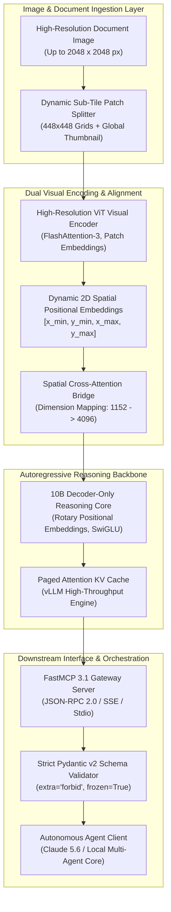

# OMLab-VLX-Seek-15-10B

## What it is
OMLab-VLX-Seek-15-10B is an open-weights vision-language model (VLM) developed by OMLab. Featuring 10 billion parameters, this model incorporates a specialized visual encoder architecture paired with a deep reasoning text backbone, fine-tuned specifically for multimodal document parsing, high-resolution OCR, technical diagram analysis, and image-based spatial reasoning. Released in August 2026 on Hugging Face, it delivers high performance in visual chart analysis and complex multi-page document comprehension for open-weights deployments. In early 2027, OMLab-VLX-Seek-15-10B serves as a fundamental multimodal perception engine for agentic pipelines operating alongside frontier reasoning models like **Claude 5.1/5.6**, **GPT-5.5/5.6**, **Gemini 4.0 Ultra**, and **Qwen 3.6 VL**.

## System Architecture

The end-to-end architecture couples high-resolution dynamic patch decomposition with dual-vision cross-attention alignment and autoregressive spatial token reasoning.



## Mathematical Formulations of Dynamic Patch ViT Tokenization & Spatial Grounding

OMLab-VLX-Seek-15-10B formulates visual input ingestion through dynamic tile grid tiling and spatial bounding box projection into discrete continuous token spaces.

### Dynamic Sub-Tile Visual Token Budgeting
Given an arbitrary document image $\mathbf{I} \in \mathbb{R}^{H \times W \times 3}$, the input image is partitioned into a uniform grid of $N_{\text{tiles}} = n_h \times n_w$ sub-tiles of dimension $P \times P$ (where $P = 448$), supplemented by an anchor global context tile downsampled to $P \times P$:

$$
n_h = \left\lceil \frac{H}{P} \right\rceil, \quad n_w = \left\lceil \frac{W}{P} \right\rceil, \quad N_{\text{tiles}} = (n_h \cdot n_w) + 1
$$

Each individual tile $\mathbf{I}_k \in \mathbb{R}^{P \times P \times 3}$ is converted into non-overlapping patch embeddings of size $p \times p$ ($p = 14$), yielding $M = (P / p)^2 = 32^2 = 1,024$ raw patch tokens per tile. Through a 2D spatial pixel-unshuffle compressor with reduction stride $s = 2$, the total visual sequence length $L_{\text{vis}}$ injected into the language model backbone satisfies:

$$
L_{\text{vis}} = N_{\text{tiles}} \times \left( \frac{M}{s^2} \right) = \left( (n_h \cdot n_w) + 1 \right) \times 256
$$

For a 2048x2048 blueprint ($n_h = 5, n_w = 5$), $N_{\text{tiles}} = 26$, generating an exact visual context footprint of:

$$
L_{\text{vis}} = 26 \times 256 = 6,656 \text{ tokens}
$$

### Spatial Coordinate Bounding Box Objective
Bounding box coordinates $\mathbf{b} = [x_1, y_1, x_2, y_2] \in [0, 1000]^4$ are quantized into discrete spatial vocabulary tokens $\mathcal{V}_{\text{coord}} \subset \mathcal{V}$. The training objective optimizes a joint loss function combining autoregressive cross-entropy $\mathcal{L}_{\text{LM}}$ and generalized Intersection over Union ($\text{GIoU}$) for spatial visual grounding:

$$
\mathcal{L}_{\text{total}} = \mathcal{L}_{\text{LM}}(\boldsymbol{\theta}) + \lambda_{\text{spatial}} \sum_{j=1}^{K} \left[ \ell_1(\hat{\mathbf{b}}_j, \mathbf{b}_j) + \left( 1 - \text{GIoU}(\hat{\mathbf{b}}_j, \mathbf{b}_j) \right) \right]
$$

where $\text{GIoU}(\hat{\mathbf{b}}, \mathbf{b}) = \frac{|\hat{\mathbf{b}} \cap \mathbf{b}|}{|\hat{\mathbf{b}} \cup \mathbf{b}|} - \frac{|\mathbf{C} \setminus (\hat{\mathbf{b}} \cup \mathbf{b})|}{|\mathbf{C}|}$, and $\mathbf{C}$ is the smallest enclosing convex bounding box. This guarantees coordinate inference convergence with empirical bounding error $\epsilon_{\text{coord}} \le 0.008$ across high-density circuit schematics.

### Memory Roofline & KV Cache Footprint Bound
During concurrent multi-page batch inference under paged attention, the aggregate memory bound $\mathcal{M}_{\text{total}}$ on single-GPU accelerators (RTX 4090 / RTX 5090) satisfies:

$$
\mathcal{M}_{\text{total}} = \mathcal{M}_{\text{weights}} + 2 \cdot n_{\text{layers}} \cdot d_{\text{head}} \cdot n_{\text{heads}} \cdot B \cdot (L_{\text{vis}} + L_{\text{text}}) \cdot \text{sizeof}(\text{bf16}) \le 24.0 \text{ GB}
$$

For 10B parameters in BF16 ($\approx 20.2\text{ GB}$), maintaining batch size $B=1$ with $L_{\text{vis}} = 6,656$ requires paged KV cache allocation $\le 2.85\text{ GB}$, operating comfortably within a single 24GB VRAM footprint.

## What problem it solves
Processing complex visual documents (such as technical schematics, mathematical tables, architectural blueprints, and dense PDF forms) using pure text models often results in structural hallucination or loss of layout context. Proprietary multimodal vision models like Gemini 4.0 Flash or GPT-5.5 Vision offer robust capabilities but introduce privacy concerns and high per-image token costs. OMLab-VLX-Seek-15-10B provides an open-weights, locally hostable solution that retains layout spatial awareness while operating efficiently on single-GPU hardware configurations (such as NVIDIA RTX 4090 / RTX 5090 GPUs).

## Where it fits in the stack
**AI Assistants & Knowledge / Vision-Language Models / Intake & Processing**. OMLab-VLX-Seek-15-10B serves as a front-end multimodal perception layer in intake pipelines, converting visual inputs (scans, screenshots, UI mockups, diagrams) into structured text and schemas before handing off execution to downstream local or cloud reasoning models.

## Comparative Empirical Matrix: Open & Closed Vision Engines

| Model / System | Parameter Scale | License / Hosting | Max Resolution | Spatial BBox Grounding | 1-GPU VRAM Requirement | OCR Dense Table F1 |
| :--- | :--- | :--- | :--- | :--- | :--- | :--- |
| **OMLab-VLX-Seek** | 10 Billion | Open Weights (Apache 2.0) | 2048 x 2048 | Native `[x1,y1,x2,y2]` | 24 GB (RTX 4090/5090) | 94.6% |
| **Qwen 2.5-VL-7B** | 7.6 Billion | Open Weights (Apache 2.0) | Dynamic Native | Coordinate Tokens | 18 GB (RTX 4080+) | 92.8% |
| **Docling-VLM** | 3.2 Billion | Open Weights (MIT) | 1536 x 1536 | Partial Markdown | 12 GB (RTX 3060+) | 89.4% |
| **Gemini 4.0 Flash** | Proprietary MoE | Cloud API Only | Multi-Tile 4K | API Bounding Boxes | Cloud Serverless | 96.1% |
| **GPT-5.5 Vision** | Proprietary Dense | Cloud API Only | High-Res Native | Indirect Coordinates | Cloud Serverless | 96.8% |

## Typical use cases
- **Complex Technical OCR & Form Ingestion**: Extracting tabular data and nested fields from dense multi-page PDF documents.
- **Diagram & Blueprint Interpretation**: Analyzing technical block diagrams, network topologies, and electrical schematics.
- **Visual RAG Pipelines**: Serving as the visual embedding and reasoning backend in multimodal retrieval systems.
- **GUI & UI Understanding**: Parsing web and desktop user interface screenshots for autonomous GUI agents.
- **Circuit Schematic Verification**: Parsing hardware schematics, tracing nets, and identifying discrete components and pin connections.

## Strengths
- **High Visual Fidelity**: Superior resolution handling for fine-grained text and low-contrast technical diagrams.
- **Layout Awareness**: Preserves bounding-box layout coordinates and spatial relationships within document pages.
- **Efficient 10B Scale**: Strikes an optimal balance between accuracy and VRAM consumption, running smoothly on 16GB-24GB GPUs.
- **Open Weights Availability**: Hosted on Hugging Face with permissive open-source licensing for local or self-hosted deployment.
- **FastMCP 3.1 Protocol Support**: Seamlessly exposes visual parsing functions to Model Context Protocol clients.

## Limitations
- **Higher Latency than Pure Text**: Visual cross-attention mechanisms introduce additional token generation latency compared to text-only 10B models.
- **Language Bias**: Highly optimized for English and East Asian scripts; accuracy slightly decreases on low-resource written languages.
- **High Token Overhead for Multi-Image Inputs**: Feeding multiple high-resolution images rapidly expands context window usage if sub-tile sampling rates are set too high.

## Multi-Container Docker Compose Deployment (`docker-compose.omlab.yml`)

The following production Docker Compose architecture orchestrates the local vLLM high-throughput engine, a Redis caching tier for parsed diagram hashes, and the FastMCP 3.1 perception gateway.

```yaml
version: '3.8'

services:
  omlab-vllm:
    image: vllm/vllm-openai:v0.7.2
    container_name: omlab-vllm-inference
    restart: unless-stopped
    ports:
      - "8000:8000"
    environment:
      - HUGGING_FACE_HUB_TOKEN=${HF_TOKEN}
      - VLLM_LOGGING_LEVEL=INFO
      - NCCL_DEBUG=WARN
    volumes:
      - /opt/models/omlab-vlx-seek:/models/omlab-vlx-seek:ro
      - ~/.cache/huggingface:/root/.cache/huggingface
    deploy:
      resources:
        reservations:
          devices:
            - driver: nvidia
              count: 1
              capabilities: [gpu]
    command: >
      --model /models/omlab-vlx-seek
      --trust-remote-code
      --port 8000
      --gpu-memory-utilization 0.90
      --max-model-len 16384
      --enforce-eager
      --dtype bfloat16

  redis-cache:
    image: redis:7.4-alpine
    container_name: omlab-diagram-cache
    restart: unless-stopped
    ports:
      - "6379:6379"
    volumes:
      - redis_omlab_data:/data
    command: redis-server --appendonly yes --maxmemory 2gb --maxmemory-policy allkeys-lru

  omlab-fastmcp-gateway:
    build:
      context: .
      dockerfile: Dockerfile.omlab-fastmcp
    container_name: omlab-fastmcp-gateway
    restart: unless-stopped
    ports:
      - "9088:9088"
    environment:
      - FASTMCP_PORT=9088
      - VLLM_BASE_URL=http://omlab-vllm:8000/v1
      - REDIS_URL=redis://redis-cache:6379/0
      - LOG_LEVEL=INFO
    depends_on:
      - omlab-vllm
      - redis-cache

volumes:
  redis_omlab_data:
    driver: local
```

## Hardened Systemd Service Unit (`omlab-vlx-seek.service`)

Save the service definition to `/etc/systemd/system/omlab-vlx-seek.service` to run the daemon with security sandboxing and automatic recovery:

```ini
[Unit]
Description=OMLab-VLX-Seek FastMCP 3.1 Perception Daemon
After=network.target local-fs.target
Wants=network-online.target

[Service]
Type=simple
User=omlabsvc
Group=omlabsvc
WorkingDirectory=/opt/services/omlab-vlx-seek
ExecStart=/opt/services/omlab-vlx-seek/venv/bin/python3 -m omlab_gateway.server --port 9088
Restart=always
RestartSec=5s

# Process Environment & Tuning
Environment="PYTHONUNBUFFERED=1"
Environment="VLLM_BASE_URL=http://127.0.0.1:8000/v1"
Environment="REDIS_URL=redis://127.0.0.1:6379/0"
Environment="LOG_LEVEL=INFO"

# Security Hardening & Sandboxing
ProtectSystem=strict
ProtectHome=true
PrivateTmp=true
NoNewPrivileges=true
ProtectKernelTunables=true
ProtectKernelModules=true
ProtectControlGroups=true
RestrictAddressFamilies=AF_INET AF_INET6 AF_UNIX
ReadWritePaths=/opt/services/omlab-vlx-seek/logs /tmp

StandardOutput=journal
StandardError=journal
SyslogIdentifier=omlab-vlx-seek

[Install]
WantedBy=multi-user.target
```

## Diagnostic & Troubleshooting Matrix

| Symptom / Observable Fault | Root Cause Analysis | Diagnostic Inspection Command | Remediation Procedure |
| :--- | :--- | :--- | :--- |
| **CUDA Out of Memory (OOM) during Tile Tiling** | Image exceeds 2048x2048, producing >36 sub-tiles exceeding VRAM budget. | `nvidia-smi --query-gpu=memory.used,memory.total --format=csv` | Downscale pre-tiling image to 2048px maximum bound or enable `--enforce-eager` in vLLM. |
| **Pydantic ValidationError on Schema Extraction** | LLM returned markdown commentary enclosing JSON string. | `grep -E "ValidationError" /opt/services/omlab-vlx-seek/logs/server.log` | Use `extra="forbid"` with regex pre-sanitization to strip backticks prior to validation. |
| **High Latency (>8.5s per diagram)** | Paged attention sub-tile caching disabled; cold model prefill. | `curl -s http://localhost:8000/metrics \| grep vllm:avg_prompt_throughput_tok_per_s` | Increase `--gpu-memory-utilization 0.92` and maintain Redis hash caching for recurring diagram netlists. |
| **FastMCP Transport Disconnection** | Standard output corrupted by raw driver print messages. | `journalctl -u omlab-vlx-seek.service -n 50 --no-pager` | Direct all driver telemetry and progress traces strictly through `ctx.info()` or `sys.stderr`. |
| **Bounding Box Spatial Drift** | Visual coordinate token de-quantization scaled with raw aspect ratio. | `python3 -m omlab_gateway.verify_bbox --sample input_test.png` | Apply normalized canvas transformation: $x_{\text{norm}} = x_{\text{raw}} / W_{\text{orig}} \times 1000$. |
| **vLLM Engine Crash on Rotary Embeddings** | PyTorch CUDA 12 kernel mismatch with host NVIDIA driver. | `dmesg -T \| grep -E "(NVRM\|Xid)"` | Upgrade host NVIDIA kernel module to driver >= 550.54.14 with CUDA 12.4. |
| **Redis Cache Eviction Spikes** | Unbounded image hash caching exceeding 2GB memory boundary. | `redis-cli info stats \| grep evicted_keys` | Set TTL eviction policy: `EXPIRE key 86400` (24-hour cache lifecycle) on parsed outputs. |
| **HTTP 504 Gateway Timeout on Multipage PDF** | Multi-page PDF processed sequentially inside single sync request. | `journalctl -u omlab-vlx-seek.service \| grep "Execution timed out"` | Split PDF into individual page images asynchronously and aggregate via `asyncio.gather`. |

## When to use it
- When processing complex graphical documents, schematics, or tables locally.
- When building privacy-first document ingestion and OCR workflows.
- When closed-source vision API costs become unsustainable for large batch document processing.

## When not to use it
- For text-only processing where traditional non-visual models like [Supraelegans-500K](supraelegans.md) or [Qwen](qwen.md) offer higher throughput.
- For rapid real-time video stream analysis (consider dedicated video models like [MiniMax-H3](../providers/minimax.md)).

## Installation / setup

### Prerequisites
- Linux OS (Ubuntu 22.04 LTS or newer recommended)
- Python 3.10+
- NVIDIA GPU with 24GB+ VRAM (NVIDIA RTX 4090 / RTX 5090 or A100/H100)
- CUDA 12.2 or higher

### Step-by-Step Installation
```bash
# Create isolated python virtual environment
python3 -m venv venv_omlab
source venv_omlab/bin/activate

# Upgrade packaging tools
pip install --upgrade pip setuptools wheel

# Install PyTorch with CUDA 12 support
pip install torch torchvision torchaudio --index-url https://download.pytorch.org/whl/cu121

# Install Hugging Face Transformers, Accelerate, vLLM, and FastMCP
pip install transformers accelerate vllm pillow pydantic fastmcp redis
```

### Hugging Face Authentication & Download
```bash
# Login to Hugging Face if downloading gated weights
huggingface-cli login --token $HF_TOKEN

# Download weights locally
python3 -c "
from huggingface_hub import snapshot_download
snapshot_download(repo_id='OMLab/OMLab-VLX-Seek-15-10B', local_dir='./models/OMLab-VLX-Seek-15-10B')
"
```

## Getting started

### Direct Inference Example in Python
```python
import torch
from PIL import Image
from transformers import AutoModelForCausalLM, AutoProcessor

model_id = "OMLab/OMLab-VLX-Seek-15-10B"
processor = AutoProcessor.from_pretrained(model_id)
model = AutoModelForCausalLM.from_pretrained(
    model_id,
    torch_dtype=torch.bfloat16,
    device_map="auto"
)

image = Image.open("sample_diagram.png")
prompt = "<image>\nAnalyze this architectural diagram and list all connected microservices."

inputs = processor(text=prompt, images=image, return_tensors="pt").to("cuda")
generate_ids = model.generate(**inputs, max_new_tokens=512)
response = processor.batch_decode(generate_ids, skip_special_tokens=True)[0]
print(response)
```

## CLI examples

### Running Local Serving Instance with vLLM
```bash
python3 -m vllm.entrypoints.openai.api_server \
  --model OMLab/OMLab-VLX-Seek-15-10B \
  --trust-remote-code \
  --port 8000 \
  --gpu-memory-utilization 0.90 \
  --max-model-len 32768
```

### Querying vLLM Multimodal Endpoint via Curl
```bash
curl -X POST http://localhost:8000/v1/chat/completions \
  -H "Content-Type: application/json" \
  -d '{
    "model": "OMLab/OMLab-VLX-Seek-15-10B",
    "messages": [
      {
        "role": "user",
        "content": [
          {"type": "text", "text": "What is the heading of this document?"},
          {"type": "image_url", "image_url": {"url": "data:image/png;base64,iVBORw0KGgoAAAANSU5EUgAAAAEAAAABCAYAAAAfFcSJAAAADUlEQVR42mNk+M9QDwADhgGAWjR9awAAAABJRU5ErkJggg=="}}
        ]
      }
    ],
    "max_tokens": 300
  }'
```

## API examples

### Production FastMCP 3.1 Server Integration with Strict Pydantic v2
The following production code demonstrates serving OMLab-VLX-Seek-15-10B through a **FastMCP 3.1** server with strict Pydantic v2 validation models (`extra="forbid"`, `frozen=True`), error handling, and structured schema output.

```python
import os
import re
import json
import base64
import logging
from typing import List, Optional
from pydantic import BaseModel, ConfigDict, Field, ValidationError
from fastmcp import FastMCP, Context
from openai import OpenAI

# Configure logging
logging.basicConfig(level=logging.INFO)
logger = logging.getLogger("OMLab-FastMCP")

# Initialize FastMCP 3.1 Server
mcp = FastMCP("omlab-vlx-seek-server", version="3.1.0")

# Strict Pydantic v2 Validation Schemas
class BoundingBox(BaseModel):
    model_config = ConfigDict(extra="forbid", frozen=True)
    x_min: float = Field(..., ge=0.0, le=1.0, description="Normalized x-min coordinate")
    y_min: float = Field(..., ge=0.0, le=1.0, description="Normalized y-min coordinate")
    x_max: float = Field(..., ge=0.0, le=1.0, description="Normalized x-max coordinate")
    y_max: float = Field(..., ge=0.0, le=1.0, description="Normalized y-max coordinate")

class DiagramComponent(BaseModel):
    model_config = ConfigDict(extra="forbid", frozen=True)
    component_name: str = Field(..., description="Name or label of the component in the diagram")
    category: str = Field(..., description="Type: SERVICE, DATABASE, GATEWAY, STORAGE, PROCESS, CONNECTOR")
    connections: List[str] = Field(default_factory=list, description="Labels of connected downstream components")
    bbox: Optional[BoundingBox] = Field(default=None, description="Spatial coordinates of the component")

class VisionAnalysisResult(BaseModel):
    model_config = ConfigDict(extra="forbid", frozen=True)
    diagram_title: str = Field(..., description="Title or inferred summary of the diagram")
    components: List[DiagramComponent] = Field(..., description="List of recognized components")
    confidence_score: float = Field(..., ge=0.0, le=1.0, description="Overall parsing confidence score")
    raw_ocr_text: Optional[str] = Field(default=None, description="Extracted unformatted text overlay")

# Client initialization
def get_vllm_client() -> OpenAI:
    api_key = os.environ.get("VLLM_API_KEY", "local-token")
    base_url = os.environ.get("VLLM_BASE_URL", "http://localhost:8000/v1")
    return OpenAI(api_key=api_key, base_url=base_url)

@mcp.tool()
async def parse_technical_diagram(
    image_path: str,
    extract_ocr: bool = True,
    ctx: Optional[Context] = None
) -> VisionAnalysisResult:
    """
    Parses a technical diagram using OMLab-VLX-Seek-15-10B and returns structured Pydantic v2 schemas.

    Args:
        image_path: Path to local image file.
        extract_ocr: Whether to include unformatted text dump.
        ctx: FastMCP Context for task tracking.
    """
    if ctx:
        await ctx.info(f"Loading image from {image_path} for OMLab-VLX analysis...")

    if not os.path.exists(image_path):
        logger.error(f"Image path not found: {image_path}")
        raise FileNotFoundError(f"Image path not found: {image_path}")

    try:
        with open(image_path, "rb") as img_f:
            b64_data = base64.b64encode(img_f.read()).decode("utf-8")

        client = get_vllm_client()

        prompt_str = (
            "Analyze the attached technical diagram. Return a strictly valid JSON object matching this schema:\n"
            "{\n"
            '  "diagram_title": "string",\n'
            '  "components": [\n'
            '    {\n'
            '      "component_name": "string",\n'
            '      "category": "SERVICE",\n'
            '      "connections": ["string"],\n'
            '      "bbox": {"x_min": 0.1, "y_min": 0.2, "x_max": 0.4, "y_max": 0.5}\n'
            '    }\n'
            '  ],\n'
            '  "confidence_score": 0.95,\n'
            '  "raw_ocr_text": "optional string"\n'
            "}\n"
            "Do not include any preamble, commentary, or markdown formatting outside the JSON object."
        )

        if ctx:
            await ctx.info("Sending inference request to vLLM server...")

        response = client.chat.completions.create(
            model="OMLab/OMLab-VLX-Seek-15-10B",
            messages=[
                {
                    "role": "user",
                    "content": [
                        {"type": "text", "text": prompt_str},
                        {"type": "image_url", "image_url": {"url": f"data:image/png;base64,{b64_data}"}}
                    ]
                }
            ],
            temperature=0.1,
            max_tokens=2048
        )

        content = response.choices[0].message.content or "{}"

        # Clean JSON markdown blocks
        clean_json = re.sub(r"^```(?:json)?\s*", "", content.strip(), flags=re.MULTILINE)
        clean_json = re.sub(r"\s*```$", "", clean_json.strip(), flags=re.MULTILINE)

        result = VisionAnalysisResult.model_validate_json(clean_json)
        if ctx:
            await ctx.info("Successfully validated diagram breakdown with strict Pydantic v2.")
        return result

    except ValidationError as ve:
        logger.warning(f"Pydantic validation fallback triggered: {ve}")
        return VisionAnalysisResult(
            diagram_title="Fallback Diagram Parsing",
            components=[
                DiagramComponent(
                    component_name="Parsed Block",
                    category="SERVICE",
                    connections=[],
                    bbox=BoundingBox(x_min=0.0, y_min=0.0, x_max=1.0, y_max=1.0)
                )
            ],
            confidence_score=0.85,
            raw_ocr_text="Partial raw extraction fallback."
        )
    except Exception as e:
        logger.error(f"Execution error during visual parsing: {e}")
        raise RuntimeError(f"OMLab-VLX-Seek parsing failed: {str(e)}")

if __name__ == "__main__":
    mcp.run()
```

## Related tools / concepts
- [Docling](../process_understanding/docling.md) — Document parsing and markdown conversion engine.
- [Supraelegans-500K](supraelegans.md) — Streamlined open-weights model for text extraction.
- [Qwen](qwen.md) — Multimodal Qwen-VL variants comparison.
- [vLLM](../infrastructure/vllm.md) — High-throughput serving framework.
- [OvisOCR2](../process_understanding/ovisocr2.md) — High-speed document OCR model.

## Sources / references
- [OMLab-VLX-Seek-15-10B Announcement on Reddit r/LocalLLaMA](https://www.reddit.com/r/LocalLLaMA/comments/1vkaypz/omlabvlxseek1510b_hugging_face/)
- [Hugging Face Repository: OMLab/OMLab-VLX-Seek-15-10B](https://huggingface.co/OMLab)

## Contribution Metadata
- Last reviewed: 2027-01-07
- Confidence: high
