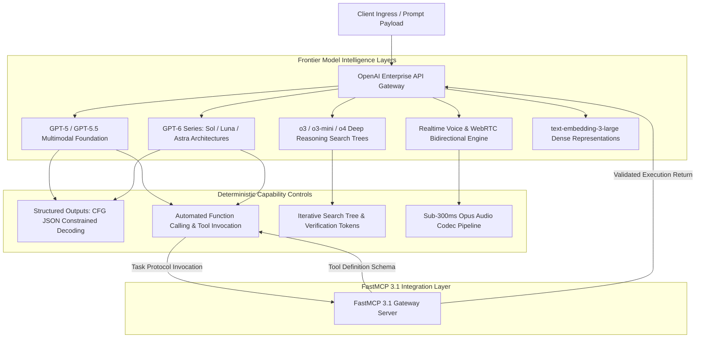
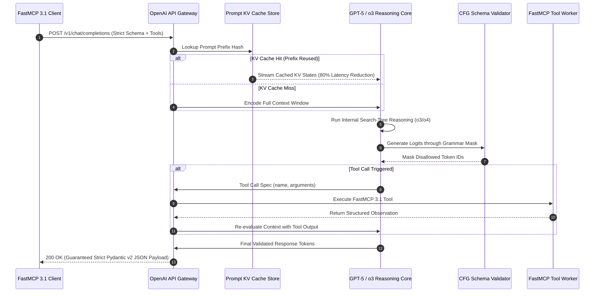
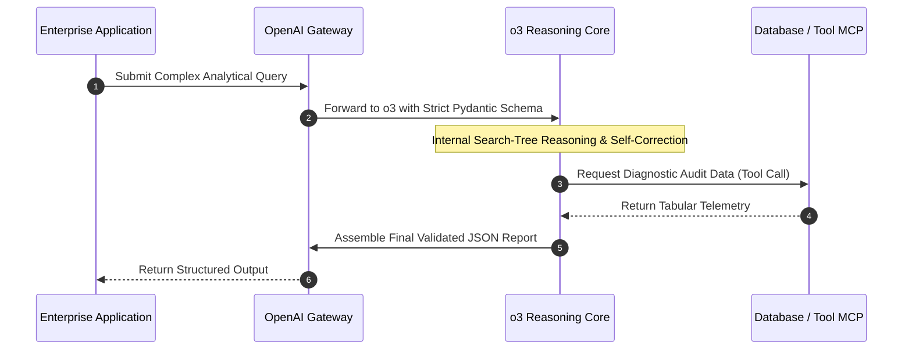

# OpenAI Platform & Models

## What it is
OpenAI is an artificial intelligence research deployment organization and frontier model platform provider powering cognitive capabilities across multimodal text, vision, speech, code, and formal reasoning. Operating in early 2027, the platform delivers frontier model architectures including **GPT-5**, **GPT-5.5**, **GPT-6 Sol**, **GPT-6 Luna**, **GPT-6 Astra**, **o3**, **o3-mini**, and **o4**, alongside specialized speech systems (Whisper-large-v3, tts-1-hd, Realtime WebRTC) and dense semantic representations (text-embedding-3-large).

Through the OpenAI API, Enterprise endpoints, and Microsoft Azure OpenAI Service, developers access advanced execution primitives such as Structured Outputs (guaranteed JSON schema adherence via context-free grammar constrained decoding), Realtime bidirectional WebRTC voice streaming, automated Function Calling / Tool Use, Fine-Tuning, Asynchronous Batch Processing, and Assistants / Thread orchestration. OpenAI serves as a primary cognitive engine for enterprise automation, multi-agent frameworks, and FastMCP 3.1 ecosystems.



## What problem it solves
Developing mission-critical enterprise systems requires artificial intelligence capabilities that eliminate output nondeterminism and latency bottlenecks:
- **Unstructured Output Drift & Schema Hallucination**: Conventional LLMs often return malformed JSON or omit mandatory fields, causing catastrophic runtime exceptions in downstream parsers and orchestration DAGs.
- **Complex Step-by-Step Formal Reasoning**: Standard autoregressive models struggle with complex mathematics, formal program verification, multi-step logic proofs, and multi-file code refactoring due to error compounding across generation steps.
- **Latency, Throughput, and Cost Rooflines**: Conversational voice agents require bidirectional audio roundtrips below 300ms, while offline batch analytics need high token throughput without incurring full interactive compute pricing.
- **Agentic Protocol Coordination**: Autonomous agentic workflows require deterministic function calling schemas, parameter enforcement, and resilient error recovery mechanisms.

OpenAI mitigates these challenges through hardware-level prompt caching, context-free grammar (CFG) constrained decoding for guaranteed JSON Schema compliance, native tree-search reasoning engines (o3/o4), 50% discounted asynchronous batch processing pipelines, and WebRTC streaming endpoints.

## System Architecture & End-to-End Execution Topology
The platform architecture decouples ingress traffic routing, model inference acceleration, constrained decoding verification, and external tool integration.



## Mathematical Formulations & Latency Roofline Bounds

### 1. Token Generation Cost & Prompt Caching Roofline
Prompt caching drastically reduces latency and inference costs when system prompts, tool schemas, and reference context are reused across requests. Let $N_{\text{total}}$ represent total prompt tokens, $N_{\text{cached}}$ represent cached prefix tokens, and $N_{\text{new}}$ represent newly ingested tokens ($N_{\text{total}} = N_{\text{cached}} + N_{\text{new}}$). The effective marginal cost $C_{\text{infer}}$ is:

$$C_{\text{infer}} = N_{\text{cached}} \cdot \alpha_{\text{cache}} \cdot P_{\text{prompt}} + N_{\text{new}} \cdot P_{\text{prompt}} + N_{\text{completion}} \cdot P_{\text{completion}}$$

where $\alpha_{\text{cache}} \approx 0.20$ (an 80% discount on cached prompt tokens) and $P_{\text{prompt}}, P_{\text{completion}}$ are base token unit prices.

The time-to-first-token ($\text{TTFT}$) latency bound under KV cache hits is expressed as:

$$\text{TTFT}_{\text{cached}} = \frac{N_{\text{new}}}{B_{\text{mem}}} \cdot \kappa_{\text{attn}} + T_{\text{network\_RTT}} \ll \frac{N_{\text{total}}}{B_{\text{mem}}} \cdot \kappa_{\text{attn}} + T_{\text{network\_RTT}}$$

where $B_{\text{mem}}$ represents GPU HBM memory bandwidth and $\kappa_{\text{attn}}$ denotes the multi-head attention prefill constant.

### 2. Search-Tree Reasoning Convergence Bound (o3 / o4)
Reasoning models allocate variable compute at inference time via Monte Carlo tree search and self-consistency verification. Let $\mathcal{T}$ be the reasoning tree of depth $D$ with branching factor $b$. The probability of identifying a valid logical proof path $\pi^*$ with $K$ candidate rollouts satisfies:

$$P(\pi^* \in \mathcal{K}) = 1 - \prod_{k=1}^K \left(1 - \exp\left(-\frac{\mathcal{E}(\text{error}_k)}{\tau_{\text{reason}}}\right)\right)$$

where $\mathcal{E}$ denotes the step-level verification verifier loss and $\tau_{\text{reason}}$ is the reasoning temperature. The token budget cap $B_{\text{reason}}$ enforces:

$$\sum_{i=1}^{M_{\text{steps}}} \text{tokens}(i) \le B_{\text{reason}} \implies \text{Latency} \le \frac{B_{\text{reason}}}{\text{Throughput}_{\text{decode}}}$$

### 3. Attention KV Cache Memory Footprint
For long-context models handling $L$ context tokens across $N_{\text{layers}}$ layers with $H_{\text{kv}}$ key-value heads and dimension $d_{\text{head}}$ in 16-bit floating point precision:

$$M_{\text{KV}} = 2 \cdot 2 \cdot N_{\text{layers}} \cdot H_{\text{kv}} \cdot d_{\text{head}} \cdot L \quad [\text{Bytes}]$$

For GPT-5.5 at $L = 256,000$ tokens with Grouped Query Attention ($H_{\text{kv}} = 8$, $d_{\text{head}} = 128$, $N_{\text{layers}} = 96$):

$$M_{\text{KV}} \approx 4 \cdot 96 \cdot 8 \cdot 128 \cdot 256,000 \approx 100.66 \text{ GB per concurrent sequence}$$

This mandates intelligent prefix caching and dynamic page-table memory management across the inference cluster.

## Comparative Systems Evaluation

| Dimension | OpenAI Platform (GPT-5/o3) | Anthropic (Claude 5.6 Sonnet) | Google (Gemini 4.0 Ultra) | DeepSeek (DeepSeek-V4) | Meta (Llama 4 Maverick Self-Hosted) |
| :--- | :--- | :--- | :--- | :--- | :--- |
| **Primary Architecture** | Mixture-of-Experts + o3 Search | Dense MoE + Constitutional AI | Native Multimodal MoE | MoE + Multi-head Latent Attn | Open-Weights MoE Dense Backbone |
| **Max Context Window** | 256k – 1,000k tokens | 500,000 tokens | 2,000,000 tokens | 256,000 tokens | 128,000 tokens |
| **Constrained Schema Guarantee** | 100% Deterministic CFG Parse | Partial / Prompt Guided | Strict JSON Mode Schema | Structured Output Adapter | Guidance / Outlines / vLLM CFG |
| **Interactive Voice Latency** | < 300 ms (Native WebRTC) | N/A (Requires External TTS) | < 320 ms (Multimodal Live) | N/A | > 450 ms (Stacked ASR+LLM+TTS) |
| **Deep Reasoning Tokens** | Native o3/o4 Search Trees | Thinking Phase Tokens | Thinking Mode Extended | Native DeepSeek-R2 CoT | Prompted Chain-of-Thought |
| **Batch Pricing Discount** | 50% discount (24h window) | 50% discount (Message Batches) | 50% discount (Batch Embed) | Fixed Compute Tier | Self-Managed Compute Utilization |
| **MCP Integration** | FastMCP 3.1 Gateway Tool Bridge | Native Claude Code Desktop | MCP Extensions SDK | FastMCP Custom Bridge | Local FastMCP 3.1 Server |

## Where it fits in the stack
**Category**: [AI Knowledge & Frontier Providers](index.md) / Model API & Reasoning Infrastructure.

OpenAI functions as the central cognitive foundation within enterprise software systems:
- **Reasoning Engine Layer**: Powers multi-agent software engineering frameworks (e.g. Claude Code, AgentKit), business intelligence pipelines, and automated coding agents.
- **Protocol & Integration Layer**: Exposes standardized APIs that connect with FastMCP 3.1 tool servers, vector databases (Qdrant, Pinecone, Pgvector), and orchestration frameworks (LangGraph, LlamaIndex, Flyte).
- **Voice & Perception Layer**: Converts audio streams into structured semantic tool calls and back to natural speech using the Realtime API over WebRTC.



## Typical use cases
- **Deterministic Enterprise Extraction**: Ingesting unstructured PDFs, invoices, and contracts into strict Pydantic v2 schemas without regex post-processing.
- **Automated Multi-File Code Synthesis & Auditing**: Utilizing o3 and GPT-5 for dependency graph analysis, security flaw identification (CWE/CVE tagging), and automated refactoring PR generation.
- **Low-Latency Conversational Agents**: Real-time customer support and interactive voice systems powered by the bidirectional WebRTC Realtime API.
- **High-Throughput Offline Batch Analysis**: Processing millions of documents or classification requests overnight via the 50% discounted Batch API.

## Strengths
- **Context-Free Grammar Determinism**: Guaranteed 100% compliance with Pydantic schemas via strict Structured Outputs.
- **Frontier Multi-Step Reasoning**: o3/o4 search-tree reasoning models deliver state-of-the-art results on mathematical, logical, and code benchmarks.
- **Hardware-Accelerated Prompt Caching**: Automatic 80% cost and latency reductions for repetitive prompt prefixes without developer configuration.
- **Comprehensive Multimodal API**: Unified REST, WebSocket, and WebRTC protocols supporting text, code, high-resolution imagery, and audio streams.

## Limitations
- **Proprietary Closed-Weights Deployment**: Models cannot be audited internally or executed fully air-gapped on private on-premise hardware without Azure enclave agreements.
- **Reasoning Latency Trade-Off**: Models like o3 generate intermediate reasoning tokens, increasing time-to-first-token compared to direct completion models.
- **Strict Schema Feature Constraints**: Structured Outputs reject unsupported JSON Schema keywords (such as `format: email` with arbitrary regex, or complex recursive definitions).
- **Egress & Cloud Dependency**: Requires reliable public internet connectivity or private cloud interconnects to OpenAI or Azure data centers.

## When to use it
- When zero schema deviation is an absolute operational requirement for automated downstream database ingestion.
- When solving difficult multi-step logical problems, automated code refactoring, or mathematical theorem verification that exceeds standard LLM capabilities.
- When building conversational interactive voice bots requiring sub-300ms latency.
- When running high-volume asynchronous batch jobs where a 50% cost reduction is desired.

## When not to use it
- When corporate policy or strict sovereign compliance mandates fully air-gapped, on-premise hardware execution (use [Local LLMs](local_llms.md) like Llama 4 or Gemma 4 instead).
- When ultra-low latency simple text classification (< 50ms) is needed where a quantized local model on CPU/GPU is sufficient.
- When strict fixed-rate token budgets make dynamic variable reasoning token lengths unpredictable.

## Getting started

### Installation
Install the official OpenAI Python SDK alongside Pydantic v2 for structured data modeling and FastMCP for agent tooling:

```bash
pip install openai pydantic fastmcp uvicorn httpx
```

Configure your environment variables with your OpenAI API key and organization:

```bash
export OPENAI_API_KEY="sk-proj-109283019823019283019283019283"
export OPENAI_ORG_ID="org-enterprise9021"  # Optional
```

### Hello-world example
Create a minimal client and send a prompt using the Responses API with structured outputs:

```python
from openai import OpenAI
from pydantic import BaseModel, ConfigDict, Field

class GreetingResponse(BaseModel):
    model_config = ConfigDict(extra="forbid", frozen=True)
    greeting: str = Field(..., description="Salutation message")
    stack_component: str = Field(..., description="Role of the tool")

client = OpenAI()

response = client.beta.chat.completions.parse(
    model="gpt-5",
    messages=[
        {"role": "system", "content": "You are an expert enterprise knowledge engineer."},
        {"role": "user", "content": "Hello! Explain FastMCP 3.1 in one sentence."}
    ],
    response_format=GreetingResponse
)

result: GreetingResponse = response.choices[0].message.parsed
print(f"Salutation: {result.greeting}")
print(f"Component: {result.stack_component}")
```

## CLI examples

### 1. Inspecting Available Models
List available models and inspect platform access:

```bash
curl https://api.openai.com/v1/models \
  -H "Authorization: Bearer $OPENAI_API_KEY" | jq '.data[0:5]'
```

### 2. Generating Chat Completions via OpenAI CLI
Send a quick prompt directly from your terminal using the OpenAI CLI:

```bash
openai api chat.completions.create \
  --model gpt-5 \
  --message "user: Explain zero-trust workload identity in 2 sentences."
```

### 3. Submitting Asynchronous Batch Jobs
Submit asynchronous batch jobs for high-throughput, non-latency-sensitive workloads at a 50% discount:

```bash
curl https://api.openai.com/v1/batches \
  -H "Authorization: Bearer $OPENAI_API_KEY" \
  -H "Content-Type: application/json" \
  -d '{
    "input_file_id": "file-xyz123abc",
    "endpoint": "/v1/chat/completions",
    "completion_window": "24h"
  }'
```

### 4. Downloading Batch Output Results
Retrieve completed batch results and verify token consumption:

```bash
curl https://api.openai.com/v1/files/file-completed789/content \
  -H "Authorization: Bearer $OPENAI_API_KEY" \
  -o batch_output_results.jsonl
```

## API examples

### FastMCP 3.1 Tool Gateway Server
The following Python script implements a production-ready **FastMCP 3.1** server that leverages OpenAI GPT-5 and o3 with strict Pydantic v2 schemas (`extra="forbid"`, `frozen=True`):

```python
import os
import json
from typing import List, Optional, Dict, Any
from pydantic import BaseModel, ConfigDict, Field, field_validator
from openai import OpenAI
from fastmcp import FastMCP

mcp = FastMCP(
    "openai-reasoning-server",
    instructions="FastMCP 3.1 server leveraging OpenAI GPT-5 and o3 for structured intelligence."
)

client = OpenAI(api_key=os.environ.get("OPENAI_API_KEY", "mock-key"))

class AnalysisRequestSpec(BaseModel):
    model_config = ConfigDict(extra="forbid", frozen=True)

    query: str = Field(..., min_length=5, description="User prompt or analytical request")
    reasoning_effort: str = Field(default="medium", pattern="^(low|medium|high)$", description="Reasoning effort level")
    max_tokens: int = Field(default=2000, ge=100, le=32768, description="Token budget cap")

class AnalysisActionItem(BaseModel):
    model_config = ConfigDict(extra="forbid", frozen=True)

    step_number: int = Field(..., ge=1)
    description: str = Field(..., min_length=5)
    owner: str = Field(default="automation-agent")

class AnalysisResponseSpec(BaseModel):
    model_config = ConfigDict(extra="forbid", frozen=True)

    summary: str = Field(..., min_length=10, description="High-level analytical summary")
    action_items: List[AnalysisActionItem] = Field(default_factory=list, description="Actionable execution steps")
    confidence_score: float = Field(..., ge=0.0, le=1.0, description="Model confidence score")

    @field_validator("confidence_score")
    @classmethod
    def validate_confidence(cls, v: float) -> float:
        if v < 0.1:
            raise ValueError("Confidence score below threshold")
        return v

@mcp.tool()
def analyze_with_o3(request: AnalysisRequestSpec) -> Dict[str, Any]:
    """
    Execute deep reasoning using the o3 model family and return structured analysis.
    """
    try:
        completion = client.beta.chat.completions.parse(
            model="o3-mini",
            messages=[
                {"role": "system", "content": "Perform rigorous logical analysis and return structured results."},
                {"role": "user", "content": request.query}
            ],
            response_format=AnalysisResponseSpec
        )

        parsed_result: AnalysisResponseSpec = completion.choices[0].message.parsed
        return {
            "status": "success",
            "data": parsed_result.model_dump()
        }
    except Exception as e:
        fallback = AnalysisResponseSpec(
            summary=f"Analysis fallback due to upstream error: {str(e)}",
            action_items=[AnalysisActionItem(step_number=1, description="Inspect OpenAI connectivity and billing")],
            confidence_score=0.5
        )
        return {
            "status": "degraded",
            "data": fallback.model_dump()
        }

if __name__ == "__main__":
    mcp.run()
```

### Production Structured Code Security Auditor
Enforce strict schema validation using **Pydantic v2** and OpenAI's `response_format` configuration:

```python
import os
from typing import List
from pydantic import BaseModel, ConfigDict, Field, ValidationError
from openai import OpenAI

class SoftwareVulnerability(BaseModel):
    model_config = ConfigDict(extra="forbid", frozen=True)

    cve_id: str = Field(..., pattern=r"^CVE-\d{4}-\d{4,7}$", description="Valid CVE Identifier")
    severity: str = Field(..., pattern=r"^(Critical|High|Medium|Low)$")
    description: str = Field(..., min_length=10, description="Technical summary of vulnerability")
    remediation: str = Field(..., min_length=5, description="Recommended fix or patch version")

class CodeSecurityAuditReport(BaseModel):
    model_config = ConfigDict(extra="forbid", frozen=True)

    repository_name: str = Field(..., min_length=1, description="Target repository name")
    audit_timestamp: str = Field(..., description="ISO 8601 audit timestamp")
    total_files_scanned: int = Field(..., ge=1)
    vulnerabilities: List[SoftwareVulnerability] = Field(default_factory=list)
    compliance_passed: bool = Field(..., description="True if no Critical/High vulnerabilities exist")

def run_code_security_audit(repo_name: str, code_diff: str) -> CodeSecurityAuditReport:
    """
    Analyzes code diffs using GPT-5 with guaranteed Pydantic v2 schema adherence.
    """
    client = OpenAI(api_key=os.environ.get("OPENAI_API_KEY", "mock-key"))

    completion = client.beta.chat.completions.parse(
        model="gpt-5",
        messages=[
            {
                "role": "system",
                "content": "You are an automated security auditor. Analyze code diffs and report vulnerabilities strictly adhering to the schema."
            },
            {
                "role": "user",
                "content": f"Repository: {repo_name}\n\nCode Diff:\n{code_diff}"
            }
        ],
        response_format=CodeSecurityAuditReport
    )

    return completion.choices[0].message.parsed

if __name__ == "__main__":
    sample_diff = """
    --- a/auth/login.py
    +++ b/auth/login.py
    @@ -10,3 +10,3 @@ def authenticate_user(username, password):
    -   query = f"SELECT * FROM users WHERE user='{username}' AND pass='{password}'"
    +   query = "SELECT * FROM users WHERE user=%s AND pass=%s"
    """

    try:
        print("Executing OpenAI Pydantic v2 Structured Audit pipeline...")
        # report = run_code_security_audit("enterprise-auth", sample_diff)
        # print(f"Audit Status: Passed={report.compliance_passed}")
    except ValidationError as e:
        print(f"Validation Failure:\n{e.json(indent=2)}")
```

## Production Deployment & Orchestration

### Systemd Service Unit (`openai-gateway.service`)
Deploy the FastMCP 3.1 OpenAI gateway as an autonomous background daemon managed by systemd:

```ini
[Unit]
Description=FastMCP 3.1 OpenAI Gateway Daemon
After=network-online.target
Wants=network-online.target

[Service]
Type=simple
User=knowledgeops
Group=knowledgeops
WorkingDirectory=/opt/openai-gateway
Environment="PATH=/opt/openai-gateway/.venv/bin:/usr/local/bin:/usr/bin"
EnvironmentFile=/etc/default/openai-gateway
ExecStart=/opt/openai-gateway/.venv/bin/python -m uvicorn gateway:app --host 0.0.0.0 --port 8088 --workers 4
Restart=always
RestartSec=5s
LimitNOFILE=65536
StandardOutput=journal
StandardError=journal

[Install]
WantedBy=multi-user.target
```

### Docker Compose Stack (`docker-compose.yml`)
Deploy a resilient OpenAI FastMCP gateway stack complete with Redis caching and OpenTelemetry collector integration:

```yaml
version: "3.9"

services:
  openai-mcp-gateway:
    image: openai-fastmcp-gateway:v2027.1
    container_name: openai-mcp-gateway
    restart: unless-stopped
    ports:
      - "8088:8088"
    environment:
      - OPENAI_API_KEY=${OPENAI_API_KEY}
      - OPENAI_ORG_ID=${OPENAI_ORG_ID}
      - REDIS_URL=redis://redis-cache:6379/0
      - OTEL_EXPORTER_OTLP_ENDPOINT=http://otel-collector:4317
    depends_on:
      redis-cache:
        condition: service_healthy
    healthcheck:
      test: ["CMD", "curl", "-f", "http://localhost:8088/health"]
      interval: 15s
      timeout: 5s
      retries: 3
    networks:
      - ai-mesh

  redis-cache:
    image: redis:7.4-alpine
    container_name: redis-cache
    restart: unless-stopped
    command: ["redis-server", "--appendonly", "yes", "--maxmemory", "1gb", "--maxmemory-policy", "allkeys-lru"]
    healthcheck:
      test: ["CMD", "redis-cli", "ping"]
      interval: 10s
      timeout: 3s
      retries: 3
    networks:
      - ai-mesh

networks:
  ai-mesh:
    driver: bridge
```

## Model Matrix & Capability Comparison

| Model | Target Workloads | Context Window | Max Output Tokens | Key Capabilities |
| :--- | :--- | :--- | :--- | :--- |
| **GPT-5 / GPT-5.5** | Multimodal reasoning, enterprise agents, complex instruction following | 256,000 tokens | 16,384 tokens | Advanced vision, audio processing, Structured Outputs, Function Calling |
| **GPT-6 Sol** | High-efficiency enterprise LLM with alignment optimizations | 512,000 tokens | 32,768 tokens | Cost-optimized throughput, enhanced safety alignment, FastMCP 3.1 tool execution |
| **GPT-6 Luna** | Low-latency rapid inference and Edge-to-Cloud dispatch | 256,000 tokens | 16,384 tokens | Sub-100ms time-to-first-token, streaming tool execution, lightweight footprint |
| **GPT-6 Astra** | High-throughput parallel execution & async batch pipelines | 1,000,000 tokens | 65,536 tokens | Parallel execution, 70% time and cost reduction on batch jobs, deep multi-context window |
| **o3** | Deep reasoning, formal logic, competitive coding, math verification | 200,000 tokens | 100,000 tokens | Search-tree reasoning tokens, multi-step problem solving |
| **o3-mini** | Low-latency technical reasoning, fast coding, math, science | 128,000 tokens | 65,536 tokens | Cost-efficient deep reasoning, developer tool integration |
| **o4** | Frontier scientific hypothesis generation, theorem proving | 256,000 tokens | 100,000 tokens | Autonomous verification loops, verified SAT/SMT synthesis |
| **Realtime API (gpt-4o-realtime)** | Speech-to-speech interactive voice agents | WebSocket / WebRTC | Streaming | Sub-300ms latency, native audio input/output, tool calling |
| **text-embedding-3-large** | Vector embeddings, RAG retrieval, semantic search | 8,191 tokens | 3,072 dims | Native dimension truncation (matryoshka embeddings) |

## Diagnostic & Troubleshooting Matrix

| Issue / Failure Mode | Root Cause | Resolution Strategy |
| :--- | :--- | :--- |
| **`429 RateLimitError`** | Exceeded Requests Per Minute (RPM) or Tokens Per Minute (TPM) tier limits. | Implement exponential jitter backoff, request tier upgrades, or utilize the Batch API for non-urgent tasks. |
| **`RefusalError` / Safety Trigger** | Prompt violates system usage policies or triggers safety guardrails. | Inspect `message.refusal` field in response; rephrase prompts to avoid false positives and inspect system instructions. |
| **Structured Output Schema Rejection** | Pydantic model contains unsupported JSON schema features (e.g., custom regex pattern constraints). | Simplify Pydantic schema types to standard primitives, enums, optional fields, and nested models without arbitrary patterns. |
| **o3 TTFT Latency Delay** | Model spending significant time generating internal reasoning tokens before outputting response. | Adjust `reasoning_effort` parameter ("low", "medium", "high") or switch to `o3-mini` for faster response times. |
| **Realtime WebRTC Connection Drop** | Network NAT traversal failure or expired ephemeral session token. | Ensure TURN server configuration is active and refresh ephemeral tokens before WebRTC initialization. |
| **Token Budget Truncation (`length` finish)** | `max_completion_tokens` set lower than reasoning tokens + final answer length. | Increase `max_completion_tokens` or configure explicit reasoning budget cap in the API parameters. |
| **Context Window Overflow (`context_length_exceeded`)** | Ingested prompt tokens exceeded model context limit (e.g., > 256k tokens). | Ingest vector embeddings via text-embedding-3-large to summarize context or route to GPT-6 Astra (1M tokens). |
| **FastMCP Schema Serialization Failure** | Custom Python object passed as tool argument lacking Pydantic serialization model. | Wrap all FastMCP 3.1 input and output structures in explicit Pydantic v2 models with `extra="forbid"`. |

## Operational Guardrails

1. **Non-Blocking Telemetry**: Always dispatch trace spans and token usage metrics to OpenTelemetry asynchronously to avoid blocking user generation requests.
2. **Deterministic Schema Locking**: In production pipelines, pin schema models using Pydantic v2 with `frozen=True` and `extra="forbid"` to eliminate parameter injection.
3. **Budget Caps and Throttles**: Set per-tenant max completion token limits and budget alerting via OpenAI organization management to prevent runaway reasoning loops.

## Related tools / concepts
- [Model Context Protocol (MCP)](../automation_orchestration/mcp.md) — Standard protocol for connecting OpenAI models to local tools.
- [Whisper](../../services/whisper.md) — OpenAI open-weights speech recognition model.
- [Azure OpenAI Service](../providers/azure-ai-search.md) — Enterprise cloud hosting platform for OpenAI models.
- [Local LLMs](local_llms.md) — Open-source alternatives (Llama 4, Gemma 4, Qwen) for local deployments.
- [LangChain / LangGraph](../frameworks/langflow.md) — Orchestration frameworks supporting OpenAI APIs.
- [Anthropic](../providers/anthropic.md) — Competing frontier reasoning and Claude model provider.

## Sources / References
- [OpenAI Platform Documentation](https://platform.openai.com/docs)
- [OpenAI API Reference](https://platform.openai.com/docs/api-reference)
- [OpenAI Structured Outputs Guide](https://platform.openai.com/docs/guides/structured-outputs)
- [FastMCP 3.1 Protocol Specification](https://modelcontextprotocol.io)

---
## Contribution Metadata
- Last reviewed: 2027-01-07
- Confidence: high
