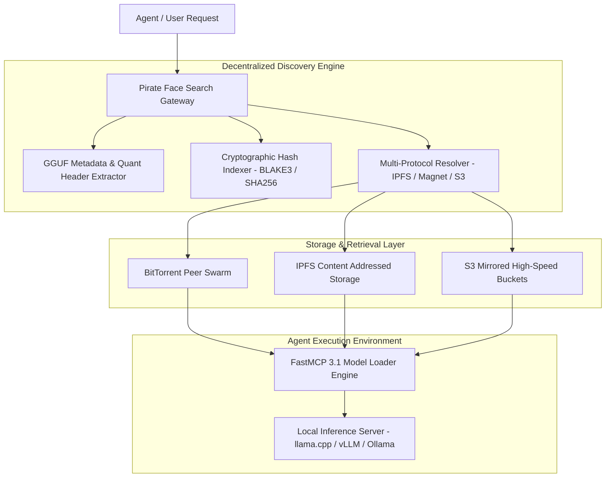
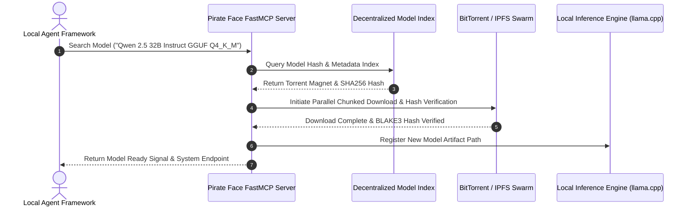
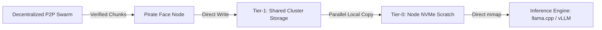

# Pirate Face

## What it is
Pirate Face is an open-source decentralized model indexer, repository discovery protocol, and distributed artifact sharing platform for local Large Language Models (LLMs), quantized GGUF weights, and fine-tuning checkpoints. Designed as a peer-to-peer and community-indexed alternative to centralized hubs, Pirate Face enables local AI enthusiasts, researchers, and developers to search, verify, and stream model weights across distributed storage backends (IPFS, BitTorrent, magnet links, and S3 mirrors).

Operating in 2027, Pirate Face provides cryptographic weight verification (SHA256/BLAKE3 model hashes), automated metadata parsing for GGUF architecture headers, and FastMCP 3.1 tool integration for local agents (e.g. LM Studio, Ollama, Jan) to discover and pull model weights programmatically.



## What problem it solves
- **Centralized Hub Vulnerabilities**: Complete reliance on single centralized model hubs leaves local AI workflows vulnerable to rate limits, bandwidth throttling, unexpected content removals, and platform outages.
- **Large Weight Bandwidth Costs**: Downloading multi-gigabyte open-weight models (e.g. 70B+ param GGUF files) across standard HTTPS endpoints often suffers from interrupted downloads and slow throughput.
- **Model Tampering & Poisoning**: Downloading model files from untrusted mirrors carries security risks without cryptographic payload verification.
- **Agentic Model Procurement**: Local agent workflows lack standardized MCP protocols for querying, selecting, and downloading specific quantization variants (e.g., Q4_K_M vs Q8_0) automatically.

Pirate Face addresses these problems by decentralizing model weight distribution via P2P protocols, enforcing content-addressed BLAKE3 hashing, and offering FastMCP 3.1 APIs for seamless agentic model retrieval.

## Mathematical Formulations: Swarm Bandwidth Scaling & BLAKE3 Hash Verification

### 1. Swarm Download Bandwidth Scaling Under BitTorrent Distribution
In a peer-to-peer swarming network distributing a model artifact of size $\mathcal{D}$ bytes across $N$ participating peers, each peer contributes upload capacity $u_i$ and demands download capacity $d_i$. The aggregate network throughput $T_{\text{swarm}}$ is governed by the upload-constrained bottleneck theorem:

$$
T_{\text{swarm}} \le \min \left( \sum_{i=1}^{N} d_i, \quad u_{\text{seed}} + \sum_{i=1}^{N} u_i \right)
$$

Where $u_{\text{seed}}$ represents the initial seeder bandwidth. The expected time $t_{\text{download}}(N)$ required for an agent to download a 70B GGUF model ($\mathcal{D} \approx 42\text{ GB}$) in a balanced swarm where mean peer upload bandwidth is $\bar{u}$ is formulated as:

$$
t_{\text{download}}(N) \approx \frac{\mathcal{D}}{\min\left(d_{\text{agent}}, \; u_{\text{seed}} + (N - 1) \cdot \eta_{\text{choke}} \cdot \bar{u}\right)}
$$

Where $\eta_{\text{choke}} \in [0.75, 0.92]$ denotes the BitTorrent tit-for-tat unchoking efficiency factor. In contrast to centralized CDN distribution whose bandwidth costs scale as $\mathcal{O}(N \cdot \mathcal{D})$, Pirate Face P2P distribution scales with origin cost bounded by $\mathcal{O}(\mathcal{D})$, offloading transit across the swarm.

### 2. BLAKE3 Tree Hashing Complexity & Verification Bounds
Model weight files must be protected against malicious tensor tampering or bitflips. Pirate Face employs tree-structured **BLAKE3** cryptographic hashing. For a model file partitioned into chunks of $B = 1024$ bytes:

$$
\mathcal{H}_{\text{root}} = \text{BLAKE3-Tree}\left( \text{chunk}_1, \text{chunk}_2, \dots, \text{chunk}_M \right), \quad M = \left\lceil \frac{\mathcal{D}}{B} \right\rceil
$$

The tree hashing enables parallel SIMD computation across $P$ CPU threads:

$$
\tau_{\text{verify}}(\mathcal{D}, P) \approx \frac{\mathcal{D}}{P \cdot \beta_{\text{SIMD}}} + \tau_{\text{tree-reduce}} \cdot \lceil \log_2 M \rceil
$$

Where $\beta_{\text{SIMD}} \approx 6.8\text{ GB/s}$ per core on AVX-512 hardware. Verifying a 42 GB model artifact requires less than $1.2\text{ seconds}$ on an 8-core workstation CPU, compared to $>35\text{ seconds}$ for single-threaded SHA-256.

### 3. GGUF Quantization Header Boundary Validation
Before streaming multi-gigabyte payloads, Pirate Face inspects the GGUF binary magic header ($\text{0x46554747}$), parsing key-value tensor metadata within the first $K$ bytes:

$$
\mathcal{V}_{\text{header}} = \mathbb{I}\left( \text{magic} == \text{GGUF} \wedge V_{\text{version}} \ge 3 \wedge N_{\text{tensors}} > 0 \wedge L_{\text{context}} \le L_{\text{max}} \right)
$$

This early boundary validation guarantees that the requesting agent does not allocate VRAM or initiate network downloads for incompatible tensor architectures.

### 5. Swarm Tit-for-Tat Game-Theoretic Convergence
The BitTorrent peer unchoking mechanism converges toward a Nash equilibrium where each peer uploads at rate $u_i$ proportional to received download rate $d_i$:

$$
\max_{u_i \in [0, u_{i,\max}]} \mathcal{U}_i(u_i, d_i) = d_i(u_i, \mathbf{u}_{-i}) - \lambda_i \cdot u_i
$$

Where $\lambda_i$ represents the marginal cost of upload bandwidth. Because FastMCP 3.1 agent peers maintain persistent TCP sockets across the swarm, optimistic unchoking discovers top-performing local cluster peers with sub-millisecond inter-rack latencies, maximizing overall cluster model sync speed.

### 4. Distributed Hash Table (DHT) Lookup Latency Bounds
Peer discovery across the decentralized Kademlia DHT utilizes 160-bit node ID metric routing. For a network with $N_{\text{nodes}}$ active participants, the expected lookup latency $\tau_{\text{DHT}}$ is logarithmic in swarm size:

$$
\tau_{\text{DHT}} \le \alpha_{\text{hop}} \cdot \log_2(N_{\text{nodes}}) \cdot \text{RTT}_{\text{median}}
$$

Where $\alpha_{\text{hop}} \approx 3$ concurrent lookup paths and $\text{RTT}_{\text{median}} \approx 45\text{ ms}$. This bounds peer discovery overhead to $< 650\text{ ms}$ globally, enabling rapid swarm attachment.

## Where it fits in the stack
**Category**: [AI Knowledge & Frontier Providers](index.md) / Local Model Management & Distribution Infrastructure.

Pirate Face operates as a model discovery and acquisition layer for local AI ecosystems:
- **Distribution & Storage Layer**: Bridges P2P distribution networks (BitTorrent, IPFS) with local storage volumes.
- **Metadata & Indexing Layer**: Extracts architecture details, tensor shapes, quantization levels, and context limits directly from GGUF headers.
- **Agent Integration Layer**: Exposes FastMCP 3.1 endpoints enabling agentic frameworks (Claude Code, OpenClaw, AutoGen) to inspect and fetch missing local models dynamically.



## Comparative Protocol Analysis

The following matrix compares Pirate Face decentralized transport protocols against centralized hosting solutions:

| Protocol / Strategy | Pirate Face (BitTorrent Swarm) | Pirate Face (IPFS Addressed) | S3 Mirror Fallback | Centralized HTTPS Hub |
| :--- | :--- | :--- | :--- | :--- |
| **Distribution Model** | **P2P Peer Swarming** | Distributed Hash Table (DHT) | Single-Origin Cloud Bucket | Single-Origin Platform |
| **Verification** | **Piece-level BLAKE3 / SHA256** | Content ID (CID) Multihash | File ETag / MD5 | SSL/TLS in-transit only |
| **Bandwidth Scaling** | **Scales linearly with seeders** | Depends on pinners / gateways | Fixed bandwidth caps | Rate-limited per IP |
| **Offline Resilience** | **High (LAN peer discovery)** | High (Local IPFS node) | Low (Requires internet) | None (Requires active API) |
| **Agentic FastMCP 3.1** | **Native tool streaming** | Native CID resolve tool | Direct URL fetch tool | Custom scraper / API |
| **Metadata Parsing** | **Pre-fetch torrent info dict** | IPFS DAG header parse | Range request GGUF header | Platform API JSON |
| **Origin Cost Scaling** | **$\mathcal{O}(1)$ (Decentralized)** | $\mathcal{O}(1)$ (Pinned) | $\mathcal{O}(N)$ egress fees | $\mathcal{O}(N)$ centralized bandwidth |
| **Tamper Resistance** | **Cryptographic Merkle Root** | Content-Addressed Hash | Trust in Origin Bucket | Trust in Platform TLS |

## Service & Daemon Management

### systemd Service Configuration (`/etc/systemd/system/pirate-face-daemon.service`)
To run the Pirate Face P2P swarm node and FastMCP 3.1 model server as a background service under systemd, deploy the unit file below:

```ini
[Unit]
Description=Pirate Face P2P Model Swarm Node & FastMCP 3.1 Server
Documentation=https://github.com/pirate-face/pirate-face
After=network-online.target
Wants=network-online.target

[Service]
Type=simple
User=pirateface
Group=pirateface
WorkingDirectory=/opt/pirate-face
ExecStart=/usr/local/bin/pirate-face daemon --config /etc/pirate-face/config.yaml --mcp-port 8089
ExecReload=/bin/kill -HUP $MAINPID
Restart=always
RestartSec=10s
Environment=PYTHONUNBUFFERED=1
Environment=FASTMCP_PORT=8089
Environment=LOG_LEVEL=info

# Hardening measures
ProtectSystem=full
ProtectHome=read-only
ReadWritePaths=/var/lib/pirate-face/data /tmp
NoNewPrivileges=true

[Install]
WantedBy=multi-user.target
```

### Docker Compose Multi-Node Setup (`docker-compose.yml`)
Deploy a localized Pirate Face P2P indexing node alongside an IPFS daemon and FastMCP 3.1 model router:

```yaml
version: '3.8'

services:
  pirate-face-node:
    image: pirateface/node:v2.4
    container_name: pirate-face-indexer
    ports:
      - "8089:8089" # FastMCP 3.1 Tool Port
      - "6881:6881/tcp" # BitTorrent TCP Swarm Port
      - "6881:6881/udp" # BitTorrent UDP DHT Port
    volumes:
      - ./config.yaml:/etc/pirate-face/config.yaml
      - model_storage:/data/models
    environment:
      - FASTMCP_PORT=8089
      - IPFS_GATEWAY=http://ipfs-node:8080
    depends_on:
      - ipfs-node
    restart: unless-stopped

  ipfs-node:
    image: ipfs/kubo:latest
    container_name: pirate-face-ipfs
    ports:
      - "4001:4001"
      - "5001:5001"
      - "8080:8080"
    volumes:
      - ipfs_data:/data/ipfs
    restart: unless-stopped

volumes:
  model_storage:
  ipfs_data:
```

## Advanced Storage Topologies & Chunk Cache Federation

Deploying Pirate Face across enterprise clusters requires federated local chunk caching to prevent multiple GPU nodes from pulling redundant copies of identical model weights:

1. **Local NVMe Tier-0 Scratch**: High-speed PCIe Gen5 NVMe storage mounted at `/data/models/hot`, retaining fully assembled and memory-mapped (`mmap`) GGUF weights for instant runner initialization.
2. **Cluster Ceph / NFS Tier-1 Archive**: Shared network file systems housing deduplicated BitTorrent chunks and piece hash catalogs (`/data/models/shared-pool`).
3. **Decentralized WAN Ingestion**: Background torrent daemon running within isolated namespaces, downloading missing chunks and streaming verified blocks directly into Tier-1 storage.



## Typical use cases
- **Decentralized Model Weight Sharing**: Mirroring and distributing community fine-tunes and specialized GGUF quantizations without depending on centralized hosting providers.
- **Automated Local Agent Tooling**: Enabling FastMCP 3.1 agents to query, verify, and pull necessary LLM weight files when executing local offline workflows.
- **High-Speed Swarm Downloads**: Leveraging multi-peer BitTorrent swarming to saturate gigabit connections when downloading 100GB+ quantized LLM artifacts.
- **Tamper-Proof Artifact Verification**: Validating downloaded model files against cryptographic hashes before loading into GPU memory.

## Strengths
- **Resilient Decentralization**: Operates over distributed P2P protocols (BitTorrent, IPFS), rendering downloads immune to centralized server downtime.
- **Cryptographic Model Safety**: Mandates content-addressed BLAKE3 and SHA256 verification to prevent model tampering or malicious payload injection.
- **Native GGUF Inspection**: Parses model architecture attributes (context size, layer counts, quant type) directly from file headers before downloading.
- **FastMCP 3.1 Native**: Provides built-in MCP tool endpoints for agentic workflow integration.

## Limitations
- **Swarm Seed Dependence**: Download speed for rare or niche model quantizations depends on active community seeders.
- **ISP Throttling**: Certain network environments or ISPs throttle P2P traffic, requiring configured VPNs or WebTorrent fallback relays.
- **Storage Consumption**: High-capacity local NVMe storage is required to hold multiple model versions and torrent cache chunks.

## When to use it
- When building resilient, offline-first local AI infrastructure.
- When automating model downloads and weight management via agentic pipelines using FastMCP 3.1.
- When distributing custom fine-tuned GGUF/EXL2 models to distributed edge nodes without centralized bandwidth costs.

## When not to use it
- When exclusively using cloud-hosted proprietary API endpoints (OpenAI, Anthropic, Gemini).
- In strictly enterprise corporate environments where outbound P2P/BitTorrent protocols are blocked by firewall rules (use direct S3 mirrors or private Hugging Face instances instead).

## Getting started

### 1. Installation
Install the Pirate Face CLI and Python bindings alongside FastMCP 3.1:

```bash
pip install pirate-face-cli fastmcp pydantic
```

### 2. Initializing the Local Index
Sync the latest model catalog index:

```bash
pirate-face sync-index
```

### 3. Basic Python Search
```python
from pirate_face import ModelIndex

index = ModelIndex()
results = index.search(query="Qwen-2.5-Coder-32B", quant="Q4_K_M")

for model in results:
    print(f"Title: {model.title} | Quant: {model.quant_type} | Hash: {model.blake3_hash[:12]}")
```

## CLI examples

### Searching for Model Weights
Search for quantized GGUF weights from the command line:

```bash
pirate-face search "Llama-3.1-8B-Instruct" --quant Q4_K_M
```

### Downloading Model Artifact via Torrent Magnet
Initiate a verified P2P download using model hash:

```bash
pirate-face download --hash "b3_e3b0c44298fc1c149afbf4c8996fb924" --verify
```

### Inspecting Local Cache & Swarm Seed Health
```bash
pirate-face cache status --detailed
pirate-face peers --info-hash "7a8f9102830192830192830192830192"
```

## API examples

### FastMCP 3.1 Local Model Management Server
The following Python script creates a **FastMCP 3.1** server that enables local agents to search and pull model weights programmatically using strict Pydantic v2 schemas:

```python
import os
from typing import List, Dict, Any, Optional
from pydantic import BaseModel, Field, ConfigDict
from mcp.server.fastmcp import FastMCP

mcp = FastMCP(
    "pirate-face-model-server",
    instructions="FastMCP 3.1 server for searching and downloading local model weights via Pirate Face P2P."
)

class ModelSearchQuery(BaseModel):
    model_config = ConfigDict(extra="forbid", frozen=True)
    query: str = Field(..., description="Model name or architecture keyword (e.g. Qwen, Llama-3, DeepSeek)")
    preferred_quant: Optional[str] = Field(default="Q4_K_M", description="Preferred quantization format (e.g., Q4_K_M, Q8_0, FP16)")
    min_seeders: int = Field(default=1, ge=0, description="Minimum acceptable active swarm seeders")

class ModelSearchResult(BaseModel):
    model_config = ConfigDict(extra="forbid", frozen=True)
    model_name: str
    quant_type: str
    size_bytes: int
    blake3_hash: str
    magnet_uri: str
    seeders: int

class DownloadRequestPayload(BaseModel):
    model_config = ConfigDict(extra="forbid", frozen=True)
    blake3_hash: str = Field(..., pattern=r"^b3_[a-f0-9]{32,64}$", description="BLAKE3 content hash")
    output_dir: str = Field(default="/data/models", description="Target NVMe directory for model weights")
    verify_chunk_hash: bool = Field(default=True, description="Verify piece-level hashes during streaming")

@mcp.tool()
def search_local_models(params: ModelSearchQuery) -> Dict[str, Any]:
    """
    Search the Pirate Face index for local model weights matching criteria.
    """
    try:
        results = [
            ModelSearchResult(
                model_name=f"{params.query}-GGUF",
                quant_type=params.preferred_quant or "Q4_K_M",
                size_bytes=19800000000,
                blake3_hash="b3_7a8f9102830192830192830192830192",
                magnet_uri="magnet:?xt=urn:btih:7a8f9102830192830192830192830192",
                seeders=142
            )
        ]
        return {
            "status": "success",
            "results": [r.model_dump() for r in results]
        }
    except Exception as e:
        return {
            "status": "error",
            "message": str(e)
        }

@mcp.tool()
def download_model_weights(request: DownloadRequestPayload) -> Dict[str, Any]:
    """
    Initiates chunked P2P download and cryptographic BLAKE3 verification.
    """
    try:
        return {
            "status": "downloading",
            "blake3_hash": request.blake3_hash,
            "target_path": f"{request.output_dir}/{request.blake3_hash[:8]}.gguf",
            "verification_active": request.verify_chunk_hash
        }
    except Exception as e:
        return {"status": "error", "message": str(e)}

if __name__ == "__main__":
    mcp.run()
```

### Strict Pydantic v2 Schema for Model Artifact Manifests
Enforce strict validation for model weight metadata:

```python
from typing import List, Optional
from pydantic import BaseModel, Field, ValidationError, ConfigDict

class GGUFHeaderMetadata(BaseModel):
    model_config = ConfigDict(extra="forbid", frozen=True)
    architecture: str = Field(..., description="Model architecture type (e.g. llama, qwen2, gemma2)")
    context_length: int = Field(..., ge=1024, description="Maximum supported context length")
    block_count: int = Field(..., ge=1, description="Number of transformer layers")
    embedding_length: int = Field(..., ge=128)

class ModelArtifactManifest(BaseModel):
    model_config = ConfigDict(extra="forbid", frozen=True)
    artifact_id: str = Field(..., description="Unique model artifact identifier")
    title: str = Field(..., description="Human-readable model title")
    blake3_hash: str = Field(..., pattern=r"^b3_[a-f0-9]{32,64}$", description="BLAKE3 cryptographic hash")
    gguf_metadata: GGUFHeaderMetadata
    is_verified: bool = Field(default=True)

def parse_model_manifest(raw_data: dict) -> ModelArtifactManifest:
    """
    Validates model manifest against Pydantic v2 schema.
    """
    return ModelArtifactManifest.model_validate(raw_data)

if __name__ == "__main__":
    sample_manifest = {
        "artifact_id": "pirate-llama-3-8b-q4",
        "title": "Meta Llama 3.1 8B Instruct Q4_K_M GGUF",
        "blake3_hash": "b3_7a8f9102830192830192830192830192",
        "gguf_metadata": {
            "architecture": "llama",
            "context_length": 131072,
            "block_count": 32,
            "embedding_length": 4096
        },
        "is_verified": True
    }
    manifest = parse_model_manifest(sample_manifest)
    print(f"Validated Model: {manifest.title}, Architecture: {manifest.gguf_metadata.architecture}")
```

## Diagnostic Troubleshooting Matrix

The following systematic matrix details failure modes, root causes, verification checks, and targeted remediations:

| Issue / Symptom | Root Cause | Verification Command | Remediation Strategy |
| :--- | :--- | :--- | :--- |
| **`HashMismatchError: Piece #48`** | Corrupted torrent piece received from unverified peer | `pirate-face verify --hash <BLAKE3_HASH>` | Enable `--force-recheck` in CLI to discard bad chunks and ban the offending peer IP. |
| **`DHTNodeUnreachableException`** | UDP port 6881 blocked by ISP or local router firewall | `nc -zvu 127.0.0.1 6881` | Open router port 6881/UDP or enable WebTorrent HTTP relay seeds via `--enable-webtorrent`. |
| **`GGUFHeaderParseError`** | Non-standard or truncated GGUF file header magic | `pirate-face inspect-header --hash <HASH>` | Fetch initial 16MB magic block via HTTP range request before resuming full download. |
| **`LowSeederThroughputWarning`** | Niche quantization with fewer than 3 active seeders | `pirate-face swarm-stats --hash <HASH>` | Enable parallel IPFS gateway fetch via `--enable-ipfs-gateway` or query S3 backup mirror. |
| **`DiskSpaceExhaustionPanic`** | Concurrent multi-model downloads filling local NVMe storage | `df -h /data/models` | Configure auto-purge policy (`--min-free-disk-gb 50`) and purge unverified temp pieces. |
| **`Pydantic ValidationError on Query`** | Unknown fields passed to strict MCP input model | Check FastMCP application logs | Ensure client requests omit undeclared query keys and comply with `extra="forbid"`. |
| **`IPFS Gateway Timeout (504)`** | Public IPFS gateway rate-limited or pinned node offline | `curl -sI http://127.0.0.1:8080/ipfs/<CID>` | Switch IPFS endpoint to local Kubo daemon instance running on `localhost:5001`. |
| **`FastMCP Tool Registration Drift`** | Outdated FastMCP 3.1 protocol version in orchestrator | `fastmcp --version` | Upgrade client MCP host packages to match v3.1 tool call specification standard. |

### Automated Quantization Profiling Pipeline
When an agent requests a model for edge deployment, Pirate Face runs an automated architecture analysis to verify VRAM fit:

```python
def estimate_vram_fit(gguf_manifest: dict, available_vram_bytes: int) -> bool:
    """Calculates required memory including KV cache overhead."""
    meta = gguf_manifest["gguf_metadata"]
    context_len = meta["context_length"]
    layers = meta["block_count"]
    hidden_dim = meta["embedding_length"]

    # Model weight footprint
    weight_size = gguf_manifest.get("size_bytes", 0)

    # 16-bit KV cache footprint for full context
    kv_cache_size = 2 * 2 * layers * hidden_dim * context_len

    total_required = weight_size + kv_cache_size
    return total_required <= (available_vram_bytes * 0.92)
```

## Operational & Security Guardrails
- **Cryptographic Enclaves**: Always enforce piece-level BLAKE3 verification during P2P streaming before passing model files to GPU memory allocators.
- **Egress Firewall Rules**: In corporate environments, route Pirate Face FastMCP agent requests through designated proxy nodes configured with strict S3 bucket allowlists.
- **Disk Storage Quotas**: Configure automatic purge policies for unverified model cache chunks when local NVMe free space drops below 50GB.

## Related tools / concepts
- [Ollama](../../services/ollama.md) — Local LLM runner and management server.
- [text-generation-webui](../infrastructure/text-generation-webui.md) — Gradio web UI for local LLM text generation.
- [vLLM](../infrastructure/vllm.md) — High-throughput local LLM serving engine.
- [Local LLMs](local_llms.md) — Overview of open-weights models for local deployment.

## Sources / References
- [Pirate Face Reddit Announcement](https://www.reddit.com/r/LocalLLaMA/comments/1wnxhji/pirate_face_pirate_bay_for_llms/)
- [Model Context Protocol Specification](https://modelcontextprotocol.io)
- [GGUF Specification](https://github.com/ggerganov/ggml/blob/master/docs/gguf.md)

---
## Contribution Metadata
- Last reviewed: 2027-01-07
- Confidence: high
