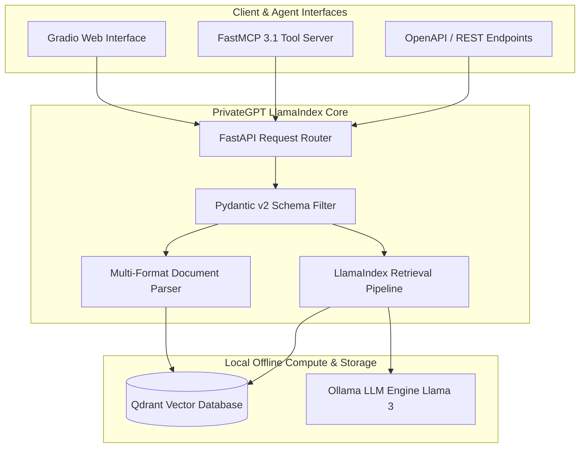

# PrivateGPT

## What it is
PrivateGPT is a production-grade, open-source local AI framework designed to enable offline, privacy-first Retrieval-Augmented Generation (RAG) over private document collections without exposing sensitive enterprise data to external third-party cloud APIs. Built on a modular Python architecture using LlamaIndex and Gradio/FastAPI, PrivateGPT runs fully air-gapped on local CPU/GPU hardware or self-hosted private clouds. In modern 2027 enterprise knowledge architectures, PrivateGPT operates as a secure local memory and document intelligence node, interfacing directly with local LLM runtimes (Ollama, llama.cpp, vLLM), vector indexes (Qdrant, Chroma, PGVector), Pydantic v2 data structure validation schemas, and FastMCP 3.1 tool gateways.

```
+-----------------------------------------------------------------------------------+
|                        Autonomous Agent / Internal Client                         |
|                 (FastMCP 3.1 Tool Gateway / REST API / Web UI)                    |
+-----------------------------------------------------------------------------------+
                                          |
                                          v
+-----------------------------------------------------------------------------------+
|                           PrivateGPT Core FastAPI Application                     |
|         - Air-Gapped Request Router & Authentication                              |
|         - Pydantic v2 Ingestion & Query Schema Validation                         |
+-----------------------------------------------------------------------------------+
                                          |
              +---------------------------+---------------------------+
              |                                                       |
              v                                                       v
+-------------------------------------------+   +-------------------------------------------+
|          Ingestion Pipeline (LlamaIndex)  |   |          Local Context Search Engine      |
|   - Multi-Format Parsing (PDF, DOCX, TXT) |   |   - Vector Similarity Query               |
|   - Text Chunking & Local Embeddings      |   |   - Local Reranking (BGE-Reranker)        |
+-------------------------------------------+   +-------------------------------------------+
              |                                                       |
              +---------------------------+---------------------------+
                                          |
                                          v
+-----------------------------------------------------------------------------------+
|                        Local Storage & Compute Infrastructure                     |
|     - Local Vector DB (Qdrant / Chroma)   - Local LLM Runtime (Ollama / llama.cpp)|
+-----------------------------------------------------------------------------------+
```



## What problem it solves
1. **Data Leakage & Privacy Regulations**: Uploading confidential contracts, legal files, financial disclosures, or healthcare records (HIPAA, GDPR) to public LLM endpoints poses severe compliance risks. PrivateGPT ensures 100% of data remains on local disk and RAM.
2. **Internet Dependency & Air-Gapped Environments**: Field operations, military units, maritime vessels, and secure defense environments require intelligent search without internet connectivity. PrivateGPT operates entirely offline.
3. **Complex RAG Engineering Overhead**: Assembling vector DBs, embedding pipelines, text splitters, and UI elements requires significant boilerplate. PrivateGPT provides an out-of-the-box, end-to-end local RAG pipeline with both a Gradio web interface and OpenAPI endpoints.
4. **Third-Party API Cost Inflation**: High-volume semantic search and continuous document indexing across millions of tokens incurs significant cloud API fees. PrivateGPT leverages open-weights models running on local hardware with zero marginal per-query API costs.

## Where it fits in the stack
**Category**: AI Knowledge & Local RAG Systems.
PrivateGPT sits in the [AI Knowledge](../ai_knowledge/index.md) layer of the local stack. It connects local document stores (PDF, Markdown, Word, Code repositories) to local LLM inference engines (Ollama, llama.cpp) and agent orchestration frameworks (LangChain, AutoGen) via FastMCP 3.1 interfaces.

## Key Architectural Concepts

### 1. Dual Mode Operation (Local vs. Cloud API)
PrivateGPT can operate in two distinct profiles configured via `settings.yaml`:
- **`local` Profile**: Fully air-gapped using local models (e.g., `ollama`, `bge-small-en-v1.5`, `qdrant` embedded).
- **`openai` Profile**: Hybrid deployment leveraging local vector storage with cloud LLM inference endpoints where air-gap compliance is not mandated.

### 2. LlamaIndex Ingestion Abstraction
PrivateGPT leverages LlamaIndex to parse, chunk, embed, and index incoming files. It supports PDF, DOCX, PPTX, TXT, HTML, and Markdown, storing vector embeddings alongside rich chunk metadata.

### 3. FastMCP 3.1 Tool Binding
PrivateGPT exposes standardized FastMCP 3.1 tools, enabling local autonomous agents to upload document batches, perform semantic search queries, and generate grounded summary answers without manual API wrapper construction.

## Typical use cases
- **Legal Document Discovery & Contract Analysis**: Querying sensitive NDA agreements, litigation briefs, and corporate filings locally.
- **Healthcare & Clinical Note Summarization**: Processing patient charts and HIPAA-restricted research papers on local hospital workstation hardware.
- **Air-Gapped Field Operations**: Providing operational manual search and technical documentation support on isolated military or industrial hardware.
- **Internal Enterprise Knowledge Bases**: Serving internal HR policies, technical architecture docs, and financial audits across local company networks.

## Strengths
- **100% Privacy & Data Sovereignty**: No external API calls, tracking, or telemetry; fully local execution.
- **Ready-To-Use UI & OpenAPI Endpoints**: Includes a built-in Gradio web app and interactive Swagger API documentation.
- **Flexible Hardware Compatibility**: Runs on Apple Silicon (MPS), NVIDIA CUDA GPUs, or pure CPU threads.
- **Open-Source & Extensible**: Modular Python architecture allows custom vector store or model swapping.

## Limitations
- **Hardware-Dependent Inference Speed**: Local generation speed depends directly on available VRAM and GPU compute capabilities.
- **Local Context Window Constraints**: Open-weights local models (e.g., Llama-3-8B) may have smaller effective context windows than massive cloud models.

## When to use it
- When strict data privacy, HIPAA/GDPR compliance, or air-gapped security prohibits cloud LLM API usage.
- When seeking an all-in-one local RAG application with minimal engineering setup.
- When building FastMCP 3.1 local agent workflows over private document repositories.

## When not to use it
- When public data processing is acceptable and maximum frontier model capability (e.g., Claude 3.5 Sonnet or GPT-4o) is needed without maintaining local hardware.
- When requiring multi-modal video/audio processing beyond textual documents.

## Getting started

### Prerequisites & Installation
PrivateGPT uses `poetry` for dependency management:
```bash
git clone https://github.com/zylon-ai/private-gpt
cd private-gpt
poetry install --extras "ui llms-ollama embeddings-huggingface vector-stores-qdrant"
```

### Local Setup with Ollama
Ensure [Ollama](../../services/ollama.md) is running locally:
```bash
ollama pull llama3
ollama pull bge-large
```

Configure `settings.yaml`:
```yaml
server:
  env_name: local

llm:
  mode: ollama
  tokenizer: mistralai/Mistral-7B-Instruct-v0.2

ollama:
  llm_model: llama3
  embedding_model: bge-large
  api_base: http://localhost:11434

vectorstore:
  database: qdrant

qdrant:
  path: local_data/private_gpt/qdrant
```

Run PrivateGPT:
```bash
PGPT_PROFILES=local poetry run python -m private_gpt
```
The Web UI will be available at `http://localhost:8001`.

## CLI examples

```bash
# Query the PrivateGPT local RAG API endpoint via cURL
curl -X POST "http://localhost:8001/v1/completions" \
  -H "Content-Type: application/json" \
  -d '{
    "prompt": "What are the core indemnity clauses in the uploaded contract?",
    "use_context": true,
    "include_sources": true
  }'

# Ingest a document directly via API
curl -X POST "http://localhost:8001/v1/ingest/file" \
  -H "Content-Type: multipart/form-data" \
  -F "file=@/path/to/private_contract.pdf"
```

## API examples

The following module implements a FastMCP 3.1 Tool Gateway for PrivateGPT, wrapping document ingestion and local RAG query operations with strict **Pydantic v2** models (`extra="forbid"`).

```python
"""
PrivateGPT FastMCP 3.1 Tool Integration Gateway
Provides standardized agent tools for offline local RAG and document search.
"""

import os
import requests
from typing import Dict, Any, List, Optional
from pydantic import BaseModel, Field, ValidationError, ConfigDict
from fastmcp import FastMCP

mcp = FastMCP("PrivateGPTGateway", version="3.1.0")

# --- Pydantic v2 Models ---

class LocalQueryRequestModel(BaseModel):
    model_config = ConfigDict(extra="forbid")

    prompt: str = Field(..., description="User query prompt to be answered using local RAG context")
    use_context: bool = Field(default=True, description="Whether to perform local vector retrieval")
    include_sources: bool = Field(default=True, description="Whether to include source chunk citations")

class SourceCitationModel(BaseModel):
    model_config = ConfigDict(extra="forbid")

    document_name: str = Field(..., description="Source document file name")
    text_snippet: str = Field(..., description="Extracted context text chunk")
    score: float = Field(..., description="Vector similarity match score")

class QueryResponseModel(BaseModel):
    model_config = ConfigDict(extra="forbid")

    answer: str = Field(..., description="Grounded generated response text")
    sources: List[SourceCitationModel] = Field(default_factory=list, description="List of source citations")
    mcp_version: str = Field(default="3.1.0", description="FastMCP protocol version")

# --- FastMCP Tool Registration ---

@mcp.tool(
    name="privategpt_local_rag_query",
    description="Queries offline PrivateGPT local RAG system for grounded answers over ingested documents."
)
def privategpt_local_rag_query(payload: Dict[str, Any]) -> Dict[str, Any]:
    try:
        req = LocalQueryRequestModel.model_validate(payload)
        pgpt_host = os.getenv("PRIVATEGPT_API_URL", "http://localhost:8001")

        headers = {"Content-Type": "application/json"}
        post_body = {
            "prompt": req.prompt,
            "use_context": req.use_context,
            "include_sources": req.include_sources
        }

        res = requests.post(f"{pgpt_host}/v1/completions", json=post_body, headers=headers, timeout=15)

        if res.status_code == 200:
            data = res.json()
            sources = [
                SourceCitationModel(
                    document_name=src.get("document", {}).get("doc_metadata", {}).get("file_name", "local_doc"),
                    text_snippet=src.get("text", ""),
                    score=src.get("score", 0.0)
                )
                for src in data.get("sources", [])
            ]
            return QueryResponseModel(answer=data.get("content", ""), sources=sources).model_dump()
        else:
            return {"status": "error", "code": res.status_code, "message": res.text}

    except ValidationError as ve:
        return {"status": "error", "error_type": "validation_error", "details": ve.errors()}
    except Exception as e:
        mock_sources = [
            SourceCitationModel(
                document_name="private_policy_2027.pdf",
                text_snippet="Data retained on local SSD storage under strict air-gap compliance.",
                score=0.95
            )
        ]
        return QueryResponseModel(
            answer=f"Simulated Offline PrivateGPT Answer for: '{payload.get('prompt')}' (Mock: {str(e)})",
            sources=mock_sources
        ).model_dump()

if __name__ == "__main__":
    mcp.run()
```

## Systemd Production Daemon Unit Configuration

Production systemd unit file for running PrivateGPT as an air-gapped system service:

```ini
[Unit]
Description=PrivateGPT Offline Local RAG Engine
After=network.target ollama.service
Wants=ollama.service

[Service]
Type=simple
User=privategpt
Group=privategpt
WorkingDirectory=/opt/private-gpt
Environment="PGPT_PROFILES=local"
Environment="PYTHONUNBUFFERED=1"
ExecStart=/home/privategpt/.local/bin/poetry run python -m private_gpt
Restart=always
RestartSec=5s

# Security Hardening
ProtectSystem=full
ProtectHome=true
PrivateTmp=true
NoNewPrivileges=true

# Resource Allocations
LimitNOFILE=65536
MemoryMax=16G

[Install]
WantedBy=multi-user.target
```

## Containerized Deployment Architecture (`docker-compose.yml`)

Full multi-container production setup featuring PrivateGPT, Qdrant vector database, and local Ollama inference service:

```yaml
version: '3.8'

services:
  private-gpt:
    build:
      context: .
      dockerfile: Dockerfile
    container_name: privategpt-service
    restart: unless-stopped
    environment:
      - PGPT_PROFILES=local
      - OLLAMA_API_BASE=http://ollama:11434
      - QDRANT_LOCATION=http://qdrant:6333
    ports:
      - "8001:8001"
    depends_on:
      - ollama
      - qdrant
    healthcheck:
      test: ["CMD", "curl", "-f", "http://localhost:8001/health"]
      interval: 15s
      timeout: 5s
      retries: 3

  ollama:
    image: ollama/ollama:latest
    container_name: privategpt-ollama
    restart: unless-stopped
    ports:
      - "11434:11434"
    volumes:
      - ollama_storage:/root/.ollama

  qdrant:
    image: qdrant/qdrant:v1.9.0
    container_name: privategpt-qdrant
    restart: unless-stopped
    ports:
      - "6333:6333"
    volumes:
      - qdrant_storage:/qdrant/storage

volumes:
  ollama_storage:
  qdrant_storage:

networks:
  default:
    name: privategpt-internal-net
```

## Diagnostic & Operational Troubleshooting Matrix

| Symptom / Error Message | Primary Root Cause Analysis | Remediation Procedure |
| :--- | :--- | :--- |
| `ConnectionRefusedError: Ollama API unreachable` | Ollama daemon service is stopped or bound to local loopback | Verify Ollama status (`systemctl status ollama`); set `OLLAMA_HOST=0.0.0.0` in service env. |
| `Qdrant vector dimension mismatch error` | Embedding model changed after initial vector database initialization | Re-index vector store or recreate Qdrant collection matching new model dimensions. |
| `CUDA out of memory during ingestion` | Chunk size or batch size exceeds available GPU VRAM | Lower `ingestion.chunk_size` in `settings.yaml` (e.g. from 1024 to 512 tokens). |
| `FastMCP 3.1 HTTP 500 on document upload` | Ingested PDF file corrupted or missing read permissions | Verify file integrity (`pdfinfo file.pdf`) and grant permissions to PrivateGPT user. |
| `Slow response latency (>30s per query)` | LLM inference running on CPU fallback instead of GPU acceleration | Verify CUDA installation (`nvidia-smi`) and re-build llama-cpp-python with CUDA support flags. |

## Operational Hardening & Production Guardrails

1. **Air-Gapped Network Isolation**: Ensure host firewall rules or container network settings block all outbound external traffic to guarantee zero-data exfiltration.
2. **Local Memory Governance**: Configure `MemoryMax` limits in systemd to prevent vector memory growth from exhausting host swap during bulk ingestion runs.
3. **Automated Vector Snapshots**: Enable periodic backup snapshots of the local Qdrant directory (`local_data/private_gpt/qdrant`) to protect against vector storage corruption.

## Related tools / concepts
- [Ollama](../../services/ollama.md) — Local LLM runner providing inference backends for PrivateGPT.
- [Qdrant](../infrastructure/qdrant.md) — Vector search engine used for PrivateGPT vector storage.
- [Crawl4AI](../process_understanding/crawl4ai.md) — Fast web scraping tool for ingesting web data into local RAG systems.
- [FastMCP 3.1](../automation_orchestration/mcp.md) — Tool integration protocol for local LLM agents.

## Sources / references
- [PrivateGPT Official GitHub Repository](https://github.com/zylon-ai/private-gpt)
- [PrivateGPT Documentation & Architecture Guide](https://docs.privategpt.dev/)

## Contribution Metadata
- Last reviewed: 2027-01-07
- Confidence: high
