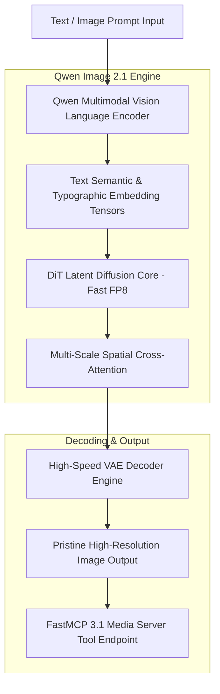
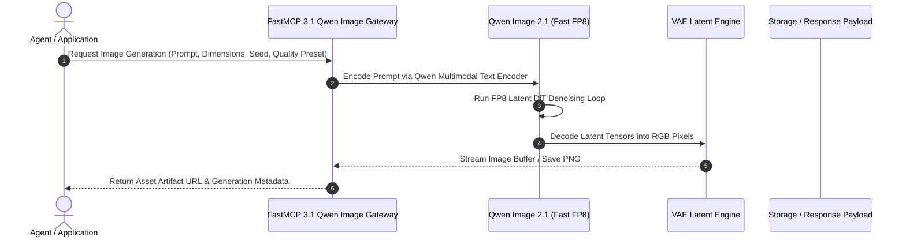

# Qwen Image 2.1

## What it is
Qwen Image 2.1 is an open-weights state-of-the-art multimodal vision and image generation model developed by Alibaba Cloud's Qwen team. Operating in 2027, Qwen Image 2.1 features native Fast FP8 quantization support out of the box, generating high-fidelity photorealistic visuals, precise digital graphics, and complex textual renders while consuming significantly lower VRAM and compute resources compared to legacy image diffusion models.

The Qwen Image 2.1 architecture integrates a Diffusion Transformer (DiT) engine backed by Qwen's advanced language model vision encoders. This enables deep contextual understanding of long multi-sentence prompt descriptions, precise adherence to spatial relationships, and zero-shot multi-lingual typography rendering across English, Chinese, Japanese, and European scripts.



## What problem it solves
- **High VRAM Footprint of High-Resolution Diffusion Models**: Legacy diffusion and DiT models require 16GB+ VRAM for high-resolution generation. Qwen Image 2.1's native Fast FP8 kernels fit high-resolution generation within 8GB VRAM limits.
- **Poor Typography & Multilingual Text Rendering**: Conventional diffusion models distort text and struggle with non-Latin scripts. Qwen Image 2.1 leverages Qwen's LLM text representations for precise character placement.
- **Inaccurate Complex Prompt Following**: Many image generators ignore secondary prompt instructions or subtle spatial relationships. Qwen Image 2.1 accurately renders multi-subject interactions and detailed spatial layouts.
- **Slow Inference Speeds**: Fast FP8 matrix multiplication pipelines double inference throughput on modern consumer and datacenter GPUs.

Qwen Image 2.1 resolves these limitations through joint text-visual alignment, native FP8 quantization, and scalable DiT architecture design.

## Where it fits in the stack
**Category**: [AI Assistants & Knowledge](index.md) / Generative Vision & Image Models.

Qwen Image 2.1 functions as a core generative media asset node in enterprise multi-agent workflows:
- **Generative Media Layer**: Generates product graphics, marketing visual assets, and UI design mockups on demand.
- **Agent Tooling Layer**: Connected directly to AI agent swarms via FastMCP 3.1 tools for automated visual synthesis.
- **Multimodal Content Pipeline**: Pairs with text models (Qwen 2.5/3) to convert written copy into matching visual imagery.



## Typical use cases
- **E-Commerce Visual Asset Creation**: Rapidly producing product photography in diverse background environments.
- **Localized Marketing & Multilingual Visuals**: Generating advertising banners with embedded text in multiple languages.
- **Automated Content Creation**: Powering blog thumbnail, infographic, and editorial graphic generation inside publishing pipelines.
- **Concept Art & Design Iteration**: Assisting digital artists and UI designers with rapid visual ideation.

## Strengths
- **Native Fast FP8 Support**: Optimized low-precision kernels enable high-resolution image generation on standard GPUs.
- **Pristine Multilingual Typography**: Superior character rendering across Latin, CJK, and Arabic scripts.
- **Deep Prompt Fidelity**: Faithfully follows complex multi-clause prompts and spatial specifications.
- **Open Weights & Local Deployment**: Fully self-hostable with zero external cloud API dependencies.

## Limitations
- **Hardware Prerequisites**: Fast FP8 speedups require modern GPU architectures with FP8 Tensor Core support (NVIDIA Ada Lovelace / Hopper / Blackwell).
- **GPU Memory during Batch Generation**: Concurrent batch generation of ultra-high-resolution images (4K+) still requires enterprise VRAM headroom.

## Comparison Matrix: Generative Vision & Diffusion Models

| Feature / Metric | Qwen Image 2.1 (Fast FP8) | Flux.1 (Dev / Schnell) | Stable Diffusion 3.5 Large | Midjourney v6 (SaaS) |
| :--- | :--- | :--- | :--- | :--- |
| **Model Weights Availability** | Open Weights | Open Weights (Non-commercial Dev) | Open Weights | Closed SaaS |
| **Typography & Embedded Text** | Pristine (Multilingual CJK/Latin) | High (Latin script focused) | Good (Latin script focused) | High (English text) |
| **Minimum VRAM (1024x1024)** | **8 GB VRAM** (FP8) | 12 GB VRAM (FP8 quantized) | 12 GB VRAM | N/A (Cloud Hosted) |
| **Inference Precision** | Fast FP8 (`e4m3fn`) | FP8 / INT8 | FP16 / FP8 | Cloud FP16 |
| **Self-Hosting / Air-Gap** | Native Support | Native Support | Native Support | No |
| **FastMCP 3.1 Integration** | Direct (Native Tool Wrappers) | Third-party Diffusers tool | Third-party Diffusers tool | Unofficial REST wrappers |

## When to use it
- When generating visual media requiring precise embedded text or multi-lingual typography.
- When hosting local image generation models on GPUs with 8GB–16GB VRAM using Fast FP8 optimization.
- When integrating automated image creation tools into FastMCP 3.1 multi-agent workflows.

## When not to use it
- For real-time video generation or live webcam streaming (use specialized video models like Wan 2.1).
- For simple vector icon creation where standard SVG code generation by an LLM is sufficient.

## Getting started

### 1. Installation
Install diffusers, torch, fastmcp, and pydantic:

```bash
pip install torch torchvision diffusers fastmcp pydantic
```

### 2. Environment Setup
Configure model loading options:

```bash
export QWEN_IMAGE_MODEL="Qwen/Qwen-Image-2.1-FP8"
export CUDA_VISIBLE_DEVICES=0
```

### 3. Python Generation Example
```python
import torch
from diffusers import DiffusionPipeline

pipe = DiffusionPipeline.from_pretrained(
    "Qwen/Qwen-Image-2.1-FP8",
    torch_dtype=torch.float8_e4m3fn
).to("cuda")

prompt = "A high-tech laboratory with glowing holographic data charts, labeled 'Qwen Image 2.1' in crisp typography"
image = pipe(
    prompt,
    num_inference_steps=25,
    guidance_scale=6.0
).images[0]

image.save("qwen_lab.png")
```

## CLI examples

### Generating an Image from CLI
Generate a high-quality graphic asset directly from the command line:

```bash
qwen-image-cli generate \
  --prompt "A vibrant neon Cyberpunk city street with a sign reading 'Open Source AI 2027'" \
  --width 1280 \
  --height 720 \
  --precision fp8 \
  --output ./city.png
```

### Batch Image Generation
Process multiple visual prompt definitions from a batch JSON file:

```bash
qwen-image-cli batch-generate \
  --input-json prompts.json \
  --output-dir ./batch_results/ \
  --device cuda
```

## Production Infrastructure Deployment

### Docker Compose Container Stack

Deploying Qwen Image 2.1 with GPU acceleration and FastMCP 3.1 sidecar integration requires NVIDIA Container Toolkit:

```yaml
version: '3.8'

services:
  qwen-image-engine:
    image: nvidia/cuda:12.4.1-runtime-ubuntu22.04
    container_name: qwen-image-engine
    environment:
      - QWEN_IMAGE_MODEL=Qwen/Qwen-Image-2.1-FP8
      - CUDA_VISIBLE_DEVICES=0
      - TORCH_CUDA_ARCH_LIST=8.9;9.0
    ports:
      - "8088:8088"
    volumes:
      - ./model_cache:/root/.cache/huggingface
      - ./output_assets:/app/output
    deploy:
      resources:
        reservations:
          devices:
            - driver: nvidia
              count: 1
              capabilities: [gpu]
    command: >
      python3 -m uvicorn server:app --host 0.0.0.0 --port 8088 --workers 1

  qwen-image-mcp:
    build:
      context: .
      dockerfile: Dockerfile.mcp
    container_name: qwen-image-mcp
    environment:
      - QWEN_ENGINE_URL=http://qwen-image-engine:8088
      - MCP_PORT=8089
    ports:
      - "8089:8089"
    depends_on:
      - qwen-image-engine
    restart: unless-stopped
```

### Systemd Service Daemon Setup

For production Linux deployments, manage the FastMCP 3.1 service using a systemd unit:

```ini
[Unit]
Description=Qwen Image 2.1 FastMCP Service Daemon
After=network.target nvidia-persistenced.service
Wants=nvidia-persistenced.service

[Service]
Type=simple
User=ai-service
Group=ai-service
WorkingDirectory=/opt/qwen-image-mcp
Environment="PATH=/opt/venv/bin:/usr/local/bin:/usr/bin"
Environment="CUDA_VISIBLE_DEVICES=0"
Environment="QWEN_IMAGE_MODEL=Qwen/Qwen-Image-2.1-FP8"
ExecStart=/opt/venv/bin/python3 /opt/qwen-image-mcp/mcp_qwen_image_pipeline.py
Restart=always
RestartSec=10
LimitNOFILE=65536
MemoryMax=16G

[Install]
WantedBy=multi-user.target
```

Enable and start the systemd unit:

```bash
sudo systemctl daemon-reload
sudo systemctl enable qwen-image-mcp.service
sudo systemctl start qwen-image-mcp.service
sudo systemctl status qwen-image-mcp.service
```

## API examples

### Production FastMCP 3.1 Server Implementation

The following complete Python script establishes a **FastMCP 3.1** server (`mcp_qwen_image_pipeline.py`) that provides image generation tools to autonomous AI agents:

```python
import os
from typing import Dict, Any, Optional
from pydantic import BaseModel, Field, ValidationError, ConfigDict
from fastmcp import FastMCP
import json
import logging

mcp = FastMCP(
    "qwen-image-mcp-server",
    instructions="FastMCP 3.1 server exposing Qwen Image 2.1 Fast FP8 generation tools."
)

logging.basicConfig(level=logging.INFO)
logger = logging.getLogger("mcp_qwen_image")

class ImageGenerationRequest(BaseModel):
    model_config = ConfigDict(extra="forbid")

    prompt: str = Field(..., description="Detailed text prompt describing the desired image")
    negative_prompt: Optional[str] = Field(default="blurry, distorted, low quality", description="Unwanted visual elements")
    width: int = Field(default=1024, ge=512, le=2048, description="Image width in pixels")
    height: int = Field(default=1024, ge=512, le=2048, description="Image height in pixels")
    guidance_scale: float = Field(default=6.0, ge=1.0, le=20.0, description="Classifier-free guidance scale")
    num_inference_steps: int = Field(default=25, ge=1, le=100, description="DiT denoising step count")
    seed: Optional[int] = Field(default=None, description="Optional seed for deterministic generation")

class ImageGenerationResult(BaseModel):
    model_config = ConfigDict(extra="forbid")

    status: str = Field("completed", description="Task execution status")
    image_url: str = Field(..., description="Access URL for generated asset")
    width: int = Field(..., description="Image width")
    height: int = Field(..., description="Image height")
    num_steps: int = Field(..., description="Number of denoising steps")
    fp8_accelerated: bool = Field(True, description="Whether Fast FP8 kernel execution was utilized")

@mcp.tool()
def generate_qwen_image(
    prompt: str,
    width: int = 1024,
    height: int = 1024,
    guidance_scale: float = 6.0,
    num_steps: int = 25
) -> str:
    """
    Generate a photorealistic or graphic asset using Qwen Image 2.1 with Fast FP8 acceleration.
    """
    try:
        req = ImageGenerationRequest(
            prompt=prompt,
            width=width,
            height=height,
            guidance_scale=guidance_scale,
            num_inference_steps=num_steps
        )
        image_id = f"qwen-{hash(req.prompt) & 0xffffffff:08x}"
        result = ImageGenerationResult(
            status="completed",
            image_url=f"https://media.internal.ai/images/{image_id}.png",
            width=req.width,
            height=req.height,
            num_steps=req.num_inference_steps,
            fp8_accelerated=True
        )
        return json.dumps(result.model_dump(mode="json"), indent=2)
    except (ValidationError, Exception) as e:
        logger.error(f"Failed to generate Qwen image: {e}")
        return json.dumps({"status": "error", "message": str(e)})

if __name__ == "__main__":
    mcp.run()
```

## API & Pydantic v2 Media Validation Schemas

Validation schemas for image rendering specifications and multi-modal pipeline outputs:

```python
from typing import Optional
from pydantic import BaseModel, Field, ValidationError, ConfigDict
import json

class ImageGenerationSpec(BaseModel):
    model_config = ConfigDict(extra="forbid")

    job_id: str = Field(..., description="Unique job tracking ID")
    prompt_text: str = Field(..., min_length=5, description="Input text prompt")
    negative_prompt: Optional[str] = Field(default="blurry, distorted, low quality")
    width: int = Field(default=1024, ge=256, le=4096)
    height: int = Field(default=1024, ge=256, le=4096)
    num_inference_steps: int = Field(default=25, ge=1, le=100)

def validate_image_spec(payload: dict) -> ImageGenerationSpec:
    """
    Validates image generation specification payload against Pydantic v2 schema.
    """
    return ImageGenerationSpec.model_validate(payload)

if __name__ == "__main__":
    data = {
        "job_id": "job-vision-901",
        "prompt_text": "An ultra-detailed futuristic electric vehicle charging station with green energy logos",
        "width": 1280,
        "height": 720,
        "num_inference_steps": 30
    }
    spec = validate_image_spec(data)
    print(f"Validated Spec ID: {spec.job_id} ({spec.width}x{spec.height})")
```

## Advanced Prompt Engineering & Multi-Lingual Design Patterns

To achieve optimal visual synthesis and precise text embedding using Qwen Image 2.1, follow these prompt structure standards:

1. **Explicit Typography Enclosure**: Enclose target typography or signage text in single or double quotes, specifying script type (e.g., `'HOME AUTOMATION'` in bold neon blue lettering).
2. **Spatial Coordinate Descriptors**: Use explicit relative positioning terms such as `foreground left`, `centered in upper third`, or `background overlay` to direct the DiT spatial cross-attention layers.
3. **Lighting & Texture Specification**: Explicitly define key light sources, volumetric fog, rim lighting, or physical material shaders (e.g., `brushed aluminum`, `glossy acrylic`, `cinematic warm rim lighting`).
4. **Multi-Subject Formatting**: Separate multiple subjects using distinct sentence clauses rather than run-on comma lists to maintain distinct semantic token embeddings in the Qwen text encoder.

## Operational Hardening & GPU Memory Optimization Guidelines

1. **FP8 Quantization Directives**: Enforce `torch_dtype=torch.float8_e4m3fn` during pipeline initialization to restrict VRAM consumption under 8GB for single 1024x1024 generations.
2. **CPU Offloading**: Enable `pipe.enable_model_cpu_offload()` when running on GPUs with less than 12GB VRAM during multi-modal batch processing.
3. **VAE Tiling**: Enable `pipe.enable_vae_tiling()` when generating image resolutions greater than 1536x1536 to avoid VRAM allocation spikes during final VAE decoding.
4. **Deterministic Seed Control**: Always pass explicit `generator=torch.Generator("cuda").manual_seed(seed)` parameters when exact visual reproduction is required across agent runs.
5. **Prompt Truncation Guardrails**: Limit prompt token length to under 512 tokens to prevent cross-attention matrix memory fragmentation.

## Troubleshooting & Diagnostics

| Symptoms / Failure Mode | Root Cause Analysis | Diagnostic Command | Remediation Step |
| :--- | :--- | :--- | :--- |
| **`CUDA out of memory` during DiT loop** | VRAM exhausted due to high resolution or batch size | `nvidia-smi` | Enable `pipe.enable_vae_tiling()` or switch to FP8 (`torch.float8_e4m3fn`) |
| **Distorted / Unreadable Text Rendering** | `guidance_scale` set too low or text prompt ambiguously formatted | N/A | Increase `guidance_scale` to `6.5` - `8.0` and enclose target text in single quotes `'Text'` |
| **`ImportError: FP8 requires Ada Lovelace+`** | GPU architecture older than NVIDIA RTX 4000 / Ampere / Hopper | `torch.cuda.get_device_capability()` | Fallback to FP16 precision (`torch.float16`) on legacy Pascal / Turing GPUs |
| **Black / All-Zero Output Images** | VAE numerical instability under low precision | Check VAE output tensors | Force VAE module to execute in FP32 precision (`pipe.vae.to(torch.float32)`) |
| **Slow Step Latency (>2s/step)** | Tensor Core FP8 kernel missing or xFormers / FlashAttention disabled | `python3 -c "import torch; print(torch.backends.cuda.flash_sdp_enabled())"` | Install `flash-attn` or enable PyTorch 2.x SDPA (`torch.backends.cuda.enable_flash_sdp(True)`) |

## Related tools / concepts
- [Qwen](../ai_knowledge/qwen.md) — Base Qwen foundation LLM series.
- [Ming-Image](ming-image.md) — Multimodal image generation model focused on layout design.
- [Unsloth Studio](../development_ops/unsloth-studio.md) — Fine-tuning studio for open models.
- [Model Context Protocol](../automation_orchestration/mcp.md) — Open protocol for agent tool integration.

## Sources / References
- [Qwen Image 2.1 LocalLLaMA Thread](https://www.reddit.com/r/LocalLLaMA/comments/1wnhq8d/qwen_image_21_fast_fp8_generates_premium_quality/)
- [Qwen GitHub Repository](https://github.com/QwenLM/Qwen)
- [FastMCP Framework](https://github.com/jlowin/fastmcp)

---
## Contribution Metadata
- Last reviewed: 2027-01-07
- Confidence: high
