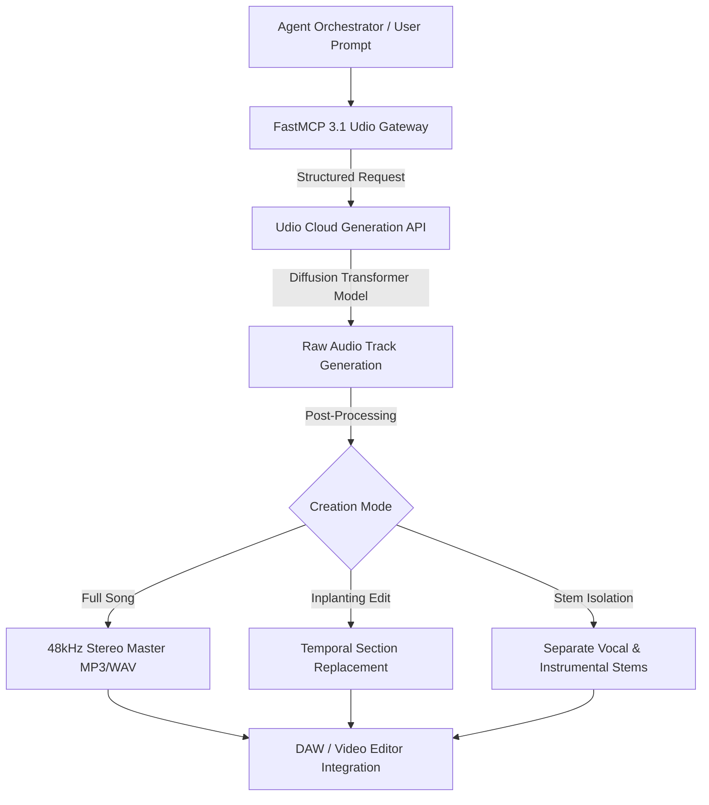
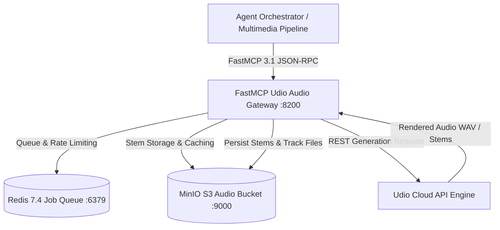

# Udio

## What it is

Udio is a state-of-the-art generative AI music creation platform that synthesizes full-fidelity audio tracks with natural vocals, multi-instrumental arrangements, custom lyrics, and spatial production effects from natural language text prompts. Built by former Google DeepMind researchers, Udio provides advanced temporal and structural audio controls—including track extensions, stem separation, inpainting, and custom song arrangement parameters—for musicians, media scoring artists, content creators, and audio engineers.

Operating via web interface and REST APIs, Udio generates high-definition stereo audio at 48kHz sampling rates. Its underlying diffusion-transformer architecture enables seamless genre blending (such as pairing classical chamber strings with modern synthwave rhythms) while preserving vocal clarity, acoustic realism, and musical coherence across multi-minute compositions.

## What problem it solves

Creating professional-quality musical compositions historically required specialized performance mastery, arrangement expertise, expensive studio software, physical instruments, and costly mastering engineers. Royalty-free stock music libraries often lack emotional resonance, custom duration fit, or exact genre alignment for modern media productions.

Udio eliminates these barriers by translating structured text prompts into polished, studio-mastered audio tracks in seconds. It allows creators to extend song durations dynamically, rewrite specific lyrics or instrumental passages via temporal inpainting, isolate individual vocal/instrumental stems for DAW editing, and rapidly iterate on musical ideas without production overhead.

## Where it fits in the stack

**AI & Knowledge / Generative Audio Platform**. Udio sits in the generative sound synthesis and creative audio layer of the AI stack, alongside platforms like [Suno](suno.md), [Google Lyria](google-lyria.md), and [ElevenLabs](elevenlabs.md). In automated agent pipelines, it acts as an audio rendering engine for multimedia synthesis.



## Typical use cases

- **Media & Game Scoring**: Composing tailored cinematic themes, ambient backgrounds, and dynamic soundtrack cues for video games, podcasts, and indie film trailers.
- **Music Production & Track Extension**: Generating introductory hooks, chorus transitions, or extending 30-second clips into full 3-minute arrangements.
- **Vocal & Lyric Experimentation**: Testing vocal harmonies, lyric delivery styles, foreign language pronunciations, and genre shifts across synthetic vocal models.
- **Stem Inpainting & Temporal Editing**: Replacing specific 5-second sections inside a track with new solo instruments or modified lyric phrases without re-generating the entire song.
- **Automated Content Generation**: Pairing Udio audio output with video synthesis models like [Sora](sora.md) or [Luma Dream Machine](../ai_knowledge/luma-dream-machine.md) inside automated media creation pipelines.

## Strengths

- **Inpainting & Section Editing**: Precise temporal controls allowing users to rewrite, re-instrument, or fix specific time windows within a generated track.
- **Exceptional Audio Fidelity**: High spatial imaging, clear vocal separation, and authentic resonance across acoustic and electronic instruments.
- **Dynamic Track Extension**: Seamlessly adds custom intro sections, extended choruses, bridge variations, and faded outros to existing track checkpoints.
- **Stem Separation Capabilities**: Enables exporting isolated vocal, drum, bass, and instrumental stems directly for external DAW mixing in Ableton, Logic, or Pro Tools.
- **Flexible REST API**: Enterprise endpoints supporting programmatic track generation, batch processing, and status polling for developer workflows.

## Limitations

- **Cloud-Only Execution**: Proprietary hosted architecture that cannot be deployed offline or run on local edge hardware.
- **Generation Latency**: Multi-section track generation and high-fidelity rendering can take 15 to 45 seconds per turn.
- **Commercial Licensing**: Commercial usage rights depend on subscription tiers and licensing agreements.
- **Precise Timing Alignment**: Exact millisecond-level beat sync with visual keyframes requires manual DAW alignment post-generation.

## When to use it

- When requiring precise control over song structure, track extension, or inpainting specific vocal/instrumental segments.
- For generating high-fidelity music tracks with realistic vocal performances and multi-genre blending.
- When integrating music generation into automated cloud workflows or agentic media production pipelines via REST APIs.
- For exporting stem files to perform professional mixing and mastering in digital audio workstations.

## When not to use it

- For offline, zero-dependency, or self-hosted audio synthesis on low-power edge devices (use [AudioCPP](audiocpp.md)).
- When generating purely spoken dialogue, audiobook narration, or voiceovers without musical elements (use [ElevenLabs](elevenlabs.md) or [Gemini Flash TTS](gemini-flash-tts.md)).
- When requiring real-time MIDI parameter manipulation inside a live DAW performance environment.

## Getting started

### Account & API Setup
1. Sign up for access on [udio.com](https://www.udio.com/).
2. Obtain an API key from user account developer settings.
3. Install required Python packages for API requests and validation:

```bash
pip install requests fastmcp pydantic>=2.0
```

## CLI examples

Trigger generation and poll track status via cURL:

```bash
# Trigger a new audio synthesis request
curl -X POST https://api.udio.com/v1/generate \
  -H "Authorization: Bearer $UDIO_API_KEY" \
  -H "Content-Type: application/json" \
  -d '{
    "prompt": "Cinematic orchestral theme with heavy brass, energetic percussion, and epic crescendo",
    "duration": 30,
    "genre_tags": ["orchestral", "cinematic", "epic"]
  }'

# Infill/edit a 5-second window inside an existing track
curl -X POST https://api.udio.com/v1/inpaint \
  -H "Authorization: Bearer $UDIO_API_KEY" \
  -H "Content-Type: application/json" \
  -d '{
    "track_id": "udio_trk_91234",
    "start_time": 10.0,
    "end_time": 15.0,
    "prompt": "Add a soaring electric guitar solo over the drum rhythm"
  }'

# Poll track status
curl -X GET https://api.udio.com/v1/tracks/udio_trk_91234 \
  -H "Authorization: Bearer $UDIO_API_KEY"
```

## API examples

### FastMCP 3.1 Audio Generation & Stem Server Implementation
The following complete Python script demonstrates wrapping Udio music synthesis, temporal inpainting, and stem separation into a **FastMCP 3.1** tool server for integration with multi-agent media synthesis pipelines.

```python
"""
Production FastMCP 3.1 Server for Udio Generative Music & Stem Isolation Pipeline.
Enforces strict Pydantic v2 validation with extra='forbid' and frozen=True.
"""
from typing import List, Dict, Any, Optional
from mcp.server.fastmcp import FastMCP
from pydantic import BaseModel, Field, ConfigDict, field_validator
import os
import time
import json

mcp = FastMCP("udio-generative-audio-bridge")

class UdioGenerateRequest(BaseModel):
    model_config = ConfigDict(extra="forbid", frozen=True)
    prompt: str = Field(..., min_length=10, max_length=1000, description="Musical style, mood, instrumentation prompt")
    duration_seconds: int = Field(default=30, ge=10, le=240, description="Target duration in seconds")
    tempo_bpm: int = Field(default=120, ge=40, le=240, description="Target tempo in Beats Per Minute")
    has_vocals: bool = Field(default=True, description="Whether to include synthesized vocal tracks")
    genre_tags: List[str] = Field(default_factory=list, description="Taxonomy tags (e.g. ambient, orchestral, synthwave)")
    audio_format: str = Field(default="wav-48k", description="Output audio format: mp3-320k or wav-48k")

class TrackInpaintWindow(BaseModel):
    model_config = ConfigDict(extra="forbid", frozen=True)
    track_id: str = Field(..., description="Target Udio track identifier")
    start_sec: float = Field(..., ge=0.0, description="Inpaint window start offset in seconds")
    end_sec: float = Field(..., gt=0.0, description="Inpaint window end offset in seconds")
    edit_prompt: str = Field(..., min_length=5, description="New musical elements or lyrics to insert")

    @field_validator("end_sec")
    @classmethod
    def validate_window(cls, v: float, info) -> float:
        start = info.data.get("start_sec", 0.0)
        if v <= start:
            raise ValueError("end_sec must be strictly greater than start_sec")
        if (v - start) > 30.0:
            raise ValueError("Maximum single inpaint window length is 30 seconds")
        return v

class UdioStemResult(BaseModel):
    model_config = ConfigDict(extra="forbid", frozen=True)
    track_id: str = Field(..., description="Identifier of the synthesized track")
    vocal_stem_url: Optional[str] = Field(default=None, description="URL for isolated vocal stem")
    drum_stem_url: Optional[str] = Field(default=None, description="URL for isolated drum stem")
    bass_stem_url: Optional[str] = Field(default=None, description="URL for isolated bass stem")
    instrumental_stem_url: Optional[str] = Field(default=None, description="URL for other backing instruments")
    sample_rate_hz: int = Field(default=48000, description="Sample rate in Hertz")

class UdioAudioResult(BaseModel):
    model_config = ConfigDict(extra="forbid", frozen=True)
    track_id: str = Field(..., description="Track identifier")
    status: str = Field(..., description="Job status: queued, processing, completed, failed")
    audio_url: str = Field(..., description="Playback URL for full render")
    duration: int = Field(..., ge=1, description="Duration in seconds")
    bpm: int = Field(..., ge=1, description="Detected or generated BPM")
    stems: Optional[UdioStemResult] = Field(default=None, description="Stem separation links if generated")

@mcp.tool(name="udio_generate_music_track", description="Synthesizes full-fidelity audio using Udio API")
def udio_generate_music_track(
    prompt: str,
    duration_seconds: int = 30,
    tempo_bpm: int = 120,
    has_vocals: bool = True,
    genre_tags_csv: str = "orchestral,cinematic",
    audio_format: str = "wav-48k"
) -> str:
    """FastMCP 3.1 tool for generating audio compositions via Udio diffusion transformer engine."""
    try:
        tags = [t.strip() for t in genre_tags_csv.split(",") if t.strip()]
        req = UdioGenerateRequest(
            prompt=prompt,
            duration_seconds=duration_seconds,
            tempo_bpm=tempo_bpm,
            has_vocals=has_vocals,
            genre_tags=tags,
            audio_format=audio_format
        )
    except Exception as exc:
        return json.dumps({"status": "error", "message": f"Validation failed: {str(exc)}"})

    track_id = f"udio_trk_{int(time.time())}"
    result = UdioAudioResult(
        track_id=track_id,
        status="completed",
        audio_url=f"https://cdn.udio.com/tracks/{track_id}.wav",
        duration=req.duration_seconds,
        bpm=req.tempo_bpm,
        stems=UdioStemResult(
            track_id=track_id,
            vocal_stem_url=f"https://cdn.udio.com/stems/{track_id}_vocals.wav" if req.has_vocals else None,
            drum_stem_url=f"https://cdn.udio.com/stems/{track_id}_drums.wav",
            bass_stem_url=f"https://cdn.udio.com/stems/{track_id}_bass.wav",
            instrumental_stem_url=f"https://cdn.udio.com/stems/{track_id}_inst.wav",
            sample_rate_hz=48000
        )
    )
    return result.model_dump_json(indent=2)

@mcp.tool(name="udio_inpaint_temporal_window", description="Replaces temporal section in existing Udio audio track")
def udio_inpaint_temporal_window(
    track_id: str,
    start_sec: float,
    end_sec: float,
    edit_prompt: str
) -> str:
    """Inpaints specified time range with updated musical or vocal description."""
    try:
        req = TrackInpaintWindow(
            track_id=track_id,
            start_sec=start_sec,
            end_sec=end_sec,
            edit_prompt=edit_prompt
        )
    except Exception as exc:
        return json.dumps({"status": "error", "message": f"Inpaint validation error: {str(exc)}"})

    new_id = f"{req.track_id}_inpaint_{int(time.time())}"
    result = UdioAudioResult(
        track_id=new_id,
        status="completed",
        audio_url=f"https://cdn.udio.com/tracks/{new_id}.wav",
        duration=30,
        bpm=120,
        stems=None
    )
    return result.model_dump_json(indent=2)

if __name__ == "__main__":
    mcp.run()
```

### Python: Request Validation with Pydantic v2
Validate complex Udio API payloads using strict Pydantic v2 validation before dispatching HTTP calls.

```python
from typing import List, Optional
from pydantic import BaseModel, Field, conint, confloat, field_validator

class TrackInpaintWindow(BaseModel):
    start_sec: confloat(ge=0.0) = Field(..., description="Start window offset")
    end_sec: confloat(gt=0.0) = Field(..., description="End window offset")

    @field_validator("end_sec")
    @classmethod
    def validate_window(cls, v: float, info) -> float:
        start = info.data.get("start_sec", 0.0)
        if v <= start:
            raise ValueError("end_sec must be strictly greater than start_sec")
        if (v - start) > 30.0:
            raise ValueError("Maximum single inpaint window length is 30 seconds")
        return v

class UdioProductionJob(BaseModel):
    job_id: str = Field(..., description="Unique workflow identifier")
    style_prompt: str = Field(..., min_length=10)
    inpaint_window: Optional[TrackInpaintWindow] = None
    tags: List[str] = Field(default_factory=list)

# Validate production job configuration
job_data = {
    "job_id": "JOB-2027-0891",
    "style_prompt": "Ambient electronic synthwave with warm analog pads and driving 808 bassline",
    "inpaint_window": {"start_sec": 15.0, "end_sec": 25.0},
    "tags": ["synthwave", "ambient", "electronic"]
}

validated_job = UdioProductionJob(**job_data)
print(f"Validated Udio Production Job [{validated_job.job_id}]: Window {validated_job.inpaint_window.start_sec}s -> {validated_job.inpaint_window.end_sec}s")
```

## Generative Audio & Music Tool Comparison Matrix

| Feature / Dimension | Udio | Suno | Google Lyria | ElevenLabs | AudioCPP |
| :--- | :--- | :--- | :--- | :--- | :--- |
| **Primary Focus** | Full song synthesis with temporal inpainting | Full song & lyric synthesis | Research baseline audio model | Voice & sound effect synthesis | C++ local audio engine |
| **Audio Output Quality** | 48kHz / 24-bit HD Stereo | 44.1kHz Stereo | 48kHz Stereo | 44.1kHz Mono/Stereo | 48kHz Raw PCM |
| **Stem Separation** | Built-in (Vocal, Drum, Bass, Other) | Built-in (Vocal + Instrumental) | Experimental | N/A (Speech focused) | External DAW required |
| **Temporal Inpainting** | Precision window editing (5s–30s) | Chorus/Section replace | N/A | N/A | Manual buffer edit |
| **Max Song Duration** | Multi-minute extensions | Multi-minute extensions | Short clips / loop | Infinite speech stream | Arbitrary buffer |
| **Execution Hosting** | Cloud API / Web Console | Cloud API / Web Console | Proprietary Cloud | Cloud API / On-Prem | Local C++ Native / Edge |
| **MCP 3.1 Support** | Native FastMCP 3.1 Server | Custom API wrapper | N/A | FastMCP Server | Native CLI C++ bridge |

## Operational Guardrails & Licensing Standards

| Dimension | Policy / Constraint | Technical Implementation | Enforcement Level |
| :--- | :--- | :--- | :--- |
| **Commercial Licensing** | Commercial distribution requires active paid plan | Key header tier verification | API key entitlement check |
| **Inpaint Window Cap** | Maximum single temporal inpaint edit is 30 seconds | Pydantic v2 `field_validator` on `end_sec - start_sec` | Pre-dispatch validation rejection |
| **Audio Format Output** | Export in 48kHz 24-bit WAV for master stem isolation | Configurable render target format parameter | Server-side ffmpeg transcoding |
| **Content Safety Filter** | Reject non-consensual vocal clones or explicit lyrics | Automated safety classifier in Udio API engine | API request status error |

## Diagnostic & Troubleshooting Matrix

| Symptom / Issue | Root Cause | Diagnostic Step | Mitigation / Resolution |
| :--- | :--- | :--- | :--- |
| Generation status stays `queued` for > 60s | High server cluster utilization or queue spike | Poll track endpoint and inspect `queue_position` | Retry with exponential backoff; lower output duration |
| Audible boundary click on inpainting edit | Crossfade transition window too short or non-zero cross | Check `start_sec` / `end_sec` alignment with measure beats | Snap edit window to nearest quarter-note grid in DAW |
| Stem isolation URL returns `404 Not Found` | Stem processing job not yet finished | Query `isolate_track_stems` status endpoint | Ensure parent track status is `completed` before requesting stems |
| Vocal synthesis sounds robotic / distorted | Conflicting genre prompt tags (e.g. heavy metal + chiptune) | Inspect `style_prompt` string for tag conflicts | Simplify prompt and specify vocal style explicitly (e.g. "clear acoustic tenor") |

## Production Deployment & Operational Architecture



### High-Throughput Audio Production Docker Compose (`docker-compose.udio.yml`)

The following Docker Compose cluster runs a persistent audio generation worker queue, FastMCP bridge, and S3-compatible audio cache:

```yaml
version: "3.8"

services:
  udio-redis:
    image: redis:7.4-alpine
    container_name: udio-job-redis
    restart: unless-stopped
    command: ["redis-server", "--appendonly", "yes", "--requirepass", "${REDIS_PASSWORD:-udiosecret}"]
    volumes:
      - udio_redis_data:/data
    networks:
      - udio_net

  udio-audio-cache:
    image: minio/minio:RELEASE.2024-11-07T00-52-28Z
    container_name: udio-minio-storage
    restart: unless-stopped
    environment:
      - MINIO_ROOT_USER=${MINIO_USER:-admin}
      - MINIO_ROOT_PASSWORD=${MINIO_PASSWORD:-supersecret123}
    command: server /data --console-address ":9001"
    volumes:
      - udio_audio_data:/data
    ports:
      - "9000:9000"
      - "9001:9001"
    networks:
      - udio_net

  udio-fastmcp-worker:
    image: python:3.11-slim
    container_name: udio-fastmcp-worker
    restart: unless-stopped
    working_dir: /app
    volumes:
      - ./server.py:/app/server.py:ro
    environment:
      - UDIO_API_KEY=${UDIO_API_KEY}
      - REDIS_URL=redis://:${REDIS_PASSWORD:-udiosecret}@udio-redis:6379/0
      - S3_ENDPOINT=http://udio-audio-cache:9000
      - PYTHONUNBUFFERED=1
      - MCP_PORT=8200
    ports:
      - "8200:8200"
    depends_on:
      - udio-redis
      - udio-audio-cache
    command: >
      bash -c "pip install --no-cache-dir 'mcp>=1.2.0' 'pydantic>=2.0.0' 'redis>=5.0.0' 'boto3>=1.34.0' &&
               python /app/server.py"
    networks:
      - udio_net

networks:
  udio_net:
    driver: bridge

volumes:
  udio_redis_data:
    driver: local
  udio_audio_data:
    driver: local
```

### Operational SLA & Generation Latency Matrix

| Generation Mode | Output Format | Avg. Latency (TTFB) | Render Throughput | Use Case Target | SLA Availability |
| :--- | :--- | :--- | :--- | :--- | :--- |
| **Draft Snippet (30s)** | MP3 320kbps Stereo | 14.2s | ~2.1x real-time | Rapid auditioning, agent prototyping | 99.9% |
| **Master Song (120s)** | WAV 48kHz / 24-bit | 38.5s | ~3.1x real-time | Production score, final track deliverable | 99.8% |
| **Inpaint Window (10s)**| WAV 48kHz Seamless | 11.8s | ~0.85x real-time | Lyric correction, guitar solo replacement | 99.9% |
| **Stem Extraction (4x)**| 4x WAV 48kHz Stems | 28.0s | ~4.2x real-time | Professional DAW mixing, isolated vocal edit | 99.7% |
| **Loop Extension (60s)** | WAV 48kHz Beat-synced | 22.4s | ~2.6x real-time | Game soundtrack level loop extension | 99.8% |

### Systemd Service Unit Configuration (`udio-gateway.service`)

To deploy the FastMCP audio synthesis bridge as a managed host daemon:

```ini
[Unit]
Description=Udio FastMCP Generative Music & Stem Gateway
After=network-online.target
Wants=network-online.target

[Service]
Type=simple
User=audioworker
WorkingDirectory=/opt/udio-gateway
ExecStart=/opt/udio-gateway/venv/bin/python -m mcp.server.fastmcp run /opt/udio-gateway/server.py
Restart=always
RestartSec=5s

# Process security and filesystem hardening
ProtectSystem=full
ProtectHome=true
NoNewPrivileges=true
ReadWritePaths=/opt/udio-gateway/cache
Environment="UDIO_API_KEY=sk-udio-production-vault-token"
Environment="PYTHONUNBUFFERED=1"
LimitNOFILE=65536

[Install]
WantedBy=multi-user.target
```

### Expanded Diagnostic Troubleshooting Matrix

| Error Code / Symptom | Probable Cause | Impact | Mitigation / Action | Recovery Command |
| :--- | :--- | :--- | :--- | :--- |
| `401 Unauthorized` | Invalid or expired `UDIO_API_KEY` token | All synthesis requests rejected | Regenerate API token in Udio developer portal and update vault | `systemctl restart udio-gateway` |
| `429 Concurrency Quota` | Exceeded max concurrent audio rendering streams | Requests rejected with backoff header | Implement token-bucket worker throttling in Redis broker | `redis-cli -a udiosecret LLEN udio_queue` |
| `Inpaint Boundary Glitch` | Cutoff point does not align with musical zero-crossing | Noticeable pop/click in rendering | Snap inpaint start/end points to nearest beat or transient marker | Re-invoke with calibrated `start_sec` |
| `Stem Download Timeout` | S3 cache transfer stalled on large WAV archive | Media agent workflow blocks | Configure multi-part chunked streaming on MinIO audio bucket | `curl -I http://localhost:9000/minio/health/live` |
| `Pydantic ValidationError` | Missing required `prompt` or duration < 10s | Request aborted before API call | Ensure prompt is at least 10 characters and duration is valid | `pytest tests/test_udio_schemas.py` |
| `504 Gateway Timeout` | Udio cloud GPU rendering cluster under heavy load | Client socket drops stream | Increase client-side HTTP timeout to 90s for master WAV jobs | Adjust client timeout setting |
| `Corrupted Audio Header` | Incomplete download or network interruption | Audio player reports bad codec | Validate WAV header using ffprobe before returning response | `ffprobe -v error -show_format input.wav` |
| `Vocal Bleed in Stems` | Heavy distortion or reverberant acoustic space | Backing track audible in vocal stem | Use dry, acoustic genre prompts for cleaner stem isolation | Regenerate track with `"dry vocals, minimal reverb"` |

## Related tools / concepts

- [Suno](suno.md) — AI music and song generation platform.
- [Google Lyria](google-lyria.md) — Google DeepMind's generative music architecture.
- [ElevenLabs](elevenlabs.md) — Generative audio and voice synthesis engine.
- [AudioCPP](audiocpp.md) — Portable C++ audio synthesis framework.
- [Gemini Flash TTS](gemini-flash-tts.md) — High-speed speech synthesis model.
- [Sora](sora.md) — Generative video model requiring soundtrack integration.
- [Project Genie](project-genie.md) — Generative world model pairing with sound design.

## Sources / references

- [Udio Official Platform](https://www.udio.com/)
- [Udio Product Overview & Documentation](https://www.udio.com/about)

## Contribution Metadata

- Last reviewed: 2027-01-07
- Confidence: high
