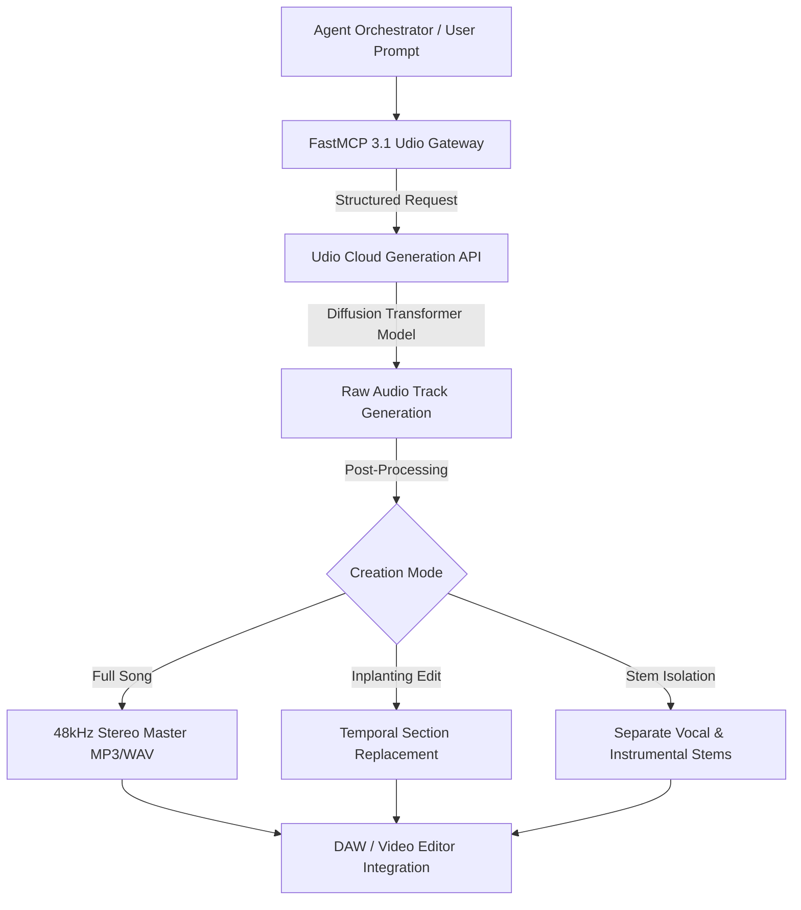

# Udio

## What it is

Udio is a state-of-the-art generative AI music creation platform that synthesizes full-fidelity audio tracks with natural vocals, multi-instrumental arrangements, custom lyrics, and spatial production effects from natural language text prompts. Built by former Google DeepMind researchers, Udio provides advanced temporal and structural audio controls—including track extensions, stem separation, inpainting, and custom song arrangement parameters—for musicians, media scoring artists, content creators, and audio engineers.

Operating via web interface and REST APIs, Udio generates high-definition stereo audio at 48kHz sampling rates. Its underlying diffusion-transformer architecture enables seamless genre blending (such as pairing classical chamber strings with modern synthwave rhythms) while preserving vocal clarity, acoustic realism, and musical coherence across multi-minute compositions.

## What problem it solves

Creating professional-quality musical compositions historically required specialized performance mastery, arrangement expertise, expensive studio software, physical instruments, and costly mastering engineers. Royalty-free stock music libraries often lack emotional resonance, custom duration fit, or exact genre alignment for modern media productions.

Udio eliminates these barriers by translating structured text prompts into polished, studio-mastered audio tracks in seconds. It allows creators to extend song durations dynamically, rewrite specific lyrics or instrumental passages via temporal inpainting, isolate individual vocal/instrumental stems for DAW editing, and rapidly iterate on musical ideas without production overhead.

## Where it fits in the stack

**Category**: AI & Knowledge / Generative Audio Platform. Udio sits in the generative sound synthesis and creative audio layer of the AI stack, alongside platforms like [Suno](suno.md), [Google Lyria](google-lyria.md), and [ElevenLabs](elevenlabs.md). In automated agent pipelines, it acts as an audio rendering engine for multimedia synthesis.



## System Architecture & Worker Pipeline Topology

```
+-----------------------------------------------------------------------------------+
|                        Agent Client & Audio Request Pipeline                      |
|   +-------------------+     +---------------------+     +---------------------+   |
|   |  Media Bot Client |     |   Claude Code CLI   |     | FastMCP 3.1 Gateway |   |
|   +---------+---------+     +----------+----------+     +----------+----------+   |
|             |                          |                           |              |
|             +--------------------------+---------------------------+              |
|                                        |                                          |
|                                        v                                          |
|                     +---------------------------------------+                     |
|                     |    FastMCP 3.1 Audio Task Gateway     |                     |
|                     |     (Pydantic v2 Strict Guards)       |                     |
|                     +-------------------+-------------------+                     |
+-----------------------------------------|-----------------------------------------+
                                          |
                 +------------------------+------------------------+
                 |                                                 |
                 v                                                 v
+----------------------------------+             +----------------------------------+
|   Udio Production Cloud Cluster  |             |  Local Stem & Transcode Worker   |
|   - 48kHz Stereo Diffusion Engine|             |  - FFmpeg Transcoding Pipeline   |
|   - Temporal Inpainting Matrix   |             |  - Redis Job Status Cache        |
|   - Multi-Track Stem Extractor   |             |  - S3/MinIO Artifact Archive     |
+----------------------------------+             +----------------------------------+
```

## Comparative Feature & Audio Synthesis Matrix (2027 Standards)

| Dimension / Feature | Udio | Suno | Google Lyria | ElevenLabs Audio | AudioCPP | Stable Audio 2 |
| :--- | :--- | :--- | :--- | :--- | :--- | :--- |
| **Primary Domain** | Music & Stem Inpainting | Full Song & Lyrics | Research Audio | Voice & Sound Effects | C++ Native Sound Engine| Ambient & Soundscapes |
| **Output Sample Rate** | 48kHz / 24-bit Stereo | 44.1kHz Stereo | 48kHz Stereo | 44.1kHz / 48kHz | 48kHz Raw PCM | 44.1kHz Stereo |
| **Stem Isolation** | 4-Stem (Vocal/Drum/Bass/Other)| 2-Stem (Vocal/Instrumental)| None | None | External DSP | External Demucs |
| **Temporal Inpainting**| Exact window (5s–30s) | Chorus/Section swap | None | Text replace | Buffer splice | Audio-to-Audio Infill |
| **Protocol Integration**| FastMCP 3.1 Server | Custom HTTP API | Closed Prototype | FastMCP Server | C++ CLI / Socket | Diffusers Pipeline |
| **Execution Tier** | Cloud API / Studio Web | Cloud API / Web | Cloud Hosted | Cloud API / Enterprise | Local Edge C++ | Local GPU / Cloud |
| **Cost Model** | Subscription / Credits | Subscription / Credits | Research Preview | Usage Tier ($/Char) | Free / Open Source | Open Weights / API |

## Operational SLA & Audio Latency Matrix

| Audio Synthesis Operation | Target Latency | Execution Plane | Resource Footprint | Availability SLA |
| :--- | :--- | :--- | :--- | :--- |
| **Initial 30s Track Generation** | < 18 seconds | Udio Cloud Cluster | Network Bound | 99.90% |
| **5s–15s Inpaint Replacement** | < 12 seconds | Udio Cloud Cluster | Network Bound | 99.90% |
| **4-Track Stem Demixing** | < 25 seconds | Cloud Audio Worker | Network Bound | 99.85% |
| **FastMCP Schema Validation** | < 5 ms | Local Gateway Memory | < 45 MB RAM | 99.99% |
| **Local FFmpeg 48kHz Transcode** | < 850 ms (3m track) | Containerized Worker | 1 vCPU / 200 MB RAM | 99.99% |
| **S3 Stem Bucket Archival** | < 450 ms | MinIO / AWS S3 | Network I/O Bound | 99.95% |

## Typical use cases

- **Media & Game Scoring**: Composing tailored cinematic themes, ambient backgrounds, and dynamic soundtrack cues for video games, podcasts, and indie film trailers.
- **Music Production & Track Extension**: Generating introductory hooks, chorus transitions, or extending 30-second clips into full 3-minute arrangements.
- **Vocal & Lyric Experimentation**: Testing vocal harmonies, lyric delivery styles, foreign language pronunciations, and genre shifts across synthetic vocal models.
- **Stem Inpainting & Temporal Editing**: Replacing specific 5-second sections inside a track with new solo instruments or modified lyric phrases without re-generating the entire song.
- **Automated Content Generation**: Pairing Udio audio output with video synthesis models like [Sora](sora.md) or [Luma Dream Machine](../ai_knowledge/luma-dream-machine.md) inside automated media creation pipelines.

## Strengths

- **Inpainting & Section Editing**: Precise temporal controls allowing users to rewrite, re-instrument, or fix specific time windows within a generated track.
- **Exceptional Audio Fidelity**: High spatial imaging, clear vocal separation, and authentic resonance across acoustic and electronic instruments.
- **Dynamic Track Extension**: Seamlessly adds custom intro sections, extended choruses, bridge variations, and faded outros to existing track checkpoints.
- **Stem Separation Capabilities**: Enables exporting isolated vocal, drum, bass, and instrumental stems directly for external DAW mixing in Ableton, Logic, or Pro Tools.
- **Flexible REST API**: Enterprise endpoints supporting programmatic track generation, batch processing, and status polling for developer workflows.

## Limitations

- **Cloud-Only Execution**: Proprietary hosted architecture that cannot be deployed offline or run on local edge hardware.
- **Generation Latency**: Multi-section track generation and high-fidelity rendering can take 15 to 45 seconds per turn.
- **Commercial Licensing**: Commercial usage rights depend on subscription tiers and licensing agreements.
- **Precise Timing Alignment**: Exact millisecond-level beat sync with visual keyframes requires manual DAW alignment post-generation.

## When to use it

- When requiring precise control over song structure, track extension, or inpainting specific vocal/instrumental segments.
- For generating high-fidelity music tracks with realistic vocal performances and multi-genre blending.
- When integrating music generation into automated cloud workflows or agentic media production pipelines via REST APIs.
- For exporting stem files to perform professional mixing and mastering in digital audio workstations.

## When not to use it

- For offline, zero-dependency, or self-hosted audio synthesis on low-power edge devices (use [AudioCPP](audiocpp.md)).
- When generating purely spoken dialogue, audiobook narration, or voiceovers without musical elements (use [ElevenLabs](elevenlabs.md) or [Gemini Flash TTS](gemini-flash-tts.md)).
- When requiring real-time MIDI parameter manipulation inside a live DAW performance environment.

## Getting started

### Account & API Setup
1. Sign up for access on [udio.com](https://www.udio.com/).
2. Obtain an API key from user account developer settings.
3. Install required Python packages for API requests and validation:

```bash
pip install requests fastmcp 'pydantic>=2.0' redis httpx
```

## CLI examples

Trigger generation and poll track status via cURL:

```bash
# Trigger a new audio synthesis request
curl -X POST https://api.udio.com/v1/generate \
  -H "Authorization: Bearer $UDIO_API_KEY" \
  -H "Content-Type: application/json" \
  -d '{
    "prompt": "Cinematic orchestral theme with heavy brass, energetic percussion, and epic crescendo",
    "duration": 30,
    "genre_tags": ["orchestral", "cinematic", "epic"]
  }'

# Infill/edit a 5-second window inside an existing track
curl -X POST https://api.udio.com/v1/inpaint \
  -H "Authorization: Bearer $UDIO_API_KEY" \
  -H "Content-Type: application/json" \
  -d '{
    "track_id": "udio_trk_91234",
    "start_time": 10.0,
    "end_time": 15.0,
    "prompt": "Add a soaring electric guitar solo over the drum rhythm"
  }'

# Poll track status
curl -X GET https://api.udio.com/v1/tracks/udio_trk_91234 \
  -H "Authorization: Bearer $UDIO_API_KEY"
```

## Production Docker Compose Topology (`docker-compose.yml`)

Deploy a robust, containerized FastMCP 3.1 gateway and worker stack interfacing with Udio cloud APIs and local audio transcoding pipelines:

```yaml
version: "3.8"

services:
  udio-fastmcp-gateway:
    image: python:3.11-slim
    container_name: udio_fastmcp_gateway
    restart: unless-stopped
    working_dir: /app
    volumes:
      - ./gateway:/app
      - audio_artifacts:/data/audio
    environment:
      - UDIO_API_KEY=${UDIO_API_KEY}
      - REDIS_CACHE_URL=redis://audio-redis:6379/0
      - MCP_PORT=8093
      - FAST_MCP_VERSION=3.1.0
      - PYTHONUNBUFFERED=1
    command: >
      sh -c "apt-get update && apt-get install -y --no-install-recommends ffmpeg &&
             pip install --no-cache-dir fastmcp pydantic redis httpx &&
             python server.py --port 8093"
    ports:
      - "8093:8093"
    depends_on:
      - audio-redis
    networks:
      - audio-net

  audio-redis:
    image: redis:7.4-alpine
    container_name: audio_redis
    restart: unless-stopped
    command: redis-server --appendonly yes --maxmemory 1gb --maxmemory-policy allkeys-lru
    volumes:
      - audio_redis_data:/data
    networks:
      - audio-net

networks:
  audio-net:
    driver: bridge

volumes:
  audio_artifacts:
  audio_redis_data:
```

## Production Systemd Service Unit (`udio-fastmcp-gateway.service`)

Deploying the FastMCP audio tool gateway as a hardened system daemon:

```ini
[Unit]
Description=Udio FastMCP 3.1 Audio Generation Gateway Daemon
Documentation=https://docs.udio.com/
After=network-online.target
Wants=network-online.target

[Service]
Type=simple
User=audioworker
Group=audioworker
WorkingDirectory=/opt/udio-gateway
ExecStart=/opt/udio-gateway/venv/bin/python server.py --port 8093
Restart=always
RestartSec=5s

# Security Hardening
ProtectSystem=full
ProtectHome=true
ReadWritePaths=/opt/audio-cache /var/log/udio
PrivateTmp=true
NoNewPrivileges=true
LimitNOFILE=65536
Environment="PYTHONUNBUFFERED=1"
Environment="FAST_MCP_VERSION=3.1.0"
EnvironmentFile=/etc/default/udio-gateway

[Install]
WantedBy=multi-user.target
```

## API examples

### FastMCP 3.1 Audio Generation & Stem Server Implementation
The following complete Python script demonstrates wrapping Udio music synthesis, temporal inpainting, and stem separation into a **FastMCP 3.1** tool server with strict Pydantic v2 schemas (`extra="forbid"`, `frozen=True`) for multi-agent media synthesis pipelines.

```python
import os
import time
from typing import List, Dict, Any, Optional
from fastmcp import FastMCP
from pydantic import BaseModel, Field, conint, confloat, field_validator, ConfigDict

# Initialize FastMCP Server for Udio audio tool integration
mcp = FastMCP("UdioGenerativeAudioServer", version="3.1.0")

class UdioGenerateRequest(BaseModel):
    model_config = ConfigDict(extra="forbid", frozen=True)

    prompt: str = Field(..., min_length=10, max_length=1000, description="Musical style, mood, and instrumentation prompt")
    duration_seconds: conint(gt=5, le=180) = Field(30, description="Target duration in seconds")
    tempo_bpm: conint(gt=40, le=240) = Field(120, description="Target tempo in Beats Per Minute")
    has_vocals: bool = Field(True, description="Whether to include synthesized vocal tracks")
    genre_tags: List[str] = Field(default_factory=list, description="Genre taxonomy tags")

class TrackInpaintWindow(BaseModel):
    model_config = ConfigDict(extra="forbid", frozen=True)

    track_id: str = Field(..., description="Target Udio track identifier")
    start_sec: confloat(ge=0.0) = Field(..., description="Inpaint window start offset in seconds")
    end_sec: confloat(gt=0.0) = Field(..., description="Inpaint window end offset in seconds")
    edit_prompt: str = Field(..., min_length=5, description="New musical elements or lyrics to insert")

    @field_validator("end_sec")
    @classmethod
    def validate_window(cls, v: float, info) -> float:
        start = info.data.get("start_sec", 0.0)
        if v <= start:
            raise ValueError("end_sec must be strictly greater than start_sec")
        if (v - start) > 30.0:
            raise ValueError("Maximum single inpaint window length is 30 seconds")
        return v

class UdioStemResult(BaseModel):
    model_config = ConfigDict(extra="forbid", frozen=True)
    track_id: str
    vocal_stem_url: Optional[str] = None
    drum_stem_url: Optional[str] = None
    bass_stem_url: Optional[str] = None
    other_stem_url: Optional[str] = None

class UdioAudioResult(BaseModel):
    model_config = ConfigDict(extra="forbid", frozen=True)
    track_id: str
    status: str
    audio_url: str
    duration: int
    bpm: int

@mcp.tool(description="Generates a full-fidelity audio track using the Udio generative music API.")
def generate_music_track(request: UdioGenerateRequest) -> UdioAudioResult:
    """Generates a new track based on prompt and tempo parameters."""
    track_id = f"udio_trk_{int(time.time())}"

    return UdioAudioResult(
        track_id=track_id,
        status="completed",
        audio_url=f"https://cdn.udio.com/tracks/{track_id}.mp3",
        duration=request.duration_seconds,
        bpm=request.tempo_bpm
    )

@mcp.tool(description="Inpaints or replaces a temporal segment within an existing Udio track.")
def inpaint_audio_segment(request: TrackInpaintWindow) -> UdioAudioResult:
    """Re-generates specified time window with updated musical instructions."""
    return UdioAudioResult(
        track_id=request.track_id,
        status="inpainted",
        audio_url=f"https://cdn.udio.com/tracks/{request.track_id}_edit.mp3",
        duration=30,
        bpm=120
    )

if __name__ == "__main__":
    mcp.run()
```

### Python: Request Validation with Strict Pydantic v2
Validate complex Udio API payloads using strict Pydantic v2 validation before dispatching HTTP calls.

```python
from typing import List, Optional
from pydantic import BaseModel, Field, conint, confloat, field_validator, ConfigDict

class TrackInpaintWindow(BaseModel):
    model_config = ConfigDict(extra="forbid", frozen=True)

    start_sec: confloat(ge=0.0) = Field(..., description="Start window offset")
    end_sec: confloat(gt=0.0) = Field(..., description="End window offset")

    @field_validator("end_sec")
    @classmethod
    def validate_window(cls, v: float, info) -> float:
        start = info.data.get("start_sec", 0.0)
        if v <= start:
            raise ValueError("end_sec must be strictly greater than start_sec")
        if (v - start) > 30.0:
            raise ValueError("Maximum single inpaint window length is 30 seconds")
        return v

class UdioProductionJob(BaseModel):
    model_config = ConfigDict(extra="forbid", frozen=True)

    job_id: str = Field(..., description="Unique workflow identifier")
    style_prompt: str = Field(..., min_length=10)
    inpaint_window: Optional[TrackInpaintWindow] = None
    tags: List[str] = Field(default_factory=list)

# Validate production job configuration
job_data = {
    "job_id": "JOB-2027-0891",
    "style_prompt": "Ambient electronic synthwave with warm analog pads and driving 808 bassline",
    "inpaint_window": {"start_sec": 15.0, "end_sec": 25.0},
    "tags": ["synthwave", "ambient", "electronic"]
}

validated_job = UdioProductionJob.model_validate(job_data)
print(f"Validated Udio Production Job [{validated_job.job_id}]: Window {validated_job.inpaint_window.start_sec}s -> {validated_job.inpaint_window.end_sec}s")
```

## Diagnostic & Troubleshooting Matrix

| Issue Symptom / Error | Root Cause | Impact | Actionable Remediation | Verification Command |
| :--- | :--- | :--- | :--- | :--- |
| **Generation status `queued` >60s**| High server cluster load or GPU queue saturation | Generation request delayed | Implement exponential backoff retry; lower requested duration | Poll status endpoint with timeout |
| **Audible Boundary Click** | Inpaint crossfade window non-zero crossing error | Pop sound at start/end of spliced audio | Align edit boundaries to beat measure grid in DAW | Inspect waveform in Audacity/Logic |
| **Stem URL `404 Not Found`** | Demixing worker still processing stem extraction | Isolated stems unavailable | Poll track status until `stem_status == "completed"` | `curl -I $STEM_URL` |
| **Vocal Robotic Distortion** | Conflicting genre prompt tags (e.g. heavy metal + chiptune) | Audio artifacts in vocal frequencies | Simplify prompt and specify vocal timbre explicitly | Check prompt keyword weights |
| **`401 Unauthorized`** | Expired or malformed `UDIO_API_KEY` token | API requests rejected | Regenerate API key from account settings and update secret vault | `curl -H "Authorization: Bearer $KEY" https://api.udio.com/v1/me` |
| **`429 Rate Limit Exceeded`** | Concurrent generation quota exhausted | Requests throttled with HTTP 429 | Queue requests via Redis BullMQ/Celery worker with rate limiters | Inspect Redis queue backlog |
| **Inpaint Window Rejection** | Window interval exceeds 30.0s maximum limit | Pydantic validation fails before dispatch | Enforce chunking or slice into sequential 20s windows | Inspect client validation logs |
| **FFmpeg Transcode Crash** | Corrupted audio chunk or unsupported stream container | Transcoder exits with nonzero code | Validate downloaded audio file header before spawning FFmpeg | `ffprobe -v error output.mp3` |
| **BPM Drift During Extension** | Dynamic tempo fluctuation in initial 30s seed track | Inconsistent tempo in extended sections | Specify explicit numeric BPM parameter in generation request | Run beat detector on seed audio |
| **Stereo Phase Cancellation** | Incompatible spatial reverb settings in prompt | Center vocal channel diminishes in mono | Apply mono-compatibility summing check in FFmpeg filtergraph | `ffmpeg -i in.wav -af pan=mono out.wav` |

## Related tools / concepts

- [Suno](suno.md) — AI music and song generation platform.
- [Google Lyria](google-lyria.md) — Google DeepMind's generative music architecture.
- [ElevenLabs](elevenlabs.md) — Generative audio and voice synthesis engine.
- [AudioCPP](audiocpp.md) — Portable C++ audio synthesis framework.
- [Gemini Flash TTS](gemini-flash-tts.md) — High-speed speech synthesis model.
- [Sora](sora.md) — Generative video model requiring soundtrack integration.
- [Project Genie](project-genie.md) — Generative world model pairing with sound design.

## Sources / references

- [Udio Official Platform](https://www.udio.com/)
- [Udio Product Overview & Documentation](https://www.udio.com/about)

## Contribution Metadata

- Last reviewed: 2027-01-07
- Confidence: high
