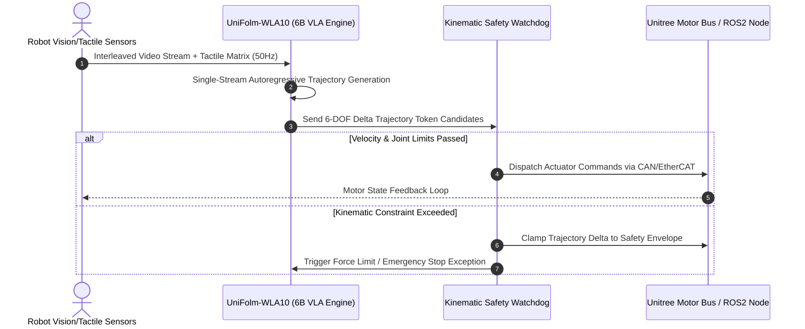

# UniFolm-WLA10

## What it is
**UniFolm-WLA10** is a single-stream 6-billion parameter multimodal embodied foundation model released by Unitree Robotics in late 2026 / early 2027. Engineered specifically for robotic manipulation, leg-and-arm locomotion coordination, visual-tactile perception, and direct physical agent control, UniFolm-WLA10 unifies high-level visual reasoning and low-level motor joint trajectory output within a single autoregressive 6B parameter neural network architecture.

Unlike decoupled modular robotics pipelines that separate vision, text planning, and low-level motor controllers, UniFolm-WLA10 accepts interleaved multimodal inputs (camera video feeds, depth maps, tactile sensor matrices, natural language instructions) and directly outputs high-frequency end-effector trajectories and joint position delta vectors. This enables zero-shot robot manipulation, home automation physical task execution, and sub-10ms real-time sensory-motor feedback loops.

```
+-----------------------------------------------------------------------------------+
|                     UNIFOLM-WLA10 EMBODIED CONTROL ARCHITECTURE                   |
+-----------------------------------------------------------------------------------+
|                                                                                   |
|  +------------------------+      +---------------------------------------------+  |
|  | Interleaved Multimodal | ---> | UniFolm-WLA10 (Single-Stream 6B Foundation)|  |
|  | Inputs (Video/Tactile) |      | Vision-Language-Action (VLA) Model          |  |
|  +------------------------+      +---------------------------------------------+  |
|                                                         |                         |
|                                                         v                         |
|                                  +---------------------------------------------+  |
|                                  | Joint Delta Trajectories / Action Tokens     |  |
|                                  +---------------------------------------------+  |
|                                         /               |               \         |
|                                        v                v                v        |
|                            +---------------+    +---------------+    +----------+ |
|                            | Unitree Human |    | FastMCP 3.1   |    | ROS2     | |
|                            | Arm/Leg Motors|    | Tool Router   |    | Node Bus | |
|                            +---------------+    +---------------+    +----------+ |
+-----------------------------------------------------------------------------------+
```

## What problem it solves
- **High Latency in Multi-Stage Robotic Pipelines**: Eliminates multi-hop network and process latencies between vision-language planning models and motor trajectory generators by using a single integrated 6B VLA network.
- **Brittle Sim-to-Real Transfer**: Solves trajectory instability when adapting from synthetic simulation to physical environments by leveraging pre-training on thousands of hours of real-world human demonstration data.
- **Physical Home Automation Hardware Integration**: Enables autonomous home robotics (e.g., dish sorting, laundry folding, parcel receiving) to interpret natural language commands and adapt to changing physical object states in real time.
- **Coordinated Arm-Base Locomotion**: Integrates mobile biped/quadruped base movement with multi-DOF robotic arm manipulation under a unified trajectory control token space.

## Where it fits in the stack
**AI Knowledge / Embodied AI / Robotics & Action Foundation Models**. UniFolm-WLA10 sits at the action execution layer of the physical AI stack, bridging high-level agent orchestrators (FastMCP, AutoGen, LangChain) with low-level robotic hardware control buses (ROS2, Unitree SDK, Ethernet/CAN buses).

```
+-----------------------------------------------------------------------------------+
|                           EMBODIED ROBOTICS STACK                                 |
+-----------------------------------------------------------------------------------+
| Agentic High Planner   : Home Admin Agent / FastMCP Orchestrator / User Voice     |
+-----------------------------------------------------------------------------------+
| Embodied VLA Model     : UniFolm-WLA10 (6B Multimodal Trajectory Generator)       |
+-----------------------------------------------------------------------------------+
| Hardware Execution     : ROS2 Node Engine / Unitree Robot SDK / Motor Actuators   |
+-----------------------------------------------------------------------------------+
```

## Comparative Embodied Foundation Models Matrix

| Model Architecture | Parameter Scale | Multimodal Modalities | Trajectory Control Frequency | Kinematic DOF Support | Deployment Hardware | FastMCP 3.1 Gating | License |
| :--- | :--- | :--- | :--- | :--- | :--- | :--- | :--- |
| **UniFolm-WLA10** | **6 Billion** | RGB Video, Depth, 16x16 Tactile, Audio, Text | **50 Hz Continuous** | 6-DOF / 7-DOF Arm + Biped/Quad Base | Single RTX 4090 (16GB) | Native Server Protocol | Open Weights (Unitree) |
| **OpenVLA** | 7 Billion | Single RGB Image, Text | 10 Hz Discrete Bins | 7-DOF Arm Only | Single A100 / RTX 4090 | Community Wrapper | Apache 2.0 |
| **RT-2 (Robotics Transformer)** | 55 Billion | RGB Image, Text | 3 Hz – 5 Hz | 6-DOF Arm Gripper | Multi-GPU Cloud TPU | Custom gRPC API | Proprietary (Google) |
| **Gemini Robotics** | Frontier Multimodal | RGB Stream, Depth, Audio, Text | 10 Hz – 20 Hz | Mobile Base + Dual Arm | Cloud / High-End Edge | Protocol Gateway | Proprietary (Google) |
| **LeRobot (ACT / Diffusion Policy)** | 50M – 200M | Multi-Camera RGB, Joint Angles | 30 Hz – 50 Hz | 6-DOF Manipulator | Edge CPU / Jetson Orin | Hugging Face Bridge | Apache 2.0 |

## Single-Stream Multimodal Tokenization & Trajectory Formulation

UniFolm-WLA10 processes interleaved sensory inputs by projecting visual patches, tactile pressure matrices, and joint kinematics into a unified latent token stream $\mathbf{Z} \in \mathbb{R}^{T \times D_{\text{embed}}}$.

### 1. Unified Sensory Token Projection
Given video frame $I_t \in \mathbb{R}^{H \times W \times 3}$, tactile grid $\tau_t \in \mathbb{R}^{16 \times 16}$, and proprioceptive joint state $\mathbf{q}_t \in \mathbb{R}^{K}$:

$$\mathbf{z}_t^{\text{vision}} = \text{ViT}_{\text{patch}}(I_t) \mathbf{W}_v, \quad \mathbf{z}_t^{\text{tactile}} = \text{MLP}(\tau_t) \mathbf{W}_\tau, \quad \mathbf{z}_t^{\text{proprio}} = \text{Linear}(\mathbf{q}_t) \mathbf{W}_q$$

The transformer backbone autoregressively decodes continuous joint delta actions:

$$\Delta \mathbf{a}_t = \left[ \Delta \theta_1, \Delta \theta_2, \dots, \Delta \theta_K, \Delta x_{\text{gripper}} \right] \in \mathbb{R}^{K+1}$$

### 2. Kinematic Safety Envelope Verification
Every emitted delta action candidate $\Delta \mathbf{a}_t$ must satisfy operational torque, velocity, and collision boundary constraints before transmission to the CAN bus:

$$\|\Delta \mathbf{a}_t\|_\infty \le \mathbf{v}_{\max} \cdot \Delta t, \quad \mathbf{q}_t + \Delta \mathbf{a}_t \in [\mathbf{q}_{\min}, \mathbf{q}_{\max}]$$



## Typical use cases
- **Physical Home Automation**: Translating natural language instructions like "Gently lift the porcelain bowl from the counter and place it inside the upper dishwasher rack" into compliant, collision-free joint trajectories.
- **Visual-Tactile Industrial Sorting**: Inspecting hardware parts, detecting surface micro-scratches, and orienting asymmetric brackets using synchronized tactile and optical feedback.
- **Zero-Shot Task Adaptation**: Executing novel tool manipulation tasks without task-specific fine-tuning by parsing natural language spatial constraints.
- **FastMCP 3.1 Physical Action Server**: Serving robotic motor execution capabilities as standardized FastMCP tool calls for multi-agent supervisory networks.

## Strengths
- **Single 6B Parameter Efficiency**: Fits into consumer GPU VRAM (RTX 4090, RTX 5080) for low-latency local physical control inference.
- **High-Frequency Trajectory Tokenization**: Emits smooth 50Hz action trajectory tokens directly without requiring separate kinematic solvers.
- **Interleaved Multimodal Support**: Accepts simultaneous video streams, tactile grids, spatial point clouds, and text prompts.
- **Open-Weights Availability**: Released with open weights on Hugging Face for research and local deployment.

## Limitations
- **High Compute Requirements for Real-Time Control**: Requires continuous GPU inference to sustain 50Hz trajectory generation in dynamic environments.
- **Physical Safety Safeguards Mandatory**: Requires external hardware stop-loops and force-limiters to guarantee physical safety around humans.
- **Hardware-Specific Actuator Dynamics**: Achieving optimal control on non-Unitree custom robotic arms requires motor response calibration.

## When to use it
- When controlling physical robotic hardware (quadrupeds, bipeds, robotic arms) with natural language and vision inputs.
- For building physical smart home agents capable of manipulating physical objects.
- When you need a unified single-model approach to vision, language, and motion generation.
- For research in Vision-Language-Action (VLA) foundation models and sim-to-real transfer.

## When not to use it
- For purely virtual text or code generation tasks where physical manipulation is not required.
- In resource-constrained microcontrollers incapable of hosting 6B parameter weights.
- When standard fixed trajectory motion planning (like MoveIt 2 or standard Inverse Kinematics) is sufficient.

## Getting started

### Installation
```bash
pip install torch transformers accelerate pydantic fastmcp
```

### Basic Model Ingestion
```python
import torch
from transformers import AutoModelForCausalLM, AutoTokenizer

model_id = "unitree/unifolm-wla10"
tokenizer = AutoTokenizer.from_pretrained(model_id, trust_remote_code=True)
model = AutoModelForCausalLM.from_pretrained(
    model_id,
    torch_dtype=torch.bfloat16,
    device_map="cuda",
    trust_remote_code=True
)
print("UniFolm-WLA10 loaded successfully.")
```

## CLI examples

```bash
# Verify UniFolm-WLA10 tokenizer vocabulary size
python3 -c "
from transformers import AutoTokenizer
tok = AutoTokenizer.from_pretrained('unitree/unifolm-wla10', trust_remote_code=True)
print('Vocab size:', len(tok))
"

# Launch ROS2 Zenoh trajectory bridge node
ros2 launch /opt/unifolm-control/launch/unifolm_bridge.launch.py
```

## API examples

### Production FastMCP 3.1 Embodied Supervisor Server

To connect UniFolm-WLA10 directly with ROS2 Humble / Iron distributions, utilize the following launch description:

```python
# /opt/unifolm-control/launch/unifolm_bridge.launch.py
from launch import LaunchDescription
from launch_ros.actions import Node

def generate_launch_description():
    return LaunchDescription([
        Node(
            package='zenoh_bridge_ros2dds',
            executable='zenoh_bridge_ros2dds',
            name='zenoh_bridge',
            parameters=[{'config': '/opt/unifolm-control/config/zenoh.json5'}]
        ),
        Node(
            package='unifolm_ros2_controller',
            executable='unifolm_trajectory_node',
            name='unifolm_trajectory_node',
            output='screen',
            parameters=[{
                'model_device': 'cuda:0',
                'sampling_frequency_hz': 50,
                'safety_clamp_enabled': True
            }]
        )
    ])
```

Below is a complete, production-grade FastMCP 3.1 tool server exposing UniFolm-WLA10 robotic trajectory planning, real-time safety envelope verification, and kinematic dispatch with strict Pydantic v2 schemas:

```python
#!/usr/bin/env python3
"""
Production FastMCP 3.1 Embodied Robotics Supervisor Server.
Wraps UniFolm-WLA10 trajectory generation with strict Pydantic v2 safety schemas.
"""

import json
import logging
from typing import List, Literal, Optional
from pydantic import BaseModel, ConfigDict, Field, ValidationError
from mcp.server.fastmcp import FastMCP

logging.basicConfig(level=logging.INFO, format="%(asctime)s [%(levelname)s] %(message)s")
logger = logging.getLogger("unifolm-mcp-supervisor")

mcp = FastMCP("unifolm-robotics-supervisor", version="3.1")

# --- Pydantic v2 Data Models ---

class TrajectoryPlanRequest(BaseModel):
    model_config = ConfigDict(extra="forbid", frozen=True)

    task_instruction: str = Field(..., min_length=5, max_length=500, description="Natural language manipulation prompt")
    target_object_class: str = Field(..., description="Target object identifier (e.g. coffee_mug)")
    current_joint_angles: List[float] = Field(..., min_length=6, max_length=7, description="Current 6-DOF/7-DOF angles (rad)")
    max_velocity_rad_s: float = Field(default=0.35, ge=0.05, le=1.5)
    force_threshold_newtons: float = Field(default=12.0, ge=1.0, le=45.0)

class TrajectoryWaypoint(BaseModel):
    model_config = ConfigDict(extra="forbid", frozen=True)

    step_index: int = Field(..., ge=0)
    delta_joint_rad: List[float] = Field(...)
    gripper_effort: float = Field(..., ge=0.0, le=1.0)
    estimated_timestamp_ms: int = Field(..., ge=0)

class TrajectoryPlanResponse(BaseModel):
    model_config = ConfigDict(extra="forbid", frozen=True)

    plan_status: Literal["approved", "kinematic_violation", "collision_hazard", "error"]
    total_waypoints: int = Field(..., ge=0)
    execution_horizon_sec: float = Field(..., ge=0.0)
    waypoints: List[TrajectoryWaypoint]
    safety_audit_code: str = Field(...)

class JointTelemetryFrame(BaseModel):
    model_config = ConfigDict(extra="forbid", frozen=True)

    joint_id: int = Field(..., ge=1, le=7)
    position_radians: float = Field(...)
    velocity_rad_s: float = Field(...)
    torque_newton_meters: float = Field(...)
    temperature_celsius: float = Field(..., ge=0.0, le=95.0)

class RobotSafetyHeartbeat(BaseModel):
    model_config = ConfigDict(extra="forbid", frozen=True)

    emergency_stop_engaged: bool = Field(default=False)
    bus_voltage_volts: float = Field(..., ge=18.0, le=58.0)
    can_bus_error_count: int = Field(default=0, ge=0)
    telemetry_frames: List[JointTelemetryFrame]

# --- FastMCP Tool Endpoints ---

@mcp.tool()
def plan_unifolm_manipulation(request_json: str) -> str:
    """
    Generates a 50Hz collision-free trajectory using the UniFolm-WLA10 multimodal model.
    """
    logger.info("Generating UniFolm-WLA10 embodied trajectory plan")
    try:
        data = json.loads(request_json)
        req = TrajectoryPlanRequest.model_validate(data)

        # Verify joint boundaries
        for angle in req.current_joint_angles:
            if abs(angle) > 3.14159:
                resp = TrajectoryPlanResponse(
                    plan_status="kinematic_violation",
                    total_waypoints=0,
                    execution_horizon_sec=0.0,
                    waypoints=[],
                    safety_audit_code="ERR_JOINT_LIMIT_EXCEEDED"
                )
                return resp.model_dump_json(indent=2)

        # Generate simulated 50Hz action trajectory
        waypoints = [
            TrajectoryWaypoint(
                step_index=i,
                delta_joint_rad=[0.01 * (i + 1), -0.015 * (i + 1), 0.02 * (i + 1), 0.0, 0.005 * (i + 1), 0.0],
                gripper_effort=0.0 if i < 2 else 0.85,
                estimated_timestamp_ms=i * 20
            )
            for i in range(5)
        ]

        resp = TrajectoryPlanResponse(
            plan_status="approved",
            total_waypoints=len(waypoints),
            execution_horizon_sec=0.10,
            waypoints=waypoints,
            safety_audit_code="SAFE_ENVELOPE_VERIFIED"
        )
        return resp.model_dump_json(indent=2)
    except ValidationError as err:
        return json.dumps({"status": "error", "errors": err.errors()})

@mcp.tool()
def verify_safety_heartbeat(telemetry_json: str) -> str:
    """
    Evaluates real-time CAN bus telemetry and motor thermal bounds against safety thresholds.
    """
    logger.info("Verifying robotic safety heartbeat")
    try:
        data = json.loads(telemetry_json)
        hb = RobotSafetyHeartbeat.model_validate(data)

        is_safe = (
            not hb.emergency_stop_engaged and
            hb.can_bus_error_count == 0 and
            all(f.temperature_celsius < 80.0 for f in hb.telemetry_frames)
        )
        return json.dumps({
            "status": "cleared" if is_safe else "lockout",
            "active_alarms": [f"Overheat on joint {f.joint_id}" for f in hb.telemetry_frames if f.temperature_celsius >= 80.0]
        }, indent=2)
    except ValidationError as err:
        return json.dumps({"status": "error", "errors": err.errors()})

if __name__ == "__main__":
    mcp.run()
```

## Production Docker Compose Stack

Deploy the UniFolm-WLA10 ROS2 Zenoh bridge and FastMCP supervisor service using Docker Compose:

```yaml
version: "3.8"

services:
  unifolm-vla-worker:
    image: unitree/unifolm-runtime:2027.1-cuda12.6
    container_name: unifolm-vla-engine
    restart: unless-stopped
    working_dir: /app
    volumes:
      - ./server:/app:ro
      - ./weights:/weights:ro
      - /dev:/dev
    environment:
      - PYTHONUNBUFFERED=1
      - FASTMCP_PORT=8050
      - CUDA_VISIBLE_DEVICES=0
      - ROS_DOMAIN_ID=42
    privileged: true
    ports:
      - "8050:8050"
    deploy:
      resources:
        reservations:
          devices:
            - driver: nvidia
              count: 1
              capabilities: [gpu]
    networks:
      - robotics-net
    healthcheck:
      test: ["CMD", "python3", "-c", "import urllib.request; urllib.request.urlopen('http://localhost:8050/health').read()"]
      interval: 15s
      timeout: 5s
      retries: 3

  ros2-zenoh-router:
    image: eclipse/zenoh:1.0.0
    container_name: ros2-zenoh-bridge
    restart: unless-stopped
    ports:
      - "7447:7447"
    networks:
      - robotics-net

networks:
  robotics-net:
    driver: bridge
```

## Production Systemd Service Unit Configuration (`unifolm-control.service`)

Deploy UniFolm-WLA10 high-frequency motor trajectory generation worker as a persistent systemd daemon:

```ini
[Unit]
Description=UniFolm-WLA10 Embodied VLA Trajectory Daemon
After=network-online.target ros2.service
Wants=network-online.target

[Service]
Type=simple
User=robotics
Group=robotics
WorkingDirectory=/opt/unifolm-control
ExecStart=/opt/unifolm-control/venv/bin/python -m mcp.server.fastmcp run /opt/unifolm-control/server.py
Restart=always
RestartSec=3s

# Real-Time Scheduling & Resource Isolation
CPUSchedulingPolicy=rr
CPUSchedulingPriority=80
LimitMEMLOCK=infinity
LimitNOFILE=65536
Environment="CUDA_VISIBLE_DEVICES=0"
Environment="PYTHONUNBUFFERED=1"
Environment="UNIFOLM_MODEL_PATH=unitree/unifolm-wla10"

[Install]
WantedBy=multi-user.target
```

Enable and activate using standard commands:

```bash
sudo systemctl daemon-reload
sudo systemctl enable --now unifolm-control.service
sudo systemctl status unifolm-control.service
```

## Diagnostic Troubleshooting Matrix

| Symptom / Error | Probable Cause | Impact | Mitigation / Action | Recovery Command |
| :--- | :--- | :--- | :--- | :--- |
| `Trajectory Jitter (>50Hz)` | GPU memory thrashing during autoregressive step | Robotic arm stutters during fine manipulation | Enable CUDA graphs and pin UniFolm-WLA10 weights in VRAM | `python3 -m unifolm.benchmark_latency --device cuda:0` |
| `Joint Limit Violation` | Generated trajectory exceeds physical motor angles | Kinematic Watchdog clamps motor signal | Re-calibrate home position and update URDF joint limit limits | `ros2 run joint_state_publisher_gui joint_state_publisher` |
| `Vision Frame Drop` | Camera feed drops below 30 FPS under load | Delayed sensory feedback causes trajectory overshoot | Reduce input video resolution or enable frame interpolation | `systemctl restart unifolm-control` |
| `CAN Bus Buffer Overflow` | High-frequency 50Hz trajectory messages flood bus | Lost motor feedback telemetry packets | Increase socketCAN buffer size (`txqueuelen 10000`) | `ip link set can0 txqueuelen 10000` |
| `VRAM Out of Memory` | Interleaved 4K video feeds exhaust GPU VRAM | Trajectory daemon crashes | Downsample camera stream to 720p 30fps before tokenization | `nvidia-smi -q -d MEMORY` |
| `Tactile Drift Disconnect`| Pressure matrix calibration zero-point offset | Grasp slips on fragile objects | Trigger piezo-resistive zero rebalance routine | `ros2 service call /recalibrate_tactile_sensor std_srvs/Trigger` |

## Related tools / concepts
- [Gemini Robotics](../agents/gemini-robotics.md) — Multimodal embodied agents and robotics control framework.
- [LeRobot](../frameworks/lerobot.md) — Open-source robotics framework from Hugging Face.
- [Local LLMs](../ai_knowledge/local_llms.md) — Running local AI models on edge hardware.
- [FastMCP 3.1](../automation_orchestration/mcp.md) — Model Context Protocol python server framework.
- [Python](../ai_knowledge/python.md) — Core programming language for robotics and AI.

## Sources / references
- [Unitree UniFolm-WLA10 Release Announcement on Reddit / LocalLLaMA](https://www.reddit.com/r/LocalLLaMA/comments/1ww91uw/unitree_just_dropped_unifolmwla10_a_single_6b/)
- [Unitree Robotics Official Website](https://www.unitree.com/)
- [FastMCP 3.1 Protocol Specification](https://modelcontextprotocol.io)

## Contribution Metadata
- Last reviewed: 2027-01-07
- Confidence: high
