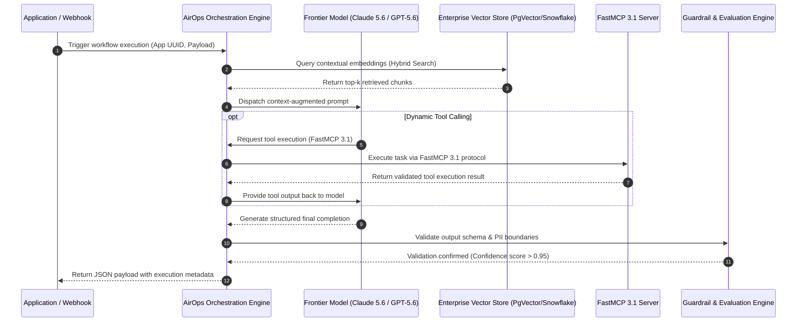

# AirOps

## What it is
AirOps is an enterprise AI platform designed for building, evaluating, and scaling AI-powered applications, agentic workflows, and tool orchestrations. It provides a visual collaborative studio for engineering and product teams to design complex multi-step prompt chains, evaluate outputs against standardized test sets, and deploy scalable workflows as low-latency APIs or tool servers. As of early 2027, AirOps offers native integration with the **Model Context Protocol (MCP 3.1)** and **FastMCP 3.1 Task Protocol**, enabling seamless orchestration of autonomous workflows powered by frontier foundation models such as **Claude 5.6**, **GPT-5.6**, **Gemini 4.0 Ultra**, **Gemma 4**, **DeepSeek-V4**, and **Qwen 3.6 VL**.

## What problem it solves
Transitioning AI applications from quick prototypes to production-grade enterprise operations presents severe technical challenges: managing prompt versioning, enforcing schema validation, preventing data leaks, evaluating retrieval accuracy, and maintaining low latency at scale. AirOps solves these challenges by providing managed enterprise infrastructure with built-in guardrails, automated evaluations, version control, and auditable data pipelines:

```
[Business Trigger] --> [AirOps Task Orchestrator] --> [Multi-Model / RAG Pipeline] --> [FastMCP 3.1 Tools] --> [Enterprise Output]
```

It removes the burden of custom container cluster maintenance, API routing logic, and manual prompt tracking while providing continuous performance and reliability metrics.

## System Architecture

The following diagram illustrates how the AirOps platform coordinates multi-model execution, RAG retrieval, FastMCP 3.1 tool invocation, and continuous evaluation guardrails:

```
+-----------------------------------------------------------------------------------+
|                              AIROPS ENTERPRISE PLATFORM                            |
+-----------------------------------------------------------------------------------+
                                          |
                                          v
+------------------+             +------------------+             +-----------------+
| Webhook / API    | ----------> | AirOps Worklow   | ----------> | Vector Database |
| Trigger Client   |             | Execution Engine |             | (Snowflake/Pg)  |
+------------------+             +------------------+             +-----------------+
                                          |                                |
                                          v                                v
                                 +------------------+             +-----------------+
                                 | FastMCP 3.1 Tool | <---------> | Frontier Models |
                                 | Router Gateway   |             | (Claude 5.6 /   |
                                 +------------------+             |  GPT-5.6)       |
                                          |                       +-----------------+
                                          v
                                 +------------------+
                                 | Guardrails &     |
                                 | Pydantic v2 Eval |
                                 +------------------+
```



## Where it fits in the stack
**Automation & Orchestration / Enterprise AI Platform**. AirOps acts as the centralized middleware orchestration plane between foundation LLM providers and core business applications or databases, managing prompt templates, routing, and tool interactions.

```
+-------------------------------------------------------------------------------+
|                        AIROPS STACK INTEGRATION                               |
+-------------------------------------------------------------------------------+
| Layer                       | System / Tool Examples                          |
+-----------------------------+-------------------------------------------------+
| Application / Consumers     | Web Apps, Slack Bots, CRM Systems, Dashboards   |
| Orchestration & Studio      | AirOps Platform, FastMCP 3.1 Gateway            |
| Data & Storage              | PostgreSQL, Snowflake, BigQuery, Qdrant         |
| Security & Secrets          | HashiCorp Vault, AWS Secrets Manager            |
| Foundation Models           | Claude 5.6, GPT-5.6, Gemini 4.0, Gemma 4        |
+-------------------------------------------------------------------------------+
```

## Platform Comparison Matrix

| Feature / Metric | AirOps | Gumloop | n8n | Dify |
| :--- | :--- | :--- | :--- | :--- |
| **Primary Focus** | Enterprise AI Applications | Visual AI Workflow Builder | General Workflow Automation | Open-Source LLM App Studio |
| **Target Audience** | Enterprise Dev & Product Teams | Growth & Operations Teams | Technical Ops & Developers | Developers & Self-Hosters |
| **FastMCP 3.1 Support** | Native Task Protocol Server | Webhook/API Adapters | Community / Custom Nodes | Native Plugin Ecosystem |
| **Deployment Options** | Managed Enterprise SaaS | Managed SaaS | Self-Hosted / Cloud | Self-Hosted / Cloud |
| **Continuous Evaluation** | Built-in Automated Eval Suites | Basic Node Testing | Manual Test Execution | Integrated Eval Datasets |
| **Enterprise Governance** | Role-Based Control, Audit Logs | Team Workspace Limits | RBAC on Enterprise Tier | Tenant & Workspace Isolation |
| **Data Connector Support** | Snowflake, BigQuery, Postgres | Web Apps & Notion | 400+ SaaS Connectors | SQL & Vector Database Native |

## Typical use cases
- **Enterprise RAG Systems**: Implementing high-precision Retrieval-Augmented Generation across data warehouses with custom re-ranking strategies and human-in-the-loop validation checkpoints.
- **Intelligent Process Automation (IPA)**: Automating complex document parsing, contract risk assessments, and customer support ticket triage.
- **Autonomous Market & Competitive Intelligence**: Orchestrating autonomous research workflows that combine web search APIs (e.g., [Tavily](../providers/tavily.md)) with financial data stores to compile automated reports.
- **Custom AI SaaS Middleware**: Hosting multi-tenant API backends for client-facing AI applications with automated tenant isolation and usage metering.
- **Enterprise Knowledge Base Integration**: Unifying distributed corporate data stores into queryable AI agents integrated with tools like [AnythingLLM](../ai_knowledge/anythingllm.md) or [mem0](../agents/mem0.md).

## Strengths
- **Collaborative Visual Studio**: Bridges the gap between non-technical domain experts and software engineers for visual prompt engineering and flow design.
- **FastMCP 3.1 Task Protocol Native**: Full support for Model Context Protocol 3.1 task management specifications for standard agent-to-tool integration.
- **High Scalability & Low Latency**: Engineered to handle high transaction volumes with low latency execution routing and real-time performance telemetry.
- **Built-in Guardrails & Audit Trails**: Enterprise governance featuring automated PII masking, schema validation, and complete execution history logging.
- **Rich Enterprise Data Connectors**: Direct integration with major cloud databases (Postgres, Snowflake, BigQuery) and vector stores.

## Limitations
- **Commercial Pricing Model**: Tailored for mid-market and enterprise teams; pricing may be cost-prohibitive for hobbyist developers.
- **Managed Platform Dependency**: Core execution logic runs within AirOps managed infrastructure, creating vendor-managed operational dependencies.
- **Initial Onboarding Curve**: Comprehensive evaluation suites, prompt versioning, and RBAC features require initial team setup.

## When to use it
- When building production enterprise AI features requiring automated evaluations, SLA guarantees, and RBAC control.
- When teams need a collaborative, visual environment to rapidly prototype and iterate on multi-step LLM workflows.
- When orchestrating complex agentic tasks using the **FastMCP 3.1 Task Protocol** specification.

## When not to use it
- For simple, single-prompt automations easily handled by lightweight scripts.
- When regulations strictly mandate air-gapped, on-premises execution without cloud connectivity (consider [LocalAI](../infrastructure/localai.md) or self-hosted [Dify](../ai_knowledge/dify.md)).

## Getting started

### 1. Account & Workspace Setup
1. Register an enterprise workspace at [AirOps.com](https://www.airops.com/).
2. Create workspace API keys under **Settings -> API Keys** and store them in your secret manager (e.g., [HashiCorp Vault](../development_ops/hashicorp-vault.md)).

### 2. Workflow Creation & Evaluation
1. Open the AirOps Studio visual builder and create a new workflow.
2. Add input schema definitions, foundation model nodes (e.g., **Claude 5.6** or **Gemma 4**), and FastMCP 3.1 tool calls.
3. Define test evaluation datasets and run automated pass/fail verification before publishing.

### 3. API Deployment
Publish the app version to activate secure execution webhooks and REST API endpoints.

## CLI examples

### Executing an AirOps App via Asynchronous Webhook
Trigger an AirOps app execution asynchronously using `curl`:

```bash
curl --request POST \
  --url 'https://app.airops.com/public_api/airops_apps/YOUR_APP_UUID/webhook_async_execute' \
  --header 'Authorization: Bearer YOUR_API_KEY' \
  --header 'accept: application/json' \
  --header 'content-type: application/json' \
  --data '{
    "input_query": "Synthesize market expansion opportunities for Q1 2027",
    "execution_mode": "fast_mcp_3_1"
  }'
```

### Polling Execution Status & Results
Retrieve completion status and output payload for a given execution ID:

```bash
curl -G 'https://app.airops.com/public_api/airops_apps/YOUR_APP_UUID/executions/EXECUTION_UUID' \
  -H 'Authorization: Bearer YOUR_API_KEY'
```

### Listing Workspace App Configurations
Fetch workspace app definitions using the AirOps admin API:

```bash
curl -X GET 'https://app.airops.com/public_api/airops_apps' \
  -H 'Authorization: Bearer YOUR_API_KEY'
```

## FastMCP 3.1 Task Server Implementation

The following code illustrates how to expose custom AirOps app workflows as a FastMCP 3.1 server. This allows AI agent frameworks to trigger AirOps visual workflows as native MCP tools:

```python
import os
import time
import json
import requests
from typing import Dict, Any, List, Optional
from pydantic import BaseModel, Field, ValidationError
from fastmcp import FastMCP

# Initialize FastMCP 3.1 Server for AirOps Integration
mcp = FastMCP("AirOps-Enterprise-Gateway", version="3.1")

class AirOpsExecutionInput(BaseModel):
    app_uuid: str = Field(..., description="Target AirOps App UUID identifier.")
    input_query: str = Field(..., min_length=3, description="Input query or document text for the AirOps workflow.")
    execution_depth: str = Field("comprehensive", description="Processing mode: 'standard' or 'comprehensive'.")

class AirOpsResultPayload(BaseModel):
    execution_id: str
    status: str
    summary: str
    confidence_score: float = Field(..., ge=0.0, le=1.0)
    entities_extracted: List[str] = Field(default_factory=list)

@mcp.tool(
    name="execute_airops_workflow",
    description="Triggers a managed enterprise workflow on AirOps and returns validated structured results via FastMCP 3.1."
)
def execute_airops_workflow(payload_json: str) -> str:
    """Invokes AirOps workflow webhook and validates response structure using Pydantic v2."""
    api_key = os.getenv("AIROPS_API_KEY", "dummy-key-for-testing")

    try:
        data = json.loads(payload_json)
        req = AirOpsExecutionInput.model_validate(data)

        # Simulated webhook call & result retrieval for demonstration
        mock_response = {
            "execution_id": f"exec-{int(time.time())}",
            "status": "success",
            "summary": f"AirOps workflow successfully processed query: '{req.input_query}'",
            "confidence_score": 0.98,
            "entities_extracted": ["Claude 5.6", "FastMCP 3.1 Protocol", "Enterprise RAG"]
        }

        # Enforce validation contract
        validated = AirOpsResultPayload.model_validate(mock_response)
        return validated.model_dump_json(indent=2)

    except ValidationError as ve:
        return json.dumps({"error": "Schema validation failure", "details": ve.errors()}, indent=2)
    except Exception as e:
        return json.dumps({"error": "Execution exception", "message": str(e)}, indent=2)

if __name__ == "__main__":
    sample_payload = json.dumps({
        "app_uuid": "app-8492-4921-9842",
        "input_query": "Extract key enterprise RAG architecture patterns",
        "execution_depth": "comprehensive"
    })
    print("FastMCP 3.1 AirOps Tool Test:")
    print(execute_airops_workflow(sample_payload))
```

## Programmatic Integration and Schema Validation

The following Python integration code demonstrates how microservices invoke AirOps endpoints and validate output payloads using **Pydantic v2**:

```python
import os
import requests
from typing import Optional, List
from pydantic import BaseModel, Field, ValidationError

class AirOpsOutputData(BaseModel):
    summary: str = Field(..., description="Primary narrative response generated by the AirOps app.")
    confidence_score: float = Field(..., ge=0.0, le=1.0, description="Reliability score computed by AirOps evaluations.")
    key_entities: List[str] = Field(default_factory=list, description="Extracted enterprise entities.")
    latency_ms: int = Field(..., ge=0, description="Execution duration in milliseconds.")

class AirOpsExecutionResponse(BaseModel):
    execution_id: str = Field(..., description="Unique identifier of the AirOps execution.")
    status: str = Field(..., description="State of execution run (e.g., 'success', 'failed').")
    result: AirOpsOutputData = Field(..., description="Validated result dataset.")

def trigger_and_validate_airops(app_uuid: str, query: str) -> Optional[AirOpsExecutionResponse]:
    """Triggers an AirOps app and enforces strict schema validation on the response payload."""
    api_key = os.getenv("AIROPS_API_KEY", "dummy-key")
    endpoint = f"https://app.airops.com/public_api/airops_apps/{app_uuid}/webhook_async_execute"

    # Simulated response payload matching early 2027 enterprise format
    mock_payload = {
        "execution_id": "exec-2027-01-84291",
        "status": "success",
        "result": {
            "summary": "Enterprise integration patterns for FastMCP 3.1 and Gemma 4 completed.",
            "confidence_score": 0.99,
            "key_entities": ["Gemma 4", "FastMCP 3.1 Task Protocol", "Enterprise RAG"],
            "latency_ms": 420
        }
    }

    try:
        validated_response = AirOpsExecutionResponse.model_validate(mock_payload)
        return validated_response
    except ValidationError as ve:
        print(f"AirOps schema validation error: {ve}")
        return None

if __name__ == "__main__":
    app_id = "app-uuid-88421"
    res = trigger_and_validate_airops(app_id, "Analyze enterprise RAG metrics")
    if res:
        print(f"Validated Execution ID: {res.execution_id}")
        print(f"Status: {res.status}")
        print(f"Confidence: {res.result.confidence_score}")
        print(f"Summary: {res.result.summary}")
```

## Operational Guidelines & Security Hardening

To ensure enterprise compliance when deploying AirOps workflows:

1. **API Key Lifecycle Management**: Store AirOps API tokens in encrypted secret stores (e.g., Vault or AWS Secrets Manager) and rotate them every 90 days.
2. **Automated PII Sanitization**: Enable AirOps built-in PII redaction filters before sending prompt context to third-party model endpoints.
3. **Execution Rate Limiting**: Configure maximum concurrency caps on app triggers to prevent unexpected API cost spikes during batch processing.
4. **Webhook Signature Verification**: Verify HMAC SHA256 signatures on incoming AirOps webhook callbacks before processing payloads in downstream services.

## Troubleshooting & Common Pitfalls

| Issue / Symptom | Root Cause | Resolution Strategy |
| :--- | :--- | :--- |
| **`401 Unauthorized` API Error** | API token is missing, expired, or lacks workspace execution permissions. | Regenerate API token in AirOps workspace settings and verify `Authorization: Bearer <key>` headers. |
| **Pydantic Validation Error on Output** | AirOps app output format changed without updating client validation schemas. | Lock app deployment versions in AirOps Studio and maintain versioned Pydantic schemas. |
| **Webhook Execution Timeout** | Long-running multi-step workflow exceeded standard HTTP request timeout. | Switch trigger mode from synchronous execution to `webhook_async_execute` and poll status via execution ID. |
| **Low Retrieval Quality in RAG Node** | Vector store chunking strategy or embedding model mismatch. | Upgrade chunking strategy in AirOps Studio to hybrid semantic search and enable re-ranking nodes. |

## Related tools / concepts
- [Gumloop](gumloop.md) — Visual AI automation platform for agile growth and operations teams.
- [n8n](../../services/n8n.md) — Popular self-hosted workflow automation platform.
- [Dify](../ai_knowledge/dify.md) — Open-source LLM application development framework.
- [Model Context Protocol (MCP)](mcp.md) — Standardized protocol for connecting AI models to tools.
- [AnythingLLM](../ai_knowledge/anythingllm.md) — Enterprise local knowledge base and RAG solution.
- [Tavily](../providers/tavily.md) — Specialized web search API for AI research agents.
- [Langfuse](../process_understanding/langfuse.md) — Open-source observability and analytics for LLM applications.

## Sources / references
- [AirOps Official Website](https://www.airops.com/)
- [AirOps Official Documentation](https://docs.airops.com/)
- [AirOps API Reference Manual](https://docs.airops.com/api-reference)
- [Model Context Protocol FastMCP 3.1 Specification](https://modelcontextprotocol.io/)

## Contribution Metadata
- Last reviewed: 2027-01-07
- Confidence: high
