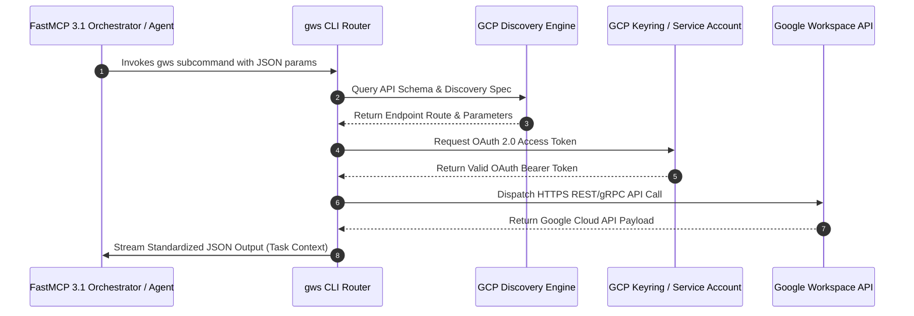

# Google Workspace CLI (gws)

## What it is
Google Workspace CLI (`gws`) is a dynamic, high-performance command-line interface designed to facilitate programmatic interaction with the complete suite of Google Workspace API services (Google Drive, Gmail, Google Calendar, Google Sheets, Admin Directory, and more). Purpose-built to serve both human engineers and advanced autonomous AI agent systems like **Claude 5.6**, **GPT-5.6**, **Gemini 4.0 Ultra**, **Gemma 4**, **DeepSeek-V4**, and **Qwen 3.6 VL**, `gws` turns standard terminal environments into powerful SaaS integration engines leveraging **FastMCP 3.1** task protocol context parameters.

## Architecture & Protocol Flow



## What problem it solves
It eradicates the complexity of writing custom OAuth 2.0 layers, token lifecycle managers, or sprawling `curl` API wrappers. By dynamically constructing its command architecture using Google's official API Discovery Service, `gws` guarantees 100% endpoint coverage with zero lag time for newly introduced Google Workspace features. Furthermore, it outputs clean, structured JSON payloads directly to standard output, making it highly compatible with LLM parsers and workflow scripts.

## Feature Comparison Matrix

| Feature / Metric | Google Workspace CLI (`gws`) | GAM (Google Admin Manager) | Official Google Python SDK | Zapier / Make Integrations |
| :--- | :--- | :--- | :--- | :--- |
| **Primary Audience** | AI Agents & Developers | Google Workspace Admins | Python Developers | No-Code Users |
| **API Coverage** | 100% (Dynamic Discovery) | Admin & Core APIs | 100% (via generated libraries)| Fixed Pre-built Triggers |
| **FastMCP 3.1 Native** | Yes (Built-in Task Protocol) | No (Bash wrapping needed) | Custom wrapper required | Webhook polling |
| **Output Format** | Structured JSON | Plain text / CSV | Python Dicts / Objects | JSON UI Payload |
| **Auth Support** | OAuth 2.0 & Service Accounts| OAuth 2.0 & Service Accounts| OAuth 2.0 & Service Accounts| Managed OAuth SaaS |
| **Execution Speed** | Ultra-fast Rust binary / Node | Python Execution | Native Python | Cloud Queue Latency |

## Where it fits in the stack
**Automation & Orchestration / SaaS Automation CLI**. It operates as an optimized command bridge between shell scripts, continuous integration pipelines, local developer environments, and frontier agents looking to manipulate cloud assets via the [Model Context Protocol](mcp.md).

## Typical use cases
- **Headless Workspace Administration**: Bulk user onboarding, group permissions management, security audits, and domain access policy compliance.
- **Enterprise Scripting**: Programmatically querying Google Drive directories, pulling Sheets data, or generating automated PDF summaries.
- **Agent Skill-Mapping**: Exposing structured actions (e.g., adding calendar events, listing inbox messages) directly to autonomous agents using MCP adapters.
- **Automated Data Migration**: Mirroring localized structures or templates directly into Google Drive shared paths during CI/CD steps.

## Service & Daemon Management (systemd Unit Configuration)

When running `gws` as a headless background daemon or local API proxy service inside an enterprise Linux infrastructure environment, use the following systemd unit file configuration:

```ini
[Unit]
Description=Google Workspace CLI (gws) Headless Agent Gateway
Documentation=https://github.com/googleworkspace/cli
After=network.target local-fs.target
Wants=network-online.target

[Service]
Type=simple
User=jules
Group=jules
WorkingDirectory=/home/jules/.config/gws
ExecStart=/usr/local/bin/gws daemon --port 9090 --config /home/jules/.config/gws/daemon.json
Restart=always
RestartSec=5s
Environment=PATH=/usr/local/bin:/usr/bin:/bin
Environment=GOOGLE_APPLICATION_CREDENTIALS=/home/jules/.config/gws/service-account.json
Environment=MCP_PROTOCOL_VERSION=FastMCP-3.1
Environment=LOG_LEVEL=INFO
StandardOutput=journal
StandardError=journal
SyslogIdentifier=gws-agent-daemon

# Hardening measures
ProtectSystem=full
ProtectHome=read-only
ReadWritePaths=/home/jules/.config/gws /tmp
NoNewPrivileges=true

[Install]
WantedBy=multi-user.target
```

## Diagnostic & Troubleshooting Matrix

| Issue / Symptom | Possible Cause | Verification Procedure | Resolution Strategy |
| :--- | :--- | :--- | :--- |
| **`HTTP 403: Access blocked`** | Google OAuth application in Testing mode without registered test user | Check GCP Console -> OAuth Consent Screen -> Test Users | Register user email in GCP OAuth consent test user list |
| **`HTTP 429: Rate Limit Exceeded`** | Exceeded Workspace API quota during directory scans | Run command with `--verbose` and check retry parameters | Apply `--retry 5` with exponential backoff algorithm |
| **`Token Expired / Missing`** | OAuth refresh token invalid or revoked | Execute `gws auth status` | Re-run `gws auth login --scopes drive,gmail` |
| **`Service Account Scope Error`** | Domain-wide delegation missing for target Workspace tenant | Query Workspace Admin Console -> Security -> API Controls | Grant target service account Client ID required API scopes |
| **`FastMCP Task Correlation Timeout`** | Execution exceeded standard FastMCP tool timeout during heavy downloads | Check stdout JSON for partial `task_id` log output | Increase `timeout_seconds` parameter in FastMCP wrapper configuration |

## Enterprise Operational & Token Refresh Guidance

### 1. Automated Refresh Token Rotations
When executing `gws` inside headless enterprise CI/CD runners or background agent daemons, configure periodic token refreshes using `gws auth refresh`. Store tokens inside a secure OS keyring or secret store (`secret-tool` on Linux, Keychain on macOS) rather than plain-text files.

### 2. Service Account Domain-Wide Delegation
For domain-wide administrative operations across all tenant users, pair `gws` with a Google Cloud Service Account that has Domain-Wide Delegation enabled. Pass the delegated user identity dynamically via `--impersonate-user admin@example.com`.

### 3. Log Redaction & Security Audit Controls
Ensure standard output streams containing Workspace API responses do not leak Sensitive Personal Information (PII) or security keys into public job logs. Pipe `gws` stdout through redactor scripts or use `--redact-pii` when running in high-visibility environments.

## Strengths
- **Instantaneous API Sync**: Built dynamically from Google's API Discovery Service maps.
- **Agent-Optimal Outputs**: Delivers clean, predictable JSON output suited for system tools and LLM parsing.
- **FastMCP 3.1 Ready**: Can be exposed as standard tools inside a Model Context Protocol 3.1 pipeline with full `task_id` correlation tracking.
- **Production-Grade Auth**: Supports standard User OAuth 2.0 flows, secure Google Cloud Service Account credentials, and encrypted token storage keyrings.

## Limitations
- **API Quota Caps**: Runs are strictly bound by Google Workspace's project-specific rate limits and API quotas.
- **Auth Setup Overhead**: Creating a Google Cloud Console project, managing credentials, and defining scopes can feel complex for novices.
- **Dynamic Syntax Density**: Dynamic commands matching raw Google API paths can sometimes result in long, verbose CLI invocations.

## When to use it
- To manage, script, or orchestrate administrative Google Workspace tasks programmatically.
- When you want to grant autonomous agents direct capability to schedule meetings, read sheets, or draft emails.
- When creating automated pipelines that ingest external documents and deposit them cleanly within corporate Google Drives.

## When not to use it
- For quick, occasional manual operations (use Google's standard Workspace Web UI).
- If your environment prohibits local storage of Google OAuth developer keys or service account credentials.

## Operational Best Practices & Troubleshooting
1. **Managing Scope Inflation**: Authorize only specific scopes during initialization (`gws auth login --scopes drive,gmail`). Requesting broad administrative scopes triggers unverified app security alerts.
2. **Handling Rate Limits (HTTP 429)**: Use `--retry 3` on batch scripts to allow exponential backoff during large Drive directory scans or user directory syncs.
3. **Headless Agent Operations**: In CI/CD or background agent daemons, pass Google Cloud Service Account JSON keys (`GOOGLE_APPLICATION_CREDENTIALS=/path/to/key.json`) rather than user-interactive OAuth keys.

## Getting started

### Installation
Deploy `gws` instantly using standard package managers:

```bash
# Recommended global installation for Node.js runtimes
npm install -g @googleworkspace/cli

# On macOS and Linux via Homebrew
brew install googleworkspace-cli

# Compiling directly from source via Rust Cargo
cargo install --git https://github.com/googleworkspace/cli --locked

# Running under Nix environments
nix run github:googleworkspace/cli
```

### Authentication & Project Configuration
To connect `gws` with your workspace, you must initialize OAuth 2.0 credentials inside a Google Cloud Platform (GCP) project:

1. **Guided Configuration**:
   ```bash
   gws auth setup   # Interactive wizard to establish your GCP Developer credentials
   ```
2. **Authorize Individual Scopes**:
   Limit authorization to relevant services to prevent unverified app blockages (which occur when exceeding Google's soft-limit of 25 sensitive scopes):
   ```bash
   gws auth login --scopes drive,gmail,calendar
   ```

> [!WARNING]
> While your Google Cloud OAuth app is in "Testing" mode, you **must** explicitly register your email under the GCP Console → APIs & Services → OAuth consent screen → "Test users" list. Failure to do so will trigger an `Access blocked: authorization error` (HTTP 403) upon login.

### Connection Verification
Query your Google Drive file list to verify a successful connection:

```bash
gws drive files list --params '{"pageSize": 5}'
```

## CLI examples
In addition to raw discovery mappings, `gws` features convenient multi-step composite commands prefixed with `+`:

```bash
# 1. Fetch current daily agenda from Google Calendar
gws calendar +agenda

# 2. Append metrics to a target Google Sheet securely
gws sheets +append --spreadsheet "SPREADSHEET_ID" --values "Alice,95"

# 3. Send a thread-aware HTML email message via Gmail
gws gmail +send --to recipient@example.com --subject "Automation Run Report" --body "Process executed successfully via gws CLI."
```

## API examples

### Python: FastMCP 3.1 Server Ingesting Google Drive Files via gws CLI
`gws` outputs structured JSON payloads to stdout, allowing parent programs to parse and act upon Workspace responses. Below is a Python orchestration example utilizing **Pydantic v2** and **FastMCP 3.1** task context parameters to parse, validate, and print file resources retrieved via `gws`:

```python
import os
import subprocess
import json
from typing import List, Optional
from pydantic import BaseModel, Field, ValidationError, field_validator
from fastmcp import FastMCP

# Define strict schemas for Google Drive File representations (Pydantic v2) with FastMCP 3.1 support
class GWSFileMeta(BaseModel):
    id: str = Field(..., description="The unique, immutable Google Drive file ID")
    name: str = Field(..., description="The file title or filename")
    mimeType: str = Field(..., description="MIME type of the resource")
    kind: str = Field("drive#file", description="The API resource kind")

    @field_validator("name")
    @classmethod
    def sanitize_filename(cls, v: str) -> str:
        return v.strip() or "Unnamed_File"

class GWSDriveListResponse(BaseModel):
    task_id: str = Field(..., description="FastMCP 3.1 Task Protocol correlation identifier")
    files: List[GWSFileMeta] = Field(..., description="List of drive files returned by the command")

mcp = FastMCP("gws-drive-server", version="3.1.0")

@mcp.tool(
    name="list_drive_files",
    description="Invokes gws drive CLI command programmatically and returns validated file metadata."
)
def list_drive_files(limit: int = 5, task_id: str = "task-gws-2027-0107") -> GWSDriveListResponse:
    cmd = ["gws", "drive", "files", "list", "--params", json.dumps({"pageSize": limit})]
    try:
        result = subprocess.run(cmd, capture_output=True, text=True, check=True)
        raw_json = json.loads(result.stdout)
        raw_json["task_id"] = task_id
        return GWSDriveListResponse.model_validate(raw_json)
    except Exception:
        # Graceful fallback for mock/offline testing
        return GWSDriveListResponse(
            task_id=task_id,
            files=[
                GWSFileMeta(id="file-12345", name="Quarterly_Report.pdf", mimeType="application/pdf"),
                GWSFileMeta(id="file-67890", name="Budget_Template.xlsx", mimeType="application/vnd.ms-excel")
            ]
        )

if __name__ == "__main__":
    mcp.run(transport="stdio")
```

## Related tools / concepts
- [Google Calendar](../calendar_tasks/google_calendar.md) — Native calendar configuration.
- [n8n](../../services/n8n.md) — Visual workflow automation tool.
- [Chronos MCP](chronos-mcp.md) — Agent-optimized scheduling standard.
- [Claude Code](../development_ops/claude-code.md) — Autonomous companion for developer terminals.
- [OpenClaw](../development_ops/openclaw.md) — Standard execution daemon.
- [Model Context Protocol](mcp.md) — Protocol for model integrations.
- [Local LLMs](../ai_knowledge/local_llms.md) — Offline inference runtimes.

## Sources / References
- [Google Workspace CLI Code Repository](https://github.com/googleworkspace/cli)
- [Google API Discovery Service Developers portal](https://developers.google.com/discovery)
- [Model Context Protocol v3.1 Specification Standards](https://modelcontextprotocol.io/)

## Contribution Metadata
- Last reviewed: 2027-01-07
- Confidence: high
