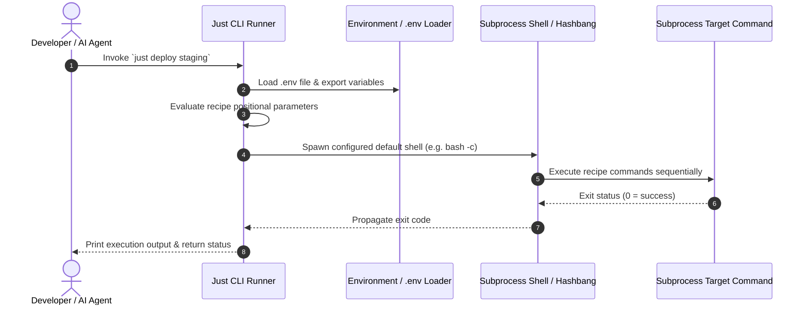

# Just

## What it is
Just (invoked as `just` and configured via a `justfile`) is a fast, handy command runner written in Rust. Inspired by GNU Make, Just is explicitly saved from the burden of being a build system. Rather than tracking file dependencies, object graphs, or compilation targets, Just focuses strictly on running project-specific command recipes. It features concise syntax, positional recipe parameters, default argument values, environment variable handling, polyglot inline scripts (Python, Node.js, bash, perl), cross-platform shell support, and clear shell completion integrations.

In early 2027, Just is a standard command execution wrapper across developer environments, local AI agent setups, and homelab operational workflows.

```
+-----------------------------------------------------------------------------------+
|                          Just Command Execution Pipeline                          |
+-----------------------------------------------------------------------------------+
|  [ Human Developer CLI / Autonomous AI Agent (Claude Code / Jules) ]               |
|               |                                                                   |
|               v                                                                   |
|  +-----------------------------------------------------------------------------+  |
|  | Just CLI Parser & AST Evaluator (justfile syntax parsing & .env loading)    |  |
|  +-----------------------------------------------------------------------------+  |
|               |                                                                   |
|               v (Recipe Resolution & Variable Substituted AST)                    |
|  +-----------------------------------------------------------------------------+  |
|  | Target Shell Invocation Manager (Bash / Zsh / PowerShell / Python Hashbangs)  |  |
|  +-----------------------------------------------------------------------------+  |
|         /                                |                                 \      |
|        v                                 v                                  v     |
|  +------------------+          +-------------------+              +---------------------+ |
|  | Subprocess CLI   |          | Inline Python     |              | Container Systems   | |
|  | Tools & Scripts  |          | Interpreter       |              | (Docker / Podman)   | |
|  +------------------+          +-------------------+              +---------------------+ |
+-----------------------------------------------------------------------------------+
```

## What problem it solves
[GNU Make](gnu-make.md) is frequently abused as a simple task runner. However, Make's design requires file target resolution, `.PHONY` declarations to prevent conflicts with local directory names, and strict tab indentation. Moreover, passing positional CLI arguments or dynamic parameters to Makefile targets requires awkward `$(filter-out ...)` hacks or environment variable overrides. Other alternatives like heavy shell scripts lack self-documenting capabilities, listing mechanisms, or clean multi-line recipe formatting.

Just solves these friction points by providing a purpose-built syntax designed exclusively for command execution. `justfile` recipes support typed positional arguments (`recipe param1 param2="default"`), modular `import` statements, inline polyglot scripts (`#!/usr/bin/env python3`), and automated `--list` command generation with doc comments.

- **Eliminates .PHONY Overhead**: Treat every entry as a executable command recipe without file target checking.
- **First-Class Positional Parameters**: Support optional, required, and default command line arguments natively.
- **Polyglot Hashbang Execution**: Embed Python, Node, or Ruby multi-line logic directly inside recipe blocks.
- **Self-Documenting CLI Entrypoints**: Automatically format and render project commands using `just --list`.

## Where it fits in the stack
**Automation & Orchestration / Task Execution Layer**. Operating at the root of project repositories, Just provides the primary command interface for human developers and autonomous AI agents ([Claude Code](../development_ops/claude-code.md), [Jules](../../tools/ai_knowledge/jules.md)). It delegates execution to CLI tools, container systems ([Docker](../infrastructure/docker.md)), or complex task runners ([Taskfile](taskfile.md)).



## Comparison Matrix: Task Runners & Build Tools

| Tool / Framework | Target Resolution | Variable & Argument Support | Polyglot Scripting | Primary Focus | Language Ecosystem |
| :--- | :--- | :--- | :--- | :--- | :--- |
| **Just** | Command recipes only (No file graph) | Native positional, defaults, variadic | Direct hashbangs (Python/Node/Bash) | Project command alias execution | Rust (Standalone binary) |
| **GNU Make** | File modification timestamps | Complex macro hacks (`$(filter-out)`) | Shell strings only | C/C++ incremental compilation | C / POSIX standard |
| **Taskfile (Task)** | File checksum fingerprinting (`STATUS`) | YAML task arguments & vars | Shell commands & Go templates | Cross-platform dev task runner | Go (Standalone binary) |
| **Invoke (pyinv)** | Python functions & tasks | Python kwargs & CLI flags | Native Python code | Python-centric task execution | Python |
| **Cargo-make** | Rust build steps & flows | Environment variables & TOML | Inline Duckscript / Rust / Bash | Rust project workflow automation | Rust |

## Typical use cases
- **Developer Command Alias Suite**: Wrapping long, multi-flag development CLI commands under simple aliases (`just test`, `just lint`, `just serve`).
- **Parameterized Service Management**: Passing dynamic arguments to homelab management scripts (`just restart-service paperless`, `just backup db`).
- **Inline Polyglot Automation**: Writing inline Python, Rust, or Node.js scripts directly inside a `justfile` recipe using standard hashbangs.
- **Agent Task Execution**: Providing AI coding agents with a clean, documented list of available project tasks via `just --list`.

## Strengths
- **Purpose-Built Command Runner**: Zero build graph complexity or `.PHONY` overhead; focused entirely on command execution.
- **Clean Argument & Variable Handling**: First-class support for positional parameters, default values, variadic arguments, and `.env` loading.
- **Polyglot Recipe Hashbangs**: Allows embedding multi-line Python, Bash, or Node.js scripts directly within a recipe block using `#!/usr/bin/env ...`.
- **Fast Rust Execution**: Blazing fast CLI startup times with native binaries available for Linux, macOS, FreeBSD, and Windows.

## Limitations
- **No Dependency Fingerprinting**: Does not inspect source file modification times or checksums to skip up-to-date targets (use [Taskfile](taskfile.md) or [GNU Make](gnu-make.md) for incremental builds).
- **Not a Replacement for Complex DAG Workflows**: Lacks multi-node distributed workflow graphs or visual pipeline monitoring (use [Argo Workflows](../orchestration/argo-workflows.md) or [n8n](../../services/n8n.md)).
- **Syntax Uniqueness**: Uses custom `justfile` syntax that, while clean, requires learning Just-specific constructs for variable export and conditional evaluation.

## When to use it
- When you want a simple, zero-overhead command runner for project scripts and developer commands.
- When recipes require flexible positional command-line arguments and default fallback parameters.
- When writing multi-language inline scripts (Python + Bash) within a single task runner file.

## When not to use it
- When you need incremental file-based build tracking and dependency checksums (use [Taskfile](taskfile.md) or [GNU Make](gnu-make.md)).
- For complex, multi-server enterprise deployment pipelines requiring graphical DAG orchestration (use [n8n](../../services/n8n.md) or [Argo Workflows](../orchestration/argo-workflows.md)).
- When strictly mandated to use zero-install system tools natively present on legacy Linux servers without installing new binaries (use [GNU Make](gnu-make.md)).

## Getting started

### Installation
Install `just` via standard package managers or Rust's cargo:

```bash
# macOS (Homebrew)
brew install just

# Linux (apt / pacman / dnf / cargo)
cargo install just

# Windows (Scoop / Chocolatey)
scoop install just
```

### Initializing a justfile
Create a `justfile` in your repository root:

```just
# Default recipe listing available commands
default:
    @just --list

# Run repository linting checks
lint:
    python3 scripts/check_catalog_consistency.py
    python3 scripts/validate_new_sources.py

# Run unit tests with optional filter
test filter="":
    pytest -k "{{filter}}"

# Polyglot inline Python recipe
[private]
inspect-env:
    #!/usr/bin/env python3
    import sys, os
    print(f"Python Runtime: {sys.version}")
    print(f"Current Directory: {os.getcwd()}")
```

## CLI examples

### Listing & Executing Commands
```bash
# Display formatted list of available recipes and descriptions
just --list

# Run a parameterized recipe with custom argument
just test filter="test_catalog"

# Pass raw command line arguments through to an underlying command
just -- dry-run --verbose
```

### Working Directory & Format Controls
```bash
# Format the justfile to canonical syntax standards
just --fmt --check

# Dump evaluated justfile AST as JSON for programmatic inspection
just --dump --dump-format json
```

## API examples

### FastMCP 3.1 Justfile Orchestrator Tool Server
The following Python script implements a complete **FastMCP 3.1** server that allows autonomous AI agents to inspect, list, and trigger `just` recipes with validated positional parameters.

```python
import os
import subprocess
import json
from typing import Dict, Any, List, Optional
from pydantic import BaseModel, Field
from fastmcp import FastMCP

mcp = FastMCP(
    "just-runner-server",
    instructions="FastMCP 3.1 server exposing programmatic execution of local justfile recipes."
)

class JustRecipeExecutionRequest(BaseModel):
    recipe_name: str = Field(..., description="Name of the justfile recipe to execute")
    positional_args: List[str] = Field(default_factory=list, description="Positional parameters for recipe")
    environment_overrides: Dict[str, str] = Field(default_factory=dict, description="Env vars to inject")

class JustfileRecipeInfo(BaseModel):
    name: str
    doc_string: Optional[str] = None
    parameters: List[str] = Field(default_factory=list)

@mcp.tool()
def list_available_recipes() -> Dict[str, Any]:
    """
    Executes `just --dump --dump-format json` to programmatically return all available recipes in workspace.
    """
    try:
        res = subprocess.run(["just", "--dump", "--dump-format", "json"], capture_output=True, text=True, check=True)
        dump_data = json.loads(res.stdout)
        recipes_summary = []
        for name, details in dump_data.get("recipes", {}).items():
            if not details.get("private", False):
                recipes_summary.append({
                    "name": name,
                    "doc": details.get("doc"),
                    "parameters": [p["name"] for p in details.get("parameters", [])]
                })
        return {"status": "success", "recipes": recipes_summary}
    except Exception as e:
        return {"status": "error", "message": str(e)}

@mcp.tool()
def execute_recipe(request: JustRecipeExecutionRequest) -> Dict[str, Any]:
    """
    Triggers execution of a specific justfile recipe.
    """
    try:
        env = os.environ.copy()
        env.update(request.environment_overrides)
        cmd = ["just", request.recipe_name] + request.positional_args
        res = subprocess.run(cmd, capture_output=True, text=True, env=env)
        return {
            "status": "success" if res.returncode == 0 else "failed",
            "exit_code": res.returncode,
            "stdout": res.stdout,
            "stderr": res.stderr
        }
    except Exception as e:
        return {"status": "error", "message": str(e)}

if __name__ == "__main__":
    mcp.run()
```

### Python (Justfile Parser & Executor with Pydantic v2 Schema Validation)
The following script demonstrates programmatically generating and validating `justfile` configurations using strict **Pydantic v2** models and executing recipes via subprocess.

```python
import os
import subprocess
from typing import List, Dict, Optional
from pydantic import BaseModel, Field, field_validator

class RecipeArgument(BaseModel):
    name: str = Field(..., description="Argument variable name")
    default_value: Optional[str] = Field(None, description="Default fallback value")

class JustRecipe(BaseModel):
    doc_comment: str = Field(..., min_length=5, description="Docstring comment for --list display")
    arguments: List[RecipeArgument] = Field(default_factory=list)
    commands: List[str] = Field(..., min_items=1, description="List of command lines")
    is_private: bool = Field(False, description="Whether to hide recipe from --list")

class JustfileSchema(BaseModel):
    variables: Dict[str, str] = Field(default_factory=dict, description="Top-level export variables")
    recipes: Dict[str, JustRecipe] = Field(..., description="Map of recipe names to definitions")

    @field_validator("recipes")
    @classmethod
    def check_default_recipe(cls, v: Dict[str, JustRecipe]) -> Dict[str, JustRecipe]:
        if "default" not in v:
            raise ValueError("Justfile schema must contain a 'default' recipe")
        return v

def generate_justfile(schema: JustfileSchema, file_path: str = "justfile") -> str:
    lines = []

    # 1. Variables
    for k, v in schema.variables.items():
        lines.append(f'{k} := "{v}"')
    if schema.variables:
        lines.append("")

    # 2. Recipes
    for recipe_name, recipe in schema.recipes.items():
        if recipe.is_private:
            lines.append("[private]")
        lines.append(f"# {recipe.doc_comment}")

        # Format arguments
        args_str = ""
        if recipe.arguments:
            formatted_args = []
            for arg in recipe.arguments:
                if arg.default_value is not None:
                    formatted_args.append(f'{arg.name}="{arg.default_value}"')
                else:
                    formatted_args.append(arg.name)
            args_str = " " + " ".join(formatted_args)

        lines.append(f"{recipe_name}{args_str}:")
        for cmd in recipe.commands:
            lines.append(f"    {cmd}")
        lines.append("")

    content = "\n".join(lines)
    with open(file_path, "w") as f:
        f.write(content)

    return content

if __name__ == "__main__":
    schema = JustfileSchema(
        variables={"PROJECT_NAME": "HomelabOps"},
        recipes={
            "default": JustRecipe(
                doc_comment="Default entrypoint listing recipes",
                commands=["@just --list"]
            ),
            "audit": JustRecipe(
                doc_comment="Run doc quality and contract checks",
                commands=["python3 scripts/check_catalog_consistency.py", "python3 scripts/validate_new_sources.py"]
            ),
            "deploy": JustRecipe(
                doc_comment="Deploy service to target environment",
                arguments=[RecipeArgument(name="target", default_value="staging")],
                commands=["echo 'Deploying {{PROJECT_NAME}} to {{target}} environment...'"]
            )
        }
    )

    print("Validated Justfile Pydantic Schema:")
    print(schema.model_dump_json(indent=2))

    justfile_text = generate_justfile(schema)
    print("\nGenerated justfile Content:\n")
    print(justfile_text)
```

## Operational Troubleshooting & Guardrails

| Symptom / Issue | Root Cause | Remediation Step |
| :--- | :--- | :--- |
| `just: command not found` | `just` binary missing from user `$PATH` | Install `just` via system package manager or `cargo install just`. |
| Recipe fails on Windows environment | Default shell missing or defaulting to `cmd.exe` | Add `set shell := ["powershell.exe", "-c"]` or `["bash", "-c"]` to top of `justfile`. |
| Tab vs space indentation error | Mixed whitespace or spaces used in tab-sensitive block | Use hard tabs or set `set allow-duplicate-recipes := false` / run `just --fmt`. |
| Variables in `.env` ignored | `.env` loading not explicitly declared | Add `set dotenv-load := true` at top of `justfile`. |

## Production Best Practices
1. **Always Define a `default` Recipe**: Set `default:` to `@just --list` so running `just` without arguments prints available project recipes cleanly.
2. **Use Hashbangs for Complex Scripts**: For logic requiring multi-line conditionals or API calls, use `#!/usr/bin/env python3` inside the recipe rather than giant shell one-liners.
3. **Format Standard Compliance**: Execute `just --fmt --check` in pre-commit CI pipelines to ensure uniform `justfile` formatting across developer machines.

## Related tools / concepts
- [GNU Make](gnu-make.md) — Classic tab-indented build runner.
- [Taskfile](taskfile.md) — YAML-based cross-platform task runner with checksum fingerprinting.
- [Docker](../infrastructure/docker.md) — Container runtime orchestrated via Just recipes.
- [Claude Code](../development_ops/claude-code.md) — AI developer agent relying on Just for workspace commands.
- [Jules](../../tools/ai_knowledge/jules.md) — Autonomous agent running Just recipes.
- [Optuna](../development_ops/optuna.md) — HPO framework executed via Just scripts.
- [n8n](../../services/n8n.md) — Workflow engine executing Just CLI commands.
- [Paperless-ngx](../../services/paperless-ngx.md) — Homelab application managed via Just scripts.

## Sources / references
- [Just GitHub Repository](https://github.com/casey/just)
- [Just Programmer's Manual](https://just.systems/man/en/)

## Contribution Metadata
- Last reviewed: 2027-01-07
- Confidence: high
