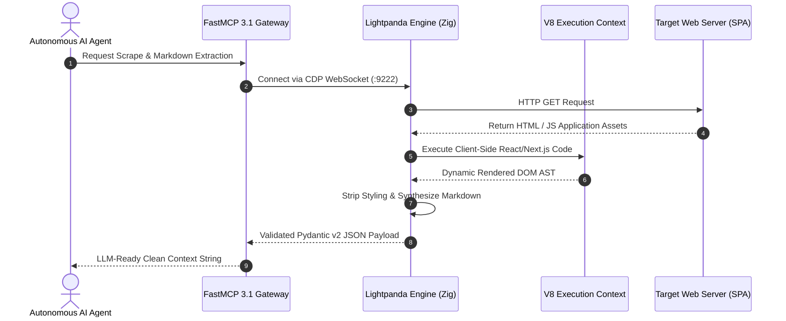

# Lightpanda Browser

**Lightpanda** is an open-source, ultra-high-performance headless web browser engineered from scratch in **Zig** specifically designed for AI agents, high-density web scraping, and sub-second browser automation. Unlike standard headless browser setups (such as Headless Chrome, Chromium, or WebKit forks), Lightpanda implements a custom, lightweight execution engine optimized for execution performance, minimal memory footprint, and high concurrency scaling.

As of early January 2027, Lightpanda serves as a core execution backend for **FastMCP 3.1 Task Protocol-based agent tools** and autonomous web agents powered by **Gemma 4**, **Claude 5.6**, **GPT-5.6**, and **Gemini 4.0 Ultra**.

---

## What it is
Lightpanda is a headless browser engine built in Zig that exposes full compatibility with the **Chrome DevTools Protocol (CDP)**. By replacing standard heavy browser rendering pipelines with a lightweight execution model integrated with V8 JavaScript execution, Lightpanda executes browser tasks up to **11x faster** while using **up to 9x less RAM** compared to standard Headless Chrome.

```
+-----------------------------------------------------------------------------------+
|                               AI AGENT / ORCHESTRATOR                             |
|                    (FastMCP 3.1 / Playwright / Puppeteer / CDP)                    |
+-----------------------------------------------------------------------------------+
                                          |
                                          | CDP WebSocket Connection (Port 9222)
                                          v
+-----------------------------------------------------------------------------------+
|                             LIGHTPANDA ZIG BROWSER ENGINE                         |
|                                                                                   |
|  +---------------------------+  +--------------------------+  +----------------+  |
|  | Zig Memory Manager        |  | V8 JS Execution VM       |  | DOM Synthesizer|  |
|  | (Sub-second Spinup)       |  | (SPA Execution Context)  |  | & CSS Engine   |  |
|  +---------------------------+  +--------------------------+  +----------------+  |
+-----------------------------------------------------------------------------------+
                                          |
                                          v
+-----------------------------------------------------------------------------------+
|                              STRUCTURED AGENT OUTPUT                              |
|                   (LLM-Ready Markdown / Clean HTML / DOM JSON)                    |
+-----------------------------------------------------------------------------------+
```

---

## What problem it solves
Running traditional headless browsers for AI agents and web scraping presents severe infrastructure bottlenecks:
1. **Excessive VRAM and RAM Overhead**: A single Headless Chrome instance typically consumes 300MB–500MB+ of RAM. Scaling to dozens of concurrent agent browser threads requires massive cloud server instances.
2. **Slow Instance Spinup Times**: Standard browser startup takes several seconds, adding significant latency to real-time agent tool executions.
3. **Context Window Pollution**: Raw HTML DOM dumps contain bloat (scripts, style blocks, tracking pixels) that consume valuable LLM token context. Lightpanda provides native `--dump markdown` transformations that strip non-semantic content.

Lightpanda solves these challenges by enabling high-density browser execution—allowing hundreds of concurrent browser sessions on modest edge hardware or cloud VM instances.

---

## Where it fits in the stack
Lightpanda resides in the **Automation & Tool Execution layer** of the agentic software stack.



---

## Typical use cases
- **High-Density Agent Web Navigation**: Powering autonomous web-browsing agents that execute thousands of page interactions daily without exhausting server memory.
- **Sub-Second RAG Web Scraping**: Ingesting dynamic client-rendered single page applications (SPAs) into vector databases with minimal network latency.
- **LLM-Optimized Context Dumping**: Fetching dynamic web pages and converting them directly into clean Markdown (`--dump markdown`) for direct ingestion into model prompt contexts.
- **Automated Synthetic Web Testing**: Executing CI/CD browser testing suites in parallel with sub-second initialization.
- **FastMCP 3.1 Tool Backend**: Providing local or cloud agent runtimes with lightweight browser automation primitives over CDP.

---

## Strengths
- **Extreme Memory Efficiency**: Consumes up to 9x less RAM than Headless Chrome (often ~30MB–50MB per instance).
- **Sub-Second Initialization**: Instant spinup enabled by Zig's zero-cost allocations and lightweight binary design.
- **Chrome DevTools Protocol (CDP) Standard Compatibility**: Drop-in compatible with existing Playwright, Puppeteer, and `chromedp` automation scripts.
- **Native Markdown Serialization**: Built-in AST-to-Markdown conversion engine optimized for LLM context windows.
- **Native V8 Integration**: Full JavaScript engine execution, ensuring high compatibility with modern client-side React, Vue, and Next.js applications.

---

## Limitations
- **Custom Visual Rendering**: Because Lightpanda uses a custom Zig rendering engine rather than full Chromium/Blink, subtle visual CSS alignment edge cases may differ.
- **No Headed/GUI Mode**: Built strictly for headless server execution; lacks graphical GUI window display capabilities.
- **Anti-Bot Detection Scenarios**: Highly aggressive enterprise anti-bot solutions (e.g., Cloudflare Turnstile, Kasada) may flag non-standard browser signatures.
- **No Chrome Extensions**: Loading legacy `.crx` Chrome extensions is unsupported.

---

## Comparison Matrix: Headless Browser Engines

| Feature / Metric | Lightpanda (Zig) | Headless Chrome / Chromium | Playwright WebKit | Selenium Firefox |
| :--- | :--- | :--- | :--- | :--- |
| **RAM Footprint (per Page)** | **~30 MB - 50 MB** | ~300 MB - 500 MB | ~250 MB - 400 MB | ~350 MB - 600 MB |
| **Cold Startup Latency** | **< 100 ms** | 1,500 ms - 3,000 ms | 1,200 ms - 2,500 ms | 2,000 ms - 4,000 ms |
| **Native LLM Markdown Extractor** | Yes (`--dump markdown`) | No (Requires BeautifulSoup/Turndown) | No | No |
| **CDP Protocol Interface** | Native WebSocket (:9222) | Native (:9222) | Internal Adapter | Limited CDP Adapter |
| **Language Runtime** | Compiled Native Zig + V8 | C++ Blink + V8 | C++ WebKit | C++ Gecko |

---

## When to use it
- When running multiple concurrent browser automation threads for AI agents where server RAM is the primary bottleneck.
- For RAG pipelines that must rapidly fetch and convert dynamic web pages to clean Markdown.
- When building FastMCP 3.1 tools that require browser interactions with sub-second startup times.
- In resource-constrained environments (edge nodes, containerized microservices, local homelabs).

---

## When not to use it
- For visual design testing that requires 100% pixel-perfect Chromium rendering fidelity.
- When browser workflows depend on proprietary Chrome extensions or DRM video playback codecs.
- For bypassing enterprise anti-bot defenses requiring specialized residential browser networks.

---

## Getting started

### Local Binary Installation
```bash
# One-line binary installer for Linux / macOS
curl -fsSL https://pkg.lightpanda.io/install.sh | bash
```

### Deploying via Docker Container
Lightpanda is commonly deployed as a lightweight container exposing the standard CDP WebSocket port (9222):

```bash
docker run -d \
  --name lightpanda-browser \
  -p 127.0.0.1:9222:9222 \
  lightpanda/browser:latest
```

---

## CLI examples

### CLI Navigation and Dumping
```bash
# Fetch HTML content with 3-second wait for SPA client execution
lightpanda fetch --wait 3000 --dump html https://example.com

# Fetch dynamic page and output directly as LLM-ready Markdown
lightpanda fetch --dump markdown https://news.ycombinator.com

# Execute inline JavaScript on DOM load and print result
lightpanda fetch --script "Array.from(document.querySelectorAll('h2')).map(e => e.innerText)" https://lightpanda.io
```

---

## API examples

### FastMCP 3.1 Integration & Pydantic v2 Schema Patterns

Below is a production FastMCP 3.1 server implementation in Python that connects to a Lightpanda headless browser instance over CDP and validates scraped output using strict **Pydantic v2** schemas (`extra="forbid"`).

```python
import asyncio
from typing import Optional, List, Dict, Any
from pydantic import BaseModel, Field, field_validator, ConfigDict
from fastmcp import FastMCP
from playwright.async_api import async_playwright

# Initialize FastMCP 3.1 Server
mcp = FastMCP("Lightpanda-Browser-Provider", version="3.1.0")

# ------------------------------------------------------------------
# 1. Pydantic v2 Validation Schemas
# ------------------------------------------------------------------
class ScrapedPagePayload(BaseModel):
    model_config = ConfigDict(extra="forbid")

    url: str = Field(..., description="Target URL navigated")
    title: str = Field(..., min_length=1, description="Page title")
    meta_description: Optional[str] = Field(default=None, description="HTML meta description text")
    markdown_content: str = Field(..., description="LLM-ready extracted text content")
    word_count: int = Field(..., ge=0, description="Word count of extracted body text")
    links_found: List[str] = Field(default_factory=list, description="List of internal and external URLs found")

    @field_validator("url")
    @classmethod
    def validate_url_scheme(cls, v: str) -> str:
        if not v.startswith("http://") and not v.startswith("https://"):
            raise ValueError("URL must start with http:// or https://")
        return v

# ------------------------------------------------------------------
# 2. FastMCP 3.1 Tool Registration Wrapping Lightpanda CDP
# ------------------------------------------------------------------
@mcp.tool()
async def fetch_webpage_markdown(
    url: str,
    cdp_endpoint: str = "http://127.0.0.1:9222",
    wait_time_ms: int = 2000
) -> str:
    """Navigates to a webpage using Lightpanda over CDP and extracts structured Markdown and metadata."""
    async with async_playwright() as p:
        try:
            # Connect to Lightpanda over Chrome DevTools Protocol
            browser = await p.chromium.connect_over_cdp(cdp_endpoint)
            context = await browser.new_context()
            page = await context.new_page()

            await page.goto(url, wait_until="domcontentloaded")
            if wait_time_ms > 0:
                await page.wait_for_timeout(wait_time_ms)

            # Extract page data
            title = await page.title()
            body_text = await page.locator("body").inner_text()

            # Extract meta description
            meta_desc = None
            desc_element = page.locator("meta[name='description']")
            if await desc_element.count() > 0:
                meta_desc = await desc_element.get_attribute("content")

            # Extract links
            link_elements = await page.locator("a[href]").all()
            links = []
            for link in link_elements[:15]:
                href = await link.get_attribute("href")
                if href and href.startswith("http"):
                    links.append(href)

            await browser.close()

            # Enforce Pydantic v2 schema verification
            payload = ScrapedPagePayload(
                url=url,
                title=title or "Untitled Page",
                meta_description=meta_desc,
                markdown_content=body_text[:4000],  # Truncate for prompt efficiency
                word_count=len(body_text.split()),
                links_found=links
            )

            return payload.model_dump_json(indent=2)

        except Exception as e:
            return f"Error executing Lightpanda browser tool: {str(e)}"

if __name__ == "__main__":
    mcp.run()
```

---

## Production Infrastructure Deployment

### Docker Compose Stack
To deploy a Lightpanda CDP daemon alongside a FastMCP 3.1 Python integration container in Docker Compose:

```yaml
version: '3.8'

services:
  lightpanda-engine:
    image: lightpanda/browser:latest
    container_name: lightpanda-engine
    ports:
      - "9222:9222"
    restart: unless-stopped

  lightpanda-mcp-gateway:
    build:
      context: .
      dockerfile: Dockerfile.lightpanda-mcp
    container_name: lightpanda-mcp-gateway
    environment:
      - CDP_ENDPOINT=http://lightpanda-engine:9222
      - MCP_PORT=8093
    ports:
      - "8093:8093"
    depends_on:
      - lightpanda-engine
    restart: unless-stopped
```

### Systemd Service Daemon Setup (`lightpanda.service`)
For host-level Linux deployments, manage the Lightpanda daemon using systemd:

```ini
[Unit]
Description=Lightpanda High-Performance Headless Browser Daemon
After=network.target

[Service]
Type=simple
User=lightpanda
Group=lightpanda
WorkingDirectory=/opt/lightpanda
ExecStart=/usr/local/bin/lightpanda --host 0.0.0.0 --port 9222
Restart=always
RestartSec=3
LimitNOFILE=65536
MemoryMax=8G

[Install]
WantedBy=multi-user.target
```

---

## Architecture and Key Concepts

Lightpanda achieves its high performance through several core engineering choices in Zig:

1. **Custom Arena Allocators**: Instead of standard browser garbage collection overhead across massive C++ object models, Lightpanda utilizes Zig custom arena allocators for instantaneous web page session cleanup upon page teardown.
2. **Decoupled DOM Synthesis**: Converts HTML nodes into a lightweight semantic tree that renders directly to text or Markdown AST without executing full visual layout computations unless explicitly requested.
3. **V8 Isolated Execution**: Integrates Google V8 directly into the Zig runtime to execute client-side JavaScript for dynamic single page applications without carrying Chrome's process overhead.
4. **Zero-Copy CDP Parser**: Parses incoming Chrome DevTools Protocol WebSocket payloads directly in memory buffers without unnecessary allocations.

---

## Operational Hardening & Browser Scaling Guidelines

When operating Lightpanda at scale across agent swarms in production environments:

1. **WebSocket Pool Reuse**: Maintain persistent CDP WebSocket connection pools rather than opening new sockets for every web page fetch.
2. **Process Memory Constraints**: Set `MemoryMax=8G` in systemd units to prevent runaway V8 heap expansion during complex SPA rendering sessions.
3. **Sub-Domain Wildcard Isolation**: Enforce distinct V8 execution context sandboxes when scraping untrusted multi-tenant web applications to prevent cross-site data leakage.
4. **Automated Health Check Probes**: Configure HTTP Liveness probes querying `http://localhost:9222/json/version` to detect stalled CDP daemons.
5. **Rate Limiting & Queue Backpressure**: Implement token bucket rate limiting on the FastMCP 3.1 gateway to cap concurrent page fetches at 100 sessions per worker instance.
6. **Graceful Timeout Fallbacks**: Set tight script timeouts (`wait_time_ms <= 5000`) to prevent unhandled asynchronous web sockets from blocking agent tool execution loops.

---

## Troubleshooting & Diagnostics Matrix

| Symptoms / Failure Mode | Root Cause Analysis | Diagnostic Command | Remediation Step |
| :--- | :--- | :--- | :--- |
| **`CDP Connection Refused` on port 9222** | Lightpanda binary or Docker container is not active | `curl http://127.0.0.1:9222/json/version` | Start Lightpanda service or check container logs via `docker logs lightpanda-browser` |
| **SPA Content Incomplete / Blank Body** | Client-side JavaScript execution requires additional wait time | `lightpanda fetch --wait 5000 https://target-spa.com` | Increase `wait_time_ms` parameter in FastMCP tool invocation |
| **Memory Leak under High Concurrency** | V8 context instances not garbage collected cleanly | Check memory usage via `top` or `docker stats` | Explicitly invoke `browser.close()` in Playwright or restart systemd daemon periodically |
| **Anti-Bot `403 Forbidden` / Cloudflare Block** | Missing standard browser User-Agent headers | N/A | Pass explicit custom `User-Agent` and viewport parameters via Playwright context initialization |

---

## Related tools / concepts
- [Browser Use](browser-use.md) — Agentic framework that uses Lightpanda as a high-density backend.
- [Playwright](../development_ops/playwright.md) — Node.js / Python automation library compatible with Lightpanda CDP.
- [Skyvern](skyvern.md) — Vision-based web agent framework.
- [FastMCP 3.1](../automation_orchestration/mcp.md) — Protocol for exposing Lightpanda capabilities to AI agents.
- [Gemma 4](../ai_knowledge/local_llms.md) — Edge model frequently paired with Lightpanda for local web automation.
- [Pydantic v2](../frameworks/pydantic.md) — Schema validation standard for web data extraction.

---

## Sources / references
- [Lightpanda Official Site](https://lightpanda.io/)
- [Lightpanda GitHub Repository](https://github.com/lightpanda-io/browser)
- [Lightpanda Official Documentation](https://docs.lightpanda.io/)
- [Chrome DevTools Protocol (CDP) Specification](https://chromedevtools.github.io/devtools-protocol/)

---

## Contribution Metadata
- Last reviewed: 2027-01-07
- Confidence: high
