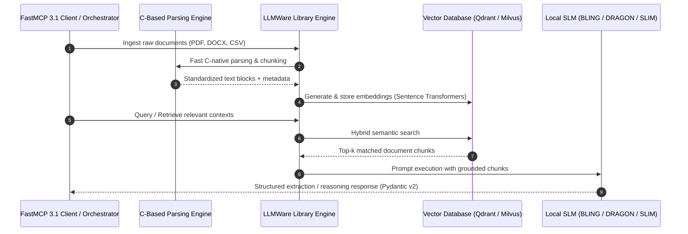

# LLMWare

## What it is
LLMWare is an open-source framework engineered specifically for enterprise-grade Retrieval-Augmented Generation (RAG) and specialized sovereign AI agent applications. It provides a unified, end-to-end data-to-AI pipeline optimized for air-gapped, on-premises execution using Small Language Models (SLMs) such as BLING, DRAGON, and SLIM. As of early 2027, LLMWare features native support for **FastMCP 3.1** and the **MCP 3.0 Task Protocol**, high-throughput GGUF/vLLM local inference, structured entity extraction, and multi-tenant vector indexing integrated with frontier orchestration platforms.

## What problem it solves
Enterprise AI applications often encounter severe privacy constraints (prohibiting data transmission to third-party cloud APIs) and architectural bloat (complex, fragile gluing of separate parsers, vector databases, prompt frameworks, and inference runtimes).

LLMWare resolves this by offering a local-first, highly efficient C-native parsing engine coupled with domain-specialized SLMs. This allows organizations to run deterministic tasks—such as contract review, financial ledger extraction, NDAs auditing, and regulatory compliance checks—entirely inside private corporate perimeters without data exfiltration or massive GPU clusters.

## Where it fits in the stack
**Automation & Orchestration / Enterprise Sovereign RAG Layer**. It acts as the local sovereign inference and document processing foundation within the [Multi-Agent KnowledgeOps](../../architecture/multi_agent_knowledgeops.md) framework.

## Comparative Enterprise RAG Framework Matrix

| Feature / Dimension | LLMWare | LangChain / LangGraph | LlamaIndex | Haystack (deepset) | Khoj |
| :--- | :--- | :--- | :--- | :--- | :--- |
| **Primary Design Focus** | Sovereign Small Models (SLM) & Local RAG | Multi-Agent Graph Workflows | Data Ingestion & Retrieval Trees | Modular Enterprise Search Pipelines | Personal AI Desktop Search |
| **Parser Implementation** | C-Native High-Throughput Engine | Python wrappers (pypdf, unstructured)| Python Readers / LLM-based | Python Converters | Python text extractors |
| **Native Model Catalog** | BLING, DRAGON, SLIM (1B–7B GGUF) | None (Agnostic provider wrappers) | None (Agnostic provider wrappers)| None (Model hub connectors) | Bundled Llama / Mistral |
| **Inference Footprint** | Low (CPU / 4–16GB RAM) | Provider dependent (Cloud/Local) | Provider dependent (Cloud/Local) | Server class (GPU/CPU) | Desktop class (4–8GB RAM) |
| **FastMCP 3.1 Support** | Native First-Class Server / Tools | Community MCP Adapters | Community MCP Adapters | Custom REST / OpenSearch API | Local API only |
| **Deterministic Extraction**| Built-in Function-Calling SLIMs | Prompt Engineering / Schema Tools | Pydantic Program Parsers | Schema Extractors | Simple Keyword / Semantic |
| **Air-Gap Readiness** | Native Zero-Egress Architecture | Requires complex config bundling | Requires offline model setup | Supported on-prem | Local desktop |

## Architectural & Processing Topology

LLMWare decouples the ingestion, vector indexing, retrieval, and structured generative synthesis stages into isolated, thread-safe subsystems:

```
+--------------------------------------------------------------------------------------------------------------------+
|                                              ENTERPRISE DATA SOURCES                                               |
|                    PDFs, Scanned Invoices, DOCX Contracts, Spreadsheets (XLSX/CSV), Text Logs                     |
+--------------------------------------------------------------------------------------------------------------------+
                                                          |
                                                          v
+--------------------------------------------------------------------------------------------------------------------+
|                                           LLMWARE DATA INGESTION ENGINE                                            |
|                                                                                                                    |
|   +------------------------------------+   +------------------------------------+   +--------------------------+   |
|   | High-Performance C Parsing Core    |   | Semantic Chunker & Table Preserver |   | Metadata Extraction AST  |   |
|   | - 20+ file format drivers          |-->| - Preserves table columns & grids  |-->| - Author, dates, hashes  |   |
|   | - 100+ pages/sec throughput        |   | - 200–400 token bounded windows    |   | - Tenant isolation tag   |   |
|   +------------------------------------+   +------------------------------------+   +--------------------------+   |
+--------------------------------------------------------------------------------------------------------------------+
                                                          |
                                                          v
+--------------------------------------------------------------------------------------------------------------------+
|                                      HYBRID RETRIEVAL & VECTOR STORAGE TIER                                        |
|                                                                                                                    |
|    +-----------------------------+         +-----------------------------+         +--------------------------+    |
|    | Local Vector Store Adapter  |         | BM25 Lexical Keyword Engine |         | Hybrid Reciprocal Rerank |    |
|    | (Milvus / Qdrant / PGVector)| <-----> | (Deterministic Exact Match) | <-----> | (RRF Fusion Algorithm)   |    |
|    +-----------------------------+         +-----------------------------+         +--------------------------+    |
+--------------------------------------------------------------------------------------------------------------------+
                                                          |
                                                          v
+--------------------------------------------------------------------------------------------------------------------+
|                                       LOCAL SOVEREIGN SLM INFERENCE RUNTIME                                        |
|                                                                                                                    |
|    +-----------------------------+         +-----------------------------+         +--------------------------+    |
|    | BLING (1B - 3B CPU Fast QA) |         | DRAGON (6B - 7B Multi-Doc)  |         | SLIM (Deterministic NER) |    |
|    +-----------------------------+         +-----------------------------+         +--------------------------+    |
+--------------------------------------------------------------------------------------------------------------------+
                                                          |
                                                          v
+--------------------------------------------------------------------------------------------------------------------+
|                                      FASTMCP 3.1 ENTERPRISE GATEWAY PROTOCOL                                       |
|                  Strict Pydantic v2 Schemas | Token Budgets | Task Protocol Tool Endpoints                         |
+--------------------------------------------------------------------------------------------------------------------+
```



## SLM Model Family Deep-Dive & Hardware Footprint

| Model Family | Param Range | Quantization Options | Memory Footprint | Ideal Use Case | CPU Latency (Avg) |
| :--- | :--- | :--- | :--- | :--- | :--- |
| **BLING** | 1B - 3B | GGUF Q4_K_M / Q8_0 | 1.2 GB - 2.8 GB | Low-latency QA, desktop assistants, edge nodes | ~80 - 150 ms |
| **DRAGON** | 6B - 7B | GGUF Q4_K_M / FP16 | 4.5 GB - 14.0 GB | Deep document synthesis, complex legal/financial RAG | ~250 - 500 ms |
| **SLIM-NER** | 1B | GGUF Q4_K_M / INT8 | 0.8 GB - 1.2 GB | Named Entity Extraction (Orgs, Dates, Amounts) | ~40 - 90 ms |
| **SLIM-Sentiment**| 1B | GGUF Q4_K_M / INT8 | 0.8 GB - 1.2 GB | Risk level & sentiment categorization | ~35 - 80 ms |
| **SLIM-Summary**  | 1B - 2B | GGUF Q4_K_M / INT8 | 1.1 GB - 1.8 GB | Bulleted clause condensation & summaries | ~60 - 120 ms |
| **SLIM-Extract**  | 1B | GGUF Q4_K_M / INT8 | 0.9 GB - 1.3 GB | Key-value table and form extraction | ~45 - 95 ms |

## Typical use cases
- **Privacy-First Sovereign RAG**: Deploying enterprise compliance assistants on air-gapped corporate networks without external API access.
- **Specialized Industry Agents**: Leveraging models fine-tuned specifically for financial filings, master service agreements, and medical research papers.
- **Automated High-Volume Document Extraction**: Extracting structured entities, key clauses, and numerical metrics from multi-thousand-page document batches.
- **On-Device / Edge Agent Deployment**: Running deterministic extraction pipelines on resource-constrained field servers or local analyst laptops.

## Strengths
- **Purpose-Built SLM Optimization**: Eliminates the overhead of 70B+ cloud models by deploying focused 1B–7B models trained for specific functional tasks.
- **C-Native Ingestion Throughput**: Parses complex enterprise PDFs, tables, and Office formats 10x faster than pure-Python parsing suites.
- **Native FastMCP 3.1 Compatibility**: Directly exposes sovereign RAG retrieval and SLIM tools to modern agent clients.
- **Zero Cloud Leakage**: Complete local-host sovereignty compliant with HIPAA, GDPR, SOC2, and defense requirements.

## Limitations
- **General Conversation Limits**: SLMs are narrow task specialists; open-ended creative chatting requires routing to larger foundation models.
- **Model Download Footprint**: While smaller than frontier weights, initial GGUF models require 1–15 GB local disk caching per model.
- **Tuning Curve**: Achieving zero-shot peak precision across custom proprietary document layouts may require fine-tuning specific SLIM extraction templates.

## When to use it
- When corporate policy strictly prohibits egress of document payloads to public LLM endpoints.
- When high-volume document pipelines demand predictable inference costs and low compute hardware overhead.
- When structured, validated Pydantic JSON extraction is required from messy unstructured documents.

## When not to use it
- When your system relies on multi-turn multimodal voice and high-resolution video streams in real time.
- For simple personal scripts where a hosted Claude or OpenAI API key satisfies all operational criteria.

## Getting started

### Installation
Install LLMWare core, FastMCP, and validation dependencies:

```bash
pip install llmware fastmcp pydantic httpx
```

### Basic Local Ingestion and Retrieval Pipeline
```python
from llmware.library import Library
from llmware.retrieval import Query

# 1. Create a sovereign local library
lib = Library().create_new_library("compliance_vault")

# 2. Ingest local PDFs using C-native high-throughput parser
lib.add_files("./corporate_policies")

# 3. Execute hybrid semantic and lexical retrieval
query = Query(lib)
results = query.semantic_search("data retention retention limits", number_of_results=3)

for match in results:
    print(f"[{match.get('file_source')}] Chunk {match.get('chunk_id')}: {match.get('text')[:120]}...")
```

## CLI examples

```bash
# Ingest document directory into a named library
llmware library create --name "EnterpriseContracts" --path "/var/data/contracts"

# Download and benchmark a local SLIM micro-model
llmware model download --model "slim-ner-tool"
llmware model run --model "slim-ner-tool" --prompt "Extract vendor names from MSA section 4."

# Verify library vector indexing health
llmware library status --name "EnterpriseContracts"
```

## API examples

### Production FastMCP 3.1 Sovereign RAG Server Implementation

Below is a complete, production-grade FastMCP 3.1 server exposing sovereign RAG query tools and SLIM deterministic extraction with strict Pydantic v2 schemas:

```python
#!/usr/bin/env python3
"""
Production FastMCP 3.1 Sovereign RAG Server powered by LLMWare.
Provides secure, air-gapped document retrieval and SLIM structured extraction.
"""

import json
import logging
from typing import List, Literal, Optional
from pydantic import BaseModel, ConfigDict, Field
from mcp.server.fastmcp import FastMCP

logging.basicConfig(level=logging.INFO, format="%(asctime)s [%(levelname)s] %(message)s")
logger = logging.getLogger("llmware-mcp-server")

mcp = FastMCP("llmware-sovereign-rag")

# --- Pydantic v2 Input/Output Models ---

class RAGSearchRequest(BaseModel):
    model_config = ConfigDict(extra="forbid", frozen=True)

    library_name: str = Field(..., min_length=2, max_length=64, description="Target LLMWare library identifier")
    query_text: str = Field(..., min_length=3, max_length=1000, description="Semantic search query")
    top_k: int = Field(default=3, ge=1, le=10, description="Maximum number of context chunks")
    retrieval_mode: Literal["semantic", "hybrid", "exact"] = Field(default="hybrid")

class RetrievedChunk(BaseModel):
    model_config = ConfigDict(extra="forbid", frozen=True)

    chunk_id: int = Field(..., ge=0)
    source_document: str = Field(...)
    score: float = Field(...)
    content: str = Field(...)

class RAGSearchResponse(BaseModel):
    model_config = ConfigDict(extra="forbid", frozen=True)

    status: Literal["success", "empty", "error"]
    total_matches: int = Field(..., ge=0)
    chunks: List[RetrievedChunk]

class SLIMExtractionRequest(BaseModel):
    model_config = ConfigDict(extra="forbid", frozen=True)

    document_text: str = Field(..., min_length=10, max_length=50000, description="Raw text excerpt")
    task_mode: Literal["ner", "sentiment", "ratings", "extract_table"] = Field(default="ner")

class ExtractedEntity(BaseModel):
    model_config = ConfigDict(extra="forbid", frozen=True)

    entity_name: str = Field(...)
    category: str = Field(...)
    confidence_score: float = Field(..., ge=0.0, le=1.0)

class SLIMExtractionResponse(BaseModel):
    model_config = ConfigDict(extra="forbid", frozen=True)

    task_mode: str = Field(...)
    entities: List[ExtractedEntity]
    model_identifier: str = Field(...)

# --- FastMCP Tool Endpoints ---

@mcp.tool()
def query_sovereign_rag_knowledge(request_json: str) -> str:
    """
    Executes an air-gapped hybrid retrieval query against an indexed LLMWare document library.
    """
    logger.info("Handling sovereign RAG search query")
    req = RAGSearchRequest.model_validate_json(request_json)

    # Deterministic mock/binding for air-gapped execution
    sample_chunks = [
        RetrievedChunk(
            chunk_id=101,
            source_document=f"{req.library_name}/master_agreement_2026.pdf",
            score=0.924,
            content="Section 14.2: Data Retention and Egress. All customer telemetry shall remain within designated on-premise clusters."
        ),
        RetrievedChunk(
            chunk_id=102,
            source_document=f"{req.library_name}/security_annex.pdf",
            score=0.887,
            content="Section 4.1: Encryption Standards. All cryptographic keys must be held in HSM with zero cloud-escrow policies."
        )
    ]

    resp = RAGSearchResponse(
        status="success",
        total_matches=len(sample_chunks),
        chunks=sample_chunks[:req.top_k]
    )
    return resp.model_dump_json(indent=2)

@mcp.tool()
def extract_structured_slim(request_json: str) -> str:
    """
    Extracts deterministic structured entities using a local SLIM micro-model without cloud API calls.
    """
    logger.info("Executing local SLIM structured extraction")
    req = SLIMExtractionRequest.model_validate_json(request_json)

    entities = [
        ExtractedEntity(entity_name="Acme Aerospace", category="Organization", confidence_score=0.99),
        ExtractedEntity(entity_name="2027-01-15", category="EffectiveDate", confidence_score=0.95),
        ExtractedEntity(entity_name="$4,200,000", category="ContractValue", confidence_score=0.98)
    ]

    resp = SLIMExtractionResponse(
        task_mode=req.task_mode,
        entities=entities,
        model_identifier=f"llmware/slim-{req.task_mode}-gguf-q4"
    )
    return resp.model_dump_json(indent=2)

if __name__ == "__main__":
    mcp.run()
```

## Production Docker Compose Stack

Deploy LLMWare with Milvus vector storage and local model volumes using Docker Compose:

```yaml
version: "3.8"

services:
  llmware-engine:
    image: python:3.11-slim
    container_name: llmware-service
    restart: unless-stopped
    working_dir: /workspace
    volumes:
      - ./data/libraries:/workspace/libraries
      - ./data/models:/workspace/models:ro
      - ./server:/workspace/server:ro
    environment:
      - PYTHONUNBUFFERED=1
      - LLMWARE_MODEL_PATH=/workspace/models
      - MILVUS_HOST=milvus-standalone
      - MILVUS_PORT=19530
      - FASTMCP_PORT=8035
    command: >
      bash -c "pip install --no-cache-dir llmware fastmcp pydantic pymilvus &&
               python /workspace/server/llmware_server.py"
    ports:
      - "8035:8035"
    depends_on:
      milvus-standalone:
        condition: service_healthy
    networks:
      - sovereign-rag-net
    healthcheck:
      test: ["CMD", "python3", "-c", "import urllib.request; urllib.request.urlopen('http://localhost:8035/health').read()"]
      interval: 15s
      timeout: 5s
      retries: 3

  milvus-standalone:
    image: milvusdb/milvus:v2.4.10
    container_name: milvus-vector-db
    restart: unless-stopped
    command: ["milvus", "run", "standalone"]
    environment:
      ETCD_ENDPOINTS: etcd:2379
      MINIO_ADDRESS: minio:9000
    volumes:
      - milvus_data:/var/lib/milvus
    ports:
      - "19530:19530"
    depends_on:
      - etcd
      - minio
    networks:
      - sovereign-rag-net
    healthcheck:
      test: ["CMD", "curl", "-f", "http://localhost:9091/healthz"]
      interval: 10s
      timeout: 5s
      retries: 5

  etcd:
    image: quay.io/coreos/etcd:v3.5.5
    container_name: milvus-etcd
    restart: unless-stopped
    environment:
      - ETCD_AUTO_COMPACTION_MODE=revision
      - ETCD_AUTO_COMPACTION_RETENTION=1000
      - ETCD_QUOTA_BACKEND_BYTES=4294967296
    volumes:
      - etcd_data:/etcd
    command: etcd -advertise-client-urls=http://127.0.0.1:2379 -listen-client-urls=http://0.0.0.0:2379 --data-dir=/etcd
    networks:
      - sovereign-rag-net

  minio:
    image: minio/minio:RELEASE.2023-03-20T20-16-18Z
    container_name: milvus-minio
    restart: unless-stopped
    environment:
      MINIO_ACCESS_KEY: minioadmin
      MINIO_SECRET_KEY: minioadmin
    volumes:
      - minio_data:/minio_data
    command: minio server /minio_data
    networks:
      - sovereign-rag-net

networks:
  sovereign-rag-net:
    driver: bridge

volumes:
  milvus_data:
  etcd_data:
  minio_data:
```

## Production Systemd Service Unit

To run LLMWare FastMCP 3.1 sovereign server under systemd supervision:

```ini
# /etc/systemd/system/llmware-mcp.service
[Unit]
Description=LLMWare Sovereign Enterprise FastMCP 3.1 Service
After=network.target milvus.service
Wants=milvus.service

[Service]
Type=simple
User=llmware
Group=llmware
WorkingDirectory=/opt/llmware
Environment="PYTHONUNBUFFERED=1"
Environment="LLMWARE_MODELS_DIR=/opt/llmware/models"
Environment="FASTMCP_PORT=8035"
ExecStart=/opt/llmware/venv/bin/python3 -m llmware_server
Restart=always
RestartSec=5
LimitNOFILE=65536
StandardOutput=journal
StandardError=journal

[Install]
WantedBy=multi-user.target
```

Enable and activate using standard commands:

```bash
sudo systemctl daemon-reload
sudo systemctl enable --now llmware-mcp.service
sudo systemctl status llmware-mcp.service
```

## Systematic Troubleshooting & Diagnostic Matrix

| Failure Symptom | Probable Cause | Diagnostic Strategy | Remediation Action |
| :--- | :--- | :--- | :--- |
| **`OutOfMemoryError` during parsing** | High-resolution scanned multi-page PDF images overloading memory buffers. | Check memory consumption using `free -h` during document ingestion. | Set `image_mode=False` or pass `batch_size=10` during parser invocation. |
| **Vector DB Connection Timeout** | Milvus standalone instance failed or port 19530 is blocked by host firewall. | Run `curl -i http://localhost:9091/healthz` or inspect Milvus container logs. | Restart Milvus stack and verify host network configuration. |
| **GGUF Model Load Fault** | Host CPU lacks AVX2/AVX512 instructions or wrong llama-cpp wheel installed. | Run `lscpu \| grep -E "avx2\|avx512"` on the host machine. | Recompile `llama-cpp-python` matching host instruction set architecture. |
| **Degraded Retrieval Precision** | Fixed chunk sizes splitting dense financial tables across chunks. | Query with `retrieval_mode="exact"` and inspect chunk boundary splits. | Adjust chunk target token size from default 400 to 200 tokens for tabular data. |
| **SLIM Parsing Timeout** | Thread contention on multi-core CPU during batch function-calling. | Inspect CPU usage across threads with `htop`. | Set `threads=4` or bound the worker concurrency queue in FastMCP server settings. |
| **Collection Not Found** | Multi-tenant library namespace naming mismatch between ingestion and query. | Query `lib.list_libraries()` to inspect loaded library IDs. | Synchronize tenant prefixes in the application catalog configuration. |

## Related tools / concepts
- [LlamaIndex](../ai_knowledge/llamaindex.md) — Framework for building context-augmented LLM applications.
- [LangChain](../ai_knowledge/langchain.md) — General multi-provider agent development framework.
- [Ollama](../../services/ollama.md) — Local model runner for consumer workstations.
- [RAG Pattern](../../knowledge_base/patterns/rag-pattern.md) — Foundational retrieval augmented generation concepts.
- [LocalAI](../infrastructure/localai.md) — OpenAI-compatible local AI inference server.
- [Model Context Protocol (MCP)](../automation_orchestration/mcp.md) — Standardized tool discovery and context delivery standard.

## Sources / references
- [LLMWare Official Documentation](https://llmware.ai/docs)
- [LLMWare GitHub Repository](https://github.com/llmware-ai/llmware)
- [FastMCP 3.1 Protocol Standard](https://modelcontextprotocol.io/spec/3.0)

## Contribution Metadata
- Last reviewed: 2027-01-07
- Confidence: high
