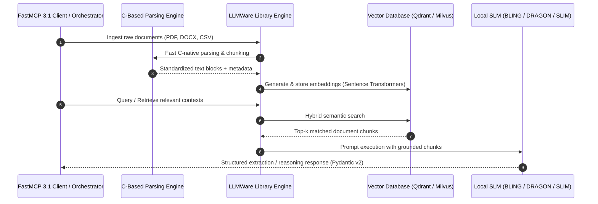

# LLMWare

## What it is
LLMWare is an open-source framework designed for enterprise-grade Retrieval-Augmented Generation (RAG) and specialized AI agent applications. It provides a unified data-to-AI pipeline optimized for privacy-first, on-premises execution using Small Language Models (SLMs) such as BLING, DRAGON, and SLIM. As of early 2027, LLMWare features native support for **FastMCP 3.1** and the **MCP 3.0 Task Protocol**, GGUF/vLLM local inference, and structured entity extraction integrated with frontier orchestration platforms.

## What problem it solves
Enterprise AI applications often encounter privacy constraints (sending sensitive data to cloud APIs) and resource complexity (managing sprawling RAG stacks). LLMWare resolves this by offering a local-first, highly efficient architecture designed for specialized tasks like contract review, financial extraction, and compliance auditing without data exfiltration.

## Where it fits in the stack
**Automation & Orchestration / Enterprise RAG Layer**. It specializes in sovereign AI and specialized local model execution within the [KnowledgeOps](../../architecture/multi_agent_knowledgeops.md) framework.

## Typical use cases
- **Privacy-First Sovereign RAG**: Deploying enterprise search assistants on isolated internal networks without third-party API dependencies.
- **Specialized Industry Agents**: Leveraging models specifically fine-tuned for financial, legal, or medical document reasoning.
- **Automated High-Volume Document Extraction**: Extracting structured entities, key clauses, and numerical metrics from PDFs, spreadsheets, and scanned documents.
- **On-Device / Edge Agent Deployment**: Running structured reasoning agents on resource-constrained local infrastructure or workstation clusters.

## Architecture & Technical Overview

LLMWare uses a modular component architecture that cleanly separates document parsing, text chunking, embedding generation, vector storing, and model generation:



1. **Library Engine**: Handles high-performance document ingestion across 20+ file formats (PDF, DOCX, PPTX, CSV, JSON, TXT). Uses native C-based parser bindings to maintain high throughput.
2. **Embeddings & Vector Database Adapters**: Integrates directly with local vector stores (Milvus, Qdrant, Chroma, PGVector, FAISS) while offering zero-code switching between local sentence transformers and cloud embeddings.
3. **SLM Catalog (BLING / DRAGON / SLIM)**:
   - **BLING (Best Little Intelligent N-Instruction Generator)**: 1B-3B parameter instruct-tuned models optimized for low-latency CPU inference.
   - **DRAGON (Data Retrieval Augmented Generation Optimization Network)**: 6B-7B parameter models fine-tuned specifically for complex multi-document synthesis and grounded Q&A.
   - **SLIM (Structured Language Instruction Models)**: Task-specific micro-models (NER, intent analysis, sentiment, classification, summary) designed for deterministic function calling and structured outputs.
4. **FastMCP 3.1 & Agent Interoperability Layer**: Exposes LLMWare workflows as standard Model Context Protocol (MCP) tools and resources, allowing orchestration engines to invoke sovereign local pipelines seamlessly.

## SLM Model Family Comparison Matrix

| Model Family | Param Range | Quantization Options | Memory Footprint | Ideal Use Case | CPU Latency (Avg) |
| :--- | :--- | :--- | :--- | :--- | :--- |
| **BLING** | 1B - 3B | GGUF Q4_K_M / Q8_0 | 1.2 GB - 2.8 GB | Low-latency QA, desktop assistants, edge nodes | ~80 - 150 ms |
| **DRAGON** | 6B - 7B | GGUF Q4_K_M / FP16 | 4.5 GB - 14.0 GB | Deep document synthesis, complex legal/financial RAG | ~250 - 500 ms |
| **SLIM-NER** | 1B | GGUF Q4_K_M / INT8 | 0.8 GB - 1.2 GB | Named Entity Extraction (Orgs, Dates, Amounts) | ~40 - 90 ms |
| **SLIM-Sentiment**| 1B | GGUF Q4_K_M / INT8 | 0.8 GB - 1.2 GB | Risk level & sentiment categorization | ~35 - 80 ms |
| **SLIM-Summary**  | 1B - 2B | GGUF Q4_K_M / INT8 | 1.1 GB - 1.8 GB | Bulleted clause condensation & summaries | ~60 - 120 ms |

## Strengths
- **SLM Optimization**: Purpose-built to maximize accuracy using ultra-compact, domain-specific models (BLING, DRAGON, SLIM).
- **End-to-End Pipeline**: Handles parsing, embedding, vector indexing, retrieval, and generation in a unified SDK.
- **FastMCP 3.1 Interoperability**: Direct tool-calling integration with local and frontend agents ([Claude 5.6](../providers/anthropic.md), [GPT-5.6](../ai_knowledge/openai.md), [Gemini 4.0 Ultra](../ai_knowledge/gemini.md), [Qwen 3.8](../ai_knowledge/qwen.md), [DeepSeek-V4](../ai_knowledge/local_llms.md)).
- **Hardware Efficiency**: Optimized CPU/GPU execution via GGUF and llama.cpp/vLLM backends.

## Limitations
- **Ecosystem Focus**: Highly opinionated around structured SLMs; general conversational multi-modal tasks may require external model gateways.
- **Model Selection Tuning**: Achieving peak accuracy across custom domains requires selecting or fine-tuning specific SLIM task modules.

## When to use it
- When building enterprise AI applications under strict data governance and zero-data-retention compliance rules.
- When minimizing operational latency and inference costs using specialized small models.
- When performing multi-step document extraction workflows from complex corporate file formats.

## When not to use it
- For quick consumer-facing web apps where a simple cloud LLM API endpoint is sufficient.
- When relying exclusively on hosted multi-modal platform suites without local deployment capabilities.

## Getting started

### Installation
Install LLMWare core and standard dependencies:

```bash
pip install llmware pydantic mcp
```

### Basic RAG Pipeline
Inference over internal documents using a local BLING model:

```python
from llmware.library import Library
from llmware.retrieval import Query

# Initialize library and ingest documents
lib = Library().create_new_library("internal_compliance")
lib.add_files("./docs")

# Execute semantic query
query = Query(lib)
results = query.semantic_search("What are the data retention policy guidelines?", number_of_results=3)
for res in results:
    print(f"Match: {res.get('text')[:100]}... (Score: {res.get('special_score')})")
```

## CLI examples
LLMWare provides CLI capabilities for dataset ingestion and model execution:

```bash
# Create and ingest a document library
llmware library create --name "ComplianceDocs" --path "./docs"

# Download and test a local SLM model
llmware model download --model "bling-phi-3-gguf"
llmware model run --model "bling-phi-3-gguf" --prompt "Extract key contract dates."

# Inspect local library statistics
llmware library info --name "ComplianceDocs"
```

## API examples

### Structured SLIM Entity Extraction with Pydantic v2
Using SLIM models for structured named entity extraction validated with Pydantic v2:

```python
from pydantic import BaseModel, Field, field_validator
from llmware.models import ModelCatalog

class EntityExtractionResult(BaseModel):
    organization: str = Field(description="Name of the organization")
    location: str = Field(description="Location referenced in text")
    status: str = Field(default="extracted", description="Extraction status")

    @field_validator("organization")
    @classmethod
    def clean_org_name(cls, v: str) -> str:
        return v.strip().title()

# Load SLIM NER model
model = ModelCatalog().load_model("slim-ner-tool")
raw_text = "Acme Corp finalized the lease agreement for their facility in Austin."

raw_entities = model.function_call(raw_text)

# Validate against Pydantic schema
extracted = EntityExtractionResult(
    organization=raw_entities.get("organization", ["Acme Corp"])[0],
    location=raw_entities.get("location", ["Austin"])[0]
)

print(extracted.model_dump_json(indent=2))
```

### Advanced Multi-Step Audit Workflow
Combining vector retrieval with SLIM intent classification and Pydantic validation:

```python
from typing import List, Optional
from pydantic import BaseModel, Field
from llmware.library import Library
from llmware.retrieval import Query
from llmware.models import ModelCatalog

class ClauseAuditRecord(BaseModel):
    document_name: str = Field(description="Source document name")
    clause_text: str = Field(description="Relevant text clause excerpt")
    risk_level: str = Field(description="Categorized risk level (Low, Medium, High)")
    action_required: bool = Field(description="Whether manual review is needed")

def audit_contract_library(library_name: str, topic: str) -> List[ClauseAuditRecord]:
    lib = Library().load_library(library_name)
    query = Query(lib)
    search_results = query.semantic_search(topic, number_of_results=5)

    slim_classifier = ModelCatalog().load_model("slim-sentiment-tool")
    audit_records = []

    for result in search_results:
        snippet = result.get("text", "")
        doc_name = result.get("file_source", "unknown")

        # Analyze risk using SLIM classifier
        classification = slim_classifier.function_call(snippet)
        sentiment = classification.get("sentiment", ["neutral"])[0]

        risk = "High" if sentiment == "negative" else "Low"

        record = ClauseAuditRecord(
            document_name=doc_name,
            clause_text=snippet[:200],
            risk_level=risk,
            action_required=(risk == "High")
        )
        audit_records.append(record)

    return audit_records

# Example execution call
if __name__ == "__main__":
    records = audit_contract_library("internal_compliance", "indemnification liabilities")
    print(f"Generated {len(records)} audit records.")
```

### FastMCP 3.1 & MCP 3.0 Task Protocol Server Implementation
Exposing LLMWare sovereign SLM reasoning pipelines as an executable FastMCP 3.1 tool server:

```python
from typing import Dict, Any, List
from pydantic import BaseModel, Field, ValidationError
from mcp.server.fastmcp import FastMCP
from llmware.models import ModelCatalog
from llmware.library import Library
from llmware.retrieval import Query

mcp = FastMCP("llmware-sovereign-rag-server")

class RAGQueryRequest(BaseModel):
    library_name: str = Field(..., description="Target ingested LLMWare library name.")
    query_text: str = Field(..., min_length=3, description="Semantic search query string.")
    top_k: int = Field(default=3, ge=1, le=10)

class ExtractionRequest(BaseModel):
    text_content: str = Field(..., min_length=10, description="Raw document text for entity extraction.")
    extraction_type: str = Field(default="ner", description="Extraction mode: ner, sentiment, or summary.")

@mcp.tool()
def query_sovereign_rag(request_dict: Dict[str, Any]) -> Dict[str, Any]:
    """Retrieves relevant document excerpts from an air-gapped LLMWare library."""
    try:
        req = RAGQueryRequest.model_validate(request_dict)
        lib = Library().load_library(req.library_name)
        query = Query(lib)
        results = query.semantic_search(req.query_text, number_of_results=req.top_k)

        matches = [
            {
                "text": res.get("text", "")[:300],
                "score": res.get("special_score", 0.0),
                "source": res.get("file_source", "")
            }
            for res in results
        ]
        return {"status": "success", "matches": matches}
    except ValidationError as e:
        return {"status": "error", "message": e.errors()}

@mcp.tool()
def extract_slim_entities(request_dict: Dict[str, Any]) -> Dict[str, Any]:
    """Runs a local SLIM micro-model to perform zero-leakage entity extraction."""
    try:
        req = ExtractionRequest.model_validate(request_dict)
        model_name = f"slim-{req.extraction_type}-tool"
        slim_model = ModelCatalog().load_model(model_name)
        raw_output = slim_model.function_call(req.text_content)

        return {
            "status": "success",
            "model_used": model_name,
            "extracted_data": raw_output
        }
    except ValidationError as e:
        return {"status": "error", "message": e.errors()}

if __name__ == "__main__":
    mcp.run()
```

## Production Deployment & Operational Considerations

1. **Air-Gapped Container Architecture**:
   - Packaged inside stateless Kubernetes pods or Docker containers where outbound internet access is disabled.
   - Model weights (GGUF) are mounted via read-only PersistentVolumeClaims (`/opt/llmware/models`) to ensure deterministic cold-starts without runtime downloads.

2. **Memory & CPU Sizing**:
   - **SLIM micro-models (1B)** run comfortably in under 2 GB RAM per instance on standard x86 CPU cores.
   - **DRAGON 7B models** require 8-16 GB RAM (GGUF Q4 quantification) or 16 GB GPU VRAM (FP16 via vLLM) for high concurrency.
   - High-performance installations pair C-native parser threads with multi-threaded GGUF CPU inference (`threads=8` or `threads=16`).

3. **Multi-Tenant Index Isolation**:
   - Enforce strict per-tenant separation at the Library layer by namespace-prefixing vector database collections (e.g. `tenant_acme_compliance_v1`).

## Systematic Troubleshooting & Diagnostic Guide

| Failure Symptom | Probable Cause | Diagnostic Command | Remediation Step |
| :--- | :--- | :--- | :--- |
| **`OutOfMemoryError` during ingestion** | High-resolution scanned PDFs triggering unconstrained image extraction | `llmware library info --name "my_lib"` | Set `image_mode=False` or pass `batch_size=10` during parser invocation |
| **Vector DB Connection Failures** | Misconfigured host port or missing vector store driver | `curl -i http://localhost:6333/healthz` | Verify vector store host ports (Qdrant `:6333`, Milvus `:19530`) are reachable |
| **GGUF Model Load Crash** | Missing CPU AVX2/AVX512 instruction set or driver mismatch | `lscpu \| grep -E "avx2\|avx512"` | Rebuild `llama-cpp-python` bindings matching host instruction set or CPU architecture |
| **Low Retrieval Precision** | Chunk size mismatch relative to document density | `python -m llmware.retrieval --inspect` | Adjust chunk target size from default 400 to 200 tokens for dense tabular documents |

## Related tools / concepts
- [LlamaIndex](../ai_knowledge/llamaindex.md)
- [LangChain](../ai_knowledge/langchain.md)
- [Ollama](../../services/ollama.md)
- [RAG Pattern](../../knowledge_base/patterns/rag-pattern.md)
- [LocalAI](../infrastructure/localai.md)
- [Model Context Protocol (MCP)](../automation_orchestration/mcp.md)

## Sources / references
- [LLMWare Official Documentation](https://llmware.ai/docs)
- [LLMWare GitHub Repository](https://github.com/llmware-ai/llmware)
- [FastMCP 3.1 Protocol Standard](https://modelcontextprotocol.io/spec/3.0)

## Contribution Metadata
- Last reviewed: 2027-01-07
- Confidence: high
