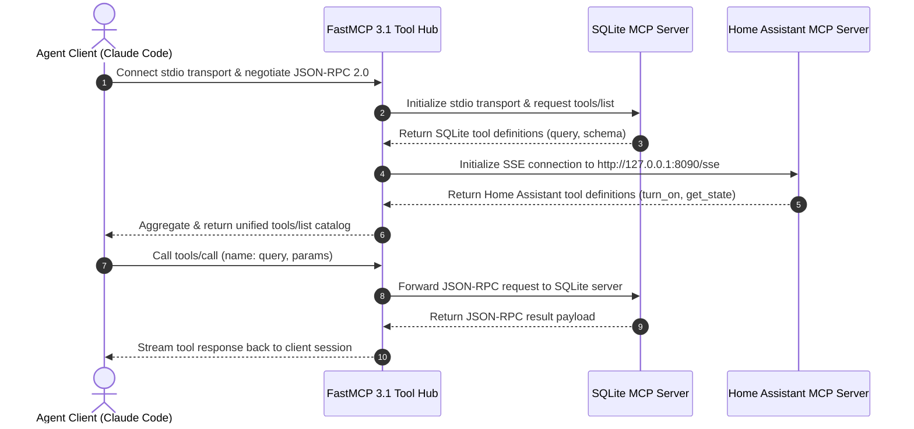

# Model Context Protocol Servers

## What it is
Model Context Protocol (MCP) Servers are standardized, lightweight microservices implementing the open Model Context Protocol (FastMCP 3.1). They expose tools, resource capabilities, and prompts to AI agents (such as [Claude 5.6](../providers/anthropic.md), [GPT-5.6](../ai_knowledge/openai.md), [Gemini 4.0 Ultra](../ai_knowledge/gemini.md), and [DeepSeek-V4](../ai_knowledge/local_llms.md)) over stdio or Server-Sent Events (SSE) transports.

## What problem it solves
Before MCP, every AI agent framework (LangChain, AutoGen, LlamaIndex) required custom, proprietary integrations to connect LLMs to external systems like GitHub, Home Assistant, SQLite, or Paperless-ngx. MCP servers provide a universal, framework-agnostic protocol standard that allows any compliant AI client to discover and invoke tools seamlessly without custom integration code for each LLM provider.

## Where it fits in the stack
**Automation / Orchestration**. MCP servers act as the execution layer that connects reasoning AI models with homelab infrastructure, local databases, and enterprise APIs within the [KnowledgeOps](../../architecture/multi_agent_knowledgeops.md) framework.

## Architecture & Technical Protocol Specification
The Model Context Protocol establishes a bidirectional client-server relationship over JSON-RPC 2.0 primitives:

```
+-----------------------------------------------------------------------------------+
|                     Model Context Protocol Ecosystem (FastMCP 3.1)                 |
+-----------------------------------------------------------------------------------+
                                          |
  +---------------------------------------+---------------------------------------+
  |                                       |                                       |
  v                                       v                                       v
+-----------------------+     +-----------------------+     +-----------------------+
|   Host Application    |     |  Transport Protocol   |     |     MCP Server        |
|                       |     |                       |     |     (FastMCP 3.1)     |
| - Claude Code / Cursor| ===>| - stdio (Subprocess)  |<===>| - Tool Handlers       |
| - Open WebUI / Agent  |     | - SSE / HTTP Stream   |     | - Resource Providers  |
| - Custom Python Loop  |     | - JSON-RPC 2.0 Spec   |     | - Prompt Templates    |
+-----------------------+     +-----------------------+     +-----------------------+
                                          |
                                          v
                              +-----------------------+
                              | Target Integrations   |
                              | - Homelab / K3s APIs  |
                              | - Postgres / VectorDB |
                              | - Home Assistant      |
                              +-----------------------+
```

### Core Primitives
1. **Tools**: Executable functions exposed to the LLM with typed JSON schemas for input parameters and structured response payloads.
2. **Resources**: Read-only context endpoints (URI scheme `protocol://...`) providing documentation, configuration files, live telemetry, or file attachments to the agent prompt.
3. **Prompts**: Parameterized prompt templates managed on the server side to guide specific multi-step workflows (e.g., code review templates, diagnostic runbooks).
4. **Transport Layer**:
   - **stdio**: Standard Input/Output streaming for local desktop applications and local agent subprocesses.
   - **SSE (Server-Sent Events)**: HTTP-based streaming for remote or containerized MCP server deployments across local networks or internal VPCs.

## Multi-Server Protocol Initialization Sequence



## Typical use cases
- **Homelab System Control**: Controlling Home Assistant lights, smart plugs, and automation scenes via dedicated MCP tools.
- **Document & Task Operations**: Querying, staging, and indexing documents in Paperless-ngx or updating Vikunja and Todoist task backlogs.
- **Developer & Infrastructure Workflows**: Interacting with local Git repositories, Docker/Podman containers, Kubernetes k3s clusters, and database schemas.
- **Enterprise Data Retrieval**: Querying SQL databases, Atlassian Jira tickets, or HashiCorp Vault secrets securely.

## Strengths
- **Protocol Standardization**: Built on FastMCP 3.1 with standardized tool, resource, and prompt JSON-RPC messaging.
- **Universal Compatibility**: Works natively across Claude Code, Open WebUI, Cursor, LibreChat, and custom agent loops.
- **Security & Sandboxing**: Server instances can run in isolated Docker or Podman containers with strict environment variable controls and network restrictions.
- **Language Agnostic**: Servers can be implemented in Python (FastMCP), TypeScript (`@modelcontextprotocol/sdk`), Go, Rust, or Java.

## Limitations
- **State Management**: MCP servers are stateless by default and rely on clients or external state stores for long-running workflows.
- **Transport Latency**: Remote SSE transport adds network latency compared to local stdio communication.
- **Schema Overhead**: Complex nested tool schemas require rigorous client-side schema validation to prevent model tool-calling failures.

## Systemd Multi-Server Daemon Setup
For local Linux AI workstations or homelab servers, manage FastMCP 3.1 SSE servers using dedicated systemd units:

```ini
[Unit]
Description=FastMCP 3.1 Homelab Operations Daemon
After=network.target docker.service
Wants=network-online.target

[Service]
Type=simple
User=mcpuser
WorkingDirectory=/opt/mcp-hub
ExecStart=/usr/bin/python3 -m mcp.server.fastmcp run server_hub.py --transport sse --port 8090 --host 0.0.0.0
Restart=always
RestartSec=5
Environment=PYTHONUNBUFFERED=1
Environment=MCP_PROTOCOL_VERSION=3.1
Environment=LOG_LEVEL=INFO
Environment=SQLITE_DB_PATH=/data/homelab.db

# Security Sandbox
NoNewPrivileges=true
ProtectSystem=full
ProtectHome=true
PrivateTmp=true

[Install]
WantedBy=multi-user.target
```

## Advanced Security & Sandbox Enforcement
To prevent rogue MCP tools from accessing unauthorized host resources when executing third-party tool servers, apply strict Podman/Docker container security profiles:

```bash
# Run remote MCP server in read-only Podman sandbox container
podman run -d \
  --name mcp-sqlite-sandbox \
  --read-only \
  --cap-drop=ALL \
  --security-opt=no-new-privileges \
  -v /data/sqlite_readonly:/data:ro \
  -p 127.0.0.1:8091:8090 \
  mcp-server-sqlite:v3.1
```

## When to use it
- When connecting AI agents (Claude Code, Cursor, Open WebUI) to homelab APIs, local databases, and custom CLI utilities.
- When creating reusable, framework-independent tool integrations for LLMs.
- When standardizing agent tool calling using FastMCP 3.1 protocols.

## When not to use it
- When implementing simple, inline function calls without external agent access needs.
- When communicating over restricted legacy protocols that prohibit JSON-RPC over stdio/SSE.

## Getting started

### Installation
Install FastMCP framework via `uv` or `pip` to construct Model Context Protocol 3.1 compliant servers:

```bash
uv add fastmcp pydantic
```

### Basic FastMCP 3.1 Server Example
A working example defining a FastMCP server with a tool for homelab storage calculations:

```python
from fastmcp import FastMCP

# Create a named FastMCP server instance
mcp = FastMCP("Homelab Storage Calculator")

@mcp.tool()
def calculate_storage_used(total_gb: float, used_gb: float) -> dict[str, float]:
    """Calculates available disk space and usage percentage for home-lab nodes."""
    free_gb = max(0.0, total_gb - used_gb)
    usage_pct = round((used_gb / total_gb) * 100, 2) if total_gb > 0 else 0.0
    return {"free_gb": free_gb, "usage_pct": usage_pct}

if __name__ == "__main__":
    mcp.run()
```

### Client Configuration (`claude_desktop_config.json`)
To configure client integrations (e.g., Claude Code, Claude Desktop, or Cursor), add the server definition to `claude_desktop_config.json`:

```json
{
  "mcpServers": {
    "sqlite": {
      "command": "uvx",
      "args": ["mcp-server-sqlite", "--db-path", "/data/homelab.db"]
    },
    "homelab-storage": {
      "command": "python",
      "args": ["/opt/mcp-servers/storage_server.py"]
    }
  }
}
```

## CLI examples

```bash
# 1. Install FastMCP package into local Python project environment
uv add fastmcp

# 2. Launch an MCP server binary directly using uvx runner
uvx mcp-server-sqlite --db-path /data/homelab.db

# 3. Inspect, test, and debug running FastMCP server tools in interactive CLI mode
mcp dev server.py

# 4. Expose server over HTTP SSE transport for remote agent connections
mcp run server.py --transport sse --port 8000
```

## API examples

### Complete FastMCP 3.1 Server with Pydantic v2 Schema Validation
Defining custom tools, resources, and prompt templates with strict Pydantic v2 inputs:

```python
from typing import List, Dict, Any
from pydantic import BaseModel, Field
from fastmcp import FastMCP

mcp = FastMCP("homelab-ops-mcp")

class NodeHealthCheckInput(BaseModel):
    node_id: str = Field(description="Unique node identifier (e.g., k3s-worker-01)")
    check_disk: bool = Field(default=True, description="Whether to include disk utilization checks")
    check_memory: bool = Field(default=True, description="Whether to include RAM usage checks")

class HealthStatusOutput(BaseModel):
    node_id: str
    healthy: bool
    metrics: Dict[str, Any]
    warnings: List[str]

@mcp.tool()
def evaluate_node_health(input_data: NodeHealthCheckInput) -> str:
    """Evaluates cluster node health and returns a JSON payload matching HealthStatusOutput."""
    warnings = []
    metrics = {}

    if input_data.check_disk:
        metrics["disk_used_pct"] = 68.5
        if metrics["disk_used_pct"] > 85.0:
            warnings.append("High disk usage detected")

    if input_data.check_memory:
        metrics["memory_used_pct"] = 42.1

    status = HealthStatusOutput(
        node_id=input_data.node_id,
        healthy=len(warnings) == 0,
        metrics=metrics,
        warnings=warnings
    )
    return status.model_dump_json(indent=2)

@mcp.resource("config://homelab/cluster/summary")
def get_cluster_summary() -> str:
    """Exposes cluster inventory as an MCP resource endpoint."""
    return '{"cluster_name": "home-core", "nodes": 4, "status": "active"}'

@mcp.prompt()
def diagnose_node_failure(node_id: str) -> str:
    """Generates a diagnostic prompt template for inspecting node outages."""
    return f"Diagnose recent failure events on node '{node_id}'. Run evaluating tools and suggest remediation steps."

if __name__ == "__main__":
    mcp.run()
```

### JSON-RPC Protocol Message Schema (Pydantic v2)
The following script validates JSON-RPC 2.0 tool-call messages used internally by MCP clients:

```python
from typing import Dict, Any, Optional, Literal
from pydantic import BaseModel, Field, ValidationError

class JSONRPCRequest(BaseModel):
    jsonrpc: Literal["2.0"] = "2.0"
    id: int | str = Field(..., description="Request identifier matching response")
    method: str = Field(..., description="MCP JSON-RPC method (e.g., tools/call, tools/list)")
    params: Dict[str, Any] = Field(default_factory=dict, description="Method parameters")

class JSONRPCResponse(BaseModel):
    jsonrpc: Literal["2.0"] = "2.0"
    id: int | str
    result: Optional[Dict[str, Any]] = None
    error: Optional[Dict[str, Any]] = None

# Example validation check
if __name__ == "__main__":
    req_json = {
        "jsonrpc": "2.0",
        "id": 101,
        "method": "tools/call",
        "params": {"name": "evaluate_node_health", "arguments": {"node_id": "k3s-master"}}
    }
    validated_req = JSONRPCRequest.model_validate(req_json)
    print(f"Validated JSON-RPC call for method: {validated_req.method}")
```

## Transport Layer & Protocol Capability Matrix

| Transport Type | Primary Target | Framing / Format | Security Model | Recommended Use Case |
| :--- | :--- | :--- | :--- | :--- |
| **stdio** | Local Agent Subprocesses | Newline-delimited JSON-RPC 2.0 | Process isolation, inherited environment | Claude Code CLI, Cursor, local desktop apps |
| **SSE (Server-Sent Events)** | Containerized / Remote Services | HTTP GET `/sse` + POST `/message` | TLS + API Bearer Tokens + Docker network isolation | Open WebUI, multi-node K3s cluster tools |
| **WebSocket** (Experimental) | High-Frequency Realtime Streams | Bidirectional WS Frames | TLS + Subprotocol Tokens | High-throughput sensor streaming / audio pipelines |

## Production Deployment & Operational Considerations
- **Process Supervision**: Run stdio MCP servers under systemd or Supervisor to ensure continuous daemon availability.
- **Docker / Podman Isolation**:
  - Package MCP servers in minimal base images (`python:3.12-slim`).
  - Pass secret API keys or database connection strings via environment variables (`-e`).
  - Restrict network access to required internal IPs when running SSE servers.
- **Observability**: Log incoming JSON-RPC calls, execution latency, and exceptions to stdout or structured logging services for troubleshooting.

## Troubleshooting & Common Failure Modes

| Symptom | Probable Cause | Diagnostic Command | Remediation Action |
| :--- | :--- | :--- | :--- |
| **Client Connection Timeout on stdio** | Server writing unformatted print/logging statements to stdout | `python server.py 2> /tmp/mcp_err.log` | Direct all custom logging strictly to `sys.stderr` or python `logging` module so stdout remains pure JSON-RPC |
| **Tool Schema Rejection by LLM Client** | Mismatch in parameter descriptions or missing required field annotations | `mcp dev server.py` | Ensure all function inputs use Pydantic v2 or explicit type hints with `Field(description=...)` |
| **SSE Network Port Conflicts / 404** | Remote agent hitting wrong endpoint URI (e.g. missing `/sse`) | `curl -i http://localhost:8000/sse` | Confirm client endpoint URL matches server listener, open firewall port 8000 |

## Related tools / concepts
- [MCP Registry](mcp-registry.md) — Central directory for open-source MCP servers.
- [Model Context Protocol (MCP)](mcp.md) — Protocol specification and architecture overview.
- [FastMCP 3.1](mcp.md) — SDK for building Python MCP servers.
- [Paperless-ngx](../../services/paperless-ngx.md) — Specialized MCP server target for Paperless-ngx document indexing.
- [Vikunja MCP](vikunja-mcp.md) — MCP server interface for Vikunja task management.

## Sources / references
- [Model Context Protocol Specification](https://modelcontextprotocol.io/)
- [FastMCP GitHub Repository](https://github.com/jlowin/fastmcp)
- [MCP Server Examples Repository](https://github.com/modelcontextprotocol/servers)

## Contribution Metadata
- Last reviewed: 2027-01-07
- Confidence: high
