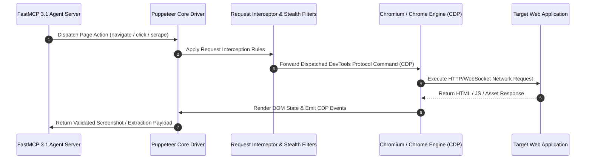

# Puppeteer

## What it is
**Puppeteer** is an industry-standard Node.js library developed by the Google Chrome DevTools team that provides a high-level API for programmatically controlling Chromium, Chrome, and Chrome for Testing browsers over the Chrome DevTools Protocol (CDP) or W3C WebDriver BiDi protocol. Running in headless mode by default, Puppeteer functions in the 2027 ecosystem as a foundational browser execution driver for AI agents ([Stagehand](stagehand.md), [Skyvern](skyvern.md), [OpenHands](../development_ops/openhands.md)), providing native **FastMCP 3.1** tool interfaces for visual DOM navigation, stealth scraping, and automated web interaction.

## Architecture & Protocol Flow



## What problem it solves
Modern web applications rely heavily on client-side JavaScript rendering, Single-Page Application (SPA) state machines, shadow DOMs, dynamic reCAPTCHA/Cloudflare challenges, and WebSocket sessions. Static HTTP client libraries (`fetch`, `axios`, `requests`) cannot execute JavaScript or render dynamic DOM states.

Puppeteer solves the browser execution gap for AI agents and data processing pipelines by executing a full-featured Chromium browser engine. It allows automated systems to authenticate via SSO, click interactive elements, intercept network payloads, solve visual challenges, generate deterministic PDF artifacts, and export clean DOM representations for LLM consumption.

## Comparison Matrix

| Feature / Metric | Puppeteer | Playwright | Selenium WebDriver |
| :--- | :--- | :--- | :--- |
| **Primary Engine** | Chromium / Chrome for Testing | Chromium, Firefox, WebKit | Multi-Browser (Chromium, Firefox, Safari) |
| **Protocol** | CDP / WebDriver BiDi | Playwright Internal Protocol / CDP | W3C WebDriver / BiDi |
| **Language Support** | Node.js / TypeScript (Official) | TypeScript, Python, Java, C# | Python, Java, C#, JS, Ruby |
| **FastMCP 3.1 Native** | First-Party MCP Extensions | Playwright MCP Server | Custom Wrappers Required |
| **DevTools Integration** | Native Google CDP Access | Partial CDP Access | Limited |
| **Stealth Plugins** | `puppeteer-extra-plugin-stealth` | Custom Browser Context Hooks | Third-Party Plugins |

## Where it fits in the stack
**Category**: Automation & Orchestration / Browser Control & Agent Primitives.

Puppeteer forms the **browser execution and web vision layer**, enabling autonomous agents (`docs/tools/agents/`) to bridge software APIs and web interfaces lacking formal REST endpoints.

## Typical use cases
- **Agentic Computer Use & Web Navigation**: Serving as the vision-guided browser driver for autonomous agents like [Stagehand](stagehand.md), [Skyvern](skyvern.md), and [OpenHands](../development_ops/openhands.md).
- **Stealth Data Scraping**: Scraping dynamic single-page applications behind complex JavaScript anti-bot protection systems.
- **Automated PDF & Artifact Generation**: Producing pixel-perfect, CSS-rendered PDF documents and screenshot logs for legal and compliance auditing.
- **Visual Regression Testing**: Capturing baseline screenshots and running automated pixel comparison tests across deployments.

## Service & Daemon Management (systemd Unit Configuration)

To operate headless Puppeteer browser pool workers reliably as background daemons on Linux enterprise systems, deploy the systemd service configuration below:

```ini
[Unit]
Description=Puppeteer Headless Browser Pool Service
Documentation=https://pptr.dev/
After=network.target local-fs.target
Wants=network-online.target

[Service]
Type=simple
User=puppeteer
Group=puppeteer
WorkingDirectory=/opt/puppeteer-pool
ExecStart=/usr/bin/node /opt/puppeteer-pool/server.js --port 8085
Restart=always
RestartSec=5s
Environment=NODE_ENV=production
Environment=PUPPETEER_SKIP_CHROMIUM_DOWNLOAD=true
Environment=PUPPETEER_EXECUTABLE_PATH=/usr/bin/google-chrome-stable
Environment=MCP_PROTOCOL_VERSION=FastMCP-3.1
Environment=LOG_LEVEL=info
StandardOutput=journal
StandardError=journal
SyslogIdentifier=puppeteer-pool

# Hardening measures
ProtectSystem=full
ProtectHome=read-only
ReadWritePaths=/opt/puppeteer-pool /tmp /dev/shm
NoNewPrivileges=true

[Install]
WantedBy=multi-user.target
```

## Diagnostic & Troubleshooting Matrix

| Issue / Symptom | Possible Cause | Verification Procedure | Resolution Strategy |
| :--- | :--- | :--- | :--- |
| **`TargetCloseError: Target closed`** | Chromium crashed due to exhaustion of shared memory (`/dev/shm`) | Inspect `dmesg` or system logs for kernel OOM killer events | Add `--disable-dev-shm-usage` flag to Puppeteer launch configuration |
| **`TimeoutError: Navigation timeout exceeded`** | Target website hanging or waiting on unblocked analytics scripts | Inspect network tab or page logs for blocked pending requests | Change `waitUntil` option to `domcontentloaded` instead of `networkidle0` |
| **`HTTP 403 Forbidden / Cloudflare Block`** | Standard headless User-Agent string detected by anti-bot scanner | Check `navigator.webdriver` status on browser target | Integrate `puppeteer-extra-plugin-stealth` and override User-Agent |
| **`Failed to launch the browser process!`** | Missing underlying system shared libraries in minimal OS image | Run `ldd /path/to/chrome` inside execution environment | Install missing Linux packages (`libnss3`, `libgbm`, `libasound2`) |
| **High RAM consumption in node pool** | Browser page instances opened without explicit `.close()` handling | Monitor node process heap and Chromium process count using `top` | Implement strict `try...finally` blocks calling `await page.close()` and `await browser.close()` |

## Strengths
- **Direct Chrome Team Maintenance**: First-party alignment with every Chromium update and security release.
- **Low-Level CDP Access**: Granular network modification, request mocking, CPU throttling, and memory profiling.
- **WebDriver BiDi Compatibility**: Bidirectional event-driven browser automation for high-concurrency tasks.
- **Robust Stealth Ecosystem**: Mature plugin ecosystem (`puppeteer-extra-plugin-stealth`) to defeat anti-bot fingerprints.

## Limitations
- **Node.js Environment Focus**: Official SDK is strictly Node.js/TypeScript (Python agents require node bridges or Playwright).
- **Resource Footprint**: Running multiple headless Chromium processes requires substantial RAM (minimum ~250MB per instance).

## When to use it
- When building Node.js/TypeScript AI agents that require browser interaction.
- When needing direct access to Chrome DevTools Protocol features (network inspection, performance profiling).
- When generating CSS-accurate PDF reports using Chrome's native layout engine.

## When not to use it
- When multi-browser testing across Safari (WebKit) or Firefox is mandatory (use [Playwright](../development_ops/playwright.md)).
- For lightweight, non-JavaScript HTML parsing (use `Cheerio` or `BeautifulSoup`).

## Getting started

### 1. Installation
Install Puppeteer and Chromium dependencies:
```bash
npm install puppeteer
```

### 2. Basic Headless Execution
```typescript
import puppeteer from 'puppeteer';

const browser = await puppeteer.launch({
  headless: 'shell',
  args: ['--no-sandbox', '--disable-setuid-sandbox']
});
const page = await browser.newPage();
await page.goto('https://example.com', { waitUntil: 'networkidle0' });
const title = await page.title();
console.log(`Page Title: ${title}`);
await browser.close();
```

## CLI examples

### 1. Fast Command-Line Screenshot
```bash
npx puppeteer-cli screenshot https://example.com --path screenshot.png
```

### 2. Generate PDF from HTML Document
```bash
npx puppeteer-cli pdf ./report.html --path report.pdf --format Letter
```

### 3. Debug Browser Process Execution
```bash
PUPPETEER_EXECUTABLE_PATH=$(which google-chrome) DEBUG=puppeteer:* node scraper.js
```

## API examples

### FastMCP 3.1 Puppeteer Web Scraping Server (TypeScript + Zod)
This complete FastMCP 3.1 server exposes browser scraping tools to AI agents with strict Zod validation.

```typescript
import puppeteer from 'puppeteer';
import { z } from 'zod';

const ScrapeResultSchema = z.object({
  url: z.string().url(),
  title: z.string(),
  elementCount: z.number().int().nonnegative(),
  links: z.array(z.string().url())
});

export type ScrapeResult = z.infer<typeof ScrapeResultSchema>;

export async function scrapeUrl(targetUrl: string): Promise<ScrapeResult> {
  const browser = await puppeteer.launch({
    headless: 'shell',
    args: ['--no-sandbox', '--disable-gpu']
  });

  try {
    const page = await browser.newPage();
    await page.goto(targetUrl, { waitUntil: 'domcontentloaded', timeout: 30000 });

    const rawData = await page.evaluate(() => {
      const anchors = Array.from(document.querySelectorAll('a[href]'));
      return {
        url: window.location.href,
        title: document.title,
        elementCount: document.querySelectorAll('*').length,
        links: anchors.map(a => (a as HTMLAnchorElement).href).filter(h => h.startsWith('http'))
      };
    });

    return ScrapeResultSchema.parse(rawData);
  } finally {
    await browser.close();
  }
}
```

### FastMCP 3.1 Bridge Server Pattern (Python + FastMCP)
The following Python integration exposes Puppeteer browser automation tools over **FastMCP 3.1** via Node sub-process execution:

```python
import asyncio
import json
from typing import Optional
from mcp.server.fastmcp import FastMCP
from pydantic import BaseModel, Field, HttpUrl

mcp = FastMCP("Puppeteer-Bridge-Server", version="3.1")

class PuppeteerScrapeRequest(BaseModel):
    url: HttpUrl = Field(..., description="Target webpage URL to inspect")
    capture_screenshot: bool = Field(True, description="Save PNG screenshot artifact")
    wait_until: str = Field("domcontentloaded", description="Navigation wait state")

class PuppeteerScrapeResponse(BaseModel):
    status: str
    url: str
    title: str
    screenshot_path: Optional[str] = None

@mcp.tool()
async def invoke_puppeteer_scrape(request: PuppeteerScrapeRequest) -> str:
    """Executes Node.js Puppeteer scraper sub-process and returns structured payload."""
    proc = await asyncio.create_subprocess_exec(
        "node", "puppeteer_runner.js", str(request.url),
        stdout=asyncio.subprocess.PIPE,
        stderr=asyncio.subprocess.PIPE
    )
    stdout, stderr = await proc.communicate()

    if proc.returncode != 0:
        return f"Scrape failed: {stderr.decode()}"

    data = json.loads(stdout.decode())
    response = PuppeteerScrapeResponse(
        status="success",
        url=data["url"],
        title=data["title"],
        screenshot_path=data.get("screenshot")
    )
    return response.model_dump_json(indent=2)

if __name__ == "__main__":
    mcp.run()
```

### Python Execution Trace Validator (Pydantic v2)
This script validates execution trace logs produced by headless Puppeteer instances using strict **Pydantic v2** validation.

```python
import json
from typing import List, Optional
from pydantic import BaseModel, Field, HttpUrl, field_validator

class BrowserPerformanceMetrics(BaseModel):
    title: str = Field(..., description="Document page title")
    url: HttpUrl = Field(..., description="Verified loaded target URL")
    load_time_ms: float = Field(..., ge=0.0, description="Page navigation latency in milliseconds")
    dom_nodes: int = Field(..., ge=0, description="Total DOM element count")

class PuppeteerTracePayload(BaseModel):
    session_id: str = Field(..., min_length=8, description="Unique UUID session identifier")
    metrics: BrowserPerformanceMetrics
    screenshot_path: Optional[str] = Field(None, description="Filesystem path to captured PNG")
    console_errors: List[str] = Field(default_factory=list)

    @field_validator("session_id")
    @classmethod
    def validate_session(cls, v: str) -> str:
        if not v.replace("-", "").isalnum():
            raise ValueError("session_id must be alphanumeric.")
        return v

def validate_trace_payload(json_str: str) -> dict:
    try:
        data = json.loads(json_str)
        validated = PuppeteerTracePayload.model_validate(data)
        return {"status": "VALID", "payload": validated.model_dump()}
    except Exception as e:
        return {"status": "INVALID", "error": str(e)}

if __name__ == "__main__":
    sample_json = """
    {
      "session_id": "sess-89b9a67a-8fbe-497b",
      "metrics": {
        "title": "Example Domain",
        "url": "https://example.com/",
        "load_time_ms": 342.12,
        "dom_nodes": 42
      },
      "screenshot_path": "/storage/captures/sess-89b9a.png",
      "console_errors": []
    }
    """
    res = validate_trace_payload(sample_json)
    print("Trace Validation Result:\n", json.dumps(res, indent=2))
```

## Operational Best Practices & Anti-Detection

### 1. Stealth Fingerprint Evasion
When running headless scrapers against anti-bot protected endpoints, configure `puppeteer-extra-plugin-stealth` to mask automation indicators (`navigator.webdriver`, WebGL vendor strings, Chrome User-Agent details):
```javascript
import puppeteer from 'puppeteer-extra';
import StealthPlugin from 'puppeteer-extra-plugin-stealth';

puppeteer.use(StealthPlugin());
const browser = await puppeteer.launch({ headless: true });
```

### 2. Network Resource Interception
To optimize scraping performance and reduce memory usage by 40-60%, block non-essential asset requests (images, CSS, fonts, tracking analytics) using request interception:
```javascript
await page.setRequestInterception(true);
page.on('request', (request) => {
  if (['image', 'stylesheet', 'font', 'media'].includes(request.resourceType())) {
    request.abort();
  } else {
    request.continue();
  }
});
```

### 3. Container Resource Limits & Shared Memory (`/dev/shm`)
In Docker environments, Chromium processes require adequate shared memory to prevent browser crashes. Always pass `--shm-size=2gb` or launch Puppeteer with `--disable-dev-shm-usage`:
```javascript
const browser = await puppeteer.launch({
  args: ['--disable-dev-shm-usage', '--no-sandbox']
});
```

## Related tools / concepts
- [Playwright](../development_ops/playwright.md) — Multi-browser automation suite.
- [Stagehand](stagehand.md) — LLM-guided browser automation framework.
- [Skyvern](skyvern.md) — Vision-driven web agent engine.
- [OpenHands](../development_ops/openhands.md) — Autonomous developer agent.
- [Lightpanda](lightpanda.md) — Lightweight browser engine for AI agents.

## Sources / references
- [Puppeteer Official Documentation](https://pptr.dev/)
- [Puppeteer GitHub Repository](https://github.com/puppeteer/puppeteer)
- [W3C WebDriver BiDi Specification](https://w3c.github.io/webdriver-bidi/)
- [Chrome DevTools Protocol (CDP) Reference](https://chromedevtools.github.io/devtools-protocol/)

## Contribution Metadata
- Last reviewed: 2027-01-07
- Confidence: high
