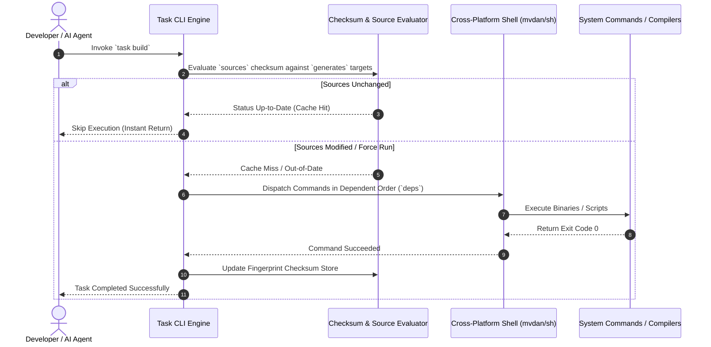

# Task (Taskfile)

## What it is
Task (commonly known as Taskfile or `task`) is a modern, cross-platform task runner and build tool written in Go. Operating as a clean, YAML-based alternative to GNU Make, Task allows developers and AI automation agents to define, document, and execute project commands using simple `Taskfile.yml` definitions. It provides native variable expansion, dynamic task dependencies, task inclusion, platform-agnostic shell execution (via `mvdan/sh`), and real-time parallel execution controls without requiring heavy runtime dependencies like Python or Node.js.

In early 2027, Task serves as a foundational orchestration standard across developer workspaces, MLOps automation scripts, and autonomous agent workflows operating in hybrid local and cloud environments.

## What problem it solves
Legacy build tools like [GNU Make](gnu-make.md) rely on tab-sensitive Makefile syntax, platform-specific shell quirks (Windows `cmd.exe` vs Linux `bash`), and opaque variable scoping rules that complicate cross-platform maintenance. Furthermore, Make's file-based DAG design requires complex `.PHONY` declarations when managing pure command tasks rather than target files. On the other hand, heavy script runners (npm scripts, tox, invoking Python wrappers) add unnecessary runtime overhead for basic system management tasks.

Task addresses these operational challenges by offering a structured, schema-validated YAML format (`Taskfile.yml`) that works identically across Linux, macOS, and Windows. It provides native JSON/YAML variable interpolation, concurrency control (`deps`), fingerprint-based status checking (`checksum` and `sources`), and auto-generated command help documentation.

## Where it fits in the stack
**Automation & Orchestration / Task Execution Layer**. Sitting directly above individual CLI utilities and below high-level workflow engines, Task provides a unified execution entrypoint for developer commands, container builds ([Docker](../infrastructure/docker.md)), hyperparameter optimization runs ([Optuna](../development_ops/optuna.md)), and CI/CD job steps.

## Architecture & Task Pipeline Diagram
```
+-----------------------------------------------------------------------------------+
|                            Task Execution Pipeline                                |
|                                                                                   |
|  +-----------------------------------------------------------------------------+  |
|  | Task CLI / Agent Invocation (`task build`, `task test --parallel`)          |  |
|  +-----------------------------------------------------------------------------+  |
|                                        ||                                         |
|                                        \/                                         |
|  +-----------------------------------------------------------------------------+  |
|  | Taskfile Parser & Var Interpolation (`Taskfile.yml` / Included Sub-tasks)    |  |
|  +-----------------------------------------------------------------------------+  |
|                                        ||                                         |
|                                        \/                                         |
|  +-------------------------------------+  +------------------------------------+  |
|  | Dependency DAG Solver (`deps`)      |  | Fingerprint Evaluator (`sources`   |  |
|  | & Concurrency Controller            |  | vs `generates` Checksum Database)  |  |
|  +-------------------------------------+  +------------------------------------+  |
|                                        ||                                         |
|                                        \/                                         |
|  +-----------------------------------------------------------------------------+  |
|  | Embedded POSIX Shell Engine (`mvdan/sh` Cross-Platform Runner)              |  |
|  +-----------------------------------------------------------------------------+  |
+-----------------------------------------------------------------------------------+
```



## Typical use cases
- **Developer Onboarding & Common Workflows**: Unifying repository setup, linting, testing, and build commands under standard `task setup`, `task test`, and `task build` commands.
- **Container & Service Orchestration**: Managing multi-container Docker Compose lifecycle commands and homelab service deployments ([Paperless-ngx](../../services/paperless-ngx.md), [n8n](../../services/n8n.md)).
- **Autonomous Agent Tool Invocation**: Providing deterministic, sandboxed execution entrypoints for AI agents ([Jules](../../tools/ai_knowledge/jules.md), [Claude Code](../development_ops/claude-code.md)).
- **Monorepo Task Inclusion**: Structuring hierarchical tasks using modular `Taskfile.yml` includes across multi-package projects.

## Comprehensive Comparison Matrix: Command Runners

| Feature / Dimension | Task (Taskfile) | GNU Make | Just | npm scripts / npx |
| :--- | :--- | :--- | :--- | :--- |
| **Syntax Format** | Structured YAML (`Taskfile.yml`) | Tab-indented Makefile | Custom `justfile` DSL | JSON (`package.json`) |
| **Cross-Platform Shell** | Embedded Go POSIX (`mvdan/sh`) | System Shell (`sh`/`cmd.exe`) | System Shell (`sh`/`powershell`)| Node.js wrapper |
| **Dependency Management**| Dynamic Task DAG (`deps`) | File-target dependency graph | Recipe dependencies | Parallel/sequential chaining |
| **Caching / Fingerprinting**| Checksum of `sources` / `generates` | File modification timestamps | Manual conditional logic | None built-in |
| **Task Inclusion** | Native modular `includes` | Textual `include` directives | Modular `import` statements | None built-in |
| **Self-Documentation** | Built-in `task --list` | Manual target parsing | Built-in `just --list` | Manual `npm run` listing |
| **Runtime Dependencies** | Single Go binary (Zero-dep) | C/POSIX toolchain | Single Rust binary | Node.js runtime |

## Strengths
- **Simple YAML Syntax**: Clear, human-readable `Taskfile.yml` format with strict key validation and zero whitespace tab errors.
- **Cross-Platform Shell Compatibility**: Uses `mvdan/sh` embedded shell parser, ensuring POSIX script execution across Windows, macOS, and Linux without MSYS/Cygwin.
- **Fast & Lightweight Binary**: Distributed as a single, zero-dependency Go binary with instant startup times.
- **Up-to-Date Status Fingerprinting**: Skips redundant task execution automatically by comparing `sources` file checksums against `generates` outputs.

## Limitations
- **Not a Full Package Manager**: Focuses strictly on task execution and command chaining, requiring external package managers (pip, go, cargo) for dependency resolution.
- **YAML Escaping Requirements**: Complex nested multiline shell scripts require explicit YAML block scalar formatting (`|`).
- **No Native In-Memory Variable Mutation**: Variables are scoped per task and evaluated before task execution rather than mutated dynamically in shell state.

## When to use it
- When you need a reliable, cross-platform command runner across Linux, macOS, and Windows.
- When structuring team or repository development tasks with self-documenting CLI output (`task --list`).
- When orchestrating multi-step build pipelines with file fingerprinting to skip unnecessary rebuilds.

## When not to use it
- When managing legacy C/C++ build targets where Make's automatic dependency tracking of header files is deeply ingrained (use [GNU Make](gnu-make.md)).
- For ultra-minimal, single-file command aliases where a lightweight `justfile` is preferred (use [Just](just.md)).
- For complex multi-node distributed data pipelines requiring graphical orchestration DAGs (use [Argo Workflows](../orchestration/argo-workflows.md) or [n8n](../../services/n8n.md)).

## Getting started

### Installation
Install Task via standard package managers:

```bash
# macOS (Homebrew)
brew install go-task/tap/go-task

# Linux (Package Script or Binary)
sh -c "$(curl --location https://taskfile.dev/install.sh)" -- -d -b /usr/local/bin

# Windows (Scoop / Chocolatey)
scoop install task
```

### Initializing a Taskfile
Create a default `Taskfile.yml` in your project root:

```yaml
version: '3'

vars:
  GREETING: "Hello from Taskfile"

tasks:
  default:
    desc: "Display greeting and list available tasks"
    cmds:
      - echo "{{.GREETING}}"
      - task --list
    silent: true

  build:
    desc: "Compile application binary"
    cmds:
      - echo "Building project..."
      - go build -v ./...
    sources:
      - "**/*.go"
      - "go.mod"
    generates:
      - "bin/app"
```

## CLI examples

### Executing Tasks & Viewing Help Documentation
```bash
# List all documented tasks in the current Taskfile
task --list

# Execute a specific task with custom environment variables
ENV=production task deploy

# Run tasks concurrently in parallel
task --parallel test-unit test-integration
```

### Dry-Run & Status Inspection
```bash
# Inspect commands that would be executed without running them
task build --dry

# Force execution regardless of file checksum status
task build --force
```

## API examples

### Python FastMCP 3.1 Task Execution & Pydantic v2 Schema Generator
The following Python script illustrates how to construct a **FastMCP 3.1** task execution server that validates `Taskfile.yml` definitions using **Pydantic v2** models and exposes remote task execution endpoints to AI agents.

```python
import os
import yaml
import subprocess
from typing import List, Dict, Optional, Any
from pydantic import BaseModel, Field, field_validator, ConfigDict
from fastmcp import FastMCP

# Initialize FastMCP 3.1 server for Taskfile orchestration
mcp = FastMCP(name="taskfile-runner-server", version="3.1")

class TaskCommand(BaseModel):
    model_config = ConfigDict(extra="forbid", str_strip_whitespace=True)

    cmd: str = Field(..., description="Shell command string to execute")
    ignore_error: bool = Field(False, description="Whether to ignore command exit codes")

class TaskDefinition(BaseModel):
    model_config = ConfigDict(extra="forbid", str_strip_whitespace=True)

    desc: str = Field(..., min_length=5, description="Human-readable description of the task")
    summary: Optional[str] = Field(None, description="Detailed multiline task summary")
    cmds: List[str] = Field(..., min_items=1, description="List of shell commands")
    deps: List[str] = Field(default_factory=list, description="Dependent tasks to run prior")
    sources: List[str] = Field(default_factory=list, description="Source files for checksum fingerprinting")
    generates: List[str] = Field(default_factory=list, description="Output target files")

class TaskfileSchema(BaseModel):
    model_config = ConfigDict(extra="forbid", str_strip_whitespace=True)

    version: str = Field("3", pattern=r"^3$")
    vars: Dict[str, str] = Field(default_factory=dict, description="Global string variables")
    tasks: Dict[str, TaskDefinition] = Field(..., description="Map of task names to definitions")

    @field_validator("tasks")
    @classmethod
    def check_default_task(cls, v: Dict[str, TaskDefinition]) -> Dict[str, TaskDefinition]:
        if "default" not in v and "help" not in v:
            raise ValueError("Taskfile should define a 'default' or 'help' task")
        return v

@mcp.tool(name="execute_task", description="Execute a named task from local Taskfile.yml")
def execute_task(task_name: str, vars_override: Optional[Dict[str, str]] = None) -> Dict[str, Any]:
    """FastMCP 3.1 endpoint to invoke Taskfile commands."""
    cmd = ["task", task_name]
    env = os.environ.copy()
    if vars_override:
        for k, v in vars_override.items():
            env[k] = v

    try:
        res = subprocess.run(cmd, capture_output=True, text=True, check=True, env=env)
        return {
            "status": "success",
            "task": task_name,
            "stdout": res.stdout,
            "exit_code": res.returncode
        }
    except Exception as e:
        return {
            "status": "failed",
            "task": task_name,
            "error": str(e)
        }

if __name__ == "__main__":
    schema = TaskfileSchema(
        vars={"APP_NAME": "KnowledgeOpsEngine"},
        tasks={
            "default": TaskDefinition(
                desc="Default automation entrypoint",
                cmds=["echo 'Running {{.APP_NAME}} task automation pipeline...'"]
            ),
            "lint": TaskDefinition(
                desc="Run python code quality checks",
                cmds=["python3 scripts/check_catalog_consistency.py", "python3 scripts/validate_new_sources.py"]
            )
        }
    )

    print("Validated Taskfile Schema:")
    print(schema.model_dump_json(indent=2))
```

## Troubleshooting Guide

| Issue / Symptom | Probable Cause | Corrective Action |
| :--- | :--- | :--- |
| `task: Command not found` | Task binary not installed in user `PATH` | Run official installer `sh -c "$(curl -ssL https://taskfile.dev/install.sh)"` and update `PATH`. |
| `YAML Parsing Error` | Invalid whitespace or missing quotes around template variables | Wrap Go template expressions in quotes: `echo "{{.VAR}}"`. |
| `Task Skipped Unexpectedly` | Checksum matching `sources` files without detecting changes | Use `task <task_name> --force` to bypass fingerprint checks. |
| `Environment Variable Not Inherited` | Variable not exported or overwritten in `vars` section | Pass environment variables explicitly before command or set `env:` in task definition. |

## Related tools / concepts
- [GNU Make](gnu-make.md) — Traditional tab-based Makefile build runner.
- [Just](just.md) — Lightweight, single-file command runner written in Rust.
- [Docker](../infrastructure/docker.md) — Container virtualization engine orchestrated via Task commands.
- [Optuna](../development_ops/optuna.md) — Hyperparameter optimization library executed via Task studies.
- [Paperless-ngx](../../services/paperless-ngx.md) — Homelab document service deployed via Task scripts.
- [Jules](../../tools/ai_knowledge/jules.md) — Local agent runner invoking Taskfile commands.
- [Claude Code](../development_ops/claude-code.md) — Developer agent utilizing Taskfiles for build pipelines.
- [n8n](../../services/n8n.md) — Workflow automation engine triggering Task execution hooks.

## Sources / references
- [Task Official Website](https://taskfile.dev/)
- [Task GitHub Repository](https://github.com/go-task/task)
- [Taskfile Documentation & Schema](https://taskfile.dev/usage/)

## Contribution Metadata
- Last reviewed: 2027-01-07
- Confidence: high
