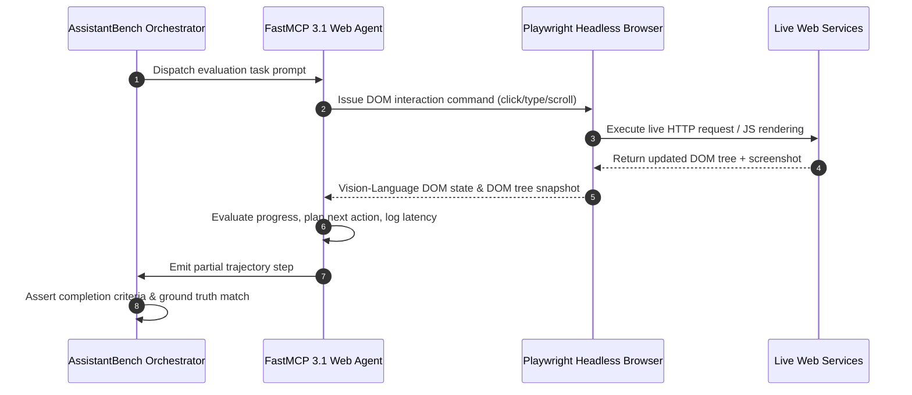

# AssistantBench

## What it is
AssistantBench is a rigorous, open-source evaluation benchmark designed to measure the capability of web-connected AI agents and autonomous assistants to execute complex, realistic, and time-consuming multi-step tasks on the live web. As of early 2027, AssistantBench is established as a critical component of the "Agentic Evaluation Standard." It systematically quantifies the planning, navigation, retrieval, and reasoning capabilities of frontier models (including Claude 5.6, GPT-5.6, Llama 4, Gemma 4, DeepSeek-V4, Qwen 3.6 VL, and Gemini 4.0 Ultra) operating in stateful browser environments and FastMCP 3.1 Task Protocol integrations.

## What problem it solves
Most traditional LLM benchmarks evaluate atomic capabilities, such as isolated code generation or single-turn QA, in synthetic environments. However, these benchmarks fail to evaluate real-world agentic execution, where an agent must navigate dynamic websites, bypass anti-bot systems, manage complex browser states, retrieve scattered data, and reason across multiple pages to complete a single user request. AssistantBench solves this by providing long-horizon, multi-domain web-agent tasks that typically take a human developer or assistant 10 to 30 minutes to complete, allowing teams to rigorously benchmark success rates and measure Agentic Latency.

## Where it fits in the stack
**Category**: [Benchmarking](index.md) / [Agentic Evaluations](../../knowledge_base/README.md).
It functions as a high-level performance and capability auditing layer, typically orchestrated via modular evaluation frameworks like the UK AISI's `inspect-ai` and integrated into development workflows to compare agent planning architectures (e.g., ReAct, plan-and-solve, or custom state-machines).

```
+-----------------------------------------------------------------------------------+
|                     ASSISTANTBENCH AGENTIC EVALUATION STACK                      |
+-----------------------------------------------------------------------------------+
|  [Benchmark Dataset: Long-Horizon Open-Web Real World Tasks]                       |
|                │                                                                  |
|                ▼                                                                  |
|  [Inspect-AI / UK AISI Framework Orchestration Engine]                            |
|                │                                                                  |
|                ▼                                                                  |
|  [FastMCP 3.1 Task Protocol & Agent Controller Bridge]                            |
|        │                                               │                          |
|        ▼ (Playwright Browser Loop)                     ▼ (Frontier Reasoning VLM) |
|  [Headless Chromium / DOM Tree & Screenshot Engine]   [Claude 5.6 / GPT-5.6 / Gemini 4] |
|        │                                               │                          |
|        └───────────────────────┬───────────────────────┘                          |
|                                ▼                                                  |
|  [Pydantic v2 Trajectory Metric Validation & Ground Truth Assertion]              |
|                │                                                                  |
|                ▼                                                                  |
|  [Performance Report: Accuracy %, Agentic Latency, Step Trajectory Analytics]     |
+-----------------------------------------------------------------------------------+
```

## Multi-Step Tool Execution & Browser Loop Architecture



## Benchmark Suite Comparison Matrix

| Metric / Feature | AssistantBench | WebArena | OSWorld | GAIA | PA-Bench |
| :--- | :--- | :--- | :--- | :--- | :--- |
| **Target Environment** | Live Open Web | Sandboxed Web | OS Desktop (Ubuntu/Win) | General Multimodal | Procedural Web |
| **FastMCP 3.1 Integration**| Native Task Server | Adapter required | Custom wrapper | Custom plugin | Direct API |
| **Task Horizon Length** | Long (10-30 mins) | Medium (5-15 mins) | Long (15-45 mins) | Medium (5-20 mins) | Short (2-5 mins) |
| **Visual DOM Grounding** | Native VLM screenshots | Text DOM / Accessibility tree | Desktop Pixel Bounding Box | Image/File Attachments | DOM Selector Maps |
| **Agentic Latency Tracking**| Step-level breakdown | End-to-end timer | Task-level latency | End-to-end timer | Step timer |

## Typical use cases
- **Web Agent Capability Profiling**: Measuring and auditing the execution success rate of browser-based agents like OpenHands, MultiOn, Stagehand, or custom Playwright-based systems.
- **VLM Visual Grounding Analysis**: Evaluating how effectively vision-language models can interpret dynamic, interactive web interfaces, complex layouts, and multi-format graphics.
- **Planning & Self-Correction Audits**: Testing the resilience of agent decision loops when encountering unexpected layout adjustments, pop-ups, modal dialogs, or dead ends.
- **Agentic Latency Quantification**: Measuring the relationship between planning token overhead, action sequences, and actual execution duration on live web routes.
- **RAG & Synthesis Evaluation**: Assessing an agent's capability to search the web, scrape raw materials, and synthesize a single, factual, non-hallucinated answer to multi-layered research queries.

## Strengths
- **Authentic and Realistic Tasks**: Sourced from actual, real-world questions and tasks that humans perform, ensuring evaluation results reflect genuine utility.
- **Dynamic Live Web Execution**: Tests agents on the open web, verifying their resilience against real-world web-design patterns and javascript-dense interfaces.
- **Standardized Framework Integration**: Natively integrated with `inspect-ai` and the `inspect-evals` package, enabling standardized execution and evaluation runs.
- **Long-Horizon Multi-Domain Coverage**: Spans across business, real estate, travel booking, scientific research, and SaaS interfaces, ensuring a diverse capability profile.
- **Detailed Visual Tracing**: Generates complete execution logs with visual step-by-step screenshots to allow developers to inspect and analyze agent failure modes.

## Limitations
- **Live Web Volatility**: Because tests are executed on the live internet, unexpected modifications to external websites can occasionally impact test reproducibility and baseline consistency.
- **Compute and Token Cost**: Running long-horizon, multi-step browser loops utilizing frontier visual models (like Claude 5.6 or GPT-5.6) consumes a high volume of input and output tokens.
- **Operational Execution Speed**: Executing true end-to-end browser trajectories on live websites is intrinsically slower than running synthetic unit tests, making it better suited for periodic scheduled runs rather than rapid pre-commit checks.

## When to use it
- When developing or tuning autonomous web assistants, personal agents, or automated research pipelines that navigate the open web.
- To compare and benchmark the cost-to-performance efficiency of different planning layers and model backbones.
- When you need to generate high-confidence capability profiles and success rate reports for enterprise-grade autonomous systems.

## When not to use it
- For testing isolated desktop interface interactions (such as system-level mouse and keyboard actions), where an operating-system-level benchmark like [OSWorld](./os-world.md) is appropriate.
- If you are building a highly sandboxed, air-gapped agent that is explicitly blocked from accessing the external, live internet.
- For high-speed, local regression testing of simple prompts where lightweight, deterministic unit-test assertions are sufficient.

## Getting started
AssistantBench evaluations are primarily orchestrated using the `inspect-ai` framework and the companion `inspect-evals` suite.

### 1. Installation
Install the required packages utilizing pip:
```bash
pip install inspect-ai inspect-evals pydantic fastmcp
```

### 2. Live Web Driver Dependencies
Ensure Playwright or your targeted browser driver is installed and authenticated:
```bash
playwright install
```

## CLI examples
The `inspect` command-line utility provides intuitive controls to run, configure, and inspect AssistantBench evaluations.

```bash
# Run a standard AssistantBench evaluation using a frontier model
inspect eval inspect_evals/assistant_bench_web_browser --model openai/gpt-5.6

# Restrict the evaluation run to a small, sample-limited set (e.g., 5 tasks) for debugging
inspect eval inspect_evals/assistant_bench_web_browser --model anthropic/claude-5.6 --limit 5

# Compare performance across multiple frontier models simultaneously
inspect eval inspect_evals/assistant_bench_web_browser --model openai/gpt-5.6,anthropic/claude-5.6

# Boot up the interactive visual log viewer to analyze step-by-step agent trajectories
inspect view
```

## API examples

### FastMCP 3.1 Evaluation Runner Server Implementation

Below is a complete FastMCP 3.1 benchmark orchestration server designed to dispatch AssistantBench tasks, capture Playwright DOM trajectories, and validate trajectory metrics using strict Pydantic v2 schemas.

```python
"""
FastMCP 3.1 AssistantBench Evaluation Controller
Orchestrates agent trajectory execution, latency tracking, and metric validation.
"""

from typing import Dict, Any, List, Optional
from pydantic import BaseModel, Field, field_validator, ConfigDict
from mcp.server.fastmcp import FastMCP
import datetime
import logging

logging.basicConfig(level=logging.INFO)
logger = logging.getLogger("AssistantBenchMCP")

mcp = FastMCP("AssistantBench-Evaluation-Server", version="3.1.0")

class TrajectoryStep(BaseModel):
    model_config = ConfigDict(extra="forbid", frozen=True)

    step_number: int = Field(..., ge=1, description="Sequential index of trajectory step")
    action_type: str = Field(..., pattern=r"^(click|type|scroll|navigate|extract|finish)$")
    target_selector: Optional[str] = Field(None, description="CSS or XPath DOM selector")
    step_latency_seconds: float = Field(..., ge=0.0, description="Execution delay for action step")

class EvaluationTaskMetrics(BaseModel):
    model_config = ConfigDict(extra="forbid", frozen=True)

    task_id: str = Field(..., description="AssistantBench benchmark task UUID")
    model_evaluated: str = Field(..., description="Frontier LLM or VLM evaluated")
    is_successful: bool = Field(..., description="Ground truth answer match status")
    total_steps: int = Field(..., ge=1, description="Total trajectory actions executed")
    agentic_latency_avg: float = Field(..., ge=0.0, description="Mean latency per action step")
    trajectory: List[TrajectoryStep] = Field(default_factory=list, description="Detailed action log")

    @field_validator("agentic_latency_avg")
    def validate_latency(cls, v: float) -> float:
        if v > 120.0:
            logger.warning("Average agentic latency exceeds 120 seconds per step.")
        return v

@mcp.tool()
def log_evaluation_trajectory(data: Dict[str, Any]) -> Dict[str, Any]:
    """Validates and logs an AssistantBench evaluation trajectory using Pydantic v2 schemas."""
    try:
        metrics = EvaluationTaskMetrics.model_validate(data)
        logger.info(f"Task {metrics.task_id} evaluated for model {metrics.model_evaluated}. Success: {metrics.is_successful}")
        return {
            "status": "logged",
            "task_id": metrics.task_id,
            "success": metrics.is_successful,
            "avg_latency": metrics.agentic_latency_avg
        }
    except Exception as err:
        logger.error(f"Failed to log trajectory: {err}")
        return {"error": str(err), "status": "validation_failed"}

if __name__ == "__main__":
    mcp.run()
```

### Programmatic Evaluation Execution (Python)

```python
import os
from inspect_ai import eval
from inspect_evals import assistant_bench_web_browser

# Set up the API environment
os.environ["ANTHROPIC_API_KEY"] = "your_api_key_here"

# Execute the evaluation run on a limited set of samples
evaluation_results = eval(
    assistant_bench_web_browser(),
    model="anthropic/claude-5.6",
    limit=10,
    score_filter=None
)

# Extract and output high-level statistics
for run in evaluation_results:
    print(f"Model Evaluated: {run.model}")
    print(f"Task Success Accuracy: {run.metrics['accuracy'].value * 100:.2f}%")
```

## Production Systemd Service Unit (`assistantbench-eval.service`)

For running automated nightly batch evaluation sweeps against live web benchmarks, deploy the following systemd service configuration:

```ini
[Unit]
Description=AssistantBench Nightly FastMCP 3.1 Evaluation Runner
After=network.target

[Service]
Type=oneshot
User=eval-agent
WorkingDirectory=/opt/assistantbench-runner
ExecStart=/opt/assistantbench-runner/venv/bin/inspect eval inspect_evals/assistant_bench_web_browser --model anthropic/claude-5.6 --limit 20
Environment=ANTHROPIC_API_KEY=/etc/assistantbench/anthropic.env
Environment=OPENAI_API_KEY=/etc/assistantbench/openai.env
StandardOutput=journal
StandardError=journal
LimitNOFILE=65536

[Install]
WantedBy=multi-user.target
```

## Diagnostic & Operational Troubleshooting Matrix

| Symptom / Failure Mode | Underlying Root Cause | Diagnostic Method | Remediation / Countermeasure |
| :--- | :--- | :--- | :--- |
| `Browser context timeout ( > 300s )` | Dynamic JavaScript rendering loop or infinite scroll trap | Inspect visual step trajectory in `inspect view` | Implement action step timeout guardrail (`max_step_timeout: 30s`) |
| `Bot detection challenge (Cloudflare/CAPTCHA)` | Headless Playwright browser fingerprint flagged | Check screenshot artifact for CAPTCHA element | Use stealth browser plugins or proxy rotation in test runner |
| `DOM selector target not found` | Dynamic SPA layout updated during live web run | Review DOM tree snapshot | Fall back to visual spatial bounding box navigation via VLM |
| `High agentic latency (> 45s/step)` | Massive DOM token expansion exceeding context window | Audit prompt token count per step | Prune raw HTML and convert DOM tree to concise accessibility tree |

## Related tools / concepts
- [PA-bench](./pa-bench.md) — Web session orchestration and procedural navigation benchmark.
- [GAIA](./gaia.md) — General AI Assistant benchmark targeting multimodal, tool-connected real-world tasks.
- [OSWorld](./os-world.md) — Comprehensive sandbox benchmark for evaluating agents in real operating-system and desktop environments.
- [Inspect AI](inspect-ai.md) — Foundational framework developed by the UK AISI for orchestrating model benchmarks.
- [MultiOn](../agents/multion.md) — High-performance visual navigation and execution engine.
- [Stagehand](../automation_orchestration/stagehand.md) — LLM-driven browser-automation SDK built on Playwright.
- [Browser Use](../automation_orchestration/browser-use.md) — Multi-agent browser control framework.
- [Agentic Latency](../../knowledge_base/patterns/index.md) — The measure of cognitive and network delay during autonomous long-horizon runs.

## Licensing and cost
- **License**: Apache-2.0 (Open Source)
- **Cost**: The benchmark framework is free, but executing browser trajectories requires live internet connectivity and substantial LLM API token consumption. Long trajectories on premium visual models can result in significant usage costs.

## Sources / references
- [AssistantBench: Can Web Agents Solve Realistic and Time-Consuming Tasks? (ArXiv Paper)](https://arxiv.org/abs/2407.15711)
- [AssistantBench Official Webpage](https://assistantbench.github.io/)
- [AssistantBench Project GitHub Repository](https://github.com/assistantbench/assistantbench)
- [UK AISI Inspect-AI Documentation](https://github.com/UKGovernmentBEIS/inspect-ai)

## Contribution Metadata
- Last reviewed: 2027-01-07
- Confidence: high
