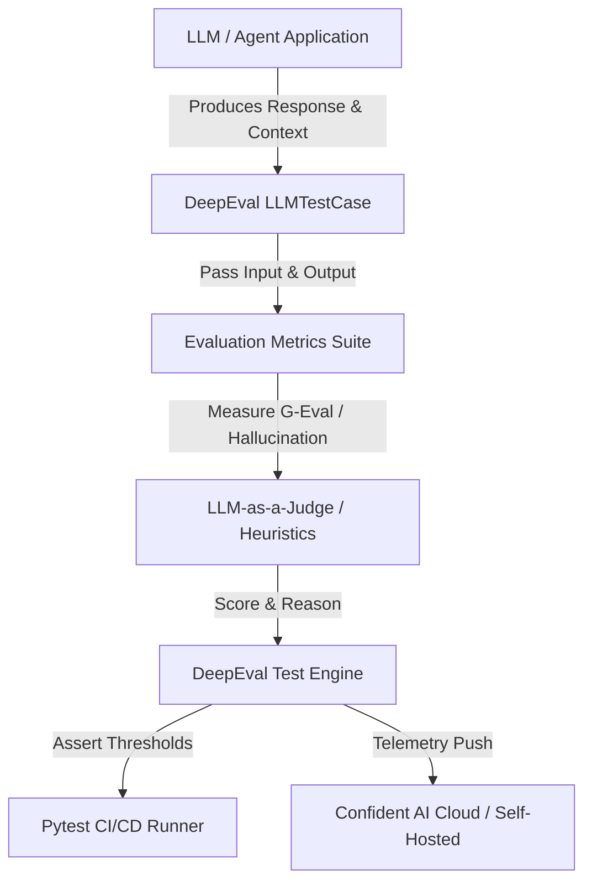

# DeepEval

## What it is
DeepEval is an open-source Large Language Model (LLM) evaluation and unit-testing framework built by Confident AI. Designed as the "Pytest for LLMs", it enables developers to unit-test LLM applications, Retrieval-Augmented Generation (RAG) pipelines, and autonomous agent loops across key metrics such as hallucination, answer relevancy, faithfulness, contextual precision, toxicity, and prompt injection resilience. As of early 2027, DeepEval integrates directly into Model Context Protocol (FastMCP 3.1 / MCP 3.1) agentic loops to deliver real-time evaluation assertions and telemetry.

## What problem it solves
Evaluating generative AI models and multi-agent workflows using manual QA or subjective spot-checks is unscalable, non-deterministic, and error-prone. DeepEval solves this by providing programmatic unit testing, deterministic heuristic metrics, and calibrated LLM-as-a-judge scoring frameworks. It allows engineering teams to detect accuracy regressions, groundlessness, prompt injection vulnerabilities, and tool-calling drift early in CI/CD pipelines before code is merged into production across frontier models including Claude 5.6, GPT-5.6, Gemini 4.0 Pro, DeepSeek-V4, and Llama 4.



## Where it fits in the stack
**Category**: [Benchmarking](index.md) / [Development & QA](index.md).
It operates at the testing and validation layer of the KnowledgeOps ecosystem, sitting alongside CI/CD workflows and running unit tests against inference models (e.g., Claude 5.1/5.6, GPT-5.5/5.6, Gemini 4.0 Pro, DeepSeek-V4) and local MCP tool integrations (FastMCP 3.1).

## Typical use cases
- **Continuous LLM Unit Testing**: Running Pytest-style assertions on model responses for every code pull request in CI/CD pipelines.
- **RAG Pipeline Evaluation**: Measuring Faithfulness, Contextual Relevancy, and Answer Precision across vector database context retrievals (e.g., [Chroma](../infrastructure/chroma.md), [Qdrant](../infrastructure/qdrant.md), or [Milvus](../infrastructure/milvus.md)).
- **Agentic Tool Evaluation**: Validating whether multi-agent systems trigger the correct FastMCP 3.1 tools with expected JSON argument schemas.
- **Red Teaming & Security Audits**: Detecting vulnerability to prompt injections, PII leakage, sycophancy, and toxic outputs.
- **Model Router Benchmarking**: Comparing output quality, latency, and cost across frontier models (Claude 5.6 vs GPT-5.6 Sol vs Llama 4).

## Evaluation Matrix & Framework Comparison

| Metric / Feature | DeepEval | Promptfoo | Giskard | Inspect AI | LangSmith |
| :--- | :--- | :--- | :--- | :--- | :--- |
| **Primary Focus** | Pytest LLM Unit Testing | CLI Assertion Eval | Security & Red Teaming | AI Safety Benchmarking | Tracing & Observability |
| **Pytest Integration** | Native (`deepeval test`) | Custom Wrapper | Custom Test Harness | Custom Harness | Optional Integration |
| **Local / Offline** | Full Local Support | Full Local Support | Local / SaaS Hybrid | Full Local Support | Cloud / Self-Host SaaS |
| **FastMCP 3.1 Support**| Native Task Protocol | External Plugin | Manual Wrapper | Native Plugin | Tracing Interceptor |
| **LLM-as-a-Judge** | G-Eval & Custom | Heuristic & LLM | Automated Red Team | Custom Judge | Custom Evaluator |
| **Pydantic v2 Schema**| Built-in Native | Schema Mapping | Custom Adapters | Built-in | Pydantic Integration |

## Evaluation Metrics Summary

| Metric Name | Evaluation Target | Description | Minimum Passing Threshold |
| :--- | :--- | :--- | :--- |
| **Faithfulness** | RAG Context | Measures factual grounding against retrieved documents. | $\ge 0.85$ |
| **Answer Relevancy** | Prompt vs Output | Quantifies how directly the output addresses user prompt. | $\ge 0.80$ |
| **Contextual Precision**| Vector DB Search | Evaluates signal-to-noise ratio in retrieved context chunks. | $\ge 0.75$ |
| **Hallucination** | Generative Content | Calculates percentage of unsupported claims generated. | $\le 0.15$ |
| **GEval (Custom)** | Domain Specs | Custom rubric-based scoring using structured LLM judges. | $\ge 0.80$ |
| **Tool Execution** | FastMCP 3.1 Calls | Verifies tool parameter validity and schema compliance. | $100\%$ Match |

## Strengths
- **Pytest Native Integration**: Integrates directly with standard `pytest` runners, allowing developers to execute `deepeval test run` with zero friction.
- **Comprehensive Metric Suite**: Provides 14+ out-of-the-box metrics including G-Eval, Hallucination, Faithfulness, Summarization, and Bias.
- **Custom Metric Definition**: Supports defining domain-specific evaluation criteria via custom G-Eval criteria or Python validation models.
- **Confident AI Cloud & Self-Hosted Dashboard**: Offers web-based tracking dashboards for regression analysis, test execution history, and team collaboration.
- **FastMCP 3.1 & Tool-Calling Support**: Capable of auditing multi-step agent reasoning logs and structured tool parameters.

## Limitations
- **API Token Cost**: Running extensive G-Eval LLM-as-a-judge test suites across large datasets can incur significant API costs on high-tier evaluation models.
- **Judge Model Bias**: Metric reliability depends heavily on the chosen judge model; smaller local models may produce inconsistent metric scores compared to GPT-5.6 or Claude 5.6.
- **Multi-Turn State Complexity**: Evaluating complex multi-turn conversational agents with state persistence requires structured dataset formatting.

## When to use it
- When implementing automated LLM CI/CD testing pipelines.
- When evaluating RAG pipelines to quantify hallucination rates and retrieval precision.
- When building multi-agent systems with strict quality and compliance contracts.
- When requiring a Pytest-native interface for LLM evaluation.

## When not to use it
- For basic non-generative ML classification or traditional statistical evaluation (use scikit-learn metrics instead).
- When real-time sub-millisecond production request monitoring is required without offline evaluation suites (use dedicated APM tools like [Sentry](../process_understanding/sentry.md) or [Comet Opik](../process_understanding/comet-opik.md)).

## Systemd Service Configuration
For continuous background evaluation runners or automated nightly regression testing nodes on Linux CI servers:

```ini
[Unit]
Description=DeepEval Continuous Agent Benchmark Runner
After=network.target

[Service]
Type=simple
User=deepeval
Group=deepeval
WorkingDirectory=/opt/deepeval-runner
Environment="PATH=/opt/deepeval-runner/venv/bin:/usr/local/bin:/usr/bin"
Environment="OPENAI_BASE_URL=http://127.0.0.1:8000/v1"
Environment="CONFIDENT_AI_API_KEY=cai_live_sec_benchmark2027"
Environment="DEEPEVAL_TELEMETRY_OPT_OUT=YES"
ExecStart=/opt/deepeval-runner/venv/bin/deepeval test run /opt/deepeval-runner/tests --confidence-threshold 0.85
Restart=on-failure
RestartSec=15s
LimitNOFILE=65536

[Install]
WantedBy=multi-user.target
```

## Docker Compose Multi-Container Stack
Deploying a self-hosted evaluation harness with DeepEval runner, local judge LLM inference proxy, and Redis evaluation cache:

```yaml
version: "3.8"

services:
  deepeval-runner:
    image: python:3.11-slim
    container_name: deepeval-test-harness
    restart: unless-stopped
    working_dir: /app
    volumes:
      - ./tests:/app/tests
      - ./reports:/app/reports
    environment:
      - OPENAI_BASE_URL=http://judge-llm-proxy:8000/v1
      - REDIS_URL=redis://redis-eval:6379/0
      - DEEPEVAL_RESULTS_FOLDER=/app/reports
    command: >
      sh -c "pip install deepeval pydantic pytest redis &&
             deepeval test run /app/tests"
    depends_on:
      judge-llm-proxy:
        condition: service_healthy
      redis-eval:
        condition: service_healthy
    networks:
      - eval-net

  judge-llm-proxy:
    image: vllm/vllm-openai:latest
    container_name: deepeval-judge-proxy
    restart: unless-stopped
    ports:
      - "8000:8000"
    command: >
      --model Qwen/Qwen2.5-7B-Instruct
      --port 8000
      --max-model-len 8192
    networks:
      - eval-net
    healthcheck:
      test: ["CMD", "curl", "-f", "http://localhost:8000/v1/models"]
      interval: 15s
      timeout: 5s
      retries: 5

  redis-eval:
    image: redis:7-alpine
    container_name: deepeval-redis-cache
    restart: unless-stopped
    command: ["redis-server", "--maxmemory", "512mb", "--maxmemory-policy", "allkeys-lru"]
    ports:
      - "6379:6379"
    volumes:
      - redis_eval_data:/data
    networks:
      - eval-net
    healthcheck:
      test: ["CMD", "redis-cli", "ping"]
      interval: 5s
      timeout: 3s
      retries: 5

networks:
  eval-net:
    driver: bridge

volumes:
  redis_eval_data:
```

## Getting started

### Installation
Install DeepEval via pip:

```bash
pip install deepeval pydantic
```

### Environment Configuration
Configure your target evaluation LLM key (e.g., OpenAI or Anthropic):

```bash
export OPENAI_API_KEY="your-api-key"
export ANTHROPIC_API_KEY="your-anthropic-key"
```

## CLI examples

### 1. Running DeepEval Test Suites
```bash
# Execute all Pytest-style LLM unit tests in the current directory
deepeval test run test_llm_app.py
```

### 2. Logging Test Results to Confident AI
```bash
# Login and push evaluation analytics to Confident AI platform
deepeval login --api-key your_confident_ai_key
deepeval test run test_llm_app.py --confidence-threshold 0.85
```

### 3. Evaluating Batch Datasets via CLI
```bash
# Run evaluation across a pre-formatted JSON dataset
deepeval evaluate --dataset-file benchmark_dataset.json --metrics faithfulness,hallucination
```

## API examples

### 1. Basic Pytest LLM Unit Test with DeepEval Metrics
```python
import pytest
from deepeval import assert_test
from deepeval.test_case import LLMTestCase
from deepeval.metrics import HallucinationMetric, AnswerRelevancyMetric

def test_rag_faithfulness():
    # Simulated RAG context retrieval from ChromaDB
    retrieved_context = ["To reset the smart thermostat, hold the power button for 10 seconds."]
    actual_output = "Hold the power button on the thermostat for 10 seconds to initiate a reset."
    input_prompt = "How do I factory reset my thermostat?"

    test_case = LLMTestCase(
        input=input_prompt,
        actual_output=actual_output,
        retrieved_context=retrieved_context
    )

    # Define metrics with target passing thresholds
    hallucination_metric = HallucinationMetric(threshold=0.2)
    relevancy_metric = AnswerRelevancyMetric(threshold=0.8)

    # Assert test passes thresholds
    assert_test(test_case, [hallucination_metric, relevancy_metric])
```

### 2. Programmatic Metric Scoring and Structured Output Validation with Strict Pydantic v2
This example demonstrates programmatically evaluating LLM output quality and validating the evaluation metrics structure using **Pydantic v2** (`extra="forbid"`) prior to storing test telemetry.

```python
from typing import List, Optional
from pydantic import BaseModel, Field, ConfigDict, ValidationError
from deepeval.metrics import GEval
from deepeval.test_case import LLMTestCase, LLMTestCaseParams

# Define structured Pydantic v2 models for test metric auditing
class MetricEvaluationResult(BaseModel):
    model_config = ConfigDict(extra="forbid")

    metric_name: str = Field(..., description="Name of the evaluation metric")
    score: float = Field(..., ge=0.0, le=1.0, description="Evaluation score between 0.0 and 1.0")
    passed: bool = Field(..., description="Whether the test passed threshold")
    reason: str = Field(..., description="Detailed explanation from the judge model")

class TestSuiteAuditReport(BaseModel):
    model_config = ConfigDict(extra="forbid")

    test_case_id: str
    input_prompt: str
    actual_output: str
    metrics: List[MetricEvaluationResult]
    overall_passed: bool

def audit_agent_response(prompt: str, response_text: str) -> Optional[TestSuiteAuditReport]:
    # Define custom G-Eval metric for checking technical conciseness
    conciseness_metric = GEval(
        name="Technical Conciseness",
        criteria="Determine whether the output is direct, accurate, and free of conversational fluff.",
        evaluation_params=[LLMTestCaseParams.INPUT, LLMTestCaseParams.ACTUAL_OUTPUT],
        threshold=0.8
    )

    test_case = LLMTestCase(input=prompt, actual_output=response_text)

    # Measure metric score programmatically
    conciseness_metric.measure(test_case)

    # Map output into Pydantic structure
    metric_res = MetricEvaluationResult(
        metric_name=conciseness_metric.name,
        score=conciseness_metric.score or 0.0,
        passed=conciseness_metric.is_successful(),
        reason=conciseness_metric.reason or "Evaluation complete."
    )

    report_data = {
        "test_case_id": "TC-2027-0107",
        "input_prompt": prompt,
        "actual_output": response_text,
        "metrics": [metric_res],
        "overall_passed": metric_res.passed
    }

    try:
        return TestSuiteAuditReport.model_validate(report_data)
    except ValidationError as e:
        print(f"Audit report validation error: {e}")
        return None

if __name__ == "__main__":
    prompt = "Summarize FastMCP 3.1 security specs."
    output = "FastMCP 3.1 enforces OAuth 2.1 authentication, fine-grained resource scoping, and schema-validated tool parameters."

    report = audit_agent_response(prompt, output)
    if report:
        print("Audit report verified via Pydantic v2:")
        print(report.model_dump_json(indent=2))
```

### 3. FastMCP 3.1 Evaluation Tool Server Implementation
The following Python module exposes a FastMCP 3.1 server enabling autonomous agents to execute DeepEval assessments over MCP connections with strict Pydantic v2 validation (`extra="forbid"`):

```python
import json
from pydantic import BaseModel, Field, ConfigDict
from mcp.server.fastmcp import FastMCP
from deepeval.metrics import HallucinationMetric, AnswerRelevancyMetric
from deepeval.test_case import LLMTestCase

mcp = FastMCP("DeepEvalMCPServer", version="3.1")

class FastMCPTestCase(BaseModel):
    model_config = ConfigDict(extra="forbid")

    input_text: str = Field(..., description="User query or prompt")
    generated_output: str = Field(..., description="Model generated response")
    contexts: list[str] = Field(default_factory=list, description="Retrieved context documents")
    relevancy_threshold: float = Field(default=0.8, ge=0.0, le=1.0)
    hallucination_threshold: float = Field(default=0.2, ge=0.0, le=1.0)

@mcp.tool(name="evaluate_llm_response", description="Evaluates LLM response for hallucination and relevancy via FastMCP 3.1.")
def evaluate_llm_response(payload_json: str) -> str:
    try:
        data = json.loads(payload_json)
        tc = FastMCPTestCase.model_validate(data)

        test_case = LLMTestCase(
            input=tc.input_text,
            actual_output=tc.generated_output,
            retrieved_context=tc.contexts if tc.contexts else None
        )

        relevancy_metric = AnswerRelevancyMetric(threshold=tc.relevancy_threshold)
        relevancy_metric.measure(test_case)

        res = {
            "relevancy_score": relevancy_metric.score,
            "relevancy_passed": relevancy_metric.is_successful(),
            "reason": relevancy_metric.reason
        }

        if tc.contexts:
            hallucination_metric = HallucinationMetric(threshold=tc.hallucination_threshold)
            hallucination_metric.measure(test_case)
            res["hallucination_score"] = hallucination_metric.score
            res["hallucination_passed"] = hallucination_metric.is_successful()

        return json.dumps(res, indent=2)
    except Exception as e:
        return json.dumps({"error": str(e)})

if __name__ == "__main__":
    mcp.run()
```

## Production Hardening & CI/CD Guidelines
- **Threshold Calibration**: Run evaluation benchmarks against known baseline outputs before setting production gate thresholds to prevent brittle test failures.
- **Judge Model Selection**: Utilize cost-effective frontier models (such as GPT-5.5 or Claude 5.1) for CI evaluation suites, reserving top-tier models (GPT-5.6 / Claude 5.6) for core release gates.
- **Caching & Rate Limiting**: Enable response caching for identical prompt-context pairs during regression test runs to save evaluation API budget.

## Diagnostic & Troubleshooting Matrix

| Symptom / Failure Mode | Probable Root Cause | Verification Command | Resolution Strategy |
| :--- | :--- | :--- | :--- |
| **Judge Model Timeout / 504 Gateway Error** | Heavy concurrent evaluation requests exceeding local judge proxy limits | Test proxy responsiveness: `curl http://localhost:8000/v1/models` | Reduce Pytest worker concurrency (`pytest -n 2`) or increase inference server timeout to 60s. |
| **Metric Flakiness Across Runs** | Temperature > 0 on evaluation judge model causing non-deterministic reasoning | Check judge model initialization parameters | Enforce `temperature=0.0` across all G-Eval and LLM-as-a-judge metric instances. |
| **Context Length Overflow on RAG Eval** | Retrieved document chunks exceed context window limit of judge model | Inspect error logs for `context_length_exceeded` | Truncate or summarize retrieved context chunks prior to building `LLMTestCase` instances. |
| **Pytest Discovery Failure** | Test functions or files not conforming to standard naming conventions | Run discovery check: `pytest --collect-only` | Ensure test filenames start with `test_` and assertions call `assert_test()`. |
| **FastMCP Schema Rejection** | MCP client sending extra unmapped parameters rejected by `extra="forbid"` | Inspect FastMCP bridge server stderr for `pydantic_core.ValidationError` | Align client request payload strictly with `FastMCPTestCase` schema fields. |
| **Confident AI Cloud Push Rejection** | Expired or revoked `CONFIDENT_AI_API_KEY` token | Test login: `deepeval login --api-key $CONFIDENT_AI_API_KEY` | Reissue workspace token from Confident AI settings portal and update CI secrets. |

## Related tools / concepts
- [Giskard](giskard.md) — Comprehensive adversarial vulnerability scanning and LLM red-teaming framework.
- [Promptfoo](promptfoo.md) — CLI tool for fast heuristic and LLM assertion evaluations.
- [Inspect AI](inspect-ai.md) — Open-source evaluation platform developed by the AI Safety Institute.
- [Comet Opik](../process_understanding/comet-opik.md) — Production tracing and evaluation platform.
- [LangSmith](langsmith.md) — Observability and testing platform tailored for LangChain ecosystems.

## Sources / references
- [DeepEval GitHub Repository](https://github.com/confident-ai/deepeval)
- [DeepEval Official Documentation](https://docs.confident-ai.com/)
- [Confident AI Platform](https://www.confident-ai.com/)

## Contribution Metadata
- Last reviewed: 2027-01-07
- Confidence: high
