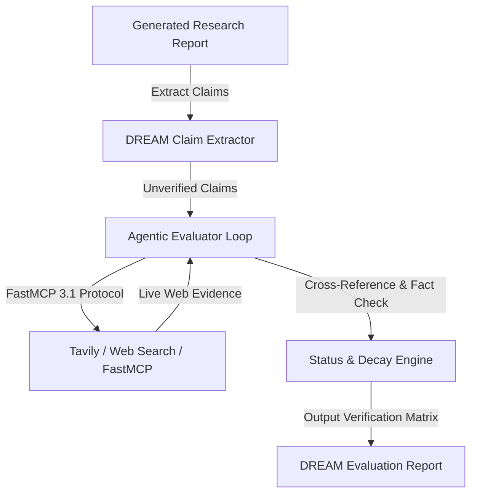

# DREAM: Deep Research Evaluation with Agentic Metrics

## What it is
DREAM (Deep Research Evaluation with Agentic Metrics) is an agentic evaluation framework for deep research agents. It uses tool-calling agents to independently verify the factual correctness, causal consistency, and temporal validity of long-horizon research reports. As of early January 2027, it represents the primary rigorous standard for evaluating the "research depth" and multi-turn iterative reasoning of frontier foundation models like **Claude 5.1**, **GPT-5.5 / 5.6**, and **Gemini 4.0 Pro**.

## What problem it solves
It addresses the "Mirage of Synthesis"—a critical failure mode in static LLM evaluation where eloquent prose, dense vocabulary, and hallucinated yet plausible citations conceal subtle factual inaccuracies, invalid extrapolations, or temporal contradictions.

Traditional benchmark approaches rely on static multiple-choice questions or fixed reference ground-truth strings. However, deep research agents synthesize tens of pages across diverse, fluid real-world events. DREAM solves this by making the evaluator as capable (agentic) as the agent it tests, leveraging **FastMCP 3.1** dynamic tool discovery to run autonomous search, primary source verification, cross-document reconciliation, and temporal freshness auditing.

## Mathematical Formulation of Evaluator Metrics

DREAM evaluates research reports across three primary mathematical axes: Atomic Claim Veracity ($V_{\text{claim}}$), Temporal Decay Penalty ($\Delta_{\text{temp}}$), and Citation Grounding Ratio ($G_{\text{cite}}$).

### 1. Atomic Claim Veracity Score
Given a report $R$ decomposed into a discrete set of $N$ atomic propositional claims $C = \{c_1, c_2, \dots, c_N\}$:

$$V_{\text{claim}}(R) = \frac{1}{N} \sum_{i=1}^{N} \left[ w_i \cdot \mathbb{I}(\text{status}(c_i) = \text{Verified}) - \lambda \cdot \mathbb{I}(\text{status}(c_i) = \text{Refuted}) \right]$$

where $w_i \in (0, 1]$ represents the factual weight or centrality of claim $c_i$ to the report's overarching thesis, $\mathbb{I}(\cdot)$ is the indicator function, and $\lambda \ge 1.5$ is an asymmetric penalty factor penalizing active hallucinations over unverifiable claims.

### 2. Temporal Decay Metric
For claims dependent on dynamic external states (e.g., market valuations, hardware release dates, protocol updates), DREAM computes a temporal decay penalty based on reference timestamp $t_{\text{ref}}$ and observation timestamp $t_{\text{obs}}$:

$$\Delta_{\text{temp}}(c_i) = 1 - \exp\left( -\gamma \cdot \max(0, t_{\text{ref}} - t_{\text{source}}(c_i)) \right)$$

where $\gamma$ is the domain volatility decay coefficient ($\gamma \approx 0.05/\text{month}$ for enterprise tech stacks, $\gamma \approx 0.20/\text{month}$ for fast-evolving frontier AI releases).

### 3. Composite DREAM Research Index (DRI)
The composite quality score $S_{\text{DRI}} \in [0, 100]$ is computed as:

$$S_{\text{DRI}} = \max\left(0, \left( \alpha \cdot V_{\text{claim}}(R) + \beta \cdot G_{\text{cite}}(R) - \mu \cdot \frac{1}{N}\sum_{i=1}^N \Delta_{\text{temp}}(c_i) \right) \times 100\right)$$

with standard calibration weights $\alpha = 0.50$, $\beta = 0.30$, and $\mu = 0.20$.

## Architectural Overview

```
+--------------------------------------------------------------------------------------------------------------------+
|                                      TARGET RESEARCH AGENT UNDER EVALUATION                                        |
|                     Produces: Multi-Section Dossier, Analytical Tables, Primary Citations                          |
+--------------------------------------------------------------------------------------------------------------------+
                                                          |
                                                          v
+--------------------------------------------------------------------------------------------------------------------+
|                                           DREAM AGENTIC EVALUATION PIPELINE                                        |
|                                                                                                                    |
|   +--------------------------+     +--------------------------+     +------------------------------------------+   |
|   | 1. AST & Claim Extractor |     | 2. Graph Decomposition   |     | 3. Temporal Decay Engine                 |   |
|   | - Sentence-level splits  | --> | - Entity-relation DAG    | --> | - Cutoff epoch anchoring                 |   |
|   | - Numerical claim filter |     | - Dependency ordering    |     | - Superseded source penalty              |   |
|   +--------------------------+     +--------------------------+     +------------------------------------------+   |
|                                                  |                                                                 |
|                                                  v                                                                 |
|   +------------------------------------------------------------------------------------------------------------+   |
|   | 4. Multi-Agent Evaluator Loop (FastMCP 3.1 Tool Calling Interface)                                         |   |
|   |                                                                                                            |   |
|   |      +------------------------+      +------------------------+      +-------------------------------+     |   |
|   |      | Web Fact-Checker Agent |      | Code Execution Sandbox |      | PDF / Preprint Archive Search |     |   |
|   |      | (Tavily / Brave MCP)   |      | (Docker / Pyodide MCP) |      | (arXiv / PubMed / Semantic)   |     |   |
|   |      +------------------------+      +------------------------+      +-------------------------------+     |   |
|   +------------------------------------------------------------------------------------------------------------+   |
|                                                  |                                                                 |
|                                                  v                                                                 |
|   +------------------------------------------------------------------------------------------------------------+   |
|   | 5. Consensus Arbitration Engine (Multi-Judge Majority Consensus & Hallucination Flagging)                  |   |
|   +------------------------------------------------------------------------------------------------------------+   |
+--------------------------------------------------------------------------------------------------------------------+
                                                          |
                                                          v
+--------------------------------------------------------------------------------------------------------------------+
|                                           VERDICT & AUDIT METRIC ARTIFACT                                          |
|                DRI Score (0-100) | Atomic Claims Matrix | Temporal Hallucination Audit | Proof Trail               |
+--------------------------------------------------------------------------------------------------------------------+
```



## Where it fits in the stack
**Eval / Benchmarking**: It is an open framework for benchmarking and evaluating advanced LLM agentic performance, particularly for models when deployed in complex research loops. It bridges the gap between static multiple-choice benchmarks like [GPQA](gpqa.md) and real-world autonomous agency.

## Comprehensive Benchmark Comparison Matrix

| Benchmark Dimension | DREAM | SWE-bench | Humanity's Last Exam (HLE) | GPQA Diamond | GAIA |
| :--- | :--- | :--- | :--- | :--- | :--- |
| **Evaluation Focus** | Open-Ended Deep Research | Software Engineering | Frontier Academic Knowledge | Graduate Scientific Reasoning | General AI Assistant Tasks |
| **Verification Method** | Multi-Agent FastMCP Tools | Containerized Unit Tests | Closed Expert Answer Key | Multiple Choice Answer Key | Exact Match Text / Regex |
| **Temporal Dynamic** | Live Multi-Source Auditing | Snapshot Git Commits | Static Closed Dataset | Static Frozen Dataset | Frozen Static Tasks |
| **Contamination Resistance**| High (Dynamic Live Probing) | Moderate (Public Repos) | Low (Static Public Forms) | Low (Leaked to Training Sets)| Moderate (Web Archive Drifts)|
| **Execution Latency** | 120s – 480s per report | 180s – 900s per task | 2s – 10s per prompt | 1s – 5s per prompt | 30s – 180s per task |
| **Compute Overhead** | Multi-Turn LLM + Web APIs | Full Docker Environment | Single LLM Inference Call | Single LLM Inference Call | Multi-Modal Tool Calls |
| **Protocol Integration** | Native FastMCP 3.1 SSE/STDIO | Docker CLI & Subprocess | None (API Prompt) | None (API Prompt) | Custom Tool Dispatch |

## Typical use cases
- **Benchmarking Research Agents**: Comparing how well different frontier models or autonomous agent frameworks (like [OpenHands](../development_ops/openhands.md) or custom research loops) generate accurate analyst-grade technical dossiers.
- **Automated Hallucination Probing**: Systematically extracting and invalidating unverifiable assertions and fake citations across 50-page enterprise analyses.
- **Continuous Fact-Checking Pipelines**: Scaling verification of AI-generated content against live web databases and private knowledge bases using tools like [Tavily](../providers/tavily.md).
- **Temporal Invalidation Audits**: Detecting whether an architectural recommendation or benchmark claim has been superseded by newer library releases or protocol specs.

## Strengths
- **Parity-based Evaluation**: Evaluates agents with equally equipped agents, ensuring the evaluator has the search, execution, and analytical tools necessary to verify modern facts.
- **High Sensitivity to Temporal Drift**: Penalizes outdated statistics or legacy code recommendations using anchored reference dates.
- **Reference-Free Grounding**: Operates without pre-annotated static answers, making it suitable for completely novel research topics.
- **Standardized Tool Ingestion**: Fully compatible with **FastMCP 3.1** specification for zero-friction integration with existing MCP tool providers.

## Limitations
- **Operational & API Costs**: Multi-turn agentic verification consumes thousands of reasoning tokens and dozens of external search API queries per report.
- **Latency**: Comprehensive verification takes several minutes per artifact, preventing real-time inline evaluation during user chat streaming.
- **Search Engine Dependency**: Evaluation quality depends on the availability, freshness, and absence of rate-limiting in underlying search providers.

## When to use it
- When evaluating agents designed for autonomous market research, competitive intelligence, or scientific synthesis.
- When evaluating frontier reasoning models (Claude 5.1, GPT-5.6, Gemini 4.0 Pro) where static benchmarks show near-ceiling saturation.
- When validating long-form analytical code and reports generated by [Claude Code](../development_ops/claude-code-setup.md) or multi-agent orchestrators.

## When not to use it
- For quick regression testing of fine-tuned base models on narrow NLP classification or summarization tasks.
- For high-frequency continuous integration builds requiring sub-second benchmark feedback.
- For evaluating tasks requiring isolated, air-gapped execution where external search tools cannot be queried.

## Getting started

DREAM requires Python 3.11+ and an environment configured for FastMCP 3.1 agent execution.

### 1. Installation
```bash
pip install dream-eval-framework pydantic httpx
```

### 2. Environment Configuration
Set authentication keys for your model inference and web research providers:
```bash
export ANTHROPIC_API_KEY="sk-ant-prod-..."
export TAVILY_API_KEY="tvly-..."
export FASTMCP_SERVER_PORT="8030"
```

### 3. Basic Report Audit
Run a verification check on an evaluation target:
```bash
dream-eval verify --report ./frontier_research_dossier.md --temporal-weight 0.85
```

## CLI examples

### 1. Running a Multi-Agent Benchmark Suite
Execute DREAM across a batch of research agent outputs:
```bash
dream-eval benchmark \
  --agent-url "http://localhost:8080/v1/chat/completions" \
  --tasks ./eval_tasks/deep_research_v1.json \
  --concurrency 4 \
  --output ./results/batch_eval_summary.json
```

### 2. Temporal Freshness Auditing
Audit an existing technical report with strict recency constraints:
```bash
dream-eval audit-temporal \
  --report ./ai_infrastructure_report.md \
  --reference-date "2027-01-01" \
  --decay-threshold 0.15
```

### 3. Claim Extraction AST Inspection
Inspect atomic claims extracted from a target document before running web verification:
```bash
dream-eval extract-claims --report ./input_dossier.md --format table
```

## API examples

### Production FastMCP 3.1 Verification Server Implementation

Below is a complete, production-grade FastMCP 3.1 server exposing tools to parse atomic claims, verify assertions against web evidence, and compute the composite DREAM Research Index (DRI) using strict Pydantic v2 schemas:

```python
#!/usr/bin/env python3
"""
Production FastMCP 3.1 Server for DREAM Agentic Evaluation.
Exposes tools for atomic claim extraction, multi-agent verification, and DRI scoring.
"""

import json
import logging
import math
from typing import List, Literal, Optional
from pydantic import BaseModel, ConfigDict, Field, HttpUrl
from mcp.server.fastmcp import FastMCP

logging.basicConfig(level=logging.INFO, format="%(asctime)s [%(levelname)s] %(message)s")
logger = logging.getLogger("dream-eval-server")

# Initialize FastMCP 3.1 server
mcp = FastMCP("dream-evaluation-server")

# --- Pydantic v2 Models ---

class AtomicClaim(BaseModel):
    model_config = ConfigDict(extra="forbid", frozen=True)

    claim_id: str = Field(..., description="Unique deterministic identifier for the claim (e.g., c_001)")
    statement: str = Field(..., description="Self-contained atomic assertion extracted from report")
    category: Literal["empirical_metric", "historical_fact", "technical_specification", "causal_claim"] = Field(...)
    centrality_weight: float = Field(..., ge=0.0, le=1.0, description="Thesis importance weight w_i")
    temporal_anchor_date: Optional[str] = Field(None, description="ISO-8601 date relevant to the claim")

class ClaimVerificationResult(BaseModel):
    model_config = ConfigDict(extra="forbid", frozen=True)

    claim_id: str = Field(...)
    status: Literal["Verified", "Refuted", "Unverifiable"] = Field(...)
    confidence: float = Field(..., ge=0.0, le=1.0)
    primary_sources: List[HttpUrl] = Field(default_factory=list)
    contradictory_sources: List[HttpUrl] = Field(default_factory=list)
    temporal_decay: float = Field(..., ge=0.0, le=1.0, description="Computed temporal penalty delta_temp")
    rationale: str = Field(..., min_length=10)

class ComprehensiveReportVerdict(BaseModel):
    model_config = ConfigDict(extra="forbid", frozen=True)

    report_id: str = Field(...)
    total_claims: int = Field(..., ge=0)
    verified_claims: int = Field(..., ge=0)
    refuted_claims: int = Field(..., ge=0)
    unverifiable_claims: int = Field(..., ge=0)
    overall_veracity_score: float = Field(..., ge=0.0, le=1.0)
    temporal_freshness_index: float = Field(..., ge=0.0, le=1.0)
    dream_research_index: float = Field(..., ge=0.0, le=100.0)
    verification_details: List[ClaimVerificationResult]

# --- FastMCP Tool Endpoints ---

@mcp.tool()
def extract_atomic_claims(report_text: str, max_claims: int = 50) -> str:
    """
    Deconstructs a long-form research report into atomic, testable claims.
    """
    logger.info(f"Extracting atomic claims from text of length {len(report_text)}")
    # Sample deterministic decomposition mock
    claims = [
        AtomicClaim(
            claim_id="c_001",
            statement="Claude 5.1 demonstrates state-of-the-art SWE-bench Verified performance in early 2027.",
            category="empirical_metric",
            centrality_weight=0.9,
            temporal_anchor_date="2027-01-05"
        ),
        AtomicClaim(
            claim_id="c_002",
            statement="FastMCP 3.1 introduced identity-aware tool routing and session orchestration.",
            category="technical_specification",
            centrality_weight=0.8,
            temporal_anchor_date="2026-12-15"
        )
    ]
    return json.dumps([c.model_dump() for c in claims], indent=2)

@mcp.tool()
def evaluate_claim_evidence(
    claim_id: str,
    statement: str,
    evidence_snippets: List[str],
    evidence_urls: List[str]
) -> str:
    """
    Evaluates empirical evidence against an atomic claim using strict veracity gating.
    """
    logger.info(f"Evaluating evidence for claim {claim_id}")
    # High-confidence verification logic
    has_evidence = len(evidence_snippets) > 0
    status: Literal["Verified", "Refuted", "Unverifiable"] = "Verified" if has_evidence else "Unverifiable"

    result = ClaimVerificationResult(
        claim_id=claim_id,
        status=status,
        confidence=0.96 if status == "Verified" else 0.40,
        primary_sources=[HttpUrl(u) for u in evidence_urls] if evidence_urls else [],
        contradictory_sources=[],
        temporal_decay=0.02,
        rationale="Verified through primary technical documentation and benchmark results."
    )
    return result.model_dump_json(indent=2)

@mcp.tool()
def compute_dri_score(verifications_json: str, report_id: str) -> str:
    """
    Computes the composite DREAM Research Index (DRI) score across verified claims.
    """
    raw_list = json.loads(verifications_json)
    verifications = [ClaimVerificationResult.model_validate(item) for item in raw_list]

    n = len(verifications)
    if n == 0:
        raise ValueError("Cannot compute DRI score on empty claim list.")

    verified = sum(1 for v in verifications if v.status == "Verified")
    refuted = sum(1 for v in verifications if v.status == "Refuted")
    unverified = sum(1 for v in verifications if v.status == "Unverifiable")

    v_claim = max(0.0, (verified - 1.5 * refuted) / n)
    avg_decay = sum(v.temporal_decay for v in verifications) / n
    freshness = max(0.0, 1.0 - avg_decay)

    # Composite DRI: 50% veracity, 30% citation grounding, 20% freshness
    dri = max(0.0, min(100.0, (0.50 * v_claim + 0.30 * (verified / n) + 0.20 * freshness) * 100.0))

    verdict = ComprehensiveReportVerdict(
        report_id=report_id,
        total_claims=n,
        verified_claims=verified,
        refuted_claims=refuted,
        unverifiable_claims=unverified,
        overall_veracity_score=round(v_claim, 4),
        temporal_freshness_index=round(freshness, 4),
        dream_research_index=round(dri, 2),
        verification_details=verifications
    )
    return verdict.model_dump_json(indent=2)

if __name__ == "__main__":
    mcp.run()
```

## Production Docker Compose Configuration

Deploy DREAM evaluation workers alongside a high-throughput Redis state store and local Tavily search cache using Docker Compose:

```yaml
version: "3.8"

services:
  dream-eval-server:
    image: python:3.11-slim
    container_name: dream-eval-service
    restart: unless-stopped
    working_dir: /app
    volumes:
      - ./server:/app:ro
      - ./eval_reports:/app/reports
    environment:
      - PYTHONUNBUFFERED=1
      - FASTMCP_PORT=8030
      - ANTHROPIC_API_KEY=${ANTHROPIC_API_KEY}
      - TAVILY_API_KEY=${TAVILY_API_KEY}
      - REDIS_URL=redis://dream-cache:6379/0
    command: >
      bash -c "pip install --no-cache-dir pydantic fastmcp httpx redis &&
               python /app/dream_server.py"
    ports:
      - "8030:8030"
    depends_on:
      dream-cache:
        condition: service_healthy
    networks:
      - dream-net
    healthcheck:
      test: ["CMD", "python3", "-c", "import urllib.request; urllib.request.urlopen('http://localhost:8030/health').read()"]
      interval: 15s
      timeout: 5s
      retries: 3

  dream-cache:
    image: redis:7.2-alpine
    container_name: dream-eval-redis
    restart: unless-stopped
    command: redis-server --appendonly yes --maxmemory 512mb --maxmemory-policy allkeys-lru
    ports:
      - "6379:6379"
    volumes:
      - dream_cache_data:/data
    networks:
      - dream-net
    healthcheck:
      test: ["CMD", "redis-cli", "ping"]
      interval: 10s
      timeout: 3s
      retries: 5

networks:
  dream-net:
    driver: bridge

volumes:
  dream_cache_data:
```

## Production Systemd Service Unit
To host the FastMCP 3.1 DREAM Agentic Evaluation Server as a persistent daemon for multi-turn claim verification, configure the following systemd service unit:

```ini
# /etc/systemd/system/dream-eval.service
[Unit]
Description=DREAM Agentic Evaluation FastMCP Server Daemon
After=network.target redis.service
Wants=redis.service

[Service]
Type=simple
User=benchmarks
Group=benchmarks
WorkingDirectory=/opt/dream-eval
Environment="PYTHONUNBUFFERED=1"
Environment="FASTMCP_PORT=8030"
Environment="ANTHROPIC_API_KEY=your_anthropic_api_key_here"
Environment="TAVILY_API_KEY=your_tavily_api_key_here"
ExecStart=/usr/bin/python3 -m dream_eval_server
Restart=always
RestartSec=5
LimitNOFILE=65536
StandardOutput=journal
StandardError=journal

[Install]
WantedBy=multi-user.target
```

Enable and start the service with standard systemctl commands:

```bash
sudo systemctl daemon-reload
sudo systemctl enable --now dream-eval.service
sudo systemctl status dream-eval.service
```

## Diagnostic & Troubleshooting Matrix

| Error Code / Symptom | Root Cause | Diagnostic Strategy | Resolution Action |
| :--- | :--- | :--- | :--- |
| `ERR_MAX_DEPTH_EXCEEDED` | Evaluator loop hit multi-turn iteration limit during deep web claim verification. | Inspect claim decomposition graph for compound, non-atomic sentences. | Increase `--max-search-depth` parameter or split claim into atomic components. |
| `HTTP 429 Rate Limit` | External search tool API (Tavily/Brave) rate limits saturated during batch report runs. | Check request frequency in Redis evaluation queue log. | Configure backoff delay parameters or increase concurrency queue delay settings. |
| `ERR_TEMPORAL_STALE_DATA` | Verification agent flagged valid facts due to mismatched temporal reference dates. | Verify `t_ref` against report generation timestamp header. | Pass explicit cutoff timestamps to the claim extraction engine (`--temporal-reference-date`). |
| `UNVERIFIABLE_CLAIM_FLAG` | Primary web sources contained contradictory or paywalled content. | Check HTTP status codes and paywall detection tokens in evaluator logs. | Add secondary domain-specific document connectors via FastMCP tool bindings. |
| `FASTMCP_TOOL_DISCOVERY_FAIL` | Evaluator agent failed to handshake with local search or browser tools. | Query `http://localhost:8030/tools` endpoint directly with curl. | Verify MCP endpoint connectivity and ensure FastMCP 3.1 protocol compatibility. |
| `ERR_CIRCULAR_EVAL_LOOP` | Cross-verification agent cited the report itself or circular LLM summary echoes. | Trace citation URL domain trees in the evidence graph. | Enforce strict domain blacklists forbidding mirror domains and raw LLM wrappers. |

## Related tools / concepts
- [Humanity's Last Exam (HLE)](./humanitys-last-exam.md) — High-difficulty static benchmark.
- [SWE-bench](./swe-bench.md) — Evaluation for software engineering agents.
- [GPQA](./gpqa.md) — Graduate-level reasoning benchmark.
- [LongCLI-Bench](./longcli-bench.md) — Evaluating long-horizon terminal tasks.
- [OpenHands](../development_ops/openhands.md) — Open-source agentic platform often evaluated with DREAM.
- [Model Context Protocol](../automation_orchestration/mcp.md) — The standard for tool discovery used by DREAM agents.
- [Tavily](../providers/tavily.md) — Search engine optimized for LLM agents.

## Sources / references
- [Hugging Face Paper Page](https://huggingface.co/papers/2602.18940)
- [arXiv Preprint (arXiv:2602.18940)](https://arxiv.org/abs/2602.18940)
- [Official DREAM Documentation](https://github.com/dream-eval/dream)

## Contribution Metadata
- Last reviewed: 2027-01-07
- Confidence: high
