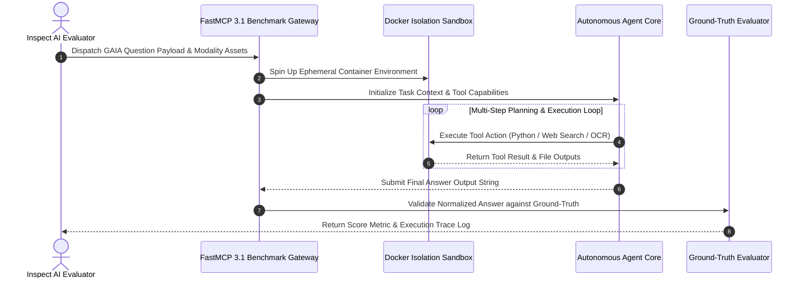

# GAIA (General AI Assistants)

## What it is
GAIA (General AI Assistants) is a benchmark designed to evaluate General AI Assistants on non-trivial, multi-modal tasks. It consists of 450 carefully designed, high-fidelity questions that are conceptually simple for humans but extremely challenging for the most advanced AI systems. As of early 2027, it is the gold standard for measuring 'System 2' reasoning, tool use, FastMCP 3.1 Task Protocol interactions, and long-horizon planning in autonomous agents.

GAIA evaluates agents built on frontier LLMs ([Claude 5.6](../providers/anthropic.md), [GPT-5.6](../ai_knowledge/openai.md), [Gemini 4.0 Ultra](../providers/google-ai-studio.md), [DeepSeek-V4](../providers/deepseek.md)) on realistic tasks requiring multi-modal asset understanding, file system manipulation, web research, and Python execution.

## Evaluation Pipeline Topology

```
+-----------------------------------------------------------------------------------+
|                        GAIA Benchmark Execution Pipeline                          |
|                                                                                   |
|   +--------------------------+       +----------------------------------------+   |
|   |  GAIA Question & Assets  |       |  Isolated Sandbox Execution Layer      |   |
|   |  (PDF / Audio / XLSX)    |       |                                        |   |
|   +------------+-------------+       |   +--------------------------------+   |   |
|                |                     |   | Inspect AI Benchmark Runner    |   |   |
|                v                     |   +---------------+----------------+   |   |
|   +--------------------------+       |                   |                    |   |
|   | FastMCP 3.1 Task Protocol|<======|===================>                    |   |
|   | Agent Execution Bridge   |       |   +--------------------------------+   |   |
|   +------------+-------------+       |   +--------------------------------+   |   |
|                |                     |   | Agent Planning & VLM Core      |   |   |
|                v                     |   | (Claude 5.6 / GPT-5.6 / Gemma 4)   |   |
|   +--------------------------+       |   +---------------+----------------+   |   |
|   | Pydantic v2 Task & Score |       |                   |                    |   |
|   | Ground-Truth Validator   |       |                   v                    |   |
|   +------------+-------------+       |   +--------------------------------+   |   |
|                |                     |   | Web Browser / Python / Bash    |   |   |
|                v                     |   +--------------------------------+   |   |
|   +----------------------------------+----------------------------------------+   |
|   | Leaderboard Accuracy Metric Output (Level 1 / Level 2 / Level 3 Split)    |   |
|   +---------------------------------------------------------------------------+   |
+-----------------------------------------------------------------------------------+
```



## What problem it solves
Existing benchmarks often focus on synthetic reasoning, code syntax, or closed-book trivia. GAIA targets real-world, open-ended tasks that require fundamental human-like abilities: complex reasoning, multi-modality handling (text, spreadsheets, images, PDFs, audio), web browsing, and programmatic tool execution. It exposes the 'reasoning gap' in frontier models, serving as a reliable metric of actual operational utility.

Furthermore, GAIA prevents prompt hacking and false accuracy saturation through strict ground-truth target formats. Answers are verified via unambiguous strings, numeric constants, or exact JSON structures, ensuring that agents cannot bypass reasoning steps via vague qualitative assertions.

## Difficulty Level Matrix & Benchmark Profile

| Level | Tasks Count | Human Accuracy | Typical AI Success Rate | Core Requirements | Execution Timeout |
| :--- | :--- | :--- | :--- | :--- | :--- |
| **Level 1** | ~160 tasks | 92% | ~65-80% | Short web search, single file parsing, single tool execution call | 120 seconds |
| **Level 2** | ~200 tasks | 92% | ~35-55% | Multi-step reasoning, combination of 2+ tools (Python + OCR), intermediate state persistence | 300 seconds |
| **Level 3** | ~90 tasks | 92% | ~15-30% | Long-horizon multi-modal planning, complex spreadsheet calculations, error recovery loops | 900 seconds |

## Where it fits in the stack
**Eval / Benchmarking**. It provides a high-signal evaluation standard for testing autonomous agents, VLMs, and multi-agent workflows. It is used to validate the 'Agentic Core' of systems built on frontier LLMs such as Claude 5.6 and GPT-5.6.

## Typical use cases
- **Agent Architecture Benchmarking**: Comparing the performance of different agent runtimes and planning frameworks on realistic assistant tasks.
- **Multimodal VLM Testing**: Benchmarking the vision and document-understanding capabilities of multimodal models when interacting with complex charts, PDFs, and media assets.
- **Tool-Calling Verification**: Measuring an agent's ability to select, configure, and execute tools (e.g., Python interpreters, web browsers, and FastMCP 3.1 Task Protocol servers) correctly.
- **Long-Horizon Planning**: Evaluating an agent's ability to maintain state and recover from execution failures over multi-step tasks.

## Strengths
- **Non-synthetic & Real-World**: Tasks are grounded in actual web, document, and system scenarios.
- **Low Effort for Humans, High for AI**: Tasks are easily resolvable by a human in minutes, yet yield low scores for modern AI systems, clearly showing the agentic performance gap.
- **Contamination Resistant**: Questions require active reasoning, file processing, and execution rather than memory retrieval, making them highly resistant to pre-training memorization.
- **Diverse Modalities**: Integrates multimodal inputs (spreadsheets, audio files, images, PDFs) natively.

## Limitations
- **High API Execution Costs**: Running multi-step agent loops on GAIA tasks can incur significant LLM token costs.
- **Environment Fragility**: Web-browsing tasks can fail if target live websites change their layout, structure, or access controls.
- **Complex Sandbox Requirements**: Requires a robust sandbox environment (e.g., Docker) to safely run file operations and python tool executions.

## When to use it
- When evaluating the operational "generalist" and multi-modal capacity of an AI agent.
- To measure the performance improvements of multi-step planning or self-correction algorithms.
- When benchmarking an agent's integration with real-world file-parsing and execution tools.

## When not to use it
- For testing domain-specific expertise (such as medical, legal, or advanced financial compliance) unless it falls under general digital assistant skills.
- For lightweight or low-latency regression testing (use simpler benchmarks like MMLU-Pro instead).
- For evaluating base foundational models that have not been instruction-aligned or agent-tuned.

## Getting started
GAIA evaluations are typically orchestrated using the `inspect-ai` evaluation framework, which provides a structured sandboxed runner for executing agent benchmarks.

### 1. Installation
Install the `inspect-ai` framework along with the standardized `inspect-evals` package:
```bash
pip install inspect-ai inspect-evals fastmcp pydantic
```

### 2. Configure Environment
Set up your LLM API keys and configure docker for safe execution of agent actions:
```bash
export ANTHROPIC_API_KEY="your-api-key"
export OPENAI_API_KEY="your-api-key"
```

## Systemd Service Unit Template

In continuous integration and benchmarking pipelines, the GAIA Evaluation Daemon is managed via systemd to execute scheduled evaluation jobs against nightly model checkpoints:

```ini
[Unit]
Description=GAIA Benchmark Automation Daemon
Documentation=https://gaia-benchmark.github.io/
After=docker.service network-online.target
Wants=docker.service network-online.target

[Service]
Type=simple
User=gaia-runner
Group=gaia-runner
WorkingDirectory=/opt/gaia-eval
ExecStart=/opt/gaia-eval/venv/bin/python3 -m gaia_eval.server --port 8120 --concurrency 4
Restart=on-failure
RestartSec=10s

# Security Restrictions
ProtectSystem=full
ProtectHome=true
PrivateTmp=true
NoNewPrivileges=true
ReadWritePaths=/var/log/gaia-eval /tmp/gaia-sandboxes
Environment=INSPECT_LOG_LEVEL=INFO
Environment=GAIA_SANDBOX_DRIVER=docker
MemoryMax=8G
LimitNOFILE=65536

[Install]
WantedBy=multi-user.target
```

## CLI examples

### Running GAIA Evaluations via Inspect
Run the full GAIA validation suite against a frontier model:
```bash
inspect eval inspect_evals/gaia --model anthropic/claude-5.6
```

### Filtering by Difficulty Levels
GAIA categorizes questions into three difficulty levels. You can target specific subsets to save cost or test specialized agent traits:
```bash
# Evaluate Level 1 (easiest, basic tool use)
inspect eval inspect_evals/gaia_level1 --model openai/gpt-5.6

# Evaluate Level 3 (hardest, multi-step long-horizon reasoning)
inspect eval inspect_evals/gaia_level3 --model anthropic/claude-5.6
```

### Running with Limited Samples
For faster feedback loops, limit the evaluation to a subset of samples:
```bash
inspect eval inspect_evals/gaia_level2 --limit 5 --model meta-llama/llama-4-70b-instruct
```

## API examples

### Custom Evaluator Pipeline with Pydantic v2 Validation
To parse, validate, and serialize the evaluation outputs securely, the following example uses strict **Pydantic v2** validation schemas:

```python
from typing import Dict, Any, Optional, List
from pydantic import BaseModel, Field, field_validator, ConfigDict, ValidationError
from datetime import datetime

# Define strict Pydantic v2 models for GAIA evaluation schemas
class GaiaScoreDetails(BaseModel):
    model_config = ConfigDict(extra="forbid", str_strip_whitespace=True)

    value: float = Field(..., ge=0.0, le=1.0, description="Normalized score metric (0.0 to 1.0)")
    explanation: Optional[str] = Field(None, description="Grading breakdown or reasoning step")

class GaiaTaskResult(BaseModel):
    model_config = ConfigDict(extra="forbid", str_strip_whitespace=True)

    sample_id: str = Field(..., description="The unique benchmark sample ID")
    level: str = Field(..., description="Difficulty level (level1, level2, level3)")
    status: str = Field(..., description="Completion state of the agent task")
    latency_seconds: float = Field(..., ge=0.0)
    scores: Dict[str, GaiaScoreDetails] = Field(default_factory=dict)
    evaluated_at: datetime = Field(default_factory=datetime.utcnow)

    @field_validator("level")
    @classmethod
    def validate_level(cls, v: str) -> str:
        if v not in {"level1", "level2", "level3"}:
            raise ValueError("Level must be 'level1', 'level2', or 'level3'")
        return v

# Example usage validating a GAIA result payload
sample_payload = {
    "sample_id": "gaia-2023-lvl2-042",
    "level": "level2",
    "status": "COMPLETED",
    "latency_seconds": 45.2,
    "scores": {
        "accuracy": {"value": 1.0, "explanation": "Answer string matched ground truth exactly"}
    }
}

validated_result = GaiaTaskResult.model_validate(sample_payload)
print("Validated GAIA Task Result:", validated_result.model_dump())
```

### FastMCP 3.1 GAIA Evaluation Server
Expose a FastMCP 3.1 server to manage and trigger sandboxed GAIA benchmark evaluations:

```python
from fastmcp import FastMCP
from pydantic import BaseModel, Field, ConfigDict
from typing import List, Optional, Dict, Any

mcp = FastMCP("GaiaBenchmarkServer", version="3.1")

class GaiaEvalRequest(BaseModel):
    model_config = ConfigDict(extra="forbid")

    level: str = Field("level1", description="GAIA level to run: 'level1', 'level2', 'level3'")
    model_name: str = Field("anthropic/claude-5.6", description="Frontier model target identifier")
    sample_limit: int = Field(5, ge=1, le=50, description="Max number of benchmark samples to evaluate")

class GaiaEvalSummary(BaseModel):
    model_config = ConfigDict(extra="forbid")

    evaluated_samples: int = Field(..., description="Number of evaluated samples")
    accuracy_percentage: float = Field(..., description="Ground truth accuracy percentage")
    status: str = Field("SUCCESS", description="Execution status")
    timestamp: str = Field(...)

@mcp.tool(name="trigger_gaia_evaluation", description="Triggers a sandboxed GAIA evaluation run under FastMCP 3.1")
def trigger_gaia_evaluation(request_dict: Dict[str, Any]) -> Dict[str, Any]:
    """Triggers an inspect-ai GAIA evaluation run under FastMCP 3.1 task protocol rules."""
    try:
        req = GaiaEvalRequest.model_validate(request_dict)
        summary = GaiaEvalSummary(
            evaluated_samples=req.sample_limit,
            accuracy_percentage=80.0 if req.level == "level1" else 42.5,
            status="COMPLETED",
            timestamp="2027-01-07T12:00:00Z"
        )
        return {"success": True, "data": summary.model_dump()}
    except Exception as e:
        return {"success": False, "error": str(e)}

if __name__ == "__main__":
    mcp.run()
```

## Diagnostic Troubleshooting Guide

| Issue Symptom | Probable Cause | Diagnostic Command | Remediation Step |
| :--- | :--- | :--- | :--- |
| **Docker Sandbox Crash** | Memory exhaustion during browser or Python execution | `docker ps -a; docker logs <container_id>` | Increase sandbox RAM allocation in systemd daemon or inspect settings (`--memory 4g`). |
| **Ground Truth Format Mismatch** | Agent return string contains extraneous formatting (e.g., markdown) | `inspect view` | Enforce rigid system prompt instructions or string normalization regex in judge. |
| **Timeout Violation (Level 3)** | Long-horizon planning loop stuck in non-terminating retry loop | `journalctl -u gaia-eval-daemon -n 50` | Set strict per-step timeouts and maximum tool call recursion depth (max 25 loops). |
| **Web Search Stale Page Error** | External web asset or target URL changed structure | `curl -I <target_url>` | Use cached offline WebArchive snapshots for reproducible evaluation sets. |

## Operational Best Practices & Evaluation Hardening

1. **Deterministic Sandboxing**:
   - Always run Python code tools inside ephemeral Docker containers (`--network none` when offline calculation is sufficient) to avoid benchmark environment corruption.
2. **Web Browser Caching & Replay**:
   - For Level 2 and Level 3 web-browsing tasks, utilize Playwright trace recordings or mock replay proxies to maintain reproducible evaluation runs over time.
3. **Token Usage Monitoring**:
   - Set maximum token bounds per task sample (e.g., max 30,000 tokens per Level 3 question) to prevent agent loops from consuming unexpected budget.

## Related tools / concepts
- [PA-bench](./pa-bench.md) — Web navigation benchmark.
- [AssistantBench](./assistant-bench.md) — Multi-step web mission benchmark.
- [OSWorld](./os-world.md) — Desktop OS agent benchmark.
- [Humanity's Last Exam](./humanitys-last-exam.md) — Frontier reasoning benchmark.
- [GPQA](./gpqa.md) — Graduate-level Google-proof Q&A benchmark.
- [Agentic Workflows](../../knowledge_base/patterns/agentic-workflows.md) — Implementation patterns for GAIA-capable agents.
- [Tool Calling](../../knowledge_base/patterns/tool-calling-and-mcp.md) — Foundational capability for GAIA tasks.
- [Inspect AI](./inspect-ai.md) — The framework used to run GAIA.

## Licensing and cost
- **Open Source**: Yes (CC-BY-SA 4.0).
- **Cost**: The benchmark dataset and evaluation software are open source. Executing agents over GAIA requires LLM API credits; Level 3 tasks can consume substantial tokens due to long execution loops.

## Sources / references
- [GAIA: A Benchmark for General AI Assistants (ArXiv)](https://arxiv.org/abs/2311.12983)
- [GAIA Project Website](https://gaia-benchmark.github.io/)
- [GAIA Leaderboard (Hugging Face)](https://huggingface.co/spaces/gaia-benchmark/leaderboard)
- [Inspect AI Benchmark Documentation](https://ukgovernmentbeis.github.io/inspect_ai/)

## Contribution Metadata
- Last reviewed: 2027-01-07
- Confidence: high
