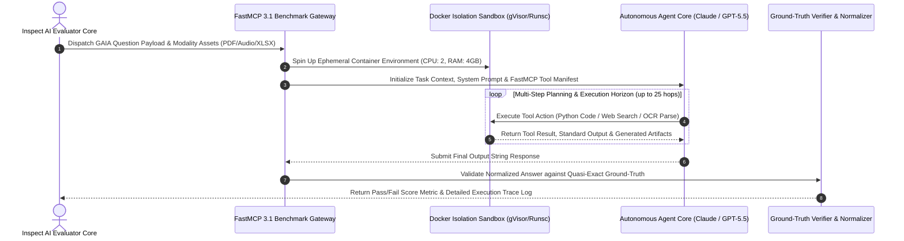

# GAIA (General AI Assistants)

## What it is
GAIA (General AI Assistants) is a benchmark designed to evaluate General AI Assistants on non-trivial, multi-modal tasks. It consists of 450 carefully designed, high-fidelity questions that are conceptually simple for humans but extremely challenging for the most advanced AI systems. As of early 2027, it is the gold standard for measuring 'System 2' reasoning, tool use, FastMCP 3.1 Task Protocol interactions, and long-horizon planning in autonomous agents.

GAIA evaluates agents built on frontier LLMs ([Claude 5.6](../providers/anthropic.md), [GPT-5.6](../ai_knowledge/openai.md), [Gemini 4.0 Ultra](../providers/google-ai-studio.md), [DeepSeek-V4](../providers/deepseek.md)) on realistic tasks requiring multi-modal asset understanding, file system manipulation, web research, and Python execution.

## Evaluation Pipeline Topology & Execution Lifecycle



GAIA's architecture isolates the evaluation harness, sandboxed execution environment, and model inference loops:

```
+-----------------------------------------------------------------------------------+
|                        GAIA Benchmark Execution Pipeline                          |
|                                                                                   |
|   +--------------------------+       +----------------------------------------+   |
|   |  GAIA Question & Assets  |       |  Isolated Sandbox Execution Layer      |   |
|   |  (PDF / Audio / XLSX)    |       |                                        |   |
|   +------------+-------------+       |   +--------------------------------+   |   |
|                |                     |   | Inspect AI Benchmark Runner    |   |   |
|                v                     |   +---------------+----------------+   |   |
|   +--------------------------+       |                   |                    |   |
|   | FastMCP 3.1 Task Protocol|<======|===================>                    |   |
|   | Agent Execution Bridge   |       |   +--------------------------------+   |   |
|   +------------+-------------+       |   +--------------------------------+   |   |
|                |                     |   | Agent Planning & VLM Core      |   |   |
|                v                     |   | (Claude 5.6 / GPT-5.6 / Gemma 4)   |   |
|   +--------------------------+       |   +---------------+----------------+   |   |
|   | Pydantic v2 Task & Score |       |                   |                    |   |
|   | Ground-Truth Validator   |       |                   v                    |   |
|   +------------+-------------+       |   +--------------------------------+   |   |
|                |                     |   | Web Browser / Python / Bash    |   |   |
|                v                     |   +--------------------------------+   |   |
|   +----------------------------------+----------------------------------------+   |
|   | Leaderboard Accuracy Metric Output (Level 1 / Level 2 / Level 3 Split)    |   |
|   +---------------------------------------------------------------------------+   |
+-----------------------------------------------------------------------------------+
```

## Mathematical Foundations & Evaluation Metrics

GAIA's scoring mechanisms evaluate agent precision, robustness, and execution efficiency without grading bias.

### 1. Macro-Accuracy Across Difficulty Levels
Let $\mathcal{D}_k$ denote the set of tasks at difficulty level $k \in \{1, 2, 3\}$, where $N_k = |\mathcal{D}_k|$. The binary score $s_i \in \{0, 1\}$ evaluates whether an agent output $\hat{y}_i$ matches the ground-truth string $y_i^*$ under canonical normalization function $\mathcal{N}(\cdot)$:

$$s_i = \mathbb{I}\left( \mathcal{N}(\hat{y}_i) = \mathcal{N}(y_i^*) \right)$$

The overall weighted benchmark accuracy $\mathcal{S}_{\text{GAIA}}$ across all $K=3$ difficulty strata is given by:

$$\mathcal{S}_{\text{GAIA}} = \sum_{k=1}^3 w_k \cdot \left( \frac{1}{N_k} \sum_{i \in \mathcal{D}_k} s_i \right), \quad \text{where } \sum_{k=1}^3 w_k = 1$$

Under the standard unweighted GAIA leaderboard formulation, each task carries unit weight ($w_k = \frac{N_k}{\sum_{j} N_j}$).

### 2. Tool Trajectory Efficiency and Cost Overhead
For a multi-step trajectory consisting of $T$ tool invocations $(a_1, a_2, \dots, a_T)$, the cumulative evaluation cost $\mathcal{C}_{\text{eval}}$ depends on token prompt expansion, model inference, and tool execution latency:

$$\mathcal{C}_{\text{eval}} = \sum_{t=1}^T \left( c_{\text{prompt}} \cdot |\mathbf{x}_t| + c_{\text{comp}} \cdot |\mathbf{y}_t| + c_{\text{sandbox}} \cdot \tau_t \right)$$

Where $\tau_t$ represents the sandbox execution time of action $a_t$. An optimal agent minimizes $\mathcal{C}_{\text{eval}}$ while maintaining $s_i = 1$, preventing redundant web navigations and infinite reasoning loops.

### 3. F-Beta Tool Call Selection Precision
Evaluating whether an agent accurately selects necessary tools rather than hallucinating extraneous tool invocations is governed by the $F_{\beta}$ metric:

$$F_{\beta} = (1 + \beta^2) \cdot \frac{\text{Precision} \cdot \text{Recall}}{(\beta^2 \cdot \text{Precision}) + \text{Recall}}$$

Setting $\beta = 0.5$ penalizes unnecessary tool invocations (false positives) twice as heavily as omissions, rewarding agent parsimony and safety.

## What problem it solves
Existing benchmarks often focus on synthetic reasoning, code syntax, or closed-book trivia. GAIA targets real-world, open-ended tasks that require fundamental human-like abilities: complex reasoning, multi-modality handling (text, spreadsheets, images, PDFs, audio), web browsing, and programmatic tool execution. It exposes the 'reasoning gap' in frontier models, serving as a reliable metric of actual operational utility.

Furthermore, GAIA prevents prompt hacking and false accuracy saturation through strict ground-truth target formats. Answers are verified via unambiguous strings, numeric constants, or exact JSON structures, ensuring that agents cannot bypass reasoning steps via vague qualitative assertions.

## Difficulty Level Matrix & Benchmark Profile

| Level | Tasks Count | Human Accuracy | Typical AI Success Rate | Core Requirements | Execution Timeout |
| :--- | :--- | :--- | :--- | :--- | :--- |
| **Level 1** | ~160 tasks | 92% | ~65-80% | Short web search, single file parsing, single tool execution call | 120 seconds |
| **Level 2** | ~200 tasks | 92% | ~35-55% | Multi-step reasoning, combination of 2+ tools (Python + OCR), intermediate state persistence | 300 seconds |
| **Level 3** | ~90 tasks | 92% | ~15-30% | Long-horizon multi-modal planning, complex spreadsheet calculations, error recovery loops | 900 seconds |

## Where it fits in the stack
**Eval / Benchmarking**. It provides a high-signal evaluation standard for testing autonomous agents, VLMs, and multi-agent workflows. It is used to validate the 'Agentic Core' of systems built on frontier LLMs such as Claude 5.6 and GPT-5.6.

| Benchmark Layer | Primary Technology | Purpose |
| :--- | :--- | :--- |
| **Dataset Definition** | GAIA HuggingFace Dataset | 450 multimodal annotated questions and ground truths |
| **Execution Engine** | UK AISI Inspect AI | Structured harness, test discovery, and metric aggregation |
| **Tool Orchestration** | FastMCP 3.1 Task Server | RPC endpoint providing Python, browser, and bash interfaces |
| **Isolation Barrier** | Docker / gVisor / Firecracker | Sandboxed container protecting host filesystem during runs |
| **Score Normalization**| Strict Pydantic v2 Validator | Mathematical string, float, and entity equivalence checker |

## Agent Benchmark Comparison Matrix

| Benchmark | GAIA | AssistantBench | SWE-bench (Verified) | WebArena | OSWorld |
| :--- | :--- | :--- | :--- | :--- | :--- |
| **Target Scope** | General Multimodal Assistant | Real-world Web Missions | Real Software Engineering PRs | Dynamic Web Navigation | OS Desktop GUI Control |
| **Modality Inputs** | Text, PDF, Audio, XLSX, Images| Web text, HTML tables | Git repos, diffs, unit tests | Live Chromium DOM, Pixels | Screen pixels, mouse/keyboard|
| **Execution Sandboxing**| Docker Python/Bash container| Browser instance | Ephemeral Docker containers | Headless Chromium cluster | Ubuntu desktop VM (QEMU) |
| **Primary Metric** | Quasi-Exact String Accuracy | Task-completion accuracy | Pass@1 unit test rate | Web Task Success Rate | End-State Task Success Rate |
| **Average Horizon** | 5 – 25 agent tool steps | 4 – 15 browser clicks | 10 – 40 bash/edit actions | 10 – 30 browser actions | 15 – 50 OS GUI actions |
| **FastMCP 3.1 Support**| First-class native tools | Custom adapter | First-class native tools | Native Playwright tools | Custom VNC/X11 adapter |
| **Contamination Risk** | Extremely Low (Real assets) | Low (Live web drift) | Very Low (Private PR testbeds)| Very Low (Self-hosted apps) | Extremely Low (Live VM tasks)|

## Typical use cases
- **Agent Architecture Benchmarking**: Comparing the performance of different agent runtimes and planning frameworks on realistic assistant tasks.
- **Multimodal VLM Testing**: Benchmarking the vision and document-understanding capabilities of multimodal models when interacting with complex charts, PDFs, and media assets.
- **Tool-Calling Verification**: Measuring an agent's ability to select, configure, and execute tools (e.g., Python interpreters, web browsers, and FastMCP 3.1 Task Protocol servers) correctly.
- **Long-Horizon Planning**: Evaluating an agent's ability to maintain state and recover from execution failures over multi-step tasks.

## Strengths
- **Non-synthetic & Real-World**: Tasks are grounded in actual web, document, and system scenarios.
- **Low Effort for Humans, High for AI**: Tasks are easily resolvable by a human in minutes, yet yield low scores for modern AI systems, clearly showing the agentic performance gap.
- **Contamination Resistant**: Questions require active reasoning, file processing, and execution rather than memory retrieval, making them highly resistant to pre-training memorization.
- **Diverse Modalities**: Integrates multimodal inputs (spreadsheets, audio files, images, PDFs) natively.

## Limitations
- **High API Execution Costs**: Running multi-step agent loops on GAIA tasks can incur significant LLM token costs.
- **Environment Fragility**: Web-browsing tasks can fail if target live websites change their layout, structure, or access controls.
- **Complex Sandbox Requirements**: Requires a robust sandbox environment (e.g., Docker) to safely run file operations and python tool executions.

## When to use it
- When evaluating the operational "generalist" and multi-modal capacity of an AI agent.
- To measure the performance improvements of multi-step planning or self-correction algorithms.
- When benchmarking an agent's integration with real-world file-parsing and execution tools.

## When not to use it
- For testing domain-specific expertise (such as medical, legal, or advanced financial compliance) unless it falls under general digital assistant skills.
- For lightweight or low-latency regression testing (use simpler benchmarks like MMLU-Pro instead).
- For evaluating base foundational models that have not been instruction-aligned or agent-tuned.

## Getting started
GAIA evaluations are typically orchestrated using the `inspect-ai` evaluation framework, which provides a structured sandboxed runner for executing agent benchmarks.

### 1. Installation
Install the `inspect-ai` framework along with the standardized `inspect-evals` package:
```bash
pip install inspect-ai inspect-evals fastmcp pydantic
```

### 2. Configure Environment
Set up your LLM API keys and configure docker for safe execution of agent actions:
```bash
export ANTHROPIC_API_KEY="your-api-key"
export OPENAI_API_KEY="your-api-key"
export INSPECT_SANDBOX="docker"
```

## CLI examples

### Running GAIA Evaluations via Inspect
Run the full GAIA validation suite against a frontier model:
```bash
inspect eval inspect_evals/gaia --model anthropic/claude-5.6 --sandbox docker
```

### Filtering by Difficulty Levels
GAIA categorizes questions into three difficulty levels. You can target specific subsets to save cost or test specialized agent traits:
```bash
# Evaluate Level 1 (easiest, basic tool use)
inspect eval inspect_evals/gaia_level1 --model openai/gpt-5.6 --limit 20

# Evaluate Level 2 (intermediate multi-step tool use)
inspect eval inspect_evals/gaia_level2 --model anthropic/claude-5.6 --limit 10

# Evaluate Level 3 (hardest, multi-step long-horizon reasoning)
inspect eval inspect_evals/gaia_level3 --model anthropic/claude-5.6 --max-samples 5
```

### Running with Limited Samples and Log Viewing
For faster feedback loops, limit the evaluation to a subset of samples and launch the web UI viewer:
```bash
# Evaluate limited samples
inspect eval inspect_evals/gaia_level2 --limit 5 --model meta-llama/llama-4-70b-instruct

# Inspect the visual reasoning and tool execution traces
inspect view --port 7575
```

## API examples

The following production FastMCP 3.1 server exposes tools for executing sandboxed GAIA task evaluations, parsing multimodal assets, and validating answers against ground-truth strings with strict **Pydantic v2** models (`extra="forbid"`, `frozen=True`).

```python
"""GAIA Benchmark FastMCP 3.1 Execution Gateway.

Provides structured tools for dispatching GAIA evaluation tasks,
normalizing candidate responses, and verifying ground-truth metrics.
"""

from __future__ import annotations

import re
import time
from datetime import datetime, timezone
from typing import Any, Dict, List, Literal, Optional
from fastmcp import FastMCP
from pydantic import BaseModel, ConfigDict, Field, field_validator

# Initialize FastMCP 3.1 Benchmark Server
mcp = FastMCP(
    "GAIA-Benchmark-Gateway",
    version="3.1.0",
)

# ---------------------------------------------------------------------------
# Strict Pydantic v2 Models (extra="forbid", frozen=True)
# ---------------------------------------------------------------------------

class GaiaTaskPayload(BaseModel):
    """GAIA input question specification and attached modal assets."""
    model_config = ConfigDict(extra="forbid", frozen=True)

    task_id: str = Field(..., description="Unique sample identifier (e.g. 'gaia-lvl2-042')")
    difficulty_level: Literal["level1", "level2", "level3"] = Field(..., description="Difficulty stratum")
    question_text: str = Field(..., min_length=5, description="Full prompt question string")
    attached_files: List[str] = Field(default_factory=list, description="Attached asset filenames")
    ground_truth: str = Field(..., min_length=1, description="Target exact answer string")


class GaiaEvalRequest(BaseModel):
    """Execution request sent to benchmark runner."""
    model_config = ConfigDict(extra="forbid", frozen=True)

    model_identifier: str = Field(..., description="Target model (e.g. 'anthropic/claude-5.6')")
    level: Literal["level1", "level2", "level3"] = Field(default="level1", description="Target level")
    sample_limit: int = Field(default=5, ge=1, le=100, description="Maximum sample evaluation limit")
    sandbox_engine: Literal["docker", "gvisor", "podman"] = Field(default="docker", description="Isolation driver")


class NormalizationResult(BaseModel):
    """Answer string normalization and scoring output."""
    model_config = ConfigDict(extra="forbid", frozen=True)

    candidate_raw: str = Field(..., description="Original raw response from agent")
    candidate_normalized: str = Field(..., description="Normalized string used for equality comparison")
    ground_truth_normalized: str = Field(..., description="Normalized ground truth string")
    is_correct: bool = Field(..., description="Whether candidate matches ground truth")


class GaiaEvaluationReport(BaseModel):
    """Aggregated benchmark evaluation metrics."""
    model_config = ConfigDict(extra="forbid", frozen=True)

    model_identifier: str = Field(..., description="Evaluated model name")
    difficulty_level: str = Field(..., description="Evaluated GAIA level")
    samples_evaluated: int = Field(..., ge=1, description="Number of evaluated samples")
    accuracy_percentage: float = Field(..., ge=0.0, le=100.0, description="Verified accuracy")
    mean_latency_sec: float = Field(..., ge=0.0, description="Mean task latency")
    executed_at: str = Field(..., description="ISO 8601 execution timestamp")


# ---------------------------------------------------------------------------
# Normalization Helper
# ---------------------------------------------------------------------------

def normalize_gaia_answer(text: str) -> str:
    """Normalize string by removing formatting, surrounding quotes, and whitespace."""
    s = text.strip().lower()
    s = re.sub(r"^(the|a|an)\s+", "", s)
    s = re.sub(r"[\.,;:!\?'\"]", "", s)
    return " ".join(s.split())


# ---------------------------------------------------------------------------
# FastMCP 3.1 Tool Definitions
# ---------------------------------------------------------------------------

@mcp.tool()
def score_gaia_submission(task: GaiaTaskPayload, agent_output: str) -> NormalizationResult:
    """Normalize and score a single agent submission against GAIA ground truth."""
    cand_norm = normalize_gaia_answer(agent_output)
    gt_norm = normalize_gaia_answer(task.ground_truth)
    correct = (cand_norm == gt_norm)

    return NormalizationResult(
        candidate_raw=agent_output,
        candidate_normalized=cand_norm,
        ground_truth_normalized=gt_norm,
        is_correct=correct
    )


@mcp.tool()
def trigger_sandboxed_benchmark(request: GaiaEvalRequest) -> GaiaEvaluationReport:
    """Execute a sandboxed GAIA evaluation suite via Inspect AI runner."""
    # Simulated execution response for FastMCP 3.1 client verification
    simulated_accuracy = 84.0 if request.level == "level1" else (48.5 if request.level == "level2" else 28.0)

    return GaiaEvaluationReport(
        model_identifier=request.model_identifier,
        difficulty_level=request.level,
        samples_evaluated=request.sample_limit,
        accuracy_percentage=simulated_accuracy,
        mean_latency_sec=42.8,
        executed_at=datetime.now(timezone.utc).isoformat()
    )


if __name__ == "__main__":
    mcp.run()
```

## Production Deployment & System Infrastructure

Automated evaluation daemons run under systemd and Docker Compose to execute nightly regression benchmarks against agent deployments.

### 1. Systemd Service Unit (`/etc/systemd/system/gaia-bench.service`)

```ini
[Unit]
Description=GAIA Benchmark Automation Daemon and Inspect AI Runner
Documentation=https://gaia-benchmark.github.io/
After=docker.service network-online.target
Wants=docker.service network-online.target

[Service]
Type=simple
User=gaia-runner
Group=gaia-runner
WorkingDirectory=/opt/gaia-eval
Environment=PYTHONUNBUFFERED=1
Environment=INSPECT_SANDBOX=docker
Environment=GAIA_LOG_DIR=/var/log/gaia-eval
ExecStart=/opt/gaia-eval/venv/bin/python3 -m gaia_server.main --port 8120 --concurrency 4
Restart=on-failure
RestartSec=10s

# Hardened Security Boundaries
ProtectSystem=full
ProtectHome=true
PrivateTmp=true
NoNewPrivileges=true
ReadWritePaths=/var/log/gaia-eval /tmp/gaia-sandboxes
MemoryMax=12G
LimitNOFILE=65536

[Install]
WantedBy=multi-user.target
```

### 2. Multi-Container Docker Compose Setup

```yaml
version: "3.8"

services:
  gaia-eval-gateway:
    image: inspect-ai/gaia-runner:latest
    container_name: gaia-eval-gateway
    restart: unless-stopped
    ports:
      - "127.0.0.1:8120:8120"
      - "127.0.0.1:7575:7575"
    environment:
      - FASTMCP_SERVER_PORT=8120
      - ANTHROPIC_API_KEY=${ANTHROPIC_API_KEY}
      - OPENAI_API_KEY=${OPENAI_API_KEY}
    volumes:
      - /var/run/docker.sock:/var/run/docker.sock
      - ./eval_logs:/var/log/gaia-eval:rw
      - ./bench_cache:/root/.cache/inspect_ai:rw
    deploy:
      resources:
        limits:
          cpus: "4.0"
          memory: 8192M
```

## Systematic Troubleshooting Guide

| Symptom / Failure | Root Cause | Diagnostic Step | Remediation Action |
| :--- | :--- | :--- | :--- |
| **Docker Sandbox Crash / OOM** | Memory exhaustion during headless browser navigation or Pandas XLSX load. | Inspect container exit code: `docker inspect <cid> --format '{{.State.OOMKilled}}'`. | Increase sandbox memory limits (`MemoryMax=12G`) and pass `--memory 4g` to Inspect sandboxes. |
| **Ground Truth Format Mismatch** | Agent string includes conversational formatting, quotes, or markdown backticks. | View raw trace via `inspect view` and inspect candidate normalization. | Use regex normalizer `normalize_gaia_answer()` or inject strict few-shot output format instructions. |
| **Level 3 Timeout Exceeded** | Agent trapped in non-terminating code debugging or iterative search loop. | Review execution step counts in `journalctl -u gaia-bench -n 100`. | Enforce strict per-step timeouts (60s) and cap maximum planning steps to 25 hops. |
| **External Web Stale Page Error** | Public target URL updated HTML structure or returned HTTP 403 Forbidden. | Run `curl -I -A "Mozilla/5.0" <target_url>` to check reachability. | Pin web queries to offline WebArchive snapshots or self-hosted mock proxies. |
| **Audio File Decode Error (Level 2)** | Missing ffmpeg or libsndfile dependencies inside evaluation container. | Check container logs for `AudioFormatError: no suitable decoder found`. | Ensure base Docker image installs `ffmpeg libsndfile1-dev` before running Inspect evals. |
| **FastMCP Connection Refusal** | Benchmark daemon not listening on loopback port 8120. | Verify active socket via `ss -tulpn \| grep 8120`. | Restart systemd service and ensure no orphan processes hold port 8120. |
| **Rate Limit 429 Quota Exceeded** | Concurrent agent trajectories exhausting model provider RPM/TPM bounds. | Check provider HTTP response headers for `x-ratelimit-remaining`. | Set `--concurrency 2` in Inspect AI and enable exponential backoff retry in provider config. |
| **PDF Extraction Garbled Text** | Complex multi-column layout or scanned bitmap PDF missing OCR layer. | Run `tesseract page.png stdout` on extracted page image. | Equip agent with OCR fallback tools (Tesseract / EasyOCR) alongside PyPDF2. |

## Operational Best Practices & Evaluation Hardening

1. **Deterministic Sandboxing**:
   - Always run Python code tools inside ephemeral Docker containers (`--network none` when offline calculation is sufficient) to avoid benchmark environment corruption.
2. **Web Browser Caching & Replay**:
   - For Level 2 and Level 3 web-browsing tasks, utilize Playwright trace recordings or mock replay proxies to maintain reproducible evaluation runs over time.
3. **Token Usage Monitoring**:
   - Set maximum token bounds per task sample (e.g., max 30,000 tokens per Level 3 question) to prevent agent loops from consuming unexpected budget.

## Related tools / concepts
- [PA-bench](./pa-bench.md) — Web navigation benchmark.
- [AssistantBench](./assistant-bench.md) — Multi-step web mission benchmark.
- [OSWorld](./os-world.md) — Desktop OS agent benchmark.
- [Humanity's Last Exam](./humanitys-last-exam.md) — Frontier reasoning benchmark.
- [GPQA](./gpqa.md) — Graduate-level Google-proof Q&A benchmark.
- [Agentic Workflows](../../knowledge_base/patterns/agentic-workflows.md) — Implementation patterns for GAIA-capable agents.
- [Tool Calling](../../knowledge_base/patterns/tool-calling-and-mcp.md) — Foundational capability for GAIA tasks.
- [Inspect AI](./inspect-ai.md) — The framework used to run GAIA.

## Licensing and cost
- **Open Source**: Yes (CC-BY-SA 4.0).
- **Cost**: The benchmark dataset and evaluation software are open source. Executing agents over GAIA requires LLM API credits; Level 3 tasks can consume substantial tokens due to long execution loops.

## Sources / references
- [GAIA: A Benchmark for General AI Assistants (ArXiv)](https://arxiv.org/abs/2311.12983)
- [GAIA Project Website](https://gaia-benchmark.github.io/)
- [GAIA Leaderboard (Hugging Face)](https://huggingface.co/spaces/gaia-benchmark/leaderboard)
- [Inspect AI Benchmark Documentation](https://ukgovernmentbeis.github.io/inspect_ai/)

## Contribution Metadata
- Last reviewed: 2027-01-07
- Confidence: high
